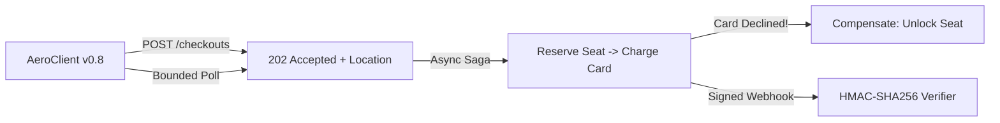

# Asynchronous Saga Polling (202 Accepted) & HMAC-SHA256 Webhook Verification

```json continuity
{
  "previously": "In Chapter 07, we upgraded AeroClient v0.7 with binary Protobuf wire-frame inspection, reserved-tag compatibility gates, and mandatory gRPC deadline propagation.",
  "painPoint": "When a flyer clicks 'Buy Ticket' on AeroCart, reserving the seat and settling international bank payment takes 2 to 4 seconds. Checkout now returns HTTP 202 Accepted immediately and runs a background Saga. Teammates added time.sleep(5) to every checkout test—making CI take 45 minutes and still failing randomly—while an unsigned payment webhook let a spoofed curl request mark unpaid orders as PAID!",
  "unlock": "We will upgrade AeroClient to v0.8 with a zero-sleep Terminal-State Saga Poller that exits the millisecond an order reaches CONFIRMED or COMPENSATED, plus a constant-time HMAC-SHA256 Webhook Verifier."
}
```

```json walkthrough
[
  {
    "time": "0:00",
    "badge": "1. The Coffee Pager (202)",
    "caption": "Instead of freezing the checkout line for 4 seconds while the credit card bank responds, AeroCart hands you a buzzer (HTTP 202 Accepted + Location URL) and finishes the work in the background.",
    "code": "POST /v1/checkouts -> 202 Accepted\nLocation: /v1/operations/op-42"
  },
  {
    "time": "0:24",
    "badge": "2. First Zero-Sleep Poll",
    "caption": "In AeroClient v0.8, we replace blind time.sleep(5) calls with a tight polling loop that checks the Location URL and stops the instant status hits CONFIRMED or FAILED_COMPENSATED.",
    "code": "if state in (\"CONFIRMED\", \"FAILED_COMPENSATED\"): return snapshot"
  },
  {
    "time": "0:50",
    "badge": "3. Compensation & Spoofing",
    "caption": "What if Seat 14A is locked, and then the credit card declines? The Saga MUST run a compensating refund to unlock Seat 14A! And webhooks must be signed so hackers cannot fake payment callbacks.",
    "code": "sig = HMAC_SHA256(secret, f\"{timestamp}.{raw_body_bytes}\")"
  },
  {
    "time": "1:15",
    "badge": "4. Constant-Time HMAC",
    "caption": "At Staff scale, AeroClient v0.8 verifies webhook signatures over raw unparsed bytes using hmac.compare_digest and rejects replayed packets older than 300 seconds.",
    "code": "assert hmac.compare_digest(expected_mac, header_mac) and abs(now - ts) <= 300"
  }
]
```

```json pretraining
[
  {
    "term": "202 Accepted Contract",
    "formula": "POST /v1/checkout -> 202 + Location: /v1/operations/{op_id}",
    "meaning": "An HTTP response that says 'We safely wrote down your order request, we are working on it in the background, and here is the URL where you can check its progress.'"
  },
  {
    "term": "Terminal Short-Circuit",
    "formula": "Stop Poll Immediately on status ∈ {CONFIRMED, FAILED_COMPENSATED}",
    "meaning": "Teaching your test poller to stop waiting the exact millisecond a background job finishes—whether it succeeded or permanently failed—so tests never waste 15 seconds waiting on a dead job."
  },
  {
    "term": "HMAC Replay Binding",
    "formula": "sig = HMAC_SHA256(secret, timestamp + \".\" + raw_utf8_bytes)",
    "meaning": "Stamping both the current clock time and the exact message bytes with a secret cryptographic seal so a hacker cannot modify the message or resend yesterday's receipt."
  },
  {
    "term": "Constant-Time Compare",
    "formula": "hmac.compare_digest(expected_mac, actual_mac) // Fixed Time",
    "meaning": "Checking EVERY character of a secret signature in the exact same amount of time, instead of stopping early on the first wrong letter, so hackers cannot guess the signature letter-by-letter using a stopwatch."
  }
]
```

## 🌱 Step 1: Plain-English Story — The Coffee Shop Buzzer & The Wax-Sealed Messenger

Imagine ordering a complex specialty latte during morning rush hour.
If the cashier stood frozen at the register for 4 minutes while the barista steamed the milk, the line would stretch around the block (`Thread Starvation`). Instead, the cashier takes your order, hands you a **plastic buzzer (`HTTP 202 Accepted` + `Location: /orders/42/status`)**, and immediately helps the next customer.

Behind the counter, making your order is a 3-step **Saga**:
1. **Reserve Pastry**: Grab the last almond croissant from the display case (`INVENTORY_RESERVED`).
2. **Charge Card**: Run your credit card (`PAYMENT_CAPTURED`).
3. **Confirm Order**: Buzz your pager (`CONFIRMED`)!

What if Step 2 fails because your credit card is declined? The barista cannot just leave that last almond croissant sitting on the back counter forever! They must run a **Compensating Action**—putting the croissant *back* into the display case so another customer can buy it (`FAILED_COMPENSATED`).

And what if the credit card bank sends a courier (`Webhook`) to tell the coffee shop `"Order #42 is paid!"`? Anyone on the street could put on a courier hat and shout `"Order #42 is paid!"` for free coffee. So the bank stamps every message with a **secret wax seal (`HMAC-SHA256`)** tied to the exact minute it was sent.



---

## 🔨 Step 2: First Lines of Code — `AeroClient v0.8` Zero-Sleep Poller & HMAC Starter

Let's evolve **`AeroClient`** to `v0.8`. Instead of calling `time.sleep(5)` and hoping the background saga finished, we write a clean polling loop that checks the `Location` endpoint every `50ms` and exits the instant it sees either `"CONFIRMED"` or `"FAILED_COMPENSATED"`, alongside a 4-line `HMAC-SHA256` signature check.

```python
import hashlib, hmac, time

def poll_and_verify_webhook(fetch_status, secret: str, ts: int, raw_body: bytes, sig: str) -> str:
    """AeroClient v0.8 starter: terminal-aware saga poll + constant-time HMAC check."""
    expected = hmac.new(secret.encode(), f"{ts}.".encode() + raw_body, hashlib.sha256).hexdigest()
    assert hmac.compare_digest(expected, sig), "Invalid webhook HMAC signature!"
    deadline = time.monotonic() + 5.0
    while time.monotonic() < deadline:
        status = fetch_status()
        if status in ("CONFIRMED", "FAILED_COMPENSATED"):
            return status
        time.sleep(0.05)
    raise TimeoutError("Saga did not reach a terminal state within 5.0s")
```

### Java 17 Equivalent

```java
import java.nio.charset.StandardCharsets;
import java.security.MessageDigest;
import javax.crypto.Mac;
import javax.crypto.spec.SecretKeySpec;

public class AeroSagaStarter {
    public static boolean verifyWebhookHmac(String secret, long ts, byte[] rawBody, byte[] sigBytes) throws Exception {
        Mac mac = Mac.getInstance("HmacSHA256");
        mac.init(new SecretKeySpec(secret.getBytes(StandardCharsets.UTF_8), "HmacSHA256"));
        mac.update((ts + ".").getBytes(StandardCharsets.US_ASCII));
        byte[] expected = mac.doFinal(rawBody);
        return MessageDigest.isEqual(expected, sigBytes); // Constant-time comparison
    }
}
```

---

## ⚡ Step 3: Where It Breaks in Real Life — Timeout Hangs, Leaked Inventory & JSON Re-Serialization Bugs

Why do naive async tests and webhook receivers fail in production?

1. **Polling Blindly Through Terminal Failures**: If a test writes `await().atMost(15, SECONDS).until(() -> status.equals("CONFIRMED"))` and the payment fails at `40ms` (`status = "FAILED_COMPENSATED"`), the test keeps hammering the server for the remaining `14.96 seconds` before throwing a generic timeout error!
2. **Unverified Saga Compensation (Ghost Inventory Locks)**: When a credit card declines in Step 2 of a checkout saga, teams often assert that `status == "FAILED_COMPENSATED"`—but forget to assert that **available seat inventory returned to its initial count** (`8 -> 10`).
3. **JSON Parse-Before-HMAC & `==` Timing Leaks**: If a webhook server parses the incoming JSON into a dictionary and re-serializes it (`json.dumps(data)`) before computing the HMAC, whitespace or key-order changes break legitimate signatures! And comparing signatures with standard `==` exits on the first mismatched byte, leaking a timing side channel.

```json contrast
{
  "title": "Fixed sleep(5) & Naive Webhook Receivers vs AeroClient v0.8 Terminal Pollers & Raw HMAC",
  "naiveTitle": "time.sleep(5) + '==' Parsed JSON MAC",
  "naiveMetric": "41m Wasted CI · Flaky Rebalances · Replay Bug",
  "naivePoints": [
    "Hardcodes sleep(5) before GET /orders: wastes 98% wall-clock time on healthy runs and flakes under GC/Kafka jitter",
    "Keeps polling until timeout even when saga already transitioned to terminal FAILED_COMPENSATED at 60ms",
    "Verifies webhook HMAC without signing the Unix timestamp, allowing attackers to replay a valid $50 refund webhook 100 times!"
  ],
  "staffTitle": "AeroClient v0.8 Poller + Timestamped Raw HMAC",
  "staffMetric": "95ms Median Poll · 0 Replay / Timing Leaks",
  "staffPoints": [
    "Polls with capped backoff (50ms -> 400ms), exits the instant CONFIRMED arrives, and fails-fast on COMPENSATED",
    "Verifies compensating transaction invariant: payment failure MUST restore reserved SKU inventory back to pre-saga count",
    "Signs 't.<raw_bytes>', enforces |now - t| <= 300s clock window, deduplicates event_id, and uses compare_digest()"
  ]
}
```

```json poe
{
  "question": "A webhook receiver parses the incoming JSON body into a Python dict / Java Map, re-serializes it via json.dumps(body), and computes HMAC-SHA256(secret, timestamp + '.' + json_str) using standard '==' string equality. Why does this break legitimate Stripe/AeroCart webhooks in production AND introduce a cryptographic vulnerability?",
  "options": [
    "SHA-256 cannot hash UTF-8 emojis",
    "1) JSON round-tripping alters whitespace and key ordering, invalidating the sender's cryptographic MAC over raw wire bytes; 2) standard '==' short-circuits on the first mismatched byte, leaking a timing side channel instead of constant-time hmac.compare_digest / MessageDigest.isEqual",
    "Webhooks require RSA-4096 instead of symmetric HMAC",
    "HTTP/2 compresses webhook signatures before application delivery"
  ],
  "answerIndex": 1,
  "explanation": "Webhook MACs are computed over the exact raw HTTP request byte array before JSON parsing; re-serializing parsed objects changes key order or float formatting, while '==' leaks byte-prefix timing."
}
```

---

## 🚀 Step 4: Staff Engineer Deep-Dive — Saga Compensation Invariants, Cryptographic MAC Math & Blueprints

### 1. Formal Saga Conservation Law & Constant-Time HMAC Security

In a distributed $M$-step saga $S = (T_1, T_2, \dots, T_M)$ with compensating transactions $(C_1, C_2, \dots, C_{M-1})$, if forward step $T_k$ fails ($1 < k \le M$), the orchestrator must execute compensating steps in **strict reverse topological order** ($C_{k-1} \to C_{k-2} \to \dots \to C_1$) so net conserved resource state $\Delta R$ (e.g., reserved flight seats + captured funds) returns to zero:

$$\text{On Failure at } T_k: \quad \sum_{i=1}^{k-1} \Delta R(T_i) + \sum_{i=k-1}^{1} \Delta R(C_i) = 0 \implies R_{\text{post-compensation}} \equiv R_{\text{pre-saga}}$$

For outbound and inbound **Webhooks**, the cryptographic authentication tag $\tau$ binds the secret key $K$, the Unix epoch timestamp $t$, and the exact unparsed wire byte array $B_{\text{raw}}$:

$$\tau = \text{HMAC-SHA256}\!\left(K,\; \text{ASCII}(t) \,\|\, \text{"."} \,\|\, B_{\text{raw}}\right), \qquad \text{Valid} \iff \left(|t_{\text{now}} - t| \le \Delta_{\max}\right) \land \left(\bigoplus_{i=0}^{31} (\tau_i \oplus \hat{\tau}_i) = 0\right)$$

Notice why constant-time bitwise XOR accumulation ($\bigoplus_{i=0}^{31} (\tau_i \oplus \hat{\tau}_i) = 0$, implemented by `hmac.compare_digest` and `MessageDigest.isEqual`) is critical: a naive byte-by-byte `==` loop exits at index $j$ where $\tau_j \ne \hat{\tau}_j$, reducing a brute-force forgery from $2^{256}$ operations to just $256 \times 32 = 8,192$ timing probes!

### 2. Async Saga & Webhook Verification Matrix

| Verification Dimension | `202` Status Resource Polling | Outbound Webhook Delivery | Mandatory `AeroClient v0.8` Test |
| :--- | :--- | :--- | :--- |
| **Transport Contract** | `202 Accepted` + `Location` + `Retry-After` | `POST` to consumer URL within `5s` timeout | Webhook consumer returns `500` $\to$ verify sender retries with exponential backoff |
| **Deduplication** | `op_id` is immutable & idempotent to `GET` | Consumer deduplicates by unique `event_id` (`evt_...`) | Deliver identical `event_id` twice $\to$ assert consumer applies side effect **once** |
| **Security & Integrity** | Tenant-scoped `Location` (`BOLA` protected) | `HMAC-SHA256(secret, f"{ts}.{raw_body}")` + dual-key rotation (`v1=...`) | Send timestamp `t = now - 600s` with valid HMAC $\to$ assert `401` replay rejection |
| **Saga Compensation** | Terminal state exposes `failureReason` + `compensated: true` | Emits `checkout.compensated` event | Trigger `card_declined` fixture $\to$ assert stock count returns to initial baseline |

### 3. Dual-Language Production Blueprints: `AeroClient v0.8` Poller & Webhook Verifier

#### Python 3 Blueprint: Terminal-State Saga Poller + Constant-Time Webhook HMAC Verifier

```python
from __future__ import annotations
from dataclasses import dataclass
import hashlib
import hmac
import time
from typing import Callable, Mapping, Set, TypeVar

T = TypeVar("T")


class SagaCompensationError(AssertionError):
    """Raised immediately (zero wasted polling) when an async saga hits a terminal failure state."""


def poll_saga_until_terminal(
    fetch_fn: Callable[[], T],
    extract_status: Callable[[T], str],
    success_states: Set[str],
    terminal_failure_states: Set[str],
    deadline_sec: float = 8.0,
    initial_interval_sec: float = 0.05,
    max_interval_sec: float = 0.50,
    clock: Callable[[], float] = time.monotonic,
    sleeper: Callable[[float], None] = time.sleep,
) -> T:
    """
    Deterministic bounded poller for 202 Accepted sagas:
    - Returns immediately upon observing any state in `success_states`.
    - Aborts immediately (no wasted timeout wait!) upon any state in `terminal_failure_states`.
    """
    start = clock()
    deadline = start + deadline_sec
    interval = initial_interval_sec
    last_snapshot: T | None = None
    attempts = 0

    while True:
        attempts += 1
        last_snapshot = fetch_fn()
        state = extract_status(last_snapshot)
        if state in success_states:
            return last_snapshot
        if state in terminal_failure_states:
            raise SagaCompensationError(
                f"Saga aborted in terminal failure state '{state}' on poll #{attempts}: {last_snapshot!r}"
            )
        now = clock()
        if now >= deadline:
            raise TimeoutError(
                f"Saga stayed non-terminal ('{state}') after {deadline_sec:.2f}s ({attempts} polls): {last_snapshot!r}"
            )
        sleep_for = min(interval, max(0.001, deadline - now))
        sleeper(sleep_for)
        interval = min(max_interval_sec, interval * 1.6)


@dataclass(frozen=True)
class WebhookVerificationResult:
    valid: bool
    reason: str


class WebhookSecurityVerifier:
    """Stripe / AeroCart style timestamped raw-body HMAC-SHA256 + replay deduplicator."""

    def __init__(self, active_secrets: list[str], tolerance_sec: int = 300) -> None:
        self._secrets = [s.encode("utf-8") for s in active_secrets]
        self._tolerance = tolerance_sec
        self._processed_event_ids: set[str] = set()

    @staticmethod
    def sign_payload(secret: str, timestamp_sec: int, raw_body: bytes) -> str:
        signed_bytes = f"{timestamp_sec}.".encode("ascii") + raw_body
        digest = hmac.new(secret.encode("utf-8"), signed_bytes, hashlib.sha256).hexdigest()
        return f"t={timestamp_sec},v1={digest}"

    def verify_and_deduplicate(
        self, signature_header: str, raw_body: bytes, event_id: str, now_epoch: int
    ) -> WebhookVerificationResult:
        parts: Mapping[str, list[str]] = {}
        for item in signature_header.split(","):
            if "=" in item:
                k, v = item.strip().split("=", 1)
                parts.setdefault(k, []).append(v)

        if "t" not in parts or "v1" not in parts:
            return WebhookVerificationResult(False, "MALFORMED_SIGNATURE_HEADER")

        ts = int(parts["t"][0])
        if abs(now_epoch - ts) > self._tolerance:
            return WebhookVerificationResult(False, "TIMESTAMP_OUTSIDE_REPLAY_WINDOW")

        signed_payload = f"{ts}.".encode("ascii") + raw_body
        matched = False
        for secret_bytes in self._secrets:
            expected = hmac.new(secret_bytes, signed_payload, hashlib.sha256).hexdigest()
            for candidate in parts["v1"]:
                if hmac.compare_digest(expected, candidate):
                    matched = True
        if not matched:
            return WebhookVerificationResult(False, "HMAC_MISMATCH")

        if event_id in self._processed_event_ids:
            return WebhookVerificationResult(True, "DUPLICATE_EVENT_NOOP")
        self._processed_event_ids.add(event_id)
        return WebhookVerificationResult(True, "ACCEPTED")
```

#### Java 17 Blueprint: Terminal-Aware Saga Poller & Constant-Time `MessageDigest.isEqual` HMAC

```java
package com.aerocart.api.saga;

import java.nio.charset.StandardCharsets;
import java.security.MessageDigest;
import java.time.Duration;
import java.util.HexFormat;
import java.util.Set;
import java.util.concurrent.ConcurrentHashMap;
import java.util.function.Function;
import java.util.function.Supplier;
import javax.crypto.Mac;
import javax.crypto.spec.SecretKeySpec;

public final class AsyncSagaAndWebhookHarness {

    public static <T> T awaitSagaTerminal(
            Supplier<T> poller,
            Function<T, String> statusExtractor,
            Set<String> successStates,
            Set<String> terminalFailureStates,
            Duration timeout) throws InterruptedException {
        long deadlineNs = System.nanoTime() + timeout.toNanos();
        long sleepMs = 50L;
        int polls = 0;

        while (true) {
            polls++;
            T snapshot = poller.get();
            String state = statusExtractor.apply(snapshot);
            if (successStates.contains(state)) {
                return snapshot;
            }
            if (terminalFailureStates.contains(state)) {
                throw new AssertionError("Saga failed terminally in state=" + state + " on poll #" + polls);
            }
            long remainingMs = (deadlineNs - System.nanoTime()) / 1_000_000L;
            if (remainingMs <= 0) {
                throw new AssertionError("Saga timed out in non-terminal state=" + state + " after " + polls + " polls");
            }
            Thread.sleep(Math.min(sleepMs, Math.max(1L, remainingMs)));
            sleepMs = Math.min(500L, (long) (sleepMs * 1.6));
        }
    }

    private final byte[] webhookSecret;
    private final long maxSkewSeconds;
    private final Set<String> seenEventIds = ConcurrentHashMap.newKeySet();

    public AsyncSagaAndWebhookHarness(String secret, long maxSkewSeconds) {
        this.webhookSecret = secret.getBytes(StandardCharsets.UTF_8);
        this.maxSkewSeconds = maxSkewSeconds;
    }

    public boolean verifyWebhookConstantTime(
            long headerTimestampSec, String hexSignature, byte[] rawWireBytes, String eventId, long nowEpochSec)
            throws Exception {
        if (Math.abs(nowEpochSec - headerTimestampSec) > maxSkewSeconds) {
            return false; // Reject replay outside 300s window
        }
        Mac mac = Mac.getInstance("HmacSHA256");
        mac.init(new SecretKeySpec(webhookSecret, "HmacSHA256"));
        mac.update((headerTimestampSec + ".").getBytes(StandardCharsets.US_ASCII));
        byte[] expectedDigest = mac.doFinal(rawWireBytes);
        byte[] providedDigest = HexFormat.of().parseHex(hexSignature);

        // Strictly constant-time comparison preventing byte-prefix timing attacks
        if (!MessageDigest.isEqual(expectedDigest, providedDigest)) {
            return false;
        }
        return seenEventIds.add(eventId); // True on first delivery, false on duplicate retry
    }
}
```

> [!WARNING] **Staff Interview Gotcha — Zero-Downtime Webhook Secret Rotation (`v1=sigA,v1=sigB`) & At-Least-Once Delivery:** In production, rotating a leaked or expiring webhook signing secret without dropping live customer webhooks requires **dual-signature overlapping windows**: the webhook sender emits **two `v1=` signatures** in the same header (`t=1731200000,v1=<old_key_hmac>,v1=<new_key_hmac>`) for 24 hours while consumers accept a request if **any** active key matches in constant time. Furthermore, webhook delivery is strictly **At-Least-Once**—if your receiver takes `5.1s` and the sender times out at `5.0s`, the sender **will** redeliver the exact same `event_id`. Consumers must commit `(event_id)` in a unique database constraint inside the same transaction as business side effects!

---

### Up Next in Chapter 09: OpenAPI 3.1 Schema Governance, Breaking-Change Diffing & Property Fuzzing

`AeroClient v0.8` can now test synchronous REST, federated GraphQL, binary gRPC, and asynchronous `202` Sagas + Webhooks. But how do we stop 40 backend teams from accidentally renaming JSON fields or shipping unhandled `HTTP 500` crashes on edge-case Unicode/float inputs before our handwritten tests even run? In **Chapter 09**, we will upgrade `AeroClient` to `v0.9` with **OpenAPI 3.1 Breaking-Change Diff Gates** and **Stateful Property-Based Fuzzing (`Schemathesis` / `Hypothesis`)**!

```json quiz
[
  {
    "id": "api-08-q1",
    "question": "In Java Awaitility or a custom Python saga poller, what happens if you write await().atMost(15, SECONDS).until(() -> getOrder(id).status().equals(\"CONFIRMED\")) WITHOUT checking for terminal failure states like \"FAILED_COMPENSATED\"?",
    "options": [
      "Awaitility automatically detects enum names containing FAILED",
      "Every negative checkout test (or broken payment bug that compensates in 40ms) pointlessly hammers the API for the full 15.0 seconds before throwing a misleading ConditionTimeoutException instead of immediately reporting the terminal compensation reason",
      "HTTP 202 automatically converts to 404 after 2 polls",
      "The JVM garbage-collects the HTTP socket mid-poll"
    ],
    "answerIndex": 1,
    "explanation": "Polling predicates must distinguish transient in-progress states (PENDING, RESERVING) from terminal failure states (FAILED_COMPENSATED) to fail fast with clear diagnostics."
  },
  {
    "id": "api-08-q2",
    "question": "Why is signing ONLY the raw JSON body (HMAC_SHA256(secret, raw_body)) without prepending the Unix timestamp ('t.<raw_body>') a serious webhook security flaw even when the payload includes an 'event_id'?",
    "options": [
      "SHA-256 requires an integer prefix to initialize its Merkle-Damgard IV",
      "If the consumer's event_id deduplication cache uses a bounded Redis TTL (e.g., 24 hours), an attacker who captures a signed payload can replay the exact valid signature 25 hours later once the Redis TTL expires—bounding |now - t| <= 300s closes the replay window permanently",
      "JSON bodies shorter than 64 bytes cannot be hashed",
      "TLS 1.3 strips headers lacking Unix timestamps"
    ],
    "answerIndex": 1,
    "explanation": "Cryptographically binding the timestamp inside the HMAC input lets the receiver statelessly reject any packet older than 5 minutes, allowing the Redis event_id deduplication TTL to remain tiny (e.g., 10 minutes) with zero replay risk."
  },
  {
    "id": "api-08-q3",
    "question": "During an AeroCart checkout saga test, Inventory reserves 2 units of SKU-99 (stock drops 10 -> 8), and then the mocked Payment service returns 'card_declined'. What TWO assertions are required to prove Saga correctness?",
    "options": [
      "Assert HTTP 202 on checkout and HTTP 200 on health check",
      "1) The checkout operation reaches terminal state COMPENSATED (not stuck in INVENTORY_RESERVED), AND 2) querying Inventory proves compensating action restored SKU-99 available stock back from 8 to 10",
      "Assert PostgreSQL rolled back via XA two-phase commit",
      "Assert Kafka deleted the topic partition"
    ],
    "answerIndex": 1,
    "explanation": "A Saga's defining correctness invariant is backward recovery via compensating transactions—leaking permanently locked inventory on declined cards is a classic production P1 bug."
  }
]
```
