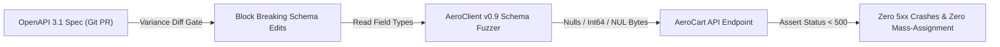

# OpenAPI 3.1 Schema Governance, Breaking-Change Rules & Property-Based Fuzzing

```json continuity
{
  "previously": "In Chapter 08, we upgraded AeroClient v0.8 with a zero-sleep Terminal-State Saga Poller and constant-time HMAC-SHA256 webhook signature verification.",
  "painPoint": "AeroCart's backend team changed 'phoneNumber' in GET /v1/users from 'string' to ['string', 'null'] without bumping the API version—crashing 100,000 iOS apps with a NullPointerException! The very next day, a passenger entered a null byte ('A\\u0000B') into their baggage tag note and triggered an unhandled PostgreSQL HTTP 500 crash because our 10 handwritten tests only tested 'Alice'.",
  "unlock": "We will upgrade AeroClient to v0.9 with an OpenAPI 3.1 Breaking-Change Diff Gate and a deterministic Property-Based Schema Fuzzer that fires boundary integers, nulls, and Unicode edge strings at every endpoint to guarantee zero HTTP 5xx crashes."
}
```

```json walkthrough
[
  {
    "time": "0:00",
    "badge": "1. Asymmetric Contracts",
    "caption": "Why is adding an optional field to a Request safe, while making an existing Response field nullable a P0 outage? Because requests and responses obey opposite compatibility laws!",
    "code": "Request: Safe to Relax | Response: Safe to Tighten (Never widen to null!)"
  },
  {
    "time": "0:24",
    "badge": "2. First 5xx Fuzz Loop",
    "caption": "In AeroClient v0.9, instead of testing only 'Alice', our starter fuzzer loops through boundary integers, nulls, and NUL-byte strings and asserts the server NEVER returns HTTP >= 500.",
    "code": "for edge in [0, -1, 2**53, None, \"A\\x00B\"]:\n    assert send(edge).status_code < 500"
  },
  {
    "time": "0:50",
    "badge": "3. Drift & Mass Assignment",
    "caption": "Hand-written docs drift in 2 weeks. Worse, if a server accepts undocumented JSON fields (additionalProperties: true), an attacker can send 'isAdmin': true and hijack an account!",
    "code": "POST /v1/users {\"name\": \"Bob\", \"isAdmin\": true} -> Must return 400/422!"
  },
  {
    "time": "1:15",
    "badge": "4. Variance Diff & Fuzzing",
    "caption": "At Staff scale, AeroClient v0.9 blocks breaking OpenAPI 3.1 PR diffs in CI and runs automated property-based fuzzing campaigns across every endpoint.",
    "code": "detect_openapi31_breaking_changes(old_req, new_req, old_resp, new_resp)"
  }
]
```

```json pretraining
[
  {
    "term": "Variance Asymmetry Law",
    "formula": "Request = Safe to Relax | Response = Safe to Tighten",
    "meaning": "You can safely ask callers for LESS required info in a request, and you can safely promise MORE guaranteed non-null info in a response—doing the reverse breaks existing apps."
  },
  {
    "term": "OpenAPI 3.1 Type Union",
    "formula": "type: [\"string\", \"null\"] (Replaces 3.0 nullable: true)",
    "meaning": "OpenAPI 3.1 uses standard JSON Schema arrays to declare when a field is allowed to be null, clearly separating 'this field can be omitted' from 'this field can be null'."
  },
  {
    "term": "Postel / Ingress Split",
    "formula": "Server Request: Reject Unknown | Client Reader: Ignore Unknown",
    "meaning": "Servers strictly reject unexpected extra fields in incoming requests to block hackers, while client apps quietly ignore new extra fields in server responses so upgrades never crash."
  },
  {
    "term": "5xx Fuzzing Oracle",
    "formula": "For Every Mutated Input x: HTTP_Status(x) < 500",
    "meaning": "Even when a fuzzer sends bizarre negative numbers or emojis and doesn't know the exact business answer, it knows one rule for sure: the server should return a clean 400/422 error, NEVER a 500 crash!"
  }
]
```

## 🌱 Step 1: Plain-English Story — The Electrical Wall Outlet & The Robot Crash-Tester

Think of an API contract (`OpenAPI 3.1`) like a **wall power outlet** in an airport lounge:
- **The Request (What the wall outlet requires from your plug)**: Suppose the outlet used to accept standard 2-prong plugs, and overnight the airport changes it to **require** a 3-prong grounding pin. Every traveler with a 2-prong phone charger is now broken! (*Adding a new required field to a Request is a breaking change.*)
- **The Response (What the wall outlet promises to deliver)**: Suppose the outlet promises steady `110V` power, and overnight the airport widens the spec so the outlet returns `110V` **or `0V` (`null`)** randomly. Laptops immediately shut down! (*Widening a Response field from `"string"` to `["string", "null"]` is also a breaking change.*)

Even when your OpenAPI contract stays stable, writing 5 manual tests (`name = "Alice"`, `bags = 1`) only checks polite travelers. What happens when someone types an invisible NUL byte (`"A\u0000B"`), a negative bag count (`-1`), or a 64-bit integer larger than JavaScript can count?

Instead of writing 500 boring edge-case tests by hand, **`AeroClient v0.9`** reads your OpenAPI schema and unleashes a **Property-Based Robot Crash-Tester (`Fuzzer`)**. The robot doesn't need to know AeroCart's exact tax formula—it relies on the **No-`5xx` Crash Oracle**: *no matter how weird the input is, the server must either process it (`2xx`) or politely reject it (`400`/`422`), never crash with `HTTP 500`!*



---

## 🔨 Step 2: First Lines of Code — `AeroClient v0.9` Deterministic `5xx` Fuzzer

Let's evolve **`AeroClient`** to `v0.9`. In just 15 lines of Python 3 or Java 17, we can mutate a valid seed payload with the most notorious production-crashing edge values (`0`, `-1`, `2^53 + 1`, `None`, `"A\x00B"`) and assert that the API never returns an unhandled `5xx` server error.

```python
import requests

EDGE_VALUES = [0, -1, 9_007_199_254_740_993, None, "", "A\x00B", "' OR 1=1 --"]

def fuzz_endpoint_no_5xx(url: str, valid_seed: dict, token: str) -> None:
    """AeroClient v0.9 starter: mutates each field with adversarial edges & asserts status < 500."""
    headers = {"Authorization": f"Bearer {token}"}
    for field in valid_seed:
        for edge in EDGE_VALUES:
            mutated = {**valid_seed, field: edge}
            resp = requests.post(url, json=mutated, headers=headers, timeout=4.0)
            assert resp.status_code < 500, f"5xx crash ({resp.status_code}) on {field}={edge!r}"
```

### Java 17 Equivalent

```java
import java.net.URI;
import java.net.http.*;
import java.util.List;

public class AeroFuzzStarter {
    private static final List<String> EDGES = List.of("-1", "9007199254740993", "null", "\"A\\u0000B\"");

    public static void assertZero5xx(HttpClient client, URI url, String field) throws Exception {
        for (String edge : EDGES) {
            String json = "{\"%s\": %s}".formatted(field, edge);
            HttpRequest req = HttpRequest.newBuilder(url)
                .header("Content-Type", "application/json")
                .POST(HttpRequest.BodyPublishers.ofString(json)).build();
            HttpResponse<String> resp = client.send(req, HttpResponse.BodyHandlers.ofString());
            if (resp.statusCode() >= 500) {
                throw new AssertionError("5xx crash (" + resp.statusCode() + ") on payload: " + json);
            }
        }
    }
}
```

---

## ⚡ Step 3: Where It Breaks in Real Life — Schema Drift, Closed Enums & Mass Assignment

Why do APIs with "100% endpoint test coverage" still cause P0 incidents?

1. **Asymmetric Response Widening (`string` $\to$ `["string", "null"]` or New Enum Values)**: A backend team adds a new status enum `"AWAITING_CUSTOMS"` to `GET /v1/orders` or allows `"gateNumber": null`. Strongly-typed Swift/Kotlin mobile apps built last month crash immediately while deserializing the unknown enum or unexpected `null`!
2. **OWASP API3 Mass Assignment (`additionalProperties: true`)**: If `PATCH /v1/users/me` does not set `additionalProperties: false` on its incoming request schema, an attacker who sends `{"displayName": "Bob", "role": "SUPERADMIN"}` may overwrite internal database columns if the controller binds request JSON directly to an ORM model.
3. **PostgreSQL `0x00` NUL-Byte Crashes**: RFC 8259 JSON allows `\u0000` inside strings, but PostgreSQL `TEXT`/`VARCHAR` columns reject C-string `0x00` bytes with a fatal driver exception (`HTTP 500`) unless caught at the API validation boundary.

```json contrast
{
  "title": "Curated Happy-Path JSON Tests vs AeroClient v0.9 OpenAPI Governance + Property Fuzzing",
  "naiveTitle": "5 Hand-Crafted Positive Payloads",
  "naiveMetric": "Misses 500 Crashes · Schema Drift in 2 Wks",
  "naivePoints": [
    "Swagger YAML is written manually in Confluence/docs and drifts from actual controller code within two sprints",
    "Tests only ASCII names ('Alice') and small ints (qty: 2), missing surrogate-pair emojis, NUL bytes, and INT32_MAX+1",
    "Allows additionalProperties: true on PATCH /users, exposing OWASP API3 Mass-Assignment ('role': 'ADMIN') bugs"
  ],
  "staffTitle": "AeroClient v0.9 Variance Gate + Schema Fuzzing",
  "staffMetric": "Zero Spec Drift · 500+ Edge Vectors / Endpoint",
  "staffPoints": [
    "CI validates every test response (2xx AND 4xx) against OpenAPI 3.1 JSON Schema—undocumented fields fail the build",
    "Ingress requests set additionalProperties: false (400/422 on unknown fields); client DTOs ignore unknown response fields",
    "Property-based fuzzer mutates boundaries (0, -1, 2^53+1, null, '\\u0000', SQL metachars) asserting zero 5xx & valid schemas"
  ]
}
```

```json poe
{
  "question": "A backend team modifies GET /v1/users/{id} in OpenAPI 3.1 in two ways without bumping v1 -> v2: (Change A) adds a new optional response field 'avatarUrl', and (Change B) widens existing response field 'phoneNumber' from type: 'string' to type: ['string', 'null']. Meanwhile, mobile Kotlin/Swift clients use standard generated non-null data classes with ignoreUnknownKeys = true. Which change crashes production mobile apps?",
  "options": [
    "Change A crashes mobile apps while Change B is backward-compatible",
    "Change B is a P0 BREAKING CHANGE: widening a response type from 'string' to ['string', 'null'] injects JSON nulls into existing non-nullable client fields (NullPointerException / DecodingError), whereas Change A is safe under Tolerant Reader",
    "Both Change A and Change B are 100% backward-compatible",
    "Neither breaks JSON because null is a valid string in RFC 8259"
  ],
  "answerIndex": 1,
  "explanation": "Response schemas are covariant: narrowing a response (never returning null where null was previously allowed) is safe, whereas widening a response (returning null or a new enum variant to an unsuspecting enum parser) breaks strict consumers!"
}
```

---

## 🚀 Step 4: Staff Engineer Deep-Dive — Subtyping Variance Math, Fuzz Oracles & Production Blueprints

### 1. Formal Contravariant / Covariant Schema Evolution & IEEE-754 Precision Bounds

Let an API operation convert a Request schema $\mathcal{I}$ into a Response schema $\mathcal{O}$ ($\text{API}: \mathcal{I} \to \mathcal{O}$). Under Liskov Substitution and type-theory variance, evolving version $v_1 (\mathcal{I}_1 \to \mathcal{O}_1)$ to $v_2 (\mathcal{I}_2 \to \mathcal{O}_2)$ is **backward-compatible** if and only if:

$$\text{BackwardCompatible}(v_1 \to v_2) \iff \underbrace{\mathcal{I}_1 \subseteq \mathcal{I}_2}_{\text{Contravariant Request (Accepts At Least } \mathcal{I}_1\text{)}} \;\land\; \underbrace{\mathcal{O}_2 \subseteq \mathcal{O}_1}_{\text{Covariant Response (Emits Subset of } \mathcal{O}_1\text{)}}$$

- **Why widening a response field from `"string"` to `["string", "null"]` violates $\mathcal{O}_2 \subseteq \mathcal{O}_1$**: Because $\text{null} \in \mathcal{O}_2$ but $\text{null} \notin \mathcal{O}_1$, $\mathcal{O}_2 \not\subseteq \mathcal{O}_1$!
- **Why 64-bit integer IDs break browser JSON parsers**: Standard IEEE-754 double-precision floats (`float64`) allocate `53 bits` to the significand. Every integer $n$ above `Number.MAX_SAFE_INTEGER` loses unit precision (`ULP >= 2`):

$$N_{\max\text{-safe}} = 2^{53} - 1 = 9{,}007{,}199{,}254{,}740{,}991 \implies \text{JSON.parse}(2^{53} + 1) = 2^{53}$$

### 2. Property-Based OpenAPI Fuzzing Oracles Matrix

| Fuzzing Oracle | Generated Adversarial Vector | Passing Invariant | Real Production Bug Caught |
| :--- | :--- | :--- | :--- |
| **No-`5xx` Crash Oracle** | `"quantity": 9223372036854775808` (`> int64`), `"name": "A\u0000B"` | Returns `400` or `422`, **never** `500` | PostgreSQL `ERROR: invalid byte sequence 0x00` or `integer out of range` uncaught `500` |
| **Response Conformance** | Valid edge inputs (`quantity: 0`, empty array `[]`) | Response body matches OpenAPI 3.1 schema + `Content-Type` | Controller returns `{"items": null}` instead of `{"items": []}` when DB table is empty |
| **Negative Rejection Oracle** | Violates `minLength`, wrong `type`, or extra field `{"isAdmin": true}` | Returns `400`/`422`, **never** `2xx`! | Missing `@Valid` / Pydantic validator silently accepting invalid or mass-assigned fields |
| **Stateful Link Chaining** | `POST /orders` $\to$ extract `id` via OpenAPI `links` $\to$ `DELETE /orders/{id}` $\to$ `GET` | Lifecycle transitions obey state-machine spec | Orphaned child rows causing `500 ForeignKeyViolation` on `DELETE` |

### 3. Dual-Language Production Blueprints: `AeroClient v0.9` Variance Diff & Fuzzer

#### Python 3 Blueprint: OpenAPI 3.1 Variance Diff Checker & Property-Based `5xx` Fuzzer

```python
from __future__ import annotations
from dataclasses import dataclass
from typing import Any, Callable, Dict, Iterable, List, Set


@dataclass(frozen=True)
class SchemaPropertySpec:
    types: Set[str]          # e.g., {"string"} or {"string", "null"}
    required: bool
    enum_values: Set[str] | None = None


def detect_openapi31_breaking_changes(
    old_req: Dict[str, SchemaPropertySpec],
    new_req: Dict[str, SchemaPropertySpec],
    old_resp: Dict[str, SchemaPropertySpec],
    new_resp: Dict[str, SchemaPropertySpec],
) -> List[str]:
    """Implements contravariant request & covariant response breaking-change detection."""
    breaking: List[str] = []

    # 1. Request Contravariance: adding required fields or narrowing accepted types breaks callers
    for name, spec in new_req.items():
        if name not in old_req and spec.required:
            breaking.append(f"REQUEST BREAKING: Added new required request field '{name}'")
        elif name in old_req:
            removed_types = old_req[name].types - spec.types
            if removed_types:
                breaking.append(f"REQUEST BREAKING: Narrowed '{name}' accepted types (removed {sorted(removed_types)})")

    # 2. Response Covariance: deleting required fields or widening types (e.g. adding 'null') breaks callers
    for name, old_spec in old_resp.items():
        if name not in new_resp:
            breaking.append(f"RESPONSE BREAKING: Removed existing response field '{name}'")
            continue
        new_spec = new_resp[name]
        if old_spec.required and not new_spec.required:
            breaking.append(f"RESPONSE BREAKING: Required response field '{name}' became optional (omittable)")
        added_types = new_spec.types - old_spec.types
        if added_types:
            breaking.append(f"RESPONSE BREAKING: Widened response field '{name}' types with {sorted(added_types)}")
        if old_spec.enum_values is not None and new_spec.enum_values is not None:
            new_enums = new_spec.enum_values - old_spec.enum_values
            if new_enums:
                breaking.append(f"RESPONSE BREAKING: Added closed-enum response values {sorted(new_enums)} on '{name}'")
    return breaking


class DeterministicSchemaFuzzer:
    """Zero-AI deterministic boundary & Unicode fuzzer verifying the 5xx and Mass-Assignment oracles."""

    EDGE_INTEGERS: List[Any] = [0, -1, 1, 2_147_483_647, 2_147_483_648, 9_007_199_254_740_993]
    EDGE_STRINGS: List[Any] = [
        "",
        " ",
        "null",
        "true",
        "A\x00B",                       # Embedded NUL byte (crashes PostgreSQL text columns if unvalidated!)
        "👩‍💻🚀\u202eRTL-override",       # Multi-codepoint ZWJ emoji + BiDi control char
        "' OR 1=1 --",
        "x" * 16_384,
    ]

    @classmethod
    def generate_mutations(cls, valid_seed: Dict[str, Any], schema_types: Dict[str, str]) -> Iterable[Dict[str, Any]]:
        # Mass-assignment probe (OWASP API3)
        yield {**valid_seed, "__undeclared_role": "SUPERADMIN"}
        for field, kind in schema_types.items():
            pool = cls.EDGE_INTEGERS if kind == "integer" else cls.EDGE_STRINGS
            for edge_val in pool:
                mutated = dict(valid_seed)
                mutated[field] = edge_val
                yield mutated
            nulled = dict(valid_seed)
            nulled[field] = None
            yield nulled

    @classmethod
    def run_fuzz_campaign(
        cls,
        valid_seed: Dict[str, Any],
        schema_types: Dict[str, str],
        dispatch_fn: Callable[[Dict[str, Any]], int],
    ) -> None:
        crashes: List[str] = []
        for idx, payload in enumerate(cls.generate_mutations(valid_seed, schema_types)):
            status = dispatch_fn(payload)
            if status >= 500:
                crashes.append(f"Vector #{idx} triggered HTTP {status}: {payload!r}")
            if "__undeclared_role" in payload and 200 <= status < 300:
                crashes.append(f"Vector #{idx} accepted undeclared field (Mass Assignment risk): {payload!r}")
        if crashes:
            raise AssertionError("OpenAPI Fuzzing Campaign Failures:\n" + "\n".join(crashes))
```

#### Java 17 Blueprint: Boundary & Unicode Fuzzing Harness with `5xx` & Stack-Trace Leak Oracle

```java
package com.aerocart.api.governance;

import com.fasterxml.jackson.databind.ObjectMapper;
import java.net.URI;
import java.net.http.HttpClient;
import java.net.http.HttpRequest;
import java.net.http.HttpResponse;
import java.time.Duration;
import java.util.ArrayList;
import java.util.LinkedHashMap;
import java.util.List;
import java.util.Map;

public final class OpenApiBoundaryFuzzer {

    private static final List<Object> ADVERSARIAL_SCALARS = List.of(
        0, -1, Integer.MAX_VALUE, (long) Integer.MAX_VALUE + 1L, 9_007_199_254_740_993L,
        "", "   ", "A\u0000B", "👩‍🔬\u202Ertl", "' OR '1'='1", "X".repeat(8192)
    );

    private final HttpClient http;
    private final ObjectMapper mapper = new ObjectMapper();

    public OpenApiBoundaryFuzzer(HttpClient http) {
        this.http = http;
    }

    public void assertZeroServerCrashesAndLeaks(URI endpoint, Map<String, Object> validSeed, String bearerToken)
            throws Exception {
        List<String> violations = new ArrayList<>();

        // 1. Mass-Assignment / Strict Ingress Oracle (additionalProperties: false)
        Map<String, Object> massAssign = new LinkedHashMap<>(validSeed);
        massAssign.put("internalAdminOverride", true);
        HttpResponse<String> maResp = sendJson(endpoint, massAssign, bearerToken);
        if (maResp.statusCode() >= 200 && maResp.statusCode() < 300) {
            violations.add("Mass-Assignment accepted undocumented property 'internalAdminOverride' with "
                + maResp.statusCode());
        }

        // 2. Field-by-Field Boundary, Type-Confusion & Null Fuzzing
        for (String key : validSeed.keySet()) {
            for (Object edge : ADVERSARIAL_SCALARS) {
                Map<String, Object> candidate = new LinkedHashMap<>(validSeed);
                candidate.put(key, edge);
                HttpResponse<String> resp = sendJson(endpoint, candidate, bearerToken);
                if (resp.statusCode() >= 500) {
                    violations.add("5xx Crash (" + resp.statusCode() + ") on field '" + key + "'=" + edge);
                }
                if (resp.body().contains("java.lang.") || resp.body().contains("Traceback (most recent")) {
                    violations.add("Stack-trace information disclosure on field '" + key + "'");
                }
            }
        }
        if (!violations.isEmpty()) {
            throw new AssertionError("Schema Fuzzing Violations:\n" + String.join("\n", violations));
        }
    }

    private HttpResponse<String> sendJson(URI uri, Map<String, Object> body, String token) throws Exception {
        HttpRequest req = HttpRequest.newBuilder()
            .uri(uri)
            .timeout(Duration.ofSeconds(4))
            .header("Content-Type", "application/json")
            .header("Authorization", "Bearer " + token)
            .POST(HttpRequest.BodyPublishers.ofString(mapper.writeValueAsString(body)))
            .build();
        return http.send(req, HttpResponse.BodyHandlers.ofString());
    }
}
```

> [!WARNING] **Staff Interview Gotcha — Nullable (`null`) vs. Optional (`omitted`) & `IEEE-754` `MAX_SAFE_INTEGER`:** Two subtle JSON Schema bugs cause high-severity production incidents:
> 1. **`optional` $\neq$ `nullable`**: In OpenAPI 3.1, omitting `"discountCode"` from `required: [...]` makes the key **optional** (it may be absent `{}`), NOT **nullable**! If `"discountCode": {"type": "string"}` is sent as `{"discountCode": null}`, strict validators reject it unless typed as `{"type": ["string", "null"]}`.
> 2. **64-Bit Snowflake IDs in Browser JSON**: Java `long` and PostgreSQL `BIGINT` reach $9.22 \times 10^{18}$, whereas JavaScript `JSON.parse()` parses all JSON numbers as `IEEE-754` `float64`, silently rounding every integer $> 2^{53} - 1$ (`9,007,199,254,740,991`)! E.g., `JSON.parse('{"id": 9007199254740993}').id === 9007199254740992`! **Invariant:** 64-bit Snowflake IDs and high-precision monetary amounts MUST be serialized as `type: "string"` (or integer minor units + currency code) in OpenAPI contracts consumed by web browsers.

---

### Up Next in Chapter 10: Consumer-Driven Contract Testing (`Pact`), Broker Matrix & `can-i-deploy`

OpenAPI 3.1 tracks what the **Provider** claims it serves—but how does a Provider know which specific fields **15 different Consumer teams** (`CheckoutWeb`, `iOSApp`, `BillingWorker`) actually rely on, without spinning up all 50 microservices in a slow, flaky shared staging environment? In **Chapter 10**, we will complete **`AeroClient v1.0`** by building a **Consumer-Driven Contract (`Pact`) Engine** with Broker Matrix verification and `can-i-deploy` release gates!

```json quiz
[
  {
    "id": "api-09-q1",
    "question": "Why does sending the string \"A\\u0000B\" (a valid RFC 8259 JSON string containing an escaped NUL character) via an OpenAPI property-based fuzzer frequently uncover immediate HTTP 500 bugs in PostgreSQL-backed REST APIs?",
    "options": [
      "JSON parsers crash on backslash escapes",
      "RFC 8259 JSON permits \\u0000 inside UTF-8 strings, whereas PostgreSQL TEXT/VARCHAR columns strictly forbid 0x00 NUL bytes in C-string storage—if the API layer lacks an input character-hygiene validator, the SQL INSERT throws an unhandled DataException -> HTTP 500!",
      "TLS 1.3 terminates connections on NUL bytes",
      "NUL bytes reset HTTP/2 stream IDs to 0"
    ],
    "answerIndex": 1,
    "explanation": "Schemathesis routinely finds unhandled 500 crashes with '\\u0000' because JSON syntax allows NUL codepoints while PostgreSQL's underlying C string routines reject them unless rejected cleanly as 400/422 at the API boundary."
  },
  {
    "id": "api-09-q2",
    "question": "How should Postel's Law ('be conservative in what you send, liberal in what you accept') be applied safely to modern REST APIs without introducing OWASP API3 Mass-Assignment vulnerabilities?",
    "options": [
      "Accept and persist all unknown JSON keys sent in POST/PATCH requests into MongoDB/JSONB directly",
      "Apply Tolerant Reader on CONSUMERS (client DTOs ignore unknown new response fields so servers can add fields non-breakingly), while enforcing STRICT additionalProperties: false on SERVER REQUESTS so typos or injected privilege fields ('isAdmin': true) fail fast with 400/422",
      "Forbid adding any new fields to responses without creating /v2, /v3, /v4 URLs every week",
      "Convert all JSON payloads to XML XSD"
    ],
    "answerIndex": 1,
    "explanation": "Tolerant Reader belongs on consumers reading responses; strict request ingress validation protects servers against mass-assignment and alerts callers immediately when they misspell an optional filter parameter!"
  },
  {
    "id": "api-09-q3",
    "question": "A backend service switches order IDs from sequential 32-bit integers to 64-bit Twitter Snowflake integers (e.g., 1855492019283746819) serialized as JSON numbers. Python and Java backend tests pass, yet React web checkouts start fetching the WRONG customer's order! Why?",
    "options": [
      "React strips numbers longer than 10 digits",
      "Browser JSON.parse() uses IEEE-754 double-precision floats (53-bit significand, MAX_SAFE_INTEGER = 9,007,199,254,740,991), silently corrupting the low bits of 64-bit integers into neighboring IDs unless serialized as JSON strings!",
      "HTTP/2 HPACK truncates 64-bit JSON numbers",
      "Snowflake IDs are negative in UTC"
    ],
    "answerIndex": 1,
    "explanation": "Any integer exceeding 2^53 - 1 loses unit precision in standard JavaScript Number parsing; OpenAPI governance lint rules (Spectral) should ban int64 JSON numbers without format: string serialization on browser-facing APIs."
  }
]
```
