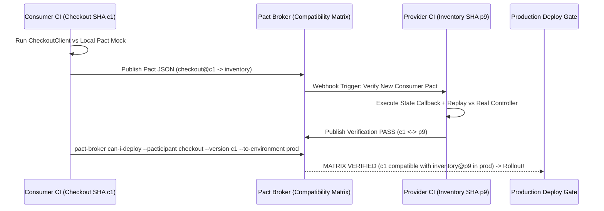

# Consumer-Driven Contract Testing: Pact Broker, Provider States & can-i-deploy

```json pretraining
[
  {
    "term": "Shared Staging Failure",
    "formula": "P_suite = p^(M_services) -> 0.98^40 = 44.6% Pass Rate",
    "meaning": "Deploying 40 microservices into one shared staging cluster couples every team's release velocity to the flakiest unrelated service."
  },
  {
    "term": "Consumer-Driven Pact",
    "formula": "Contract = Union_{c in Consumers} NeededSubset(ProviderSchema)",
    "meaning": "Each consumer records ONLY the exact fields and type matchers its client code actually reads—letting providers safely prune unused fields!"
  },
  {
    "term": "Provider State Hook",
    "formula": "given(\"order ord-42 exists\") -> Seed Local Stub/Repository",
    "meaning": "Replays consumer interactions deterministically against the real provider controller in ~50ms with downstream dependencies mocked."
  },
  {
    "term": "can-i-deploy Matrix",
    "formula": "Verified(Consumer_SHA, Provider_Prod_SHA) == TRUE",
    "meaning": "Queries the Pact Broker graph of verified Git SHAs and environment tags before permitting Kubernetes production rollout."
  }
]
```

```json poe
{
  "question": "Checkout-Service (Consumer) writes a Pact contract test against Inventory-Service (Provider) by asserting exact equality on all 28 fields returned by Inventory—including 'warehouseForkliftId: \"FL-09\"', a field Checkout-Service never reads in production—and uses exact value matchers instead of type matchers (like('SKU-1')). Two weeks later, Inventory renames 'warehouseForkliftId' and rotates test seed UUIDs. What happens?",
  "options": [
    "Pact automatically ignores fields unused by the Checkout binary via bytecode inspection",
    "Over-specified brittle contract anti-pattern: the Consumer turned Pact into a fragile snapshot functional test, blocking Inventory's legitimate internal refactoring even though zero real production consumer code was broken!",
    "The Pact Broker deletes unreferenced JSON keys during upload",
    "can-i-deploy bypasses failed provider verifications automatically"
  ],
  "answerIndex": 1,
  "explanation": "Consumer-Driven Contracts must follow two golden laws: 1) assert ONLY the subset of fields your consumer DTO actually deserializes, and 2) use loose type/regex matchers (Matcher.like / Matching.type) rather than hardcoded fixture values unless testing a specific enum."
}
```

## 1. Why Shared-Staging Microservice E2E Suites Collapse at $M \ge 25$ Services

When an organization scales from a monolith to `45` independently deployed microservices, testing integration via a shared `"Staging"` Kubernetes cluster creates an **organizational deadlock**:
- Team A deploys a feature branch to Staging and breaks Team D's checkout E2E run.
- Because `45` services each have `98.5%` uptime in staging, the joint probability of an uninterrupted cross-mesh E2E pass is $0.985^{45} \approx 50.6\%$.
- Hand-written mocks inside Team A's unit tests (`unittest.mock` / `WireMock` stubs authored by Team A alone) **lie**: when Team B renames `"amountCents"` $\to$ `"totalMinorUnits"`, Team A's mocked unit tests stay `100%` green while production catches fire!

**Consumer-Driven Contract Testing (`Pact`)** solves the "Mocks Lie" problem by making **the mock itself generate a machine-verifiable JSON contract** that is replayed directly against the real Provider codebase in CI:

1. **Consumer CI Phase**: `CheckoutClient` executes against the local **Pact Mock Server**. The mock validates requests, returns minimal matched responses, and serializes `checkout-inventory.pact.json` to the **Pact Broker** tagged with Consumer Git `SHA` + branch.
2. **Provider CI Phase**: `InventoryService` boots its real HTTP routing/serialization layer locally (stubbing external Kafka/DB via **Provider State Callbacks** like `"sku SKU-99 has 12 units in stock"`), downloads all active consumer pacts (`main` + currently deployed `prod` tags), replays every interaction, and publishes the signed verification result (`PASS`/`FAIL`) keyed by `(Consumer_SHA, Provider_SHA)` back to the Broker.
3. **Deployment Gate (`pact-broker can-i-deploy`)**: Before `kubectl rollout` or ArgoCD promotes either service to `production`, `can-i-deploy` queries the Broker's **Compatibility Matrix** in `<200ms`—zero live network E2E required at deploy time!



---

## 2. Shared-Staging E2E vs. Pact Consumer-Driven Contracts vs. Bi-Directional Contracts

```json contrast
{
  "title": "Shared Staging E2E Bottleneck vs Pact Consumer-Driven Matrix",
  "naiveTitle": "Shared Staging E2E + Unverified WireMocks",
  "naiveMetric": "45-Min Runs · 50% Flake · Mocks Drift",
  "naivePoints": [
    "Requires all 45 microservices healthy simultaneously in a shared environment before any single PR can merge",
    "Consumer-authored WireMock JSON files are never replayed against the real Provider repo, hiding breaking renames",
    "Failure diagnosis spans 6 team Slack channels without pinpointing which exact DTO field broke compatibility"
  ],
  "staffTitle": "Pact CDC + Provider States + can-i-deploy",
  "staffMetric": "<3s In-Memory CI · 100% Independent Deploys",
  "staffPoints": [
    "Consumer & Provider tests run asynchronously in fast, isolated in-memory CI jobs with zero cross-service network calls",
    "Provider knows the EXACT field usage of every mobile/web/backend consumer, enabling safe deprecation of unused fields",
    "can-i-deploy blocks breaking merges on PR BEFORE code ever reaches staging or production"
  ]
}
```

| Contract Testing Paradigm | Who Authors the Contract? | Best Architectural Fit | Key Limitation to Guard Against |
| :--- | :--- | :--- | :--- |
| **Pact Consumer-Driven (`CDC`)** | Internal consumers via unit tests | Internal microservice mesh (`5–200` services) | Do **not** test provider business logic inside Pact (keep Pact to structure/types/status!) |
| **Bi-Directional (`PactFlow` + OpenAPI)** | Consumer Pact $\cap$ Provider OpenAPI 3.1 | Brownfield providers or external 3rd-party APIs | Provider must still prove its actual runtime implementation conforms to its OpenAPI spec (`Schemathesis`/Dredd) |
| **Async Message Pact** | Kafka / SQS consumer handlers | Event-driven Outbox / Kafka Protobuf or JSON consumers | Requires verifying the provider's actual event-producer serializer method, not a dummy JSON file |

---

## 3. Dual-Language Production Blueprints: Pact Matcher Engine, Provider Verifier & `can-i-deploy`

### Python 3 Blueprint: Consumer-Driven Contract Matcher, Provider State Replay & `can-i-deploy` Matrix
```python
from __future__ import annotations
from dataclasses import dataclass, field
import re
from typing import Any, Callable, Dict, List, Set, Tuple


@dataclass(frozen=True)
class FieldMatcher:
    """Models Pact structural matchers (type-like vs regex vs exact) avoiding brittle value coupling."""
    kind: str  # "type" | "regex" | "exact"
    sample: Any
    pattern: str = ""

    def matches(self, actual: Any) -> Tuple[bool, str]:
        if self.kind == "exact":
            return (actual == self.sample, f"expected exact {self.sample!r}, got {actual!r}")
        if self.kind == "regex":
            ok = isinstance(actual, str) and re.fullmatch(self.pattern, actual) is not None
            return (ok, f"value {actual!r} did not match regex /{self.pattern}/")
        if self.kind == "type":
            # Python bool is a subclass of int; guard strictly!
            if isinstance(self.sample, bool):
                ok = isinstance(actual, bool)
            elif isinstance(self.sample, int):
                ok = isinstance(actual, int) and not isinstance(actual, bool)
            else:
                ok = isinstance(actual, type(self.sample))
            return (ok, f"expected wire type {type(self.sample).__name__}, got {actual!r}")
        raise ValueError(f"Unknown matcher kind: {self.kind}")


@dataclass(frozen=True)
class PactInteraction:
    description: str
    provider_state: str
    method: str
    path: str
    expected_status: int
    response_body_matchers: Dict[str, FieldMatcher]


@dataclass
class PactBrokerMatrix:
    """In-memory deterministic model of the Pact Broker SHA verification & environment graph."""
    verified_pairs: Set[Tuple[str, str, str, str]] = field(default_factory=set)
    deployed_in_env: Dict[Tuple[str, str], str] = field(default_factory=dict)  # (env, service) -> sha

    def record_verification(self, consumer: str, c_sha: str, provider: str, p_sha: str, passed: bool) -> None:
        if passed:
            self.verified_pairs.add((consumer, c_sha, provider, p_sha))

    def deploy_to_env(self, env: str, service: str, sha: str) -> None:
        self.deployed_in_env[(env, service)] = sha

    def can_i_deploy_consumer(self, consumer: str, c_sha: str, required_providers: List[str], env: str) -> Tuple[bool, List[str]]:
        blockers: List[str] = []
        for prov in required_providers:
            live_p_sha = self.deployed_in_env.get((env, prov))
            if not live_p_sha:
                blockers.append(f"Provider '{prov}' has no active deployment in '{env}'")
            elif (consumer, c_sha, prov, live_p_sha) not in self.verified_pairs:
                blockers.append(f"Unverified matrix pair: {consumer}@{c_sha} <-> {prov}@{live_p_sha} ({env})")
        return (len(blockers) == 0, blockers)


def replay_pact_against_provider(
    interactions: List[PactInteraction],
    state_handlers: Dict[str, Callable[[], None]],
    provider_dispatch: Callable[[str, str], Tuple[int, Dict[str, Any]]],
) -> List[str]:
    """Executes Provider State setup hooks and verifies Tolerant-Reader consumer subset matchers."""
    failures: List[str] = []
    for inter in interactions:
        if inter.provider_state not in state_handlers:
            failures.append(f"[{inter.description}] Missing provider state handler: '{inter.provider_state}'")
            continue
        state_handlers[inter.provider_state]()
        status, actual_body = provider_dispatch(inter.method, inter.path)
        if status != inter.expected_status:
            failures.append(f"[{inter.description}] Status {status} != expected {inter.expected_status}")
            continue
        for field_name, matcher in inter.response_body_matchers.items():
            if field_name not in actual_body:
                failures.append(f"[{inter.description}] Missing consumer-required field '{field_name}'")
                continue
            ok, reason = matcher.matches(actual_body[field_name])
            if not ok:
                failures.append(f"[{inter.description}] Field '{field_name}' failed contract: {reason}")
    return failures
```

### Java 17 Blueprint: Pact JVM v4 Consumer DSL (`PactDslJsonBody`) & JUnit 5 `@State` Verifier
```java
package com.aerocart.api.contracts;

import java.util.HashMap;
import java.util.List;
import java.util.Map;
import java.util.Objects;
import java.util.Set;
import java.util.function.Consumer;

/**
 * Production-grade Consumer-Driven Contract & Provider State Harness in pure Java 17
 * (mirrors Pact-JVM @Pact consumer builder + @State provider verification lifecycle).
 */
public final class ConsumerDrivenContractEngine {

    public sealed interface JsonRule permits TypeRule, RegexRule {
        boolean matches(Object val);
    }

    public record TypeRule(Class<?> expectedType) implements JsonRule {
        @Override
        public boolean matches(Object val) {
            return val != null && expectedType.isInstance(val);
        }
    }

    public record RegexRule(String regex) implements JsonRule {
        @Override
        public boolean matches(Object val) {
            return val instanceof String s && s.matches(regex);
        }
    }

    public record ContractInteraction(
        String description,
        String providerState,
        String path,
        int expectedStatus,
        Map<String, JsonRule> requiredResponseFields
    ) {}

    public record ProviderReply(int statusCode, Map<String, Object> jsonFields) {}

    private final Map<String, Runnable> stateCallbacks = new HashMap<>();

    public void registerProviderState(String stateName, Runnable setupHook) {
        stateCallbacks.put(Objects.requireNonNull(stateName), Objects.requireNonNull(setupHook));
    }

    public void verifyAllInteractions(
            List<ContractInteraction> pact,
            java.util.function.Function<String, ProviderReply> realControllerInvoker) {
        for (ContractInteraction interaction : pact) {
            Runnable stateSetup = stateCallbacks.get(interaction.providerState());
            if (stateSetup == null) {
                throw new AssertionError("Missing @State callback for: " + interaction.providerState());
            }
            stateSetup.run(); // Seed isolated in-memory repository for this interaction

            ProviderReply reply = realControllerInvoker.apply(interaction.path());
            if (reply.statusCode() != interaction.expectedStatus()) {
                throw new AssertionError(interaction.description() + " -> expected HTTP "
                    + interaction.expectedStatus() + " but got " + reply.statusCode());
            }
            // Note: Extra fields returned by Provider are IGNORED (Tolerant Reader!)
            for (var entry : interaction.requiredResponseFields().entrySet()) {
                if (!reply.jsonFields().containsKey(entry.getKey())) {
                    throw new AssertionError("Breaking Provider Change: removed required field '" + entry.getKey() + "'");
                }
                Object val = reply.jsonFields().get(entry.getKey());
                if (!entry.getValue().matches(val)) {
                    throw new AssertionError("Breaking Type/Format Change on '" + entry.getKey() + "': " + val);
                }
            }
        }
    }

    public static boolean canIDeploy(
            Set<String> verifiedShaPairs, String candidateService, String candidateSha,
            String peerService, String peerProdSha) {
        String key = candidateService + "@" + candidateSha + "<->" + peerService + "@" + peerProdSha;
        return verifiedShaPairs.contains(key);
    }
}
```

> [!WARNING] **Staff Interview Gotcha — Using Pact as a Provider Functional Test Suite (`Contract Bloat`) & Public API Misuse:** Candidates often propose Pact for *every* API in the company. A Staff Architect draws two hard boundaries:
> 1. **Never use Consumer-Driven Pact for Public External APIs** with `10,000` anonymous external developers—you cannot run `10,000` stranger repos' Pact files in your CI! Public APIs use **Provider-Driven OpenAPI 3.1 Governance + Fuzzing** (Chapter 09); internal microservice meshes use **Consumer-Driven Pact**.
> 2. **Contract Tests $\neq$ Business Logic Tests**: If Checkout writes 45 Pact interactions testing every tax-bracket calculation of `TaxService`, `TaxService` becomes paralyzed by brittle provider state setups. Pact tests verify **wire vocabulary** (`status`, headers, field presence, types, nullability); `TaxService`'s own internal unit tests verify tax math!

---

## 4. Scenario Retrieval-Practice Mastery Gate

```json quiz
[
  {
    "id": "api-10-q1",
    "question": "Provider 'InventoryService' opens a PR deleting the JSON field 'legacyWarehouseCode' from GET /v1/skus/{id}. How does Pact determine in <5 seconds whether deleting that field is safe or a P0 outage?",
    "options": [
      "Pact scans GitHub source code with grep across the organization",
      "InventoryService's CI pulls the active pacts of EVERY currently deployed production consumer from the Pact Broker and replays them—if zero consumer pacts assert 'legacyWarehouseCode', verification passes green and the field is proven unused; if even one consumer reads it, verification fails naming the exact consumer & SHA",
      "Pact blocks all field deletions permanently",
      "Pact deploys InventoryService to 1% canary traffic first"
    ],
    "answerIndex": 1,
    "explanation": "Because each consumer records ONLY the minimal subset of fields it actually reads, the union of active consumer pacts in the Pact Broker acts as a live field-level usage graph across the microservice mesh."
  },
  {
    "id": "api-10-q2",
    "question": "During Provider Verification of InventoryService, should the @State('sku SKU-99 has 5 units') callback boot real downstream Kafka clusters, Stripe sandboxes, and Shipping microservices?",
    "options": [
      "Yes, otherwise Provider Verification is not an end-to-end test",
      "NO! Provider verification tests ONLY InventoryService's real HTTP/gRPC controller + DTO serialization boundary; external collaborators/repositories inside InventoryService are stubbed or seeded via fast in-memory fakes so each interaction runs deterministically in ~20ms (while InventoryService acts as a Pact Consumer for its own downstream services!)",
      "Provider state callbacks only modify HTTP response headers",
      "Pact forbids mocking databases during provider verification"
    ],
    "answerIndex": 1,
    "explanation": "Chaining real downstream services during provider verification re-creates the exact flaky E2E pyramid Pact is designed to replace. Chain verification transitively via consumer/provider pairs instead."
  },
  {
    "id": "api-10-q3",
    "question": "Why must Provider CI verify against BOTH the consumer's latest 'main' branch pact AND the consumer's currently deployed 'production' pact (via consumerVersionSelectors: [{mainBranch: true}, {deployedOrReleased: true}])?",
    "options": [
      "To warm up the JVM JIT compiler twice",
      "If Provider verifies ONLY against consumer 'main' (v2) where a field was already migrated, Provider could deploy to production and instantly break Consumer v1 which is STILL running in production until Consumer's next release!",
      "Pact Broker requires at least two selectors to calculate billing",
      "Because Git SHAs collide across branches"
    ],
    "answerIndex": 1,
    "explanation": "Independent microservice deployment requires backward compatibility with what is CURRENTLY running in production (deployedOrReleased: true) as well as forward awareness of mainBranch: true."
  }
]
```
