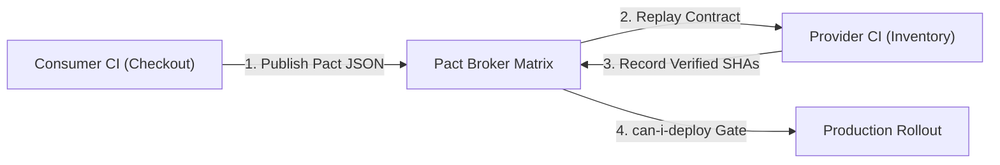

# Consumer-Driven Contract Testing: Pact Broker, Provider States & can-i-deploy

```json continuity
{
  "previously": "In Chapter 09, we upgraded AeroClient v0.9 with OpenAPI 3.1 variance diffing and property-based fuzzing to catch 5xx server crashes and mass-assignment bugs.",
  "painPoint": "AeroCart has grown to 45 independently deployed microservices. Running full end-to-end API tests in our shared Staging cluster takes 45 minutes and fails 50% of the time because at least one unrelated service is always restarting—yet when teams mocked downstream services by hand, Inventory renamed 'stockCount' to 'availableUnits' and broke Checkout in production while all unit tests stayed green!",
  "unlock": "We will complete AeroClient v1.0 by building a Consumer-Driven Contract (Pact) Engine where consumer tests record exact field needs into a Pact Broker, providers replay those contracts in 50ms against real controllers, and can-i-deploy gates every production rollout."
}
```

```json walkthrough
[
  {
    "time": "0:00",
    "badge": "1. Why Mocks Lie",
    "caption": "Shared staging environments with 45 microservices are always half-broken. Yet if Checkout writes its own fake mock of Inventory, that mock never knows when Inventory renames a JSON field!",
    "code": "45 services @ 98.5% uptime = 0.985^45 = 50.6% Staging Pass Rate!"
  },
  {
    "time": "0:24",
    "badge": "2. First Consumer Pact",
    "caption": "In AeroClient v1.0, the Consumer records a JSON contract listing ONLY the fields it actually reads using loose type matchers, and the Provider replays that exact contract in CI.",
    "code": "required_fields = {\"sku\": str, \"availableUnits\": int}  # Ignore unused fields!"
  },
  {
    "time": "0:50",
    "badge": "3. Brittle Exact-Value Trap",
    "caption": "If a consumer asserts all 28 fields of a response or hardcodes exact UUID strings instead of type matchers, every harmless provider refactor breaks the contract.",
    "code": "Use FieldMatcher(kind=\"type\", sample=10) instead of exact hardcoded values!"
  },
  {
    "time": "1:15",
    "badge": "4. Broker & can-i-deploy",
    "caption": "At Staff scale, AeroClient v1.0 records verified (Consumer_SHA, Provider_SHA) pairs in a Pact Broker Matrix and runs can-i-deploy in <200ms before every Kubernetes rollout.",
    "code": "pact-broker can-i-deploy --pacticipant checkout --version c1 --to-environment prod"
  }
]
```

```json pretraining
[
  {
    "term": "Shared Staging Failure",
    "formula": "Suite Pass Rate = 0.985^45 = 50.6%",
    "meaning": "When 45 teams deploy half-finished code into one shared testing environment, even if each service is 98.5% reliable, half of your full-system test runs will fail due to someone else's service."
  },
  {
    "term": "Consumer-Driven Pact",
    "formula": "Contract = Only The Fields Each Consumer Actually Reads",
    "meaning": "Instead of the backend guessing which fields apps use, each client app generates a receipt listing the exact 3 or 4 JSON fields it actually reads—so the backend knows what is safe to delete."
  },
  {
    "term": "Provider State Hook",
    "formula": "given(\"order ord-42 exists\") -> Seed In-Memory Repo",
    "meaning": "A tiny setup function on the provider side that inserts the exact test data needed (like 'SKU-99 has 5 items in stock') into memory right before replaying a consumer's contract request."
  },
  {
    "term": "can-i-deploy Matrix",
    "formula": "Verified(Consumer_SHA, Provider_Prod_SHA) == TRUE",
    "meaning": "A pre-release safety check that asks the central Pact Broker: 'Has the exact version of Checkout we are about to deploy already been tested against the exact version of Inventory running in production?'"
  }
]
```

## 🌱 Step 1: Plain-English Story — The Blueprint Receipt That Never Lies

Imagine building a custom kitchen where the **Cabinet Maker (`Consumer`)** and the **Sink Manufacturer (`Provider`)** work in different cities.
- **The Shared-Staging Nightmare**: Every time the Cabinet Maker cuts a single board, they rent a flatbed truck, ship the entire kitchen to a giant warehouse (`Shared Staging Environment`), and wait for the Plumber, Electrician, Painter, and Sink Manufacturer to show up at the same time. Half the time, the Electrician's van breaks down, and nobody can test anything!
- **The "Hand-Written Mock" Lie**: Frustrated, the Cabinet Maker carves a **cardboard sink (`Hand-Written Mock`)** in their own workshop and tests against that. Everything fits! Except two weeks later, the real Sink Manufacturer widens the sink bowl by 2 inches. The Cabinet Maker's cardboard sink still fits in their workshop (`100% Green Unit Tests`), so they ship the cabinets to the customer's house—and the real sink crashes right through the counter!

How does **Consumer-Driven Contract Testing (`Pact`)** give us the speed of the workshop *without* the lie of the cardboard mock?
1. **Consumer Records a Blueprint Receipt (`Pact File`)**: While testing against a local mock in `5ms`, `Checkout` (`Consumer`) automatically prints a **Pact JSON Contract** stating: *"When I call `GET /skus/99`, I only care that you return `status 200` and an integer field named `availableUnits`."*
2. **Provider Replays the Receipt in Its Own Workshop**: The **Pact Broker** sends that receipt to `Inventory` (`Provider`). `Inventory` replays the request against its **real controller** in `20ms` and proves it still outputs `availableUnits: <int>`.
3. **`can-i-deploy` Checks the Matrix**: Before either team deploys to production, they ask the Broker: *"Did these exact two Git versions pass each other's receipt?"*



---

## 🔨 Step 2: First Lines of Code — `AeroClient v1.0` Minimal Consumer-Subset Contract Verifier

Let's graduate **`AeroClient`** from `v0.9` to **`v1.0`**. In our starter code, a Consumer declares **only** the subset of fields and types it actually reads (`required_types`), and our verifier checks the Provider's real JSON payload using **Tolerant Reader** semantics (ignoring any extra fields the Provider returns).

```python
def verify_consumer_contract(provider_json: dict, required_types: dict[str, type]) -> None:
    """AeroClient v1.0 starter: verifies Consumer's minimal field & type contract on Provider JSON."""
    for field_name, expected_type in required_types.items():
        assert field_name in provider_json, f"Breaking change: Provider removed '{field_name}'"
        val = provider_json[field_name]
        # Guard against Python's bool-is-subclass-of-int quirk
        if expected_type is int and isinstance(val, bool):
            raise AssertionError(f"Breaking type change on '{field_name}': expected int, got bool")
        assert isinstance(val, expected_type), (
            f"Breaking type change on '{field_name}': expected {expected_type.__name__}, got {type(val).__name__}"
        )
```

### Java 17 Equivalent

```java
import java.util.Map;

public class AeroPactStarter {
    public static void verifyConsumerSubset(Map<String, Object> providerJson, Map<String, Class<?>> consumerContract) {
        for (var entry : consumerContract.entrySet()) {
            String field = entry.getKey();
            if (!providerJson.containsKey(field)) {
                throw new AssertionError("Breaking change: Provider removed required field '" + field + "'");
            }
            Object val = providerJson.get(field);
            if (!entry.getValue().isInstance(val)) {
                throw new AssertionError("Breaking type change on '" + field + "': got " + val);
            }
        }
    }
}
```

---

## ⚡ Step 3: Where It Breaks in Real Life — Over-Specified Contracts, Unstubbed Providers & Single-Branch Traps

Even teams that adopt Pact can accidentally recreate a brittle test suite if they fall into three anti-patterns:

1. **Over-Specifying Unused Fields & Exact Fixture Values**: If `CheckoutService` only reads `sku` and `availableUnits`, but its Pact test asserts exact equality on all 28 fields returned by `InventoryService` (including `warehouseForkliftId == "FL-09"`), then `InventoryService` cannot refactor its internal forklift fields without breaking `CheckoutService`'s contract! Always assert **only the fields your consumer DTO deserializes**, and use **type matchers (`like(10)`)** instead of exact numbers.
2. **Booting Real Downstream Databases in Provider Verification**: Provider verification must test only the Provider's HTTP/gRPC controller + serializer with its own repositories seeded in-memory via `@State` hooks (`20ms`), never calling live downstream microservices.
3. **Verifying Only `main` Instead of `deployedOrReleased` (`prod`)**: If a Provider verifies only against the Consumer's latest `main` branch (`v2`), the Provider can deploy a breaking change to production before Consumer `v2` has actually rolled out to production (`v1` is still live!).

```json contrast
{
  "title": "Shared Staging E2E Bottleneck vs AeroClient v1.0 Pact Consumer-Driven Matrix",
  "naiveTitle": "Shared Staging E2E + Unverified WireMocks",
  "naiveMetric": "45-Min Runs · 50% Flake · Mocks Drift",
  "naivePoints": [
    "Requires all 45 microservices healthy simultaneously in a shared environment before any single PR can merge",
    "Consumer-authored WireMock JSON files are never replayed against the real Provider repo, hiding breaking renames",
    "Failure diagnosis spans 6 team Slack channels without pinpointing which exact DTO field broke compatibility"
  ],
  "staffTitle": "AeroClient v1.0 Pact CDC + Provider States + can-i-deploy",
  "staffMetric": "<3s In-Memory CI · 100% Independent Deploys",
  "staffPoints": [
    "Consumer & Provider tests run asynchronously in fast, isolated in-memory CI jobs with zero cross-service network calls",
    "Provider knows the EXACT field usage of every mobile/web/backend consumer, enabling safe deprecation of unused fields",
    "can-i-deploy blocks breaking merges on PR BEFORE code ever reaches staging or production"
  ]
}
```

```json poe
{
  "question": "Checkout-Service (Consumer) writes a Pact contract test against Inventory-Service (Provider) by asserting exact equality on all 28 fields returned by Inventory—including 'warehouseForkliftId: \"FL-09\"', a field Checkout-Service never reads in production—and uses exact value matchers instead of type matchers (like('SKU-1')). Two weeks later, Inventory renames 'warehouseForkliftId' and rotates test seed UUIDs. What happens?",
  "options": [
    "Pact automatically ignores fields unused by the Checkout binary via bytecode inspection",
    "Over-specified brittle contract anti-pattern: the Consumer turned Pact into a fragile snapshot functional test, blocking Inventory's legitimate internal refactoring even though zero real production consumer code was broken!",
    "The Pact Broker deletes unreferenced JSON keys during upload",
    "can-i-deploy bypasses failed provider verifications automatically"
  ],
  "answerIndex": 1,
  "explanation": "Consumer-Driven Contracts must follow two golden laws: 1) assert ONLY the subset of fields your consumer DTO actually deserializes, and 2) use loose type/regex matchers (Matcher.like / Matching.type) rather than hardcoded fixture values unless testing a specific enum."
}
```

---

## 🚀 Step 4: Staff Engineer Deep-Dive — Mesh Reliability Math, Compatibility Matrices & `AeroClient v1.0`

### 1. Shared-Staging Reliability Decay vs. Consumer-Driven Contract Algebra

In a shared-staging environment containing $M$ microservices where each service $i$ has independent availability $p_i \in (0, 1)$, the probability that an end-to-end test suite completes without a transient environment failure decays exponentially with $M$:

$$P_{\text{staging-E2E}}(M) = \prod_{i=1}^{M} p_i \approx p^M \implies \text{For } M = 45,\; p = 0.985:\quad P_{\text{staging-E2E}} = 0.985^{45} \approx 0.506 \text{ (49.4\% Flake Rate!)}$$

By contrast, **Consumer-Driven Contract Testing (`CDC`)** decomposes global compatibility across a directed dependency graph $G = (V, E)$ into pairwise in-memory structural projections. Let $\mathcal{S}(P, \text{sha}_P)$ be the response schema emitted by Provider $P$ at commit $\text{sha}_P$, and let $\pi_C(\mathcal{S})$ be the minimal field/type subset demanded by Consumer $C \in \text{Consumers}(P)$. Provider commit $\text{sha}_P$ is **safe to deploy (`can-i-deploy`)** to environment $E$ if and only if it satisfies the union of all currently deployed consumer projections in $E$:

$$\text{CanIDeploy}(P, \text{sha}_P, E) \iff \forall C \in \text{Consumers}(P):\; \text{Verified}\!\left(\pi_C(\text{sha}_{C, E}),\; \mathcal{S}(P, \text{sha}_P)\right) = \text{TRUE}$$

And a Provider field $f \in \mathcal{S}(P)$ is **provably safe to delete** without a version bump whenever:

$$f \notin \bigcup_{C \in \text{Consumers}(P)} \text{Fields}\!\left(\pi_C(\text{sha}_{C, \text{prod}})\right)$$

### 2. Contract Testing Paradigm Trade-Off Matrix

| Contract Testing Paradigm | Who Authors the Contract? | Best Architectural Fit | Key Limitation to Guard Against |
| :--- | :--- | :--- | :--- |
| **Pact Consumer-Driven (`CDC`)** | Internal consumers via unit tests | Internal microservice mesh (`5–200` services) | Do **not** test provider business logic inside Pact (keep Pact to structure/types/status!) |
| **Bi-Directional (`PactFlow` + OpenAPI)** | Consumer Pact $\cap$ Provider OpenAPI 3.1 | Brownfield providers or external 3rd-party APIs | Provider must still prove its actual runtime implementation conforms to its OpenAPI spec (`Schemathesis`/Dredd) |
| **Async Message Pact** | Kafka / SQS consumer handlers | Event-driven Outbox / Kafka Protobuf or JSON consumers | Requires verifying the provider's actual event-producer serializer method, not a dummy JSON file |

### 3. Dual-Language Production Blueprints: `AeroClient v1.0` Pact Engine & `can-i-deploy` Gate

#### Python 3 Blueprint: Consumer-Driven Contract Matcher, Provider State Replay & `can-i-deploy` Matrix

```python
from __future__ import annotations
from dataclasses import dataclass, field
import re
from typing import Any, Callable, Dict, List, Set, Tuple


@dataclass(frozen=True)
class FieldMatcher:
    """Models Pact structural matchers (type-like vs regex vs exact) avoiding brittle value coupling."""
    kind: str  # "type" | "regex" | "exact"
    sample: Any
    pattern: str = ""

    def matches(self, actual: Any) -> Tuple[bool, str]:
        if self.kind == "exact":
            return (actual == self.sample, f"expected exact {self.sample!r}, got {actual!r}")
        if self.kind == "regex":
            ok = isinstance(actual, str) and re.fullmatch(self.pattern, actual) is not None
            return (ok, f"value {actual!r} did not match regex /{self.pattern}/")
        if self.kind == "type":
            if isinstance(self.sample, bool):
                ok = isinstance(actual, bool)
            elif isinstance(self.sample, int):
                ok = isinstance(actual, int) and not isinstance(actual, bool)
            else:
                ok = isinstance(actual, type(self.sample))
            return (ok, f"expected wire type {type(self.sample).__name__}, got {actual!r}")
        raise ValueError(f"Unknown matcher kind: {self.kind}")


@dataclass(frozen=True)
class PactInteraction:
    description: str
    provider_state: str
    method: str
    path: str
    expected_status: int
    response_body_matchers: Dict[str, FieldMatcher]


@dataclass
class PactBrokerMatrix:
    """In-memory deterministic model of the Pact Broker SHA verification & environment graph."""
    verified_pairs: Set[Tuple[str, str, str, str]] = field(default_factory=set)
    deployed_in_env: Dict[Tuple[str, str], str] = field(default_factory=dict)  # (env, service) -> sha

    def record_verification(self, consumer: str, c_sha: str, provider: str, p_sha: str, passed: bool) -> None:
        if passed:
            self.verified_pairs.add((consumer, c_sha, provider, p_sha))

    def deploy_to_env(self, env: str, service: str, sha: str) -> None:
        self.deployed_in_env[(env, service)] = sha

    def can_i_deploy_consumer(self, consumer: str, c_sha: str, required_providers: List[str], env: str) -> Tuple[bool, List[str]]:
        blockers: List[str] = []
        for prov in required_providers:
            live_p_sha = self.deployed_in_env.get((env, prov))
            if not live_p_sha:
                blockers.append(f"Provider '{prov}' has no active deployment in '{env}'")
            elif (consumer, c_sha, prov, live_p_sha) not in self.verified_pairs:
                blockers.append(f"Unverified matrix pair: {consumer}@{c_sha} <-> {prov}@{live_p_sha} ({env})")
        return (len(blockers) == 0, blockers)


def replay_pact_against_provider(
    interactions: List[PactInteraction],
    state_handlers: Dict[str, Callable[[], None]],
    provider_dispatch: Callable[[str, str], Tuple[int, Dict[str, Any]]],
) -> List[str]:
    """Executes Provider State setup hooks and verifies Tolerant-Reader consumer subset matchers."""
    failures: List[str] = []
    for inter in interactions:
        if inter.provider_state not in state_handlers:
            failures.append(f"[{inter.description}] Missing provider state handler: '{inter.provider_state}'")
            continue
        state_handlers[inter.provider_state]()
        status, actual_body = provider_dispatch(inter.method, inter.path)
        if status != inter.expected_status:
            failures.append(f"[{inter.description}] Status {status} != expected {inter.expected_status}")
            continue
        for field_name, matcher in inter.response_body_matchers.items():
            if field_name not in actual_body:
                failures.append(f"[{inter.description}] Missing consumer-required field '{field_name}'")
                continue
            ok, reason = matcher.matches(actual_body[field_name])
            if not ok:
                failures.append(f"[{inter.description}] Field '{field_name}' failed contract: {reason}")
    return failures
```

#### Java 17 Blueprint: Pact JVM v4 Consumer DSL (`PactDslJsonBody`) & JUnit 5 `@State` Verifier

```java
package com.aerocart.api.contracts;

import java.util.HashMap;
import java.util.List;
import java.util.Map;
import java.util.Objects;
import java.util.Set;

/**
 * Production-grade Consumer-Driven Contract & Provider State Harness in pure Java 17
 * (mirrors Pact-JVM @Pact consumer builder + @State provider verification lifecycle).
 */
public final class ConsumerDrivenContractEngine {

    public sealed interface JsonRule permits TypeRule, RegexRule {
        boolean matches(Object val);
    }

    public record TypeRule(Class<?> expectedType) implements JsonRule {
        @Override
        public boolean matches(Object val) {
            return val != null && expectedType.isInstance(val);
        }
    }

    public record RegexRule(String regex) implements JsonRule {
        @Override
        public boolean matches(Object val) {
            return val instanceof String s && s.matches(regex);
        }
    }

    public record ContractInteraction(
        String description,
        String providerState,
        String path,
        int expectedStatus,
        Map<String, JsonRule> requiredResponseFields
    ) {}

    public record ProviderReply(int statusCode, Map<String, Object> jsonFields) {}

    private final Map<String, Runnable> stateCallbacks = new HashMap<>();

    public void registerProviderState(String stateName, Runnable setupHook) {
        stateCallbacks.put(Objects.requireNonNull(stateName), Objects.requireNonNull(setupHook));
    }

    public void verifyAllInteractions(
            List<ContractInteraction> pact,
            java.util.function.Function<String, ProviderReply> realControllerInvoker) {
        for (ContractInteraction interaction : pact) {
            Runnable stateSetup = stateCallbacks.get(interaction.providerState());
            if (stateSetup == null) {
                throw new AssertionError("Missing @State callback for: " + interaction.providerState());
            }
            stateSetup.run(); // Seed isolated in-memory repository for this interaction

            ProviderReply reply = realControllerInvoker.apply(interaction.path());
            if (reply.statusCode() != interaction.expectedStatus()) {
                throw new AssertionError(interaction.description() + " -> expected HTTP "
                    + interaction.expectedStatus() + " but got " + reply.statusCode());
            }
            // Note: Extra fields returned by Provider are IGNORED (Tolerant Reader!)
            for (var entry : interaction.requiredResponseFields().entrySet()) {
                if (!reply.jsonFields().containsKey(entry.getKey())) {
                    throw new AssertionError("Breaking Provider Change: removed required field '" + entry.getKey() + "'");
                }
                Object val = reply.jsonFields().get(entry.getKey());
                if (!entry.getValue().matches(val)) {
                    throw new AssertionError("Breaking Type/Format Change on '" + entry.getKey() + "': " + val);
                }
            }
        }
    }

    public static boolean canIDeploy(
            Set<String> verifiedShaPairs, String candidateService, String candidateSha,
            String peerService, String peerProdSha) {
        String key = candidateService + "@" + candidateSha + "<->" + peerService + "@" + peerProdSha;
        return verifiedShaPairs.contains(key);
    }
}
```

> [!WARNING] **Staff Interview Gotcha — Using Pact as a Provider Functional Test Suite (`Contract Bloat`) & Public API Misuse:** Candidates often propose Pact for *every* API in the company. A Staff Architect draws two hard boundaries:
> 1. **Never use Consumer-Driven Pact for Public External APIs** with `10,000` anonymous external developers—you cannot run `10,000` stranger repos' Pact files in your CI! Public APIs use **Provider-Driven OpenAPI 3.1 Governance + Fuzzing** (Chapter 09); internal microservice meshes use **Consumer-Driven Pact**.
> 2. **Contract Tests $\neq$ Business Logic Tests**: If Checkout writes 45 Pact interactions testing every tax-bracket calculation of `TaxService`, `TaxService` becomes paralyzed by brittle provider state setups. Pact tests verify **wire vocabulary** (`status`, headers, field presence, types, nullability); `TaxService`'s own internal unit tests verify tax math!

---

### Up Next: Course 04 Graduation & Entering Course 05 (`AI Engineering`)

Congratulations! Across Chapters `01 -> 10`, you evolved **`AeroClient`** from a 5-line HTTP status check (`v0.1`) into **`AeroClient v1.0`**—a Staff-grade multi-protocol verification SDK mastering TCP/TLS connection pooling, RFC 9110 idempotency, OAuth2 PKCE + Singleflight token refresh, BOLA/IDOR security matrices, GraphQL AST/DataLoader span gates, binary gRPC Protobuf framing, async `202` Sagas + HMAC webhooks, OpenAPI 3.1 property-based fuzzing, and Consumer-Driven Pact contracts!

Next in **Course 05 (`05-ai-engineering`)**, we will build **`AeroBrain`** from a 10-line flight-price predictor into a production Transformer, Hybrid RAG (`BM25 + HNSW + RRF`), LoRA fine-tuned, and MCP Agent architecture!

```json quiz
[
  {
    "id": "api-10-q1",
    "question": "Provider 'InventoryService' opens a PR deleting the JSON field 'legacyWarehouseCode' from GET /v1/skus/{id}. How does Pact determine in <5 seconds whether deleting that field is safe or a P0 outage?",
    "options": [
      "Pact scans GitHub source code with grep across the organization",
      "InventoryService's CI pulls the active pacts of EVERY currently deployed production consumer from the Pact Broker and replays them—if zero consumer pacts assert 'legacyWarehouseCode', verification passes green and the field is proven unused; if even one consumer reads it, verification fails naming the exact consumer & SHA",
      "Pact blocks all field deletions permanently",
      "Pact deploys InventoryService to 1% canary traffic first"
    ],
    "answerIndex": 1,
    "explanation": "Because each consumer records ONLY the minimal subset of fields it actually reads, the union of active consumer pacts in the Pact Broker acts as a live field-level usage graph across the microservice mesh."
  },
  {
    "id": "api-10-q2",
    "question": "During Provider Verification of InventoryService, should the @State('sku SKU-99 has 5 units') callback boot real downstream Kafka clusters, Stripe sandboxes, and Shipping microservices?",
    "options": [
      "Yes, otherwise Provider Verification is not an end-to-end test",
      "NO! Provider verification tests ONLY InventoryService's real HTTP/gRPC controller + DTO serialization boundary; external collaborators/repositories inside InventoryService are stubbed or seeded via fast in-memory fakes so each interaction runs deterministically in ~20ms (while InventoryService acts as a Pact Consumer for its own downstream services!)",
      "Provider state callbacks only modify HTTP response headers",
      "Pact forbids mocking databases during provider verification"
    ],
    "answerIndex": 1,
    "explanation": "Chaining real downstream services during provider verification re-creates the exact flaky E2E pyramid Pact is designed to replace. Chain verification transitively via consumer/provider pairs instead."
  },
  {
    "id": "api-10-q3",
    "question": "Why must Provider CI verify against BOTH the consumer's latest 'main' branch pact AND the consumer's currently deployed 'production' pact (via consumerVersionSelectors: [{mainBranch: true}, {deployedOrReleased: true}])?",
    "options": [
      "To warm up the JVM JIT compiler twice",
      "If Provider verifies ONLY against consumer 'main' (v2) where a field was already migrated, Provider could deploy to production and instantly break Consumer v1 which is STILL running in production until Consumer's next release!",
      "Pact Broker requires at least two selectors to calculate billing",
      "Because Git SHAs collide across branches"
    ],
    "answerIndex": 1,
    "explanation": "Independent microservice deployment requires backward compatibility with what is CURRENTLY running in production (deployedOrReleased: true) as well as forward awareness of mainBranch: true."
  }
]
```
