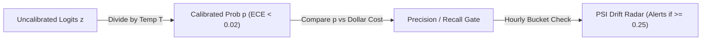

# AeroBrain v0.2: Rare-Event Metrics (PR-AUC), Calibration (ECE) & Production Drift (PSI)

```json continuity
{
  "previously": "In Chapter 01, we built `AeroBrain v0.1` using stable Cross-Entropy Loss, decoupled `AdamW`, and chronological splits so it outputs clean probabilities without leaking future data.",
  "painPoint": "We deployed `AeroBrain v0.1` to block stolen credit cards and prompt-injection attacks (which happen on only 1 in 1,000 bookings). Offline `Accuracy` hit `99.0%` and `ROC-AUC` hit `0.975`—yet within 2 hours of launch, 91% of blocked customers were innocent flyers!",
  "unlock": "Upgrade to `AeroBrain v0.2`: replace deceptive Accuracy/ROC-AUC gates with `PR-AUC` and dollar-cost thresholds, calibrate overconfident neural probabilities via Temperature Scaling (`ECE`), and catch silent production data shifts using `PSI`!"
}
```

```json walkthrough
[
  {
    "time": "0:00",
    "badge": "Slide 1 / 4 · The 99% Accuracy Mirage",
    "caption": "Suppose 1 in 1,000 AeroCart bookings is fraudulent. A lazy model that literally prints 'CLEAN' for every single booking on Earth gets 99.9% Accuracy—while catching 0% of fraud!",
    "code": "# 1,000,000 bookings: 999,000 Clean, 1,000 Fraud\n# Even 1% False Alarm Rate = 9,990 innocent flyers blocked vs 900 real frauds caught!\nprecision = 900 / (900 + 9990)  # Only 8.26% of blocks are real fraud!"
  },
  {
    "time": "0:26",
    "badge": "Slide 2 / 4 · Fixing Overconfidence with Temperature T",
    "caption": "Deep neural networks are cocky: they output 0.99 probability when they are only right 75% of the time! Dividing raw logits by a single number T > 1 (Temperature Scaling) makes confidence match reality without changing which class wins!",
    "code": "calibrated_prob = sigmoid(raw_logit / temperature_T)\n# If AeroBrain says 0.80, it now actually happens 80% of the time!"
  },
  {
    "time": "0:54",
    "badge": "Slide 3 / 4 · Picking the Threshold Using Dollar Cost",
    "caption": "Never hardcode `if prob >= 0.50`! Once probabilities are calibrated, if an SMS verification costs $2 (FP) and a missed chargeback costs $400 (FN), we trigger an SMS whenever `prob * $400 >= $2`!",
    "code": "optimal_threshold = cost_fp / (cost_fp + cost_fn)  # 2 / 402 = 0.005"
  },
  {
    "time": "1:18",
    "badge": "Slide 4 / 4 · Catching Silent Drift with PSI",
    "caption": "In production, a mobile app update can silently break an input feature to NULL weeks before chargeback labels arrive. Population Stability Index (PSI) compares today's input buckets against training buckets and pages us in 1 hour!",
    "code": "psi = sum((q_live - p_train) * math.log(q_live / p_train))\n# PSI < 0.10 Green | 0.10..0.25 Warn | >= 0.25 Page On-Call!"
  }
]
```

```json pretraining
[
  {
    "term": "Precision vs. Recall (`F_beta`)",
    "formula": "Precision = TP / (TP + FP)  |  Recall = TP / (TP + FN)",
    "meaning": "Recall asks: 'Out of all real bad guys, how many did we catch?' Precision asks: 'When our alarm rings, how often is it actually a bad guy instead of a false alarm?'"
  },
  {
    "term": "ROC-AUC vs. PR-AUC",
    "formula": "ROC uses False Positive Rate; PR uses Precision",
    "meaning": "When 99.9% of traffic is clean, millions of True Negatives hide thousands of false alarms inside ROC-AUC. PR-AUC ignores True Negatives so rare-event false alarms cannot hide!"
  },
  {
    "term": "Calibration (`ECE`) & Temperature",
    "formula": "p_cal = softmax(z / T)  so  Confidence == True Accuracy",
    "meaning": "Ensuring that when your model predicts an 80% risk score, the event genuinely happens 80% of the time—calibrated by dividing logits by a single scalar Temperature `T`."
  },
  {
    "term": "Population Stability Index (`PSI`)",
    "formula": "PSI = sum (q_live - p_base) * ln(q_live / p_base)",
    "meaning": "An early-warning radar that compares today's live feature/score histogram against your training baseline to catch broken pipelines or seasonal shifts without waiting for ground-truth labels."
  }
]
```

```json poe
{
  "question": "AeroBrain v0.2 screens 1,000,000 live user chat prompts for jailbreak attacks. Only 1,000 prompts (0.1%) are real attacks; 999,000 are normal travelers asking about flights. The model catches 900 real attacks (90% Recall) and has a 1.0% False Positive Rate (falsely flagging 9,990 normal travelers). Its Accuracy is 98.99% and ROC-AUC is 0.975. Why does the VP of Product demand an emergency rollback?",
  "options": [
    "90% Recall is worse than flipping a coin",
    "Base-Rate Fallacy in Precision: out of 900 + 9,990 = 10,890 blocked travelers, 9,990 are innocent! Precision is 900 / 10,890 = 8.26%—meaning 91.7% of blocked customers are false alarms, which huge True Negatives (989,010) hid inside Accuracy and ROC-AUC!",
    "Temperature scaling reversed the positive and negative classes",
    "PSI exceeded 10.0 on the training set"
  ],
  "answerIndex": 1,
  "explanation": "When positive events are rare (0.1%), a tiny 1% False Positive Rate against 999,000 clean prompts creates 9,990 False Positives—outnumbering the 900 True Positives 11-to-1! Rare-event classifiers must gate on PR-AUC and Precision@Recall, never Accuracy or ROC-AUC."
}
```

## 🌱 Step 1: Plain-English Story — The 99% Accuracy Mirage, Cocky Models & Silent Rot

Imagine celebrating because `AeroBrain v0.1` hit **`99.0%` Accuracy** on our test set for catching stolen credit cards! You deploy to production on Monday morning, and by lunch the customer support phone lines are melting down. What happened?

In airline ticketing (and LLM safety guardrails), real attacks are **rare**—say **`1` in `1,000` bookings (`0.1%`)**.
Suppose we screen `1,000,000` bookings (`1,000` real frauds, `999,000` honest flyers):
- `AeroBrain` catches `900` out of `1,000` real frauds (**`90%` Recall**—awesome!).
- It only makes a mistake on `1%` of honest flyers (`False Positive Rate = 1%`—sounds tiny, right?).
- **Wait**: `1%` of `999,000` honest flyers is **`9,990` innocent families locked out of their flights!**
- Out of `10,890` total alarms (`900` real + `9,990` false), **over `91.7%` of our blocks are false alarms (`Precision = 8.26%`)**!



To make `AeroBrain v0.2` survive contact with real traffic, we need **three upgrades**:
1. **Measure `Precision` & `Recall` (never raw Accuracy!)**, and choose our cutoff threshold using **real dollar costs** (`$2` SMS step-up challenge vs. `$400` missed fraud chargeback).
2. **Calibrate Cocky Probabilities (`Temperature Scaling`)**: Deep models often output `0.99` when they are only right `75%` of the time. Dividing raw scores by a single number `T` (`Temperature`) softens overconfident scores so `0.80` genuinely means an `80%` chance!
3. **Watch for Silent Drift (`PSI`)**: What if an iOS app update accidentally sends `account_age = 0` for every iPhone user? Chargeback labels take 60 days to arrive from banks, so **Population Stability Index (`PSI`)** compares today's feature buckets against training buckets to alert us in **60 minutes**!

## 🔨 Step 2: First Lines of Code — Precision, Recall & Dollar-Cost Thresholding in 15 Lines!

Let's write `AeroBrain v0.2`'s evaluation and thresholding core in pure Python and Java—computing **Precision**, **Recall**, and the exact **Dollar-Optimal Cutoff** (`cost_fp / (cost_fp + cost_fn)`):

```python
def aerobrain_v02_eval(y_true: list[int], probs: list[float], cost_fp: float, cost_fn: float):
    # 1. Bayes-Optimal Threshold: trigger action when p * cost_fn >= (1 - p) * cost_fp
    threshold = cost_fp / (cost_fp + cost_fn)
    tp = fp = fn = 0
    for y, p in zip(y_true, probs):
        pred = 1 if p >= threshold else 0
        tp += int(y == 1 and pred == 1)
        fp += int(y == 0 and pred == 1)
        fn += int(y == 1 and pred == 0)

    precision = tp / (tp + fp) if (tp + fp) else 0.0
    recall = tp / (tp + fn) if (tp + fn) else 0.0
    print(f"Cutoff={threshold:.3f} -> Precision={precision:.2%}, Recall={recall:.2%}")


# $20 manual review (FP) vs $200 chargeback (FN) -> optimal cutoff = 20 / 220 = 0.091
aerobrain_v02_eval([1, 0, 1, 0, 0], [0.82, 0.04, 0.15, 0.25, 0.01], cost_fp=20, cost_fn=200)
```

### Java 17 Equivalent

```java
public class AeroBrainV02Eval {
    public static void main(String[] args) {
        int[] yTrue = {1, 0, 1, 0, 0};
        double[] probs = {0.82, 0.04, 0.15, 0.25, 0.01};
        double costFp = 20.0, costFn = 200.0;

        double threshold = costFp / (costFp + costFn); // 0.0909
        int tp = 0, fp = 0, fn = 0;
        for (int i = 0; i < yTrue.length; i++) {
            int pred = probs[i] >= threshold ? 1 : 0;
            if (yTrue[i] == 1 && pred == 1) tp++;
            else if (yTrue[i] == 0 && pred == 1) fp++;
            else if (yTrue[i] == 1 && pred == 0) fn++;
        }
        double precision = (tp + fp) > 0 ? (double) tp / (tp + fp) : 0.0;
        double recall = (tp + fn) > 0 ? (double) tp / (tp + fn) : 0.0;
        System.out.printf("Cutoff=%.3f -> Precision=%.1f%%, Recall=%.1f%%%n",
                threshold, precision * 100, recall * 100);
    }
}
```

## ⚡ Step 3: Where It Breaks in Real Life — Uncalibrated Risk Math & Silent Concept Drift

Look closely at `threshold = cost_fp / (cost_fp + cost_fn)` above. That formula assumes that when `AeroBrain` outputs `p = 0.15`, there is *actually* a `15%` chance of fraud!
Here is where naive deployments break in production:

1. **Failure Mode 1: Modern Neural Nets & LLMs Are Wildly Overconfident (`ECE` Failure)**
   A deep classifier or LLM judge trained with Cross-Entropy keeps pushing logits larger even after it gets training examples right, outputting `p = 0.99` on messy edge cases where its true accuracy is only `0.70`! If you multiply `0.99 * $400` without calibrating first, your risk engine overestimates expected loss by `4x`.
   - **The Fix (`Temperature Scaling`)**: On a held-out calibration split, fit a single number `T > 0` (`p = sigmoid(z / T)`). Because dividing by `T > 0` never changes which score is bigger, **your ranking (`ROC-AUC` / `PR-AUC` / top-1 accuracy) stays `100%` identical**, while Expected Calibration Error (`ECE`) drops below `2%`!
2. **Failure Mode 2: Feature Drift (`Covariate Shift`) vs. Adversarial Adaptation (`Concept Drift`)**
   - **Covariate Drift (`P(X)` shifts)**: A new holiday sale or broken mobile SDK changes input distributions. **PSI** catches this within an hour with **zero labels needed**.
   - **Concept Drift (`P(Y | X)` shifts!)**: Clever fraudsters rent residential iPhones and buy normal `$350` tickets so their features `X` look `100%` normal (`PSI = 0.02`, all green!)—yet fraud triples! Because `P(X)` didn't change, only **sampled canary audits** (sending `0.5%` of auto-approved orders through verification to get fresh labels) can catch pure Concept Drift!

```json contrast
{
  "title": "Naive Uncalibrated 0.50 Cutoff vs. Calibrated Cost-Threshold + PSI Drift Radar",
  "naiveTitle": "Accuracy / ROC-AUC + Hardcoded p >= 0.5",
  "naiveMetric": "91% False Alarms · 60-Day Blind Spot on Broken Inputs",
  "naivePoints": [
    "Celebrates 99.0% Accuracy and 0.97 ROC-AUC on a 0.1% rare-event dataset while Precision sits at an unusable 8%",
    "Multiplies raw uncalibrated neural scores (0.99) by transaction dollar value, mispricing expected loss by 4x",
    "Waits 60-90 days for bank chargeback labels before noticing a mobile app update broke an input feature to NULL"
  ],
  "staffTitle": "PR-AUC + Temperature Calibration + Hourly PSI + Canary Audit",
  "staffMetric": "ECE < 0.018 · Same-Hour Null/PSI Detection",
  "staffPoints": [
    "Gates releases on PR-AUC, Precision@Recall>=0.85, and slice-level F_beta across regions and device types",
    "Fits post-hoc Temperature T on a held-out calibration split so p * DollarLoss reflects true actuarial risk",
    "Monitors hourly PSI across fixed baseline decile bins (plus an explicit NULL bin!) AND runs a 0.5% canary label audit"
  ]
}
```

## 🚀 Step 4: Staff Engineer Deep-Dive — Generalized $F_\beta$, `ECE` & `PSI` Math + Blueprints

Let's lock in the three formal equations every Staff AI Engineer uses to govern production classifiers and LLM safety guardrails:

1. **Generalized $F_\beta$ Score & Bayes-Optimal Cost Threshold ($\tau^*$)**:
   When Recall is $\beta$ times as important as Precision ($\beta = 2$ for safety/fraud; $\beta = 0.5$ when false alarms are expensive):
   $$F_\beta = (1 + \beta^2)\frac{\text{Precision}\cdot\text{Recall}}{(\beta^2 \cdot \text{Precision}) + \text{Recall}}, \qquad \tau^* = \frac{C_{\text{FP}}}{C_{\text{FP}} + C_{\text{FN}}}$$
2. **Expected Calibration Error (`ECE`) across $M$ Confidence Bins**:
   Partition predictions into $M = 10$ intervals $B_1 \dots B_M$. Compare empirical accuracy $\text{acc}(B_m)$ against mean predicted confidence $\text{conf}(B_m)$:
   $$\text{ECE} = \sum_{m=1}^{M} \frac{|B_m|}{N} \Big|\text{acc}(B_m) - \text{conf}(B_m)\Big|$$
3. **Population Stability Index (`PSI` — Symmetric KL Divergence on Fixed Baseline Deciles)**:
   Freeze bin boundaries on the training/reference distribution ($p_i$) and measure live bucket proportions ($q_i$):
   $$\text{PSI} = \sum_{i=1}^{B} (q_i - p_i) \ln\!\left(\frac{q_i}{p_i}\right)$$

| Metric / Monitor | Needs Live Labels? | What It Catches | Healthy Production SLA |
| :--- | :--- | :--- | :--- |
| **`PR-AUC` & `Precision @ Recall=0.90`** | Yes (Golden Holdout) | False-alarm floods on skewed (`< 5%` positive) tasks | Must beat champion model on every critical customer slice |
| **`ECE` (10-Bin Calibration Error)** | Yes (Calibration Split) | Overconfident probabilities distorting `p * DollarCost` | `ECE <= 0.025` after Temperature Scaling ($z / T$) |
| **Feature & Score `PSI` (+ `NULL` Bin)** | **No (Zero label lag!)** | Upstream schema bugs, NULL spikes, seasonal covariate shift | `PSI < 0.10` stable; `0.10–0.25` warn; `>= 0.25` page on-call |
| **Stratified Canary Audit (`0.5%`)** | Sampled fast oracle | **Concept Drift** ($P(Y \mid X)$ shift where `PSI` stays `< 0.05`) | Weekly rolling Precision/Recall within `±2%` of launch |

### Production Blueprint: Imbalanced $F_\beta$, Temperature Calibration (`ECE`) & Fixed-Bin `PSI` Engine

```python
from __future__ import annotations
from dataclasses import dataclass
import math
from typing import Sequence, Tuple


@dataclass(frozen=True)
class ImbalancedEvalReport:
    precision: float
    recall: float
    f_beta: float
    fpr: float


def evaluate_at_threshold(
    y_true: Sequence[int], probs: Sequence[float], threshold: float, beta: float = 2.0
) -> ImbalancedEvalReport:
    tp = fp = tn = fn = 0
    for y, p in zip(y_true, probs):
        pred = 1 if p >= threshold else 0
        if y == 1 and pred == 1:
            tp += 1
        elif y == 0 and pred == 1:
            fp += 1
        elif y == 0 and pred == 0:
            tn += 1
        else:
            fn += 1

    precision = tp / (tp + fp) if (tp + fp) > 0 else 0.0
    recall = tp / (tp + fn) if (tp + fn) > 0 else 0.0
    fpr = fp / (fp + tn) if (fp + tn) > 0 else 0.0
    b2 = beta * beta
    denom = b2 * precision + recall
    f_beta = ((1.0 + b2) * precision * recall / denom) if denom > 0 else 0.0
    return ImbalancedEvalReport(round(precision, 4), round(recall, 4), round(f_beta, 4), round(fpr, 5))


def sigmoid_with_temperature(logit: float, temperature: float) -> float:
    z = logit / max(temperature, 1e-6)
    return 1.0 / (1.0 + math.exp(-z)) if z >= 0 else math.exp(z) / (1.0 + math.exp(z))


def expected_calibration_error(
    y_true: Sequence[int], probs: Sequence[float], num_bins: int = 10
) -> float:
    """Computes M-bin Expected Calibration Error: sum (|B_m|/N) * |acc(B_m) - conf(B_m)|."""
    n = len(y_true)
    if n == 0:
        return 0.0
    bin_counts = [0] * num_bins
    bin_correct = [0.0] * num_bins
    bin_conf = [0.0] * num_bins

    for y, p in zip(y_true, probs):
        pred = 1 if p >= 0.5 else 0
        conf = p if pred == 1 else (1.0 - p)
        correct = 1.0 if pred == y else 0.0
        idx = min(num_bins - 1, int(conf * num_bins))
        bin_counts[idx] += 1
        bin_correct[idx] += correct
        bin_conf[idx] += conf

    ece = 0.0
    for m in range(num_bins):
        if bin_counts[m] > 0:
            acc_m = bin_correct[m] / bin_counts[m]
            conf_m = bin_conf[m] / bin_counts[m]
            ece += (bin_counts[m] / n) * abs(acc_m - conf_m)
    return round(ece, 5)


def fit_temperature_grid(logits: Sequence[float], y_true: Sequence[int]) -> Tuple[float, float]:
    """Finds optimal post-hoc Temperature T in [0.25, 5.0] minimizing Binary NLL on calibration split."""
    best_t, best_nll = 1.0, float("inf")
    for step in range(25, 505, 5):
        t = step / 100.0
        nll = 0.0
        for z, y in zip(logits, y_true):
            p = min(1.0 - 1e-12, max(1e-12, sigmoid_with_temperature(z, t)))
            nll -= y * math.log(p) + (1 - y) * math.log(1.0 - p)
        nll /= len(logits)
        if nll < best_nll:
            best_nll, best_t = nll, t
    return best_t, round(best_nll, 5)


def compute_psi(baseline_hist: Sequence[int], live_hist: Sequence[int], eps: float = 1e-4) -> float:
    """Computes Population Stability Index (PSI) across fixed baseline quantile bins."""
    base_total = max(1, sum(baseline_hist))
    live_total = max(1, sum(live_hist))
    psi = 0.0
    for b_cnt, q_cnt in zip(baseline_hist, live_hist):
        p = max(eps, b_cnt / base_total)
        q = max(eps, q_cnt / live_total)
        psi += (q - p) * math.log(q / p)
    return round(psi, 5)
```

### Java 17 Equivalent

```java
package com.hub.ai.metrics;

public final class CalibrationAndDriftMonitor {

    public record DriftVerdict(double psi, String status) {}

    public static double optimalBayesThreshold(double falsePositiveCost, double falseNegativeCost) {
        if (falsePositiveCost <= 0 || falseNegativeCost <= 0) {
            throw new IllegalArgumentException("Costs must be strictly positive");
        }
        return falsePositiveCost / (falsePositiveCost + falseNegativeCost);
    }

    public static double computeExpectedCalibrationError(int[] yTrue, double[] probs, int bins) {
        int n = yTrue.length;
        int[] counts = new int[bins];
        double[] sumCorrect = new double[bins];
        double[] sumConf = new double[bins];

        for (int i = 0; i < n; i++) {
            int pred = probs[i] >= 0.5 ? 1 : 0;
            double conf = pred == 1 ? probs[i] : (1.0 - probs[i]);
            int bucket = Math.min(bins - 1, (int) (conf * bins));
            counts[bucket]++;
            sumConf[bucket] += conf;
            if (pred == yTrue[i]) {
                sumCorrect[bucket] += 1.0;
            }
        }
        double ece = 0.0;
        for (int b = 0; b < bins; b++) {
            if (counts[b] > 0) {
                double acc = sumCorrect[b] / counts[b];
                double avgConf = sumConf[b] / counts[b];
                ece += ((double) counts[b] / n) * Math.abs(acc - avgConf);
            }
        }
        return ece;
    }

    public static DriftVerdict evaluatePopulationStabilityIndex(long[] baselineBins, long[] liveBins) {
        long baseSum = 0;
        long liveSum = 0;
        for (long c : baselineBins) baseSum += c;
        for (long c : liveBins) liveSum += c;

        double psi = 0.0;
        double eps = 1e-4;
        for (int i = 0; i < baselineBins.length; i++) {
            double p = Math.max(eps, (double) baselineBins[i] / Math.max(1L, baseSum));
            double q = Math.max(eps, (double) liveBins[i] / Math.max(1L, liveSum));
            psi += (q - p) * Math.log(q / p);
        }
        String level = psi >= 0.25 ? "CRITICAL_DRIFT" : (psi >= 0.10 ? "MODERATE_SHIFT" : "STABLE");
        return new DriftVerdict(psi, level);
    }
}
```

> [!WARNING]
> **Staff Interview Gotcha — Re-Computing `PSI` Bin Cutoffs on Live Data Gives `PSI = 0.000` Forever!**
> A classic production bug is computing 10-decile boundaries on the reference dataset AND re-computing 10-decile boundaries (`np.percentile(live, [10, 20, ..., 90])`) on today's live dataset. By definition, deciles of *any* dataset put `10%` of rows into each bucket—so `q_i = 0.10` and `p_i = 0.10`, outputting **`PSI = 0.000` even if ticket prices shifted by `100x`!** **Invariant:** Freeze bin edges (`-inf, q10, ..., q90, +inf` plus an explicit `11th` bucket for `NULL/NaN`) **once on the training baseline**, and count what fraction of live rows fall inside those fixed boundaries!

**Up Next in Chapter 03**: Right now `AeroBrain v0.2` only understands numbers (`storm_intensity = 2.0`, `ticket_price = 450.0`). What happens when a passenger types a messy chat message like `"Can I get a refund on Flight #402?!"`? How do we turn raw text into token IDs and geometric vectors without losing meaning or blowing up RAM? In Chapter 03, we'll build `AeroBrain v0.3`'s **Byte-Level `BPE` Tokenizer & Matryoshka (`MRL`) Embedding Engine**!

```json quiz
[
  {
    "id": "aie-02-q1",
    "question": "Why does post-hoc Temperature Scaling (`p = softmax(z / T)` with `T > 0` fit on a held-out calibration split) reduce Expected Calibration Error (`ECE`) WITHOUT changing top-1 accuracy or `ROC-AUC`?",
    "options": [
      "Dividing logits by T adds random Gaussian noise that cancels out over large batches",
      "Because f(z) = z / T for T > 0 is a strictly order-preserving (monotonic) transformation across all classes/samples, neither argmax_i(z_i) nor the pairwise ranking of sample scores changes—only steep overconfident probability extremes soften toward empirical frequencies",
      "Temperature Scaling retrains the final linear projection matrix W_vocab",
      "Temperature Scaling sets all probabilities below 0.5 to exact zero"
    ],
    "answerIndex": 1,
    "explanation": "Scalar division by T > 0 preserves logit ordering (leaving top-1 accuracy and rank-based AUCs untouched) while stretching or compressing entropy to align predicted confidence with true empirical accuracy."
  },
  {
    "id": "aie-02-q2",
    "question": "Your fraud classifier's hourly Feature PSI and Output Score PSI both read 0.02 (green/stable), yet chargeback losses triple over a holiday weekend because a fraud ring started using stolen credentials from clean residential IPs matching normal cart sizes. What drift occurred and why did PSI miss it?",
    "options": [
      "Covariate shift caused by broken JSON serialization",
      "Pure Concept Drift (P(Y | X) shifted while marginal input distribution P(X) stayed identical!): the fraudsters mimicked normal feature distributions, so label-free PSI on X remained ~0.02; requires canary friction/human-review holdout sampling (e.g., auto-auditing 0.5% of approved traffic) to measure live P(Y | X)",
      "PSI cannot measure more than 5 features",
      "Floating-point underflow in ln(q / p)"
    ],
    "answerIndex": 1,
    "explanation": "PSI only measures marginal shifts in P(X) or P(y_hat). Adversarial adaptation that mimics normal X changes P(Y|X) (concept drift), which can only be observed via ground-truth/canary outcome sampling."
  },
  {
    "id": "aie-02-q3",
    "question": "Downstream mobile version 4.12 ships a bug sending `user_account_age_days = NULL` instead of an integer for 35% of traffic, and your PSI SQL query filters `WHERE user_account_age_days IS NOT NULL` before binning. What happens?",
    "options": [
      "PostgreSQL automatically raises a PSI alert on NULL values",
      "Silent Blind Spot: filtering NULLs before binning hides the 35% missing-value spike from continuous PSI buckets while the model's median-imputer feeds constant defaults! Production PSI monitors must always allocate an explicit 11th bin for NULL/missing/out-of-range values",
      "PSI becomes negative when NULLs are excluded",
      "ROC-AUC rises to 1.0"
    ],
    "answerIndex": 1,
    "explanation": "Upstream schema/SDK null spikes are the #1 real-world ML failure mode; a dedicated NULL/NaN bin in PSI catches broken feature pipelines within minutes."
  }
]
```
