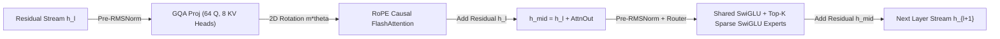

# Modern Frontier Transformers: Pre-RMSNorm, RoPE, SwiGLU, GQA/MLA & Sparse MoE

```json pretraining
[
  {
    "term": "Pre-RMSNorm Highway",
    "formula": "h_{l+1} = h_l + Block(RMSNorm(h_l)),  RMS(x) = sqrt(mean(x^2) + eps)",
    "meaning": "Drops mean-centering (saving ~15% norm bandwidth) and places normalization BEFORE sublayers so unimpeded identity gradients flow across 100+ layers."
  },
  {
    "term": "RoPE Relative Invariant",
    "formula": "<R(m) q, R(n) k> = Re( sum_i q_i * conj(k_i) * e^{i (m - n) theta_i} )",
    "meaning": "Rotates 2D coordinate pairs of Q and K by absolute angle m*theta_i so their dot product depends EXCLUSIVELY on relative distance (m - n)!"
  },
  {
    "term": "Grouped-Query Attn (GQA)",
    "formula": "H_Q = 64 Query Heads share G = 8 Key/Value Heads (8:1 Ratio)",
    "meaning": "Slashes KV-Cache VRAM and decode HBM memory-bandwidth bottleneck by 8x with <0.2% perplexity loss vs full MHA ( DeepSeek MLA compresses further!)."
  },
  {
    "term": "Sparse MoE Routing",
    "formula": "y = sum_{e in TopK(Router(x))} g_e(x) * Expert_e(x)",
    "meaning": "Decouples total knowledge capacity (e.g., 671B params in DeepSeek-V3) from per-token FLOPs (only 37B active params per token!)."
  }
]
```

```json poe
{
  "question": "Your infrastructure team deploys an open-weight Sparse Mixture-of-Experts (MoE) model advertised as '47B Total Parameters, 13B Active Parameters per Token' (Mixtral-8x7B class in BF16) onto a single 40GB A100 GPU, sizing VRAM for 13B * 2 bytes = 26GB. At startup, the serving engine immediately crashes with CUDA OutOfMemoryError! Why?",
  "options": [
    "Active parameters double when batch size = 1",
    "Sparse MoE saves FLOPs per single token, NOT static VRAM! All 47B total expert weights (47B * 2 bytes ≈ 94GB in BF16) must reside in GPU HBM simultaneously because different tokens in a batch dynamically route to all 8 experts within microseconds!",
    "RoPE rotation matrices consume 60GB of VRAM",
    "RMSNorm requires FP64 precision on A100 GPUs"
  ],
  "answerIndex": 1,
  "explanation": "Active parameter count governs compute FLOPs (and single-token latency), whereas TOTAL parameter count governs HBM VRAM capacity! Fitting 47B BF16 (~94GB + KV-Cache) requires either 2x 80GB GPUs (Tensor/Expert Parallelism) or INT4 quantization (~24GB weights)."
}
```

## 1. Five Upgrades from 2017 Vaswani Transformer to Modern Frontier LLMs

Almost zero frontier LLMs today use the literal 2017 *Attention Is All You Need* block (`Post-LayerNorm` + Sinusoidal additive positions + `ReLU` 2-matrix FFN + `MHA`). Five mathematical upgrades define modern Llama / Qwen / DeepSeek / Gemma architectures:

1. **`Post-LayerNorm` $\to$ `Pre-RMSNorm`**: Post-LN normalized *on* the residual trunk (`LN(x + Sublayer(x))`), attenuating early-layer gradients and requiring fragile warmup. **Pre-RMSNorm** (`x + Sublayer(RMSNorm(x))`) keeps an untouched identity residual highway from layer `N` straight back to token embeddings, while omitting redundant mean subtraction ($\text{RMSNorm}(x) = \frac{x}{\sqrt{\frac{1}{d}\sum x_i^2 + \epsilon}} \odot \gamma$).
2. **Additive Sinusoids $\to$ Rotary Position Embeddings (`RoPE`)**: Instead of adding position vectors once at layer `0` (where positional signal washes out by layer `60`), **RoPE** (Su et al., 2021) groups every `Q` and `K` head vector into `d_head / 2` 2D complex planes and rotates position $m$ by angle $m \theta_j$ ($\theta_j = \text{base}^{-2j/d}$, e.g. `base = 500,000` for `128k` context). Because 2D rotation matrices are orthogonal, $(R_m q)^\top (R_n k) = q^\top R_{n-m} k$—encoding **exact relative token distance $(m - n)$** at every single layer while preserving `KV-Cache` immutability (already-rotated keys never need recomputation when new tokens append!).
3. **`ReLU` FFN $\to$ `SwiGLU` Gated FFN**: Replaces $\max(0, xW_1)W_2$ with three bias-free matrices (`W_gate`, `W_up`, `W_down`):
   $$\text{SwiGLU}(x) = \big(\text{SiLU}(x W_{\text{gate}}) \odot (x W_{\text{up}})\big) W_{\text{down}}, \qquad \text{SiLU}(z) = \frac{z}{1 + e^{-z}}$$
   To keep parameter count equal (`2 * d * 4d = 8d^2`) with 3 matrices instead of 2, hidden width shrinks from $4d$ to **$\frac{8}{3}d$** (rounded to a multiple of `256` for Tensor Core alignment!).
4. **`MHA` $\to$ `GQA` (Grouped-Query Attention) & `MLA` (Multi-Head Latent Attention)**: During autoregressive decode, reading `K` and `V` caches from HBM is the #1 latency wall. **GQA** shares `1` Key/Value head across `4` or `8` Query heads (cutting `KV-Cache` by `8x`); **DeepSeek MLA** goes even further by projecting `K, V` into a low-rank compressed latent vector $c_t^{KV}$ cached in HBM!
5. **Dense FFN $\to$ Sparse Mixture-of-Experts (`MoE`)**: Replaces one giant FFN with $E$ routed experts (e.g., `64` or `256` fine-grained experts + `1` always-on **Shared Expert**), activating only `Top-K` (`K=2..8`) per token plus auxiliary load-balancing so no single GPU expert collapses into a bottleneck.



---

## 2. 2017 Vaswani Architecture vs. 2025/2026 Frontier LLM Architecture

```json contrast
{
  "title": "2017 Original Transformer vs Frontier Llama-3 / DeepSeek-V3 Architecture",
  "naiveTitle": "2017 Post-LN + Additive Pos + MHA + ReLU",
  "naiveMetric": "8x Larger KV-Cache · Unstable >48 Layers",
  "naivePoints": [
    "Post-LayerNorm sits on the main residual branch, causing gradient instability at depth >32 without delicate warmup",
    "Full Multi-Head Attention (64 KV heads = 64 Q heads) balloons KV-Cache VRAM to 40GB+ on long 128k contexts",
    "Additive absolute positional embeddings fail catastrophically the instant prompt length exceeds training max_len"
  ],
  "staffTitle": "Pre-RMSNorm + RoPE + GQA/MLA + SwiGLU MoE",
  "staffMetric": "8x Smaller KV-Cache · 128k-1M YaRN Context",
  "staffPoints": [
    "Pre-RMSNorm + bias-free linear layers enable stable 80-126 layer training at FP8 / BF16 precision",
    "RoPE frequency scaling (NTK-by-parts / YaRN) extends context windows 8k -> 128k+ with minimal continual fine-tuning",
    "GQA (8 KV heads) + Fine-Grained Top-K MoE deliver 600B-class reasoning quality at ~37B active-parameter decode FLOPs"
  ]
}
```

| Architectural Component | Parameter / Memory Formula | Primary Bottleneck Solved | Production Serving Implication |
| :--- | :--- | :--- | :--- |
| **`RMSNorm`** | $d$ scale parameters ($\gamma$ only, no $\beta$) | Elementwise HBM memory bandwidth | Fused into single Triton/CUDA kernel with residual add |
| **`RoPE` (`base = 500k+`)** | `0` trainable parameters! | Relative distance decay & `KV-Cache` reuse | Already-cached past keys keep their exact `m*theta` rotation |
| **`SwiGLU` FFN** | $3 \times d \times d_{\text{ff}}$ ($d_{\text{ff}} \approx \frac{8}{3}d$) | Dead-ReLU neurons & expressivity per FLOP | `d_ff` padded to multiples of `256` for `WMMA`/`WGMMA` Tensor Cores |
| **`GQA` (`G` KV groups)** | KV-Cache scales with **`G`**, NOT **`H_Q`** | Decode HBM memory-bandwidth wall | `G = 8` allows `8x` larger concurrent batch size on `80GB` H100 |
| **Sparse `MoE` (`Top-K / E`)** | Total VRAM $= E$, Compute/Token $= K$ | Pretraining & single-batch FLOP cost | At large batch sizes ($B \ge 64$), almost ALL $E$ experts get touched per batch—still HBM-bound! |

---

## 3. Dual-Language Production Blueprints: `RMSNorm`, `RoPE`, `SwiGLU` & `Top-K MoE`

### Python 3 Blueprint: Exact `RMSNorm`, `RoPE` Relative-Angle Proof, `SwiGLU` & `Top-K MoE` Router
```python
from __future__ import annotations
import math
from typing import Callable, List, Sequence, Tuple


def rms_norm(x: Sequence[float], weight: Sequence[float], eps: float = 1e-6) -> List[float]:
    mean_sq = sum(v * v for v in x) / len(x)
    inv_rms = 1.0 / math.sqrt(mean_sq + eps)
    return [v * inv_rms * w for v, w in zip(x, weight)]


def apply_rope_1d(
    vec: Sequence[float], position: int, rope_theta: float = 500_000.0
) -> List[float]:
    """
    Applies Rotary Position Embedding (RoPE) to an even-dimensional head vector:
    Each 2D pair (x_{2j}, x_{2j+1}) is rotated by angle m * theta^{-2j / d}.
    """
    d = len(vec)
    if d % 2 != 0:
        raise ValueError("RoPE head dimension must be even")
    out = [0.0] * d
    for j in range(0, d, 2):
        freq = 1.0 / (rope_theta ** (j / d))
        angle = position * freq
        cos_a, sin_a = math.cos(angle), math.sin(angle)
        x0, x1 = vec[j], vec[j + 1]
        out[j] = x0 * cos_a - x1 * sin_a
        out[j + 1] = x0 * sin_a + x1 * cos_a
    return out


def verify_rope_relative_invariance(
    q: Sequence[float], k: Sequence[float], pos_m: int, pos_n: int, shift: int = 73
) -> Tuple[float, float]:
    """Proves <RoPE(q, m), RoPE(k, n)> == <RoPE(q, m+shift), RoPE(k, n+shift)>!"""
    qm, kn = apply_rope_1d(q, pos_m), apply_rope_1d(k, pos_n)
    qm_s, kn_s = apply_rope_1d(q, pos_m + shift), apply_rope_1d(k, pos_n + shift)
    dot1 = sum(a * b for a, b in zip(qm, kn))
    dot2 = sum(a * b for a, b in zip(qm_s, kn_s))
    assert abs(dot1 - dot2) < 1e-9, f"RoPE relative invariance violated: {dot1} vs {dot2}"
    return dot1, dot2


def silu(z: float) -> float:
    return z / (1.0 + math.exp(-z)) if z >= 0 else (z * math.exp(z)) / (1.0 + math.exp(z))


def swiglu_ffn(
    x: Sequence[float],
    w_gate: Sequence[Sequence[float]],
    w_up: Sequence[Sequence[float]],
    w_down: Sequence[Sequence[float]],
) -> List[float]:
    """Computes SwiGLU(x) = (SiLU(x @ W_gate) * (x @ W_up)) @ W_down."""
    hidden = [
        silu(sum(xi * wg for xi, wg in zip(x, gate_col)))
        * sum(xi * wu for xi, wu in zip(x, up_col))
        for gate_col, up_col in zip(w_gate, w_up)
    ]
    return [sum(h * wd for h, wd in zip(hidden, down_col)) for down_col in w_down]


def sparse_moe_topk_route(
    x: Sequence[float],
    router_logits: Sequence[float],
    experts: Sequence[Callable[[Sequence[float]], List[float]]],
    top_k: int = 2,
) -> List[float]:
    """Routes token x ONLY to the top-k highest-scoring experts and renormalizes gating weights."""
    ranked = sorted(enumerate(router_logits), key=lambda kv: kv[1], reverse=True)[:top_k]
    max_z = ranked[0][1]
    exps = [(idx, math.exp(z - max_z)) for idx, z in ranked]
    denom = sum(w for _, w in exps)

    out = [0.0] * len(x)
    for exp_idx, raw_w in exps:
        gate = raw_w / denom
        expert_vec = experts[exp_idx](x)
        for i, val in enumerate(expert_vec):
            out[i] += gate * val
    return out
```

### Java 17 Blueprint: `RMSNorm`, `RoPE` Kernel & Grouped-Query Attention (`GQA`) Head Mapper
```java
package com.hub.ai.modern;

public final class FrontierTransformerOps {

    public static float[] rmsNorm(float[] x, float[] gamma, float eps) {
        double sumSq = 0.0;
        for (float v : x) {
            sumSq = Math.fma(v, v, sumSq);
        }
        float invRms = (float) (1.0 / Math.sqrt(sumSq / x.length + eps));
        float[] out = new float[x.length];
        for (int i = 0; i < x.length; i++) {
            out[i] = x[i] * invRms * gamma[i];
        }
        return out;
    }

    public static void applyRoPEInPlace(float[] headVec, int tokenPos, double baseTheta) {
        int d = headVec.length;
        for (int j = 0; j < d; j += 2) {
            double freq = 1.0 / Math.pow(baseTheta, (double) j / d);
            double angle = tokenPos * freq;
            float cos = (float) Math.cos(angle);
            float sin = (float) Math.sin(angle);
            float x0 = headVec[j];
            float x1 = headVec[j + 1];
            headVec[j]     = Math.fma(x0, cos, -x1 * sin);
            headVec[j + 1] = Math.fma(x0, sin,  x1 * cos);
        }
    }

    /**
     * Maps Query Head index [0 .. numQueryHeads-1] to its shared Key/Value Group index [0 .. numKvHeads-1]
     * in Grouped-Query Attention (GQA). E.g., 64 Q heads / 8 KV heads -> groupSize = 8.
     */
    public static int mapQueryHeadToKvGroup(int queryHeadIdx, int numQueryHeads, int numKvHeads) {
        if (numQueryHeads % numKvHeads != 0) {
            throw new IllegalArgumentException("numQueryHeads must be an exact multiple of numKvHeads");
        }
        int groupSize = numQueryHeads / numKvHeads;
        return queryHeadIdx / groupSize;
    }
}
```

> [!WARNING] **Staff Interview Gotcha — Sparse `MoE` Batch-Size Throughput Illusion:** Product teams often assume a `235B` total / `22B` active `MoE` model will serve high-concurrency `batch_size = 128` production traffic as cheaply as a dense `22B` model. **At `batch_size = 1`**, `1` token activates `Top-2` out of `64` experts (reading only `22B` weights from HBM—super fast!). **At `batch_size = 128`**, `128` diverse user tokens statistically activate **nearly `100%` of all `64` experts on every single decode step!** Because single-node GPU decode is HBM memory-bandwidth bound, streaming all `235B` weights from HBM per step slows batched throughput unless you deploy across large multi-node **Expert Parallelism (`EP` + `DeepEP` RDMA)** clusters where each GPU holds only `1–2` experts in local SRAM/HBM!

---

## 4. Scenario Retrieval-Practice Mastery Gate

```json quiz
[
  {
    "id": "aie-05-q1",
    "question": "Why does Rotary Position Embedding (RoPE) apply ONLY to Queries (Q) and Keys (K) inside Self-Attention, and NOT to Values (V), while remaining 100% compatible with append-only KV-Caching?",
    "options": [
      "Rotating Values V would overflow BF16 exponents",
      "RoPE rotates Q_m by m*theta and K_n by n*theta so their attention score dot-product <R_m q, R_n k> depends solely on relative distance (m - n); crucially, each past key K_n is cached ALREADY rotated by its permanent absolute index n, so when future token m=500 arrives, past cached keys 0..499 NEVER need to be re-rotated!",
      "Values V have odd vector dimensions",
      "GQA deletes Values V during prefill"
    ],
    "answerIndex": 1,
    "explanation": "Unlike naive relative-position bias schemes that re-index keys per step, RoPE achieves relative distance awareness in the inner product while applying a purely local, immutable per-position rotation to K_n once upon insertion into the KV-Cache!"
  },
  {
    "id": "aie-05-q2",
    "question": "In Llama-3 70B, why does the SwiGLU FFN set intermediate hidden width to ~8/3 * d_model (28,672 for d_model=8,192) instead of the classic 2017 Transformer's 4 * d_model (32,768)?",
    "options": [
      "SiLU activation crashes above 30,000 dimensions",
      "Because SwiGLU uses THREE projection matrices (W_gate, W_up, W_down = 3 * d * d_ff parameters) instead of the 2017 FFN's TWO matrices (W_1, W_2 = 2 * d * 4d = 8d^2 parameters); setting d_ff = (8/3)d matches 3 * d * (8/3)d = 8d^2, holding parameter & FLOP budget identical!",
      "To fit inside CPU L1 cache",
      "Because 28,672 is a prime number"
    ],
    "answerIndex": 1,
    "explanation": "3 * d * d_ff = 2 * d * (4d) solves to d_ff = (8/3)d (then rounded to the nearest hardware multiple of 256 for CUDA Tensor Core tile efficiency)."
  },
  {
    "id": "aie-05-q3",
    "question": "What happens during Sparse Mixture-of-Experts (MoE) pretraining if you omit an Auxiliary Load-Balancing mechanism (or DeepSeek's auxiliary-loss-free dynamic router bias adjustment)?",
    "options": [
      "All experts converge to bit-for-bit identical weights",
      "Routing Collapse ('Rich-Get-Richer' loop): whichever 1–2 experts get slightly larger early gradients win higher router softmax probabilities, receiving 95%+ of tokens & updates while the other 62 experts starve as dead VRAM—collapsing a 400B MoE down to a dense 12B model AND causing severe GPU Expert-Parallel straggler stalls!",
      "Softmax router probabilities become negative",
      "KV-Cache size multiplies by the number of experts E"
    ],
    "answerIndex": 1,
    "explanation": "Self-reinforcing router feedback starves non-selected experts unless balanced via Switch-Transformer load-balancing loss or DeepSeek-V3's loss-free dynamic bias terms."
  }
]
```
