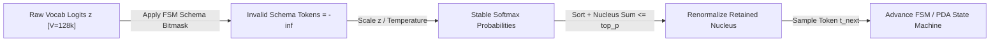

# Decoding Physics, GPU Batch Non-Determinism & Grammar-Constrained Structured Outputs

```json pretraining
[
  {
    "term": "Logit Sampling Pipeline",
    "formula": "z -> z / T -> Softmax -> Top-K Filter -> Top-P (Nucleus) Renorm",
    "meaning": "Order matters! Applying Temperature BEFORE Top-P reshapes probability concentration, dynamically shrinking or expanding the nucleus set."
  },
  {
    "term": "Float Non-Associativity",
    "formula": "(a + b) + c != a + (b + c)  in IEEE-754 FP16 / BF16 / FP32",
    "meaning": "Dynamic continuous batching changes CUDA tile reduction split sizes per millisecond, shifting tied logits by ~1e-3 and flipping argmax at T=0!"
  },
  {
    "term": "FSM Constrained Mask",
    "formula": "z'_v = z_v if v in ValidTransitions(State_s) else -infinity",
    "meaning": "Compiles JSON Schema / Regex / CFG into token-level bitmasks applied BEFORE Softmax, guaranteeing 0.00% JSON syntax errors in 1 pass!"
  },
  {
    "term": "Jump-Forward Decoding",
    "formula": "|ValidTransitions(State_s)| == 1  ==>  Append Deterministic Bytes Free",
    "meaning": "When schema syntax forces deterministic characters (e.g. '\": \"' or closing '}}'), engines emit tokens without running extra decode steps!"
  }
]
```

```json poe
{
  "question": "An SDET configures an LLM API client with temperature=0.0, top_p=1.0, and seed=42, expecting 100% bit-for-bit identical string assertions across CI runs. Under variable multi-tenant GPU server load (Continuous Batching + MoE), 4% of CI runs produce a different phrasing starting at token #19! Why?",
  "options": [
    "seed=42 is ignored whenever temperature equals 0.0",
    "IEEE-754 floating-point addition is NOT associative ((a+b)+c != a+(b+c)): as concurrent server batch size fluctuates (e.g., B=3 vs B=29), CUDA/Triton kernels switch GEMM tile reduction orders (and MoE expert capacities), nudging close top-2 logits (e.g. 14.2104 vs 14.2101) across each other so greedy argmax flips at token #19 and cascades autoregressively!",
    "BPE tokenizers randomize subword splits on multicore CPUs",
    "TLS 1.3 flips bits in streaming SSE chunks"
  ],
  "answerIndex": 1,
  "explanation": "Batch-size-invariant CUDA kernels carry a throughput penalty, so standard continuous-batching GPU servers change parallel reduction tree shapes depending on how many other users are in the current millisecond's batch—flipping near-tied greedy argmax tokens and diverging every subsequent token."
}
```

## 1. The Exact Decoding Pipeline: Temperature, `Top-K`, `Top-P` & `Min-P`

At the end of the final Transformer `RMSNorm`, multiplying hidden vector $h_t \in \mathbb{R}^d$ by the unembedding matrix $W_U \in \mathbb{R}^{d \times V}$ yields raw unnormalized **logits** $z \in \mathbb{R}^V$. Pure multinomial sampling directly from $\text{softmax}(z)$ fails on long generations because $128,000$ low-probability tail tokens (`p = 1e-6` each) collectively sum to `2–5%` probability mass—eventually sampling a nonsensical token that derails the entire autoregressive trajectory!

Modern inference engines transform logits in a strict canonical sequence:
1. **Grammar / Schema Bitmasking (`z[invalid] = -inf`)**: Masks out any token violating the active JSON Schema / Regex state.
2. **Temperature Scaling (`z' = z / T`)**: As $T \to 0^+$, $\text{softmax}(z/T)$ approaches deterministic `argmax(z)` (Greedy); $T > 1$ flattens entropy for creative brainstorming.
3. **`Top-K` Truncation**: Keeps at most the $K$ highest-logit tokens (safety rail against flat uniform distributions, though rigid when only `1` token is valid vs `20` plausible synonyms).
4. **`Top-P` (Nucleus Sampling, Holtzman et al.) & `Min-P`**: `Top-P` (`p = 0.90` or `0.95`) sorts tokens descending and retains the **smallest prefix whose cumulative probability $\ge p$**, adapting dynamically (`1` token kept on `"2 + 2 = "` vs `40` tokens kept on `"Write a story about "`). **`Min-P`** (`min_p = 0.05`) filters out any token with $p_i < \text{min\_p} \times p_{\max}$, scaling cleanly even at high temperatures $T = 1.5$!



---

## 2. Prompted `"Return JSON Only"` Retry Loops vs. FSM/CFG Constrained Decoding

```json contrast
{
  "title": "Prompt-Begging JSON + Regex Parsing vs Grammar-Masked Structured Outputs",
  "naiveTitle": "System Prompt 'Output Valid JSON Only'",
  "naiveMetric": "3-8% Parse Crashes · Retry Latency Spikes",
  "naivePoints": [
    "Model wraps JSON in fenced markdown code blocks, adds trailing conversational commentary, or emits unescaped quotes",
    "Hallucinates misspelled enum keys ('status': 'APROVED') or omits required Pydantic fields under long context pressure",
    "Wraps LLM calls in 3x retry loops on JSONDecodeError, tripling p99 latency and token spend when complex schemas fail"
  ],
  "staffTitle": "Pre-Compiled FSM / Pushdown Automaton Mask",
  "staffMetric": "100.00% Schema Valid · Faster Jump-Forward",
  "staffPoints": [
    "Compiles Pydantic / JSON Schema into an indexed vocabulary bitmask (Outlines / XGrammar / OpenAI Structured Outputs)",
    "Sets invalid vocabulary tokens to -inf BEFORE sampling—syntactically impossible to emit a broken bracket or invalid enum!",
    "Pre-caches compiled grammar bitmasks per schema hash (<50us/step overhead) and skips deterministic boilerplate tokens"
  ]
}
```

| Decoding Strategy | Typical Hyperparameters | Best Production Use Case | Critical Failure Mode |
| :--- | :--- | :--- | :--- |
| **Greedy / Near-Greedy** | `T = 0.0` (or `T = 0.1, top_p = 0.95`) | SQL generation, tool routing, classification, deterministic extraction | Repetition loops on weak models; still `~1-4%` non-deterministic across GPU batch sizes! |
| **Balanced Nucleus / `Min-P`** | `T = 0.6–0.7, top_p = 0.90` (or `min_p = 0.05`) | RAG synthesis, code explanation, multi-step reasoning (`Pass@k`) | Setting **both** aggressive `T = 1.2` AND `top_p = 1.0` leaks tail-token gibberish |
| **Constrained `FSM` / `CFG`** | Pydantic `response_format` + `T <= 0.3` | Production APIs, agent tool arguments, entity extraction | **"Reasoning Starvation"**: forcing JSON field `"verdict": true` *before* `"reasoning": "..."` degrades accuracy by `15–25%`! |

---

## 3. Dual-Language Production Blueprints: Nucleus/`Min-P` Sampler & FSM Constrained Decoder

### Python 3 Blueprint: Exact Temperature + `Top-K` + `Top-P` + `Min-P` + FSM Schema Bitmask Engine
```python
from __future__ import annotations
import math
import random
from typing import Dict, List, Mapping, Sequence, Set


def sample_token_with_constraints_and_nucleus(
    logits: Sequence[float],
    allowed_token_ids: Set[int] | None = None,
    temperature: float = 0.7,
    top_k: int = 0,
    top_p: float = 0.95,
    min_p: float = 0.0,
    rng: random.Random | None = None,
) -> int:
    """
    Production-ordered constrained decoding & nucleus sampler:
    1. Apply FSM/Grammar allowed-token mask (-inf on disallowed tokens)
    2. Handle greedy T == 0.0 deterministically over valid tokens
    3. Scale by Temperature -> Stable Softmax -> Top-K -> Min-P -> Top-P -> Renormalize
    """
    masked = [
        z if (allowed_token_ids is None or idx in allowed_token_ids) else -float("inf")
        for idx, z in enumerate(logits)
    ]
    valid_indices = [i for i, z in enumerate(masked) if math.isfinite(z)]
    if not valid_indices:
        raise ValueError("Grammar Deadlock: FSM allowed_token_ids intersected with vocabulary is empty!")

    if temperature <= 1e-7:
        return max(valid_indices, key=lambda idx: masked[idx])

    scaled = [z / temperature if math.isfinite(z) else -float("inf") for z in masked]
    z_max = max(scaled[i] for i in valid_indices)
    indexed_probs = [(i, math.exp(scaled[i] - z_max)) for i in valid_indices]
    total_exp = sum(w for _, w in indexed_probs)
    # Sort descending by probability (tie-break by token ID for deterministic CPU behavior)
    ranked = sorted(((i, w / total_exp) for i, w in indexed_probs), key=lambda x: (-x[1], x[0]))

    if top_k > 0:
        ranked = ranked[:top_k]

    if min_p > 0.0 and ranked:
        floor_prob = min_p * ranked[0][1]
        ranked = [item for item in ranked if item[1] >= floor_prob] or [ranked[0]]

    if 0.0 < top_p < 1.0:
        nucleus: List[tuple[int, float]] = []
        cum_p = 0.0
        for tok_id, prob in ranked:
            nucleus.append((tok_id, prob))
            cum_p += prob
            if cum_p >= top_p:
                break
        ranked = nucleus

    norm = sum(p for _, p in ranked)
    generator = rng or random.Random(0)
    target = generator.random() * norm
    acc = 0.0
    for tok_id, prob in ranked:
        acc += prob
        if target <= acc:
            return tok_id
    return ranked[-1][0]


class JsonEnumFsmConstraint:
    """
    Illustrates Outlines / XGrammar Finite-State Machine token masking:
    Guarantees generated token sequence strictly matches {"verdict":"(PASS|FAIL)"} with 0% syntax failure.
    """

    def __init__(self, vocab: Mapping[int, str]) -> None:
        self._vocab = vocab
        self._valid_Targets = ('{"verdict":"PASS"}', '{"verdict":"FAIL"}')

    def allowed_tokens_for_prefix(self, generated_so_far: str) -> Set[int]:
        allowed: Set[int] = set()
        for tok_id, piece in self._vocab.items():
            candidate = generated_so_far + piece
            if any(t.startswith(candidate) for t in self._valid_Targets):
                allowed.add(tok_id)
        return allowed
```

### Java 17 Blueprint: Compact BitSet FSM Vocabulary Mask & Nucleus (`Top-P`) Decoder
```java
package com.hub.ai.decoding;

import java.util.Arrays;
import java.util.BitSet;
import java.util.Comparator;
import java.util.SplittableRandom;

public final class ConstrainedNucleusDecoder {

    private record TokenProb(int tokenId, double prob) {}

    /**
     * Applies pre-compiled BitSet grammar mask (64 tokens per CPU word!) + Temperature + Top-P Nucleus.
     */
    public static int decodeNextToken(
            float[] rawLogits,
            BitSet grammarValidMask,
            double temperature,
            double topP,
            SplittableRandom rng) {

        int vocabSize = rawLogits.length;
        if (grammarValidMask != null && grammarValidMask.isEmpty()) {
            throw new IllegalStateException("Empty FSM transition mask — invalid schema state");
        }

        if (temperature <= 1e-7) {
            int bestId = -1;
            float bestLogit = Float.NEGATIVE_INFINITY;
            for (int i = 0; i < vocabSize; i++) {
                if ((grammarValidMask == null || grammarValidMask.get(i)) && rawLogits[i] > bestLogit) {
                    bestLogit = rawLogits[i];
                    bestId = i;
                }
            }
            return bestId;
        }

        double maxScaled = Double.NEGATIVE_INFINITY;
        int validCount = 0;
        for (int i = 0; i < vocabSize; i++) {
            if (grammarValidMask == null || grammarValidMask.get(i)) {
                validCount++;
                double s = rawLogits[i] / temperature;
                if (s > maxScaled) maxScaled = s;
            }
        }

        TokenProb[] candidates = new TokenProb[validCount];
        double sumExp = 0.0;
        int ptr = 0;
        for (int i = 0; i < vocabSize; i++) {
            if (grammarValidMask == null || grammarValidMask.get(i)) {
                double e = Math.exp((rawLogits[i] / temperature) - maxScaled);
                sumExp += e;
                candidates[ptr++] = new TokenProb(i, e);
            }
        }

        final double denom = sumExp;
        for (int i = 0; i < candidates.length; i++) {
            candidates[i] = new TokenProb(candidates[i].tokenId(), candidates[i].prob() / denom);
        }
        Arrays.sort(candidates, Comparator.comparingDouble(TokenProb::prob).reversed());

        double cum = 0.0;
        int cutoff = 0;
        while (cutoff < candidates.length) {
            cum += candidates[cutoff].prob();
            cutoff++;
            if (cum >= topP) break;
        }

        double draw = rng.nextDouble() * cum;
        double running = 0.0;
        for (int i = 0; i < cutoff; i++) {
            running += candidates[i].prob();
            if (draw <= running) {
                return candidates[i].tokenId();
            }
        }
        return candidates[cutoff - 1].tokenId();
    }
}
```

> [!WARNING] **Staff Interview Gotcha — Key Ordering in Constrained JSON Schemas Makes or Breaks Reasoning Accuracy!** Because Transformers are strictly **causal (`left-to-right`)**, field declaration order inside your Pydantic / JSON Schema literally controls the model's causal computation budget! If you define:
> `class FraudDecision(BaseModel): is_fraud: bool; step_by_step_analysis: str`
> Constrained decoding forces the model to commit to `"is_fraud": true` at **token #5**—*before* it has had any tokens to reason! On subsequent tokens, `step_by_step_analysis` merely rationalizes its hasty guess, dropping accuracy by **`15–30%`**! **Invariant:** Always place `chain_of_thought_evidence: list[str]` or `rationale: str` as the **very first key** in every structured output schema, and place `verdict` / `score` / `action` **last**!

---

## 4. Scenario Retrieval-Practice Mastery Gate

```json quiz
[
  {
    "id": "aie-07-q1",
    "question": "Why must an LLM evaluation suite NEVER rely on exact string equality (assert llm_out == expected_paragraph) even when temperature=0.0 and seed=0 are set on a cloud or vLLM API?",
    "options": [
      "JSON strings reorder characters alphabetically over HTTPS",
      "GPU GEMM reductions and MoE routing are not batch-size invariant: floating-point non-associativity ((a+b)+c != a+(b+c)) shifts near-tied logits across dynamic server batch sizes, flipping a single greedy token that alters the rest of the autoregressive output; assertions must verify semantic invariants, parsed schema fields, or deterministic claim rubrics",
      "Python's hash randomization alters UTF-8 decoding",
      "Temperature=0.0 switches to uniform random sampling on ties"
    ],
    "answerIndex": 1,
    "explanation": "Horace He / Thinking Machines Lab demonstrated definitively that batch-size variance in parallel GPU reductions is the primary root cause of temperature=0 LLM non-determinism in production."
  },
  {
    "id": "aie-07-q2",
    "question": "Does Grammar-Constrained Decoding (e.g., Outlines / XGrammar / OpenAI Strict Structured Outputs) guarantee BOTH 0% JSON syntax errors AND 0% semantic hallucinations?",
    "options": [
      "Yes, FSM bitmasks verify factual database truth at each token",
      "NO! Constrained decoding guarantees 100% syntactic & structural compliance (valid JSON, exact keys, valid enum strings, required types), NOT factual accuracy—an FSM happily lets the model emit {\"orderId\": \"ORD-HALLUCINATED-999\", \"refundCents\": 9999999} unless paired with Pydantic domain validators & RAG grounding checks!",
      "No, FSMs still fail JSON parsing 2% of the time",
      "Yes, provided temperature <= 0.2"
    ],
    "answerIndex": 1,
    "explanation": "Syntactic validity != semantic grounding. Constrained decoding eliminates JSONDecodeError and missing-key crashes completely, leaving domain business bounds and grounding verification to deterministic application code."
  },
  {
    "id": "aie-07-q3",
    "question": "What happens if an API caller sets BOTH temperature = 0.0 (or 0.01) AND top_p = 0.1 simultaneously, versus setting temperature = 1.5 AND top_p = 1.0?",
    "options": [
      "Setting both causes an HTTP 400 Bad Request on all providers",
      "At T -> 0, almost 100% of probability mass already collapses onto token #1 so top_p = 0.1 is redundant (providers recommend tuning Temperature OR Top-P, not both aggressively); conversely, T = 1.5 with top_p = 1.0 (no tail truncation!) inflates 100,000 garbage tail tokens and causes severe incoherence unless guarded by top_p <= 0.95 or min_p = 0.05",
      "Top-P executes before Temperature scaling",
      "Temperature only affects prefill, not decode"
    ],
    "answerIndex": 1,
    "explanation": "High temperature flattens the entire 128k vocabulary distribution; without nucleus (top_p) or min_p tail truncation, cumulative probability across 120,000 absurd tokens becomes huge."
  }
]
```
