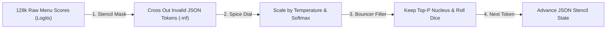

# AeroBrain v0.7: Decoding Physics, GPU Batch Non-Determinism & Grammar-Constrained Structured Outputs

```json continuity
{
  "previously": "In Chapter 06, we scaled AeroBrain v0.6 onto quantized GPU kernels with Continuous Batching so our Transformer can generate tokens fast and cheaply for thousands of flyers.",
  "painPoint": "When AeroCart's Java checkout service asks AeroBrain v0.6 to return a refund decision as JSON, the model occasionally wraps the JSON in 'Here is your JSON:' markdown fences or misspells a field—crashing our parser in production! Even worse, setting `temperature=0` still produces slightly different answers under heavy GPU traffic!",
  "unlock": "We will upgrade to AeroBrain v0.7 by mastering the exact logit-to-token sampling pipeline (`Temperature`, `Top-K`, `Top-P`, `Min-P`), uncovering why GPU batching breaks `temperature=0` determinism, and building a Finite-State Machine (FSM) token mask that makes broken JSON mathematically impossible!"
}
```

```json walkthrough
[
  {
    "time": "0:00",
    "badge": "Slide 1 / 4 · From Raw Scores to Next-Word Dice",
    "caption": "At the end of every Transformer step, AeroBrain outputs 128,000 raw scores ('logits')—one for every token in its vocabulary. Temperature acts like a contrast dial before we roll the dice!",
    "code": "# Low Temperature (T=0.1): Sharpens top choice -> predictable\n# High Temperature (T=1.2): Flattens choices -> creative (or wild!)"
  },
  {
    "time": "0:25",
    "badge": "Slide 2 / 4 · Trimming the Long Tail with Top-P",
    "caption": "Even if 100,000 weird words each have a tiny 0.00003% chance, together they add up to a 3% risk of picking total nonsense! Top-P (Nucleus Sampling) keeps only the top words whose probabilities add up to 90-95%.",
    "code": "# Top-P = 0.90:\n# On '2 + 2 = ' -> keeps 1 token ('4' = 99%)\n# On 'Fly to sunny ' -> keeps ~15 plausible city tokens"
  },
  {
    "time": "0:52",
    "badge": "Slide 3 / 4 · Why Begging for JSON in Prompts Fails",
    "caption": "Writing 'PLEASE RETURN ONLY VALID JSON' in a system prompt still fails 3-8% of the time when the model chats politely or forgets a closing brace.",
    "code": "// Prompt-begging failure in production:\n\"Sure! Here is the refund payload:\\n{\\\"verdict\\\": \\\"APROVED\\\"\" // <-- Crash!"
  },
  {
    "time": "1:18",
    "badge": "Slide 4 / 4 · FSM Grammar Masking: 0% Syntax Errors!",
    "caption": "In AeroBrain v0.7, we compile our JSON Schema into a state machine that sets every illegal token's score to -infinity BEFORE rolling the dice—making invalid JSON impossible!",
    "code": "for tok_id in range(vocab_size):\n    if tok_id not in fsm.allowed_tokens(current_state):\n        logits[tok_id] = -float('inf')  # 0.00% chance of selection!"
  }
]
```

```json pretraining
[
  {
    "term": "Logit Sampling Pipeline",
    "formula": "Mask -> Temperature -> Softmax -> Top-K -> Min-P -> Top-P",
    "meaning": "The step-by-step filter that turns 128,000 raw model scores into one clean chosen next token without accidentally picking gibberish words."
  },
  {
    "term": "Floating-Point Non-Associativity",
    "formula": "(a + b) + c != a + (b + c) on GPU floats",
    "meaning": "Adding decimals in a different order on a GPU changes the last tiny digit—which is why changing how many users share a GPU batch can flip a tied `temperature=0` token!"
  },
  {
    "term": "Grammar-Constrained Masking (FSM)",
    "formula": "Illegal Schema Token Score -> -infinity",
    "meaning": "Checking which tokens are legal next characters in your JSON schema and zeroing out every other token before the model picks one."
  },
  {
    "term": "Jump-Forward Decoding",
    "formula": "Only 1 Legal Next String -> Append Automatically",
    "meaning": "When a JSON schema forces the exact next characters (like `\"verdict\": \"`), the engine inserts them immediately without wasting a GPU step!"
  }
]
```

```json poe
{
  "question": "You set `temperature=0.0` and `seed=42` on AeroBrain v0.7 so your CI test can check `assert response == expected_text`. At 3 AM (when the GPU server is idle), the test passes 100% of the time. At noon (when 30 other users hit the GPU simultaneously), 4% of runs return a slightly different sentence starting at word #19! Why?",
  "options": [
    "The `seed=42` parameter expires after 6 hours",
    "Decimal math on GPUs is not associative (`(a+b)+c != a+(b+c)`): when Continuous Batching combines 1 request vs. 30 requests, the GPU groups matrix additions differently, nudging two nearly tied token scores (like `14.2104` vs `14.2101`) past each other so `temperature=0` picks the other word at token #19!",
    "The tokenizer shuffles letters when CPU usage is high",
    "HTTPS encrypts words in a random order"
  ],
  "answerIndex": 1,
  "explanation": "Even at temperature=0, GPU matrix kernels split parallel reductions differently depending on the current millisecond's batch size. A 0.0003 rounding shift flips a near-tie at token #19, which changes every word generated after it!"
}
```

## 🌱 Step 1: Plain-English Story — The Restaurant Menu & The Guardrail Stencil

Imagine AeroBrain is a super-fast travel concierge helping AeroCart's checkout system decide whether a delayed flight qualifies for an instant refund.

Every time AeroBrain picks the next word (token), its neural network prints a giant menu of **128,000 possible pieces of text**, each with a raw preference score (called a **logit**). How do we pick from that menu?
1. **Temperature (`T`) is the "Spice Dial"**: Turning Temperature down toward `0` makes AeroBrain always pick the #1 safest choice on the menu. Turning Temperature up (`T = 1.0+`) flattens the menu so quirky, creative words get a chance.
2. **Top-P (`Nucleus Sampling`) is the "Weird-Word Bouncer"**: Even if 100,000 random dictionary words each have a tiny `0.00003%` chance, together they add up to a `3%` chance of blurting out a totally bizarre word mid-sentence! **Top-P (`p = 0.90`)** sorts the menu from best to worst and keeps *only* the top words that add up to `90%` probability—throwing the 100,000 weird tail words in the trash!
3. **FSM Grammar Masking is the "Plastic Stencil"**: What if AeroCart's Java backend needs the answer in strict JSON (`{"verdict":"PASS"}`)? If you merely *ask* politely in the prompt, the model will eventually reply `"Sure! Here is your JSON..."` and crash your parser. Instead, **Grammar-Constrained Decoding** places a physical stencil over the 128,000-word menu at every step: if the next character *must* be `"PASS"` or `"FAIL"`, every other token in the vocabulary is crossed out (`-infinity`) **before** the model chooses!



Let's build a working 18-line **Temperature + Stencil Token Picker** for `AeroBrain v0.7` right now!

## 🔨 Step 2: First Lines of Code — Build `AeroBrain v0.7`'s Stencil Sampler in 18 Lines!

Watch how clean this is: given raw scores for 5 tokens (`"Sure!"`, `'{"verdict":'`, `'"PASS"}'`, `'"FAIL"}'`, `"maybe"`), a plain sampler might pick `"Sure!"` or `"maybe"` and break our JSON parser. By passing `allowed_tokens` from our JSON stencil, invalid tokens get `-inf` and have a **0.00% chance** of ever being picked!

```python
import math

vocab = {0: "Sure! ", 1: '{"verdict":', 2: '"PASS"}', 3: '"FAIL"}', 4: '"MAYBE"}'}
raw_logits = [4.5, 2.1, 3.8, 3.6, 4.9]  # Notice "MAYBE" (4.9) & "Sure!" (4.5) have highest raw scores!


def pick_next_token(logits: list[float], allowed_ids: set[int], temperature: float = 0.5) -> str:
    # 1. STENCIL MASK: Cross out any token that violates our JSON schema (-inf)
    masked = [z if i in allowed_ids else -float("inf") for i, z in enumerate(logits)]
    if temperature == 0.0:
        return vocab[max(allowed_ids, key=lambda i: masked[i])]
    # 2. TEMPERATURE + SOFTMAX: Convert remaining valid scores into probabilities
    probs = [math.exp(z / temperature) if math.isfinite(z) else 0.0 for z in masked]
    best_id = max(range(len(probs)), key=lambda i: probs[i])
    return vocab[best_id]


# Step A: At start of JSON, ONLY token 1 ('{"verdict":') is legal!
# Step B: For the enum value, ONLY tokens {2, 3} ('"PASS"}' or '"FAIL"}') are legal!
step_a = pick_next_token(raw_logits, allowed_ids={1}, temperature=0.0)
step_b = pick_next_token(raw_logits, allowed_ids={2, 3}, temperature=0.2)
print(f"AeroBrain v0.7 Output: {step_a}{step_b}")  # -> {"verdict":"PASS"} (100% valid JSON!)
```

### Java 17 Equivalent

```java
import java.util.Set;

public class AeroBrainStencilDemo {
    static final String[] VOCAB = {"Sure! ", "{\"verdict\":", "\"PASS\"}", "\"FAIL\"}", "\"MAYBE\"}"};
    static final double[] RAW_LOGITS = {4.5, 2.1, 3.8, 3.6, 4.9};

    public static String pickNextToken(double[] logits, Set<Integer> allowedIds) {
        int bestId = -1;
        double bestScore = Double.NEGATIVE_INFINITY;
        for (int i = 0; i < logits.length; i++) {
            // STENCIL MASK: Ignore any token not permitted by the current JSON grammar state
            double maskedScore = allowedIds.contains(i) ? logits[i] : Double.NEGATIVE_INFINITY;
            if (maskedScore > bestScore) {
                bestScore = maskedScore;
                bestId = i;
            }
        }
        return VOCAB[bestId];
    }

    public static void main(String[] args) {
        String stepA = pickNextToken(RAW_LOGITS, Set.of(1));
        String stepB = pickNextToken(RAW_LOGITS, Set.of(2, 3));
        System.out.println("AeroBrain v0.7 Output: " + stepA + stepB);
    }
}
```

Even though `"MAYBE"}"` (`4.9`) and `"Sure! "` (`4.5`) had higher raw scores than `"PASS"}"` (`3.8`), our stencil mask guaranteed that `AeroBrain v0.7` could **only** emit valid schema tokens!

## ⚡ Step 3: Where It Breaks in Real Life — Prompt-Begging Loops & GPU Batch Flips

What happens when teams skip constrained decoding and rely on `"Please return valid JSON"` in their prompt, or write tests with `assert output == expected_string` assuming `temperature=0` is 100% identical forever?

1. **The Prompt-Begging Retry Spiral**: Under long conversation histories, prompted JSON fails `3–8%` of the time (markdown code fences, trailing commas, or invented enum values like `"APROVED"`). Wrapping LLM calls in a `3x` retry loop on `JSONDecodeError` triples your p99 latency and token bill right when traffic spikes!
2. **Why `temperature=0` Still Flips Across GPU Batch Sizes**: In IEEE-754 floating-point math, `(a + b) + c != a + (b + c)`. When a GPU server runs Continuous Batching, the number of concurrent requests in a batch changes every millisecond (`batch=2` vs. `batch=27`), causing CUDA/Triton kernels to pick different tile reduction orders. That tiny `~1e-3` rounding shift flips two nearly tied tokens at `temperature=0`, changing word #19 and every word after it!

```json contrast
{
  "title": "Prompt-Begging JSON + Retry Loops vs. Pre-Compiled FSM Grammar Masking",
  "naiveTitle": "System Prompt 'Output Valid JSON Only'",
  "naiveMetric": "3-8% Parse Crashes · 3x Retry Latency Spikes",
  "naivePoints": [
    "Model wraps JSON in markdown blocks, adds polite commentary, or emits unescaped quotes",
    "Hallucinates misspelled enum keys ('status': 'APROVED') or drops required fields under long context pressure",
    "Wraps LLM calls in 3x retry loops on JSONDecodeError, tripling p99 latency and token spend"
  ],
  "staffTitle": "Pre-Compiled FSM / Pushdown Automaton Mask",
  "staffMetric": "100.00% Schema Valid · Faster Jump-Forward",
  "staffPoints": [
    "Compiles Pydantic / JSON Schema into an indexed vocabulary bitmask (Outlines / XGrammar / Strict Structured Outputs)",
    "Sets invalid vocabulary tokens to -inf BEFORE sampling—syntactically impossible to emit broken JSON or bad enums!",
    "Uses Jump-Forward Decoding to append deterministic schema boilerplate ('{\"verdict\":\"') without extra GPU decode steps"
  ]
}
```

Use the **Interactive Guardrails & Decoding Simulator** below to test how FSM token masks and sampling parameters behave under edge cases.

## 🚀 Step 4: Staff Engineer Deep-Dive — Exact Logit Math, `Min-P` & Schema Field-Order Physics

At the end of the final Transformer `RMSNorm`, multiplying hidden vector $h_t \in \mathbb{R}^d$ by the unembedding matrix $W_U \in \mathbb{R}^{d \times V}$ yields raw unnormalized **logits** $z \in \mathbb{R}^V$. Given a Finite-State Machine (FSM) or Pushdown Automaton (PDA) in grammar state $s_t$ with valid vocabulary subset $\mathcal{V}_{\text{valid}}(s_t) \subseteq \{1, \dots, V\}$, the masked temperature-scaled probability distribution is:

$$z'_i = \begin{cases} \frac{z_i}{T} & \text{if } i \in \mathcal{V}_{\text{valid}}(s_t) \\ -\infty & \text{otherwise} \end{cases}, \qquad P(w_i \mid w_{<t}) = \frac{\exp(z'_i - \max_k z'_k)}{\sum_{j=1}^{V} \exp(z'_j - \max_k z'_k)}$$

Modern inference engines then apply tail truncation before multinomial sampling:
- **`Top-K` Truncation**: Keeps at most the $K$ highest-probability tokens.
- **`Top-P` (Nucleus Sampling, Holtzman et al.)**: Sorts tokens descending $p_{(1)} \ge p_{(2)} \ge \dots$ and retains the smallest prefix $\mathcal{N}_p = \{ (1), \dots, (m) \}$ such that:

$$\sum_{j=1}^{m} p_{(j)} \ge p_{\text{top\_p}}$$

- **`Min-P` Sampling**: Retains only tokens whose probability is at least a fraction $\text{min\_p}$ (e.g., `0.05`) of the top token's probability ($p_i \ge \text{min\_p} \times p_{(1)}$), scaling cleanly even at high creative temperatures ($T = 1.3$).

| Decoding Strategy | Typical Hyperparameters | Best Production Use Case | Critical Failure Mode |
| :--- | :--- | :--- | :--- |
| **Greedy / Near-Greedy** | `T = 0.0` (or `T = 0.1, top_p = 0.95`) | SQL generation, tool routing, classification, deterministic extraction | Repetition loops on weak models; still `~1-4%` non-deterministic across GPU batch sizes! |
| **Balanced Nucleus / `Min-P`** | `T = 0.6–0.7, top_p = 0.90` (or `min_p = 0.05`) | RAG synthesis, code explanation, multi-step reasoning (`Pass@k`) | Setting **both** aggressive `T = 1.2` AND `top_p = 1.0` leaks tail-token gibberish |
| **Constrained `FSM` / `CFG`** | Pydantic `response_format` + `T <= 0.3` | Production APIs, agent tool arguments, entity extraction | **"Reasoning Starvation"**: forcing JSON field `"verdict": true` *before* `"reasoning": "..."` degrades accuracy by `15–25%`! |

### Python 3 Production Blueprint: Exact Temperature + `Top-K` + `Min-P` + `Top-P` + FSM Schema Bitmask Engine

```python
from __future__ import annotations
import math
import random
from typing import List, Mapping, Sequence, Set


def sample_token_with_constraints_and_nucleus(
    logits: Sequence[float],
    allowed_token_ids: Set[int] | None = None,
    temperature: float = 0.7,
    top_k: int = 0,
    top_p: float = 0.95,
    min_p: float = 0.0,
    rng: random.Random | None = None,
) -> int:
    """
    Production-ordered constrained decoding & nucleus sampler for AeroBrain v0.7:
    1. Apply FSM/Grammar allowed-token mask (-inf on disallowed tokens)
    2. Handle greedy T == 0.0 deterministically over valid tokens
    3. Scale by Temperature -> Stable Softmax -> Top-K -> Min-P -> Top-P -> Renormalize
    """
    masked = [
        z if (allowed_token_ids is None or idx in allowed_token_ids) else -float("inf")
        for idx, z in enumerate(logits)
    ]
    valid_indices = [i for i, z in enumerate(masked) if math.isfinite(z)]
    if not valid_indices:
        raise ValueError("Grammar Deadlock: FSM allowed_token_ids intersected with vocabulary is empty!")

    if temperature <= 1e-7:
        return max(valid_indices, key=lambda idx: masked[idx])

    scaled = [z / temperature if math.isfinite(z) else -float("inf") for z in masked]
    z_max = max(scaled[i] for i in valid_indices)
    indexed_probs = [(i, math.exp(scaled[i] - z_max)) for i in valid_indices]
    total_exp = sum(w for _, w in indexed_probs)
    ranked = sorted(((i, w / total_exp) for i, w in indexed_probs), key=lambda x: (-x[1], x[0]))

    if top_k > 0:
        ranked = ranked[:top_k]

    if min_p > 0.0 and ranked:
        floor_prob = min_p * ranked[0][1]
        ranked = [item for item in ranked if item[1] >= floor_prob] or [ranked[0]]

    if 0.0 < top_p < 1.0:
        nucleus: List[tuple[int, float]] = []
        cum_p = 0.0
        for tok_id, prob in ranked:
            nucleus.append((tok_id, prob))
            cum_p += prob
            if cum_p >= top_p:
                break
        ranked = nucleus

    norm = sum(p for _, p in ranked)
    generator = rng or random.Random(0)
    target = generator.random() * norm
    acc = 0.0
    for tok_id, prob in ranked:
        acc += prob
        if target <= acc:
            return tok_id
    return ranked[-1][0]


class JsonEnumFsmConstraint:
    """
    Illustrates Outlines / XGrammar Finite-State Machine token masking:
    Guarantees generated token sequence strictly matches {"verdict":"(PASS|FAIL)"} with 0% syntax failure.
    """

    def __init__(self, vocab: Mapping[int, str]) -> None:
        self._vocab = vocab
        self._valid_targets = ('{"verdict":"PASS"}', '{"verdict":"FAIL"}')

    def allowed_tokens_for_prefix(self, generated_so_far: str) -> Set[int]:
        allowed: Set[int] = set()
        for tok_id, piece in self._vocab.items():
            candidate = generated_so_far + piece
            if any(t.startswith(candidate) for t in self._valid_targets):
                allowed.add(tok_id)
        return allowed
```

### Java 17 Equivalent

```java
package com.hub.ai.decoding;

import java.util.Arrays;
import java.util.BitSet;
import java.util.Comparator;
import java.util.SplittableRandom;

public final class ConstrainedNucleusDecoder {

    private record TokenProb(int tokenId, double prob) {}

    /**
     * Applies pre-compiled BitSet grammar mask (64 tokens per CPU word!) + Temperature + Top-P Nucleus.
     */
    public static int decodeNextToken(
            float[] rawLogits,
            BitSet grammarValidMask,
            double temperature,
            double topP,
            SplittableRandom rng) {

        int vocabSize = rawLogits.length;
        if (grammarValidMask != null && grammarValidMask.isEmpty()) {
            throw new IllegalStateException("Empty FSM transition mask — invalid schema state");
        }

        if (temperature <= 1e-7) {
            int bestId = -1;
            float bestLogit = Float.NEGATIVE_INFINITY;
            for (int i = 0; i < vocabSize; i++) {
                if ((grammarValidMask == null || grammarValidMask.get(i)) && rawLogits[i] > bestLogit) {
                    bestLogit = rawLogits[i];
                    bestId = i;
                }
            }
            return bestId;
        }

        double maxScaled = Double.NEGATIVE_INFINITY;
        int validCount = 0;
        for (int i = 0; i < vocabSize; i++) {
            if (grammarValidMask == null || grammarValidMask.get(i)) {
                validCount++;
                double s = rawLogits[i] / temperature;
                if (s > maxScaled) maxScaled = s;
            }
        }

        TokenProb[] candidates = new TokenProb[validCount];
        double sumExp = 0.0;
        int ptr = 0;
        for (int i = 0; i < vocabSize; i++) {
            if (grammarValidMask == null || grammarValidMask.get(i)) {
                double e = Math.exp((rawLogits[i] / temperature) - maxScaled);
                sumExp += e;
                candidates[ptr++] = new TokenProb(i, e);
            }
        }

        final double denom = sumExp;
        for (int i = 0; i < candidates.length; i++) {
            candidates[i] = new TokenProb(candidates[i].tokenId(), candidates[i].prob() / denom);
        }
        Arrays.sort(candidates, Comparator.comparingDouble(TokenProb::prob).reversed());

        double cum = 0.0;
        int cutoff = 0;
        while (cutoff < candidates.length) {
            cum += candidates[cutoff].prob();
            cutoff++;
            if (cum >= topP) break;
        }

        double draw = rng.nextDouble() * cum;
        double running = 0.0;
        for (int i = 0; i < cutoff; i++) {
            running += candidates[i].prob();
            if (draw <= running) {
                return candidates[i].tokenId();
            }
        }
        return candidates[cutoff - 1].tokenId();
    }
}
```

> [!WARNING]
> **Staff Interview Gotcha — Key Ordering in Constrained JSON Schemas Makes or Breaks Reasoning Accuracy!**
> Because Transformers generate strictly **left-to-right**, field declaration order inside your Pydantic / JSON Schema literally controls the model's thinking budget! If you define `class RefundDecision(BaseModel): approve_refund: bool; step_by_step_reasoning: str`, constrained decoding forces AeroBrain to commit to `"approve_refund": true` at **token #5**—*before* it has generated a single word of reasoning! On subsequent tokens, `step_by_step_reasoning` merely rationalizes its blind guess, dropping accuracy by **`15–30%`**! **Fix:** Always place `reasoning_steps: list[str]` as the **very first key** in every structured output schema, and place `verdict` / `approve_refund` **last**!

**Up Next in Chapter 08 (`AeroBrain v0.8`)**: Now that `AeroBrain v0.7` emits 100% valid JSON, why is our cloud bill spiking to `$48 per 1,000 requests` and why is Time-To-First-Token (`TTFT`) dragging past `2.4 seconds` whenever we include AeroCart's 18,000-token Refund Policy manual? In Chapter 08, we'll unlock **85%+ KV Prefix Cache Hits & Sandwich Context Packing**!

```json quiz
[
  {
    "id": "aie-07-q1",
    "question": "Why must an LLM evaluation suite NEVER rely on exact string equality (assert llm_out == expected_paragraph) even when temperature=0.0 and seed=0 are set on a cloud or vLLM API?",
    "options": [
      "JSON strings reorder characters alphabetically over HTTPS",
      "GPU GEMM reductions and MoE routing are not batch-size invariant: floating-point non-associativity ((a+b)+c != a+(b+c)) shifts near-tied logits across dynamic server batch sizes, flipping a single greedy token that alters the rest of the autoregressive output; assertions must verify semantic invariants, parsed schema fields, or deterministic claim rubrics",
      "Python's hash randomization alters UTF-8 decoding",
      "Temperature=0.0 switches to uniform random sampling on ties"
    ],
    "answerIndex": 1,
    "explanation": "Batch-size variance in parallel GPU reductions is the primary root cause of temperature=0 LLM non-determinism in production."
  },
  {
    "id": "aie-07-q2",
    "question": "Does Grammar-Constrained Decoding (e.g., Outlines / XGrammar / Strict Structured Outputs) guarantee BOTH 0% JSON syntax errors AND 0% semantic hallucinations?",
    "options": [
      "Yes, FSM bitmasks verify factual database truth at each token",
      "NO! Constrained decoding guarantees 100% syntactic & structural compliance (valid JSON, exact keys, valid enum strings, required types), NOT factual accuracy—an FSM happily lets the model emit {\"orderId\": \"ORD-HALLUCINATED-999\", \"refundCents\": 9999999} unless paired with Pydantic domain validators & RAG grounding checks!",
      "No, FSMs still fail JSON parsing 2% of the time",
      "Yes, provided temperature <= 0.2"
    ],
    "answerIndex": 1,
    "explanation": "Syntactic validity != semantic grounding. Constrained decoding eliminates JSONDecodeError and missing-key crashes completely, leaving domain business bounds and grounding verification to deterministic application code."
  },
  {
    "id": "aie-07-q3",
    "question": "What happens if an API caller sets BOTH temperature = 0.0 (or 0.01) AND top_p = 0.1 simultaneously, versus setting temperature = 1.5 AND top_p = 1.0?",
    "options": [
      "Setting both causes an HTTP 400 Bad Request on all providers",
      "At T -> 0, almost 100% of probability mass already collapses onto token #1 so top_p = 0.1 is redundant (providers recommend tuning Temperature OR Top-P, not both aggressively); conversely, T = 1.5 with top_p = 1.0 (no tail truncation!) inflates 100,000 garbage tail tokens and causes severe incoherence unless guarded by top_p <= 0.95 or min_p = 0.05",
      "Top-P executes before Temperature scaling",
      "Temperature only affects prefill, not decode"
    ],
    "answerIndex": 1,
    "explanation": "High temperature flattens the entire 128k vocabulary distribution; without nucleus (top_p) or min_p tail truncation, cumulative probability across 120,000 absurd tokens becomes huge."
  }
]
```
