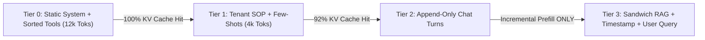

# Context Architecture, KV Prefix Caching, Lost-in-the-Middle & TTFT/TPOT Economics

```json pretraining
[
  {
    "term": "Causal Cache Rule",
    "formula": "KV(token_i) = f(tokens[0 .. i])  ==>  1 Mutated Byte @ k Invalidates [k .. L]!",
    "meaning": "Because causal attention attends strictly leftward, KV-Cache reuse works ONLY on exact byte-identical token prefixes from index 0."
  },
  {
    "term": "Radix / Automatic Prefix",
    "formula": "BlockHash_b = SHA256(BlockHash_{b-1} || TokenIDs[16b .. 16b+15])",
    "meaning": "SGLang RadixAttention & vLLM Automatic Prefix Caching index 16-token KV pages in a radix tree, skipping prefill FLOPs on cache hits."
  },
  {
    "term": "U-Shaped Recall Curve",
    "formula": "Recall(pos) >> Recall(middle)  (Primacy + Recency Bias)",
    "meaning": "Liu et al. ('Lost in the Middle'): LLM retrieval accuracy drops 15-30% on facts buried at 40-60% depth vs top-1 or bottom-most positions!"
  },
  {
    "term": "End-to-End Latency Law",
    "formula": "T_total = T_retrieval + TTFT(L_uncached) + TPOT * (N_out - 1)",
    "meaning": "Decomposes p99 latency into uncached prefill (TTFT) plus linear output generation (TPOT * N_out) to allocate exact SLA budgets."
  }
]
```

```json poe
{
  "question": "An AI Agent prepends line 1 of its 18,000-token System Prompt with f'Current UTC Timestamp: {datetime.now().isoformat()}\\n' followed by 17,980 tokens of static tool JSON schemas and enterprise SOP rules. Despite traffic hitting 50 RPS on the same tenant, cloud bill inspection shows 0.0% Prompt Cache Hit Rate and a 2,100ms Time-To-First-Token (TTFT)! What 1-line architectural change cuts cost by ~78% and TTFT down to ~240ms?",
  "options": [
    "Round the timestamp to the nearest 500 milliseconds",
    "Move volatile dynamic fields (current timestamp, user_id, live query) to the VERY END of the prompt (user turn) AFTER all static system rules, tool schemas (sorted deterministically by name!), and static few-shot examples—preserving an immutable 17,980-token causal prefix from index 0!",
    "Compress the system prompt using Base64 encoding",
    "Switch from streaming SSE to blocking HTTP/1.1"
  ],
  "answerIndex": 1,
  "explanation": "Causal self-attention makes KV_i a function of every preceding token 0..i. Mutating token #6 (a per-second timestamp) alters K and V for all 17,980 subsequent tokens, destroying 100% of KV prefix cache hits!"
}
```

## 1. Causal Prefix-Caching Physics (`RadixAttention`) & Canonical Prompt Layering

In modern LLM APIs (Anthropic, OpenAI, Gemini Context Caching) and self-hosted engines (`vLLM` Automatic Prefix Caching / `SGLang` `RadixAttention`), cached prompt tokens cost **`50%–90%` less** and bypass $O(L^2)$ prefill compute—slashing `TTFT` on a `32,000`-token context from `2.4s` down to `~190ms`!

Why must cached blocks form a **strict prefix from token `0`**? In Chapter 04, we proved that under causal masking `M`, token $i$'s hidden representation depends on `tokens[0..i]`, and `RoPE` rotates `K_i` by exact absolute index $i$. If you insert `3` extra tokens at index `10`, then every subsequent token shifts from position $i \to i + 3$ **and** attends to those `3` new tokens—invalidating every cached `K, V` vector after index `10`!

Therefore, Staff AI Engineers structure every production prompt as a **4-Tier Monotonic Stability Stack** (most static at top, most volatile at bottom):
1. **Tier 0 — Immutable Global Prefix**: Core System Instructions + **Canonically Sorted Tool Schemas** (`json.dumps(..., sort_keys=True)`—never iterate unsorted Python `set`s!).
2. **Tier 1 — Semi-Static Domain / Tenant Context**: Cached handbook / codebase summary + static Golden Few-Shot examples (`5–60 min` cache TTL).
3. **Tier 2 — Append-Only Conversation History**: Multi-turn `[user_1, assistant_1, tool_call_1, tool_result_1, ...]`—**never rewrite or re-summarize old turns on every single step**! Wait until context hits `80%` threshold, compact once, and start a fresh long-lived prefix.
4. **Tier 3 — Ephemeral Per-Turn Tail**: Retrieved RAG chunks + current `UTC date` + user's latest message + final instruction reminder.



---

## 2. Mitigating `"Lost in the Middle"` & Budgeting `TTFT` vs. `TPOT` SLAs

Even when models advertise `128k–1M` context windows, **effective reasoning recall $\neq$ maximum token window** ("Context Rot"). Liu et al. (*Lost in the Middle*) showed that Transformer retrieval accuracy follows a pronounced **U-shaped curve**: highest at the **very beginning** (primacy / attention-sink anchor) and **very end** (recency proximity to the generating query token), sagging `15–30%` on evidence buried in positions `40%–65%`!

```json contrast
{
  "title": "Cache-Busting Context Dump vs Prefix-Aligned + Sandwich-Ranked Context Architecture",
  "naiveTitle": "Timestamp @ Line 1 + 50 Unsorted Chunks",
  "naiveMetric": "0% Cache Hit · $48/1k Calls · 3.1s TTFT",
  "naivePoints": [
    "Injects dynamic request_id, timestamp, and RAG chunks inside the top of the System Prompt, busting 100% of KV caches",
    "Serializes MCP tool definitions from an unordered hash set, shuffling tool order across pods and invalidating Radix trees",
    "Dumps top-50 noisy vector chunks in descending order so critical multi-hop evidence sinks into the dead middle"
  ],
  "staffTitle": "4-Tier Prefix Stack + Edge-Sandwich Rerank",
  "staffMetric": "89% Cache Hit · $7/1k Calls · 260ms TTFT",
  "staffPoints": [
    "Locks byte-deterministic System + Sorted Tools at token 0; validates prefix hash stability in CI unit tests!",
    "Prunes top-50 recall down to top-6 high-signal chunks via Cross-Encoder reranking, placing Rank #1 first & Rank #2 last!",
    "Repeats core grounding/citation constraints right after retrieved context ('Instruction Sandwich') next to the decode cursor"
  ]
}
```

| Latency / Cost Metric | Governing Formula & Bottleneck | Interactive Chat Target | Async Batch / Agent Target |
| :--- | :--- | :--- | :--- |
| **`TTFT` (Time To First Token)** | `QueueWait + Prefill(L_uncached)` (Compute-Bound) | `< 350 ms` p95 (Streaming UX) | `< 2,500 ms` |
| **`TPOT` / `ITL` (Per Output Token)** | `WeightBytes / HBM_Bandwidth` (Memory-Bound) | `< 35 ms/tok` (`~28 tok/s` > human reading speed!) | Throughput-optimized (`tokens/sec/$`) |
| **Prefix Cache Hit Rate** | `CachedInputTokens / TotalInputTokens` | **`>= 80%`** on multi-turn & tool agents | **`>= 90%`** (sort batch jobs by shared document prefix!) |

---

## 3. Dual-Language Production Blueprints: Prefix-Cache Builder, Sandwich Packer & SLA Simulator

### Python 3 Blueprint: Deterministic Prefix-Cache Composer, U-Curve Sandwich Packer & SLA Calculator
```python
from __future__ import annotations
from dataclasses import dataclass
import hashlib
import json
from typing import Any, Dict, List, Sequence


@dataclass(frozen=True)
class RankedEvidence:
    chunk_id: str
    score: float
    text: str


def reorder_for_u_shaped_attention(ranked_chunks: Sequence[RankedEvidence]) -> List[RankedEvidence]:
    """
    Mitigates 'Lost in the Middle' (Liu et al.) on top-k reranked evidence:
    Places odd ranks (1st, 3rd, 5th...) at the START (primacy) and even ranks (2nd, 4th...)
    in reverse toward the END (recency—closest to the generation cursor!), pushing weakest items to the middle.
    Example [R1, R2, R3, R4, R5] -> [R1, R3, R5, R4, R2].
    """
    ordered_desc = sorted(ranked_chunks, key=lambda c: c.score, reverse=True)
    head: List[RankedEvidence] = []
    tail_reversed: List[RankedEvidence] = []
    for idx, chunk in enumerate(ordered_desc):
        if idx % 2 == 0:
            head.append(chunk)
        else:
            tail_reversed.append(chunk)
    tail_reversed.reverse()
    return head + tail_reversed


def build_cache_deterministic_prompt(
    static_system_rules: str,
    tool_schemas: Sequence[Dict[str, Any]],
    few_shot_block: str,
    ranked_chunks: Sequence[RankedEvidence],
    user_query: str,
    request_timestamp_iso: str,
) -> Dict[str, str]:
    """
    Guarantees byte-identical Tier-0 + Tier-1 prefix across pods and requests:
    - Canonicalizes tool schemas sorted by tool['name'] and JSON keys.
    - Isolates RAG chunks, live timestamp, and user query strictly into the dynamic tail.
    """
    sorted_tools = sorted(tool_schemas, key=lambda t: str(t.get("name", "")))
    canonical_tools_json = json.dumps(sorted_tools, sort_keys=True, separators=(",", ":"))
    immutable_prefix = (
        f"<system_instructions>\n{static_system_rules.strip()}\n</system_instructions>\n"
        f"<tools>\n{canonical_tools_json}\n</tools>\n"
        f"<examples>\n{few_shot_block.strip()}\n</examples>\n"
    )
    prefix_sha256 = hashlib.sha256(immutable_prefix.encode("utf-8")).hexdigest()

    sandwiched = reorder_for_u_shaped_attention(ranked_chunks)
    ctx_body = "\n".join(f"[{c.chunk_id}] {c.text}" for c in sandwiched)
    dynamic_tail = (
        f"<retrieved_evidence>\n{ctx_body}\n</retrieved_evidence>\n"
        f"<runtime_metadata>utc={request_timestamp_iso}</runtime_metadata>\n"
        f"<user_query>{user_query.strip()}</user_query>\n"
        f"Cite exact [chunk_id] brackets for every factual claim."
    )
    return {
        "immutable_prefix": immutable_prefix,
        "dynamic_tail": dynamic_tail,
        "prefix_sha256": prefix_sha256,
    }


def estimate_turn_latency_and_cost(
    cached_prefix_tokens: int,
    uncached_tail_tokens: int,
    output_tokens: int,
    prefill_tok_per_sec: float = 18_000.0,
    tpot_ms: float = 22.0,
    input_price_per_1m: float = 2.50,
    cached_input_discount: float = 0.80,   # 80% discount (e.g. $0.50 / 1M cached tokens)
    output_price_per_1m: float = 10.00,
) -> Dict[str, float]:
    ttft_ms = 35.0 + (uncached_tail_tokens / prefill_tok_per_sec) * 1000.0
    total_ms = ttft_ms + max(0, output_tokens - 1) * tpot_ms

    cached_rate = input_price_per_1m * (1.0 - cached_input_discount)
    cost_usd = (
        (cached_prefix_tokens / 1_000_000.0) * cached_rate
        + (uncached_tail_tokens / 1_000_000.0) * input_price_per_1m
        + (output_tokens / 1_000_000.0) * output_price_per_1m
    )
    total_in = max(1, cached_prefix_tokens + uncached_tail_tokens)
    return {
        "ttft_ms": round(ttft_ms, 2),
        "total_latency_ms": round(total_ms, 2),
        "cache_hit_ratio": round(cached_prefix_tokens / total_in, 4),
        "cost_usd": round(cost_usd, 6),
    }
```

### Java 17 Blueprint: 16-Token Block-Hash Radix Prefix Analyzer & U-Curve Evidence Arranger
```java
package com.hub.ai.context;

import java.nio.ByteBuffer;
import java.security.MessageDigest;
import java.util.ArrayList;
import java.util.Comparator;
import java.util.HashSet;
import java.util.List;
import java.util.Set;

public final class PrefixCacheAndContextEngine {

    public record EvidenceChunk(String id, double rerankScore, String content) {}

    private final int blockSizeTokens;
    private final Set<String> cachedChainHashes = new HashSet<>();

    public PrefixCacheAndContextEngine(int blockSizeTokens) {
        this.blockSizeTokens = blockSizeTokens;
    }

    /**
     * Simulates vLLM Automatic Prefix Caching chained block hashing:
     * Block_k hash commits to (ParentHash_{k-1} + tokens[16k .. 16k+15]).
     * First mismatch breaks the chain for all subsequent blocks!
     */
    public int registerAndCountCachedTokens(int[] promptTokenIds) throws Exception {
        int fullBlocks = promptTokenIds.length / blockSizeTokens;
        String parentChainHash = "ROOT";
        int hitTokens = 0;
        boolean stillPrefixMatching = true;

        for (int b = 0; b < fullBlocks; b++) {
            MessageDigest md = MessageDigest.getInstance("SHA-256");
            md.update(parentChainHash.getBytes());
            ByteBuffer buf = ByteBuffer.allocate(blockSizeTokens * 4);
            for (int i = 0; i < blockSizeTokens; i++) {
                buf.putInt(promptTokenIds[b * blockSizeTokens + i]);
            }
            byte[] digest = md.digest(buf.array());
            String blockHash = java.util.HexFormat.of().formatHex(digest);

            if (stillPrefixMatching && cachedChainHashes.contains(blockHash)) {
                hitTokens += blockSizeTokens;
            } else {
                stillPrefixMatching = false;
                cachedChainHashes.add(blockHash);
            }
            parentChainHash = blockHash;
        }
        return hitTokens;
    }

    public static List<EvidenceChunk> arrangeSandwichOrder(List<EvidenceChunk> raw) {
        List<EvidenceChunk> sorted = new ArrayList<>(raw);
        sorted.sort(Comparator.comparingDouble(EvidenceChunk::rerankScore).reversed());
        List<EvidenceChunk> head = new ArrayList<>();
        List<EvidenceChunk> tail = new ArrayList<>();
        for (int i = 0; i < sorted.size(); i++) {
            if ((i & 1) == 0) head.add(sorted.get(i));
            else tail.add(0, sorted.get(i));
        }
        head.addAll(tail);
        return head;
    }
}
```

> [!WARNING] **Staff Interview Gotcha — Load-Balancer Routing Destroys Self-Hosted `vLLM` / `SGLang` Prefix Caches!** Suppose you meticulously engineer byte-identical prefixes, deploy `8` `vLLM` GPU replicas behind a naive **Round-Robin Kubernetes Service**, and run multi-turn `ReAct` agents (`10` steps per task). Turn 1 lands on `Pod-3` (populating `Pod-3`'s HBM KV-Cache); Turn 2 gets round-robined to `Pod-7` (**cold cache miss**—recomputing prefill from scratch while wasting duplicate HBM across all 8 pods!). **Invariant:** Multi-replica LLM clusters MUST use **Prefix-Aware / Session-Affinity L7 Routing** (`SGLang Router`, `vLLM Production Stack`, or consistent hashing on `tenant_id` / first-256-token hash with load-bounded spillover) to maximize cluster-wide KV-Cache locality!

---

## 4. Scenario Retrieval-Practice Mastery Gate

```json quiz
[
  {
    "id": "aie-08-q1",
    "question": "In a 12-turn ReAct coding agent loop, an engineer implements 'sliding-window memory' by dropping Turn #1 on every new step (so Step 5 sends [Sys, T2, T3, T4], Step 6 sends [Sys, T3, T4, T5], Step 7 sends [Sys, T4, T5, T6]). Why does this seemingly frugal optimization INCREASE cloud token spend by 3x?",
    "options": [
      "Shorter prompts trigger higher per-token pricing tiers",
      "Dropping Turn #1 on every single step shifts the token offset of EVERY historical message [T3, T4, T5...], breaking KV-Cache prefix alignment right after [Sys] on 100% of steps! Instead, keep history strictly append-only (paying 90%-discounted cached reads) until hitting a watermark (e.g. 64k), then compact/truncate ONCE every ~15 turns!",
      "JSON serializers double-escape truncated arrays",
      "KV caches only activate above 100,000 tokens"
    ],
    "answerIndex": 1,
    "explanation": "Sliding off 1 turn per step shifts every remaining token's absolute position after the system prompt, turning cheap 90%-discounted cache hits into 100% full-price uncached prefills on every single agent step!"
  },
  {
    "id": "aie-08-q2",
    "question": "When batch-processing 10,000 offline legal contract extraction queries (100 distinct 40-page contracts, with 100 distinct extraction questions asked per contract), how should the job queue order requests sent to your LLM cluster?",
    "options": [
      "Shuffle all 10,000 requests uniformly at random to spread load",
      "Group and dispatch requests sorted by shared contract_id (all 100 questions for Contract A together within the 5-minute KV-Cache TTL before moving to Contract B), boosting prefix cache hit rate on the 40-page document from ~1% to 99%!",
      "Sort strictly by question string length ascending",
      "Insert random UUID padding between contracts"
    ],
    "answerIndex": 1,
    "explanation": "Prefix caches evict via LRU / 5-minute TTLs; clustering offline batch work by shared heavy prefix turns 100 redundant 40-page prefills into 1 prefill + 99 instant cache hits."
  },
  {
    "id": "aie-08-q3",
    "question": "Why does dynamically filtering MCP tools per turn (e.g., passing 8 selected tools on Turn 1 and a slightly different 7 tools inside the System Prompt on Turn 2) often backfire on latency and cost compared to keeping a stable canonical set of 20 tools?",
    "options": [
      "LLMs refuse to call tools if fewer than 10 are declared",
      "Because tool definitions sit near the top of the prompt (Tier 0), mutating the tool list per turn invalidates the KV-Cache for the ENTIRE subsequent 20,000-token conversation history on Turn 2! Unless tool schemas exceed tens of thousands of tokens, keeping a stable sorted toolset preserves 100% history cache hits",
      "OpenAI/Anthropic charge extra fees per removed tool",
      "Dynamic tools disable temperature=0"
    ],
    "answerIndex": 1,
    "explanation": "Mutating Tier-0 tool declarations mid-conversation invalidates the KV-Cache of every downstream chat turn and file read accumulated in Tier 2."
  }
]
```
