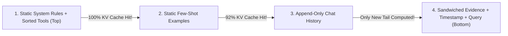

# AeroBrain v0.8: Context Architecture, KV Prefix Caching, Lost-in-the-Middle & TTFT/TPOT Economics

```json continuity
{
  "previously": "In Chapter 07, we upgraded AeroBrain v0.7 with FSM grammar masking so every refund decision returns 100% valid JSON.",
  "painPoint": "Each AeroBrain request includes 18,000 tokens of AeroCart system instructions, tool schemas, and policy examples. Because an engineer put `Current UTC Time: ...` on Line 1 of the prompt, our GPU server recomputes all 18,000 tokens from scratch on every single call—costing 5x more money and making users wait 2.4 seconds before the first word appears!",
  "unlock": "We will upgrade to AeroBrain v0.8 by arranging prompts into a 4-Tier Static-to-Dynamic Stack that hits 89% KV Prefix Cache reuse (cutting TTFT from 2.4s to 240ms and slashing token bills by 80%), while fixing the U-shaped 'Lost in the Middle' blind spot!"
}
```

```json walkthrough
[
  {
    "time": "0:00",
    "badge": "Slide 1 / 4 · Why Line 1 Ruined Our Entire Cache",
    "caption": "Transformers read strictly left-to-right: every token's cached memory (KV-Cache) depends on ALL tokens before it. Changing just 1 character on Line 1 invalidates all 18,000 tokens below it!",
    "code": "# ❌ BAD (0% Cache Hit): Timestamp at Line 1 breaks everything after it!\nprompt = f'Time: {now}\\n' + STATIC_18K_RULES + user_question\n# ✅ GOOD (89% Cache Hit): Static rules FIRST, changing timestamp LAST!\nprompt = STATIC_18K_RULES + f'\\nTime: {now}\\n' + user_question"
  },
  {
    "time": "0:26",
    "badge": "Slide 2 / 4 · The 4-Tier Monotonic Stability Stack",
    "caption": "Put your most permanent text at the very top (System Rules + Sorted Tools), append-only chat turns in the middle, and fast-changing RAG chunks + timestamps at the very bottom!",
    "code": "Tier 0: Static System + Sorted Tool JSON (100% cached)\nTier 1: Domain Handbook + Few-Shots      (95% cached)\nTier 2: Append-Only Chat History         (Incremental cache)\nTier 3: RAG Chunks + Timestamp + Query   (Uncached tail)"
  },
  {
    "time": "0:52",
    "badge": "Slide 3 / 4 · The 'Lost in the Middle' Blind Spot",
    "caption": "When you paste 20 retrieved paragraphs into a prompt, LLMs pay great attention to the FIRST and LAST paragraphs, but miss 15-30% of facts buried in the middle (#8-#12)!",
    "code": "# Edge-Sandwich Ordering for Top-5 Ranked Chunks [R1, R2, R3, R4, R5]:\n# Put #1 at the very top, #2 at the very bottom (closest to query!)\nsandwiched = [R1, R3, R5, R4, R2]"
  },
  {
    "time": "1:18",
    "badge": "Slide 4 / 4 · Budgeting TTFT vs. TPOT Latency",
    "caption": "Total wait time has two parts: TTFT (reading your uncached prompt tokens) plus TPOT (generating output words one by one). Prefix caching crushes TTFT!",
    "code": "TTFT_ms  = 35 + (uncached_input_tokens / 18_000) * 1000\nTotal_ms = TTFT_ms + (output_tokens - 1) * TPOT_ms"
  }
]
```

```json pretraining
[
  {
    "term": "Causal Prefix Cache Rule",
    "formula": "KV(token_i) depends on tokens[0..i]",
    "meaning": "An LLM server can reuse saved memory from a previous request ONLY up to the first word where the two prompts differ."
  },
  {
    "term": "RadixAttention (Block Hashing)",
    "formula": "Hash_block = SHA256(PrevHash + 16_Token_IDs)",
    "meaning": "How engines like vLLM and SGLang save 16-token chunks of prompt memory in a lookup tree so identical prompt beginnings skip heavy math."
  },
  {
    "term": "U-Shaped Recall ('Lost in the Middle')",
    "formula": "Start & End Recall >> Middle Recall",
    "meaning": "LLMs remember facts at the very top and very bottom of a long prompt much better than facts buried in the middle."
  },
  {
    "term": "TTFT vs. TPOT",
    "formula": "Total Time = TTFT + TPOT * (OutputTokens - 1)",
    "meaning": "TTFT is the pause before the first word appears (reading the prompt); TPOT is the speed at which each new word streams onto the screen."
  }
]
```

```json poe
{
  "question": "AeroBrain v0.8 has an 18,000-token System Prompt containing static AeroCart refund rules and 15 tool JSON schemas, handling 50 requests per second. Yet our monitoring dashboard shows a 0.0% Prefix Cache Hit Rate and a 2,100ms wait before the first token! You check the code and see Line 1 says `f'Current UTC Time: {datetime.now()}\\n'` and tools are serialized from an unordered Python `set`. What fixes both issues?",
  "options": [
    "Round the timestamp to the nearest 5 seconds",
    "Move volatile dynamic fields (timestamp, request_id, user query) to the VERY END of the prompt AND sort tool schemas deterministically by name (`sort_keys=True`), creating a byte-identical 17,980-token prefix from token 0 across all requests!",
    "Base64-encode the prompt",
    "Increase temperature to 1.0"
  ],
  "answerIndex": 1,
  "explanation": "Because causal attention attends strictly leftward, changing token #5 (a timestamp) or shuffling tool order invalidates the KV-Cache for all 17,980 tokens that follow! Moving dynamic fields to the tail unlocks ~89% cache hits and 50-90% cost discounts."
}
```

## 🌱 Step 1: Plain-English Story — The Photocopy Template vs. Retyping an 18-Page Contract

Imagine an AeroCart gate agent has to read an **18-page airline rulebook** before answering a passenger's 1-sentence question.
- If the rulebook is **100% identical** from Page 1 to Page 18 every time, the agent reads it **once** at 8:00 AM, keeps sticky-note summaries in their head (**the KV Prefix Cache**), and answers every new passenger in **0.2 seconds**!
- Now suppose someone stamps the **current second (`08:01:42`) at the very top of Page 1** before handing the 18-page packet to the agent. Because Transformers read strictly left-to-right and mix each word with every word that came before it, changing **Line 1 of Page 1** changes the mathematical meaning of **every single word on Pages 1 through 18**! The GPU has to throw away its saved memory and re-read all 18 pages from scratch on every single request!

And there is a second trap once the prompt gets long: **The "Lost in the Middle" Effect**. Just like a human skimming a 20-page briefing remembers **Page 1** and **Page 20** clearly but zones out around **Page 10**, LLMs lose `15–30%` accuracy when key facts are buried in the middle of retrieved context!



To make `AeroBrain v0.8` both **fast (`<250ms` start time)** and **sharp**, we follow two golden rules:
1. **Static at the Top, Dynamic at the Bottom**: Keep system rules and sorted tool definitions locked at Token `0`; push timestamps, user IDs, and live questions to the very end.
2. **Edge-Sandwich Your Best Evidence**: Put your `#1` most relevant retrieved fact at the **start** of the evidence block, and your `#2` most relevant fact at the **very end** (right next to the user's question), pushing weaker notes into the middle!

## 🔨 Step 2: First Lines of Code — Build `AeroBrain v0.8`'s Cache-Safe & Sandwich Prompt Builder!

Let's write a 17-line function for `AeroBrain v0.8` that locks static rules at the top (so the prefix hash never changes!) and arranges ranked evidence in **Edge-Sandwich order** (`[#1, #3, #5, #4, #2]`) so top facts never get lost in the middle!

```python
import hashlib


def sandwich_order(ranked_facts: list[str]) -> list[str]:
    # Odd ranks (#1, #3, #5) go to the START; Even ranks (#2, #4) go to the END!
    head = ranked_facts[0::2]
    tail = list(reversed(ranked_facts[1::2]))
    return head + tail


def build_aerobrain_v08_prompt(static_rules: str, ranked_facts: list[str], query: str, now_utc: str) -> dict:
    # 1. IMMUTABLE PREFIX at Token 0 -> 100% reusable in GPU KV-Cache across all flyers!
    prefix = f"<system>\n{static_rules.strip()}\n</system>\n"
    # 2. DYNAMIC TAIL at the bottom -> Sandwiched facts + changing timestamp + user query
    evidence = "\n".join(sandwich_order(ranked_facts))
    tail = f"<evidence>\n{evidence}\n</evidence>\n<time>{now_utc}</time>\n<query>{query}</query>"
    return {"prefix_hash": hashlib.sha256(prefix.encode()).hexdigest()[:12], "full_prompt": prefix + tail}


res = build_aerobrain_v08_prompt("AeroCart Refund Rules v1", ["R1:Best", "R2:2nd", "R3:Weak", "R4:3rd"], "Refund?", "12:00:01")
print("Prefix Hash:", res["prefix_hash"], "| Order:", sandwich_order(["R1", "R2", "R3", "R4", "R5"]))
```

### Java 17 Equivalent

```java
import java.util.ArrayList;
import java.util.List;

public class AeroBrainContextDemo {
    public static List<String> sandwichOrder(List<String> rankedFacts) {
        List<String> head = new ArrayList<>();
        List<String> tail = new ArrayList<>();
        for (int i = 0; i < rankedFacts.size(); i++) {
            // Place #1, #3, #5 at the start (primacy) and #2, #4 at the end (recency!)
            if (i % 2 == 0) head.add(rankedFacts.get(i));
            else tail.add(0, rankedFacts.get(i));
        }
        head.addAll(tail);
        return head;
    }

    public static void main(String[] args) {
        List<String> ranked = List.of("R1:Best", "R2:SecondBest", "R3:Third", "R4:Fourth", "R5:Fifth");
        System.out.println("Edge-Sandwich Order: " + sandwichOrder(ranked)); // [R1, R3, R5, R4, R2]
    }
}
```

Look at the output of `sandwich_order(["R1", "R2", "R3", "R4", "R5"])`: **`["R1", "R3", "R5", "R4", "R2"]`**! Our `#1` best fact sits at the very start, `#2` sits at the very end right above `<query>`, and `#5` (the weakest fact) sits safely in the middle!

## ⚡ Step 3: Where It Breaks in Real Life — Hidden Cache Busters in Multi-Turn Agents

Even when engineers put timestamps at the bottom, three sneaky bugs quietly destroy KV Prefix Caching in production:
1. **Unordered Tool Dictionaries / Sets**: If your agent registers MCP tools from a Python `set` or unsorted map, Pod A serializes `[search_flights, refund_ticket]` while Pod B serializes `[refund_ticket, search_flights]`—breaking the prefix hash at Token #80!
2. **"Sliding-Window" History Truncation on Every Turn**: Suppose a 15-turn coding agent drops Turn #1 on every step (`[Sys, T2, T3, T4]` $\to$ `[Sys, T3, T4, T5]`). Dropping `T2` shifts the position index of `T3, T4, T5` leftward—**invalidating 100% of your cached conversation history on every single turn**! Instead, keep history strictly **append-only** (paying 80–90% discounted cache hits) until you hit a high-water mark (e.g. `64k` tokens), then compact once!

```json contrast
{
  "title": "Cache-Busting Context Dump vs. 4-Tier Prefix Stack + Edge-Sandwich Context",
  "naiveTitle": "Timestamp @ Line 1 + Sliding Window Every Turn",
  "naiveMetric": "0% Cache Hit · $48/1k Calls · 3.1s TTFT",
  "naivePoints": [
    "Injects dynamic request_id, timestamp, and RAG chunks inside the top of the System Prompt, busting 100% of KV caches",
    "Serializes MCP tool definitions without sorting by name, shuffling tool order across pods and invalidating Radix trees",
    "Drops the oldest chat message on every single turn, shifting token offsets and forcing full prefill recomputation every step"
  ],
  "staffTitle": "4-Tier Prefix Stack + Edge-Sandwich Rerank",
  "staffMetric": "89% Cache Hit · $7/1k Calls · 240ms TTFT",
  "staffPoints": [
    "Locks byte-deterministic System + Canonically Sorted Tools at Token 0; validates prefix hash stability in CI unit tests!",
    "Keeps multi-turn chat history strictly append-only until watermark compaction so every turn reuses 100% of prior turns' KV pages",
    "Places Rank #1 evidence first & Rank #2 last ('Edge Sandwich'), followed by an instruction reminder next to the decode cursor"
  ]
}
```

Use the **Interactive KV-Cache & Context Simulator** below to watch how 16-token Radix blocks cache or invalidate as prompt layers change.

## 🚀 Step 4: Staff Engineer Deep-Dive — Radix Block-Hash Physics & `TTFT`/`TPOT` SLA Math

In `vLLM` Automatic Prefix Caching and `SGLang` `RadixAttention`, the KV-Cache is partitioned into fixed-size pages of $B = 16$ tokens. Why can't Block $b$ be hashed solely by its own 16 tokens? Because under causal self-attention and Rotary Position Embeddings (`RoPE`), the key-value tensors $(K_i, V_i)$ inside Block $b$ are a function of **every preceding block $0, \dots, b-1$**! Therefore, engines compute a **cryptographic hash chain** from block $0$:

$$H_0 = \text{Hash}\big(\text{ModelID} \parallel t_{0..15}\big), \qquad H_b = \text{Hash}\big(H_{b-1} \parallel t_{16b \dots 16b+15}\big)$$

Any single-token mutation in block $k$ cascades through $H_k, H_{k+1}, \dots$, forcing recomputation of all downstream blocks. Given total prompt length $L = L_{\text{cached}} + L_{\text{uncached}}$ and generated output length $N_{\text{out}}$, end-to-end latency and per-request dollar cost follow:

$$T_{\text{total}} = T_{\text{retrieval}} + \underbrace{\left(T_{\text{queue}} + \frac{L_{\text{uncached}}}{R_{\text{prefill}}}\right)}_{\text{TTFT (Prefill-Bound)}} + \underbrace{(N_{\text{out}} - 1) \times \text{TPOT}}_{\text{Decode (Memory-Bandwidth-Bound)}}$$

$$\text{Cost}_{\text{req}} = \frac{L_{\text{cached}}}{10^6} P_{\text{in}}(1 - d_{\text{cache}}) + \frac{L_{\text{uncached}}}{10^6} P_{\text{in}} + \frac{N_{\text{out}}}{10^6} P_{\text{out}}$$

where $d_{\text{cache}} \in [0.50, 0.90]$ is the cached-input discount (50%–90% off on cloud APIs, or saved GPU prefill FLOPs on self-hosted clusters).

| Latency / Cost Metric | Governing Formula & Bottleneck | Interactive Chat Target | Async Batch / Agent Target |
| :--- | :--- | :--- | :--- |
| **`TTFT` (Time To First Token)** | `QueueWait + Prefill(L_uncached)` (Compute-Bound) | `< 350 ms` p95 (Streaming UX) | `< 2,500 ms` |
| **`TPOT` / `ITL` (Per Output Token)** | `WeightBytes / HBM_Bandwidth` (Memory-Bound) | `< 35 ms/tok` (`~28 tok/s` > human reading speed!) | Throughput-optimized (`tokens/sec/$`) |
| **Prefix Cache Hit Rate** | `CachedInputTokens / TotalInputTokens` | **`>= 80%`** on multi-turn & tool agents | **`>= 90%`** (sort batch jobs by shared document prefix!) |

### Python 3 Production Blueprint: Deterministic Prefix-Cache Composer, U-Curve Sandwich Packer & SLA Calculator

```python
from __future__ import annotations
from dataclasses import dataclass
import hashlib
import json
from typing import Any, Dict, List, Sequence


@dataclass(frozen=True)
class RankedEvidence:
    chunk_id: str
    score: float
    text: str


def reorder_for_u_shaped_attention(ranked_chunks: Sequence[RankedEvidence]) -> List[RankedEvidence]:
    """
    Mitigates 'Lost in the Middle' (Liu et al.) on top-k reranked evidence:
    Places odd ranks (1st, 3rd, 5th...) at the START (primacy) and even ranks (2nd, 4th...)
    in reverse toward the END (recency—closest to the generation cursor!), pushing weakest items to the middle.
    Example [R1, R2, R3, R4, R5] -> [R1, R3, R5, R4, R2].
    """
    ordered_desc = sorted(ranked_chunks, key=lambda c: c.score, reverse=True)
    head: List[RankedEvidence] = []
    tail_reversed: List[RankedEvidence] = []
    for idx, chunk in enumerate(ordered_desc):
        if idx % 2 == 0:
            head.append(chunk)
        else:
            tail_reversed.append(chunk)
    tail_reversed.reverse()
    return head + tail_reversed


def build_cache_deterministic_prompt(
    static_system_rules: str,
    tool_schemas: Sequence[Dict[str, Any]],
    few_shot_block: str,
    ranked_chunks: Sequence[RankedEvidence],
    user_query: str,
    request_timestamp_iso: str,
) -> Dict[str, str]:
    """
    Guarantees byte-identical Tier-0 + Tier-1 prefix across pods and requests:
    - Canonicalizes tool schemas sorted by tool['name'] and JSON keys.
    - Isolates RAG chunks, live timestamp, and user query strictly into the dynamic tail.
    """
    sorted_tools = sorted(tool_schemas, key=lambda t: str(t.get("name", "")))
    canonical_tools_json = json.dumps(sorted_tools, sort_keys=True, separators=(",", ":"))
    immutable_prefix = (
        f"<system_instructions>\n{static_system_rules.strip()}\n</system_instructions>\n"
        f"<tools>\n{canonical_tools_json}\n</tools>\n"
        f"<examples>\n{few_shot_block.strip()}\n</examples>\n"
    )
    prefix_sha256 = hashlib.sha256(immutable_prefix.encode("utf-8")).hexdigest()

    sandwiched = reorder_for_u_shaped_attention(ranked_chunks)
    ctx_body = "\n".join(f"[{c.chunk_id}] {c.text}" for c in sandwiched)
    dynamic_tail = (
        f"<retrieved_evidence>\n{ctx_body}\n</retrieved_evidence>\n"
        f"<runtime_metadata>utc={request_timestamp_iso}</runtime_metadata>\n"
        f"<user_query>{user_query.strip()}</user_query>\n"
        f"Cite exact [chunk_id] brackets for every factual claim."
    )
    return {
        "immutable_prefix": immutable_prefix,
        "dynamic_tail": dynamic_tail,
        "prefix_sha256": prefix_sha256,
    }


def estimate_turn_latency_and_cost(
    cached_prefix_tokens: int,
    uncached_tail_tokens: int,
    output_tokens: int,
    prefill_tok_per_sec: float = 18_000.0,
    tpot_ms: float = 22.0,
    input_price_per_1m: float = 2.50,
    cached_input_discount: float = 0.80,
    output_price_per_1m: float = 10.00,
) -> Dict[str, float]:
    ttft_ms = 35.0 + (uncached_tail_tokens / prefill_tok_per_sec) * 1000.0
    total_ms = ttft_ms + max(0, output_tokens - 1) * tpot_ms

    cached_rate = input_price_per_1m * (1.0 - cached_input_discount)
    cost_usd = (
        (cached_prefix_tokens / 1_000_000.0) * cached_rate
        + (uncached_tail_tokens / 1_000_000.0) * input_price_per_1m
        + (output_tokens / 1_000_000.0) * output_price_per_1m
    )
    total_in = max(1, cached_prefix_tokens + uncached_tail_tokens)
    return {
        "ttft_ms": round(ttft_ms, 2),
        "total_latency_ms": round(total_ms, 2),
        "cache_hit_ratio": round(cached_prefix_tokens / total_in, 4),
        "cost_usd": round(cost_usd, 6),
    }
```

### Java 17 Equivalent

```java
package com.hub.ai.context;

import java.nio.ByteBuffer;
import java.security.MessageDigest;
import java.util.ArrayList;
import java.util.Comparator;
import java.util.HashSet;
import java.util.List;
import java.util.Set;

public final class PrefixCacheAndContextEngine {

    public record EvidenceChunk(String id, double rerankScore, String content) {}

    private final int blockSizeTokens;
    private final Set<String> cachedChainHashes = new HashSet<>();

    public PrefixCacheAndContextEngine(int blockSizeTokens) {
        this.blockSizeTokens = blockSizeTokens;
    }

    /**
     * Simulates vLLM Automatic Prefix Caching chained block hashing:
     * Block_k hash commits to (ParentHash_{k-1} + tokens[16k .. 16k+15]).
     * First mismatch breaks the chain for all subsequent blocks!
     */
    public int registerAndCountCachedTokens(int[] promptTokenIds) throws Exception {
        int fullBlocks = promptTokenIds.length / blockSizeTokens;
        String parentChainHash = "ROOT";
        int hitTokens = 0;
        boolean stillPrefixMatching = true;

        for (int b = 0; b < fullBlocks; b++) {
            MessageDigest md = MessageDigest.getInstance("SHA-256");
            md.update(parentChainHash.getBytes());
            ByteBuffer buf = ByteBuffer.allocate(blockSizeTokens * 4);
            for (int i = 0; i < blockSizeTokens; i++) {
                buf.putInt(promptTokenIds[b * blockSizeTokens + i]);
            }
            byte[] digest = md.digest(buf.array());
            String blockHash = java.util.HexFormat.of().formatHex(digest);

            if (stillPrefixMatching && cachedChainHashes.contains(blockHash)) {
                hitTokens += blockSizeTokens;
            } else {
                stillPrefixMatching = false;
                cachedChainHashes.add(blockHash);
            }
            parentChainHash = blockHash;
        }
        return hitTokens;
    }

    public static List<EvidenceChunk> arrangeSandwichOrder(List<EvidenceChunk> raw) {
        List<EvidenceChunk> sorted = new ArrayList<>(raw);
        sorted.sort(Comparator.comparingDouble(EvidenceChunk::rerankScore).reversed());
        List<EvidenceChunk> head = new ArrayList<>();
        List<EvidenceChunk> tail = new ArrayList<>();
        for (int i = 0; i < sorted.size(); i++) {
            if ((i & 1) == 0) head.add(sorted.get(i));
            else tail.add(0, sorted.get(i));
        }
        head.addAll(tail);
        return head;
    }
}
```

> [!WARNING]
> **Staff Interview Gotcha — Round-Robin Load Balancers Destroy Self-Hosted `vLLM` / `SGLang` Prefix Caches!**
> Suppose you engineer byte-identical prefixes, deploy `8` `vLLM` GPU replicas behind a standard **Round-Robin Kubernetes Service**, and run 10-turn agent sessions. Turn 1 lands on `Pod-3` (populating `Pod-3`'s HBM KV-Cache); Turn 2 gets round-robined to `Pod-7` (**cold cache miss**—recomputing prefill from scratch while duplicating HBM across all 8 pods!). **Fix:** Multi-replica LLM clusters MUST use **Prefix-Aware L7 Routing** (`SGLang Router`, `vLLM Production Stack`, or consistent hashing with bounded load on the first-256-token prefix hash) to route matching prefixes to the GPU replica already holding those KV blocks!

**Up Next in Chapter 09 (`AeroBrain v0.9`)**: Look at `<retrieved_evidence>` in our prompt builder above—how does AeroBrain actually **find** the right 5 paragraphs out of 50,000 AeroCart policy pages, runbooks, and flight manuals in under 15 milliseconds (especially when a user searches for an exact error code like `ERR_BAG_TAG_8841`)? In Chapter 09, we'll build **Hybrid RAG (`Breadcrumb Chunking + HNSW + Okapi BM25 + Reciprocal Rank Fusion`)**!

```json quiz
[
  {
    "id": "aie-08-q1",
    "question": "In a 12-turn ReAct coding agent loop, an engineer implements 'sliding-window memory' by dropping Turn #1 on every new step (so Step 5 sends [Sys, T2, T3, T4], Step 6 sends [Sys, T3, T4, T5], Step 7 sends [Sys, T4, T5, T6]). Why does this seemingly frugal optimization INCREASE cloud token spend by 3x?",
    "options": [
      "Shorter prompts trigger higher per-token pricing tiers",
      "Dropping Turn #1 on every single step shifts the token offset of EVERY historical message [T3, T4, T5...], breaking KV-Cache prefix alignment right after [Sys] on 100% of steps! Instead, keep history strictly append-only (paying 90%-discounted cached reads) until hitting a watermark (e.g. 64k), then compact/truncate ONCE every ~15 turns!",
      "JSON serializers double-escape truncated arrays",
      "KV caches only activate above 100,000 tokens"
    ],
    "answerIndex": 1,
    "explanation": "Sliding off 1 turn per step shifts every remaining token's absolute position after the system prompt, turning cheap 90%-discounted cache hits into 100% full-price uncached prefills on every single agent step!"
  },
  {
    "id": "aie-08-q2",
    "question": "When batch-processing 10,000 offline legal contract extraction queries (100 distinct 40-page contracts, with 100 distinct extraction questions asked per contract), how should the job queue order requests sent to your LLM cluster?",
    "options": [
      "Shuffle all 10,000 requests uniformly at random to spread load",
      "Group and dispatch requests sorted by shared contract_id (all 100 questions for Contract A together within the 5-minute KV-Cache TTL before moving to Contract B), boosting prefix cache hit rate on the 40-page document from ~1% to 99%!",
      "Sort strictly by question string length ascending",
      "Insert random UUID padding between contracts"
    ],
    "answerIndex": 1,
    "explanation": "Prefix caches evict via LRU / 5-minute TTLs; clustering offline batch work by shared heavy prefix turns 100 redundant 40-page prefills into 1 prefill + 99 instant cache hits."
  },
  {
    "id": "aie-08-q3",
    "question": "Why does dynamically filtering MCP tools per turn (e.g., passing 8 selected tools on Turn 1 and a slightly different 7 tools inside the System Prompt on Turn 2) often backfire on latency and cost compared to keeping a stable canonical set of 20 tools?",
    "options": [
      "LLMs refuse to call tools if fewer than 10 are declared",
      "Because tool definitions sit near the top of the prompt (Tier 0), mutating the tool list per turn invalidates the KV-Cache for the ENTIRE subsequent 20,000-token conversation history on Turn 2! Unless tool schemas exceed tens of thousands of tokens, keeping a stable sorted toolset preserves 100% history cache hits",
      "OpenAI/Anthropic charge extra fees per removed tool",
      "Dynamic tools disable temperature=0"
    ],
    "answerIndex": 1,
    "explanation": "Mutating Tier-0 tool declarations mid-conversation invalidates the KV-Cache of every downstream chat turn and file read accumulated in Tier 2."
  }
]
```
