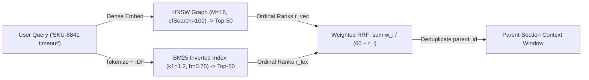

# Hybrid RAG Architecture: Structure-Aware Chunking, HNSW Graphs, BM25 & RRF

```json pretraining
[
  {
    "term": "Parent-Child Retrieval",
    "formula": "Index: 256-Tok Fine Vector -> Return: 1,200-Tok Parent Section",
    "meaning": "Decouples sharp single-concept embedding precision (small child chunks) from complete LLM synthesis context (parent window)!"
  },
  {
    "term": "HNSW Small-World Knob",
    "formula": "M = Max Edges/Node (RAM),  efSearch = Beam Width (Recall vs Latency)",
    "meaning": "Hierarchical skip-list graph achieving O(log N) ANN search; raising efSearch at query time trades latency for higher Recall@K without re-indexing."
  },
  {
    "term": "Okapi BM25 Saturation",
    "formula": "BM25(q, d) = sum_{t in q} IDF(t) * ((f * (k1 + 1)) / (f + k1 * (1 - b + b * |d|/avgdl)))",
    "meaning": "Dampens repeated keyword stuffing asymptotically via k1 (~1.2) and normalizes document length bias via b (~0.75)."
  },
  {
    "term": "Reciprocal Rank Fusion",
    "formula": "RRF(d) = sum_{s in {Dense, BM25}} w_s / (k + rank_s(d)),  k = 60",
    "meaning": "Fuses unbounded BM25 [0..45+] and bounded Cosine [-1..1] using pure ordinal ranks—zero fragile score-normalization calibration required!"
  }
]
```

```json poe
{
  "question": "An enterprise support RAG system uses ONLY dense vector search (1536-d Cosine HNSW) with naive 500-character fixed slicing. Users searching for exact error code 'ERR_SSL_KEY_USAGE_INCOMPATIBLE' or part number 'SKU-8841-REV-B' receive generic SSL/hardware overview articles instead of the exact runbook, and Markdown tables get sliced mid-row away from their column headers! What architectural stack fixes both root causes?",
  "options": [
    "Increase temperature to 0.9 and switch from Cosine to Euclidean L2 distance",
    "1) Structure-aware Markdown/AST chunking (preserving atomic table headers + Parent-Document expansion), AND 2) Hybrid Retrieval combining Sparse Lexical BM25 (exact high-IDF token match on 'SKU-8841-REV-B') + Dense HNSW fused via Reciprocal Rank Fusion (RRF, k=60)",
    "Double embedding dimensions from 1536 to 3072",
    "Remove stop-words from the LLM output prompt"
  ],
  "answerIndex": 1,
  "explanation": "Dense embeddings compress rare alphanumeric IDs/SKUs/error codes into smooth semantic neighborhoods ('some SSL error'), losing exact lexical fidelity where high-IDF BM25 excels; naive character slicing severs table rows from column headers."
}
```

## 1. Structure-Aware & Parent-Document Chunking (Why Fixed `char[:500]` Fails)

Garbage chunking guarantees garbage RAG regardless of how strong your LLM is. Slicing documents every `500` characters mid-sentence commits three structural sins: (1) severs pronouns (`"It must be set to false"`) from the heading naming *what* `"It"` refers to, (2) slices Markdown/HTML table rows `| 14 | 503 | Retry |` away from their `| Code | HTTP | Action |` header row, and (3) splits Python/Java functions mid-loop.

Staff RAG pipelines enforce **three chunking invariants**:
1. **Tokenizer-Counted Structural Recursive Splitting**: Split along semantic AST/DOM boundaries first (`# H1` $\to$ `## H2` $\to$ code `def/class` $\to$ `\n\n` paragraphs $\to$ sentences), **repeating Markdown table headers onto every split table page** and prepending the **Breadcrumb Heading Path** (`Doc > Auth > mTLS Rotation: ...`) to every chunk before indexing!
2. **Small-to-Big (Parent-Document) Retrieval**: A `1,500`-token document section averages too many topics into a blurry embedding centroid, while a `200`-token chunk embeds sharply (`0.89` cosine) yet starves the LLM of surrounding caveats. **Solution:** Embed `256`-token child chunks linked via `parent_id` to their `1,200`-token parent section (deduplicating parents before LLM injection).



---

## 2. `HNSW` Graph Internals, `BM25` Lexical Recall & Why Linear Score Mixing Fails

Why fuse **BM25** and **Dense HNSW** via **Reciprocal Rank Fusion (`RRF`)** (Cormack et al., $k=60$) instead of `0.5 * bm25_score + 0.5 * cosine_score`?
- **Incommensurable Score Distributions**: Cosine scores cluster tightly in `[0.71, 0.86]`, whereas `BM25` scores are **unbounded** (`0.0` to `48.0+` depending on query length and rare `IDF` terms!). Naive min-max normalization (`(s - min) / (max - min)`) is broken by **single-outlier distortion**: if `BM25` finds zero real keyword hits (all noise around `1.2` vs `0.8`), min-max stretches noise #1 to **`1.0`**, overpowering a genuine `0.88` semantic match!
- **Rank-Space Stability (`RRF`)**: $\text{RRF}(d) = \frac{w_{\text{dense}}}{60 + r_{\text{dense}}(d)} + \frac{w_{\text{bm25}}}{60 + r_{\text{bm25}}(d)}$. Constant $k = 60$ dampens top-1 outlier spikes so a document ranked `#2` in **both** lexical and semantic retrievers (`2 / 62 = 0.03226`) cleanly beats a noisy `#1` hit present in only one list (`1 / 61 = 0.01639`)!

```json contrast
{
  "title": "Dense-Only Fixed Slicing + Post-Filter vs Structure-Aware Hybrid RRF + Pre-Filter",
  "naiveTitle": "500-Char Dense-Only + Post-HNSW ACL Filter",
  "naiveMetric": "0% SKU Exact Match · Empty ACL Results!",
  "naivePoints": [
    "Dense embeddings alone miss exact error codes, legal clause numbers ('§14.2(b)'), CVEs, and UUID/SKU identifiers",
    "Runs HNSW top-10 search globally FIRST and filters WHERE tenant_id = 'T_small' AFTER: if T_small owns 0.1% of vectors, all 10 hits belong to other tenants -> returns 0 results!",
    "Hardcodes default efSearch=10 in production, dropping Recall@10 below 72% on 10M-vector indexes"
  ],
  "staffTitle": "Breadcrumb Chunks + Pre-Filtered HNSW + BM25 RRF",
  "staffMetric": "96%+ Hybrid Recall@10 · Strict Tenant Isolation",
  "staffPoints": [
    "Prepends section breadcrumb headers + repeats Markdown table column headers on every split chunk",
    "Enforces Partitioned Tenant Sub-Indexes or Predicate-Aware HNSW Filtered Traversal so tenant_id=T_small always returns K valid hits",
    "Combines BM25 (k1=1.2, b=0.75) + Dense HNSW (M=24, efConstruction=200, efSearch=128) via weighted RRF"
  ]
}
```

| `HNSW` / `BM25` Parameter | Typical Production Range | Increasing It Improves... | Cost of Increasing It |
| :--- | :--- | :--- | :--- |
| **`M` (HNSW Bi-Directional Links)** | `16 – 32` (`64` for high-dim `>1536`) | Graph connectivity & high-recall ceiling (`>0.98`) | Permanent RAM overhead (`M * 2 * 4B` per vector) + slower hops |
| **`efConstruction` (Build Beam)** | `128 – 400` | Graph navigation quality at build time | Slower offline index build time (**zero** extra RAM!) |
| **`efSearch` (Query Beam Width)** | `64 – 256` (must be $\ge K$!) | Runtime `Recall@K` (`0.82 -> 0.99`) dynamically! | Linearly increases query latency (`2ms -> 9ms`); tunable per SLA! |
| **`BM25` `k1` / `b`** | `k1 = 1.2`, `b = 0.75` (`b = 0.3` for uniform chunks!) | `k1`: term-frequency saturation; `b`: length penalty | When chunks are already uniform `300` tokens, lower `b ≈ 0.3–0.5` avoids over-penalizing slightly fuller chunks |

---

## 3. Dual-Language Production Blueprints: Okapi `BM25`, Weighted `RRF` & Breadcrumb Chunker

### Python 3 Blueprint: Structure-Aware Breadcrumb Chunker, Okapi `BM25` & Weighted `RRF` Engine
```python
from __future__ import annotations
from collections import Counter
from dataclasses import dataclass
import math
import re
from typing import Dict, List, Mapping, Sequence, Tuple


@dataclass(frozen=True)
class BreadcrumbChunk:
    chunk_id: str
    parent_id: str
    breadcrumb_text: str


def chunk_markdown_with_breadcrumbs(
    doc_id: str, markdown_text: str, max_words_per_child: int = 120
) -> Tuple[Dict[str, str], List[BreadcrumbChunk]]:
    """
    Splits Markdown by H1/H2/H3 sections (stored as Parent sections) and emits fine-grained
    child chunks prefixed with their hierarchical [Doc > Section] breadcrumb path.
    """
    parents: Dict[str, str] = {}
    children: List[BreadcrumbChunk] = []
    current_heading = "Overview"
    section_lines: List[str] = []
    sec_idx = 0

    def flush_section(heading: str, lines: List[str], idx: int) -> None:
        body = "\n".join(lines).strip()
        if not body:
            return
        parent_id = f"{doc_id}#sec-{idx}"
        parents[parent_id] = f"## {heading}\n{body}"
        words = body.split()
        for c_i, start in enumerate(range(0, len(words), max_words_per_child)):
            slice_txt = " ".join(words[start : start + max_words_per_child])
            children.append(
                BreadcrumbChunk(
                    chunk_id=f"{parent_id}:c{c_i}",
                    parent_id=parent_id,
                    breadcrumb_text=f"[{doc_id} > {heading}] {slice_txt}",
                )
            )

    for raw_line in markdown_text.splitlines():
        m = re.match(r"^(#{1,3})\s+(.+)$", raw_line.strip())
        if m:
            flush_section(current_heading, section_lines, sec_idx)
            sec_idx += 1
            current_heading = m.group(2).strip()
            section_lines = []
        else:
            section_lines.append(raw_line)
    flush_section(current_heading, section_lines, sec_idx)
    return parents, children


class OkapiBM25Index:
    """Zero-dependency Robertson-Sparck-Jones BM25 lexical retriever."""

    def __init__(self, docs: Mapping[str, str], k1: float = 1.2, b: float = 0.5) -> None:
        self.k1 = k1
        self.b = b
        self.doc_tfs: Dict[str, Counter[str]] = {}
        self.doc_lens: Dict[str, int] = {}
        df: Counter[str] = Counter()

        for doc_id, text in docs.items():
            tokens = re.findall(r"[a-z0-9_.-]+", text.lower())
            tf = Counter(tokens)
            self.doc_tfs[doc_id] = tf
            self.doc_lens[doc_id] = len(tokens)
            for term in tf.keys():
                df[term] += 1

        n_docs = max(1, len(docs))
        self.avgdl = sum(self.doc_lens.values()) / n_docs
        # Lucene-style non-negative IDF: ln(1 + (N - df + 0.5) / (df + 0.5))
        self.idf: Dict[str, float] = {
            t: math.log(1.0 + (n_docs - freq + 0.5) / (freq + 0.5)) for t, freq in df.items()
        }

    def search(self, query: str, top_k: int = 50) -> List[Tuple[str, float]]:
        q_terms = re.findall(r"[a-z0-9_.-]+", query.lower())
        scores: List[Tuple[str, float]] = []
        for doc_id, tf in self.doc_tfs.items():
            dl_norm = 1.0 - self.b + self.b * (self.doc_lens[doc_id] / max(1e-9, self.avgdl))
            s = 0.0
            for term in q_terms:
                f = tf.get(term, 0)
                if f > 0:
                    s += self.idf.get(term, 0.0) * ((f * (self.k1 + 1.0)) / (f + self.k1 * dl_norm))
            if s > 0.0:
                scores.append((doc_id, s))
        scores.sort(key=lambda item: (-item[1], item[0]))
        return scores[:top_k]


def reciprocal_rank_fusion(
    ranked_lists: Sequence[Tuple[Sequence[str], float]], k_constant: int = 60, top_n: int = 10
) -> List[Tuple[str, float]]:
    """
    Weighted Reciprocal Rank Fusion: score(d) = sum_i weight_i / (k_constant + rank_1_based(d)).
    """
    fused: Dict[str, float] = {}
    for doc_ids, weight in ranked_lists:
        for zero_idx, doc_id in enumerate(doc_ids):
            rank_1_based = zero_idx + 1
            fused[doc_id] = fused.get(doc_id, 0.0) + (weight / (k_constant + rank_1_based))
    return sorted(fused.items(), key=lambda kv: (-kv[1], kv[0]))[:top_n]
```

### Java 17 Blueprint: Weighted Reciprocal Rank Fusion (`RRF`) + Parent-Document Deduplicator
```java
package com.hub.ai.rag;

import java.util.ArrayList;
import java.util.Comparator;
import java.util.HashMap;
import java.util.LinkedHashSet;
import java.util.List;
import java.util.Map;
import java.util.Set;

public final class HybridRrfRetriever {

    public record FusedHit(String chunkId, String parentId, double rrfScore) {}

    /**
     * Fuses Dense HNSW top-K and Sparse BM25 top-K via Reciprocal Rank Fusion (k=60)
     * and expands child hits into unique, score-ordered Parent Document sections.
     */
    public static List<String> fuseAndResolveUniqueParents(
            List<String> denseOrderedChunkIds,
            List<String> bm25OrderedChunkIds,
            double denseWeight,
            double bm25Weight,
            int rrfK,
            Map<String, String> childToParentId,
            int maxUniqueParents) {

        Map<String, Double> rrfScores = new HashMap<>();
        for (int i = 0; i < denseOrderedChunkIds.size(); i++) {
            String cid = denseOrderedChunkIds.get(i);
            rrfScores.merge(cid, denseWeight / (rrfK + i + 1.0), Double::sum);
        }
        for (int i = 0; i < bm25OrderedChunkIds.size(); i++) {
            String cid = bm25OrderedChunkIds.get(i);
            rrfScores.merge(cid, bm25Weight / (rrfK + i + 1.0), Double::sum);
        }

        List<Map.Entry<String, Double>> sortedChildren = new ArrayList<>(rrfScores.entrySet());
        sortedChildren.sort(Comparator.<Map.Entry<String, Double>>comparingDouble(Map.Entry::getValue)
            .reversed()
            .thenComparing(Map.Entry::getKey));

        Set<String> orderedParents = new LinkedHashSet<>();
        for (var entry : sortedChildren) {
            String parentId = childToParentId.getOrDefault(entry.getKey(), entry.getKey());
            orderedParents.add(parentId);
            if (orderedParents.size() >= maxUniqueParents) {
                break;
            }
        }
        return new ArrayList<>(orderedParents);
    }
}
```

> [!WARNING] **Staff Interview Gotcha — The `HNSW` Post-Filtering Zero-Recall Trap on Multi-Tenant Indexes!** When `10,000` tenants share one physical `HNSW` vector index (`pgvector`, OpenSearch, Qdrant) and a small tenant (`0.02%` of vectors) runs `SELECT ... ORDER BY embedding <=> $q LIMIT 10` with a **post-filter** `WHERE tenant_id = 'T_small'`, standard greedy `HNSW` graph search fetches the global `efSearch = 40` nearest neighbors (all belonging to huge tenants!), filters them afterward, and **returns `0` rows (total recall failure!)**—or falls back to a `600ms` sequential scan! **Invariant:** Multi-tenant vector stores MUST use **Payload-Indexed Filtered HNSW** (e.g., Qdrant Filterable HNSW / `pgvector` `0.8+` iterative index scans) OR **Per-Tenant Partitioned / Sharded Namespaces** so tenant ACL predicates guide graph traversal *during* search!

---

## 4. Scenario Retrieval-Practice Mastery Gate

```json quiz
[
  {
    "id": "aie-09-q1",
    "question": "Why does standard Lucene / Modern Okapi BM25 use IDF(t) = ln(1 + (N - df + 0.5)/(df + 0.5)) instead of the classic textbook RSJ formula ln((N - df + 0.5)/(df + 0.5))?",
    "options": [
      "Natural logarithms cannot be computed on integers",
      "In the classic textbook formula without '1 +', any common word appearing in MORE than 50% of documents (df > N/2, e.g., 'service' or 'API' in a tech wiki) yields a NEGATIVE IDF—actively PENALIZING documents that contain the query word! Adding 1 inside ln(1 + ...) guarantees strict non-negativity >= 0",
      "To bound BM25 scores strictly below 1.0",
      "To avoid dividing by k1"
    ],
    "answerIndex": 1,
    "explanation": "Negative IDF on domain-common words (>50% document frequency) caused classic BM25 to rank documents omitting query words higher than documents containing them; Lucene 8+ fixed this via ln(1 + ...)."
  },
  {
    "id": "aie-09-q2",
    "question": "Your HNSW index (`M = 16, efConstruction = 200`) exhibits only 81% Recall@10 against exact brute-force k-NN in staging, and re-indexing 50M vectors would take 9 hours. Which single query-time parameter can you raise immediately without rebuilding the index?",
    "options": [
      "Increase M from 16 to 32 at query time",
      "Increase efSearch (query-time candidate priority-queue beam width, e.g., 40 -> 160), trading ~3–5ms of extra graph hops for ~97%+ Recall@10 with zero re-indexing",
      "Lower RRF constant k from 60 to 1",
      "Increase BM25 parameter b to 1.0"
    ],
    "answerIndex": 1,
    "explanation": "M and efConstruction are baked into the graph edges at build time, whereas efSearch dynamically controls the breadth of candidate exploration at query time."
  },
  {
    "id": "aie-09-q3",
    "question": "In Reciprocal Rank Fusion RRF(d) = sum 1 / (k + rank_i(d)), why is smoothing constant k ≈ 60 preferred over k = 0 (pure 1 / rank)?",
    "options": [
      "k = 0 causes division by zero on 1-based ranks",
      "At k = 0, rank #1 receives weight 1.0 while rank #2 drops 50% to 0.50 and rank #5 drops to 0.20—allowing a single retriever's noisy #1 false positive (1.0) to overwhelm a genuinely relevant document ranked #3 in BOTH Dense AND BM25 (0.33 + 0.33 = 0.66)! Setting k = 60 flattens top-rank steepness so multi-retriever consensus wins",
      "60 is the maximum top-K supported by HNSW",
      "k = 60 normalizes RRF scores to sum to 1.0"
    ],
    "answerIndex": 1,
    "explanation": "With k=60, a consensus hit at rank #3 in both lists scores 2/(63) = 0.03175, comfortably outranking a single-retriever #1 fluke at 1/(61) = 0.01639."
  }
]
```
