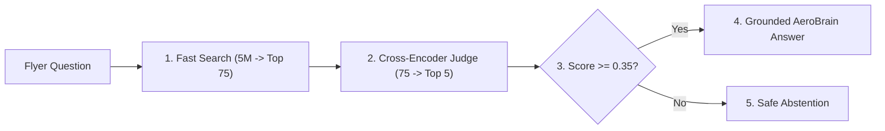

# Two-Stage Reranking: Cross-Encoders, Late Interaction (ColBERT) & Contextual Retrieval

```json continuity
{
  "previously": "In Chapter 09, we upgraded AeroBrain v0.9 with Hybrid Search (combining exact keyword search with semantic vector search via Reciprocal Rank Fusion) so flyers could find both exact flight numbers and conversational baggage rules.",
  "painPoint": "When a flyer asks 'Can I bring a lithium battery that is NOT installed inside a device?', AeroBrain v0.9's fast search returns 20 chunks where 'installed' and 'NOT installed' look almost identical, and chunks saying 'The policy prohibits it' have lost which airline or year 'the policy' refers to!",
  "unlock": "We will upgrade AeroBrain to v0.10 by adding a Two-Stage Reranking Funnel (a fast 75-candidate first pass followed by a sharp Cross-Encoder judge that reads query and document side-by-side) plus Contextual Retrieval headers that stamp every chunk with its parent document identity."
}
```

```json walkthrough
[
  {
    "time": "0:00",
    "badge": "1. The Speed-Daters",
    "caption": "Our Chapter 9 vector search summarizes each paragraph into a single fingerprint before ever seeing the user's question. That makes searching millions of chunks blazingly fast, but it blurs tiny words like NOT, EXCEPT, or version numbers.",
    "code": "bi_encoder(doc) -> 1 summary vector (fast, blurs 'NOT')"
  },
  {
    "time": "0:22",
    "badge": "2. Two-Stage Funnel",
    "caption": "Instead of asking a slow, careful judge to read all five million chunks, we use a Two-Stage Funnel: Stage 1 grabs the top 75 suspects in 12 milliseconds, and Stage 2 lets a Cross-Encoder read those 75 pairs word-by-word.",
    "code": "5,000,000 docs -> Stage 1 (Top 75) -> Cross-Encoder (Top 5)"
  },
  {
    "time": "0:48",
    "badge": "3. Orphaned Chunks",
    "caption": "Even a smart reranker fails if a chunk says 'The fee increased by $25' without saying which airline or year. Contextual Retrieval prepends a short summary header to every chunk once when we index the document.",
    "code": "[AeroCart 2026 Domestic Policy] The fee increased by $25..."
  },
  {
    "time": "1:12",
    "badge": "4. Safe Abstention",
    "caption": "Finally, if even the number-one reranked chunk scores below our confidence threshold, AeroBrain v0.10 safely abstains instead of guessing from weak evidence.",
    "code": "if top_rerank_score < 0.35: return 'Insufficient evidence'"
  }
]
```

```json pretraining
[
  {
    "term": "Bi-Encoder (Stage-1 Retriever)",
    "formula": "Score(q, d) = Embed(q) · Embed(d)",
    "meaning": "A fast model that turns the question and the document into separate summary vectors independently—great for narrowing 5 million chunks down to 75, but blind to subtle word-by-word interactions."
  },
  {
    "term": "Cross-Encoder (Stage-2 Reranker)",
    "formula": "Score(q, d) = Judge([q, d] side-by-side)",
    "meaning": "A careful reading model that puts the user's question and a candidate chunk side-by-side so every word in the question can inspect every word in the chunk, catching negations like 'never' or 'except'."
  },
  {
    "term": "Contextual Retrieval",
    "formula": "Chunk' = ParentContextHeader + RawChunk",
    "meaning": "Stamping each sliced paragraph with a one-sentence 'who, what, and when' header from its parent document before indexing so pronouns like 'it' or 'the company' are never ambiguous."
  },
  {
    "term": "ColBERT (Late Interaction)",
    "formula": "Score(q, d) = Sum of best token-to-token matches",
    "meaning": "A middle-ground architecture that saves one tiny vector per word instead of one vector per paragraph, giving near-Cross-Encoder accuracy at near-Bi-Encoder speed."
  }
]
```

## 🌱 Step 1: Plain-English Story — The Speed-Dater vs. The Panel Interview (`AeroBrain v0.10`)

Imagine hiring a pilot for **AeroCart Airlines** from a pool of `5,000,000` applicants.
You cannot conduct a 45-minute technical interview with all `5,000,000` people—that would take centuries! Instead, every hiring pipeline uses a **Two-Stage Funnel**:
1. **Stage 1: Resume Screening (`Bi-Encoder + Keyword Search`)**: A fast recruiter scans resumes in milliseconds and picks the **Top 75 candidates** who broadly match the job description. Because each resume was summarized into a single checklist *before* the recruiter knew your exact follow-up questions, a few look-alike candidates slip through—for instance, someone whose resume says *"Trained on Boeing 737, **NOT** certified on Airbus A320"* still matches the word *"Airbus A320"*.
2. **Stage 2: The Sit-Down Interview (`Cross-Encoder Reranker`)**: Now a senior captain sits down with only those **75 finalists** and compares your exact question against every sentence of their background side-by-side. In `38 milliseconds` on a GPU, the Cross-Encoder spots the word **"NOT"**, drops the uncertified candidates, and hands only the **Top 5 golden matches** to **`AeroBrain`**.



---

## 🔨 Step 2: First Lines of Code — Adding a Stage-2 Reranker to `AeroBrain v0.10`

Let's evolve **`AeroBrain`** from Chapter 9 (`v0.9` Hybrid Search) into **`AeroBrain v0.10`**. After our fast Stage-1 search hands us candidate chunks, we pair each chunk side-by-side with the user's question, score them with a reranker, and keep only the top hits above our confidence floor:

```python
# AeroBrain v0.10 — Two-Stage Reranking with a Confidence Floor
def rerank_candidates(query: str, candidates: list[str], score_pair_fn) -> list[tuple[float, str]]:
    # Pair the user's exact query side-by-side with each Stage-1 candidate
    scored = [(score_pair_fn(query, chunk), chunk) for chunk in candidates]
    scored.sort(key=lambda item: item[0], reverse=True)
    # Safe abstention gate: if the best chunk is still weak (< 0.35), return empty!
    return scored[:3] if scored and scored[0][0] >= 0.35 else []

hits = ["Batteries NOT in a device are banned.", "Batteries inside a device are allowed."]
print(rerank_candidates("Are loose batteries banned?", hits, lambda q, d: 0.92 if "NOT" in d else 0.18))
```

### Java 17 Equivalent

```java
// AeroBrain v0.10 — Two-Stage Reranking with a Confidence Floor (Java 17)
import java.util.*;
import java.util.function.BiFunction;

public class AeroBrainReranker {
    public record ScoredChunk(double score, String text) {}

    public static List<ScoredChunk> rerank(String query, List<String> candidates,
                                           BiFunction<String, String, Double> pairScorer) {
        var ranked = candidates.stream()
            .map(c -> new ScoredChunk(pairScorer.apply(query, c), c))
            .sorted(Comparator.comparingDouble(ScoredChunk::score).reversed())
            .toList();
        return (ranked.isEmpty() || ranked.get(0).score() < 0.35) ? List.of() : ranked.subList(0, Math.min(3, ranked.size()));
    }
}
```

---

## ⚡ Step 3: Where It Breaks in Real Life — Orphaned Chunks & Multi-Hop Blind Spots

Even with a Cross-Encoder in `AeroBrain v0.10`, two real-world failure modes appear in production:
1. **The "Orphaned Chunk" Problem**: When we slice a 40-page PDF manual into 300-word chunks in Chapter 8, Chunk #42 might just say: *"The baggage fee increased by $25 over the prior quarter."* Neither our Stage-1 search nor our Stage-2 Cross-Encoder can tell whether Chunk #42 came from the **2023 Domestic Manual** or the **2026 International Manual**!
   - **The Fix (Contextual Retrieval)**: At indexing time, we prepend a short one-sentence header (`"[AeroCart 2026 International Manual, Section 4]"` ) to every chunk *before* computing both keyword and vector indexes.
2. **The Multi-Hop Blind Spot**: If a flyer asks *"Did AeroCart's baggage fee change between 2024 and 2026?"*, a Cross-Encoder **cannot rescue a document that missed Stage-1 Recall**. We must decompose comparative questions into sub-queries (`"baggage fee 2024"` and `"baggage fee 2026"`) before Stage 1 runs.

```json contrast
{
  "title": "Single-Stage Raw Chunk Dump vs. Contextual Retrieval + Cross-Encoder Funnel",
  "naiveTitle": "Orphaned Chunks + Raw Bi-Encoder Top-20",
  "naiveMetric": "61% Multi-Entity Recall · Negation Blind",
  "naivePoints": [
    "Single-vector summary blurs negation: 'Battery allowed' and 'Battery NEVER allowed' score 0.96 cosine similarity",
    "Pronoun-heavy chunks ('The fee increased by $25...') lose their parent airline and year when sliced out of a PDF",
    "Feeds all 20 noisy chunks (12,000 tokens) to the LLM, inflating generation cost 4x while lowering accuracy"
  ],
  "staffTitle": "Contextual Ingest + Hybrid RRF + Cross-Encoder",
  "staffMetric": "94% NDCG@5 · +38ms Latency · 4x Cheaper Gen",
  "staffPoints": [
    "Ingest pipeline prepends prefix-cached contextual headers resolving 'it / the airline / last quarter' before indexing",
    "Cross-Encoder runs full word-to-word attention across [query, chunk], catching 'NOT / EXCEPT / v1-vs-v2' nuances",
    "Decomposes multi-hop comparative queries into parallel Stage-1 sub-retrievals before reranking"
  ]
}
```

```json poe
{
  "question": "AeroBrain's financial knowledgebase contains 40 quarterly filings across four airlines (2023–2026). Every single filing has an identical sentence: 'Operating margin expanded by 240 bps over the prior quarter.' When a user asks 'Did Globex Air's margin expand in Q3 2025?', Hybrid Search returns 10 identical chunks from the wrong airlines! What ingest-time technique cuts retrieval failure by ~67% without slowing down live queries?",
  "options": [
    "Switch from Cosine similarity to Manhattan L1 distance",
    "Anthropic-style Contextual Retrieval (+ Reranking): at ingest time, pass the prefix-cached full document + chunk to a fast LLM to prepend a disambiguating header ('This chunk is from Globex Air Q3 2025 filing...') BEFORE computing both the Dense Embedding and the BM25 index",
    "Increase HNSW efSearch to 1000",
    "Lower BM25 k1 to 0.01"
  ],
  "answerIndex": 1,
  "explanation": "Orphaned chunks lacking entity and date anchors look identical to both BM25 and Bi-Encoders. Prepending situated context at index time (made pennies per million tokens via full-document KV prefix caching!) makes both lexical and vector search entity-exact."
}
```

---

## 🚀 Step 4: Staff Engineer Deep-Dive — `ColBERT MaxSim`, `NDCG@K` Math & Prefix-Cached Ingest

### 1. Formal Math: Bi-Encoder vs. Late Interaction (`ColBERT`) vs. Cross-Encoder & `NDCG@K`

Why is a Cross-Encoder so much more expressive than a Bi-Encoder, and how does **Late Interaction (`ColBERTv2`)** bridge the gap?

$$\text{Bi-Encoder}(q, d) = \langle E_{\text{pool}}(q),\, E_{\text{pool}}(d) \rangle, \qquad \text{Cross-Encoder}(q, d) = \sigma\!\left(\mathbf{w}_{\text{cls}}^{\top}\,\text{Transformer}\big([\text{CLS}] \;\|\; q \;\|\; [\text{SEP}] \;\|\; d\big)\right)$$

$$\text{ColBERT MaxSim}(q, d) = \sum_{i=1}^{|q|} \max_{j \in \{1,\dots,|d|\}} \left\langle \mathbf{q}_i,\, \mathbf{d}_j \right\rangle$$

To measure whether our Stage-2 Reranker promotes the highest-grade evidence (`rel` $\in \{0, 1, 2, 3\}$) into slots `1..K`, we evaluate **Normalized Discounted Cumulative Gain (`NDCG@K`)**:

$$\text{DCG}@K = \sum_{i=1}^{K} \frac{2^{\text{rel}_i} - 1}{\log_2(i + 1)}, \qquad \text{NDCG}@K = \frac{\text{DCG}@K}{\text{IDCG}@K}$$

| Architecture | Offline Document Storage | Online Query Compute | Negation & Fine Entity Precision | Ideal Funnel Stage |
| :--- | :--- | :--- | :--- | :--- |
| **Bi-Encoder (`Dense`)** | `1` vector / chunk (`1–3 KB`) | `1` query embed + $O(\log N)$ HNSW | Moderate (single-vector bottleneck) | **Stage 1 Recall (`Top-75`)** |
| **Late Interaction (`ColBERTv2`)** | `N_tok` compressed 2-bit residual vectors (`~15 KB`) | `1` query encode + fast `MaxSim` PLAID | High (preserves per-token interaction) | **Stage 1.5 High-Precision Recall** |
| **Cross-Encoder (`Reranker`)** | Raw text only (`0` vector storage) | **`K` full Transformer passes** (`[K, L_q+L_d]`) | **Highest** (full cross-attention all layers) | **Stage 2 Rerank (`Top-75 -> Top-5`)** |

### 2. Dual-Language Production Blueprints: Contextual Ingest, `ColBERT MaxSim` & `NDCG@K`

```python
from __future__ import annotations
from dataclasses import dataclass
import math
from typing import Callable, List, Sequence, Tuple


def build_contextual_retrieval_ingest_prompts(
    full_document_text: str, raw_chunks: Sequence[str]
) -> List[Tuple[str, str]]:
    """
    Anthropic-style Contextual Retrieval ingest builder:
    Returns (cacheable_prefix, dynamic_chunk_suffix) pairs so 100 chunks from a 30-page PDF
    pay full prefill on `full_document_text` ONCE and hit 90%-discounted KV prefix cache 99 times!
    """
    cached_doc_prefix = f"<document>\n{full_document_text.strip()}\n</document>\n"
    prompts: List[Tuple[str, str]] = []
    for chunk in raw_chunks:
        chunk_turn = (
            f"<chunk>\n{chunk.strip()}\n</chunk>\n"
            "Give a concise 1-2 sentence context situating this chunk within the overall document "
            "(naming exact entities, product versions, dates, and section scope) for search retrieval. "
            "Respond ONLY with the succinct context."
        )
        prompts.append((cached_doc_prefix, chunk_turn))
    return prompts


def colbert_late_interaction_maxsim(
    query_token_vecs: Sequence[Sequence[float]],
    doc_token_vecs: Sequence[Sequence[float]],
) -> float:
    """Computes exact ColBERT MaxSim(Q, D) = sum_{i in Q} max_{j in D} (q_i · d_j)."""
    if not query_token_vecs or not doc_token_vecs:
        return 0.0
    return round(
        sum(
            max(sum(qk * dk for qk, dk in zip(q_vec, d_vec)) for d_vec in doc_token_vecs)
            for q_vec in query_token_vecs
        ),
        6,
    )


def compute_ndcg_at_k(relevances_in_rank_order: Sequence[float], k: int = 5) -> float:
    """Computes Normalized Discounted Cumulative Gain (NDCG@K) with graded relevance {0, 1, 2, 3}."""
    def _dcg(rels: Sequence[float]) -> float:
        return sum(((2.0 ** rel) - 1.0) / math.log2(idx + 2.0) for idx, rel in enumerate(rels[:k]))

    actual_dcg = _dcg(relevances_in_rank_order)
    ideal_dcg = _dcg(sorted(relevances_in_rank_order, reverse=True))
    return round(actual_dcg / ideal_dcg, 5) if ideal_dcg > 0.0 else 0.0


@dataclass(frozen=True)
class RerankedResult:
    abstained: bool
    selected_chunks: List[Tuple[str, float]]


def execute_rerank_with_abstention_gate(
    query: str,
    stage1_candidates: Sequence[Tuple[str, str]],
    cross_encoder_batch_fn: Callable[[str, Sequence[str]], Sequence[float]],
    top_k: int = 5,
    min_calibrated_score: float = 0.35,
) -> RerankedResult:
    """Runs batched Stage-2 Cross-Encoder and enforces a deterministic low-confidence abstention floor."""
    if not stage1_candidates:
        return RerankedResult(True, [])
    texts = [txt for _, txt in stage1_candidates]
    scores = cross_encoder_batch_fn(query, texts)
    scored = sorted(
        ((stage1_candidates[i][0], float(scores[i])) for i in range(len(texts))),
        key=lambda x: -x[1],
    )
    if scored[0][1] < min_calibrated_score:
        return RerankedResult(True, [])
    return RerankedResult(False, scored[:top_k])
```

#### Java 17 Equivalent

```java
package com.hub.ai.rerank;

import java.util.*;
import java.util.function.BiFunction;
import java.util.function.Function;

public final class TwoStageRerankPipeline {

    public record CandidateChunk(String chunkId, String situatedText) {}
    public record ScoredChunk(String chunkId, String situatedText, double crossEncoderProb) {}

    public static List<ScoredChunk> retrieveDecomposedAndRerank(
            String originalQuery,
            List<String> decomposedSubQueries,
            Function<String, List<CandidateChunk>> stage1HybridRecall,
            BiFunction<String, List<CandidateChunk>, double[]> batchedCrossEncoder,
            int finalTopK,
            double abstentionThreshold) {

        Map<String, CandidateChunk> dedupedPool = new LinkedHashMap<>();
        for (String subQ : decomposedSubQueries) {
            for (CandidateChunk hit : stage1HybridRecall.apply(subQ)) {
                dedupedPool.putIfAbsent(hit.chunkId(), hit);
            }
        }
        if (dedupedPool.isEmpty()) return List.of();

        List<CandidateChunk> poolList = new ArrayList<>(dedupedPool.values());
        double[] ceScores = batchedCrossEncoder.apply(originalQuery, poolList);

        List<ScoredChunk> reranked = new ArrayList<>(poolList.size());
        for (int i = 0; i < poolList.size(); i++) {
            CandidateChunk c = poolList.get(i);
            reranked.add(new ScoredChunk(c.chunkId(), c.situatedText(), ceScores[i]));
        }
        reranked.sort(Comparator.comparingDouble(ScoredChunk::crossEncoderProb).reversed());

        if (reranked.get(0).crossEncoderProb() < abstentionThreshold) {
            return List.of(); // Safe Abstention: zero relevant evidence found
        }
        return reranked.subList(0, Math.min(finalTopK, reranked.size()));
    }

    public static double computeNdcgAtK(double[] gradedRelevances, int k) {
        double dcg = 0.0;
        int limit = Math.min(k, gradedRelevances.length);
        for (int i = 0; i < limit; i++) {
            dcg += (Math.pow(2.0, gradedRelevances[i]) - 1.0) / (Math.log(i + 2.0) / Math.log(2.0));
        }
        double[] ideal = gradedRelevances.clone();
        Arrays.sort(ideal);
        double idcg = 0.0;
        for (int i = 0; i < limit; i++) {
            double rel = ideal[ideal.length - 1 - i];
            idcg += (Math.pow(2.0, rel) - 1.0) / (Math.log(i + 2.0) / Math.log(2.0));
        }
        return idcg == 0.0 ? 0.0 : dcg / idcg;
    }
}
```

> [!WARNING] **Staff Interview Gotcha — A Cross-Encoder Can Never Rescue a Document That Missed Stage-1 Recall!**
> Suppose a user asks: *"Did AeroCart's p99 latency improve between Q1 2025 and Q4 2025?"* If `Chunk A` (`Q1 2025: p99 = 180ms`) and `Chunk B` (`Q4 2025: p99 = 95ms`) live in separate documents and `Q1 2025` ranks `#112` in Stage 1, it misses the `Top-75` pool completely. Always run **Query Decomposition** (`["AeroCart p99 latency Q1 2025", "AeroCart p99 latency Q4 2025"]`) in Stage 1, union the recalled pools (`Top-40` per sub-query), and rerank across the combined pool so both sides of a comparison reach synthesis.

**Up Next in Chapter 11:** Now that `AeroBrain v0.10` retrieves exact, reranked facts with 94% `NDCG@5`, what happens when our airline needs `AeroBrain` to speak in strict legacy IATA/EDIFACT telemetry schemas and polite brand tone *without* stuffing a 4,000-token style guide into every prompt? In **Chapter 11**, we will learn when to use **RAG vs. Fine-Tuning (`LoRA`, `QLoRA`, and `DPO`)**.

```json quiz
[
  {
    "id": "aie-10-q1",
    "question": "Why does Anthropic's Contextual Retrieval remain economically cheap (~$1 per million indexed document tokens) despite calling an LLM once for EVERY single 300-token chunk in a 25,000-token manual?",
    "options": [
      "It calls the LLM only on every 10th chunk and interpolates the rest",
      "Because all ~85 chunks of that manual share the EXACT same 25,000-token <document> prefix at token index 0! Chunk #1 warms the KV Prefix Cache, and Chunks #2..#85 hit 90%-discounted cached KV blocks while generating only ~50 output tokens per chunk",
      "Contextual Retrieval uses regex instead of an LLM",
      "Embeddings are computed in INT1 precision"
    ],
    "answerIndex": 1,
    "explanation": "Placing <document>{full_doc}</document> at the static top of the prompt and varying only <chunk>{chunk_i}</chunk> at the tail turns O(N_chunks * L_doc) prefill compute into O(L_doc + N_chunks * L_chunk) via prefix caching!"
  },
  {
    "id": "aie-10-q2",
    "question": "When evaluating Stage-1 Candidate Retrieval vs Stage-2 Cross-Encoder Reranking in your offline CI harness, which metric pair maps cleanly to each stage's actual job?",
    "options": [
      "Stage 1: BLEU-4; Stage 2: Perplexity",
      "Stage 1: Recall@K (e.g., Recall@75 — did the golden answer chunk enter the candidate pool at ANY rank <= 75?); Stage 2: NDCG@5 / MRR (did the reranker promote the highest-grade golden evidence into the very top 1–5 slots?)",
      "Stage 1: NDCG@1; Stage 2: Recall@1000",
      "Both stages should only measure end-to-end LLM verbosity"
    ],
    "answerIndex": 1,
    "explanation": "Stage 1 only needs to avoid dropping relevant chunks (Recall@75 >= 0.96); Stage 2's job is rank-order precision at the narrow context cutoff (NDCG@5)."
  },
  {
    "id": "aie-10-q3",
    "question": "If you batch 64 (query, chunk) pairs into a GPU Cross-Encoder where 63 chunks are 180 tokens long and 1 outlier chunk is 2,048 tokens long, naive static tensor padding pads ALL 64 rows to 2,048 tokens (11x wasted compute!). How do production reranking servers avoid this latency spike?",
    "options": [
      "Drop any chunk longer than 180 tokens",
      "Sort the 64 candidate pairs by token length into length-grouped micro-batches OR use FlashAttention varlen (unpadded packed sequence cu_seqlens) so each pair computes attention strictly over its true unpadded token length!",
      "Convert tokens to characters before batching",
      "Run all 64 pairs sequentially with batch_size=1 on CPU"
    ],
    "answerIndex": 1,
    "explanation": "Packed variable-length attention (flash_attn_varlen_func) or length-sorted micro-batching eliminates quadratic padding waste in Cross-Encoder reranking."
  }
]
```
