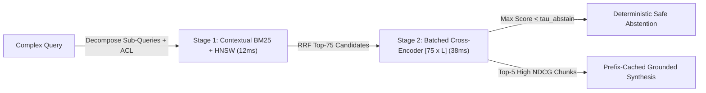

# Two-Stage Reranking: Cross-Encoders, Late Interaction (ColBERT) & Contextual Retrieval

```json pretraining
[
  {
    "term": "Bi-Encoder Bottleneck",
    "formula": "Score(q, d) = E(q) . E(d)  (Zero Token-to-Token Cross-Attention)",
    "meaning": "Compresses 400 tokens into 1 static vector BEFORE seeing the query—fast (O(log N) ANN), but blind to subtle negation or relational binding!"
  },
  {
    "term": "Cross-Encoder Joint Attn",
    "formula": "Score(q, d) = W_cls * Transformer([CLS] || q || [SEP] || d)",
    "meaning": "Every query token attends to every document token across all layers—superb precision, O(K) forward passes (feasible ONLY on top-50/100!)."
  },
  {
    "term": "ColBERT MaxSim",
    "formula": "Score(q, d) = sum_{i in |q|} max_{j in |d|} (q_i . d_j)",
    "meaning": "Late Interaction: pre-computes per-token document vectors offline and computes fast token-level MaxSim without online Transformer passes."
  },
  {
    "term": "Contextual Retrieval",
    "formula": "Chunk' = LLM_Situate(CachedFullDoc, RawChunk) + \"\\n\" + RawChunk",
    "meaning": "Resolves coreferences ('Revenue grew 3%...' -> '[ACME Corp Q2-2026 SEC 10-Q] Revenue grew 3%...') ONCE at ingest using 90%-discounted prefix caching!"
  }
]
```

```json poe
{
  "question": "A corporate financial RAG corpus contains 40 quarterly 10-Q filings (ACME, Globex, Initech across 2023–2026). Every single 10-Q has an identical chunk reading: 'The company's operating margin expanded by 240 bps over the prior quarter.' When a user asks 'Did Globex's operating margin expand in Q3 2025?', Hybrid BM25 + Bi-Encoder returns 10 nearly identical chunks from the wrong companies/quarters! What ingest-time technique cuts retrieval failure rate by ~49–67% without slowing query latency?",
  "options": [
    "Switch from Cosine similarity to Manhattan L1 distance",
    "Anthropic-style Contextual Retrieval (+ Reranking): at ingest time, pass the cached full document + chunk to a fast LLM to prepend a 50-token disambiguating header ('This chunk is from Globex Corp's Q3 2025 10-Q filing...') BEFORE computing BOTH the Dense Embedding AND the Contextual BM25 index!",
    "Increase HNSW efSearch to 1000",
    "Lower BM25 k1 to 0.01"
  ],
  "answerIndex": 1,
  "explanation": "Orphaned chunks lacking entity and temporal anchors look identical to both BM25 and Bi-Encoders. Prepending situated context at index time (made pennies-per-million-tokens via full-document KV prefix caching!) makes both lexical and vector retrieval entity-exact, cutting top-20 failure rates by up to 67% when paired with reranking."
}
```

## 1. The Two-Stage Retrieval Funnel (`Recall@100` $\to$ `NDCG@5`)

Why not run a **Cross-Encoder** over your entire `5,000,000`-chunk knowledgebase? Because a Cross-Encoder concatenates `[CLS] query [SEP] chunk` and executes full bidirectional self-attention across every pair—scoring `5M` chunks at `0.8ms/pair` would take **`4,000` GPU-seconds (`66 minutes`) per user query**! Conversely, why not pass `Top-100` raw Bi-Encoder hits straight to your generation LLM? Doing so burns `50,000` prompt tokens (`$$$`), spikes `TTFT` past `3s`, and buries real answers inside noisy `"Lost in the Middle"` distractors.

Production RAG mirrors Web Search & Ads Ranking via a **Two-Stage Funnel**:
1. **Stage 1 — Fast Candidate Generation (`~12ms`, optimizes `Recall@100`)**: Metadata ACL pre-filter $\to$ Parallel **Contextual Dense HNSW** (`top-75`) + **Contextual BM25** (`top-75`) $\to$ **RRF Fusion** (`top-75` unique candidates).
2. **Stage 2 — High-Precision Cross-Encoder Reranking (`~38ms` batched on GPU, optimizes `NDCG@5` / `MRR`)**: Feeds all `75` `(query, candidate_i)` pairs as a single padded mini-batch `[75, 512]` into a distilled `110M–560M` Cross-Encoder (`bge-reranker-v2-m3`, Cohere Rerank, Voyage Rerank), applies a **minimum relevance score gate** (abstaining with `"Insufficient documented evidence"` if even Rank #1 scores below calibrated threshold $\tau_{\text{abstain}}$!), and passes only **`Top-5`** crisp chunks to the LLM!



---

## 2. Bi-Encoder vs. Late Interaction (`ColBERT`) vs. Cross-Encoder Architecture

```json contrast
{
  "title": "Single-Stage Bi-Encoder Top-20 Dump vs Contextual Retrieval + Cross-Encoder Funnel",
  "naiveTitle": "Orphaned Chunks + Raw Bi-Encoder Top-20",
  "naiveMetric": "61% Multi-Entity Recall · Negation Blind",
  "naivePoints": [
    "Single-vector pooling blurs negation: 'Drug X cures Y' and 'Drug X NEVER cures Y' score 0.96 cosine similarity!",
    "Pronoun-heavy chunks ('The service must restart...') lose parent service identity when detached from page title",
    "Feeds all 20 noisy chunks (12k tokens) to frontier LLM, inflating token cost 4x while lowering answer accuracy"
  ],
  "staffTitle": "Contextual Ingest + Hybrid RRF + Cross-Encoder",
  "staffMetric": "94% NDCG@5 · +45ms Latency · 4x Cheaper Gen",
  "staffPoints": [
    "Ingest pipeline prepends Prefix-Cached Contextual headers resolving 'it/the company/last quarter' before indexing",
    "Cross-Encoder runs full token-to-token attention across [query, chunk], catching 'NOT / EXCEPT / v1-vs-v2' nuances cleanly",
    "Decomposes multi-hop comparative queries ('Compare AeroCart v1 vs v2 SLA') into parallel deterministic sub-retrievals"
  ]
}
```

| Architecture | Offline Document Storage | Online Query Compute | Negation & Fine Entity Precision | Ideal Funnel Stage |
| :--- | :--- | :--- | :--- | :--- |
| **Bi-Encoder (`Dense`)** | `1` vector / chunk (`1–3 KB`) | `1` query embed + $O(\log N)$ HNSW | Moderate (single-vector bottleneck) | **Stage 1 Recall (`Top-100`)** |
| **Late Interaction (`ColBERTv2`)** | `N_tok` compressed 2-bit residual vectors / chunk (`~10–25 KB`) | `1` query encode + fast `MaxSim` PLAID | High (preserves per-token interaction!) | **Stage 1.5 / High-Precision Recall** |
| **Cross-Encoder (`Reranker`)** | Raw text only (`0` vector storage) | **`K` full Transformer passes** (`[K, L_q+L_d]`) | **Highest** (full cross-attention all layers) | **Stage 2 Rerank (`Top-75 -> Top-5`)** |

---

## 3. Dual-Language Production Blueprints: `NDCG@K` Evaluator, Contextualizer & Rerank Funnel

### Python 3 Blueprint: Prefix-Cached Contextual Ingest Prompt, `ColBERT MaxSim` & `NDCG@K` Gate
```python
from __future__ import annotations
from dataclasses import dataclass
import math
from typing import Callable, Dict, List, Sequence, Tuple


def build_contextual_retrieval_ingest_prompts(
    full_document_text: str, raw_chunks: Sequence[str]
) -> List[Tuple[str, str]]:
    """
    Anthropic-style Contextual Retrieval ingest builder:
    Returns (cacheable_prefix, dynamic_chunk_suffix) pairs so 100 chunks from a 30-page PDF
    pay full prefill on `full_document_text` ONCE and hit 90%-discounted KV prefix cache 99 times!
    """
    cached_doc_prefix = f"<document>\n{full_document_text.strip()}\n</document>\n"
    prompts: List[Tuple[str, str]] = []
    for chunk in raw_chunks:
        chunk_turn = (
            f"<chunk>\n{chunk.strip()}\n</chunk>\n"
            "Give a concise 1-2 sentence context situating this chunk within the overall document "
            "(naming exact entities, product versions, dates, and section scope) for search retrieval. "
            "Respond ONLY with the succinct context."
        )
        prompts.append((cached_doc_prefix, chunk_turn))
    return prompts


def colbert_late_interaction_maxsim(
    query_token_vecs: Sequence[Sequence[float]],
    doc_token_vecs: Sequence[Sequence[float]],
) -> float:
    """
    Computes exact ColBERT MaxSim(Q, D) = sum_{i in Q} max_{j in D} (q_i · d_j).
    Preserves token-by-token alignment without running joint Cross-Encoder self-attention!
    """
    if not query_token_vecs or not doc_token_vecs:
        return 0.0
    total_score = 0.0
    for q_vec in query_token_vecs:
        best_tok_sim = max(
            sum(qk * dk for qk, dk in zip(q_vec, d_vec))
            for d_vec in doc_token_vecs
        )
        total_score += best_tok_sim
    return round(total_score, 6)


def compute_ndcg_at_k(relevances_in_rank_order: Sequence[float], k: int = 5) -> float:
    """
    Computes Normalized Discounted Cumulative Gain (NDCG@K) with graded relevance {0, 1, 2, 3}:
    DCG@K = sum_{i=1}^K (2^{rel_i} - 1) / log2(i + 1).
    """
    def _dcg(rels: Sequence[float]) -> float:
        return sum(
            ((2.0 ** rel) - 1.0) / math.log2(idx + 2.0)
            for idx, rel in enumerate(rels[:k])
        )

    actual_dcg = _dcg(relevances_in_rank_order)
    ideal_dcg = _dcg(sorted(relevances_in_rank_order, reverse=True))
    return round(actual_dcg / ideal_dcg, 5) if ideal_dcg > 0.0 else 0.0


@dataclass(frozen=True)
class RerankedResult:
    abstained: bool
    selected_chunks: List[Tuple[str, float]]


def execute_rerank_with_abstention_gate(
    query: str,
    stage1_candidates: Sequence[Tuple[str, str]],
    cross_encoder_batch_fn: Callable[[str, Sequence[str]], Sequence[float]],
    top_k: int = 5,
    min_calibrated_score: float = 0.35,
) -> RerankedResult:
    """Runs batched Stage-2 Cross-Encoder and enforces a deterministic low-confidence abstention floor."""
    if not stage1_candidates:
        return RerankedResult(True, [])
    texts = [txt for _, txt in stage1_candidates]
    scores = cross_encoder_batch_fn(query, texts)
    scored = sorted(
        (( stage1_candidates[i][0], float(scores[i]) ) for i in range(len(texts))),
        key=lambda x: -x[1],
    )
    if scored[0][1] < min_calibrated_score:
        return RerankedResult(True, [])
    return RerankedResult(False, scored[:top_k])
```

### Java 17 Blueprint: Multi-Query Sub-Retriever + Cross-Encoder Rerank & `NDCG@K` Evaluator
```java
package com.hub.ai.rerank;

import java.util.ArrayList;
import java.util.Comparator;
import java.util.LinkedHashMap;
import java.util.List;
import java.util.Map;
import java.util.function.BiFunction;
import java.util.function.Function;

public final class TwoStageRerankPipeline {

    public record CandidateChunk(String chunkId, String situatedText) {}
    public record ScoredChunk(String chunkId, String situatedText, double crossEncoderProb) {}

    /**
     * Executes parallel/multi-hop sub-query recall (unioning deduplicated candidates)
     * followed by a single batched Cross-Encoder reranking pass + abstention floor.
     */
    public static List<ScoredChunk> retrieveDecomposedAndRerank(
            String originalQuery,
            List<String> decomposedSubQueries,
            Function<String, List<CandidateChunk>> stage1HybridRecall,
            BiFunction<String, List<CandidateChunk>, double[]> batchedCrossEncoder,
            int finalTopK,
            double abstentionThreshold) {

        Map<String, CandidateChunk> dedupedPool = new LinkedHashMap<>();
        for (String subQ : decomposedSubQueries) {
            for (CandidateChunk hit : stage1HybridRecall.apply(subQ)) {
                dedupedPool.putIfAbsent(hit.chunkId(), hit);
            }
        }
        if (dedupedPool.isEmpty()) {
            return List.of();
        }

        List<CandidateChunk> poolList = new ArrayList<>(dedupedPool.values());
        double[] ceScores = batchedCrossEncoder.apply(originalQuery, poolList);

        List<ScoredChunk> reranked = new ArrayList<>(poolList.size());
        for (int i = 0; i < poolList.size(); i++) {
            CandidateChunk c = poolList.get(i);
            reranked.add(new ScoredChunk(c.chunkId(), c.situatedText(), ceScores[i]));
        }
        reranked.sort(Comparator.comparingDouble(ScoredChunk::crossEncoderProb).reversed());

        if (reranked.get(0).crossEncoderProb() < abstentionThreshold) {
            return List.of(); // Safe Abstention: zero relevant evidence found in knowledgebase
        }
        return reranked.subList(0, Math.min(finalTopK, reranked.size()));
    }

    public static double computeNdcgAtK(double[] gradedRelevances, int k) {
        double dcg = 0.0;
        int limit = Math.min(k, gradedRelevances.length);
        for (int i = 0; i < limit; i++) {
            dcg += (Math.pow(2.0, gradedRelevances[i]) - 1.0) / (Math.log(i + 2.0) / Math.log(2.0));
        }
        double[] ideal = gradedRelevances.clone();
        java.util.Arrays.sort(ideal);
        double idcg = 0.0;
        for (int i = 0; i < limit; i++) {
            double rel = ideal[ideal.length - 1 - i];
            idcg += (Math.pow(2.0, rel) - 1.0) / (Math.log(i + 2.0) / Math.log(2.0));
        }
        return idcg == 0.0 ? 0.0 : dcg / idcg;
    }
}
```

> [!WARNING] **Staff Interview Gotcha — Multi-Hop Comparative Queries Fail Even WITH a Cross-Encoder Unless Decomposed First!** Suppose a user asks: *"Did AeroCart's p99 latency improve between Q1 2025 and Q4 2025?"* If `Chunk A` (`Q1 2025: p99 = 180ms`) and `Chunk B` (`Q4 2025: p99 = 95ms`) live in separate documents, neither chunk alone answers the comparative question, and if `Q1 2025` had sparser wording it may rank `#112`—missing the `Top-75` Stage-1 recall pool completely (**a Cross-Encoder can NEVER rescue a document that missed Stage-1 Recall!**). **Invariant:** Comparative and multi-entity queries must run **Query Decomposition** (`["AeroCart p99 latency Q1 2025", "AeroCart p99 latency Q4 2025"]`) in Stage 1, union the recalled pools (`Top-40` per sub-query), and rerank/cover **each sub-query facet** so both operands reach the synthesis prompt!

---

## 4. Scenario Retrieval-Practice Mastery Gate

```json quiz
[
  {
    "id": "aie-10-q1",
    "question": "Why does Anthropic's Contextual Retrieval remain economically cheap (~$1 per million indexed document tokens) despite calling an LLM once for EVERY single 300-token chunk in a 25,000-token manual?",
    "options": [
      "It calls the LLM only on every 10th chunk and interpolates the rest",
      "Because all ~85 chunks of that manual share the EXACT same 25,000-token <document> prefix at token index 0! Chunk #1 warms the KV Prefix Cache, and Chunks #2..#85 hit 90%-discounted cached KV blocks while generating only ~50 output tokens per chunk",
      "Contextual Retrieval uses regex instead of an LLM",
      "Embeddings are computed in INT1 precision"
    ],
    "answerIndex": 1,
    "explanation": "Placing <document>{full_doc}</document> at the static top of the prompt and varying only <chunk>{chunk_i}</chunk> at the tail turns O(N_chunks * L_doc) prefill compute into O(L_doc + N_chunks * L_chunk) via prefix caching!"
  },
  {
    "id": "aie-10-q2",
    "question": "When evaluating Stage-1 Candidate Retrieval vs Stage-2 Cross-Encoder Reranking in your offline CI harness, which metric pair maps cleanly to each stage's actual job?",
    "options": [
      "Stage 1: BLEU-4; Stage 2: Perplexity",
      "Stage 1: Recall@K (e.g., Recall@75 — did the golden answer chunk enter the candidate pool at ANY rank <= 75?); Stage 2: NDCG@5 / MRR (did the reranker promote the highest-grade golden evidence into the very top 1–5 slots?)",
      "Stage 1: NDCG@1; Stage 2: Recall@1000",
      "Both stages should only measure end-to-end LLM verbosity"
    ],
    "answerIndex": 1,
    "explanation": "Stage 1 only needs to avoid dropping relevant chunks (Recall@75 >= 0.96); Stage 2's job is rank-order precision at the narrow context cutoff (NDCG@5)."
  },
  {
    "id": "aie-10-q3",
    "question": "If you batch 64 (query, chunk) pairs into a GPU Cross-Encoder where 63 chunks are 180 tokens long and 1 outlier chunk is 2,048 tokens long, naive static tensor padding pads ALL 64 rows to 2,048 tokens (11x wasted compute!). How do production reranking servers avoid this latency spike?",
    "options": [
      "Drop any chunk longer than 180 tokens",
      "Sort the 64 candidate pairs by token length into length-grouped micro-batches OR use FlashAttention varlen (unpadded packed sequence cu_seqlens) so each pair computes attention strictly over its true unpadded token length!",
      "Convert tokens to characters before batching",
      "Run all 64 pairs sequentially with batch_size=1 on CPU"
    ],
    "answerIndex": 1,
    "explanation": "Packed variable-length attention (flash_attn_varlen_func) or length-sorted micro-batching eliminates quadratic padding waste in Cross-Encoder reranking."
  }
]
```
