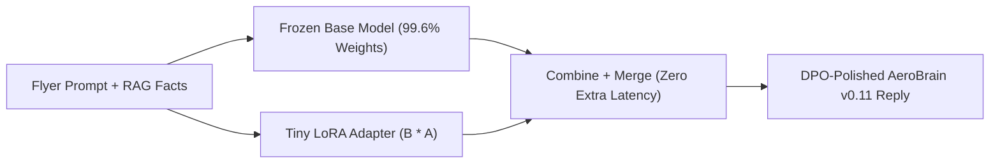

# RAG vs. Fine-Tuning Decision Matrix, LoRA / QLoRA Math & Direct Preference Optimization (DPO)

```json continuity
{
  "previously": "In Chapter 10, we upgraded AeroBrain v0.10 with Contextual Retrieval and a Two-Stage Cross-Encoder Reranking Funnel, pushing evidence precision to 94% NDCG@5.",
  "painPoint": "Even when AeroBrain v0.10 retrieves the right policy, we are stuffing 4,000 tokens of airline style guides and legacy ticket formatting rules into every prompt—and our massive 70-billion-parameter model costs $18,000/month and takes 2.5 seconds per reply!",
  "unlock": "We will upgrade AeroBrain to v0.11 by separating Facts (RAG) from Form & Skill (Fine-Tuning), attaching a tiny plug-in LoRA adapter to a fast 8-billion-parameter student model and aligning its tone with Direct Preference Optimization (DPO)."
}
```

```json walkthrough
[
  {
    "time": "0:00",
    "badge": "1. Open-Book vs. Muscle Memory",
    "caption": "Never fine-tune a model to memorize daily-changing flight schedules or private customer tickets. Use RAG as an open-book reference for facts, and use fine-tuning as muscle memory for tone, formatting, and compact speed.",
    "code": "RAG = Live Facts & Permissions | Fine-Tuning = Tone & Skill"
  },
  {
    "time": "0:24",
    "badge": "2. Sticky-Note Adapters (LoRA)",
    "caption": "Rewriting all 70 billion weights of a brain takes 16 giant GPUs. Low-Rank Adaptation, or LoRA, freezes the original brain and trains two tiny side matrices that act like a transparent sticky-note overlay using 99% less memory.",
    "code": "Output = Frozen_Base(x) + LoRA_Overlay(x)"
  },
  {
    "time": "0:50",
    "badge": "3. 4-Bit Compression (QLoRA)",
    "caption": "QLoRA compresses the frozen base model down to 4 bits per weight while keeping our tiny LoRA adapter in high precision, letting us fine-tune AeroBrain on a single workstation GPU.",
    "code": "4-bit Frozen Base + 16-bit LoRA Adapter = 1 GPU Training"
  },
  {
    "time": "1:14",
    "badge": "4. Preference Alignment (DPO)",
    "caption": "Finally, Direct Preference Optimization shows AeroBrain pairs of 'Chosen polite reply' versus 'Rejected robotic reply' so it learns human preferences without needing a separate reward model.",
    "code": "DPO: boost P(chosen_reply) / P(rejected_reply)"
  }
]
```

```json pretraining
[
  {
    "term": "RAG vs. Fine-Tuning Split",
    "formula": "RAG = Open-Book Facts | Fine-Tuning = Muscle-Memory Skill",
    "meaning": "Use search (RAG) whenever facts change hourly or require per-user privacy; use fine-tuning when you want a smaller, cheaper model to master a specific output style or domain format."
  },
  {
    "term": "LoRA (Low-Rank Adaptation)",
    "formula": "NewWeight = FrozenBase + (B * A)",
    "meaning": "Instead of updating a massive 8,192-by-8,192 weight table, we freeze it and train two skinny tables (8,192-by-16 and 16-by-8,192), cutting trainable parameters by over 99%."
  },
  {
    "term": "QLoRA (Quantized LoRA)",
    "formula": "4-Bit Frozen Base + 16-Bit Trainable Adapter",
    "meaning": "Shrinks the frozen base model into compact 4-bit numbers so a giant model fits on one GPU while your LoRA adapter trains in crisp 16-bit precision."
  },
  {
    "term": "DPO (Direct Preference Optimization)",
    "formula": "Nudge Model Toward Chosen Reply Over Rejected Reply",
    "meaning": "A clean way to polish a model's behavior by feeding it pairs of (Good Answer, Bad Answer) for the same prompt and nudging probabilities toward the good answer."
  }
]
```

## 🌱 Step 1: Plain-English Story — Open-Book Reference vs. Pilot Muscle Memory (`AeroBrain v0.11`)

When a newly hired **AeroCart** gate agent steps up to the counter, they need two completely different kinds of knowledge:
1. **Live Reference Facts (`RAG`)**: *"Is Flight AC-402 delayed right now, and does Passenger #992 have Gold Lounge access?"* You would never ask an agent to memorize every passenger's ticket two weeks in advance! Facts that change every minute or belong to private customer accounts must be looked up live in an **open book (`RAG`)**.
2. **Habits & Formatting Muscle Memory (`Fine-Tuning`)**: *"How do I emit a valid airline rebooking JSON payload and speak in AeroCart's warm, concise voice without reading a 20-page instruction manual before every sentence?"* That is **skill and form**.

Instead of rewriting all `8,000,000,000` weights of our model (which costs a fortune and risks making the model forget English), we freeze the original model and attach a tiny **LoRA (Low-Rank Adaptation)** side-adapter—like laying a transparent sheet of tracing paper over a textbook and drawing corrections on the sheet.



---

## 🔨 Step 2: First Lines of Code — Attaching a LoRA Overlay to `AeroBrain v0.11`

Let's see how **`AeroBrain v0.11`** applies a tiny `LoRA` adapter (`B` and `A`) alongside a frozen weight table `W0`, and how we can merge the overlay directly into `W0` before deployment so live queries pay **zero extra latency**:

```python
# AeroBrain v0.11 — Tiny LoRA Adapter Forward Pass & Zero-Latency Merge
def lora_forward(x: list[float], w0: list[list[float]], A: list[list[float]], B: list[list[float]], scale: float) -> list[float]:
    # 1. Frozen base output: W0 @ x
    base_out = [sum(w0[i][j] * x[j] for j in range(len(x))) for i in range(len(w0))]
    # 2. Low-rank bottleneck: first compress (A @ x), then expand (B @ latent)
    latent = [sum(A[r][j] * x[j] for j in range(len(x))) for r in range(len(A))]
    delta = [scale * sum(B[i][r] * latent[r] for r in range(len(latent))) for i in range(len(B))]
    return [base_out[i] + delta[i] for i in range(len(base_out))]

print(lora_forward([1.0, 2.0], [[0.5, 0.5], [1.0, 0.0]], [[0.1, 0.2]], [[0.5], [-0.5]], scale=2.0))
```

### Java 17 Equivalent

```java
// AeroBrain v0.11 — Tiny LoRA Adapter Forward Pass (Java 17)
public class AeroBrainLora {
    public static double[] loraForward(double[] x, double[][] w0, double[][] A, double[][] B, double scale) {
        double[] latent = new double[A.length];
        for (int r = 0; r < A.length; r++)
            for (int j = 0; j < x.length; j++) latent[r] += A[r][j] * x[j];
        double[] out = new double[w0.length];
        for (int i = 0; i < w0.length; i++) {
            for (int j = 0; j < x.length; j++) out[i] += w0[i][j] * x[j];
            for (int r = 0; r < latent.length; r++) out[i] += scale * B[i][r] * latent[r];
        }
        return out;
    }
}
```

---

## ⚡ Step 3: Where It Breaks in Real Life — Why You Must Never Fine-Tune Private Tenant Facts

What happens if an executive says: *"Let's ditch our vector database and just fine-tune `AeroBrain` every night on all customer tickets and flight manuals so it knows everything natively"*?
1. **Zero Access-Control Boundaries (Data Leakage)**: Model weights have no `WHERE user_id = ?` filter. Once VIP Passenger A's private medical waiver is baked into shared neural weights, Passenger B can coax the model into repeating it!
2. **No Instant Deletion or Live Citations**: When a flight gate changes or a European flyer exercises their legal right to delete their data, neural weights cannot instantly "unlearn" one row or cite a live document version.
3. **Training on Unfiltered Logs Amplifies Mistakes**: Fine-tuning on raw chat logs teaches the student model to copy every historical hallucination. We must filter teacher traces through deterministic validators first, and then run **Direct Preference Optimization (`DPO`)** on `(verified_winner, rejected_loser)` pairs.

```json contrast
{
  "title": "Naive Full Fine-Tuning on Raw Logs vs. Hybrid RAG + Verified QLoRA + DPO",
  "naiveTitle": "Full Fine-Tuning on 500k Raw Chat Logs",
  "naiveMetric": "16x 80GB GPUs · Data Leakage & Hallucinations",
  "naivePoints": [
    "Requires >1,120 GB of multi-node GPU memory to store optimizer states for all 70 billion weights",
    "Bakes private tenant facts into shared weights with zero row-level access control or instant deletion",
    "Trains on unverified logs, teaching the model to imitate past hallucinations"
  ],
  "staffTitle": "RAG for Facts + Verified QLoRA + DPO for Skill",
  "staffMetric": "1x 80GB GPU · 0.00ms Merged Latency Overhead",
  "staffPoints": [
    "Keeps volatile facts and access-control permissions in Hybrid RAG while distilling formatting skill into an 8B student",
    "Applies QLoRA (4-bit NF4 frozen base + 16-bit rank-16 adapters across all linear layers) on a single GPU",
    "Runs DPO over (verified_pass, rejected_fail) pairs to eliminate subtle schema and tone errors"
  ]
}
```

```json poe
{
  "question": "A VP proposes replacing AeroBrain's multi-tenant RAG index with nightly LoRA Supervised Fine-Tuning (SFT) over all newly uploaded customer tickets and policy docs so 'the LLM knows all company facts without search latency'. What THREE fatal architectural failures should a Staff AI Engineer immediately flag?",
  "options": [
    "LoRA adapters cannot be merged back into 16-bit base weights",
    "1) Zero Row-Level Access Control (ACL): parametric weights blur private tenant facts into shared weights; 2) Unverifiable Hallucinations & Stale Deletions (impossible to guarantee instant GDPR deletion or live citations); 3) Catastrophic Forgetting / Parroting on small factual updates!",
    "LoRA increases inference latency by 4x after weight merging",
    "QLoRA 4-bit quantization only works on ASCII text"
  ],
  "answerIndex": 1,
  "explanation": "Weights have no WHERE tenant_id = ? access-control boundary and cannot instantaneously unlearn deleted documents or cite live versioned sources. RAG handles dynamic ACL-governed facts; LoRA/DPO handles compact skill and format distillation."
}
```

---

## 🚀 Step 4: Staff Engineer Deep-Dive — `LoRA` Matrix Calculus, `QLoRA NF4` & `DPO` Loss

### 1. Formal Math: `LoRA` Initialization Symmetry-Breaking & Closed-Form `DPO`

Full fine-tuning of a `70B` model requires **`> 1,120 GB` of GPU VRAM** (`140 GB` BF16 weights + `140 GB` BF16 gradients + `840 GB` FP32 master weights and `AdamW` moments $m_t, v_t$). **Low-Rank Adaptation (`LoRA`)** constrains the update $\Delta W \in \mathbb{R}^{d \times k}$ to rank $r \ll \min(d, k)$:

$$h = W_0 x + \frac{\alpha}{r} B A x, \qquad A \in \mathbb{R}^{r \times k} \sim \mathcal{N}(0, \sigma^2),\quad B \in \mathbb{R}^{d \times r} = \mathbf{0}$$

Why initialize $B = \mathbf{0}$ and $A \sim \mathcal{N}(0, \sigma^2)$? Setting $B = \mathbf{0}$ ensures $\Delta W = B A = \mathbf{0}$ at step `0` (exact pretrained identity), while non-zero $A$ ensures $\frac{\partial \mathcal{L}}{\partial B} = \frac{\partial \mathcal{L}}{\partial W} A^{\top} \neq \mathbf{0}$ on step `1` (avoiding the $A=0, B=0$ zero-gradient saddle point!).

After Supervised Fine-Tuning (`SFT`), **Direct Preference Optimization (`DPO`, Rafailov et al.)** aligns policy $\pi_{\theta}$ against frozen reference $\pi_{\text{ref}}$ over preference pairs $(x, y_w \succ y_l)$ without training a separate RLHF Reward Model:

$$\mathcal{L}_{\text{DPO}}(\pi_{\theta}; \pi_{\text{ref}}) = -\mathbb{E}_{(x, y_w, y_l)}\!\left[\log \sigma\!\left(\beta \log \frac{\pi_{\theta}(y_w \mid x)}{\pi_{\text{ref}}(y_w \mid x)} - \beta \log \frac{\pi_{\theta}(y_l \mid x)}{\pi_{\text{ref}}(y_l \mid x)}\right)\right]$$

| Requirement / Constraint | Context / Few-Shot | Production Hybrid RAG | `LoRA` / `QLoRA` + `DPO` | Hybrid (`RAG + Fine-Tuned Student`) |
| :--- | :--- | :--- | :--- | :--- |
| **Hourly Freshness & Instant GDPR Delete** | No | **Yes (Update/Delete row in `<50ms`)** | **No** (Requires retraining) | **Yes** (Facts stay in RAG index) |
| **Strict Per-User / Per-Tenant ACLs** | Via prompt | **Yes (Metadata pre-filtered index)** | **No** (Unless 1 adapter/tenant) | **Yes** |
| **Proprietary DSL / Dialect / Tone** | Burns `4k` few-shot tokens | Retrieves examples | **Best (`0` prompt overhead!)** | **Best** |
| **Distilling `500 RPS` Classifier / Router** | Too slow/costly on 70B | Overkill | **Best (`8B` matches `70B` @ `15x` lower `$`)** | Live schema via RAG + `8B LoRA` skill |

### 2. Dual-Language Production Blueprints: `QLoRA` VRAM Planner, Merge Verifier & `DPO` Engine

```python
from __future__ import annotations
from dataclasses import dataclass
import math
from typing import List, Sequence, Tuple


@dataclass(frozen=True)
class TrainingVramEstimate:
    frozen_base_gb: float
    trainable_params_millions: float
    lora_weights_grads_opt_gb: float
    total_estimated_vram_gb: float


def estimate_lora_vs_qlora_vram(
    base_params_billions: float,
    n_layers: int,
    d_model: int,
    d_ff: int,
    rank_r: int = 16,
    use_4bit_nf4_qlora: bool = True,
    activation_checkpointing_gb: float = 6.0,
) -> TrainingVramEstimate:
    """Calculates trainable parameters across all 7 linear modules per layer and compares LoRA vs QLoRA VRAM."""
    attn_adapter_params = 4 * (2 * d_model * rank_r)
    mlp_adapter_params = 3 * ((d_model + d_ff) * rank_r)
    total_trainable = n_layers * (attn_adapter_params + mlp_adapter_params)

    bytes_per_base = 0.55 if use_4bit_nf4_qlora else 2.0
    frozen_base_gb = base_params_billions * bytes_per_base
    lora_state_gb = (total_trainable * 16.0) / 1_000_000_000.0
    total_gb = frozen_base_gb + lora_state_gb + activation_checkpointing_gb
    return TrainingVramEstimate(
        frozen_base_gb=round(frozen_base_gb, 2),
        trainable_params_millions=round(total_trainable / 1_000_000.0, 2),
        lora_weights_grads_opt_gb=round(lora_state_gb, 3),
        total_estimated_vram_gb=round(total_gb, 2),
    )


def lora_merge_and_verify_equivalence(
    w0: Sequence[Sequence[float]],
    b_mat: Sequence[Sequence[float]],
    a_mat: Sequence[Sequence[float]],
    x: Sequence[float],
    alpha: float = 32.0,
) -> List[float]:
    """Proves (W_0 @ x) + (alpha / r) * (B @ (A @ x)) == W_merged @ x with zero runtime overhead."""
    r = len(a_mat)
    scale = alpha / r
    d_out, d_in = len(w0), len(w0[0])

    ax = [sum(a_mat[row][j] * x[j] for j in range(d_in)) for row in range(r)]
    bax = [sum(b_mat[i][col] * ax[col] for col in range(r)) for i in range(d_out)]
    unmerged_out = [sum(w0[i][j] * x[j] for j in range(d_in)) + scale * bax[i] for i in range(d_out)]

    w_merged = [
        [w0[i][j] + scale * sum(b_mat[i][k_idx] * a_mat[k_idx][j] for k_idx in range(r)) for j in range(d_in)]
        for i in range(d_out)
    ]
    merged_out = [sum(w_merged[i][j] * x[j] for j in range(d_in)) for i in range(d_out)]
    for u, m in zip(unmerged_out, merged_out):
        assert abs(u - m) < 1e-9
    return merged_out


def direct_preference_optimization_loss(
    policy_chosen_logprob: float,
    policy_rejected_logprob: float,
    ref_chosen_logprob: float,
    ref_rejected_logprob: float,
    beta: float = 0.1,
) -> Tuple[float, float]:
    """Computes numerically stable DPO loss and implicit reward margin over (chosen, rejected) pairs."""
    chosen_log_ratio = policy_chosen_logprob - ref_chosen_logprob
    rejected_log_ratio = policy_rejected_logprob - ref_rejected_logprob
    reward_margin = beta * (chosen_log_ratio - rejected_log_ratio)
    loss = -reward_margin + math.log1p(math.exp(reward_margin)) if reward_margin < 0 else math.log1p(math.exp(-reward_margin))
    return round(loss, 6), round(reward_margin, 6)
```

#### Java 17 Equivalent

```java
package com.hub.ai.adaptation;

public final class LoraAndDpoEngine {

    public record DpoMetrics(double loss, double implicitRewardMargin, boolean prefersChosen) {}

    public static float[] forwardWithTenantLora(
            float[][] frozenBaseW0,
            float[][] tenantB,
            float[][] tenantA,
            float[] x,
            float alpha) {

        int dOut = frozenBaseW0.length;
        int dIn = frozenBaseW0[0].length;
        int rank = tenantA.length;
        float scale = alpha / rank;

        float[] latent = new float[rank];
        for (int r = 0; r < rank; r++) {
            float acc = 0.0f;
            for (int j = 0; j < dIn; j++) acc = Math.fma(tenantA[r][j], x[j], acc);
            latent[r] = acc;
        }

        float[] out = new float[dOut];
        for (int i = 0; i < dOut; i++) {
            float baseSum = 0.0f;
            for (int j = 0; j < dIn; j++) baseSum = Math.fma(frozenBaseW0[i][j], x[j], baseSum);
            float deltaSum = 0.0f;
            for (int r = 0; r < rank; r++) deltaSum = Math.fma(tenantB[i][r], latent[r], deltaSum);
            out[i] = Math.fma(scale, deltaSum, baseSum);
        }
        return out;
    }

    public static DpoMetrics evaluateDpoPair(
            double piChosenLogP, double piRejectedLogP,
            double refChosenLogP, double refRejectedLogP, double beta) {
        double margin = beta * ((piChosenLogP - refChosenLogP) - (piRejectedLogP - refRejectedLogP));
        double loss = margin >= 0.0
            ? Math.log1p(Math.exp(-margin))
            : -margin + Math.log1p(Math.exp(margin));
        return new DpoMetrics(loss, margin, margin > 0.0);
    }
}
```

> [!WARNING] **Staff Interview Gotcha — Masking Prompt Tokens (`labels = -100`) & Dequantizing Before Merging `QLoRA`!**
> Two subtle bugs ruin `LoRA`/`QLoRA` quality in production:
> 1. **Prompt Token Loss Masking**: During Supervised Fine-Tuning (`SFT`) on `(user_prompt, assistant_answer)` pairs, if you forget to mask prompt tokens (`labels[:prompt_len] = -100` in `CrossEntropyLoss`), `85%` of your gradient budget goes toward memorizing noisy user questions instead of assistant answers!
> 2. **Merging `BF16` LoRA Into `4-Bit NF4`**: You cannot add tiny `BF16` $\Delta W = (\alpha/r)BA$ directly into `4-bit NF4` blocks without severe rounding loss—you must **dequantize the `NF4` base to `BF16`**, add $(\alpha/r)BA$ in `BF16`/`FP32`, and then re-quantize to `FP8`/`AWQ` for serving.

**Up Next in Chapter 12:** `AeroBrain v0.11` can now retrieve grounded airline policies and speak with Staff-grade precision—but a true AI concierge shouldn't just *talk* about rebooking a delayed flight; it needs to **take action** (calling seat-inventory APIs, charging fare differences with idempotency keys, and pausing for human confirmation). In **Chapter 12 (Course Finale)**, we will complete **`AeroBrain v1.0`** with **Agentic Architectures, Tool Contracts & Model Context Protocol (`MCP`)**.

```json quiz
[
  {
    "id": "aie-11-q1",
    "question": "In LoRA initialization (ΔW = (alpha / r) * B * A), why is matrix B initialized to exact ZEROS while matrix A is initialized from a Gaussian random distribution—rather than initializing BOTH to zero or BOTH to Gaussian random?",
    "options": [
      "CUDA cuBLAS refuses to multiply two Gaussian matrices",
      "If BOTH A=0 and B=0, backprop gradients dL/dA = B^T * dL/dW = 0 and dL/dB = dL/dW * A^T = 0 are identically ZERO forever (dead saddle point!); if BOTH are non-zero random, step-0 injects random noise into the pretrained model! Setting B=0 and A~N(0, sigma^2) makes step-0 ΔW = 0 while guaranteeing non-zero gradient dL/dB on step 1!",
      "Setting B=0 halves GPU memory during forward passes",
      "Matrix A is frozen during LoRA training"
    ],
    "answerIndex": 1,
    "explanation": "Asymmetric initialization (B=0, A random) achieves the exact identity function W' = W_0 at t=0 while breaking gradient symmetry so B learns immediately on step 1 and A learns on step 2."
  },
  {
    "id": "aie-11-q2",
    "question": "What does hyperparameter beta (typically 0.05 – 0.5) control in Direct Preference Optimization (DPO), and what goes wrong if beta is set way too small (~0.0001)?",
    "options": [
      "beta is the AdamW second-moment exponential decay rate",
      "beta controls the strength of the KL-divergence anchor to the frozen SFT reference policy pi_ref: if beta -> 0, the KL penalty vanishes and the policy degenerates/reward-hacks (collapsing entropy and drifting arbitrarily far from fluent language!)",
      "beta sets the 4-bit NormalFloat block size",
      "beta controls how many tokens are truncated during prefill"
    ],
    "answerIndex": 1,
    "explanation": "In RLHF and DPO alike, beta weights the KL-divergence leash D_KL(pi_theta || pi_ref) preventing catastrophic policy collapse away from the pretrained/SFT base model."
  },
  {
    "id": "aie-11-q3",
    "question": "How does vLLM / Punica / S-LoRA serve 200 distinct tenant-specific LoRA adapters (r=16, ~65MB each) concurrently at 100 RPS on ONE 80GB H100 GPU without needing 200 separate 70B GPU deployments?",
    "options": [
      "It merges and unmerges all 70B base weights in HBM before every single token",
      "It keeps ONE shared frozen 70B base model in HBM, executes the heavy batched base GEMM (W_0 * X) across all 200 tenants' requests together in one Tensor Core call, and adds heterogeneous per-request (B_i * A_i * x_i) low-rank residuals via segmented gather-scatter CUDA kernels!",
      "It runs LoRA adapters on CPU over PCIe",
      "It averages all 200 adapters into a single shared matrix"
    ],
    "answerIndex": 1,
    "explanation": "Distributive linearity (W_0 + B_i A_i)x_i = W_0 x_i + B_i(A_i x_i) lets all concurrent requests share the giant W_0 GEMM at high arithmetic intensity while applying tiny ~65MB per-tenant adapters dynamically!"
  }
]
```
