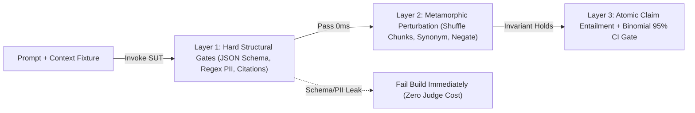

# Testing Non-Deterministic AI Systems: Hard Invariants, Pass@k Math & Metamorphic QA

```json pretraining
[
  {
    "term": "Oracle Problem",
    "formula": "f(x) ∈ ValidSet(x)",
    "meaning": "Unlike classical CRUD APIs with a single expected string, generative models map one prompt to an infinite manifold of semantically valid phrasings."
  },
  {
    "term": "Metamorphic Relation (MR)",
    "formula": "T(x) ⇒ R(f(x), f(T(x)))",
    "meaning": "Testing a model without ground-truth labels by transforming the input (synonym swap, context shuffle, negation) and asserting a deterministic relationship between outputs."
  },
  {
    "term": "Wilson Pass-Rate CI",
    "formula": "p̂ ± z · √(p̂(1-p̂)/n)",
    "meaning": "Bounding true capability pass rate across n evaluation prompts so random sampling noise or GPU floating-point non-determinism never triggers false CI rollbacks."
  },
  {
    "term": "Hard Structural Gate",
    "formula": "O(1) Deterministic Reject",
    "meaning": "Zero-cost pre-judge assertions verifying JSON schema validity, citation ID existence, PII regex absence, and latency/token budgets before invoking any semantic evaluator."
  }
]
```

```json poe
{
  "question": "Even when you set temperature=0.0 and a fixed seed on a hosted frontier LLM API, two identical requests sent 10 minutes apart occasionally return slightly different token sequences. What is the hardware-level root cause, and how must your CI harness adapt?",
  "options": [
    "Network routers randomly mutate UTF-8 JSON bytes inside TLS 1.3 frames",
    "Dynamic MoE/continuous batching routes requests into differently shaped GPU tensor batches where non-associative FP16/BF16 matrix reductions flip tie-breaking logits; CI must assert structural invariants and semantic equivalence rather than assertEquals(rawText)",
    "Tokenizers re-train their BPE vocabulary on every HTTP request",
    "Setting max_tokens above 100 disables greedy decoding"
  ],
  "answerIndex": 1,
  "explanation": "Floating-point addition on GPUs ((a + b) + c != a + (b + c)) depends on batch tensor geometry and Mixture-of-Experts (MoE) routing load. When two candidate tokens have near-identical logits, microscopic FP16 rounding shifts greedy argmax, cascading into a different phrasing."
}
```

## Part I — Why `assertEquals(expected, actual)` Collapses on Generative Pipelines

In classical software testing, a deterministic function $f(x)$ maps input $x$ to a unique canonical output $y^*$. If `calculateTax(100.00, "CA")` returns `8.26` instead of `8.25`, the build is broken.

When testing an LLM-backed system—even at `temperature=0.0`—exact string comparison fails for two orthogonal reasons:
1. **Hardware & Batch Non-Determinism**: Modern inference engines (`vLLM`, `TensorRT-LLM`) use **Continuous Batching** and **Mixture-of-Experts (`MoE`)** routing. Because parallel `BF16`/`FP16` matrix reductions are non-associative, a prompt batched with 7 concurrent users executes a slightly different reduction tree than the same prompt batched with 31 users, flipping tie-break tokens.
2. **Semantic Equivalence Multiplicity**: `"Refunds require cancellation within 24 hours [doc_14]"` and `"To receive a refund, cancel within 24h of booking [doc_14]"` have $0\%$ exact-string match yet $100\%$ policy equivalence.

A Staff AI QA engineer solves this by decomposing every AI assertion into a **Three-Layer Funnel**: fast deterministic structural gates first, **Metamorphic Invariants** second, and calibrated semantic entailment third.



---

## Part II — Metamorphic Testing: Verifying AI Without a Ground-Truth Oracle

Originally formalized by T.Y. Chen for scientific computing where exact answers are unknown, **Metamorphic Testing (`MT`)** verifies **relationships across controlled input transformations** $T(x)$:

1. **Synonym / Paraphrase Invariance ($MR_{\text{syn}}$)**:
   - Transform query $x$: *"Can I cancel a Basic Economy ticket?"* $\to$ $T(x)$: *"Am I allowed to void a Basic Economy fare?"*
   - **Assertion**: Extracted structured decision (`allow_cancel: false`) and cited policy document ID (`doc_basic_econ`) must remain **100% identical**.
2. **Context Permutation Invariance ($MR_{\text{perm}}$ — Lost-in-the-Middle Detector)**:
   - Given retrieved chunks $[C_1, C_2, C_3, C_4, C_5]$, shuffle their order to $[C_4, C_1, C_5, C_2, C_3]$ while keeping the exact same evidence set.
   - **Assertion**: The factual verdict and citation set must not flip when the gold chunk moves from position $1$ to position $3$.
3. **Directional Policy Shift / Negation Sensitivity ($MR_{\text{dir}}$)**:
   - Mutate a single numeric boundary in the injected context: change `elapsed_hours = 18` ($\le 24\text{h}$) to `elapsed_hours = 36` ($> 24\text{h}$).
   - **Assertion**: The structured eligibility boolean **must invert** (`eligible: true` $\to$ `eligible: false`). If the model still outputs `true`, it is ignoring retrieved context and relying on parametric memory!

```json contrast
{
  "title": "LLM Regression Suite Architecture (PR Gate)",
  "naiveTitle": "Brittle String / Cosine Threshold Test",
  "naiveMetric": "41% Flake Rate · Misses Logic Flips",
  "naivePoints": [
    "Asserts exact substring matches or raw embedding cosine >= 0.85 on free-form prose",
    "Breaks whenever model provider silently updates system weights or batching kernels",
    "Passes 'Refunds are NOT allowed' against 'Refunds are allowed' (0.95 cosine)",
    "Runs single-shot prompt checks without statistical confidence bounds"
  ],
  "staffTitle": "Layered Structural + Metamorphic + Binomial Gate",
  "staffMetric": "<0.5% Flake · Catches Context Blindness",
  "staffPoints": [
    "Enforces strict Pydantic/JSON Schema, valid citation IDs, and zero-PII regex in <2ms",
    "Runs Metamorphic Context-Shuffle & Boundary-Flip pairs to prove true context grounding",
    "Computes Wilson 95% lower confidence bound across stratified N=200 eval cases",
    "Distinguishes pass@1 (production reliability) from pass^k (consistency across k trials)"
  ]
}
```

---

## Part III — `pass@k` vs. `pass^k` Reliability Math & Trade-Offs

In code-generation benchmarks (`HumanEval`), researchers report **`pass@k`**: the probability that **at least one** of $k$ sampled generations passes unit tests ($1 - \binom{n-c}{k}/\binom{n}{k}$).
However, in customer-facing QA (support agents, financial workflows), a user only sees **one** response—and expects it to succeed **every single time**! Anthropic and Sierra formalized **`pass^k`** ($p^k$): the probability that **all $k$ trials succeed consecutively**. If single-trial accuracy is $p = 0.80$, `pass@5` looks impressive at $99.97\%$, whereas `pass^5` (true consistency) collapses to $0.80^5 = 32.8\%$!

| Verification Strategy | Oracle Needed? | Execution Cost | Primary Defect Caught | Blind Spot |
| :--- | :--- | :--- | :--- | :--- |
| **Hard Structural Contracts** | None (Schema rules) | $<1\text{ ms}$ CPU | Broken JSON, hallucinated citation IDs, leaked SSNs/API keys, token runaway | Factually wrong claims inside valid JSON |
| **Metamorphic Relations (`MR`)** | **None** (Relational) | $2\times–3\times$ SUT calls | Position bias (*Lost-in-the-Middle*), prompt brittleness, ignoring context edits | Consistently wrong baseline behavior across all permutations |
| **Wilson Binomial Gate (`pass^k`)** | Gold Verdict Set | $N \times k$ SUT calls | Silent capability regressions and high-variance prompt instability | Requires curated stratified Golden Dataset |

---

## Part IV — Production Implementation Blueprints (Python 3 & Java 17)

### Python 3 Blueprint: Structural Gate + Metamorphic Harness + Wilson Lower Bound
```python
from dataclasses import dataclass
import json
import math
import re
from typing import Callable, Sequence

PII_PATTERN = re.compile(r"\b(?:\d{3}-\d{2}-\d{4}|4\d{3}[ -]?\d{4}[ -]?\d{4}[ -]?\d{4})\b")


@dataclass(frozen=True)
class EvalVerdict:
    structural_ok: bool
    metamorphic_ok: bool
    reasons: list[str]


def wilson_lower_bound(successes: int, total: int, z: float = 1.96) -> float:
    """95% Wilson score lower confidence bound for binomial pass rates."""
    if total <= 0:
        return 0.0
    phat = successes / total
    denom = 1.0 + (z * z) / total
    center = phat + (z * z) / (2.0 * total)
    margin = z * math.sqrt((phat * (1.0 - phat) + (z * z) / (4.0 * total)) / total)
    return round(max(0.0, (center - margin) / denom), 4)


def verify_response_and_metamorphic_invariance(
    query: str,
    paraphrased_query: str,
    context_chunks: Sequence[dict[str, str]],
    sut_fn: Callable[[str, Sequence[dict[str, str]]], str],
) -> EvalVerdict:
    reasons: list[str] = []
    valid_doc_ids = {c["id"] for c in context_chunks}

    raw_base = sut_fn(query, context_chunks)
    if PII_PATTERN.search(raw_base):
        reasons.append("PII_LEAK_DETECTED")

    try:
        parsed_base = json.loads(raw_base)
    except json.JSONDecodeError:
        return EvalVerdict(False, False, ["INVALID_JSON_SCHEMA"])

    for req_key in ("eligible", "answer", "citations"):
        if req_key not in parsed_base:
            reasons.append(f"MISSING_KEY:{req_key}")

    cited = set(parsed_base.get("citations") or [])
    if not cited or not cited.issubset(valid_doc_ids):
        reasons.append("HALLUCINATED_OR_EMPTY_CITATIONS")

    structural_ok = len(reasons) == 0
    if not structural_ok:
        return EvalVerdict(False, False, reasons)

    # MR1: Paraphrase Invariance + MR2: Context Reversal Invariance
    parsed_para = json.loads(sut_fn(paraphrased_query, context_chunks))
    parsed_perm = json.loads(sut_fn(query, list(reversed(context_chunks))))

    mr_ok = True
    if parsed_para.get("eligible") != parsed_base.get("eligible"):
        mr_ok = False
        reasons.append("MR_PARAPHRASE_VERDICT_FLIP")
    if parsed_perm.get("eligible") != parsed_base.get("eligible"):
        mr_ok = False
        reasons.append("MR_CONTEXT_ORDER_SENSITIVITY")

    return EvalVerdict(structural_ok, mr_ok, reasons)
```

### Java 17 Blueprint: Deterministic `pass^k` Consistency & Wilson Gate Evaluator
```java
import java.util.List;
import java.util.Set;
import java.util.regex.Pattern;

public final class NondeterministicQaGate {
    private static final Pattern SSN_REGEX = Pattern.compile("\\b\\d{3}-\\d{2}-\\d{4}\\b");

    public record StructuredAnswer(boolean eligible, String summary, Set<String> citations, long latencyMs) {}

    public static boolean passesHardContract(StructuredAnswer ans, Set<String> allowedChunkIds, long maxLatencyMs) {
        if (ans == null || ans.summary() == null || ans.summary().isBlank()) return false;
        if (ans.latencyMs() > maxLatencyMs) return false;
        if (SSN_REGEX.matcher(ans.summary()).find()) return false;
        return !ans.citations().isEmpty() && allowedChunkIds.containsAll(ans.citations());
    }

    /** Computes pass^k: true only if ALL k repeated trials satisfy both contract and metamorphic parity. */
    public static boolean passesAllTrials(List<StructuredAnswer> trials, Set<String> allowedIds, long slaMs) {
        if (trials.isEmpty()) return false;
        boolean baselineDecision = trials.get(0).eligible();
        for (StructuredAnswer trial : trials) {
            if (!passesHardContract(trial, allowedIds, slaMs)) return false;
            if (trial.eligible() != baselineDecision) return false; // Variance flip across identical trials!
        }
        return true;
    }

    public static double wilsonLowerBound95(int successes, int total) {
        if (total <= 0) return 0.0;
        double z = 1.96;
        double phat = (double) successes / total;
        double denom = 1.0 + (z * z) / total;
        double center = phat + (z * z) / (2.0 * total);
        double margin = z * Math.sqrt((phat * (1.0 - phat) + (z * z) / (4.0 * total)) / total);
        return Math.max(0.0, (center - margin) / denom);
    }
}
```

> [!WARNING]
> **Staff Interview Gotcha — Never Gate PRs on a Point-Estimate Pass Rate Without Sample-Size Math**:
> If a candidate says *"We block merges whenever accuracy drops from 92% to 90% on our 50-question eval set,"* call out the binomial standard error: at $N = 50$ and $p = 0.92$, a single-question flip changes the point estimate by $2.0\%$, and the $95\%$ confidence interval spans $[81.2\%, 96.8\%]$! Always size your regression suite using $n \ge \frac{z^2 p(1-p)}{E^2}$ or compare paired prompt deltas (McNemar's test) on the exact same Golden fixtures.

---

## Part V — End-of-Chapter Mastery Check

```json quiz
[
  {
    "id": "aiqa-01-q1",
    "question": "Your team evaluates an autonomous refund-eligibility agent across k=5 trials per scenario. Single-trial accuracy p is 0.85. Why is reporting pass@5 dangerous for production customer-support sign-off, and what metric should be gated instead?",
    "options": [
      "pass@5 underestimates accuracy; you should report BLEU-4 instead",
      "pass@5 measures whether AT LEAST ONE of 5 attempts succeeded (99.99%), hiding the fact that a live customer gets only one unretried action and consecutive reliability pass^5 = 0.85^5 is only 44.4%",
      "pass@5 requires temperature=2.0 to compute",
      "pass@5 only works on classification models with Softmax outputs"
    ],
    "answerIndex": 1,
    "explanation": "pass@k assumes an external verifier can filter k candidates (like running unit tests on generated code). In live conversational or tool-executing agents without an oracle filter, pass@1 and pass^k (all k trials consistent) reflect actual user risk."
  },
  {
    "id": "aiqa-01-q2",
    "question": "You want to detect whether a RAG pipeline suffers from 'Lost-in-the-Middle' context blindness on unlabeled production queries where no human ground-truth answer exists. Which Metamorphic Relation directly exposes this defect?",
    "options": [
      "Increasing max_tokens from 256 to 1024 and checking if latency increases",
      "Context Permutation Invariance: shuffling the order of the top-K retrieved chunks (moving chunk #1 to chunk #3) while holding the chunk set constant, and asserting the extracted decision and cited chunk IDs remain invariant",
      "Translating the output into French and back into English",
      "Checking if JSON.parse() succeeds on the first response"
    ],
    "answerIndex": 1,
    "explanation": "Holding the exact evidence set constant while permuting chunk positions isolates positional attention bias without needing a pre-labeled expected answer."
  },
  {
    "id": "aiqa-01-q3",
    "question": "Why should Hard Structural Gates (JSON schema, citation ID subset check, PII regex, latency budget) always execute BEFORE semantic or LLM-as-a-Judge evaluation in CI?",
    "options": [
      "Because JSON parsing improves the LLM's creative writing style",
      "Because structural gates are 100% deterministic, run in <2ms on CPU at zero API cost, and prevent malformed or security-violating payloads from wasting expensive LLM-Judge tokens or spoofing judge prompts",
      "Because LLM judges cannot read UTF-8 strings longer than 100 bytes",
      "Because regex engines use dense vector embeddings"
    ],
    "answerIndex": 1,
    "explanation": "Fail-fast deterministic gates enforce non-negotiable schema, citation integrity, and PII boundaries with zero variance and zero token cost before probabilistic evaluators run."
  }
]
```
