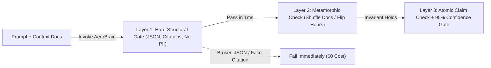

# Build AeroEval v0.1: Testing Non-Deterministic AI Systems, Pass@k Math & Metamorphic QA

```json continuity
{
  "previously": "Welcome to Day 1 of AI Engineering (QA Focused)! Zero prior AI testing background needed—we will build our own AI evaluation harness (`AeroEval`) from a blank file to protect AeroCart's new AI support concierge (`AeroBrain`).",
  "painPoint": "When you test a normal calculator (`2 + 2 == 4`), `assertEquals` works every time. When you test an AI flight bot with `assert reply == 'Refunds take 24 hours'`, the test fails whenever the bot says `'You have 24 hours to request a refund'`—even though the answer is 100% right!",
  "unlock": "Build `AeroEval v0.1`: replace brittle exact-string checks with instant structural contracts (JSON + citations + zero PII), Oracle-Free Metamorphic checks, and `pass^k` vs. `pass@k` reliability math!"
}
```

```json walkthrough
[
  {
    "time": "0:00",
    "badge": "Slide 1 / 4 · Why Plain String Asserts Break on AI",
    "caption": "Suppose AeroBrain answers a refund question. At 10:00 AM it says 'Full refund within 24 hours [doc_14]'. At 10:05 AM it says 'Cancel within 24h for a full refund [doc_14]'. Both are 100% accurate—yet a naive string equality check fails CI!",
    "code": "# ✗ Brittle classical test:\nassert bot_reply == \"Full refund within 24 hours [doc_14]\"\n# Fails on valid rephrasing: \"Cancel within 24h for a full refund [doc_14]\""
  },
  {
    "time": "0:25",
    "badge": "Slide 2 / 4 · Layer 1: Hard Structural Contracts (0ms)",
    "caption": "Before spending a penny on fancy AI grading, AeroEval v0.1 checks non-negotiable structure in 1 millisecond: Is the JSON valid? Did it cite a real policy doc ID? Did it leak a customer SSN or credit card?",
    "code": "data = json.loads(bot_json)\nassert isinstance(data[\"eligible\"], bool)\nassert set(data[\"citations\"]).issubset({\"doc_14\", \"doc_22\"})\nassert not SSN_REGEX.search(bot_json)"
  },
  {
    "time": "0:52",
    "badge": "Slide 3 / 4 · Layer 2: Metamorphic Testing Without Labels",
    "caption": "How do you test 1,000 prompts without hand-writing 1,000 perfect answers? Transform the input! Rephrase the question or shuffle the policy chunks—the structured decision MUST stay identical!",
    "code": "# Metamorphic Relation (MR): Shuffling chunk order must NOT flip eligibility!\nans_normal   = ask_aerobrain(query, [chunk_a, chunk_b])\nans_shuffled = ask_aerobrain(query, [chunk_b, chunk_a])\nassert ans_normal[\"eligible\"] == ans_shuffled[\"eligible\"]"
  },
  {
    "time": "1:18",
    "badge": "Slide 4 / 4 · Layer 3: pass@k vs. pass^k Reliability",
    "caption": "A live airline passenger only asks once! We separate research `pass@k` (at least 1 of k tries worked) from production `pass^k` (ALL k tries worked consecutively) and bound true pass rates with Wilson 95% CIs.",
    "code": "# If single-run accuracy p = 0.80 across k = 5 trials:\n# pass@5 = 1 - (0.20)^5 = 99.97% (Looks great in a paper!)\n# pass^5 = (0.80)^5     = 32.77% (Fails 2 out of 3 live flyers!)"
  }
]
```

```json pretraining
[
  {
    "term": "The Oracle Problem",
    "formula": "f(x) ∈ ValidSet(x)",
    "meaning": "Unlike a tax calculator with one exact output string, an AI chatbot can phrase the exact same right answer in thousands of valid ways."
  },
  {
    "term": "Hard Structural Gate",
    "formula": "O(1) Deterministic Reject",
    "meaning": "Fast, zero-cost code checks that verify valid JSON keys, real citation IDs, and zero leaked secrets (like SSNs) before running any slow AI grader."
  },
  {
    "term": "Metamorphic Relation (MR)",
    "formula": "T(x) ⇒ R(f(x), f(T(x)))",
    "meaning": "Testing an AI without needing a pre-written answer key by tweaking the input (rephrasing a word or shuffling documents) and checking that the decision obeys a predictable rule."
  },
  {
    "term": "Wilson Pass-Rate CI & pass^k",
    "formula": "pass^k = p^k · 95% Lower Bound",
    "meaning": "Measuring whether the AI succeeds on ALL k repeated tries (`pass^k`) and calculating a safe statistical lower bound so lucky small test runs never fool your team."
  }
]
```

```json poe
{
  "question": "Even when you set temperature=0.0 and a fixed seed on a hosted frontier LLM API, two identical requests sent 10 minutes apart occasionally return slightly different token sequences. What is the hardware-level root cause, and how must AeroEval v0.1 adapt?",
  "options": [
    "Network routers randomly mutate UTF-8 JSON bytes inside TLS 1.3 frames",
    "Dynamic MoE/continuous batching routes requests into differently shaped GPU tensor batches where non-associative FP16/BF16 matrix reductions flip tie-breaking logits; CI must assert structural invariants and semantic equivalence rather than assertEquals(rawText)",
    "Tokenizers re-train their BPE vocabulary on every HTTP request",
    "Setting max_tokens above 100 disables greedy decoding"
  ],
  "answerIndex": 1,
  "explanation": "Floating-point addition on GPUs ((a + b) + c != a + (b + c)) depends on batch tensor geometry and Mixture-of-Experts (MoE) routing load. When two candidate tokens have near-identical logits, microscopic FP16 rounding shifts greedy argmax, cascading into a different phrasing."
}
```

## 🌱 Step 1: Plain-English Story — Why `assertEquals` Crashes on AI (Even at `temperature=0`!)

Welcome to **Course 06**! Across the next 10 chapters, we are going to build **`AeroEval`**—a complete, production-grade AI Quality & Security testing platform protecting **`AeroBrain`**, AeroCart's airline customer-support AI.

Imagine it's your first morning testing `AeroBrain`. A passenger asks: *"Can I cancel a Basic Economy ticket after 10 hours?"*
According to AeroCart Policy `doc_14`, any ticket cancelled within 24 hours gets a full refund.
So you write a classic test:
`assert ask_aerobrain(query) == "Yes, you can cancel within 24 hours for a full refund [doc_14]."`

Ten minutes later, your test fails in CI! Why? Because `AeroBrain` replied:
`"Yes! Cancellations within 24 hours qualify for a 100% refund [doc_14]."`

Wait—you even set `temperature=0.0`! Why did the words change?
1. **Valid Rephrasing (The Oracle Problem)**: There isn't just one right sentence in English—hundreds of sentences mean the exact same policy verdict.
2. **GPU Batching Physics**: Modern cloud AI servers batch your request together with dozens of other users on the same GPU. Because parallel floating-point math rounds tiny decimals differently depending on batch size, two tied words (`"full"` vs. `"100%"`) can flip even at `temperature=0`!



To test AI without going crazy from false alarms, we never start with free-form prose matching. Instead, we ask `AeroBrain` to return **structured JSON** alongside its message, and we build **`AeroEval v0.1`** as a fast filter that checks **Hard Invariants** first!

## 🔨 Step 2: First Lines of Code — Build `AeroEval v0.1` in 16 Lines!

Let's write our very first working AI quality gate! Notice how `check_aerobrain_contract` verifies three non-negotiable rules in less than 1 millisecond at **zero API cost**:
1. The response must contain a boolean `eligible` decision and a non-empty `answer`.
2. Every cited document ID in `citations` must actually exist in the `allowed_docs` we gave the AI (catching invented citations!).
3. The answer must not leak a Social Security Number (`123-45-6789`).

```python
import re

SSN_PATTERN = re.compile(r"\b\d{3}-\d{2}-\d{4}\b")


def check_aerobrain_contract(response: dict, allowed_docs: set[str]) -> list[str]:
    """AeroEval v0.1: Instant deterministic contract check (0ms, $0 token cost)."""
    errors = []
    if not isinstance(response.get("eligible"), bool) or not response.get("answer"):
        errors.append("SCHEMA_ERROR: Missing boolean 'eligible' or 'answer'")
    cited = set(response.get("citations", []))
    if not cited or not cited.issubset(allowed_docs):
        errors.append(f"HALLUCINATED_CITATION: {cited - allowed_docs}")
    if SSN_PATTERN.search(str(response.get("answer", ""))):
        errors.append("PII_LEAK: SSN pattern found in answer")
    return errors


sample = {"eligible": True, "answer": "Refund allowed within 24h.", "citations": ["doc_14"]}
print("Errors:", check_aerobrain_contract(sample, allowed_docs={"doc_14", "doc_22"}))
```

### Java 17 Equivalent

```java
import java.util.ArrayList;
import java.util.List;
import java.util.Set;
import java.util.regex.Pattern;

public class AeroEvalV01 {
    private static final Pattern SSN_REGEX = Pattern.compile("\\b\\d{3}-\\d{2}-\\d{4}\\b");

    public record BotReply(Boolean eligible, String answer, Set<String> citations) {}

    public static List<String> checkContract(BotReply reply, Set<String> allowedDocs) {
        List<String> errors = new ArrayList<>();
        if (reply.eligible() == null || reply.answer() == null || reply.answer().isBlank()) {
            errors.add("SCHEMA_ERROR: Missing boolean 'eligible' or 'answer'");
        }
        if (reply.citations() == null || reply.citations().isEmpty() || !allowedDocs.containsAll(reply.citations())) {
            errors.add("HALLUCINATED_CITATION");
        }
        if (reply.answer() != null && SSN_REGEX.matcher(reply.answer()).find()) {
            errors.add("PII_LEAK: SSN pattern found in answer");
        }
        return errors;
    }
}
```

## ⚡ Step 3: Where It Breaks in Real Life — Testing Without an Answer Key (Metamorphic QA)

`AeroEval v0.1` catches broken JSON and fake citations immediately. **But what if the JSON is valid (`"eligible": true`), yet we don't have a human-written answer key for 500 new customer questions?** Or what if the AI only gave the right answer because the right policy happened to sit in Chunk #1, and goes blind when that policy moves to Chunk #3 (*Lost-in-the-Middle*)?

This is where **Metamorphic Testing (`MT`)** gives you an unfair superpower. Instead of needing a pre-labeled answer key for every prompt, you test **how the output responds when you transform the input** $T(x)$:
1. **Paraphrase Invariance ($MR_{\text{syn}}$)**: Change *"Can I cancel a Basic Economy ticket?"* to *"Am I allowed to void a Basic Economy fare?"* $\to$ `eligible` and `citations` **must stay 100% identical**!
2. **Context-Shuffle Invariance ($MR_{\text{perm}}$)**: Reverse the retrieved policy chunks `[C1, C2, C3]` to `[C3, C2, C1]` $\to$ `eligible` **must not flip**!
3. **Boundary-Flip Sensitivity ($MR_{\text{dir}}$)**: Change `hours_since_booking = 18` ($\le 24\text{h}$) to `hours_since_booking = 36` ($> 24\text{h}$) in the context $\to$ `eligible` **must invert** from `True` to `False`! If it stays `True`, the AI isn't even reading your context!

```json contrast
{
  "title": "LLM Regression Suite Architecture (PR Gate)",
  "naiveTitle": "Brittle String / Cosine Threshold Test",
  "naiveMetric": "41% Flake Rate · Misses Logic Flips",
  "naivePoints": [
    "Asserts exact substring matches or raw embedding cosine >= 0.85 on free-form prose",
    "Breaks whenever model provider silently updates system weights or batching kernels",
    "Passes 'Refunds are NOT allowed' against 'Refunds are allowed' (0.95 cosine)",
    "Runs single-shot prompt checks without statistical confidence bounds"
  ],
  "staffTitle": "Layered Structural + Metamorphic + Binomial Gate",
  "staffMetric": "<0.5% Flake · Catches Context Blindness",
  "staffPoints": [
    "Enforces strict Pydantic/JSON Schema, valid citation IDs, and zero-PII regex in <2ms",
    "Runs Metamorphic Context-Shuffle & Boundary-Flip pairs to prove true context grounding",
    "Computes Wilson 95% lower confidence bound across stratified N=200 eval cases",
    "Distinguishes pass@1 (production reliability) from pass^k (consistency across k trials)"
  ]
}
```

## 🚀 Step 4: Staff Engineer Deep-Dive — `pass@k` vs. `pass^k` & Wilson Confidence Bounds

In academic coding benchmarks (`HumanEval`), papers report **`pass@k`**: the probability that **at least one** of $k$ sampled attempts passes unit tests:

$$\text{pass}@k = 1 - \frac{\binom{n - c}{k}}{\binom{n}{k}} \approx 1 - (1 - p)^k$$

**Why is `pass@k` a dangerous trap in customer-facing QA?**
Because a live AeroCart passenger doesn't get 5 tries with a magic unit-test filter—they see **one** response, and they expect it to work **every single time**! Anthropic and Sierra formalized **`pass^k`** (pass-to-the-$k$): the probability that **all $k$ trials succeed consecutively**:

$$\text{pass}^k = p^k$$

Look at the dramatic gap when single-trial accuracy is $p = 0.80$ across $k = 5$ trials:
- $\text{pass}@5 = 1 - (0.20)^5 = 99.97\%$ (Looks ready to ship!)
- $\text{pass}^5 = (0.80)^5 = 32.77\%$ (Fails on two-thirds of 5-run stability checks!)

Furthermore, across $N$ evaluation cases with $\hat{p} = \text{successes} / N$, never gate CI on a raw point percentage without bounding sampling noise via the **95% Wilson Score Lower Confidence Bound** ($z = 1.96$):

$$\text{Wilson}_{95\%}^{-}(\hat{p}, N) = \frac{\hat{p} + \frac{z^2}{2N} - z\sqrt{\frac{\hat{p}(1-\hat{p})}{N} + \frac{z^2}{4N^2}}}{1 + \frac{z^2}{N}}$$

| Verification Strategy | Oracle Needed? | Execution Cost | Primary Defect Caught | Blind Spot |
| :--- | :--- | :--- | :--- | :--- |
| **Hard Structural Contracts** | None (Schema rules) | $<1\text{ ms}$ CPU | Broken JSON, hallucinated citation IDs, leaked SSNs/API keys, token runaway | Factually wrong claims inside valid JSON |
| **Metamorphic Relations (`MR`)** | **None** (Relational) | $2\times–3\times$ SUT calls | Position bias (*Lost-in-the-Middle*), prompt brittleness, ignoring context edits | Consistently wrong baseline behavior across all permutations |
| **Wilson Binomial Gate (`pass^k`)** | Gold Verdict Set | $N \times k$ SUT calls | Silent capability regressions and high-variance prompt instability | Requires curated stratified Golden Dataset |

### Production Blueprint: Structural Gate + Metamorphic Harness + Wilson Lower Bound

```python
from dataclasses import dataclass
import json
import math
import re
from typing import Callable, Sequence

PII_PATTERN = re.compile(r"\b(?:\d{3}-\d{2}-\d{4}|4\d{3}[ -]?\d{4}[ -]?\d{4}[ -]?\d{4})\b")


@dataclass(frozen=True)
class EvalVerdict:
    structural_ok: bool
    metamorphic_ok: bool
    reasons: list[str]


def wilson_lower_bound(successes: int, total: int, z: float = 1.96) -> float:
    """95% Wilson score lower confidence bound for binomial pass rates."""
    if total <= 0:
        return 0.0
    phat = successes / total
    denom = 1.0 + (z * z) / total
    center = phat + (z * z) / (2.0 * total)
    margin = z * math.sqrt((phat * (1.0 - phat) + (z * z) / (4.0 * total)) / total)
    return round(max(0.0, (center - margin) / denom), 4)


def verify_response_and_metamorphic_invariance(
    query: str,
    paraphrased_query: str,
    context_chunks: Sequence[dict[str, str]],
    sut_fn: Callable[[str, Sequence[dict[str, str]]], str],
) -> EvalVerdict:
    reasons: list[str] = []
    valid_doc_ids = {c["id"] for c in context_chunks}

    raw_base = sut_fn(query, context_chunks)
    if PII_PATTERN.search(raw_base):
        reasons.append("PII_LEAK_DETECTED")

    try:
        parsed_base = json.loads(raw_base)
    except json.JSONDecodeError:
        return EvalVerdict(False, False, ["INVALID_JSON_SCHEMA"])

    for req_key in ("eligible", "answer", "citations"):
        if req_key not in parsed_base:
            reasons.append(f"MISSING_KEY:{req_key}")

    cited = set(parsed_base.get("citations") or [])
    if not cited or not cited.issubset(valid_doc_ids):
        reasons.append("HALLUCINATED_OR_EMPTY_CITATIONS")

    structural_ok = len(reasons) == 0
    if not structural_ok:
        return EvalVerdict(False, False, reasons)

    # MR1: Paraphrase Invariance + MR2: Context Reversal Invariance
    parsed_para = json.loads(sut_fn(paraphrased_query, context_chunks))
    parsed_perm = json.loads(sut_fn(query, list(reversed(context_chunks))))

    mr_ok = True
    if parsed_para.get("eligible") != parsed_base.get("eligible"):
        mr_ok = False
        reasons.append("MR_PARAPHRASE_VERDICT_FLIP")
    if parsed_perm.get("eligible") != parsed_base.get("eligible"):
        mr_ok = False
        reasons.append("MR_CONTEXT_ORDER_SENSITIVITY")

    return EvalVerdict(structural_ok, mr_ok, reasons)
```

### Java 17 Equivalent

```java
import java.util.List;
import java.util.Set;
import java.util.regex.Pattern;

public final class NondeterministicQaGate {
    private static final Pattern SSN_REGEX = Pattern.compile("\\b\\d{3}-\\d{2}-\\d{4}\\b");

    public record StructuredAnswer(boolean eligible, String summary, Set<String> citations, long latencyMs) {}

    public static boolean passesHardContract(StructuredAnswer ans, Set<String> allowedChunkIds, long maxLatencyMs) {
        if (ans == null || ans.summary() == null || ans.summary().isBlank()) return false;
        if (ans.latencyMs() > maxLatencyMs) return false;
        if (SSN_REGEX.matcher(ans.summary()).find()) return false;
        return !ans.citations().isEmpty() && allowedChunkIds.containsAll(ans.citations());
    }

    /** Computes pass^k: true only if ALL k repeated trials satisfy both contract and metamorphic parity. */
    public static boolean passesAllTrials(List<StructuredAnswer> trials, Set<String> allowedIds, long slaMs) {
        if (trials.isEmpty()) return false;
        boolean baselineDecision = trials.get(0).eligible();
        for (StructuredAnswer trial : trials) {
            if (!passesHardContract(trial, allowedIds, slaMs)) return false;
            if (trial.eligible() != baselineDecision) return false; // Variance flip across identical trials!
        }
        return true;
    }

    public static double wilsonLowerBound95(int successes, int total) {
        if (total <= 0) return 0.0;
        double z = 1.96;
        double phat = (double) successes / total;
        double denom = 1.0 + (z * z) / total;
        double center = phat + (z * z) / (2.0 * total);
        double margin = z * Math.sqrt((phat * (1.0 - phat) + (z * z) / (4.0 * total)) / total);
        return Math.max(0.0, (center - margin) / denom);
    }
}
```

> [!WARNING]
> **Staff Interview Gotcha — Never Gate PRs on a Point-Estimate Pass Rate Without Sample-Size Math**:
> If a candidate says *"We block merges whenever accuracy drops from 92% to 90% on our 50-question eval set,"* call out the binomial standard error: at $N = 50$ and $p = 0.92$, a single-question flip changes the point estimate by $2.0\%$, and the $95\%$ confidence interval spans $[81.2\%, 96.8\%]$! Always size your regression suite using $n \ge \frac{z^2 p(1-p)}{E^2}$ or compare paired prompt deltas (McNemar's test) on the exact same Golden fixtures.

**Up Next in Chapter 02**: Our `AeroEval v0.1` harness can now run structural and metamorphic checks—but **which** 200 to 1,000 test cases should we feed it so rare multi-policy bugs don't hide inside easy FAQ averages? In Chapter 02, we'll build **`AeroEval v0.2`: Stratified Golden Dataset Engineering & Decontamination Guards**!

```json quiz
[
  {
    "id": "aiqa-01-q1",
    "question": "Your team evaluates an autonomous refund-eligibility agent across k=5 trials per scenario. Single-trial accuracy p is 0.85. Why is reporting pass@5 dangerous for production customer-support sign-off, and what metric should be gated instead?",
    "options": [
      "pass@5 underestimates accuracy; you should report BLEU-4 instead",
      "pass@5 measures whether AT LEAST ONE of 5 attempts succeeded (99.99%), hiding the fact that a live customer gets only one unretried action and consecutive reliability pass^5 = 0.85^5 is only 44.4%",
      "pass@5 requires temperature=2.0 to compute",
      "pass@5 only works on classification models with Softmax outputs"
    ],
    "answerIndex": 1,
    "explanation": "pass@k assumes an external verifier can filter k candidates (like running unit tests on generated code). In live conversational or tool-executing agents without an oracle filter, pass@1 and pass^k (all k trials consistent) reflect actual user risk."
  },
  {
    "id": "aiqa-01-q2",
    "question": "You want to detect whether a RAG pipeline suffers from 'Lost-in-the-Middle' context blindness on unlabeled production queries where no human ground-truth answer exists. Which Metamorphic Relation directly exposes this defect?",
    "options": [
      "Increasing max_tokens from 256 to 1024 and checking if latency increases",
      "Context Permutation Invariance: shuffling the order of the top-K retrieved chunks (moving chunk #1 to chunk #3) while holding the chunk set constant, and asserting the extracted decision and cited chunk IDs remain invariant",
      "Translating the output into French and back into English",
      "Checking if JSON.parse() succeeds on the first response"
    ],
    "answerIndex": 1,
    "explanation": "Holding the exact evidence set constant while permuting chunk positions isolates positional attention bias without needing a pre-labeled expected answer."
  },
  {
    "id": "aiqa-01-q3",
    "question": "Why should Hard Structural Gates (JSON schema, citation ID subset check, PII regex, latency budget) always execute BEFORE semantic or LLM-as-a-Judge evaluation in CI?",
    "options": [
      "Because JSON parsing improves the LLM's creative writing style",
      "Because structural gates are 100% deterministic, run in <2ms on CPU at zero API cost, and prevent malformed or security-violating payloads from wasting expensive LLM-Judge tokens or spoofing judge prompts",
      "Because LLM judges cannot read UTF-8 strings longer than 100 bytes",
      "Because regex engines use dense vector embeddings"
    ],
    "answerIndex": 1,
    "explanation": "Fail-fast deterministic gates enforce non-negotiable schema, citation integrity, and PII boundaries with zero variance and zero token cost before probabilistic evaluators run."
  }
]
```
