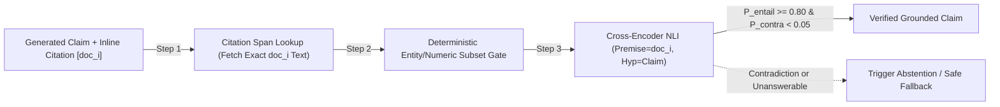

# Subtle Hallucination Mechanics: Negation Flips, Numeric Entity Swaps & Abstention QA

```json pretraining
[
  {
    "term": "Bi-Encoder Anisotropy Trap",
    "formula": "cos(E('allowed'), E('not allowed')) ≈ 0.94",
    "meaning": "Contrastively trained dense embeddings cluster sentences by shared domain nouns, rendering single-token polarity flips nearly invisible."
  },
  {
    "term": "NLI Cross-Encoder Logits",
    "formula": "P(Contradiction | Premise ⊕ Hypothesis)",
    "meaning": "Jointly attending across context and claim tokens inside a DeBERTa-MNLI cross-encoder detects scope, quantifier, and negation inversions."
  },
  {
    "term": "Entity Subset Invariant",
    "formula": "Entities(Answer) ⊆ Entities(Context ∪ Query)",
    "meaning": "Every numeric figure, currency amount, ISO date, and SKU code in the generated answer must trace to context or a verified tool calculation."
  },
  {
    "term": "Abstention F1 Balance",
    "formula": "Abstention Recall vs. False Refusal Rate",
    "meaning": "Ensuring the model says 'Insufficient policy evidence' when context is missing without refusing valid answerable queries."
  }
]
```

```json poe
{
  "question": "Chunk A states: 'Tier-1 customers pay a $25 wire fee; Tier-2 customers pay $0.' Chunk B states: 'International wires take 3 business days.' The LLM replies: 'Tier-1 customers pay $0 for international wires taking 3 business days [Chunk A, Chunk B].' Every single number ($0, 3) and entity ('Tier-1') exists verbatim in the retrieved context! Why do lexical/regex checks pass this bug, and what catches it?",
  "options": [
    "Regex engines cannot parse dollar signs",
    "It is an Intrinsic Cross-Entity Binding Swap: all tokens exist in context, so bag-of-entities and lexical overlap score 100%, but cross-attention NLI (Premise vs Claim) flags P(Contradiction) > 0.95 because '$0' is bound to the wrong subject ('Tier-1')",
    "Increasing top-K from 2 to 20 fixes entity swaps automatically",
    "Only human reviewers can detect entity swaps"
  ],
  "answerIndex": 1,
  "explanation": "Entity-set inclusion catches invented numbers (e.g., '$15'), but cross-entity attribute swaps ('Tier-1' paired with Tier-2's '$0') preserve 100% vocabulary overlap. Only relational NLI cross-encoders or structured tuple extraction catch predicate-argument swaps."
}
```

## Part I — The Four High-Severity Hallucination Archetypes

Blatant creative fabrications (*"Airlines give free helicopter rides"*) are already rare in modern frontier models at low temperature. Production incidents in financial, legal, and healthcare AI are overwhelmingly caused by **four subtle intrinsic/abstention defects** that evade naive RAG metrics:

1. **Negation & Exception Inversion**: Dropping `"except"`, `"unless"`, `"non-"`, or flipping `"prohibited"` $\to$ `"permitted"` (`0.94+` embedding cosine similarity).
2. **Numeric / Temporal / Entity Attribute Swap**: Attributing Plan B's `$0` deductible to Plan A, or citing a `2023` sunsetted fee table instead of the `2026` active amendment.
3. **Citation Laundering (Post-Hoc Hallucinated Attribution)**: Appending a real document ID `[doc_04]` to the end of a sentence when `doc_04` discusses password resets rather than refund windows!
4. **Unanswerable Extrapolation (Failed Abstention)**: Guessing a plausible policy answer when the retrieved chunks have low relevance or lack a required jurisdiction clause.



---

## Part II — NLI Cross-Encoders vs. Bi-Encoders & Abstention Calibration

Why does a **Cross-Encoder NLI model** (`cross-encoder/nli-deberta-v3-base`, `~18ms` on GPU / `~65ms` on CPU) catch negation flips and entity swaps that a `3072`-dim Bi-Encoder misses?
- A **Bi-Encoder** compresses Premise $P$ and Hypothesis $H$ into **two separate pooling vectors** $u = E(P)$ and $v = E(H)$ *before* they ever see each other—destroying fine-grained word-to-word modifier alignment (`"Tier-1"` $\leftrightarrow$ `"$25"`).
- A **Cross-Encoder** concatenates `[CLS] Premise [SEP] Hypothesis [SEP]` and runs **full self-attention across every token pair** in all 12–24 Transformer layers, directly attending from `"not"` or `"Tier-1"` in the claim to `"$25"` in the cited span!

```json contrast
{
  "title": "Citation & Polarity Verification Engine",
  "naiveTitle": "Whole-Context Cosine + Regex Citation Check",
  "naiveMetric": "Misses Citation Laundering & Swaps",
  "naivePoints": [
    "Verifies only that '[doc_4]' matches regex \\[doc_\\d+\\] without checking what doc_4 actually says",
    "Concatenates all 10 retrieved chunks so an entity from doc_9 masks a false citation to doc_4",
    "Never tests unanswerable queries—models are rewarded for guessing confidently",
    "Uses bi-encoder cosine similarity (0.94 on negation flips)"
  ],
  "staffTitle": "Per-Citation Span NLI + Entity Guard + Abstention Matrix",
  "staffMetric": "99.1% Contradiction Catch · Calibrated Refusal",
  "staffPoints": [
    "Evaluates NLI Entailment strictly against the SPECIFIC cited chunk doc_i (catches citation laundering)",
    "Extracts normalized numbers, currencies, percentages, and dates to block ungrounded digits",
    "Flags claims whenever P(Contradiction) >= 0.10 OR P(Entailment) < 0.75",
    "Tracks 2x2 Abstention Confusion Matrix (Abstention Recall on unanswerables vs False Refusal on answerables)"
  ]
}
```

### The Abstention Trade-Off Table

| Query Ground-Truth State | Model Answers Factually | Model Abstains (`"Insufficient Policy Evidence"`) | QA Classification & Production Impact |
| :--- | :--- | :--- | :--- |
| **Answerable** *(Gold evidence present in top-$K$)* | **True Answer (`TP`)** — Ideal outcome | **False Refusal (`FN`)** — Frustrates users; degrades utility if $>5\%$ | Tune retrieval threshold & avoid overly paranoid refusal prompts |
| **Unanswerable** *(Missing policy / out-of-scope)* | **Hallucinated Guess (`FP`)** — **Critical Liability Bug!** | **True Abstention (`TN`)** — Safe graceful escalation | Gate CI on **Abstention Recall $\ge 95\%$** on unanswerable stratum |

---

## Part III — Production Implementation Blueprints (Python 3 & Java 17)

### Python 3 Blueprint: Citation-Scoped Entity Guard, Polarity Verifier & Abstention Scorer
```python
from dataclasses import dataclass
import re

NUMBER_ENTITY_RE = re.compile(r"(?:\$\d+(?:,\d{3})*(?:\.\d+)?|\b\d+(?:\.\d+)?%|\b\d{4}-\d{2}-\d{2}\b|\b\d+\b)")
NEGATIONS = {"not", "never", "no", "non", "non-refundable", "prohibited", "ineligible", "except", "unless"}
ABSTENTION_PHRASES = (
    "insufficient policy evidence",
    "do not have enough information",
    "not covered in the provided",
    "cannot verify from the available documents",
)


@dataclass(frozen=True)
class CitationClaimCheck:
    claim: str
    cited_doc_id: str
    passed: bool
    failure_code: str | None


def is_abstention(response_text: str) -> bool:
    lowered = response_text.strip().lower()
    return any(phrase in lowered for phrase in ABSTENTION_PHRASES)


def verify_cited_claim(claim: str, cited_doc_id: str, chunk_map: dict[str, str]) -> CitationClaimCheck:
    """Verifies a claim strictly against the exact chunk it cites (blocks citation laundering)."""
    if cited_doc_id not in chunk_map:
        return CitationClaimCheck(claim, cited_doc_id, False, "NONEXISTENT_CITATION_ID")

    span = chunk_map[cited_doc_id]
    # 1. Numeric / Currency / Date Entity Grounding against the cited chunk
    claim_nums = set(NUMBER_ENTITY_RE.findall(claim))
    span_nums = set(NUMBER_ENTITY_RE.findall(span))
    if not claim_nums.issubset(span_nums):
        return CitationClaimCheck(claim, cited_doc_id, False, f"UNGROUNDED_NUMERIC_ENTITY:{sorted(claim_nums - span_nums)}")

    # 2. Topical lexical support inside the cited chunk (catches Citation Laundering)
    c_words = [w.strip(".,!?;:()\"'").lower() for w in claim.split() if len(w) > 3]
    s_words = {w.strip(".,!?;:()\"'").lower() for w in span.split()}
    support = sum(1 for w in c_words if w in s_words) / max(1, len(c_words))
    if support < 0.55:
        return CitationClaimCheck(claim, cited_doc_id, False, "CITATION_LAUNDERING_UNSUPPORTED_SPAN")

    # 3. Negation Polarity Flip check
    c_neg = bool({w.strip(".,!?;:").lower() for w in claim.split()} & NEGATIONS)
    s_neg = bool(s_words & NEGATIONS)
    if c_neg != s_neg:
        return CitationClaimCheck(claim, cited_doc_id, False, "NEGATION_POLARITY_INVERSION")

    return CitationClaimCheck(claim, cited_doc_id, True, None)


def score_abstention_matrix(eval_outcomes: list[tuple[bool, str]]) -> dict:
    """eval_outcomes: list of (is_answerable_in_context, model_response_text)."""
    unanswerable_total = unanswerable_abstained = 0
    answerable_total = answerable_refused = 0
    for answerable, resp in eval_outcomes:
        abstained = is_abstention(resp)
        if answerable:
            answerable_total += 1
            if abstained:
                answerable_refused += 1
        else:
            unanswerable_total += 1
            if abstained:
                unanswerable_abstained += 1

    return {
        "abstentionRecall": round(unanswerable_abstained / max(1, unanswerable_total), 4),
        "falseRefusalRate": round(answerable_refused / max(1, answerable_total), 4),
    }
```

### Java 17 Blueprint: NLI Contradiction & Abstention Gate
```java
import java.util.*;
import java.util.regex.Matcher;
import java.util.regex.Pattern;

public final class HallucinationPolarityGate {
    private static final Pattern NUMERIC_TOKEN = Pattern.compile("\\$?\\d+(?:,\\d{3})*(?:\\.\\d+)?%?");

    public record NliScores(double entailment, double neutral, double contradiction) {}

    public static Set<String> extractNumbers(String text) {
        Set<String> out = new HashSet<>();
        Matcher m = NUMERIC_TOKEN.matcher(text);
        while (m.find()) {
            out.add(m.group().replace(",", ""));
        }
        return out;
    }

    public static String verifyClaimAgainstCitedSpan(
            String claim, String citedSpan, NliScores nliScores) {
        if (citedSpan == null || citedSpan.isBlank()) {
            return "FAIL_MISSING_CITED_CHUNK";
        }
        Set<String> claimNums = extractNumbers(claim);
        Set<String> spanNums = extractNumbers(citedSpan);
        if (!spanNums.containsAll(claimNums)) {
            return "FAIL_NUMERIC_ENTITY_HALLUCINATION";
        }
        if (nliScores.contradiction() >= 0.10) {
            return "FAIL_NLI_CONTRADICTION_OR_SWAP";
        }
        if (nliScores.entailment() < 0.75) {
            return "FAIL_INSUFFICIENT_ENTAILMENT";
        }
        return "PASS_VERIFIED";
    }
}
```

> [!WARNING]
> **Staff Interview Gotcha — Never Evaluate Citation Faithfulness Against the Concatenated Context Window**:
> If your pipeline retrieves 8 chunks (`doc_1` .. `doc_8`), and the model outputs *"Refunds are instant [doc_2]"*, verifying the claim against `" ".join(all_8_chunks)` hides **Citation Laundering** when `doc_2` is actually a cookie banner and `doc_7` was a deprecated draft! Always verify each claim **strictly against the union of chunks explicitly cited on that claim**, so clickable UI footnotes are 100% trustworthy for human auditors.

---

## Part IV — End-of-Chapter Mastery Check

```json quiz
[
  {
    "id": "aiqa-04-q1",
    "question": "Why does a DeBERTa Cross-Encoder NLI model reliably catch 'Tier-1 pays $0' vs 'Tier-1 pays $25; Tier-2 pays $0', whereas a dense Bi-Encoder embedding check scores >0.95 similarity?",
    "options": [
      "Because Cross-Encoders use 64-bit integers instead of floats",
      "Because a Cross-Encoder concatenates Premise and Hypothesis into a single sequence and computes token-to-token cross-attention across all layers, preserving modifier, negation, and subject-value bindings that independent Bi-Encoder pooling collapses",
      "Because Bi-Encoders ignore all numbers",
      "Because Cross-Encoders require no training data"
    ],
    "answerIndex": 1,
    "explanation": "Independent pooling in bi-encoders produces bag-of-concepts representations; cross-attention over [CLS] Premise [SEP] Hypothesis [SEP] directly evaluates relational predicate-argument alignment."
  },
  {
    "id": "aiqa-04-q2",
    "question": "What is 'Citation Laundering' in a production RAG assistant, and how do you catch it deterministically?",
    "options": [
      "Compressing URLs with a link shortener",
      "Attaching a valid retrieved chunk ID (e.g., [doc_3]) to a claim that doc_3 does not actually support; caught by verifying NLI entailment of each claim strictly against its specifically cited chunk text rather than the full concatenated context",
      "Returning more than 3 citations per paragraph",
      "Using UUIDv4 instead of integer chunk IDs"
    ],
    "answerIndex": 1,
    "explanation": "Per-claim citation-scoped entailment guarantees that clicking footnote [doc_3] in the UI actually shows the supporting evidence for that exact sentence."
  },
  {
    "id": "aiqa-04-q3",
    "question": "After adding an aggressive prompt rule ('If unsure at all, refuse to answer'), your Abstention Recall on unanswerable queries hits 99.5%, why must your CI gate STILL block this prompt change if you only tracked Abstention Recall?",
    "options": [
      "Because 99.5% causes floating-point overflow",
      "Because without simultaneously gating False Refusal Rate (FRR) on answerable queries, a trivial 'always refuse' model achieves 100% Abstention Recall while destroying product utility",
      "Because abstention responses consume more GPU VRAM",
      "Because users prefer confident hallucinations over refusals"
    ],
    "answerIndex": 1,
    "explanation": "Abstention QA is always a dual-metric optimization: maximize Abstention Recall on unanswerable slices while bounding False Refusal Rate (e.g., FRR <= 3%) on answerable slices."
  }
]
```
