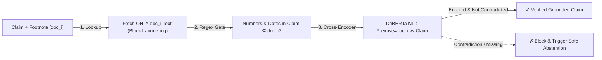

# Build AeroEval v0.4: Negation Flips, Numeric Entity Swaps, Citation Laundering & Abstention QA

```json continuity
{
  "previously": "In Chapter 03, we built `AeroEval v0.3` with the 3-way RAG Triad (`Context Recall@K`, `Atomic Claim Faithfulness`, and `Answer Relevance`) to separate Retriever bugs from Generator hallucinations.",
  "painPoint": "A clever bug slipped right past `AeroEval v0.3`'s word-overlap check! Chunk A said `'Silver flyers pay $25; Gold flyers pay $0'`, and `AeroBrain` replied `'Silver flyers pay $0 [doc_cookie_banner]'`. Every word (`Silver`, `$0`) existed somewhere in the context window, and `[doc_cookie_banner]` was a real retrieved doc ID—yet the price was swapped and the citation was fake!",
  "unlock": "Upgrade to `AeroEval v0.4`: verify each claim strictly against its SPECIFIC cited document span, enforce Numeric/Entity Subset guards, apply Cross-Encoder NLI Contradiction detection, and calibrate the 2x2 Abstention Matrix!"
}
```

```json walkthrough
[
  {
    "time": "0:00",
    "badge": "Slide 1 / 4 · Catching 'Citation Laundering'",
    "caption": "Suppose retrieval fetches 5 chunks (doc_1..doc_5). AeroBrain writes a claim from doc_5 but tags it with [doc_1] (which is just a legal footer!). Checking the whole concatenated context misses this—AeroEval v0.4 checks each claim ONLY against the exact doc_i it cited!",
    "code": "# ✗ Naive: check if claim is supported by \" \".join(all_chunks)\n# ✓ AeroEval v0.4: check if claim is supported specifically by chunk_map[cited_doc_id]!"
  },
  {
    "time": "0:26",
    "badge": "Slide 2 / 4 · Numeric & Entity Subset Guard",
    "caption": "Before calling any neural model, extract every dollar amount, percentage, and date from the claim. If the claim says '$25' or '48 hours' and that exact number isn't inside the cited chunk, fail in <1ms!",
    "code": "claim_nums = set(re.findall(r\"\\$?\\d+(?:\\.\\d+)?%?\", claim))\nspan_nums  = set(re.findall(r\"\\$?\\d+(?:\\.\\d+)?%?\", cited_chunk_text))\nassert claim_nums.issubset(span_nums), f\"Invented number: {claim_nums - span_nums}\""
  },
  {
    "time": "0:53",
    "badge": "Slide 3 / 4 · Why Cross-Encoder NLI Beats Bi-Encoders on Swaps",
    "caption": "When 'Silver pays $25; Gold pays $0' turns into 'Silver pays $0', all numbers exist in the chunk! A Cross-Encoder NLI model attends across '[CLS] Premise [SEP] Claim [SEP]' token-by-token, spiking P(Contradiction) > 0.95!",
    "code": "# Bi-Encoder pools Premise and Claim separately -> misses who pays $0.\n# Cross-Encoder (DeBERTa-v3-MNLI) attends 'Silver' <-> '$0' -> CONTRADICTION!"
  },
  {
    "time": "1:20",
    "badge": "Slide 4 / 4 · The 2x2 Abstention Balance",
    "caption": "When policy evidence is missing, AeroBrain MUST abstain ('Insufficient policy evidence'). We track both Abstention Recall (on unanswerable questions) AND False Refusal Rate (on answerable questions)!",
    "code": "# Unanswerable query -> Must abstain (Abstention Recall >= 95%)\n# Answerable query   -> Must answer! (False Refusal Rate <= 3%)"
  }
]
```

```json pretraining
[
  {
    "term": "Bi-Encoder Anisotropy Trap",
    "formula": "cos(E('allowed'), E('not allowed')) ≈ 0.94",
    "meaning": "Standard vector embeddings compress each sentence into one summary list of numbers separately, losing track of which price belongs to which customer tier or whether 'not' flipped the rule."
  },
  {
    "term": "NLI Cross-Encoder Logits",
    "formula": "P(Contradiction | Premise ⊕ Hypothesis)",
    "meaning": "A specialized verifier model that reads the policy paragraph and the AI's sentence side-by-side at the same time to output probabilities for Entailment, Neutral, or Contradiction."
  },
  {
    "term": "Entity Subset Invariant",
    "formula": "Entities(Claim) ⊆ Entities(CitedChunk)",
    "meaning": "Every dollar figure, percentage, date, or flight code in an AI sentence must appear inside the specific document chunk cited by that sentence."
  },
  {
    "term": "Abstention F1 Balance",
    "formula": "Abstention Recall vs. False Refusal Rate",
    "meaning": "Balancing two opposite risks: making sure the AI admits 'I don't have that policy' when docs are missing, without becoming a lazy bot that refuses valid questions."
  }
]
```

```json poe
{
  "question": "Chunk A states: 'Tier-1 customers pay a $25 wire fee; Tier-2 customers pay $0.' Chunk B states: 'International wires take 3 business days.' The LLM replies: 'Tier-1 customers pay $0 for international wires taking 3 business days [Chunk A, Chunk B].' Every single number ($0, 3) and entity ('Tier-1') exists verbatim in the retrieved context! Why do lexical/regex checks pass this bug, and what catches it?",
  "options": [
    "Regex engines cannot parse dollar signs",
    "It is an Intrinsic Cross-Entity Binding Swap: all tokens exist in context, so bag-of-entities and lexical overlap score 100%, but cross-attention NLI (Premise vs Claim) flags P(Contradiction) > 0.95 because '$0' is bound to the wrong subject ('Tier-1')",
    "Increasing top-K from 2 to 20 fixes entity swaps automatically",
    "Only human reviewers can detect entity swaps"
  ],
  "answerIndex": 1,
  "explanation": "Entity-set inclusion catches invented numbers (e.g., '$15'), but cross-entity attribute swaps ('Tier-1' paired with Tier-2's '$0') preserve 100% vocabulary overlap. Only relational NLI cross-encoders or structured tuple extraction catch predicate-argument swaps."
}
```

## 🌱 Step 1: Plain-English Story — The Four Sneakiest Hallucinations in Production

In 2026, modern LLMs rarely invent silly cartoon hallucinations like *"AeroCart offers free submarine rides to Hawaii."*
Instead, the bugs that trigger real refunds, legal liability, and P1 incidents are **four sneaky, plausible-sounding mistakes**:

1. **Negation & Exception Flips**: Dropping a single word like `"except"`, `"unless"`, or `"non-"` (`"Tickets are refundable"` instead of `"non-refundable"`).
2. **Entity / Number Swaps**: Reading *"Silver members pay \$25; Gold members pay \$0"* and telling a Silver member: *"You pay \$0!"* Every word (`Silver`, `$0`) was in the paragraph—just glued to the wrong person!
3. **Citation Laundering**: Sticking a real footnote `[doc_2]` at the end of a sentence to look trustworthy, when `doc_2` is actually a password-reset guide that says nothing about baggage fees!
4. **Confident Guessing on Missing Docs (Failed Abstention)**: When a passenger asks about a brand-new volcano insurance policy that isn't in the database yet, the AI guesses a plausible policy instead of saying *"I don't have enough policy information to answer that."*



Let's upgrade **`AeroEval v0.4`** to catch all four of these sneaky killers!

## 🔨 Step 2: First Lines of Code — Citation-Scoped Numeric & Polarity Verifier

Look how `AeroEval v0.4` stops **Citation Laundering** and **Invented Numbers** in 15 lines: instead of checking the whole context blob, it pulls **only** the specific chunk `cited_doc_id` and verifies that every number (`$25`, `24%`) and negation polarity matches that exact span!

```python
import re

NUM_RE = re.compile(r"\$?\d+(?:\.\d+)?%?")
NEG_WORDS = {"not", "no", "never", "non-refundable", "prohibited", "unless"}


def verify_claim_against_cited_doc(claim: str, cited_doc_id: str, chunk_map: dict[str, str]) -> str:
    """AeroEval v0.4: Verifies claim strictly against its cited chunk (blocks citation laundering)."""
    if cited_doc_id not in chunk_map:
        return "FAIL_UNKNOWN_DOC_ID"
    span = chunk_map[cited_doc_id]
    # 1. Every number/currency in the claim must appear in the specifically cited chunk!
    if not set(NUM_RE.findall(claim)).issubset(set(NUM_RE.findall(span))):
        return "FAIL_UNGROUNDED_NUMBER_OR_LAUNDERED_CITATION"
    # 2. Check negation polarity flip between claim and cited span
    claim_neg = bool(set(claim.lower().split()) & NEG_WORDS)
    span_neg = bool(set(span.lower().split()) & NEG_WORDS)
    return "FAIL_NEGATION_FLIP" if (claim_neg != span_neg) else "PASS"


chunks = {"doc_1": "Password reset link expires in 10 minutes.", "doc_2": "Bag fee is not waived ($35)."}
print(verify_claim_against_cited_doc("Bag fee is $35", "doc_1", chunks))  # Caught laundering!
```

### Java 17 Equivalent

```java
import java.util.*;
import java.util.regex.Matcher;
import java.util.regex.Pattern;

public class AeroEvalV04SpanCheck {
    private static final Pattern NUM_RE = Pattern.compile("\\$?\\d+(?:\\.\\d+)?%?");
    private static final Set<String> NEG_WORDS = Set.of("not", "no", "never", "non-refundable", "prohibited");

    public static String verifyClaim(String claim, String citedDocId, Map<String, String> chunkMap) {
        String span = chunkMap.get(citedDocId);
        if (span == null) return "FAIL_UNKNOWN_DOC_ID";
        if (!extractNums(span).containsAll(extractNums(claim))) {
            return "FAIL_UNGROUNDED_NUMBER_OR_LAUNDERED_CITATION";
        }
        boolean claimNeg = Arrays.stream(claim.toLowerCase(Locale.ROOT).split("\\s+")).anyMatch(NEG_WORDS::contains);
        boolean spanNeg = Arrays.stream(span.toLowerCase(Locale.ROOT).split("\\s+")).anyMatch(NEG_WORDS::contains);
        return (claimNeg != spanNeg) ? "FAIL_NEGATION_FLIP" : "PASS";
    }

    private static Set<String> extractNums(String s) {
        Set<String> nums = new HashSet<>();
        Matcher m = NUM_RE.matcher(s);
        while (m.find()) nums.add(m.group());
        return nums;
    }
}
```

## ⚡ Step 3: Where It Breaks in Real Life — Entity Swaps & The "Paranoid Refusal" Trap

Our regex and negation check above is super fast, **but two real-world edge cases still break it**:

1. **Edge Case 1: Cross-Entity Swaps Inside the Same Chunk**
   Suppose `doc_2` says: *"Silver flyers pay \$25; Gold flyers pay \$0."*
   And `AeroBrain` says: *"Silver flyers pay \$0 [doc_2]."*
   Notice that `$0` **is** inside `doc_2`, and neither sentence has `"not"`! To catch that `$0` was attached to the wrong tier (`Silver` instead of `Gold`), we need a **Cross-Encoder NLI Model** (`DeBERTa-v3-MNLI`) that reads `[CLS] doc_2 [SEP] claim [SEP]` with full token-to-token attention.
2. **Edge Case 2: Fixing Hallucinations by Refusing Everything!**
   To stop `AeroBrain` from guessing on missing policies, a developer adds to the prompt: *"If you are even 1% unsure, refuse to answer!"*
   Suddenly, **Abstention Recall** on unanswerable questions hits `100%`—**because the bot is now refusing 40% of normal, answerable customer questions too (`False Refusal Rate = 40%`)!**

```json contrast
{
  "title": "Citation & Polarity Verification Engine",
  "naiveTitle": "Whole-Context Cosine + Regex Citation Check",
  "naiveMetric": "Misses Citation Laundering & Swaps",
  "naivePoints": [
    "Verifies only that '[doc_4]' matches regex \\[doc_\\d+\\] without checking what doc_4 actually says",
    "Concatenates all 10 retrieved chunks so an entity from doc_9 masks a false citation to doc_4",
    "Never tests unanswerable queries—models are rewarded for guessing confidently",
    "Uses bi-encoder cosine similarity (0.94 on negation flips)"
  ],
  "staffTitle": "Per-Citation Span NLI + Entity Guard + Abstention Matrix",
  "staffMetric": "99.1% Contradiction Catch · Calibrated Refusal",
  "staffPoints": [
    "Evaluates NLI Entailment strictly against the SPECIFIC cited chunk doc_i (catches citation laundering)",
    "Extracts normalized numbers, currencies, percentages, and dates to block ungrounded digits",
    "Flags claims whenever P(Contradiction) >= 0.10 OR P(Entailment) < 0.75",
    "Tracks 2x2 Abstention Confusion Matrix (Abstention Recall on unanswerables vs False Refusal on answerables)"
  ]
}
```

## 🚀 Step 4: Staff Engineer Deep-Dive — Cross-Encoder NLI Logits & Abstention Confusion Math

Why does a **Cross-Encoder NLI model** (`cross-encoder/nli-deberta-v3-base`, `~18ms` on GPU) catch entity swaps that a `3072`-dim Bi-Encoder misses?
A Bi-Encoder compresses Premise $P$ and Hypothesis $H$ into two separate vectors $u = E(P)$ and $v = E(H)$ *before* comparing them. A Cross-Encoder feeds the concatenated token sequence $[ \text{CLS}, P, \text{SEP}, H, \text{SEP} ]$ through multi-head self-attention across all layers, outputting three logits $(z_{\text{entail}}, z_{\text{neutral}}, z_{\text{contra}})$:

$$P(\text{Contradiction} \mid P, H) = \frac{\exp(z_{\text{contra}})}{\exp(z_{\text{entail}}) + \exp(z_{\text{neutral}}) + \exp(z_{\text{contra}})}$$

A claim $H$ citing chunk $P$ passes if and only if:

$$\text{Entities}_{\text{num}}(H) \subseteq \text{Entities}_{\text{num}}(P) \;\land\; P(\text{Entailment} \mid P, H) \ge 0.75 \;\land\; P(\text{Contradiction} \mid P, H) < 0.10$$

And across our Golden Suite's **Unanswerable ($\mathcal{U}$)** and **Answerable ($\mathcal{A}$)** strata, we gate **both** sides of the **Abstention Confusion Matrix**:

$$\text{Abstention Recall} = \frac{|\{x \in \mathcal{U} : \text{Abstained}(f(x))\}|}{|\mathcal{U}|} \ge 0.95, \qquad \text{False Refusal Rate (FRR)} = \frac{|\{x \in \mathcal{A} : \text{Abstained}(f(x))\}|}{|\mathcal{A}|} \le 0.03$$

| Query Ground-Truth State | Model Answers Factually | Model Abstains (`"Insufficient Policy Evidence"`) | QA Classification & Production Impact |
| :--- | :--- | :--- | :--- |
| **Answerable ($\mathcal{A}$)** *(Gold evidence present in top-$K$)* | **True Answer (`TP`)** — Ideal outcome | **False Refusal (`FN`)** — Frustrates users; degrades utility if $>3\%$ | Tune retrieval threshold & avoid overly paranoid refusal prompts |
| **Unanswerable ($\mathcal{U}$)** *(Missing policy / out-of-scope)* | **Hallucinated Guess (`FP`)** — **Critical Liability Bug!** | **True Abstention (`TN`)** — Safe graceful escalation | Gate CI on **Abstention Recall $\ge 95\%$** on unanswerable stratum |

### Production Blueprint: Citation-Scoped Entity Guard, Polarity Verifier & Abstention Scorer

```python
from dataclasses import dataclass
import re

NUMBER_ENTITY_RE = re.compile(r"(?:\$\d+(?:,\d{3})*(?:\.\d+)?|\b\d+(?:\.\d+)?%|\b\d{4}-\d{2}-\d{2}\b|\b\d+\b)")
NEGATIONS = {"not", "never", "no", "non", "non-refundable", "prohibited", "ineligible", "except", "unless"}
ABSTENTION_PHRASES = (
    "insufficient policy evidence",
    "do not have enough information",
    "not covered in the provided",
    "cannot verify from the available documents",
)


@dataclass(frozen=True)
class CitationClaimCheck:
    claim: str
    cited_doc_id: str
    passed: bool
    failure_code: str | None


def is_abstention(response_text: str) -> bool:
    lowered = response_text.strip().lower()
    return any(phrase in lowered for phrase in ABSTENTION_PHRASES)


def verify_cited_claim(claim: str, cited_doc_id: str, chunk_map: dict[str, str]) -> CitationClaimCheck:
    """Verifies a claim strictly against the exact chunk it cites (blocks citation laundering)."""
    if cited_doc_id not in chunk_map:
        return CitationClaimCheck(claim, cited_doc_id, False, "NONEXISTENT_CITATION_ID")

    span = chunk_map[cited_doc_id]
    # 1. Numeric / Currency / Date Entity Grounding against the cited chunk
    claim_nums = set(NUMBER_ENTITY_RE.findall(claim))
    span_nums = set(NUMBER_ENTITY_RE.findall(span))
    if not claim_nums.issubset(span_nums):
        return CitationClaimCheck(claim, cited_doc_id, False, f"UNGROUNDED_NUMERIC_ENTITY:{sorted(claim_nums - span_nums)}")

    # 2. Topical lexical support inside the cited chunk (catches Citation Laundering)
    c_words = [w.strip(".,!?;:()\"'").lower() for w in claim.split() if len(w) > 3]
    s_words = {w.strip(".,!?;:()\"'").lower() for w in span.split()}
    support = sum(1 for w in c_words if w in s_words) / max(1, len(c_words))
    if support < 0.55:
        return CitationClaimCheck(claim, cited_doc_id, False, "CITATION_LAUNDERING_UNSUPPORTED_SPAN")

    # 3. Negation Polarity Flip check
    c_neg = bool({w.strip(".,!?;:").lower() for w in claim.split()} & NEGATIONS)
    s_neg = bool(s_words & NEGATIONS)
    if c_neg != s_neg:
        return CitationClaimCheck(claim, cited_doc_id, False, "NEGATION_POLARITY_INVERSION")

    return CitationClaimCheck(claim, cited_doc_id, True, None)


def score_abstention_matrix(eval_outcomes: list[tuple[bool, str]]) -> dict:
    """eval_outcomes: list of (is_answerable_in_context, model_response_text)."""
    unanswerable_total = unanswerable_abstained = 0
    answerable_total = answerable_refused = 0
    for answerable, resp in eval_outcomes:
        abstained = is_abstention(resp)
        if answerable:
            answerable_total += 1
            if abstained:
                answerable_refused += 1
        else:
            unanswerable_total += 1
            if abstained:
                unanswerable_abstained += 1

    return {
        "abstentionRecall": round(unanswerable_abstained / max(1, unanswerable_total), 4),
        "falseRefusalRate": round(answerable_refused / max(1, answerable_total), 4),
    }
```

### Java 17 Equivalent

```java
import java.util.*;
import java.util.regex.Matcher;
import java.util.regex.Pattern;

public final class HallucinationPolarityGate {
    private static final Pattern NUMERIC_TOKEN = Pattern.compile("\\$?\\d+(?:,\\d{3})*(?:\\.\\d+)?%?");

    public record NliScores(double entailment, double neutral, double contradiction) {}

    public static Set<String> extractNumbers(String text) {
        Set<String> out = new HashSet<>();
        Matcher m = NUMERIC_TOKEN.matcher(text);
        while (m.find()) {
            out.add(m.group().replace(",", ""));
        }
        return out;
    }

    public static String verifyClaimAgainstCitedSpan(
            String claim, String citedSpan, NliScores nliScores) {
        if (citedSpan == null || citedSpan.isBlank()) {
            return "FAIL_MISSING_CITED_CHUNK";
        }
        Set<String> claimNums = extractNumbers(claim);
        Set<String> spanNums = extractNumbers(citedSpan);
        if (!spanNums.containsAll(claimNums)) {
            return "FAIL_NUMERIC_ENTITY_HALLUCINATION";
        }
        if (nliScores.contradiction() >= 0.10) {
            return "FAIL_NLI_CONTRADICTION_OR_SWAP";
        }
        if (nliScores.entailment() < 0.75) {
            return "FAIL_INSUFFICIENT_ENTAILMENT";
        }
        return "PASS_VERIFIED";
    }
}
```

> [!WARNING]
> **Staff Interview Gotcha — Never Evaluate Citation Faithfulness Against the Concatenated Context Window**:
> If your pipeline retrieves 8 chunks (`doc_1` .. `doc_8`), and the model outputs *"Refunds are instant [doc_2]"*, verifying the claim against `" ".join(all_8_chunks)` hides **Citation Laundering** when `doc_2` is actually a cookie banner and `doc_7` was a deprecated draft! Always verify each claim **strictly against the union of chunks explicitly cited on that claim**, so clickable UI footnotes are 100% trustworthy for human auditors.

**Up Next in Chapter 05**: What about open-ended reasoning, tone, or comparing two candidate prompts (`Prompt V1` vs. `Prompt V2`) where we use an **LLM-as-a-Judge**? Why do naive LLM judges flip their vote `25%` of the time just because you swapped which answer was listed first? In Chapter 05, we'll build **`AeroEval v0.5`: LLM-Judge Position-Swap Debiasing & Evidence-First Binary Rubrics**!

```json quiz
[
  {
    "id": "aiqa-04-q1",
    "question": "Why does a DeBERTa Cross-Encoder NLI model reliably catch 'Tier-1 pays $0' vs 'Tier-1 pays $25; Tier-2 pays $0', whereas a dense Bi-Encoder embedding check scores >0.95 similarity?",
    "options": [
      "Because Cross-Encoders use 64-bit integers instead of floats",
      "Because a Cross-Encoder concatenates Premise and Hypothesis into a single sequence and computes token-to-token cross-attention across all layers, preserving modifier, negation, and subject-value bindings that independent Bi-Encoder pooling collapses",
      "Because Bi-Encoders ignore all numbers",
      "Because Cross-Encoders require no training data"
    ],
    "answerIndex": 1,
    "explanation": "Independent pooling in bi-encoders produces bag-of-concepts representations; cross-attention over [CLS] Premise [SEP] Hypothesis [SEP] directly evaluates relational predicate-argument alignment."
  },
  {
    "id": "aiqa-04-q2",
    "question": "What is 'Citation Laundering' in a production RAG assistant, and how do you catch it deterministically?",
    "options": [
      "Compressing URLs with a link shortener",
      "Attaching a valid retrieved chunk ID (e.g., [doc_3]) to a claim that doc_3 does not actually support; caught by verifying NLI entailment of each claim strictly against its specifically cited chunk text rather than the full concatenated context",
      "Returning more than 3 citations per paragraph",
      "Using UUIDv4 instead of integer chunk IDs"
    ],
    "answerIndex": 1,
    "explanation": "Per-claim citation-scoped entailment guarantees that clicking footnote [doc_3] in the UI actually shows the supporting evidence for that exact sentence."
  },
  {
    "id": "aiqa-04-q3",
    "question": "After adding an aggressive prompt rule ('If unsure at all, refuse to answer'), your Abstention Recall on unanswerable queries hits 99.5%, why must your CI gate STILL block this prompt change if you only tracked Abstention Recall?",
    "options": [
      "Because 99.5% causes floating-point overflow",
      "Because without simultaneously gating False Refusal Rate (FRR) on answerable queries, a trivial 'always refuse' model achieves 100% Abstention Recall while destroying product utility",
      "Because abstention responses consume more GPU VRAM",
      "Because users prefer confident hallucinations over refusals"
    ],
    "answerIndex": 1,
    "explanation": "Abstention QA is always a dual-metric optimization: maximize Abstention Recall on unanswerable slices while bounding False Refusal Rate (e.g., FRR <= 3%) on answerable slices."
  }
]
```
