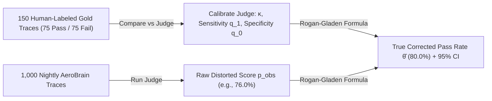

# Build AeroEval v0.6: Statistical Judge Calibration, Cohen's Kappa & Rogan-Gladen Correction

```json continuity
{
  "previously": "In Chapter 05, we upgraded `AeroEval v0.5` with Bidirectional `(A,B)/(B,A)` Swap Debiasing and Evidence-First Binary Rubrics to remove slot and verbosity bias from our LLM Judge.",
  "painPoint": "Even with a clean binary rubric, our LLM Judge isn't a mind reader! On a 150-example human-labeled gold set, our judge had 90% Sensitivity (`TPR`) and 80% Specificity (`TNR`). When we ran it on 1,000 nightly `AeroBrain` answers whose true human pass rate was 80.0%, the judge reported `76.0%`—triggering a false rollback alarm!",
  "unlock": "Upgrade to `AeroEval v0.6`: audit judges with chance-corrected Cohen's Kappa (`κ`), mathematically remove judge error bias using the Rogan-Gladen Estimator (`θ̂`), and compute Joint Bootstrap 95% Confidence Intervals!"
}
```

```json walkthrough
[
  {
    "time": "0:00",
    "badge": "Slide 1 / 4 · Why 90% Raw Agreement Can Be a Complete Lie!",
    "caption": "Suppose 95% of AeroBrain's answers are good, and you deploy a lazy 'Yes-Man' judge that blindly outputs PASS 95% of the time at random. It agrees with humans 90.5% of the time—while catching ZERO real bugs! Cohen's Kappa (κ) subtracts chance guessing, exposing κ = 0.00!",
    "code": "# 95% good answers + lazy 95%-PASS judge:\n# Raw Agreement p_o = 0.905 (Looks great!)\n# Chance Agreement p_e = 0.95*0.95 + 0.05*0.05 = 0.905\n# Cohen's Kappa κ = (p_o - p_e) / (1 - p_e) = 0.00 (Exposed!)"
  },
  {
    "time": "0:27",
    "badge": "Slide 2 / 4 · Measuring Judge Sensitivity (q1) & Specificity (q0)",
    "caption": "Before trusting any judge in CI, we test it against 150 human-labeled examples (75 true passes + 75 true failures) to measure Sensitivity q1 (how often it passes good answers) and Specificity q0 (how often it catches bad answers).",
    "code": "q1_tpr = true_positives / (true_positives + false_negatives)   # e.g., 0.90\nq0_tnr = true_negatives / (true_negatives + false_positives)   # e.g., 0.80"
  },
  {
    "time": "0:55",
    "badge": "Slide 3 / 4 · The Rogan-Gladen Formula: Unbiasing the Score!",
    "caption": "Once we know q1 and q0, we don't have to accept the judge's distorted raw score p_obs! The Rogan-Gladen formula inverts the judge's error rates to recover the exact unbiased human pass rate θ̂!",
    "code": "# Observed raw judge score p_obs = 0.76 (with q1 = 0.90, q0 = 0.80):\ntheta_hat = (p_obs + q0 - 1.0) / (q1 + q0 - 1.0)\n# -> (0.76 + 0.80 - 1.0) / (0.90 + 0.80 - 1.0) = 0.56 / 0.70 = 0.80 (Exact!)"
  },
  {
    "time": "1:20",
    "badge": "Slide 4 / 4 · Joint Bootstrap 95% Confidence Intervals",
    "caption": "Both our 150-item human calibration set and our 1,000-item nightly run have sampling noise! AeroEval v0.6 resamples BOTH sets 1,000 times to compute an honest 95% confidence interval.",
    "code": "# Resample 150 calibration pairs -> (q1*, q0*)\n# Resample 1,000 nightly verdicts -> p_obs*\n# Compute θ̂* across 1,000 iterations -> [2.5th percentile, 97.5th percentile]"
  }
]
```

```json pretraining
[
  {
    "term": "Cohen's Kappa (κ)",
    "formula": "κ = (p_o - p_e) / (1 - p_e)",
    "meaning": "Measures how well an AI Judge agrees with human experts AFTER subtracting the agreement they would get just by lucky coin-flipping on easy datasets."
  },
  {
    "term": "Judge Sensitivity & Specificity",
    "formula": "q_1 = TPR,  q_0 = TNR",
    "meaning": "Two accuracy scores measured on a 150-item human answer key: q_1 is the judge's accuracy on truly good answers, and q_0 is the judge's accuracy on truly bad answers."
  },
  {
    "term": "Rogan-Gladen Estimator (θ̂)",
    "formula": "θ̂ = (p_obs + q_0 - 1) / (q_1 + q_0 - 1)",
    "meaning": "A classic math formula that uses the judge's known error rates (q_1 and q_0) to cancel out false positives and false negatives from your nightly pass rate."
  },
  {
    "term": "Joint Bootstrap 95% CI",
    "formula": "Resample(Gold_m, Unlabeled_N)",
    "meaning": "Running 1,000 computer simulations that re-draw both the 150 human calibration items and the 1,000 nightly test items to calculate honest error bars."
  }
]
```

```json poe
{
  "question": "Suppose 95% of your production answers are genuinely good, and you deploy a lazy LLM Judge that blindly outputs 'PASS' 95% of the time at random. Raw agreement with humans is 90.5%! Why is raw % agreement a trap here, and what will Cohen's κ reveal?",
  "options": [
    "Raw agreement is fine as long as it exceeds 90%",
    "Because expected chance agreement p_e = (0.95)(0.95) + (0.05)(0.05) = 0.905, Cohen's κ = (0.905 - 0.905) / (1 - 0.905) = 0.00—instantly exposing that the judge has ZERO discriminative skill beyond base-rate guessing!",
    "Cohen's κ will equal 0.95",
    "You must switch from binary labels to 1–100 floats"
  ],
  "answerIndex": 1,
  "explanation": "On skewed pass rates (e.g., 90–95% pass), a sycophantic 'always-PASS' judge achieves >90% raw accuracy while catching 0% of regressions! Cohen's κ subtracts chance agreement p_e, requiring κ >= 0.70 AND balanced q_1/q_0 before trusting any judge in CI."
}
```

## 🌱 Step 1: Plain-English Story — Why Raw Judge Scores Lie (And How to Fix Them!)

Imagine you buy a radar speed gun to check if cars on your street are speeding. You test the radar gun first and discover it consistently reads **4 mph too slow**.
When you point that radar gun at 1,000 cars tomorrow and the screen says `56 mph`, do you tell the mayor *"Cars are driving 56 mph"*?
Of course not! Because you **calibrated** the radar gun and know its exact error (`-4 mph`), you add `4 mph` back and report the true speed: **`60 mph`**!

An **LLM-as-a-Judge** is just like that radar gun! Even after our Chapter 05 rubric upgrades, no LLM judge agrees with human domain experts 100% of the time:
- Maybe on truly **good** answers, the judge says `PASS` **90%** of the time (**Sensitivity `q1 = 0.90`**).
- And on truly **bad** answers, the judge catches `FAIL` **80%** of the time (**Specificity `q0 = 0.80`**, meaning it accidentally lets 20% of bad answers slip through as false passes).

If you run that judge on 1,000 nightly `AeroBrain` answers where **80%** are genuinely good:
- Out of 800 good answers, the judge passes $800 \times 0.90 = 720$.
- Out of 200 bad answers, the judge accidentally passes $200 \times 0.20 = 40$.
- Total raw judge passes: $720 + 40 = 760$ (**`76.0%`** instead of the true **`80.0%`**!).



Instead of reporting the distorted `76.0%` raw score, **`AeroEval v0.6`** calibrates `(q1, q0)` on a 150-item human gold set and applies the **Rogan-Gladen Correction** to recover the true `80.0%` pass rate!

## 🔨 Step 2: First Lines of Code — Build `AeroEval v0.6` Rogan-Gladen Calibrator in 15 Lines!

Look how clean the math is once you see it in code: given our judge's Sensitivity `q1` (`TPR`), Specificity `q0` (`TNR`), and raw observed pass rate `p_obs`, `rogan_gladen_correct` removes the judge's error bias in 4 lines!

```python
def calibrate_and_correct_judge(
    human_gold: list[int],
    judge_calib: list[int],
    p_obs: float,
) -> dict:
    """AeroEval v0.6: Measures judge (q1, q0) on human gold labels and unbiases p_obs!"""
    tp = sum(1 for h, j in zip(human_gold, judge_calib) if h == 1 and j == 1)
    fn = sum(1 for h, j in zip(human_gold, judge_calib) if h == 1 and j == 0)
    tn = sum(1 for h, j in zip(human_gold, judge_calib) if h == 0 and j == 0)
    fp = sum(1 for h, j in zip(human_gold, judge_calib) if h == 0 and j == 1)

    q1 = tp / max(1, tp + fn)  # Sensitivity (TPR)
    q0 = tn / max(1, tn + fp)  # Specificity (TNR)
    theta_hat = max(0.0, min(1.0, (p_obs + q0 - 1.0) / (q1 + q0 - 1.0)))
    return {"q1": round(q1, 2), "q0": round(q0, 2), "raw": p_obs, "corrected": round(theta_hat, 4)}


# 90% Sensitivity (9/10), 80% Specificity (8/10), raw observed pass rate = 0.76 -> Recovers 0.80!
print(calibrate_and_correct_judge([1] * 10 + [0] * 10, [1] * 9 + [0] * 1 + [0] * 8 + [1] * 2, p_obs=0.76))
```

### Java 17 Equivalent

```java
public class AeroEvalV06Calibrator {
    public record CalibratedScore(double q1, double q0, double rawPObs, double correctedTheta) {}

    public static CalibratedScore calibrateAndCorrect(int[] humanGold, int[] judgeCalib, double pObs) {
        int tp = 0, fn = 0, tn = 0, fp = 0;
        for (int i = 0; i < humanGold.length; i++) {
            if (humanGold[i] == 1 && judgeCalib[i] == 1) tp++;
            else if (humanGold[i] == 1 && judgeCalib[i] == 0) fn++;
            else if (humanGold[i] == 0 && judgeCalib[i] == 0) tn++;
            else fp++;
        }
        double q1 = (double) tp / Math.max(1, tp + fn);
        double q0 = (double) tn / Math.max(1, tn + fp);
        double theta = Math.max(0.0, Math.min(1.0, (pObs + q0 - 1.0) / (q1 + q0 - 1.0)));
        return new CalibratedScore(q1, q0, pObs, theta);
    }
}
```

## ⚡ Step 3: Where It Breaks in Real Life — The "Yes-Man" Judge & Skewed Calibration Sets

Watch **two classic traps** that break judge calibration in real companies if you aren't careful:

1. **Trap 1: Validating a Judge Using Raw `% Agreement` on a 95%-Pass Dataset**
   Suppose `AeroBrain` passes `95%` of normal customer questions, and someone writes a terrible "Yes-Man" judge prompt that blindly says `PASS` `95%` of the time. If you check raw agreement against humans, it scores **`90.5%` agreement**—while catching **zero** bugs! That is why `AeroEval v0.6` gates judges on **Cohen's Kappa ($\kappa \ge 0.70$)**, which subtracts lucky base-rate guessing.
2. **Trap 2: Sampling 150 Random Production Logs for Calibration (Only 6 Failures!)**
   If you pick 150 *random* logs from a `96%`-accurate bot to build your human calibration set, only **$\sim 6$ logs will be failures ($Y = 0$)**! Trying to estimate Specificity $q_0$ from just 6 examples produces huge random error ($\pm 30\%$). Instead, always curate a **50/50 class-balanced calibration set** (`75` true passes + `75` true failures)!

```json contrast
{
  "title": "Judge Validation & Pass-Rate Estimation",
  "naiveTitle": "Uncalibrated Raw Judge Average",
  "naiveMetric": "p_obs Biased by 5–18% · Unknown Variance",
  "naivePoints": [
    "Deploys a judge prompt after eyeball-checking 5 examples in a playground",
    "Validates judge using raw % accuracy on a 95%-positive sample (hiding TNR = 0.20!)",
    "Reports raw p_obs directly to executives without bias correction",
    "Ignores calibration-set uncertainty when comparing weekly eval runs"
  ],
  "staffTitle": "κ-Gated Judge + Rogan-Gladen + Joint Bootstrap",
  "staffMetric": "Unbiased θ̂ · Honest 95% Confidence Bounds",
  "staffPoints": [
    "Oversamples failure cases (50/50 split) in m=150 human calibration set to pin down Specificity q_0",
    "Requires Judge-to-Human Cohen's κ >= 0.70 and Youden's J (q_1 + q_0 - 1) >= 0.70",
    "Applies Rogan-Gladen correction θ̂ = (p_obs + q_0 - 1) / (q_1 + q_0 - 1) on every CI run",
    "Computes 2,000-iteration joint bootstrap CIs over both calibration (m) and evaluation (N) samples"
  ]
}
```

## 🚀 Step 4: Staff Engineer Deep-Dive — Total Probability Inversion & Joint Bootstrap Math

Let $\theta = P(Y = 1)$ denote the true human pass rate, $q_1 = P(\hat{Y} = 1 \mid Y = 1)$ denote Judge Sensitivity (`TPR`), and $q_0 = P(\hat{Y} = 0 \mid Y = 0)$ denote Judge Specificity (`TNR`). By the Law of Total Probability, the raw observed judge pass rate $p_{\text{obs}} = P(\hat{Y} = 1)$ satisfies:

$$p_{\text{obs}} = \theta \cdot q_1 + (1 - \theta) \cdot (1 - q_0)$$

Solving this linear equation for $\theta$ yields the **Rogan-Gladen (1978) Prevalence Estimator** (used across Stanford & Anthropic evaluation harnesses):

$$\hat{\theta} = \text{clip}_{[0, 1]}\!\left(\frac{p_{\text{obs}} + q_0 - 1}{q_1 + q_0 - 1}\right)$$

where the denominator $J = q_1 + q_0 - 1$ is **Youden's $J$ statistic** (informedness). And to qualify the judge against human raters with observed agreement $p_o$ and expected chance agreement $p_e = p_{H=1}p_{J=1} + p_{H=0}p_{J=0}$, we require **Cohen's Kappa**:

$$\kappa = \frac{p_o - p_e}{1 - p_e} \ge 0.70$$

| Metric / Estimator | Mathematical Role | Minimum Production Bar | What Happens If Omitted |
| :--- | :--- | :--- | :--- |
| **Cohen's $\kappa$** | Chance-corrected alignment with human SMEs | $\kappa \ge 0.70$ (*Substantial*) | Sycophantic "always-PASS" judges look $>90\%$ accurate on high base-rate tasks |
| **Specificity ($q_0 = \text{TNR}$)** | Ability to catch true hallucinations/failures | $q_0 \ge 0.85$ (estimated on $\ge 60$ gold failures) | High false-positive leniency masks severe regressions |
| **Rogan-Gladen ($\hat{\theta}$)** | Corrects prevalence distortion in $p_{\text{obs}}$ | $q_1 + q_0 - 1 \ge 0.65$ | Systematic $5\%–15\%$ bias whenever true pass rate shifts |
| **Joint Bootstrap 95% CI** | Propagates $\text{Var}(\hat{q}_1, \hat{q}_0) + \text{Var}(p_{\text{obs}})$ | $B \ge 1,000$ resamples | Overconfident narrow error bars cause false regression alarms |

### Production Blueprint: Cohen's $\kappa$, Rogan-Gladen Estimator & Joint Bootstrap 95% CI

```python
import random


def compute_kappa_and_rates(human_labels: list[int], judge_labels: list[int]) -> dict:
    """Computes Cohen's kappa, Sensitivity (q1 = TPR), and Specificity (q0 = TNR)."""
    assert len(human_labels) == len(judge_labels) and len(human_labels) > 0
    n = len(human_labels)
    tp = sum(1 for h, j in zip(human_labels, judge_labels) if h == 1 and j == 1)
    tn = sum(1 for h, j in zip(human_labels, judge_labels) if h == 0 and j == 0)
    fp = sum(1 for h, j in zip(human_labels, judge_labels) if h == 0 and j == 1)
    fn = sum(1 for h, j in zip(human_labels, judge_labels) if h == 1 and j == 0)

    p_o = (tp + tn) / n
    p_h1 = (tp + fn) / n
    p_j1 = (tp + fp) / n
    p_e = p_h1 * p_j1 + (1.0 - p_h1) * (1.0 - p_j1)
    kappa = (p_o - p_e) / (1.0 - p_e) if p_e < 1.0 else 1.0

    q1_tpr = tp / max(1, tp + fn)
    q0_tnr = tn / max(1, tn + fp)
    return {
        "cohensKappa": round(kappa, 4),
        "q1Sensitivity": round(q1_tpr, 4),
        "q0Specificity": round(q0_tnr, 4),
        "youdenJ": round(q1_tpr + q0_tnr - 1.0, 4),
    }


def rogan_gladen_estimate(p_obs: float, q1: float, q0: float) -> float:
    denom = q1 + q0 - 1.0
    if denom <= 1e-6:
        raise ValueError("Uninformative judge: q1 + q0 must strictly exceed 1.0")
    theta = (p_obs + q0 - 1.0) / denom
    return max(0.0, min(1.0, theta))


def calibrated_pass_rate_with_ci(
    calib_pairs: list[tuple[int, int]],  # (human_y, judge_y)
    eval_judge_verdicts: list[int],
    iterations: int = 1000,
    seed: int = 42,
) -> dict:
    """Computes point Rogan-Gladen θ̂ and Joint Non-Parametric 95% Bootstrap CI."""
    rng = random.Random(seed)
    h_base = [p[0] for p in calib_pairs]
    j_base = [p[1] for p in calib_pairs]
    cal = compute_kappa_and_rates(h_base, j_base)
    p_obs = sum(eval_judge_verdicts) / max(1, len(eval_judge_verdicts))
    theta_hat = rogan_gladen_estimate(p_obs, cal["q1Sensitivity"], cal["q0Specificity"])

    m = len(calib_pairs)
    n = len(eval_judge_verdicts)
    boot_thetas: list[float] = []
    for _ in range(iterations):
        c_sample = [calib_pairs[rng.randrange(m)] for _ in range(m)]
        tp = sum(1 for h, j in c_sample if h == 1 and j == 1)
        fn = sum(1 for h, j in c_sample if h == 1 and j == 0)
        tn = sum(1 for h, j in c_sample if h == 0 and j == 0)
        fp = sum(1 for h, j in c_sample if h == 0 and j == 1)
        q1_b = tp / max(1, tp + fn)
        q0_b = tn / max(1, tn + fp)
        if q1_b + q0_b <= 1.05:
            continue
        p_obs_b = sum(eval_judge_verdicts[rng.randrange(n)] for _ in range(n)) / n
        boot_thetas.append(rogan_gladen_estimate(p_obs_b, q1_b, q0_b))

    boot_thetas.sort()
    lo = boot_thetas[int(0.025 * len(boot_thetas))]
    hi = boot_thetas[int(0.975 * len(boot_thetas))]
    return {
        "rawObservedPassRate": round(p_obs, 4),
        "calibratedPassRate": round(theta_hat, 4),
        "ci95": [round(lo, 4), round(hi, 4)],
        "calibration": cal,
    }
```

### Java 17 Equivalent

```java
public final class RoganGladenCalibrator {
    public record CalibrationMetrics(double kappa, double q1Sensitivity, double q0Specificity) {
        public double youdenJ() {
            return q1Sensitivity + q0Specificity - 1.0;
        }
    }

    public static CalibrationMetrics calibrate(boolean[] humanGold, boolean[] judgePred) {
        if (humanGold.length != judgePred.length || humanGold.length == 0) {
            throw new IllegalArgumentException("Mismatched or empty calibration arrays");
        }
        int tp = 0, tn = 0, fp = 0, fn = 0;
        for (int i = 0; i < humanGold.length; i++) {
            if (humanGold[i] && judgePred[i]) tp++;
            else if (!humanGold[i] && !judgePred[i]) tn++;
            else if (!humanGold[i] && judgePred[i]) fp++;
            else fn++;
        }
        double n = humanGold.length;
        double po = (tp + tn) / n;
        double ph1 = (tp + fn) / n;
        double pj1 = (tp + fp) / n;
        double pe = ph1 * pj1 + (1.0 - ph1) * (1.0 - pj1);
        double kappa = pe < 1.0 ? (po - pe) / (1.0 - pe) : 1.0;
        double q1 = tp / (double) Math.max(1, tp + fn);
        double q0 = tn / (double) Math.max(1, tn + fp);
        return new CalibrationMetrics(kappa, q1, q0);
    }

    public static double correctPrevalence(double pObs, CalibrationMetrics cal) {
        if (cal.youdenJ() <= 0.05) {
            throw new IllegalStateException("Judge informedness (q1 + q0 - 1) too low for calibration");
        }
        double theta = (pObs + cal.q0Specificity() - 1.0) / cal.youdenJ();
        return Math.max(0.0, Math.min(1.0, theta));
    }
}
```

> [!WARNING]
> **Staff Interview Gotcha — Why Your 150-Item Human Calibration Set MUST Be Class-Balanced (`~50/50`), Not Randomly Sampled**:
> If your production system passes $95\%$ of the time and you label $150$ *random* production traces, you will only get **$\sim 7$ true failure examples**! Estimating Specificity $q_0 = \text{TN}/(\text{TN}+\text{FP})$ on $7$ examples produces massive variance ($\pm 30\%$), blowing up the Rogan-Gladen denominator $q_1 + q_0 - 1$. Always construct the human calibration set with **deliberately oversampled failure traces ($75$ passes + $75$ failures)**—because $q_1$ and $q_0$ condition on $Y=1$ and $Y=0$ respectively, class-balancing the calibration set shrinks $\text{Var}(\hat{\theta})$ dramatically without biasing $q_1$ or $q_0$!

**Up Next in Chapter 07**: Our `AeroEval v0.6` harness now grades accuracy with mathematical precision—but what happens when an attacker hides invisible instructions inside a partner hotel PDF (`Indirect Prompt Injection`) to steal VIP passenger phone numbers via a Markdown image link? In Chapter 07, we'll build **`AeroEval v0.7`: Adversarial Red-Teaming, Canary Tokens & Dual ASR/FRR Gates**!

```json quiz
[
  {
    "id": "aiqa-06-q1",
    "question": "An LLM Judge is calibrated on a human gold set with Sensitivity q1 (TPR) = 0.90 and Specificity q0 (TNR) = 0.80. On a nightly 1,000-query CI run, the judge outputs raw observed pass rate p_obs = 0.76. What is the Rogan-Gladen bias-corrected true pass rate θ̂?",
    "options": [
      "0.76 (no adjustment needed)",
      "0.80, because θ̂ = (0.76 + 0.80 - 1) / (0.90 + 0.80 - 1) = 0.56 / 0.70 = 0.80",
      "0.95",
      "0.56"
    ],
    "answerIndex": 1,
    "explanation": "Plugging p_obs = 0.76, q1 = 0.90, q0 = 0.80 into θ̂ = (p_obs + q0 - 1) / (q1 + q0 - 1) gives (1.56 - 1.0) / (1.70 - 1.0) = 0.56 / 0.70 = 0.80. Verification: 0.80(0.90) + 0.20(0.20) = 0.72 + 0.04 = 0.76!"
  },
  {
    "id": "aiqa-06-q2",
    "question": "When building a 150-example human-annotated calibration set to measure a judge's Sensitivity (q1) and Specificity (q0), why should you curate ~75 true passes and ~75 true failures instead of sampling 150 random traces from a 96%-accurate system?",
    "options": [
      "Because Python lists require even lengths",
      "Because a 96%-accurate random sample yields only ~6 negative examples, making Specificity q0 = P(Judge=0 | Human=0) wildly noisy; conditioning on Y=0 and Y=1 separately means a 50/50 calibration split minimizes variance in both q1 and q0 without introducing prevalence bias",
      "Because Rogan-Gladen assumes true pass rate is always 50%",
      "Because human annotators charge less for failure traces"
    ],
    "answerIndex": 1,
    "explanation": "Sensitivity conditions strictly on true positives (Y=1) and Specificity conditions strictly on true negatives (Y=0); oversampling rare failures in the calibration set tightens q0 precision."
  },
  {
    "id": "aiqa-06-q3",
    "question": "Why must a Joint Bootstrap confidence interval resample BOTH the m=150 human calibration pairs AND the N=1,000 unlabeled evaluation verdicts on every bootstrap iteration?",
    "options": [
      "To warm up the CPU branch predictor",
      "Because q1 and q0 are themselves finite-sample estimates with uncertainty; holding q1 and q0 fixed while only bootstrapping the N=1,000 test run ignores calibration error and produces deceptively narrow confidence intervals even as N approaches infinity",
      "Because N must equal m in bootstrap math",
      "To convert binary scores into BLEU scores"
    ],
    "answerIndex": 1,
    "explanation": "Even if you evaluate N = 1,000,000 unlabeled traces, your uncertainty in θ̂ is still lower-bounded by the finite m = 150 human calibration sample! Joint bootstrapping propagates both variance sources honestly."
  }
]
```
