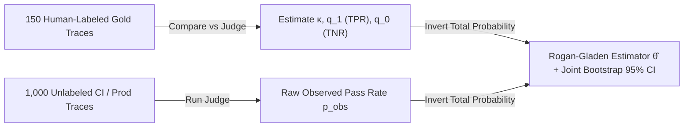

# Statistical Judge Calibration: Cohen's Kappa, Sensitivity/Specificity & Rogan-Gladen Correction

```json pretraining
[
  {
    "term": "Cohen's Kappa (κ)",
    "formula": "κ = (p_o - p_e) / (1 - p_e)",
    "meaning": "Chance-corrected agreement between an LLM Judge and human domain experts; penalizes high raw % agreement caused purely by class imbalance."
  },
  {
    "term": "Judge Sensitivity & Specificity",
    "formula": "q_1 = TPR,  q_0 = TNR",
    "meaning": "Measured on a 150-sample human gold calibration set: q_1 is P(Judge=1 | Human=1) and q_0 is P(Judge=0 | Human=0)."
  },
  {
    "term": "Rogan-Gladen Estimator (θ̂)",
    "formula": "θ̂ = (p_obs + q_0 - 1) / (q_1 + q_0 - 1)",
    "meaning": "Mathematically removes systematic judge false-positive and false-negative bias from raw observed pass rate p_obs when J = q_1 + q_0 - 1 > 0."
  },
  {
    "term": "Joint Bootstrap 95% CI",
    "formula": "Resample(Gold_m, Unlabeled_N)",
    "meaning": "Propagates BOTH finite calibration-set uncertainty (m=150) AND test-run sampling uncertainty (N=1,000) into an honest confidence interval."
  }
]
```

```json poe
{
  "question": "Suppose 95% of your production answers are genuinely good, and you deploy a lazy LLM Judge that blindly outputs 'PASS' 95% of the time at random. Raw agreement with humans is 90.5%! Why is raw % agreement a trap here, and what will Cohen's κ reveal?",
  "options": [
    "Raw agreement is fine as long as it exceeds 90%",
    "Because expected chance agreement p_e = (0.95)(0.95) + (0.05)(0.05) = 0.905, Cohen's κ = (0.905 - 0.905) / (1 - 0.905) = 0.00—instantly exposing that the judge has ZERO discriminative skill beyond base-rate guessing!",
    "Cohen's κ will equal 0.95",
    "You must switch from binary labels to 1–100 floats"
  ],
  "answerIndex": 1,
  "explanation": "On skewed pass rates (e.g., 90–95% pass), a sycophantic 'always-PASS' judge achieves >90% raw accuracy while catching 0% of regressions! Cohen's κ subtracts chance agreement p_e, requiring κ >= 0.70 AND balanced q_1/q_0 before trusting any judge in CI."
}
```

## Part I — Why Raw LLM-Judge Pass Rates Lie (And How to Debias Them)

Suppose your system's **true** human-verified pass rate is $\theta = 0.90$. You evaluate $N = 1,000$ unlabeled traces using an LLM-as-a-Judge whose calibration against a $m = 150$ human-annotated gold set yields:
- **Sensitivity ($q_1 = \text{TPR}$)**: $P(\hat{Y}=1 \mid Y=1) = 0.92$
- **Specificity ($q_0 = \text{TNR}$)**: $P(\hat{Y}=0 \mid Y=0) = 0.80$ (meaning false-positive rate $1 - q_0 = 0.20$)

What raw pass rate $p_{\text{obs}} = P(\hat{Y}=1)$ will the judge report on your dashboard? By the Law of Total Probability:

$$p_{\text{obs}} = \theta \cdot q_1 + (1 - \theta) \cdot (1 - q_0) = 0.90(0.92) + 0.10(0.20) = 0.828 + 0.020 = 0.848$$

The raw judge reports **$84.8\%$** when true quality is **$90.0\%$**—a **$5.2\%$ systematic distortion**! Worse yet, if true quality is low ($\theta = 0.50$) and specificity is weak ($q_0 = 0.65$), a sycophantic judge inflates observed accuracy systematically.

Solving the linear equation $p_{\text{obs}} = \theta q_1 + (1 - \theta)(1 - q_0)$ for $\theta$ yields the **Rogan-Gladen (1978) Prevalence Correction** (adopted across modern Stanford / Anthropic LLM evaluation frameworks):

$$\hat{\theta} = \text{clip}_{[0, 1]}\left(\frac{p_{\text{obs}} + q_0 - 1}{q_1 + q_0 - 1}\right)$$

Notice the denominator $J = q_1 + q_0 - 1$ is **Youden's J statistic** (informedness). Whenever $q_1 + q_0 > 1$, $\hat{\theta}$ recovers an asymptotically unbiased estimate of the **true human pass rate**!



---

## Part II — Two-Stage Judge Qualification Protocol

Before any LLM-as-a-Judge prompt is promoted to gate CI/CD, it must clear a **Two-Stage Statistical Qualification**:
1. **Inter-Human Anchor Check**: Have 2 domain experts independently label $m = 150$ stratified traces ($75$ passes, $75$ failures—oversampling failures so $q_0$ has tight variance!). Require human-to-human $\kappa \ge 0.80$; if humans disagree, the **rubric itself is ambiguous** and no LLM can guess their minds.
2. **Judge-to-Human Calibration**: Run the frozen LLM judge (`temperature=0`) against the adjudicated $150$-item gold set. Require **Cohen's $\kappa \ge 0.70$**, $q_1 \ge 0.85$, and $q_0 \ge 0.85$, then persist $(q_1, q_0)$ alongside the judge prompt hash to compute Rogan-Gladen $\hat{\theta}$ and **Joint Non-Parametric Bootstrap $95\%$ CIs** ($B = 2,000$ resamples of both the $m$-item calibration set and $N$-item eval run).

```json contrast
{
  "title": "Judge Validation & Pass-Rate Estimation",
  "naiveTitle": "Uncalibrated Raw Judge Average",
  "naiveMetric": "p_obs Biased by 5–18% · Unknown Variance",
  "naivePoints": [
    "Deploys a judge prompt after eyeball-checking 5 examples in a playground",
    "Validates judge using raw % accuracy on a 95%-positive sample (hiding TNR = 0.20!)",
    "Reports raw p_obs directly to executives without bias correction",
    "Ignores calibration-set uncertainty when comparing weekly eval runs"
  ],
  "staffTitle": "κ-Gated Judge + Rogan-Gladen + Joint Bootstrap",
  "staffMetric": "Unbiased θ̂ · Honest 95% Confidence Bounds",
  "staffPoints": [
    "Oversamples failure cases (50/50 split) in m=150 human calibration set to pin down Specificity q_0",
    "Requires Judge-to-Human Cohen's κ >= 0.70 and Youden's J (q_1 + q_0 - 1) >= 0.70",
    "Applies Rogan-Gladen correction θ̂ = (p_obs + q_0 - 1) / (q_1 + q_0 - 1) on every CI run",
    "Computes 2,000-iteration joint bootstrap CIs over both calibration (m) and evaluation (N) samples"
  ]
}
```

### Trade-Off Table: Judge Calibration & Estimation Choices

| Metric / Estimator | Mathematical Role | Minimum Production Bar | What Happens If Omitted |
| :--- | :--- | :--- | :--- |
| **Cohen's $\kappa$** | Chance-corrected alignment with human SMEs | $\kappa \ge 0.70$ (*Substantial*) | Sycophantic "always-PASS" judges look $>90\%$ accurate on high base-rate tasks |
| **Specificity ($q_0 = \text{TNR}$)** | Ability to catch true hallucinations/failures | $q_0 \ge 0.85$ (estimated on $\ge 60$ gold failures) | High false-positive leniency masks severe regressions |
| **Rogan-Gladen ($\hat{\theta}$)** | Corrects prevalence distortion in $p_{\text{obs}}$ | $q_1 + q_0 - 1 \ge 0.65$ | Systematic $5\%–15\%$ bias whenever true pass rate shifts |
| **Joint Bootstrap 95% CI** | Propagates $\text{Var}(\hat{q}_1, \hat{q}_0) + \text{Var}(p_{\text{obs}})$ | $B \ge 1,000$ resamples | Overconfident narrow error bars cause false regression alarms |

---

## Part III — Production Implementation Blueprints (Python 3 & Java 17)

### Python 3 Blueprint: Cohen's $\kappa$, Rogan-Gladen Estimator & Joint Bootstrap 95% CI
```python
import random


def compute_kappa_and_rates(human_labels: list[int], judge_labels: list[int]) -> dict:
    """Computes Cohen's kappa, Sensitivity (q1 = TPR), and Specificity (q0 = TNR)."""
    assert len(human_labels) == len(judge_labels) and len(human_labels) > 0
    n = len(human_labels)
    tp = sum(1 for h, j in zip(human_labels, judge_labels) if h == 1 and j == 1)
    tn = sum(1 for h, j in zip(human_labels, judge_labels) if h == 0 and j == 0)
    fp = sum(1 for h, j in zip(human_labels, judge_labels) if h == 0 and j == 1)
    fn = sum(1 for h, j in zip(human_labels, judge_labels) if h == 1 and j == 0)

    p_o = (tp + tn) / n
    p_h1 = (tp + fn) / n
    p_j1 = (tp + fp) / n
    p_e = p_h1 * p_j1 + (1.0 - p_h1) * (1.0 - p_j1)
    kappa = (p_o - p_e) / (1.0 - p_e) if p_e < 1.0 else 1.0

    q1_tpr = tp / max(1, tp + fn)
    q0_tnr = tn / max(1, tn + fp)
    return {
        "cohensKappa": round(kappa, 4),
        "q1Sensitivity": round(q1_tpr, 4),
        "q0Specificity": round(q0_tnr, 4),
        "youdenJ": round(q1_tpr + q0_tnr - 1.0, 4),
    }


def rogan_gladen_estimate(p_obs: float, q1: float, q0: float) -> float:
    denom = q1 + q0 - 1.0
    if denom <= 1e-6:
        raise ValueError("Uninformative judge: q1 + q0 must strictly exceed 1.0")
    theta = (p_obs + q0 - 1.0) / denom
    return max(0.0, min(1.0, theta))


def calibrated_pass_rate_with_ci(
    calib_pairs: list[tuple[int, int]],  # (human_y, judge_y)
    eval_judge_verdicts: list[int],
    iterations: int = 1000,
    seed: int = 42,
) -> dict:
    """Computes point Rogan-Gladen θ̂ and Joint Non-Parametric 95% Bootstrap CI."""
    rng = random.Random(seed)
    h_base = [p[0] for p in calib_pairs]
    j_base = [p[1] for p in calib_pairs]
    cal = compute_kappa_and_rates(h_base, j_base)
    p_obs = sum(eval_judge_verdicts) / max(1, len(eval_judge_verdicts))
    theta_hat = rogan_gladen_estimate(p_obs, cal["q1Sensitivity"], cal["q0Specificity"])

    m = len(calib_pairs)
    n = len(eval_judge_verdicts)
    boot_thetas: list[float] = []
    for _ in range(iterations):
        c_sample = [calib_pairs[rng.randrange(m)] for _ in range(m)]
        tp = sum(1 for h, j in c_sample if h == 1 and j == 1)
        fn = sum(1 for h, j in c_sample if h == 1 and j == 0)
        tn = sum(1 for h, j in c_sample if h == 0 and j == 0)
        fp = sum(1 for h, j in c_sample if h == 0 and j == 1)
        q1_b = tp / max(1, tp + fn)
        q0_b = tn / max(1, tn + fp)
        if q1_b + q0_b <= 1.05:
            continue
        p_obs_b = sum(eval_judge_verdicts[rng.randrange(n)] for _ in range(n)) / n
        boot_thetas.append(rogan_gladen_estimate(p_obs_b, q1_b, q0_b))

    boot_thetas.sort()
    lo = boot_thetas[int(0.025 * len(boot_thetas))]
    hi = boot_thetas[int(0.975 * len(boot_thetas))]
    return {
        "rawObservedPassRate": round(p_obs, 4),
        "calibratedPassRate": round(theta_hat, 4),
        "ci95": [round(lo, 4), round(hi, 4)],
        "calibration": cal,
    }
```

### Java 17 Blueprint: Judge Calibration & Rogan-Gladen Estimator
```java
public final class RoganGladenCalibrator {
    public record CalibrationMetrics(double kappa, double q1Sensitivity, double q0Specificity) {
        public double youdenJ() {
            return q1Sensitivity + q0Specificity - 1.0;
        }
    }

    public static CalibrationMetrics calibrate(boolean[] humanGold, boolean[] judgePred) {
        if (humanGold.length != judgePred.length || humanGold.length == 0) {
            throw new IllegalArgumentException("Mismatched or empty calibration arrays");
        }
        int tp = 0, tn = 0, fp = 0, fn = 0;
        for (int i = 0; i < humanGold.length; i++) {
            if (humanGold[i] && judgePred[i]) tp++;
            else if (!humanGold[i] && !judgePred[i]) tn++;
            else if (!humanGold[i] && judgePred[i]) fp++;
            else fn++;
        }
        double n = humanGold.length;
        double po = (tp + tn) / n;
        double ph1 = (tp + fn) / n;
        double pj1 = (tp + fp) / n;
        double pe = ph1 * pj1 + (1.0 - ph1) * (1.0 - pj1);
        double kappa = pe < 1.0 ? (po - pe) / (1.0 - pe) : 1.0;
        double q1 = tp / (double) Math.max(1, tp + fn);
        double q0 = tn / (double) Math.max(1, tn + fp);
        return new CalibrationMetrics(kappa, q1, q0);
    }

    public static double correctPrevalence(double pObs, CalibrationMetrics cal) {
        if (cal.youdenJ() <= 0.05) {
            throw new IllegalStateException("Judge informedness (q1 + q0 - 1) too low for calibration");
        }
        double theta = (pObs + cal.q0Specificity() - 1.0) / cal.youdenJ();
        return Math.max(0.0, Math.min(1.0, theta));
    }
}
```

> [!WARNING]
> **Staff Interview Gotcha — Why Your 150-Item Human Calibration Set MUST Be Class-Balanced (`~50/50`), Not Randomly Sampled**:
> If your production system passes $95\%$ of the time and you label $150$ *random* production traces, you will only get **$\sim 7$ true failure examples**! Estimating Specificity $q_0 = \text{TN}/(\text{TN}+\text{FP})$ on $7$ examples produces massive variance ($\pm 30\%$), blowing up the Rogan-Gladen denominator $q_1 + q_0 - 1$. Always construct the human calibration set with **deliberately oversampled failure traces ($75$ passes + $75$ failures)**—because $q_1$ and $q_0$ condition on $Y=1$ and $Y=0$ respectively, class-balancing the calibration set shrinks $\text{Var}(\hat{\theta})$ dramatically without biasing $q_1$ or $q_0$!

---

## Part IV — End-of-Chapter Mastery Check

```json quiz
[
  {
    "id": "aiqa-06-q1",
    "question": "An LLM Judge is calibrated on a human gold set with Sensitivity q1 (TPR) = 0.90 and Specificity q0 (TNR) = 0.80. On a nightly 1,000-query CI run, the judge outputs raw observed pass rate p_obs = 0.76. What is the Rogan-Gladen bias-corrected true pass rate θ̂?",
    "options": [
      "0.76 (no adjustment needed)",
      "0.80, because θ̂ = (0.76 + 0.80 - 1) / (0.90 + 0.80 - 1) = 0.56 / 0.70 = 0.80",
      "0.95",
      "0.56"
    ],
    "answerIndex": 1,
    "explanation": "Plugging p_obs = 0.76, q1 = 0.90, q0 = 0.80 into θ̂ = (p_obs + q0 - 1) / (q1 + q0 - 1) gives (1.56 - 1.0) / (1.70 - 1.0) = 0.56 / 0.70 = 0.80. Verification: 0.80(0.90) + 0.20(0.20) = 0.72 + 0.04 = 0.76!"
  },
  {
    "id": "aiqa-06-q2",
    "question": "When building a 150-example human-annotated calibration set to measure a judge's Sensitivity (q1) and Specificity (q0), why should you curate ~75 true passes and ~75 true failures instead of sampling 150 random traces from a 96%-accurate system?",
    "options": [
      "Because Python lists require even lengths",
      "Because a 96%-accurate random sample yields only ~6 negative examples, making Specificity q0 = P(Judge=0 | Human=0) wildly noisy; conditioning on Y=0 and Y=1 separately means a 50/50 calibration split minimizes variance in both q1 and q0 without introducing prevalence bias",
      "Because Rogan-Gladen assumes true pass rate is always 50%",
      "Because human annotators charge less for failure traces"
    ],
    "answerIndex": 1,
    "explanation": "Sensitivity conditions strictly on true positives (Y=1) and Specificity conditions strictly on true negatives (Y=0); oversampling rare failures in the calibration set tightens q0 precision."
  },
  {
    "id": "aiqa-06-q3",
    "question": "Why must a Joint Bootstrap confidence interval resample BOTH the m=150 human calibration pairs AND the N=1,000 unlabeled evaluation verdicts on every bootstrap iteration?",
    "options": [
      "To warm up the CPU branch predictor",
      "Because q1 and q0 are themselves finite-sample estimates with uncertainty; holding q1 and q0 fixed while only bootstrapping the N=1,000 test run ignores calibration error and produces deceptively narrow confidence intervals even as N approaches infinity",
      "Because N must equal m in bootstrap math",
      "To convert binary scores into BLEU scores"
    ],
    "answerIndex": 1,
    "explanation": "Even if you evaluate N = 1,000,000 unlabeled traces, your uncertainty in θ̂ is still lower-bounded by the finite m = 150 human calibration sample! Joint bootstrapping propagates both variance sources honestly."
  }
]
```
