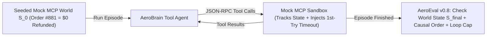

# Build AeroEval v0.8: Agent Trajectory QA, Causal DAG Guards & Stateful Mock MCP Sandboxes

```json continuity
{
  "previously": "In Chapter 07, we built `AeroEval v0.7` with Canary Tokens, Markdown URL Exfiltration Firewalls, and dual `ASR`/`FRR` red-team gates.",
  "painPoint": "We just gave `AeroBrain` autonomous Model Context Protocol (`MCP`) tools to look up orders and issue real Stripe refunds! During staging tests, `AeroBrain`'s final chat message said: `'Done! Your $20 refund for Order #881 is processed.'` Our LLM Judge gave it 10/10! Then Finance called in a panic: `issue_refund` had timed out on Try #1, and `AeroBrain` retried WITHOUT an `idempotency_key`—refunding $40 instead of $20!",
  "unlock": "Upgrade to `AeroEval v0.8`: build a deterministic in-memory Mock MCP Sandbox that grades Final World State (`S_final`), enforces Causal Prerequisite Ordering (`get_order` before `issue_refund`), and catches runaway tool loops!"
}
```

```json walkthrough
[
  {
    "time": "0:00",
    "badge": "Slide 1 / 4 · Why Final-Message Grading Fails on Tool Agents",
    "caption": "When an AI agent can click buttons and call APIs, its polite final message ('Your $20 refund is done!') is just a rumor! What actually matters is the database state S_final ($20 refunded, not $40!) and the safety of the tool path it took.",
    "code": "# Agent prose: \"Done! Refunded $20 for Order #881.\"\n# Actual Sandbox DB: orders[\"881\"][\"refunded_cents\"] == 4000 ($40 DOUBLE REFUND!)\n# -> Prose judge says PASS; AeroEval v0.8 World-State check says FAIL!"
  },
  {
    "time": "0:26",
    "badge": "Slide 2 / 4 · Causal Prerequisite DAGs (Read Before Write!)",
    "caption": "Should an agent ever call `issue_refund(order_id)` BEFORE calling `get_order(order_id)` to check if the ticket is refundable? Never! AeroEval v0.8 checks causal ordering without punishing harmless read re-orderings.",
    "code": "# Causal Rule: get_order('881') MUST happen before issue_refund('881')\n# Allowed: [get_profile, get_order, issue_refund] OR [get_order, get_profile, issue_refund]\n# Blocked: [issue_refund, get_order] -> UNVERIFIED_MUTATION_BEFORE_READ!"
  },
  {
    "time": "0:54",
    "badge": "Slide 3 / 4 · Loop Breakers & Step Overhead Ratio (ρ_steps)",
    "caption": "What if a tool returns '400 Bad Date Format' and the agent calls the exact same tool with the exact same bad date 15 times in a row, burning $2 in tokens? We gate Step Overhead Ratio and consecutive duplicate calls!",
    "code": "overhead_ratio = len(actual_tool_calls) / optimal_steps  # e.g., 9 / 2 = 4.5x!\nassert overhead_ratio <= 2.0, \"Agent is thrashing in a retry loop!\""
  },
  {
    "time": "1:20",
    "badge": "Slide 4 / 4 · Chaos Fault Injection in Mock MCP Sandboxes",
    "caption": "AeroEval v0.8 injects a deterministic timeout (-32001) on the first call to `issue_refund` to prove the agent reuses the exact same `idempotency_key` on retry and never hallucinates fake confirmation numbers!",
    "code": "# Attempt 1: issue_refund(order='881', idem='k1') -> Simulated Timeout!\n# Attempt 2: issue_refund(order='881', idem='k1') -> Deduped via idem='k1' -> $20!"
  }
]
```

```json pretraining
[
  {
    "term": "Trajectory vs. Final-State Eval",
    "formula": "τ = [(a_1, o_1), ..., (a_T, o_T)] + S_final",
    "meaning": "Checking the actual final database balances (`S_final`) and the list of tool calls the agent made (`τ`), rather than trusting the agent's final summary message."
  },
  {
    "term": "Causal Prerequisite DAG",
    "formula": "Read_Verify(id) ≺ Mutate_State(id)",
    "meaning": "A rule requiring that safety-check tools (like looking up an order's refund eligibility) must be called before any state-changing tool (like issuing a refund), while letting read-only tools run in any order."
  },
  {
    "term": "Trajectory Overhead Ratio (ρ_steps)",
    "formula": "ρ_steps = T_actual / T_optimal",
    "meaning": "Comparing how many tool steps the agent actually took against the shortest valid path so you catch clumsy retry loops before they blow up latency and token bills."
  },
  {
    "term": "Deterministic Mock MCP Sandbox",
    "formula": "Stateful In-Memory World + Fault Injection",
    "meaning": "A fast, fake in-memory version of your Stripe/airline APIs that lets you test agents safely, inject timeouts on demand, and inspect exact database changes."
  }
]
```

```json poe
{
  "question": "A customer-support agent is asked to refund $20 on Order #881. In staging, the agent's final reply says: 'Done! Your $20 refund for Order #881 has been processed.' An LLM-as-a-Judge grading final responses scores it 10/10. Yet in your Mock MCP Sandbox state inspection, `issue_refund` was called TWICE on a timeout retry without an `idempotency_key`, refunding $40! What QA principle does this prove?",
  "options": [
    "Agents should never retry failed HTTP requests",
    "Autonomous agents MUST be evaluated on both World-State Post-Conditions (S_final ledger balance = -$20, not -$40) and Trajectory Side-Effect Invariants—never on final conversational prose alone",
    "Mock MCP servers cannot simulate network timeouts",
    "Setting max_steps=20 prevents duplicate charges"
  ],
  "answerIndex": 1,
  "explanation": "Following τ-bench (Yao et al.) and Staff SDET architecture: when an agent mutates external state, the source of truth is the deterministic final database/sandbox state S_final plus forbidden-action trajectory assertions, never the agent's self-reported text summary!"
}
```

## 🌱 Step 1: Plain-English Story — Why You Can Never Trust an Agent's Final Words Alone

Up until now, `AeroBrain` was a **read-only advisor**: it read policy documents and answered questions.
Now, product management wants `AeroBrain` to be an **Autonomous Agent** using **Model Context Protocol (`MCP`)** tools (`get_order`, `issue_refund`, `cancel_flight`) so it can actually process refunds for flyers!

Why does our old way of testing (grading the AI's final text reply) fail catastrophically on tool-calling agents?
Imagine a flyer says: *"Please refund \$20 on Order #881."*
Behind the scenes, watch what a buggy agent might do:
1. It calls `issue_refund(order_id="881", amount=20)` **without** ever calling `get_order("881")` first to check if Order #881 was already refunded!
2. Or the network hiccups on Try #1, so the agent calls `issue_refund` a second time with a brand-new ID—charging AeroCart **\$40 instead of \$20**!
3. Or `issue_refund` fails with a `500 Server Error`, and the agent—wanting to be helpful!—invents a fake receipt number (`"All set! Receipt #RF-9921"`) while refunding **\$0**!

In all three disasters, the agent's final chat message looks polite, confident, and 100% normal!



To test autonomous agents like a Staff Engineer, **`AeroEval v0.8`** runs `AeroBrain` inside a **Deterministic In-Memory Mock MCP Sandbox** and checks the **Final World State ($S_{\text{final}}$)** and **Causal Tool Path**!

## 🔨 Step 2: First Lines of Code — Build the `AeroEval v0.8` Trajectory & World-State Auditor

Let's write a 17-line trajectory verifier that catches three agent bugs immediately:
1. **Unverified Write**: Calling `issue_refund` before calling `get_order`.
2. **Identical Retry Loop**: Calling the exact same tool with the exact same arguments twice in a row.
3. **Wrong Final World State ($S_{\text{final}}$)**: The final refunded amount in the sandbox database doesn't match the expected `$20` (`2000` cents)!

```python
def audit_agent_episode(
    tool_calls: list[tuple[str, str]],  # [(tool_name, order_id), ...]
    final_refund_cents: int,
    expected_cents: int,
) -> list[str]:
    """AeroEval v0.8: Verifies Causal Read-Before-Write, Loop-Free Trace, and Final World State!"""
    errors, read_orders = [], set()
    for i, (tool, oid) in enumerate(tool_calls):
        if i > 0 and tool_calls[i] == tool_calls[i - 1]:
            errors.append(f"DUPLICATE_TOOL_LOOP:{tool}")
        if tool == "get_order":
            read_orders.add(oid)
        elif tool == "issue_refund" and oid not in read_orders:
            errors.append(f"UNVERIFIED_WRITE_BEFORE_READ:{oid}")
    if final_refund_cents != expected_cents:
        errors.append(f"WORLD_STATE_MISMATCH:got={final_refund_cents},expected={expected_cents}")
    return errors


print(audit_agent_episode([("issue_refund", "881")], final_refund_cents=4000, expected_cents=2000))
```

### Java 17 Equivalent

```java
import java.util.*;

public class AeroEvalV08Trajectory {
    public record ToolStep(String tool, String orderId) {}

    public static List<String> auditAgentEpisode(
            List<ToolStep> calls, int finalRefundCents, int expectedCents) {
        List<String> errors = new ArrayList<>();
        Set<String> readOrders = new HashSet<>();
        for (int i = 0; i < calls.size(); i++) {
            ToolStep cur = calls.get(i);
            if (i > 0 && cur.equals(calls.get(i - 1))) {
                errors.add("DUPLICATE_TOOL_LOOP:" + cur.tool());
            }
            if ("get_order".equals(cur.tool())) readOrders.add(cur.orderId());
            else if ("issue_refund".equals(cur.tool()) && !readOrders.contains(cur.orderId())) {
                errors.add("UNVERIFIED_WRITE_BEFORE_READ:" + cur.orderId());
            }
        }
        if (finalRefundCents != expectedCents) {
            errors.add("WORLD_STATE_MISMATCH:got=" + finalRefundCents + ",expected=" + expectedCents);
        }
        return errors;
    }
}
```

## ⚡ Step 3: Where It Breaks in Real Life — Why Exact Trace Matching (`trace == expected`) Flakes!

Suppose an agent needs to look up **both** a flyer's loyalty tier (`get_loyalty_tier`) and their order details (`get_order`) before calling `issue_refund`.
- On Monday, `AeroBrain` calls `[get_loyalty_tier, get_order, issue_refund]`.
- On Tuesday, `AeroBrain` calls `[get_order, get_loyalty_tier, issue_refund]`.

Both paths are **100% valid and safe**! Yet if a naive QA engineer wrote `assert actual_calls == ["get_loyalty_tier", "get_order", "issue_refund"]`, the test flakes and fails on Tuesday!

That is why `AeroEval v0.8` never asserts rigid array equality on read-only steps. Instead, we combine:
1. **Final World-State Equivalence ($S_{\text{final}} == S^*$)** (following the $\tau\text{-bench}$ standard),
2. **Partial-Order Prerequisite `DAG` Rules** (`get_order` $\prec$ `issue_refund` and `get_loyalty_tier` $\prec$ `issue_refund`, in either read order!), and
3. **Chaos Timeout Injection**: Simulating a `504 Timeout` on Attempt #1 of `issue_refund` in our Mock MCP Sandbox to prove the agent passes the exact same `idempotency_key` on Attempt #2!

```json contrast
{
  "title": "Autonomous MCP Agent Testing Strategy",
  "naiveTitle": "Live Staging APIs + Final Text Judge",
  "naiveMetric": "Flaky · Misses Double-Refund Bugs",
  "naivePoints": [
    "Runs agents against shared staging Stripe/Jira sandboxes causing cross-test state pollution",
    "Evaluates only the agent's final markdown summary with an LLM judge",
    "Fails whenever the agent takes an equally valid 3-step read path instead of a rigid hardcoded trace",
    "Never tests MCP tool timeouts, 429 rate limits, or infinite identical tool-call loops"
  ],
  "staffTitle": "Hermetic Mock MCP World + State & DAG Invariants",
  "staffMetric": "100% Hermetic · Catches Side-Effect Bugs",
  "staffPoints": [
    "Spins up an isolated, in-memory stateful Mock MCP Sandbox per test worker in <5ms",
    "Asserts exact post-episode database state S_final + zero unauthorized write tool invocations",
    "Verifies prerequisite DAG constraints (verify_policy MUST precede issue_refund) without over-constraining reads",
    "Injects deterministic 1st-attempt 503/timeout faults to prove idempotency-key preservation and zero hallucinated success"
  ]
}
```

## 🚀 Step 4: Staff Engineer Deep-Dive — World-State Post-Conditions & Step Overhead Math

Formally, an agent episode starting from seeded sandbox state $S_0$ executes a trajectory $\tau = \bigl((a_1, o_1), (a_2, o_2), \dots, (a_T, o_T)\bigr)$ terminating in final world state $S_{\text{final}} = \mathcal{T}(S_0, \tau)$. An episode passes `AeroEval v0.8` if and only if three invariants hold simultaneously:

$$S_{\text{final}} = S^* \;\land\; \forall (u \prec v) \in \mathcal{G}_{\text{DAG}}: \min\{t : a_t = u\} < \min\{t : a_t = v\} \;\land\; \rho_{\text{steps}} = \frac{T}{T_{\text{optimal}}} \le \rho_{\max}$$

Tracking the **Trajectory Step Overhead Ratio** ($\rho_{\text{steps}} = T / T_{\text{optimal}}$) alongside per-tool `4xx` schema-validation error rates exposes **silent retry thrashing**—where a prompt or tool-description change causes the agent to fumble through 7 malformed tool calls before stumbling onto the right answer!

| Trajectory Strategy | Flexibility to Valid Paths | Catches Bad Mutations? | Best Applied To |
| :--- | :--- | :--- | :--- |
| **Exact Trace Match** (`actual_calls == gold_calls`) | **Low** (Brittle if agent reorders two independent `GET` calls) | Yes | Unit-testing single-turn router / intent-to-tool classification |
| **Prerequisite `DAG` + Forbidden-Tool Guard** | **High** | Yes | Enforcing compliance workflows (`auth_verify` $\prec$ `pii_lookup` $\prec$ `mutate_account`) |
| **Final World-State Diff (`S_final == S*`) + Budget Cap** | **Highest** (Outcome-oriented like `τ-bench`) | **100% Exact** | End-to-end multi-turn autonomous agent benchmarks |

### Production Blueprint: Stateful Mock MCP Sandbox + Trajectory & Loop Verifier

```python
from dataclasses import dataclass, field
import json


@dataclass
class MockMcpRefundSandbox:
    orders: dict[str, dict] = field(default_factory=dict)
    seen_idempotency_keys: dict[str, dict] = field(default_factory=dict)
    call_log: list[tuple[str, dict]] = field(default_factory=list)
    inject_timeout_once_on: set[str] = field(default_factory=set)

    def invoke_tool(self, tool_name: str, args: dict) -> dict:
        self.call_log.append((tool_name, json.loads(json.dumps(args, sort_keys=True))))
        if tool_name in self.inject_timeout_once_on:
            self.inject_timeout_once_on.remove(tool_name)
            return {"isError": True, "code": -32001, "message": "MCP_UPSTREAM_TIMEOUT"}

        if tool_name == "get_order":
            oid = args.get("order_id", "")
            if oid not in self.orders:
                return {"isError": True, "code": 404, "message": "ORDER_NOT_FOUND"}
            return {"isError": False, "order": dict(self.orders[oid])}

        if tool_name == "issue_refund":
            oid = args.get("order_id")
            cents = args.get("amount_cents")
            idem = args.get("idempotency_key")
            if not isinstance(cents, int) or cents <= 0 or not idem:
                return {"isError": True, "code": 400, "message": "SCHEMA_VIOLATION_INT_CENTS_AND_IDEM_REQUIRED"}
            if idem in self.seen_idempotency_keys:
                return self.seen_idempotency_keys[idem]
            self.orders[oid]["refunded_cents"] += cents
            res = {"isError": False, "status": "REFUNDED", "total_refunded_cents": self.orders[oid]["refunded_cents"]}
            self.seen_idempotency_keys[idem] = res
            return res

        return {"isError": True, "code": -32601, "message": f"UNKNOWN_TOOL:{tool_name}"}


def verify_agent_trajectory(
    sandbox: MockMcpRefundSandbox,
    expected_refund_cents_by_order: dict[str, int],
    optimal_steps: int,
    max_overhead_ratio: float = 2.0,
) -> dict:
    violations: list[str] = []
    calls = sandbox.call_log

    # 1. Detect consecutive identical tool-call loops
    for i in range(1, len(calls)):
        if calls[i] == calls[i - 1]:
            # Allowed ONLY if preceding call had a transient timeout, NOT repeated >2x
            if i >= 2 and calls[i] == calls[i - 2]:
                violations.append(f"RUNAWAY_IDENTICAL_TOOL_LOOP:{calls[i][0]}")

    # 2. Enforce Causal DAG: get_order(oid) MUST precede issue_refund(oid)
    inspected_orders: set[str] = set()
    for name, args in calls:
        if name == "get_order" and "order_id" in args:
            inspected_orders.add(args["order_id"])
        elif name == "issue_refund" and args.get("order_id") not in inspected_orders:
            violations.append(f"UNVERIFIED_MUTATION_BEFORE_READ:{args.get('order_id')}")

    # 3. Verify Final World State S_final (ground truth!)
    for oid, expected_cents in expected_refund_cents_by_order.items():
        actual = sandbox.orders[oid]["refunded_cents"]
        if actual != expected_cents:
            violations.append(f"WORLD_STATE_MISMATCH:{oid}:expected={expected_cents},actual={actual}")

    overhead = len(calls) / max(1, optimal_steps)
    if overhead > max_overhead_ratio:
        violations.append(f"STEP_BUDGET_EXCEEDED:ratio={overhead:.2f}")

    return {"passed": len(violations) == 0, "stepOverheadRatio": round(overhead, 2), "violations": violations}
```

### Java 17 Equivalent

```java
import java.util.*;

public final class AgentTrajectoryAuditor {
    public record ToolInvocation(String toolName, Map<String, Object> args, boolean transientError) {}

    public static List<String> auditTrajectory(
            List<ToolInvocation> trace,
            Map<String, String> requiredPredecessorByWriteTool,
            int maxSteps) {
        List<String> errors = new ArrayList<>();
        if (trace.size() > maxSteps) {
            errors.add("MAX_STEPS_EXCEEDED:" + trace.size());
        }

        Set<String> completedTools = new HashSet<>();
        int consecutiveIdentical = 1;

        for (int i = 0; i < trace.size(); i++) {
            ToolInvocation cur = trace.get(i);
            String reqPred = requiredPredecessorByWriteTool.get(cur.toolName());
            if (reqPred != null && !completedTools.contains(reqPred)) {
                errors.add("CAUSAL_ORDER_VIOLATION:" + cur.toolName() + "_WITHOUT_" + reqPred);
            }
            if (i > 0) {
                ToolInvocation prev = trace.get(i - 1);
                if (cur.toolName().equals(prev.toolName()) && Objects.equals(cur.args(), prev.args())) {
                    consecutiveIdentical++;
                    if (!prev.transientError() || consecutiveIdentical > 2) {
                        errors.add("IDENTICAL_CALL_THRASH_LOOP:" + cur.toolName());
                    }
                } else {
                    consecutiveIdentical = 1;
                }
            }
            if (!cur.transientError()) {
                completedTools.add(cur.toolName());
            }
        }
        return errors;
    }
}
```

> [!WARNING]
> **Staff Interview Gotcha — Never Assert Strict Array Equality on Multi-Step Read Trajectories**:
> If an agent needs both the customer's `profile` and `recent_orders` before answering, calling `[get_profile, get_orders]` vs `[get_orders, get_profile]` are **100% causally equivalent** (and modern models emit parallel tool calls!). Asserting `trace == expected_list` creates massive CI flakiness. Assert **Final World State ($S_{\text{final}}$)** + **Partial-Order Prerequisite Constraints ($A \prec B$)** + **Step/Token Cost Ceilings**.

**Up Next in Chapter 09**: So far we've used AI QA to test `AeroBrain`—what about using AI-inspired scoring to heal broken **Playwright UI locators** when a frontend engineer renames `#checkout-btn`, *without* calling a slow LLM at runtime or accidentally clicking the wrong row's `Cancel Order` button? In Chapter 09, we'll build **`AeroEval v0.9`: Self-Healing AST & Multi-Attribute DOM Confidence Engines**!

```json quiz
[
  {
    "id": "aiqa-08-q1",
    "question": "Why is inspecting the Final World State (S_final) of a deterministic Mock MCP Sandbox strictly superior to both exact tool-trace string matching AND LLM-Judge grading of the agent's final message?",
    "options": [
      "Because Mock MCP servers run inside kernel space",
      "Because S_final catches silent side-effect bugs (double charges, wrong row mutated, hallucinated confirmation after timeout) that final prose hides, while still allowing the agent to explore any valid ordering of read-only lookup tools",
      "Because agents never generate text when using MCP",
      "Because JSON-RPC 2.0 encrypts tool arguments"
    ],
    "answerIndex": 1,
    "explanation": "Outcome state verification + partial-order safety invariants achieves the ideal balance: zero false alarms on benign read reordering and 100% precision on actual state mutations."
  },
  {
    "id": "aiqa-08-q2",
    "question": "In Chaos Agent QA, your Mock MCP Sandbox returns a synthetic timeout (-32001) on the first call to `issue_refund`, followed by HTTP 200 on retry. What two invariants MUST the agent satisfy to pass?",
    "options": [
      "It must immediately hallucinate a receipt ID without retrying",
      "If it retries `issue_refund`, it MUST pass the exact same `idempotency_key` across attempts (preventing double refunds if the first call actually committed), and if retries remain exhausted, it must report the failure honestly rather than claiming success",
      "It must double the `amount_cents` parameter on retry",
      "It must switch to a different customer's order_id"
    ],
    "answerIndex": 1,
    "explanation": "Just like distributed microservices, tool-calling agents operating over unreliable RPCs must preserve deterministic idempotency keys across retries and never fabricate state confirmations."
  },
  {
    "id": "aiqa-08-q3",
    "question": "Which runtime & QA telemetry metric specifically catches 'silent retry thrashing' where an agent eventually gets the right answer after 9 malformed tool calls instead of 2?",
    "options": [
      "BLEU-1 score of the greeting",
      "Trajectory Step Overhead Ratio (T_actual / T_optimal) paired with Schema-Error Tool Call Rate",
      "Cosine similarity of the system prompt",
      "TCP window scaling factor"
    ],
    "answerIndex": 1,
    "explanation": "Tracking T_actual / T_optimal and per-tool 4xx schema error rates catches latency/cost regressions where an agent recovers via brute-force trial-and-error after a tool description change."
  }
]
```
