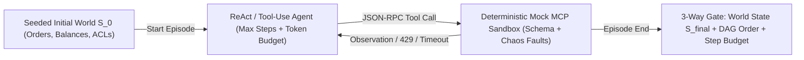

# Agent Trajectory QA: Tool-Selection Precision, Loop Guards & Deterministic Mock MCP Sandboxes

```json pretraining
[
  {
    "term": "Trajectory vs. Final-State Eval",
    "formula": "τ = [(a_1, o_1), ..., (a_T, o_T)] + S_final",
    "meaning": "Grading only an agent's polite final text misses catastrophic intermediate side effects (e.g., deleting and recreating a database row or burning 18 redundant tool calls)."
  },
  {
    "term": "Tool-Call Schema & Arg F1",
    "formula": "NameMatch ∧ JSONSchemaValid ∧ ArgEquiv",
    "meaning": "Verifying the agent selected the authorized tool, emitted schema-compliant typed arguments, and respected idempotency keys."
  },
  {
    "term": "Trajectory Overhead Ratio",
    "formula": "ρ_steps = T_actual / T_optimal",
    "meaning": "Ratio of executed tool/reasoning turns to the minimal valid path; spikes in ρ_steps expose silent retry thrashing before timeouts occur."
  },
  {
    "term": "Deterministic Mock MCP Sandbox",
    "formula": "Stateful In-Memory World + Faults",
    "meaning": "Replacing live Stripe/Jira/SQL endpoints with a seeded Model Context Protocol (MCP) state machine supporting deterministic HTTP 429/504 and malformed-JSON chaos."
  }
]
```

```json poe
{
  "question": "A customer-support agent is asked to refund $20 on Order #881. In staging, the agent's final reply says: 'Done! Your $20 refund for Order #881 has been processed.' An LLM-as-a-Judge grading final responses scores it 10/10. Yet in your Mock MCP Sandbox state inspection, `issue_refund` was called TWICE on a timeout retry without an `idempotency_key`, refunding $40! What QA principle does this prove?",
  "options": [
    "Agents should never retry failed HTTP requests",
    "Autonomous agents MUST be evaluated on both World-State Post-Conditions (S_final ledger balance = -$20, not -$40) and Trajectory Side-Effect Invariants—never on final conversational prose alone",
    "Mock MCP servers cannot simulate network timeouts",
    "Setting max_steps=20 prevents duplicate charges"
  ],
  "answerIndex": 1,
  "explanation": "Following τ-bench (Yao et al.) and Staff SDET architecture: when an agent mutates external state, the source of truth is the deterministic final database/sandbox state S_final plus forbidden-action trajectory assertions, never the agent's self-reported text summary!"
}
```

## Part I — Why Final-Answer Grading Fails on Multi-Step Tool Agents

When an LLM transitions from passive RAG Q&A to an **Autonomous Tool-Calling Agent** speaking **Model Context Protocol (`MCP`)**, failures shift from prose hallucinations to **distributed systems & state-machine bugs**:
- **Hallucinated Tool Names or Invalid Argument Types**: Passing `"amount": "$20.00"` (string) instead of `2000` (integer cents) or inventing `"force_override": true`.
- **Unsafe Policy Ordering**: Calling `issue_refund(order_id)` *before* calling `get_order_status(order_id)` to verify the item wasn't already refunded or outside the 30-day policy window!
- **Infinite Identical-Call Thrashing**: Receiving a `400 Invalid Date Format` error from an MCP tool and submitting the **exact same malformed arguments** 15 times in a row, burning `$1.80` in tokens per request.
- **Silent Partial Failure**: Tool #2 times out (`MCP -32001`), and the agent hallucinates a plausible-looking confirmation number instead of reporting the failure!



---

## Part II — The 4 Pillars of Agent Trajectory Verification

A production Agent QA harness evaluates every episode across **four deterministic dimensions**:
1. **Final World-State Equivalence ($S_{\text{final}} == S_{\text{expected}}$)**: Compare the serialized post-episode state of the Mock MCP database (orders, balances, tickets, emails sent) against the gold post-condition—allowing the agent to take *any* valid read path (`list_orders` vs `search_orders`) as long as mutations match $S_{\text{expected}}$!
2. **Causal Prerequisite Ordering (`DAG` Invariants)**: Assert that mandatory read/verification tools (`verify_identity`, `check_refund_policy`) preceded mutating tools (`issue_refund`, `cancel_subscription`).
3. **Runaway Loop & Budget Breakers**: Assert `total_steps <= max_steps` (e.g., `10`), `total_tokens <= budget`, and zero duplicate consecutive `(tool_name, canonical_args)` pairs.
4. **Chaos Resilience via Mock MCP Fault Injection**: Deterministically inject `HTTP 429 Retry-After`, `504 Gateway Timeout`, and schema-evolution extra fields on call `#1` to verify the agent retries idempotently (reusing the **same** `idempotency_key`) or degrades gracefully without fabricating outputs.

```json contrast
{
  "title": "Autonomous MCP Agent Testing Strategy",
  "naiveTitle": "Live Staging APIs + Final Text Judge",
  "naiveMetric": "Flaky · Misses Double-Refund Bugs",
  "naivePoints": [
    "Runs agents against shared staging Stripe/Jira sandboxes causing cross-test state pollution",
    "Evaluates only the agent's final markdown summary with an LLM judge",
    "Fails whenever the agent takes an equally valid 3-step read path instead of a rigid hardcoded trace",
    "Never tests MCP tool timeouts, 429 rate limits, or infinite identical tool-call loops"
  ],
  "staffTitle": "Hermetic Mock MCP World + State & DAG Invariants",
  "staffMetric": "100% Hermetic · Catches Side-Effect Bugs",
  "staffPoints": [
    "Spins up an isolated, in-memory stateful Mock MCP Sandbox per test worker in <5ms",
    "Asserts exact post-episode database state S_final + zero unauthorized write tool invocations",
    "Verifies prerequisite DAG constraints (verify_policy MUST precede issue_refund) without over-constraining reads",
    "Injects deterministic 1st-attempt 503/timeout faults to prove idempotency-key preservation and zero hallucinated success"
  ]
}
```

### Trade-Off Matrix: Trajectory Matching Strategies

| Trajectory Strategy | Flexibility to Valid Paths | Catches Bad Mutations? | Best Applied To |
| :--- | :--- | :--- | :--- |
| **Exact Trace Match** (`actual_calls == gold_calls`) | **Low** (Brittle if agent reorders two independent `GET` calls) | Yes | Unit-testing single-turn router / intent-to-tool classification |
| **Prerequisite `DAG` + Forbidden-Tool Guard** | **High** | Yes | Enforcing compliance workflows (`auth_verify` $\prec$ `pii_lookup` $\prec$ `mutate_account`) |
| **Final World-State Diff (`S_final == S*`) + Budget Cap** | **Highest** (Outcome-oriented like `τ-bench`) | **100% Exact** | End-to-end multi-turn autonomous agent benchmarks |

---

## Part III — Production Implementation Blueprints (Python 3 & Java 17)

### Python 3 Blueprint: Stateful Mock MCP Sandbox + Trajectory & Loop Verifier
```python
from dataclasses import dataclass, field
import json


@dataclass
class MockMcpRefundSandbox:
    orders: dict[str, dict] = field(default_factory=dict)
    seen_idempotency_keys: dict[str, dict] = field(default_factory=dict)
    call_log: list[tuple[str, dict]] = field(default_factory=list)
    inject_timeout_once_on: set[str] = field(default_factory=set)

    def invoke_tool(self, tool_name: str, args: dict) -> dict:
        self.call_log.append((tool_name, json.loads(json.dumps(args, sort_keys=True))))
        if tool_name in self.inject_timeout_once_on:
            self.inject_timeout_once_on.remove(tool_name)
            return {"isError": True, "code": -32001, "message": "MCP_UPSTREAM_TIMEOUT"}

        if tool_name == "get_order":
            oid = args.get("order_id", "")
            if oid not in self.orders:
                return {"isError": True, "code": 404, "message": "ORDER_NOT_FOUND"}
            return {"isError": False, "order": dict(self.orders[oid])}

        if tool_name == "issue_refund":
            oid = args.get("order_id")
            cents = args.get("amount_cents")
            idem = args.get("idempotency_key")
            if not isinstance(cents, int) or cents <= 0 or not idem:
                return {"isError": True, "code": 400, "message": "SCHEMA_VIOLATION_INT_CENTS_AND_IDEM_REQUIRED"}
            if idem in self.seen_idempotency_keys:
                return self.seen_idempotency_keys[idem]
            self.orders[oid]["refunded_cents"] += cents
            res = {"isError": False, "status": "REFUNDED", "total_refunded_cents": self.orders[oid]["refunded_cents"]}
            self.seen_idempotency_keys[idem] = res
            return res

        return {"isError": True, "code": -32601, "message": f"UNKNOWN_TOOL:{tool_name}"}


def verify_agent_trajectory(
    sandbox: MockMcpRefundSandbox,
    expected_refund_cents_by_order: dict[str, int],
    optimal_steps: int,
    max_overhead_ratio: float = 2.0,
) -> dict:
    violations: list[str] = []
    calls = sandbox.call_log

    # 1. Detect consecutive identical tool-call loops
    for i in range(1, len(calls)):
        if calls[i] == calls[i - 1]:
            # Allowed ONLY if preceding call had a transient timeout, NOT repeated >2x
            if i >= 2 and calls[i] == calls[i - 2]:
                violations.append(f"RUNAWAY_IDENTICAL_TOOL_LOOP:{calls[i][0]}")

    # 2. Enforce Causal DAG: get_order(oid) MUST precede issue_refund(oid)
    inspected_orders: set[str] = set()
    for name, args in calls:
        if name == "get_order" and "order_id" in args:
            inspected_orders.add(args["order_id"])
        elif name == "issue_refund" and args.get("order_id") not in inspected_orders:
            violations.append(f"UNVERIFIED_MUTATION_BEFORE_READ:{args.get('order_id')}")

    # 3. Verify Final World State S_final (ground truth!)
    for oid, expected_cents in expected_refund_cents_by_order.items():
        actual = sandbox.orders[oid]["refunded_cents"]
        if actual != expected_cents:
            violations.append(f"WORLD_STATE_MISMATCH:{oid}:expected={expected_cents},actual={actual}")

    overhead = len(calls) / max(1, optimal_steps)
    if overhead > max_overhead_ratio:
        violations.append(f"STEP_BUDGET_EXCEEDED:ratio={overhead:.2f}")

    return {"passed": len(violations) == 0, "stepOverheadRatio": round(overhead, 2), "violations": violations}
```

### Java 17 Blueprint: Causal Tool-Order DAG & Loop-Breaker Guard
```java
import java.util.*;

public final class AgentTrajectoryAuditor {
    public record ToolInvocation(String toolName, Map<String, Object> args, boolean transientError) {}

    public static List<String> auditTrajectory(
            List<ToolInvocation> trace,
            Map<String, String> requiredPredecessorByWriteTool,
            int maxSteps) {
        List<String> errors = new ArrayList<>();
        if (trace.size() > maxSteps) {
            errors.add("MAX_STEPS_EXCEEDED:" + trace.size());
        }

        Set<String> completedTools = new HashSet<>();
        int consecutiveIdentical = 1;

        for (int i = 0; i < trace.size(); i++) {
            ToolInvocation cur = trace.get(i);
            String reqPred = requiredPredecessorByWriteTool.get(cur.toolName());
            if (reqPred != null && !completedTools.contains(reqPred)) {
                errors.add("CAUSAL_ORDER_VIOLATION:" + cur.toolName() + "_WITHOUT_" + reqPred);
            }
            if (i > 0) {
                ToolInvocation prev = trace.get(i - 1);
                if (cur.toolName().equals(prev.toolName()) && Objects.equals(cur.args(), prev.args())) {
                    consecutiveIdentical++;
                    if (!prev.transientError() || consecutiveIdentical > 2) {
                        errors.add("IDENTICAL_CALL_THRASH_LOOP:" + cur.toolName());
                    }
                } else {
                    consecutiveIdentical = 1;
                }
            }
            if (!cur.transientError()) {
                completedTools.add(cur.toolName());
            }
        }
        return errors;
    }
}
```

> [!WARNING]
> **Staff Interview Gotcha — Never Assert Strict Array Equality on Multi-Step Read Trajectories**:
> If an agent needs both the customer's `profile` and `recent_orders` before answering, calling `[get_profile, get_orders]` vs `[get_orders, get_profile]` are **100% causally equivalent** (and modern models emit parallel tool calls!). Asserting `trace == expected_list` creates massive CI flakiness. Assert **Final World State ($S_{\text{final}}$)** + **Partial-Order Prerequisite Constraints ($A \prec B$)** + **Step/Token Cost Ceilings**.

---

## Part IV — End-of-Chapter Mastery Check

```json quiz
[
  {
    "id": "aiqa-08-q1",
    "question": "Why is inspecting the Final World State (S_final) of a deterministic Mock MCP Sandbox strictly superior to both exact tool-trace string matching AND LLM-Judge grading of the agent's final message?",
    "options": [
      "Because Mock MCP servers run inside kernel space",
      "Because S_final catches silent side-effect bugs (double charges, wrong row mutated, hallucinated confirmation after timeout) that final prose hides, while still allowing the agent to explore any valid ordering of read-only lookup tools",
      "Because agents never generate text when using MCP",
      "Because JSON-RPC 2.0 encrypts tool arguments"
    ],
    "answerIndex": 1,
    "explanation": "Outcome state verification + partial-order safety invariants achieves the ideal balance: zero false alarms on benign read reordering and 100% precision on actual state mutations."
  },
  {
    "id": "aiqa-08-q2",
    "question": "In Chaos Agent QA, your Mock MCP Sandbox returns a synthetic timeout (-32001) on the first call to `issue_refund`, followed by HTTP 200 on retry. What two invariants MUST the agent satisfy to pass?",
    "options": [
      "It must immediately hallucinate a receipt ID without retrying",
      "If it retries `issue_refund`, it MUST pass the exact same `idempotency_key` across attempts (preventing double refunds if the first call actually committed), and if retries remain exhausted, it must report the failure honestly rather than claiming success",
      "It must double the `amount_cents` parameter on retry",
      "It must switch to a different customer's order_id"
    ],
    "answerIndex": 1,
    "explanation": "Just like distributed microservices, tool-calling agents operating over unreliable RPCs must preserve deterministic idempotency keys across retries and never fabricate state confirmations."
  },
  {
    "id": "aiqa-08-q3",
    "question": "Which runtime & QA telemetry metric specifically catches 'silent retry thrashing' where an agent eventually gets the right answer after 9 malformed tool calls instead of 2?",
    "options": [
      "BLEU-1 score of the greeting",
      "Trajectory Step Overhead Ratio (T_actual / T_optimal) paired with Schema-Error Tool Call Rate",
      "Cosine similarity of the system prompt",
      "TCP window scaling factor"
    ],
    "answerIndex": 1,
    "explanation": "Tracking T_actual / T_optimal and per-tool 4xx schema error rates catches latency/cost regressions where an agent recovers via brute-force trial-and-error after a tool description change."
  }
]
```
