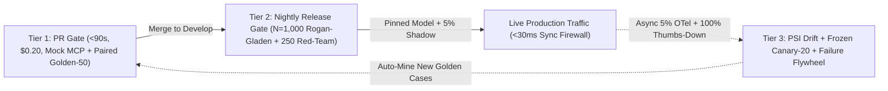

# Build AeroEval v1.0: 3-Tier AI CI/CD Gates, Shadow Canaries & PSI Drift Monitoring

```json continuity
{
  "previously": "Across Chapters 01–09, we built `AeroEval v0.1 -> v0.9`: structural & metamorphic gates, stratified Golden datasets, RAG Triad & NLI claim checkers, Rogan-Gladen calibrated judges, OWASP red-team firewalls, Mock MCP agent sandboxes, and AST DOM self-healing.",
  "painPoint": "When we tried running all 1,000 Golden tests + 250 Red-Team attacks on every Git Pull Request, each PR took 42 minutes and cost $18! Worse, on Sunday night—with ZERO Git commits deployed all weekend—a broken PDF sync and a silent SaaS model update caused Monday morning customer escalations to spike 3x!",
  "unlock": "Ship `AeroEval v1.0`: organize your checks into a fast 3-Tier Quality Funnel (`<90s PR Gate` -> `Nightly Calibrated Suite` -> `Async 5% OTel Production Monitor`) with McNemar Paired Regression tests, Frozen Canary-20 probes, and Population Stability Index (`PSI`) drift alerts!"
}
```

```json walkthrough
[
  {
    "time": "0:00",
    "badge": "Slide 1 / 4 · Why AI Breaks on Sunday With Zero Git Commits!",
    "caption": "Normal code doesn't rot over the weekend if nobody merges a PR. AI systems DO! Why? (1) Nightly doc syncs change the vector DB, (2) Real-world news changes what flyers ask, or (3) Unpinned cloud LLM aliases ('gpt-4o-latest') silently update weights!",
    "code": "# 3 things that mutate in production with ZERO Git commits:\n# 1. Knowledge Corpus Drift (broken PDF chunker)\n# 2. User Query Shift (weather/strike event -> PSI >= 0.25)\n# 3. Silent SaaS Model Checkpoint Drift (caught via Frozen Canary-20)"
  },
  {
    "time": "0:26",
    "badge": "Slide 2 / 4 · Tier 1 (<90s PR) vs. Tier 2 (Nightly Full Suite)",
    "caption": "Don't run 1,000 slow LLM calls on every PR! Tier 1 runs in <90 seconds ($0.20) using unit/Mock-MCP tests + a paired Golden-50 smoke slice. Tier 2 runs the full N=1,000 Rogan-Gladen + Red-Team suite nightly and pre-release!",
    "code": "# Tier 1 (Every PR, <90s): Hard Contracts + Mock MCP + Paired Golden-50\n# Tier 2 (Nightly, 15m):   Full N=1,000 Stratified + Rogan-Gladen + 250 Red-Team"
  },
  {
    "time": "0:54",
    "badge": "Slide 3 / 4 · Tier 3: Async 5% OTel Sampling (0ms User Latency!)",
    "caption": "Never run a slow 3-second LLM Judge inline while a customer is waiting for their chat reply! Instead, sample 5% of OpenTelemetry traces (plus 100% of thumbs-down chats) into an async background queue!",
    "code": "# Synchronous User Path (<30ms): Regex PII/URL Firewall + Fast NLI\n# Asynchronous Background Queue (0ms user delay): 5% OTel Traces + 100% Thumbs-Down"
  },
  {
    "time": "1:20",
    "badge": "Slide 4 / 4 · Catching Drift with PSI & Frozen Canary-20",
    "caption": "AeroEval v1.0 computes Population Stability Index (PSI) on retrieval scores to catch data drift, and runs 20 frozen prompts + frozen chunks hourly to catch silent cloud model updates within minutes!",
    "code": "if psi(baseline_retrieval_hist, live_retrieval_hist) >= 0.25:\n    page_oncall(\"DATA_OR_QUERY_DRIFT_DETECTED\")\nif run_frozen_canary_20() != pinned_canary_hash:\n    page_oncall(\"UPSTREAM_MODEL_PROVIDER_DRIFT\")"
  }
]
```

```json pretraining
[
  {
    "term": "3-Tier Eval Economics",
    "formula": "Tier1 (<90s PR) → Tier2 (Nightly) → Tier3 (Async Prod)",
    "meaning": "Splitting your tests into a fast 90-second smoke check on every PR, a deep 1,000-question exam every night, and background spot-checks on live traffic so developers never wait 45 minutes to merge code."
  },
  {
    "term": "McNemar's Paired Test",
    "formula": "z = (b - c) / √(b + c)",
    "meaning": "Comparing your new prompt against the old prompt question-by-question on the exact same 50 Golden items—counting how many broke (b) vs. how many got fixed (c)—for 4x sharper sensitivity."
  },
  {
    "term": "Population Stability Index (PSI)",
    "formula": "Σ (q_i - p_i) · ln(q_i / p_i)",
    "meaning": "A single drift score comparing today's live search scores or query lengths against last week's healthy baseline; PSI >= 0.25 means live traffic has shifted dangerously."
  },
  {
    "term": "Frozen Canary-20 Probe",
    "formula": "FixedPrompt + FixedChunks → CheckLogits",
    "meaning": "Sending the exact same 20 test questions and fixed policy paragraphs to your cloud LLM provider every hour to catch if the provider silently changed the model behind your back."
  }
]
```

```json poe
{
  "question": "Your team pushed ZERO Git commits over the weekend, yet Monday morning customer-support escalations spike 3x and average response token length dropped by 42%. What are the two most likely root causes in a production RAG/Agent system, and how does AeroEval v1.0 pinpoint which one occurred within 60 seconds?",
  "options": [
    "GitHub Actions deleted your historical test logs",
    "Either (1) Data/Corpus Drift (an ingestion job broke chunking or user query topics shifted, visible via Retrieval Cosine PSI >= 0.25) OR (2) Silent Model-Provider Drift on an unpinned model alias (visible via daily frozen Canary-20 probe drift despite identical retrieved context)",
    "TCP ports reset every Sunday at midnight UTC",
    "Python garbage collection shortened string buffers"
  ],
  "answerIndex": 1,
  "explanation": "Unlike traditional deterministic binaries, AI systems change behavior with ZERO code deploys whenever upstream knowledge bases re-index, real-world user queries shift (seasonal/incident spikes), or unpinned SaaS LLM endpoints update quantization/routing weights."
}
```

## 🌱 Step 1: Plain-English Story — Why AI Breaks on Sunday Night With Zero Git Commits!

Congratulations on reaching the finale of **Course 06**! Look at everything we have built into **`AeroEval`** from scratch:
- `v0.1–v0.2`: Hard Structural Contracts, Metamorphic Checks, and a 500-case Stratified Golden Dataset.
- `v0.3–v0.4`: The RAG Triad, Citation-Span Entity Guards, Cross-Encoder NLI, and the 2x2 Abstention Matrix.
- `v0.5–v0.6`: Bidirectional `(A,B)/(B,A)` Swap Judges, Evidence-First Binary Rubrics, Cohen's $\kappa$, and Rogan-Gladen Calibration.
- `v0.7–v0.9`: Canary Red-Team Firewalls, Mock MCP Agent Sandboxes, and AST Self-Healing UI Locators.

Now comes the final Staff Architect question: **Where and when do all these checks run?**
- If you run all 1,250 LLM tests on every developer Pull Request, each PR takes **42 minutes** and costs **\$18**—grinding engineering velocity to a halt!
- If you call a slow `GPT-4o` Judge synchronously before returning each live customer chat message, every passenger waits an extra **3.5 seconds**!
- And if you *only* test when Git commits happen, your team will get blindsided on Monday morning when a weekend document-ingestion job corrupts the vector database or your cloud AI provider silently tweaks an unpinned model alias!



Let's assemble **`AeroEval v1.0`**: a **3-Tier Closed-Loop AI Quality Pipeline** that keeps PRs under 90 seconds, adds **0ms** of LLM-judge delay to live flyers, and catches silent weekend drift automatically!

## 🔨 Step 2: First Lines of Code — Build the `AeroEval v1.0` PSI Drift & Async Sampler

Let's write the core of Tier 3 (`AeroEval v1.0`):
1. `should_sample_trace`: Samples **100%** of customer thumbs-down chats plus a deterministic **5%** of normal OpenTelemetry traces into our background evaluation queue (`0ms` impact on live user latency!).
2. `compute_psi`: Calculates the **Population Stability Index (`PSI`)** between our healthy baseline distribution and today's live retrieval scores—paging on-call whenever `PSI >= 0.25`!

```python
import hashlib
import math


def should_sample_trace(trace_id: str, thumbs_down: bool, sample_rate: float = 0.05) -> bool:
    """AeroEval v1.0 Tier 3: Samples 100% of thumbs-down + 5% of normal OTel traces asynchronously."""
    if thumbs_down:
        return True
    bucket = int(hashlib.md5(trace_id.encode()).hexdigest()[:8], 16) % 10000
    return bucket < int(sample_rate * 10000)


def compute_psi(baseline_bins: list[float], live_bins: list[float], eps: float = 1e-6) -> float:
    """Population Stability Index: <0.10 Stable | 0.10..0.25 Warn | >=0.25 Critical Drift!"""
    psi = sum((max(eps, q) - max(eps, p)) * math.log(max(eps, q) / max(eps, p)) for p, q in zip(baseline_bins, live_bins))
    return round(psi, 4)


print("Sampled?", should_sample_trace("trace-991", thumbs_down=True))
print("PSI Drift:", compute_psi([0.1, 0.2, 0.7], [0.5, 0.3, 0.2]))  # >= 0.25 -> CRITICAL DRIFT!
```

### Java 17 Equivalent

```java
public class AeroEvalV10DriftMonitor {
    public static boolean shouldSampleTrace(String traceId, boolean thumbsDown, double sampleRate) {
        if (thumbsDown) return true;
        int bucket = Math.floorMod(traceId.hashCode(), 10_000);
        return bucket < (int) (sampleRate * 10_000);
    }

    public static double computePsi(double[] baselineBins, double[] liveBins) {
        double eps = 1e-6, psi = 0.0;
        for (int i = 0; i < baselineBins.length; i++) {
            double p = Math.max(eps, baselineBins[i]);
            double q = Math.max(eps, liveBins[i]);
            psi += (q - p) * Math.log(q / p);
        }
        return Math.round(psi * 10000.0) / 10000.0;
    }
}
```

## ⚡ Step 3: Where It Breaks in Real Life — Inline Judge Latency & Unpinned Model Aliases

Watch two production anti-patterns that `AeroEval v1.0` prevents on Day 1:

1. **Anti-Pattern 1: Calling a Frontier LLM Judge Synchronously on the Live User Path**
   If an engineer puts `await gpt4o_judge(context, answer)` inside the synchronous HTTP handler *before* returning the chat reply to the passenger, $P_{99}$ latency jumps by **+2.5 seconds** and API token costs double!
   - **The Staff Fix**: Run **only** `<30ms` deterministic regex/PII/URL gates and tiny local NLI cross-encoders on the synchronous user path. Run heavy LLM-as-a-Judge rubrics **asynchronously out-of-band** on the `5%` sampled OpenTelemetry stream!
2. **Anti-Pattern 2: Using Floating Model Aliases (`gpt-4o-latest`) Without a Frozen Canary**
   When production mysteriously degrades on a Sunday, how do you know in 60 seconds whether **your document index broke** or **your cloud LLM provider silently changed model weights**?
   - **The Staff Fix**: Pin dated model snapshots (`gpt-4o-2026-05-13`) **and** run an hourly **Frozen Canary-20 Probe** (20 fixed queries + 20 fixed hardcoded context strings). If the Frozen Canary shifts, the model provider changed! If the Frozen Canary stays flat while live Retrieval Cosine `PSI >= 0.25`, your document corpus or user traffic shifted!

```json contrast
{
  "title": "Enterprise AI CI/CD & Production Observability",
  "naiveTitle": "Monolithic Slow Eval or Ship-and-Pray",
  "naiveMetric": "42m PR Queue · Blind to Weekend Drift",
  "naivePoints": [
    "Either runs 0 evals in CI or runs 1,000 sequential LLM calls on every PR commit ($18/commit, 42m wait)",
    "Calls synchronous LLM-as-a-Judge inline on the live user HTTP path (+2.4s P99 latency!)",
    "Uses floating unpinned model aliases ('latest') in production configs",
    "Never feeds production thumbs-down traces back into the offline Golden Dataset"
  ],
  "staffTitle": "3-Tier Funnel + Async OTel Sampling + Flywheel",
  "staffMetric": "68s PR Gate · 0ms User Latency · Auto-Drift Alerts",
  "staffPoints": [
    "Tier 1 (PR, <90s): 100% deterministic unit/schema/Mock-MCP tests + cached Golden-50 critical smoke slice",
    "Tier 2 (Nightly / Pre-Prod): N=1,000 stratified Rogan-Gladen eval + bidirectional swap + OWASP red-team suite",
    "Tier 3 (Online Async): Samples 5% of OpenTelemetry traces off-critical-path (0ms user latency) for RAG Triad & PSI drift",
    "Pins dated model snapshots + runs hourly frozen Canary-20 probes to detect provider-side drift immediately"
  ]
}
```

## 🚀 Step 4: Staff Engineer Deep-Dive — McNemar Paired Regression & PSI Math

Why can Tier 1 (`Golden-50`) detect regressions on a Pull Request with high statistical power using only 50 examples? Because instead of comparing two independent group averages, we evaluate the **baseline branch** and the **PR candidate** on the **exact same 50 Golden fixtures** and apply **McNemar's Paired Test**!
Let $b$ count **regressions** (cases that passed in baseline but failed in the PR) and $c$ count **improvements** (cases that failed in baseline but passed in the PR). Shared item difficulty cancels out completely, yielding the signed McNemar $z$-statistic:

$$z_{\text{McNemar}} = \frac{b - c}{\sqrt{b + c}}$$

Whenever $z_{\text{McNemar}} \ge 1.96$ (or $b > 1$ on zero-tolerance safety strata), Tier 1 blocks the PR in under 90 seconds!

And in Tier 3, across $K = 10$ histogram decile buckets of retrieval cosine similarity or output token length with baseline probabilities $p_k$ and live window probabilities $q_k$, the **Population Stability Index (`PSI`)** (symmetric Kullback-Leibler divergence) is:

$$\text{PSI}(P, Q) = \sum_{k=1}^{K} (q_k - p_k) \ln\!\left(\frac{q_k}{p_k}\right)$$

| Pipeline Tier | Trigger Cadence | Sample Scope | Wall-Clock SLA & Cost | Hard Blocking / Pager Criteria |
| :--- | :--- | :--- | :--- | :--- |
| **Tier 1: PR Gate** | Every Pull Request commit | Mock-MCP unit tests + `Golden-50` high-severity strata (32-way async concurrency) | **$< 90\text{s}$** · $<\$0.25$/run | $100\%$ schema/citation/canary pass; McNemar $z < 1.96$ on paired `Golden-50` |
| **Tier 2: Release / Nightly** | Pre-release & Nightly `02:00 UTC` | Full `N=1,000` Stratified Golden + `250` Red-Team + Metamorphic pairs | **$12–18\text{ min}$** · $\sim\$4.50$/run | Rogan-Gladen $\hat{\theta}$ $95\%$ lower bound $\ge \text{SLA}$ per stratum; $\text{ASR} \le 1.0\%$; $\text{FRR} \le 2.5\%$ |
| **Tier 3: Production Async Monitor** | Continuous (`5%` OTel trace reservoir + `100%` thumbs-down) | Live anonymized RAG/Agent spans (`gen_ai.*` OpenTelemetry attributes) | **$0\text{ ms}$ user path** (Async Kafka/worker queue) | Retrieval Top-1 Cosine $\text{PSI} \ge 0.25$, Abstention spike $> 2\sigma$, or Frozen Canary-20 output shift |

### Production Blueprint: Population Stability Index (`PSI`) Drift Detector & McNemar PR Gate

```python
import math


def compute_psi(baseline_props: list[float], current_props: list[float], eps: float = 1e-6) -> float:
    """
    Computes Population Stability Index across K histogram buckets (e.g., Retrieval Top-1 Cosine deciles).
    PSI < 0.10: Stable | 0.10..0.25: Moderate Drift (Warn) | >= 0.25: Severe Shift (Page On-Call).
    """
    if len(baseline_props) != len(current_props) or not baseline_props:
        raise ValueError("Bucket distributions must have identical non-zero length")
    psi = 0.0
    for p_base, q_curr in zip(baseline_props, current_props):
        p = max(eps, p_base)
        q = max(eps, q_curr)
        psi += (q - p) * math.log(q / p)
    return round(psi, 4)


def mcnemar_paired_regression_z(
    baseline_verdicts: list[bool],
    candidate_verdicts: list[bool],
) -> dict:
    """
    Paired comparison on identical Golden fixtures has 3x-5x higher statistical power than unpaired averages!
    b = passed in baseline, failed in candidate (regressions)
    c = failed in baseline, passed in candidate (improvements)
    """
    assert len(baseline_verdicts) == len(candidate_verdicts)
    regressions_b = sum(1 for b0, c1 in zip(baseline_verdicts, candidate_verdicts) if b0 and not c1)
    improvements_c = sum(1 for b0, c1 in zip(baseline_verdicts, candidate_verdicts) if (not b0) and c1)
    discordant = regressions_b + improvements_c
    if discordant == 0:
        return {"regressions": 0, "improvements": 0, "zStat": 0.0, "significantRegression": False}

    # Signed z-statistic: positive means net regressions exceed improvements
    z_stat = (regressions_b - improvements_c) / math.sqrt(discordant)
    return {
        "regressions": regressions_b,
        "improvements": improvements_c,
        "zStat": round(z_stat, 3),
        "significantRegression": z_stat >= 1.96,
    }
```

### Java 17 Equivalent

```java
public final class AiDriftMonitor {
    public enum DriftSeverity { STABLE, WARN_MODERATE_SHIFT, CRITICAL_DRIFT_PAGE }

    public record DriftReport(double psi, DriftSeverity severity, boolean canaryMismatch) {}

    public static DriftReport evaluateTelemetryWindow(
            double[] baselineHist, double[] liveHist, String expectedCanaryHash, String liveCanaryHash) {
        if (baselineHist.length != liveHist.length || baselineHist.length == 0) {
            throw new IllegalArgumentException("Invalid histogram buckets");
        }
        double eps = 1e-6;
        double psi = 0.0;
        for (int i = 0; i < baselineHist.length; i++) {
            double p = Math.max(eps, baselineHist[i]);
            double q = Math.max(eps, liveHist[i]);
            psi += (q - p) * Math.log(q / p);
        }
        boolean providerShifted = !expectedCanaryHash.equals(liveCanaryHash);
        DriftSeverity sev = (psi >= 0.25 || providerShifted)
                ? DriftSeverity.CRITICAL_DRIFT_PAGE
                : (psi >= 0.10 ? DriftSeverity.WARN_MODERATE_SHIFT : DriftSeverity.STABLE);
        return new DriftReport(Math.round(psi * 10000.0) / 10000.0, sev, providerShifted);
    }

    /** Deterministic hash-based reservoir decision: samples 100% of thumbs-down + 5% of normal traces. */
    public static boolean shouldEnqueueForAsyncJudge(String traceId, boolean userThumbsDown, double sampleRate) {
        if (userThumbsDown) return true;
        int bucket = Math.floorMod(traceId.hashCode(), 10_000);
        return bucket < (int) (sampleRate * 10_000);
    }
}
```

> [!WARNING]
> **Staff Interview Gotcha — Never Run Heavy LLM-as-a-Judge Calls Synchronously on the Critical User Response Path**:
> Candidates often propose *"Before returning the RAG answer to the user, we call GPT-4o Judge to check faithfulness."* That doubles API cost (`100%` traffic!) and adds **$1.5\text{s}–3.5\text{s}$ to $P_{99}$ Time-To-First-Token (`TTFT`)**! On the synchronous online hot path, run **only** sub-$50\text{ms}$ deterministic regex/PII/URL gates and lightweight `DeBERTa` NLI cross-encoders; run full LLM-as-a-Judge asynchronously out-of-band on `5%` sampled OpenTelemetry traces + `100%` negative-feedback traces!

**Course 06 Complete (`AeroEval v0.1 -> v1.0`)!** You have engineered a complete, Staff-level AI Quality & Security platform from a 16-line structural check to a 3-Tier calibrated production observability system. Use the **Single-Page Master Compendium (`⚡ Revise`)** anytime to review all 10 chapters, formulas, and blueprints in one continuous view!

```json quiz
[
  {
    "id": "aiqa-10-q1",
    "question": "Why should online LLM-as-a-Judge evaluation run asynchronously on a 5% OpenTelemetry trace stream (plus 100% of thumbs-down/escalated traces) rather than synchronously blocking every live user HTTP response?",
    "options": [
      "Because OpenTelemetry spans cannot store strings longer than 64 bytes",
      "Because synchronous frontier-LLM judging adds 1.5s–4.0s to user-facing P99 latency, doubles token spend, and creates a cascading single point of failure; fast deterministic/NLI guards protect the synchronous hot path while async trace judging drives drift alerts and Golden Flywheel curation at 5% cost",
      "Because HTTP/2 forbids two API calls inside one handler",
      "Because async workers bypass rate limits"
    ],
    "answerIndex": 1,
    "explanation": "Keep synchronous inline guardrails fast (<50ms deterministic + small cross-encoder) and offload expensive rubric judges to asynchronous background consumers."
  },
  {
    "id": "aiqa-10-q2",
    "question": "Why does comparing a PR candidate against the main-branch baseline using McNemar's Paired Test on the exact same Golden fixtures detect regressions much more reliably than comparing two independent aggregate pass-rate numbers?",
    "options": [
      "Because McNemar's test ignores all failed test cases",
      "Because paired item-by-item comparison cancels out shared item-difficulty variance across easy vs hard questions, isolating only the discordant pairs (regressions b vs improvements c) for 3x–5x higher statistical sensitivity",
      "Because unpaired averages require floating-point GPUs",
      "Because McNemar's test sets temperature=1.0"
    ],
    "answerIndex": 1,
    "explanation": "Item-level pairing eliminates variance caused by baseline difficulty differences across strata, directly testing whether previously passing Golden cases broke."
  },
  {
    "id": "aiqa-10-q3",
    "question": "How do you distinguish 'Upstream SaaS Model Checkpoint Drift' from 'Corpus / User Query Shift' when production RAG quality suddenly drops with zero Git deployments?",
    "options": [
      "Restart the Kubernetes pods and check CPU usage",
      "Pin dated model snapshot IDs AND run a scheduled Frozen Canary-20 probe (fixed queries + fixed frozen context chunks); if Frozen Canary outputs/logits shift, the model provider changed behavior—whereas if Frozen Canary stays flat while live Retrieval Cosine PSI >= 0.25, corpus or user query distribution shifted",
      "Delete the vector database and re-embed everything",
      "Switch from JSON to YAML configuration files"
    ],
    "answerIndex": 1,
    "explanation": "Holding both query and context strictly constant in a Frozen Canary isolates upstream model/inference changes from live retrieval or traffic distribution drift."
  }
]
```
