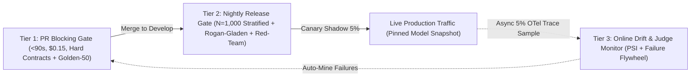

# Production AI CI/CD Gates, Shadow Canary Evals & Silent Model-Drift Monitoring

```json pretraining
[
  {
    "term": "3-Tier Eval Economics",
    "formula": "Tier1 (<90s PR) → Tier2 (Nightly) → Tier3 (Prod)",
    "meaning": "Balancing developer velocity, API token spend, and statistical power across fast PR smoke checks, full calibrated nightly suites, and async production sampling."
  },
  {
    "term": "Population Stability Index (PSI)",
    "formula": "Σ (p_i - q_i) · ln(p_i / q_i)",
    "meaning": "Quantifies distributional shift in query embeddings, retrieval similarity scores, output lengths, or refusal rates; PSI >= 0.25 signals severe production drift."
  },
  {
    "term": "Silent Upstream Checkpoint Drift",
    "formula": "Pinned Canary Hash ≠ Live Logits",
    "meaning": "Closed-weight API aliases (e.g., `gpt-4o` or `claude-sonnet`) can shift behavior silently behind the scenes unless pinned by dated snapshot ID and monitored via daily canary probes."
  },
  {
    "term": "Async Shadow Canary Replay",
    "formula": "0ms User-Path Latency Impact",
    "meaning": "Mirroring 5% of sanitized live traffic asynchronously to evaluate prompt/model upgrades side-by-side before shifting live customer routing."
  }
]
```

```json poe
{
  "question": "Your team pushed ZERO Git commits over the weekend, yet Monday morning customer-support escalations spike 3x and average response token length dropped by 42%. What are the two most likely root causes in a production RAG/Agent system, and how does your observability layer pinpoint which one occurred within 60 seconds?",
  "options": [
    "GitHub Actions deleted your historical test logs",
    "Either (1) Data/Corpus Drift (an ingestion job broke chunking or user query topics shifted, visible via Retrieval Cosine PSI >= 0.25) OR (2) Silent Model-Provider Drift on an unpinned model alias (visible via daily frozen Canary-20 probe drift despite identical retrieved context)",
    "TCP ports reset every Sunday at midnight UTC",
    "Python garbage collection shortened string buffers"
  ],
  "answerIndex": 1,
  "explanation": "Unlike traditional deterministic binaries, AI systems change behavior with ZERO code deploys whenever upstream knowledge bases re-index, real-world user queries shift (seasonal/incident spikes), or unpinned SaaS LLM endpoints update quantization/routing weights."
}
```

## Part I — Why Traditional CI/CD Alone Cannot Protect Production AI

In classical microservices, if a binary passes CI on Friday and zero commits merge over the weekend, Monday's binary behaves identically (modulo infrastructure outages). In production AI engineering, **three external moving parts mutate without a single Git commit**:
1. **Live Corpus & Index Drift**: Confluent/Notion/S3 ingestion pipelines sync thousands of updated docs nightly—a malformed PDF table parser or expired auth token can silently wipe out retrieval recall.
2. **Input Query Distribution Shift (`Covariate Shift`)**: A newly launched product tier or breaking news event sends user queries into unrepresented embedding regions (`PSI >= 0.25`).
3. **Model Provider Weight / Routing Drift**: Calling floating aliases (`model="gpt-4o-latest"`) exposes production to silent provider updates, safety-filter tightenings, or `INT4`/`FP8` quantization changes.

To govern both code changes and post-deploy drift without bankrupting API budgets or slowing PR merges to 45 minutes, Staff Platform Architects deploy a **3-Tier Closed-Loop Quality Architecture**:



---

## Part II — The 3-Tier AI Quality Pipeline Specification

```json contrast
{
  "title": "Enterprise AI CI/CD & Production Observability",
  "naiveTitle": "Monolithic Slow Eval or Ship-and-Pray",
  "naiveMetric": "42m PR Queue · Blind to Weekend Drift",
  "naivePoints": [
    "Either runs 0 evals in CI or runs 1,000 sequential LLM calls on every PR commit ($18/commit, 42m wait)",
    "Calls synchronous LLM-as-a-Judge inline on the live user HTTP path (+2.4s P99 latency!)",
    "Uses floating unpinned model aliases ('latest') in production configs",
    "Never feeds production thumbs-down traces back into the offline Golden Dataset"
  ],
  "staffTitle": "3-Tier Funnel + Async OTel Sampling + Flywheel",
  "staffMetric": "68s PR Gate · 0ms User Latency · Auto-Drift Alerts",
  "staffPoints": [
    "Tier 1 (PR, <90s): 100% deterministic unit/schema/Mock-MCP tests + cached Golden-50 critical smoke slice",
    "Tier 2 (Nightly / Pre-Prod): N=1,000 stratified Rogan-Gladen eval + bidirectional swap + OWASP red-team suite",
    "Tier 3 (Online Async): Samples 5% of OpenTelemetry traces off-critical-path (0ms user latency) for RAG Triad & PSI drift",
    "Pins dated model snapshots + runs hourly frozen Canary-20 probes to detect provider-side drift immediately"
  ]
}
```

### Architectural Budget & SLA Table Across All 3 Tiers

| Pipeline Tier | Trigger Cadence | Sample Scope | Wall-Clock SLA & Cost | Hard Blocking / Pager Criteria |
| :--- | :--- | :--- | :--- | :--- |
| **Tier 1: PR Gate** | Every Pull Request commit | Mock-MCP unit tests + `Golden-50` high-severity strata (32-way async concurrency) | **$< 90\text{s}$** · $<\$0.25$/run | $100\%$ schema/citation/canary pass; zero regression $>1$ case on paired `Golden-50` |
| **Tier 2: Release / Nightly** | Pre-release & Nightly `02:00 UTC` | Full `N=1,000` Stratified Golden + `250` Red-Team + Metamorphic pairs | **$12–18\text{ min}$** · $\sim\$4.50$/run | Rogan-Gladen $\hat{\theta}$ $95\%$ lower bound $\ge \text{SLA}$ per stratum; $\text{ASR} \le 1.0\%$; $\text{FRR} \le 2.5\%$ |
| **Tier 3: Production Async Monitor** | Continuous (`5%` OTel trace reservoir + `100%` thumbs-down) | Live anonymized RAG/Agent spans (`gen_ai.*` OpenTelemetry attributes) | **$0\text{ ms}$ user path** (Async Kafka/worker queue) | Retrieval Top-1 Cosine $\text{PSI} \ge 0.20$, Abstention spike $> 2\sigma$, or Frozen Canary-20 output shift |

---

## Part III — Production Implementation Blueprints (Python 3 & Java 17)

### Python 3 Blueprint: Population Stability Index (`PSI`) Drift Detector & Tier-Gate Controller
```python
import math


def compute_psi(baseline_props: list[float], current_props: list[float], eps: float = 1e-6) -> float:
    """
    Computes Population Stability Index across K histogram buckets (e.g., Retrieval Top-1 Cosine deciles).
    PSI < 0.10: Stable | 0.10..0.25: Moderate Drift (Warn) | >= 0.25: Severe Shift (Page On-Call).
    """
    if len(baseline_props) != len(current_props) or not baseline_props:
        raise ValueError("Bucket distributions must have identical non-zero length")
    psi = 0.0
    for p_base, q_curr in zip(baseline_props, current_props):
        p = max(eps, p_base)
        q = max(eps, q_curr)
        psi += (q - p) * math.log(q / p)
    return round(psi, 4)


def mcnemar_paired_regression_z(
    baseline_verdicts: list[bool],
    candidate_verdicts: list[bool],
) -> dict:
    """
    Paired comparison on identical Golden fixtures has 3x-5x higher statistical power than unpaired averages!
    b = passed in baseline, failed in candidate (regressions)
    c = failed in baseline, passed in candidate (improvements)
    """
    assert len(baseline_verdicts) == len(candidate_verdicts)
    regressions_b = sum(1 for b0, c1 in zip(baseline_verdicts, candidate_verdicts) if b0 and not c1)
    improvements_c = sum(1 for b0, c1 in zip(baseline_verdicts, candidate_verdicts) if (not b0) and c1)
    discordant = regressions_b + improvements_c
    if discordant == 0:
        return {"regressions": 0, "improvements": 0, "zStat": 0.0, "significantRegression": False}

    # Signed z-statistic: positive means net regressions exceed improvements
    z_stat = (regressions_b - improvements_c) / math.sqrt(discordant)
    return {
        "regressions": regressions_b,
        "improvements": improvements_c,
        "zStat": round(z_stat, 3),
        "significantRegression": z_stat >= 1.96,
    }
```

### Java 17 Blueprint: Async Shadow Trace Sampler & PSI Drift Alerter
```java
import java.util.List;

public final class AiDriftMonitor {
    public enum DriftSeverity { STABLE, WARN_MODERATE_SHIFT, CRITICAL_DRIFT_PAGE }

    public record DriftReport(double psi, DriftSeverity severity, boolean canaryMismatch) {}

    public static DriftReport evaluateTelemetryWindow(
            double[] baselineHist, double[] liveHist, String expectedCanaryHash, String liveCanaryHash) {
        if (baselineHist.length != liveHist.length || baselineHist.length == 0) {
            throw new IllegalArgumentException("Invalid histogram buckets");
        }
        double eps = 1e-6;
        double psi = 0.0;
        for (int i = 0; i < baselineHist.length; i++) {
            double p = Math.max(eps, baselineHist[i]);
            double q = Math.max(eps, liveHist[i]);
            psi += (q - p) * Math.log(q / p);
        }
        boolean providerShifted = !expectedCanaryHash.equals(liveCanaryHash);
        DriftSeverity sev = (psi >= 0.25 || providerShifted)
                ? DriftSeverity.CRITICAL_DRIFT_PAGE
                : (psi >= 0.10 ? DriftSeverity.WARN_MODERATE_SHIFT : DriftSeverity.STABLE);
        return new DriftReport(Math.round(psi * 10000.0) / 10000.0, sev, providerShifted);
    }

    /** Deterministic hash-based reservoir decision: samples 100% of thumbs-down + 5% of normal traces. */
    public static boolean shouldEnqueueForAsyncJudge(String traceId, boolean userThumbsDown, double sampleRate) {
        if (userThumbsDown) return true;
        int bucket = Math.floorMod(traceId.hashCode(), 10_000);
        return bucket < (int) (sampleRate * 10_000);
    }
}
```

> [!WARNING]
> **Staff Interview Gotcha — Never Run Heavy LLM-as-a-Judge Calls Synchronously on the Critical User Response Path**:
> Candidates often propose *"Before returning the RAG answer to the user, we call GPT-4o Judge to check faithfulness."* That doubles API cost (`100%` traffic!) and adds **$1.5\text{s}–3.5\text{s}$ to $P_{99}$ Time-To-First-Token (`TTFT`)**! On the synchronous online hot path, run **only** sub-$50\text{ms}$ deterministic regex/PII/URL gates and lightweight `DeBERTa` NLI cross-encoders; run full LLM-as-a-Judge asynchronously out-of-band on `5%` sampled OpenTelemetry traces + `100%` negative-feedback traces!

---

## Part IV — End-of-Chapter Mastery Check

```json quiz
[
  {
    "id": "aiqa-10-q1",
    "question": "Why should online LLM-as-a-Judge evaluation run asynchronously on a 5% OpenTelemetry trace stream (plus 100% of thumbs-down/escalated traces) rather than synchronously blocking every live user HTTP response?",
    "options": [
      "Because OpenTelemetry spans cannot store strings longer than 64 bytes",
      "Because synchronous frontier-LLM judging adds 1.5s–4.0s to user-facing P99 latency, doubles token spend, and creates a cascading single point of failure; fast deterministic/NLI guards protect the synchronous hot path while async trace judging drives drift alerts and Golden Flywheel curation at 5% cost",
      "Because HTTP/2 forbids two API calls inside one handler",
      "Because async workers bypass rate limits"
    ],
    "answerIndex": 1,
    "explanation": "Keep synchronous inline guardrails fast (<50ms deterministic + small cross-encoder) and offload expensive rubric judges to asynchronous background consumers."
  },
  {
    "id": "aiqa-10-q2",
    "question": "Why does comparing a PR candidate against the main-branch baseline using McNemar's Paired Test on the exact same Golden fixtures detect regressions much more reliably than comparing two independent aggregate pass-rate numbers?",
    "options": [
      "Because McNemar's test ignores all failed test cases",
      "Because paired item-by-item comparison cancels out shared item-difficulty variance across easy vs hard questions, isolating only the discordant pairs (regressions b vs improvements c) for 3x–5x higher statistical sensitivity",
      "Because unpaired averages require floating-point GPUs",
      "Because McNemar's test sets temperature=1.0"
    ],
    "answerIndex": 1,
    "explanation": "Item-level pairing eliminates variance caused by baseline difficulty differences across strata, directly testing whether previously passing Golden cases broke."
  },
  {
    "id": "aiqa-10-q3",
    "question": "How do you distinguish 'Upstream SaaS Model Checkpoint Drift' from 'Corpus / User Query Shift' when production RAG quality suddenly drops with zero Git deployments?",
    "options": [
      "Restart the Kubernetes pods and check CPU usage",
      "Pin dated model snapshot IDs AND run a scheduled Frozen Canary-20 probe (fixed queries + fixed frozen context chunks); if Frozen Canary outputs/logits shift, the model provider changed behavior—whereas if Frozen Canary stays flat while live Retrieval Cosine PSI >= 0.25, corpus or user query distribution shifted",
      "Delete the vector database and re-embed everything",
      "Switch from JSON to YAML configuration files"
    ],
    "answerIndex": 1,
    "explanation": "Holding both query and context strictly constant in a Frozen Canary isolates upstream model/inference changes from live retrieval or traffic distribution drift."
  }
]
```
