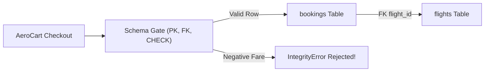

# Day-0 Relational Schemas, Keys, Integer Cents & Three-Valued NULL Traps

```json continuity
{
  "previously": "Welcome to Day 1 of Course 09! Zero prior SQL or database administration background is required.",
  "painPoint": "AeroCart originally stored flight bookings inside loose JSON files—allowing negative ticket prices, orphaned passengers pointing to deleted flights, $0.01 floating-point rounding drift, and silent QA filter misses whenever a promo_code was NULL.",
  "unlock": "Launch AeroLedger v0.1 with declarative Primary/Foreign/Check constraints, integer-cents monetary safety, parameterized queries, and rock-solid three-valued NULL assertions."
}
```

```json walkthrough
[
  {
    "time": "0:00",
    "badge": "Day-0 Mental Model",
    "title": "Spreadsheets Allow Chaos; Schemas Enforce Law at the Door",
    "caption": "A CSV or loose JSON file lets bugs write negative fares or nonexistent flight IDs. A relational table acts like an airport customs gate: every row must show a unique Primary Key passport, valid Foreign Key flight link, and non-negative Check constraint before entry.",
    "nodes": ["App / Test", "Schema Gate (PK/FK/CHECK)", "flights Table", "bookings Table"],
    "activeIndex": 1,
    "code": "CREATE TABLE bookings (\n  booking_id TEXT PRIMARY KEY,\n  flight_id  TEXT NOT NULL REFERENCES flights(flight_id),\n  fare_cents INTEGER NOT NULL CHECK (fare_cents >= 0)\n);"
  },
  {
    "time": "0:24",
    "badge": "Starter & CLI",
    "title": "Run SQL Locally in Zero Seconds & Bind Parameters Safely",
    "caption": "Every macOS and Linux machine ships with sqlite3 and Python's sqlite3 module pre-installed, while Docker boots PostgreSQL 17 in one command. Always bind user inputs with `?` or `$1` placeholders—never string formatting!",
    "nodes": ["Terminal CLI", "Parameterized ? / $1", "AeroLedger v0.1", "Verified Row"],
    "activeIndex": 2,
    "code": "cur.execute(\n  'INSERT INTO bookings VALUES (?, ?, ?, ?)',\n  ('BK-101', 'AI-302', 44980, None)\n)"
  },
  {
    "time": "0:50",
    "badge": "The NULL Trap",
    "title": "Why `WHERE promo_code != 'VIP20'` Silently Drops Undiscounted Tickets",
    "caption": "In SQL, NULL does not mean empty string—it means UNKNOWN. Comparing NULL != 'VIP20' evaluates to UNKNOWN, which WHERE filters discard! Use IS DISTINCT FROM or COALESCE so QA assertions never miss NULL rows.",
    "nodes": ["100 Bookings", "80 NULL Promo", "!= 'VIP20' (Drops 80!)", "IS DISTINCT FROM (Keeps 80!)"],
    "activeIndex": 3,
    "code": "-- Safe in PostgreSQL 17 & SQLite 3.39+:\nSELECT COUNT(*) FROM bookings\nWHERE promo_code IS DISTINCT FROM 'VIP20';"
  },
  {
    "time": "1:15",
    "badge": "Big Tech Scale",
    "title": "How Stripe & Airline Ledgers Store Money as Integer Minor Units",
    "caption": "In IEEE-754 binary floats, 0.10 + 0.20 equals 0.30000000000000004. Payment and airline systems store exact integer minor units (fare_cents BIGINT + ISO currency code) or exact base-10 NUMERIC.",
    "nodes": ["Float Drift", "BIGINT Cents + Currency", "CHECK Invariants", "Zero-Drift Ledger"],
    "activeIndex": 3,
    "code": "fare_cents BIGINT NOT NULL CHECK (fare_cents >= 0),\ncurrency   CHAR(3) NOT NULL DEFAULT 'USD'"
  }
]
```

```json pretraining
[
  {
    "term": "Primary Key vs. Foreign Key",
    "formula": "PK = Unique Row Identity · FK = Verified Parent Link",
    "meaning": "A Primary Key uniquely identifies every row (like a booking reference), while a Foreign Key guarantees a column points to a real row in another table (preventing bookings on imaginary flights)."
  },
  {
    "term": "Integer Minor Units (Cents / Paise)",
    "formula": "$449.80 -> 44980 integer cents",
    "meaning": "Storing money as whole cents (or paise) instead of binary floating-point numbers so addition and tax assertions never suffer from 0.30000000000000004 rounding bugs."
  },
  {
    "term": "Three-Valued Logic (3VL)",
    "formula": "TRUE · FALSE · UNKNOWN (NULL)",
    "meaning": "Because NULL means 'unknown value' in SQL, both `NULL = 'VIP'` and `NULL != 'VIP'` evaluate to UNKNOWN—causing a `WHERE` clause to silently skip those rows unless you use `IS NULL` or `IS DISTINCT FROM`."
  },
  {
    "term": "Parameterized Query (Prepared Statement)",
    "formula": "SQL Template + Separate Data Tuple",
    "meaning": "Sending SQL structure (`WHERE id = ?`) separately from input values so an attacker or malformed test string (`' OR 1=1 --`) can never rewrite query logic."
  }
]
```

## 🌱 Step 1: Plain-English Mental Model — Tables as Airport Customs Gates

Imagine tracking 50,000 daily `AeroCart` flight bookings inside a shared spreadsheet. Nothing stops a buggy microservice from typing `-500` as a ticket fare, spelling a flight code `"AI-9999"` that does not exist, or leaving a passenger email blank. By the time a QA test notices, corrupt data has already poisoned downstream billing reports.

A **relational database** (`PostgreSQL` in production, `SQLite` in fast local harnesses) replaces that lawless spreadsheet with **strict tables guarded at write time**. Every column declares its exact data type, and declarative **constraints** reject bad writes *before* a single byte hits disk:



Notice two life-saving guarantees right away:
1. **Data integrity lives in the storage engine, not just application `if` statements**: Even if ten different Python and Java microservices write to `bookings`, none of them can bypass `CHECK (fare_cents >= 0)` or insert an orphan `flight_id`.
2. **Money is stored as whole cents (`44980`), never binary floats (`449.80`)**: Computers represent binary floats inaccurately (`0.1 + 0.2 = 0.30000000000000004`), so storing integer cents keeps every financial assertion exact to the penny.

---

## 🔨 Step 2: Zero-to-Running Starter & CLI — Booting `AeroLedger v0.1`

You do not need a cloud account to practice real SQL. Every macOS/Linux terminal already includes `sqlite3` and `python3`, and Docker launches `PostgreSQL 17` whenever you want production parity:

```bash
# Option A: Instant zero-install interactive SQL shell (SQLite)
sqlite3 :memory: "SELECT sqlite_version();"

# Option B: Production PostgreSQL 17 container in one command (when Docker is running)
docker run --rm --name aeroledger-pg -e POSTGRES_PASSWORD=aeropass -p 5432:5432 -d postgres:17
```

Let's build **`AeroLedger v0.1`** (`flights` + `bookings`) with Foreign Keys enabled, parameterized inserts, and our first schema constraint test:

```python
from __future__ import annotations
import sqlite3

# Subgoal 1: Open an isolated database and explicitly enforce Foreign Key checks
conn = sqlite3.connect(":memory:")
conn.execute("PRAGMA foreign_keys = ON;")

# Subgoal 2: Define strict tables using integer cents and CHECK constraints
conn.executescript("""
    CREATE TABLE flights (
        flight_id TEXT PRIMARY KEY,
        origin    TEXT NOT NULL,
        dest      TEXT NOT NULL
    );
    CREATE TABLE bookings (
        booking_id TEXT PRIMARY KEY,
        flight_id  TEXT NOT NULL REFERENCES flights(flight_id),
        fare_cents INTEGER NOT NULL CHECK (fare_cents >= 0),
        promo_code TEXT
    );
""")

# Subgoal 3: Insert rows using parameterized '?' placeholders (never f-strings!)
conn.execute("INSERT INTO flights VALUES (?, ?, ?)", ("AI-302", "BLR", "SFO"))
conn.execute("INSERT INTO bookings VALUES (?, ?, ?, ?)", ("BK-101", "AI-302", 44980, None))
conn.commit()

row = conn.execute("SELECT booking_id, fare_cents FROM bookings WHERE booking_id = ?", ("BK-101",)).fetchone()
assert row == ("BK-101", 44980)
print(f"AeroLedger v0.1 verified: {row[0]} -> ${row[1] / 100:.2f}")
```

### Java 17 Equivalent

```java
import java.sql.*;

public class AeroLedgerV01Starter {
    public static void main(String[] args) throws SQLException {
        // Subgoal 1: Standard JDBC template (works identically with PostgreSQL or SQLite JDBC)
        String createSql = """
            CREATE TABLE IF NOT EXISTS bookings (
                booking_id VARCHAR(32) PRIMARY KEY,
                flight_id  VARCHAR(16) NOT NULL,
                fare_cents BIGINT NOT NULL CHECK (fare_cents >= 0),
                promo_code VARCHAR(32)
            )
            """;
        // Subgoal 2: Bind parameters via PreparedStatement (?) to prevent SQL injection
        String insertSql = "INSERT INTO bookings (booking_id, flight_id, fare_cents, promo_code) VALUES (?, ?, ?, ?)";
        assert createSql.contains("CHECK (fare_cents >= 0)") && insertSql.contains("?");
    }

    public static void insertBooking(Connection conn, String id, String flightId, long fareCents) throws SQLException {
        conn.setAutoCommit(false);
        try (PreparedStatement ps = conn.prepareStatement(
                "INSERT INTO bookings (booking_id, flight_id, fare_cents, promo_code) VALUES (?, ?, ?, ?)")) {
            ps.setString(1, id);
            ps.setString(2, flightId);
            ps.setLong(3, fareCents);
            ps.setNull(4, Types.VARCHAR);
            ps.executeUpdate();
            conn.commit();
        }
    }
}
```

**Quick Starter Walkthrough:**
- **Why `PRAGMA foreign_keys = ON`?** For backwards compatibility from the early 2000s, SQLite parses `REFERENCES` clauses by default *without* enforcing them until you run `PRAGMA foreign_keys = ON;` on each connection! (`PostgreSQL 17` enforces Foreign Keys automatically out of the box.)
- **Why `?` (or `$1` in PostgreSQL `psycopg`)?** The SQL parser compiles the query tree *before* substituting parameter bytes, making SQL injection (`' OR '1'='1`) structurally impossible.

---

## 🛠️ Step 3: Everyday Practitioner Workflows & Where Naive Code Breaks

In day-to-day QA and backend work, you constantly inspect schemas and verify rows after API calls:
- **In `psql` (PostgreSQL CLI)**: `\dt` lists tables, `\d+ bookings` shows columns, indexes, and `CHECK` constraints, and `\x auto` formats wide rows vertically for easy terminal reading.
- **In `sqlite3` CLI**: `.tables` lists tables, `.schema bookings` prints exact DDL, and `.mode box` renders crisp Unicode tables.

### Where Naive SQL Assertions Break: Three-Valued `NULL` Logic (`3VL`)

Suppose `AeroCart` runs a flash promotion `'VIP20'`. Out of `3` bookings in staging:
- `BK-101` has `promo_code = NULL` (regular passenger, no coupon entered).
- `BK-102` has `promo_code = NULL` (regular passenger).
- `BK-103` has `promo_code = 'VIP20'`.

A QA engineer writes an assertion to count all non-VIP bookings:
`SELECT COUNT(*) FROM bookings WHERE promo_code != 'VIP20';`
Instead of returning `2`, the database returns **`0`**! Because `NULL` means *Unknown*, `NULL != 'VIP20'` evaluates to **`UNKNOWN`**, and SQL's `WHERE` clause **only keeps rows that evaluate to `TRUE`**.

```json contrast
{
  "title": "Filtering Nullable Columns in QA & Backend Queries",
  "leftLabel": "❌ Naive SQL (`!=` Drops All NULLs!)",
  "leftCode": "-- Returns 0 instead of 2 when promo_code is NULL!\nSELECT COUNT(*) FROM bookings\nWHERE promo_code != 'VIP20';\n\n-- Also broken (always returns 0 rows!):\nSELECT * FROM bookings WHERE promo_code = NULL;",
  "rightLabel": "✅ Staff SQL (`IS DISTINCT FROM` / `COALESCE`)",
  "rightCode": "-- Treats NULL safely as a distinct comparable state:\nSELECT COUNT(*) FROM bookings\nWHERE promo_code IS DISTINCT FROM 'VIP20';\n\n-- Explicit NULL check:\nSELECT * FROM bookings WHERE promo_code IS NULL;"
}
```

```json poe
{
  "question": "Before running the simulator: a `bookings` table has 10 rows—7 with `promo_code = NULL`, 2 with `'SAVE10'`, and 1 with `'VIP20'`. What does `SELECT COUNT(*) FROM bookings WHERE promo_code <> 'VIP20'` return?",
  "options": [
    "9, because 7 NULL rows plus 2 'SAVE10' rows do not equal 'VIP20'",
    "2, because `NULL <> 'VIP20'` evaluates to UNKNOWN and `WHERE` discards UNKNOWN rows",
    "10, because `<>` only filters exact case-insensitive matches",
    "An IntegrityError exception at runtime"
  ],
  "answerIndex": 1,
  "explanation": "In ANSI SQL three-valued logic (PostgreSQL, MySQL, Oracle, SQLite), any equality or inequality (`=`, `!=`, `<>`) against `NULL` yields `UNKNOWN`. Only the 2 `'SAVE10'` rows evaluate to `TRUE`. Using `promo_code IS DISTINCT FROM 'VIP20'` properly returns `9`!"
}
```

---

## 🏢 Step 4: How Big Tech Runs It at Scale, Staff Math & Production Blueprint

### 🏢 In the Wild: Stripe & Airline Reservation Schema Hygiene

Across **Stripe's Payment Intents** and **Amadeus/Sabre Airline GDS** schemas, three schema rules are enforced via automated CI linters on every pull request:
1. **Integer Minor Units + Explicit Currency (`amount_cents BIGINT` + `currency CHAR(3)`)**: Because Japanese Yen (`JPY`) is zero-decimal (`¥500 = 500`) while US Dollars (`USD`) is two-decimal (`$5.00 = 500`) and Kuwaiti Dinar (`KWD`) is three-decimal, storing `BIGINT` minor units paired with an ISO-4217 currency column prevents silent multi-currency rounding loss across 135+ currencies.
2. **`NOT NULL` by Default**: Nullable columns multiply test state combinations exponentially. Every column is declared `NOT NULL` unless absence has a true domain meaning (such as `cancelled_at TIMESTAMPTZ NULL`).
3. **SQLite `STRICT` Mode in Local CI (`SQLite 3.37+`)**: Historically, SQLite used "type affinity" that allowed inserting the string `"banana"` into an `INTEGER` column! Appending `STRICT` to `CREATE TABLE ... (...) STRICT;` makes local SQLite tests enforce strict column typing just like `PostgreSQL 17`.

### Staff Representation & Combinatorial Math

Why does binary `FLOAT`/`DOUBLE` corrupt financial assertions? In base-2 IEEE-754 floating point, $0.1_{10}$ has an infinite repeating binary fraction, yielding representation drift:

$$\text{IEEE-754}(0.10) + \text{IEEE-754}(0.20) - 0.30 = 5.551115123 \times 10^{-17} \neq 0$$

Meanwhile, adding $k$ nullable columns to a table expands the three-valued truth-table test surface from $2^k$ to $3^k$:

$$\text{Predicate States}(k) = 3^k \quad (\text{TRUE}, \text{FALSE}, \text{UNKNOWN per nullable predicate})$$

| Money / ID Storage Choice | Precision | CPU Arithmetic Speed | When to Use / When NOT to Use |
| :--- | :--- | :--- | :--- |
| **`BIGINT` Minor Units (`fare_cents`)** | **100% Exact** | **Fastest (1 CPU cycle)** | **Default for Checkout, Wallets & Tickets**. Pair with `currency CHAR(3)`. |
| **`NUMERIC(19, 4)` / `DECIMAL`** | **100% Exact (Base-10)** | Moderate (Software BCD) | **Required for FX rates, crypto, or sub-cent tax fractions** (`$0.0045`/token). |
| **`DOUBLE PRECISION` / `FLOAT`** | **Inexact (Base-2)** | Fast | **NEVER for money!** Only for ML embeddings, geospatial lat/lon, or telemetry. |

### Production Blueprint: `AeroLedger v0.1` Schema & Constraint Contract Verifier

```python
from __future__ import annotations
import sqlite3
from dataclasses import dataclass


@dataclass(frozen=True)
class BookingRecord:
    booking_id: str
    flight_id: str
    fare_cents: int
    currency: str
    promo_code: str | None = None


class AeroLedgerSchemaGate:
    """Production-grade schema & 3VL assertion harness (SQLite STRICT / PostgreSQL 17 compatible)."""

    def __init__(self) -> None:
        self.conn = sqlite3.connect(":memory:")
        self.conn.execute("PRAGMA foreign_keys = ON;")
        self._bootstrap_schema()

    def _bootstrap_schema(self) -> None:
        self.conn.executescript("""
            CREATE TABLE flights (
                flight_id TEXT PRIMARY KEY,
                capacity  INTEGER NOT NULL CHECK (capacity > 0)
            ) STRICT;

            CREATE TABLE bookings (
                booking_id TEXT PRIMARY KEY,
                flight_id  TEXT NOT NULL REFERENCES flights(flight_id),
                fare_cents INTEGER NOT NULL CHECK (fare_cents >= 0),
                currency   TEXT NOT NULL CHECK (LENGTH(currency) = 3),
                promo_code TEXT
            ) STRICT;
        """)

    def seed_flight(self, flight_id: str, capacity: int) -> None:
        self.conn.execute("INSERT INTO flights VALUES (?, ?)", (flight_id, capacity))
        self.conn.commit()

    def create_booking(self, rec: BookingRecord) -> None:
        self.conn.execute(
            "INSERT INTO bookings VALUES (?, ?, ?, ?, ?)",
            (rec.booking_id, rec.flight_id, rec.fare_cents, rec.currency, rec.promo_code),
        )
        self.conn.commit()

    def count_non_promo_bookings(self, excluded_promo: str) -> int:
        # Null-safe IS NOT / IS DISTINCT FROM comparison (SQLite & PostgreSQL ANSI standard)
        cur = self.conn.execute(
            "SELECT COUNT(*) FROM bookings WHERE promo_code IS NOT ?",
            (excluded_promo,),
        )
        return int(cur.fetchone()[0])


if __name__ == "__main__":
    gate = AeroLedgerSchemaGate()
    gate.seed_flight("AI-302", capacity=180)
    gate.create_booking(BookingRecord("BK-1", "AI-302", 44980, "USD", None))
    gate.create_booking(BookingRecord("BK-2", "AI-302", 35984, "USD", "VIP20"))

    # Verify CHECK constraint deterministically blocks negative fares
    rejected_negative = False
    try:
        gate.create_booking(BookingRecord("BK-BAD", "AI-302", -100, "USD", None))
    except sqlite3.IntegrityError:
        rejected_negative = True

    assert rejected_negative, "Schema MUST reject negative fare_cents!"
    assert gate.count_non_promo_bookings("VIP20") == 1
```

### Java 17 Equivalent

```java
import java.sql.*;

public final class AeroLedgerSchemaVerifier {
    public static int countBookingsExcludingPromo(Connection conn, String excludedPromo) throws SQLException {
        // PostgreSQL 17 standard null-safe comparison: IS DISTINCT FROM ?
        String sql = "SELECT COUNT(*) FROM bookings WHERE promo_code IS DISTINCT FROM ?";
        try (PreparedStatement ps = conn.prepareStatement(sql)) {
            ps.setString(1, excludedPromo);
            try (ResultSet rs = ps.executeQuery()) {
                return rs.next() ? rs.getInt(1) : 0;
            }
        }
    }

    public static void assertNegativeFareRejected(Statement stmt) throws SQLException {
        try {
            stmt.executeUpdate("INSERT INTO bookings VALUES ('BK-BAD', 'AI-302', -50, 'USD', NULL)");
            throw new AssertionError("Expected SQLException from CHECK (fare_cents >= 0)");
        } catch (SQLException expected) {
            // Expected declarative database constraint violation
        }
    }
}
```

> [!WARNING]
> **Hiring Bar-Raiser Gotcha — `UNIQUE` Columns Allow Multiple `NULL`s by Default!**
> In both `PostgreSQL` and `SQLite`, a standard `UNIQUE (external_ref)` constraint allows inserting **hundreds of rows where `external_ref IS NULL`** because `NULL != NULL` under three-valued logic! In PostgreSQL 15+, if at most one `NULL` should ever be permitted—or if a composite unique key like `(tenant_id, deleted_at)` must treat `NULL` as equal so soft-deleted active rows cannot duplicate—you MUST explicitly write **`UNIQUE NULLS NOT DISTINCT (tenant_id, email, deleted_at)`**!

*Up Next in Chapter 02*: Now that `flights` and `bookings` enforce clean single-table laws, we add `baggage_items` and `payments`—and uncover how a seemingly innocent `LEFT JOIN` silently triples `SUM(fare_cents)` in QA reports!

```json quiz
[
  {
    "id": "sql01-q1",
    "question": "In PostgreSQL 17, a `users` table has `referral_code TEXT NULL`. Out of 1,000 rows, 900 have `referral_code = NULL`, 60 have `'PARTNER'`, and 40 have `'STAFF'`. How many rows are returned by `SELECT * FROM users WHERE referral_code != 'STAFF'`?",
    "options": [
      "960 rows",
      "60 rows, because `NULL != 'STAFF'` evaluates to `UNKNOWN` and `WHERE` filters out `UNKNOWN`",
      "900 rows",
      "0 rows due to a type mismatch error"
    ],
    "answerIndex": 1,
    "explanation": "Under SQL's three-valued logic, `NULL != 'STAFF'` yields `UNKNOWN`, leaving only the 60 `'PARTNER'` rows. Use `WHERE referral_code IS DISTINCT FROM 'STAFF'` to get all 960 non-staff users."
  },
  {
    "id": "sql01-q2",
    "question": "Why do Stripe and airline ticketing databases avoid `DOUBLE PRECISION` (`FLOAT8`) for storing ticket prices?",
    "options": [
      "Floating-point columns cannot be indexed by B+Trees",
      "Base-2 IEEE-754 floats cannot represent base-10 decimals like `0.10` or `0.20` exactly, causing cumulative rounding drift across sums and refunds",
      "PostgreSQL does not support arithmetic operators on `FLOAT8`",
      "`FLOAT8` uses 64 megabytes per row"
    ],
    "answerIndex": 1,
    "explanation": "Binary floating point approximates decimal fractions (`0.1 + 0.2 = 0.30000000000000004`). Storing `BIGINT` minor units (`fare_cents`) or base-10 `NUMERIC(19,4)` guarantees exact decimal arithmetic."
  },
  {
    "id": "sql01-q3",
    "question": "You write a fast local schema test in Python `sqlite3` with `flight_id TEXT REFERENCES flights(flight_id)`, insert a booking for nonexistent flight `'GHOST-99'`, and the insert succeeds! Why?",
    "options": [
      "SQLite does not support Foreign Keys in any version",
      "SQLite disables Foreign Key enforcement per connection by default unless `PRAGMA foreign_keys = ON;` is executed",
      "Foreign Keys only apply to `INTEGER` columns",
      "`in-memory` databases ignore all `CHECK` and `PRIMARY KEY` constraints"
    ],
    "answerIndex": 1,
    "explanation": "For legacy backwards compatibility, SQLite requires `PRAGMA foreign_keys = ON;` on every new database connection to actively enforce `REFERENCES` constraints."
  }
]
```

---

## 📋 Step 5: Master Cheat-Sheet, 60-Second Interview Pitch & Verified Sources

| Capability / Guardrail | PostgreSQL 17 | SQLite 3.39+ (Local CI) | Python 3 / Java 17 Driver Best Practice |
| :--- | :--- | :--- | :--- |
| **Enforce Column Types** | Native strict typing | Append `STRICT` to `CREATE TABLE` | Bind typed `int`/`long`, never strings for money |
| **Enforce Foreign Keys** | Always ON by default | Run `PRAGMA foreign_keys = ON;` | Execute in connection-pool `init` hook |
| **Null-Safe Inequality** | `col IS DISTINCT FROM $1` | `col IS NOT ?` / `IS DISTINCT FROM` | Never write `col != ?` on nullable columns! |
| **Unique Including NULLs** | `UNIQUE NULLS NOT DISTINCT (a, b)` | Partial unique index on `COALESCE` | Test duplicate soft-delete (`deleted_at IS NULL`) |
| **Parameterized Binding** | `psycopg`: `%s` or `$1` | `sqlite3`: `?` or `:name` | `PreparedStatement.setLong(idx, val)` |

### 🎙️ 60-Second Interview Soundbite

> *"When I design or audit a transactional schema—whether for airline bookings or fintech wallets—I enforce invariants at the storage boundary rather than trusting application code alone. First, money is stored as `BIGINT` minor units paired with a 3-letter ISO currency code—or `NUMERIC(19,4)` when sub-cent rates are required—eliminating IEEE-754 float drift. Second, columns default to `NOT NULL` with explicit `CHECK` and `FOREIGN KEY` constraints; and if soft-deletes exist in Postgres 15+, I use `UNIQUE NULLS NOT DISTINCT` or partial unique indexes because standard `UNIQUE` allows duplicate `NULL`s. Finally, in every QA verification query over nullable columns, I use `IS DISTINCT FROM` instead of `!=` so three-valued `UNKNOWN` predicates never silently hide buggy rows."*

### 📚 Verified Primary Sources
- [PostgreSQL 17 Official Docs — Constraints (`CHECK`, `UNIQUE NULLS NOT DISTINCT`, `FOREIGN KEY`)](https://www.postgresql.org/docs/current/ddl-constraints.html)
- [PostgreSQL 17 Official Docs — Comparison Predicates (`IS DISTINCT FROM` & Three-Valued Logic)](https://www.postgresql.org/docs/current/functions-comparison.html)
- [SQLite Official Documentation — `STRICT` Tables & Foreign Key Support](https://www.sqlite.org/stricttables.html)
