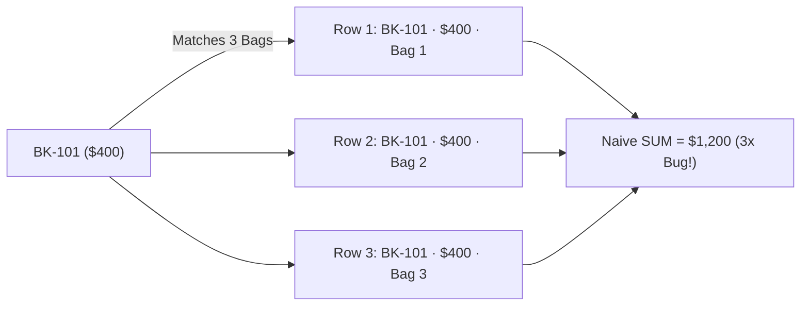

# Relational Joins, Anti-Joins, NOT IN Landmines & 1:N Fan-Out Traps

```json continuity
{
  "previously": "In Chapter 01, we built AeroLedger v0.1 with strict `flights` and `bookings` tables, integer-cent fares, parameterized queries, and null-safe `IS DISTINCT FROM` checks.",
  "painPoint": "When we added `baggage_items` (up to 3 bags per booking) and `refunds`, our nightly QA report joined `bookings LEFT JOIN baggage_items` and reported $1,200 in ticket revenue for a single $400 booking—while our `WHERE booking_id NOT IN (SELECT booking_id FROM refunds)` query returned ZERO rows the moment one test refund had a NULL booking_id!",
  "unlock": "Upgrade to AeroLedger v0.2: master INNER/LEFT/ANTI-JOIN semantics, replace fragile `NOT IN` with `NOT EXISTS`, and enforce 1-to-1 grain preservation so `1:N` joins never inflate `SUM()` or `COUNT()`."
}
```

```json walkthrough
[
  {
    "time": "0:00",
    "badge": "Join Mental Model",
    "title": "Matching Passenger Tickets to Checked Suitcases",
    "caption": "An INNER JOIN only shows bookings that checked at least one bag. A LEFT JOIN keeps every booking—filling bag columns with NULL for carry-on flyers. An Anti-Join (LEFT JOIN ... IS NULL or NOT EXISTS) finds bookings missing a payment or webhook!",
    "nodes": ["bookings (1 Row)", "baggage_items (3 Rows)", "LEFT JOIN (3 Combined Rows)", "NOT EXISTS (Orphan Finder)"],
    "activeIndex": 2,
    "code": "SELECT b.booking_id, bg.weight_kg\nFROM bookings b\nLEFT JOIN baggage_items bg ON bg.booking_id = b.booking_id;"
  },
  {
    "time": "0:25",
    "badge": "1:N Fan-Out Bug",
    "title": "Why Joining 1 Booking ($400) to 3 Bags Reports $1,200 Revenue",
    "caption": "When 1 parent row matches 3 child rows, SQL duplicates the parent columns 3 times before running SUM(b.fare_cents)! Always pre-aggregate child tables to 1 row per booking_id before joining.",
    "nodes": ["BK-101 ($400)", "3 Suitcase Rows", "Naive Join: 3 x $400 = $1,200!", "Pre-Agg Join: 1 x $400 = $400"],
    "activeIndex": 3,
    "code": "WITH bag_totals AS (\n  SELECT booking_id, COUNT(*) AS bags FROM baggage_items GROUP BY booking_id\n)\nSELECT SUM(b.fare_cents) FROM bookings b LEFT JOIN bag_totals USING (booking_id);"
  },
  {
    "time": "0:52",
    "badge": "NOT IN Landmine",
    "title": "One Single NULL Inside `NOT IN (...)` Wipes Out Your Entire Result Set",
    "caption": "`x NOT IN ('BK-1', NULL)` expands to `x != 'BK-1' AND x != NULL`, which is `TRUE AND UNKNOWN = UNKNOWN`—returning ZERO rows! Always use `NOT EXISTS` for reconciliation anti-joins.",
    "nodes": ["refunds has 1 NULL", "NOT IN -> 0 Rows!", "NOT EXISTS -> Exact Match", "QA Gate Saved"],
    "activeIndex": 2,
    "code": "SELECT b.booking_id FROM bookings b\nWHERE NOT EXISTS (\n  SELECT 1 FROM refunds r WHERE r.booking_id = b.booking_id\n);"
  },
  {
    "time": "1:18",
    "badge": "LEFT JOIN Filter Trap",
    "title": "Putting Right-Table Filters in `WHERE` Secretly Demotes `LEFT JOIN` to `INNER JOIN`",
    "caption": "Filtering `WHERE bg.weight_kg > 20` after a LEFT JOIN discards NULL carry-on rows! Put optional child filters inside the `ON` clause (`ON ... AND bg.weight_kg > 20`) to keep unmatched parents.",
    "nodes": ["LEFT JOIN", "Filter in WHERE (Drops NULLs)", "Filter in ON (Preserves Parents)", "Accurate Audit"],
    "activeIndex": 2,
    "code": "LEFT JOIN baggage_items bg\n  ON bg.booking_id = b.booking_id\n AND bg.weight_kg > 20  -- Keeps 0-bag flyers!"
  }
]
```

```json pretraining
[
  {
    "term": "Query Grain (Cardinality)",
    "formula": "What does 1 row represent? (1 Booking vs. 1 Bag)",
    "meaning": "The exact real-world entity represented by a single row in a table or query result. Mixing grains (1 booking joined to N bags) multiplies parent numbers."
  },
  {
    "term": "1:N Join Fan-Out (Chasm Trap)",
    "formula": "1 Parent x N Children = N Duplicated Parent Values",
    "meaning": "When a parent row ($400 ticket) matches 3 child rows (3 bags), the `$400` column repeats 3 times—causing `SUM(fare_cents)` to overcount by 3x."
  },
  {
    "term": "Anti-Join (`NOT EXISTS`)",
    "formula": "Rows in A with ZERO matching rows in B",
    "meaning": "The core Data-QA reconciliation pattern used to find orders missing an invoice, bookings missing a Kafka event, or users without an active session."
  },
  {
    "term": "Join Predicate vs. Post-Join Filter",
    "formula": "`ON` runs during matching · `WHERE` runs after joining",
    "meaning": "In a `LEFT JOIN`, conditions in `ON` decide which child rows attach while keeping all parent rows; conditions in `WHERE` filter the final table and delete `NULL`-padded parents."
  }
]
```

## 🌱 Step 1: Plain-English Mental Model — Matching Manifests Without Cloning Tickets

In Chapter 01 we kept `flights` and `bookings` in separate tables so we don't repeat flight origin/destination 180 times per plane. **Joining** simply stitches related rows back together side-by-side at read time using a shared key (`booking_id` or `flight_id`).

Think of an airport gate agent cross-checking two clipboards—**Clipboard A (`bookings`)** and **Clipboard B (`baggage_items`)**:
- **`INNER JOIN`**: Only list passengers who checked at least one bag (both clipboards must match).
- **`LEFT JOIN`**: List **every** passenger on Clipboard A; if they only brought a backpack, leave the suitcase columns blank (`NULL`).
- **Anti-Join (`NOT EXISTS`)**: List passengers on Clipboard A who are **completely missing** from Clipboard C (`payment_receipts`)—your #1 QA defect-hunting tool!



Look closely at the diagram above: when `BK-101` (`$400`) matches 3 suitcases, the joined output contains **3 rows**, and `$400` appears on every single one of them! Understanding **row grain** prevents 90% of broken analytics and reconciliation tests.

---

## 🔨 Step 2: Zero-to-Running Starter & CLI — Safe Joins & `NOT EXISTS` (`AeroLedger v0.2`)

Let's run a quick CLI check and then execute **`AeroLedger v0.2`** in Python 3 and Java 17 to prove both safe anti-joins and fan-out-free totals:

```bash
# Run a one-line SQLite fan-out vs CTE proof right from your terminal:
python3 frameworks/data-validation/01-sql-reconciliation-and-isolation/reference_solution.py
```

```python
from __future__ import annotations
import sqlite3

# Subgoal 1: Seed 2 bookings ($400 + $250 = $650) where BK-101 has 3 bags and BK-102 has 0 bags
conn = sqlite3.connect(":memory:")
conn.executescript("""
    CREATE TABLE bookings (booking_id TEXT PRIMARY KEY, fare_cents INTEGER NOT NULL);
    CREATE TABLE baggage  (bag_id INTEGER PRIMARY KEY, booking_id TEXT NOT NULL, kg INTEGER NOT NULL);
    CREATE TABLE refunds  (refund_id INTEGER PRIMARY KEY, booking_id TEXT); -- Nullable legacy column!

    INSERT INTO bookings VALUES ('BK-101', 40000), ('BK-102', 25000);
    INSERT INTO baggage  VALUES (1, 'BK-101', 20), (2, 'BK-101', 23), (3, 'BK-101', 15);
    INSERT INTO refunds  VALUES (1, 'BK-102'), (2, NULL);
""")

# Subgoal 2: Pre-aggregate child table (`baggage`) to 1 row per booking_id BEFORE joining
fare_sum, bag_sum = conn.execute("""
    WITH bag_Rollup AS (
        SELECT booking_id, COUNT(*) AS bag_cnt FROM baggage GROUP BY booking_id
    )
    SELECT SUM(b.fare_cents), COALESCE(SUM(br.bag_cnt), 0)
    FROM bookings b
    LEFT JOIN bag_Rollup br ON br.booking_id = b.booking_id
""").fetchone()

# Subgoal 3: Use NOT EXISTS (never NOT IN!) to find unrefunded bookings safely despite NULLs
active = [r[0] for r in conn.execute("""
    SELECT b.booking_id FROM bookings b
    WHERE NOT EXISTS (SELECT 1 FROM refunds r WHERE r.booking_id = b.booking_id)
""").fetchall()]

assert (fare_sum, bag_sum) == (65000, 3) and active == ["BK-101"]
print(f"AeroLedger v0.2 exact revenue=${fare_sum/100:.2f}, bags={bag_sum}, active={active}")
```

### Java 17 Equivalent

```java
import java.sql.*;
import java.util.*;

public class AeroLedgerV02Joins {
    // Subgoal 1: Grain-safe revenue + bag rollup query
    private static final String GRAIN_SAFE_TOTALS_SQL = """
        WITH bag_rollup AS (
            SELECT booking_id, COUNT(*) AS bag_cnt
            FROM baggage
            GROUP BY booking_id
        )
        SELECT COALESCE(SUM(b.fare_cents), 0) AS total_cents,
               COALESCE(SUM(br.bag_cnt), 0)    AS total_bags
        FROM bookings b
        LEFT JOIN bag_rollup br ON br.booking_id = b.booking_id
        """;

    // Subgoal 2: Null-immune NOT EXISTS anti-join
    public static List<String> findUnrefundedBookings(Connection conn) throws SQLException {
        String sql = """
            SELECT b.booking_id
            FROM bookings b
            WHERE NOT EXISTS (
                SELECT 1 FROM refunds r WHERE r.booking_id = b.booking_id
            )
            ORDER BY b.booking_id
            """;
        List<String> ids = new ArrayList<>();
        try (PreparedStatement ps = conn.prepareStatement(sql);
             ResultSet rs = ps.executeQuery()) {
            while (rs.next()) {
                ids.add(rs.getString(1));
            }
        }
        return ids;
    }

    public static void main(String[] args) {
        assert GRAIN_SAFE_TOTALS_SQL.contains("GROUP BY booking_id");
    }
}
```

**Starter Walkthrough:**
- In **Subgoal 2**, `bag_Rollup` collapses `baggage` so `booking_id` is unique *before* joining to `bookings`. One booking row stays one booking row!
- In **Subgoal 3**, `NOT EXISTS` checks row-by-row correlation (`r.booking_id = b.booking_id`), completely ignoring that rogue `NULL` row inside `refunds`.

---

## 🛠️ Step 3: Everyday Practitioner Workflows & Where Naive Code Breaks

### Three Classic Join Bugs Every Senior SDET Audits For

1. **The `NOT IN` + `NULL` Total Blackout**:
   - `WHERE id NOT IN (SELECT id FROM other)` translates to `id != v1 AND id != v2 AND id != NULL`. Because `id != NULL` is `UNKNOWN`, `TRUE AND UNKNOWN` becomes `UNKNOWN` for **every single row**, returning `0` rows silently!
2. **The `LEFT JOIN` Disappearing-Parent Trap (`ON` vs `WHERE`)**:
   - Suppose you want *all* bookings plus heavy-bag fees (`kg > 20`). Writing `FROM bookings b LEFT JOIN baggage bg ON bg.booking_id = b.booking_id WHERE bg.kg > 20` throws away carry-on passengers because `NULL > 20` is `UNKNOWN`! Moving `AND bg.kg > 20` into the **`ON`** clause preserves every booking with `0` heavy bags.
3. **The Chasm Trap (`1:M` + `1:N` Multi-Child Fan-Out)**:
   - Joining `bookings` (`1`) $\to$ `baggage` (`3` bags) **and** $\to$ `flight_segments` (`2` legs) in one flat query produces $3 \times 2 = 6$ rows for a single booking!

```json contrast
{
  "title": "Finding Orphaned Records & Summing Multi-Table Metrics",
  "leftLabel": "❌ Naive SQL (`NOT IN` + Flat `1:N` Sum)",
  "leftCode": "-- 1. Returns 0 rows if ANY refund has booking_id IS NULL!\nSELECT * FROM bookings\nWHERE booking_id NOT IN (SELECT booking_id FROM refunds);\n\n-- 2. Triples fare_cents when a booking has 3 bags!\nSELECT SUM(b.fare_cents), COUNT(bg.bag_id)\nFROM bookings b\nLEFT JOIN baggage bg ON bg.booking_id = b.booking_id;",
  "rightLabel": "✅ Staff SQL (`NOT EXISTS` + Pre-Aggregated CTE)",
  "rightCode": "-- 1. Immune to NULLs & stops at first match (Anti-Join):\nSELECT * FROM bookings b\nWHERE NOT EXISTS (\n  SELECT 1 FROM refunds r WHERE r.booking_id = b.booking_id\n);\n\n-- 2. Pre-aggregate child tables to 1:1 grain before joining:\nWITH bags AS (SELECT booking_id, COUNT(*) c FROM baggage GROUP BY 1)\nSELECT SUM(b.fare_cents), COALESCE(SUM(bags.c), 0)\nFROM bookings b LEFT JOIN bags USING (booking_id);"
}
```

```json poe
{
  "question": "Predict the output: Booking `'BK-9'` ($300) has `2` checked bags in `baggage` and `3` payment retry rows in `payment_attempts`. What does `SELECT COUNT(*), SUM(b.fare_cents) FROM bookings b JOIN baggage bg USING (booking_id) JOIN payment_attempts pa USING (booking_id) WHERE b.booking_id = 'BK-9'` return?",
  "options": [
    "5 rows and $300",
    "6 rows and $1,800 (2 bags × 3 payment attempts = 6x Cartesian fan-out per booking!)",
    "3 rows and $900",
    "1 row and $300 because `USING (booking_id)` deduplicates automatically"
  ],
  "answerIndex": 1,
  "explanation": "Joining two independent `1:N` child tables (`2` bags and `3` payment attempts) creates a local Cartesian product ($2 \\times 3 = 6$ rows) for `'BK-9'`, multiplying its `$300` fare 6 times to `$1,800`! Always roll up each child table in its own CTE before joining."
}
```

---

## 🏢 Step 4: How Big Tech Runs It at Scale, Staff Math & Production Blueprint

### 🏢 In the Wild: FinTech & Quick-Commerce Reconciliation Suites (Uber / Stripe / Swiggy)

At **Uber** and **Stripe**, automated financial reconciliation jobs run every 15 minutes comparing hundreds of millions of `trips`/`charges` against `ledger_postings` and `payout_transfers`:
- Engineers strictly ban `NOT IN (subquery)` in SQL lint gates (`sqlfluff` rule `L045` / custom AST checks) because a single unmapped webhook with a `NULL` reference ID would make a reconciliation alert report *"0 missing payouts"* during an actual outage!
- Furthermore, in **dbt** and **Snowflake/BigQuery/PostgreSQL** data-quality pipelines, every fact view declares a **Primary Grain Test** (`COUNT(*) == COUNT(DISTINCT booking_id)`): if a downstream engineer adds a `LEFT JOIN` to a non-unique table that causes row fan-out, CI blocks deployment immediately.

### Relational Algebra & Cardinality Fan-Out Math

Let $|B|$ be a single parent booking with multiplicity $m_1 = |\sigma_{\text{id}}(C_1)|$ in child table $C_1$ and $m_2 = |\sigma_{\text{id}}(C_2)|$ in child table $C_2$. Joining both child tables directly produces a per-key Cartesian blowup:

$$|\text{Rows}(\text{id})| = \max(1, m_1) \times \max(1, m_2), \qquad \sum \text{fare}_{\text{naive}} = \text{fare}(\text{id}) \cdot \max(1, m_1) \cdot \max(1, m_2)$$

| Set / Join Pattern | NULL Behavior | Planner Execution Strategy | Best Use Case |
| :--- | :--- | :--- | :--- |
| **`NOT EXISTS (...)`** | **Safe** (ignores `NULL`s in subquery) | **Hash / Merge Anti-Join** (short-circuits on 1st match) | Finding missing events, unpaid bookings, orphan FKs |
| **`LEFT JOIN ... WHERE r.id IS NULL`** | **Safe** (when `r.id` is `NOT NULL` PK) | **Anti-Join** (identical plan to `NOT EXISTS` in Postgres) | Idiomatic orphan check when no extra columns needed |
| **`NOT IN (SELECT ...)`** | **DANGEROUS** (`0` rows if any `NULL`!) | Materialized Subplan / Seq Scan if nullable | **Avoid on subqueries**; only safe on literal constants `NOT IN ('A', 'B')` |
| **`EXCEPT` / `EXCEPT ALL`** | **Safe** (treats `NULL == NULL`!) | HashSet / Sort-Diff across full row tuples | Comparing Staging vs. Prod migration row parity! |

### Production Blueprint: Grain-Verified Multi-Table Reconciliation Engine

```python
from __future__ import annotations
import sqlite3


def verify_reconciliation_and_grain() -> dict[str, int | list[str]]:
    conn = sqlite3.connect(":memory:")
    conn.executescript("""
        CREATE TABLE bookings (booking_id TEXT PRIMARY KEY, fare_cents INTEGER NOT NULL);
        CREATE TABLE bags     (bag_id INT PRIMARY KEY, booking_id TEXT NOT NULL, fee_cents INT NOT NULL);
        CREATE TABLE payments (pay_id INT PRIMARY KEY, booking_id TEXT, paid_cents INT NOT NULL);

        INSERT INTO bookings VALUES ('BK-1', 40000), ('BK-2', 30000), ('BK-3', 50000);
        INSERT INTO bags     VALUES (1, 'BK-1', 3500), (2, 'BK-1', 3500);
        INSERT INTO payments VALUES (10, 'BK-1', 47000), (11, 'BK-2', 25000), (12, NULL, 9999);
    """)

    # 1. Grain-safe rollup across TWO independent child tables (bags + payments)
    discrepancies = conn.execute("""
        WITH bag_totals AS (
            SELECT booking_id, SUM(fee_cents) AS bag_cents FROM bags GROUP BY booking_id
        ),
        pay_totals AS (
            SELECT booking_id, SUM(paid_cents) AS paid_cents
            FROM payments
            WHERE booking_id IS NOT NULL
            GROUP BY booking_id
        ),
        reconciled AS (
            SELECT b.booking_id,
                   b.fare_cents + COALESCE(bg.bag_cents, 0) AS expected_cents,
                   COALESCE(p.paid_cents, 0)                AS actual_paid_cents
            FROM bookings b
            LEFT JOIN bag_totals bg ON bg.booking_id = b.booking_id
            LEFT JOIN pay_totals p  ON p.booking_id  = b.booking_id
        )
        SELECT booking_id, expected_cents - actual_paid_cents AS delta_cents
        FROM reconciled
        WHERE expected_cents != actual_paid_cents
        ORDER BY booking_id
    """).fetchall()

    # 2. Assert 1:1 grain invariant: joined view row count MUST equal parent bookings count
    unpaid = [
        r[0] for r in conn.execute("""
            SELECT b.booking_id FROM bookings b
            WHERE NOT EXISTS (SELECT 1 FROM payments p WHERE p.booking_id = b.booking_id)
        """).fetchall()
    ]
    return {"mismatches": [f"{b}:{d}" for b, d in discrepancies], "unpaid": unpaid}


if __name__ == "__main__":
    res = verify_reconciliation_and_grain()
    assert res == {"mismatches": ["BK-2:5000", "BK-3:50000"], "unpaid": ["BK-3"]}
```

### Java 17 Equivalent

```java
import java.sql.*;
import java.util.*;

public final class GrainSafeReconciler {
    public record Mismatch(String bookingId, long deltaCents) {}

    public static List<Mismatch> findLedgerMismatches(Connection conn) throws SQLException {
        String sql = """
            WITH bag_totals AS (
                SELECT booking_id, SUM(fee_cents) AS bag_cents
                FROM bags GROUP BY booking_id
            ),
            pay_totals AS (
                SELECT booking_id, SUM(paid_cents) AS paid_cents
                FROM payments WHERE booking_id IS NOT NULL GROUP BY booking_id
            )
            SELECT b.booking_id,
                   (b.fare_cents + COALESCE(bg.bag_cents, 0)) - COALESCE(p.paid_cents, 0) AS delta_cents
            FROM bookings b
            LEFT JOIN bag_totals bg ON bg.booking_id = b.booking_id
            LEFT JOIN pay_totals p  ON p.booking_id  = b.booking_id
            WHERE (b.fare_cents + COALESCE(bg.bag_cents, 0)) <> COALESCE(p.paid_cents, 0)
            ORDER BY b.booking_id
            """;
        List<Mismatch> out = new ArrayList<>();
        try (PreparedStatement ps = conn.prepareStatement(sql);
             ResultSet rs = ps.executeQuery()) {
            while (rs.next()) {
                out.add(new Mismatch(rs.getString("booking_id"), rs.getLong("delta_cents")));
            }
        }
        return out;
    }
}
```

> [!WARNING]
> **Hiring Bar-Raiser Gotcha — Never Fix a Bad Join by Slapping `SELECT DISTINCT` on Top!**
> Candidates often try to "fix" duplicate join rows using `SELECT DISTINCT` or `SUM(DISTINCT b.fare_cents)`. **Both are catastrophic bugs**: if two legitimate bookings happen to cost `$400.00`, `SUM(DISTINCT b.fare_cents)` deletes one of them and reports `$400` instead of `$800`! Always fix fan-out at the source by pre-aggregating child tables to `1:1` grain before joining.

*Up Next in Chapter 03*: Now that we can join tables without losing rows or multiplying sums, how does SQL actually execute `GROUP BY`, `HAVING`, `FILTER (WHERE ...)`, and multi-stage CTE cohorts under the hood?

```json quiz
[
  {
    "id": "sql02-q1",
    "question": "You write `SELECT * FROM flights f LEFT JOIN bookings b ON b.flight_id = f.flight_id WHERE b.status = 'CONFIRMED'` to list all flights—including empty flights with 0 bookings. What happens to empty flights?",
    "options": [
      "Empty flights appear with `0` bookings as intended",
      "Empty flights disappear completely because `b.status` is `NULL` after the `LEFT JOIN`, and `WHERE NULL = 'CONFIRMED'` filters them out",
      "PostgreSQL raises a syntax error when `WHERE` references a `LEFT JOIN` table",
      "Empty flights appear twice"
    ],
    "answerIndex": 1,
    "explanation": "Filtering a right-side column in `WHERE` rejects `NULL`-padded rows, silently converting your `LEFT JOIN` into an `INNER JOIN`! Move `AND b.status = 'CONFIRMED'` into the `ON` clause to preserve empty flights."
  },
  {
    "id": "sql02-q2",
    "question": "Why does `SELECT id FROM orders WHERE id NOT IN (SELECT order_id FROM shipments)` return 0 rows when `shipments` contains a single test row with `order_id = NULL`?",
    "options": [
      "`NOT IN` automatically truncates nullable subqueries",
      "`id NOT IN (a, NULL)` expands to `id != a AND id != NULL`, which evaluates to `FALSE` or `UNKNOWN` for every row",
      "`NOT IN` only works on `INTEGER` keys",
      "PostgreSQL treats `NULL` as wildcard `'*'` inside `IN` lists"
    ],
    "answerIndex": 1,
    "explanation": "Any `!= NULL` comparison yields `UNKNOWN`, and `TRUE AND UNKNOWN` is `UNKNOWN` (never `TRUE`). Using `NOT EXISTS (SELECT 1 FROM shipments s WHERE s.order_id = o.id)` avoids this trap completely."
  },
  {
    "id": "sql02-q3",
    "question": "Why is `SUM(DISTINCT o.total_cents)` a dangerous workaround for `1:N` join fan-out?",
    "options": [
      "`SUM(DISTINCT ...)` is not valid ANSI SQL",
      "If two different orders genuinely have the same `$50.00` price, `SUM(DISTINCT ...)` collapses them into a single `$50.00` and undercounts revenue",
      "`DISTINCT` forces a deadlock on read replicas",
      "`SUM(DISTINCT ...)` converts `BIGINT` into `FLOAT`"
    ],
    "answerIndex": 1,
    "explanation": "`DISTINCT` deduplicates by *value*, not by primary key `order_id`! Two distinct `$50` orders collapse into one `$50` value. Pre-aggregating child tables by `order_id` in CTEs preserves exact grain."
  }
]
```

---

## 📋 Step 5: Master Cheat-Sheet, 60-Second Interview Pitch & Verified Sources

| Reconciliation Goal | SQL Pattern | Critical Invariant |
| :--- | :--- | :--- |
| **Keep All Parents + Optional Child Filter** | `FROM a LEFT JOIN b ON b.a_id = a.id AND b.flag = true` | Keep right-table predicates inside `ON`, NOT `WHERE`! |
| **Find Missing / Orphaned Rows (Anti-Join)** | `WHERE NOT EXISTS (SELECT 1 FROM b WHERE b.a_id = a.id)` | Immune to `NULL`s; planner uses fast Hash/Merge Anti-Join |
| **Sum Parent + Multiple `1:N` Child Tables** | Roll up each child `GROUP BY a_id` in CTEs, then `LEFT JOIN` | Guarantees `COUNT(*) == COUNT(DISTINCT a.id)` |
| **Compare Old vs. New Table Parity** | `(SELECT * FROM v1 EXCEPT ALL SELECT * FROM v2)` | `EXCEPT` treats `NULL == NULL` cleanly for migration diffs! |

### 🎙️ 60-Second Interview Soundbite

> *"Whenever I review multi-table SQL in backend services or Data-QA reconciliation pipelines, I check three invariants immediately. First, row grain: joining a parent `bookings` table directly to `1:N` child tables like `baggage` or `payment_attempts` multiplies parent rows and silently inflates `SUM()`—so I always pre-aggregate child tables to `1:1` grain inside CTEs before joining, never masking fan-out with `SUM(DISTINCT)`. Second, for orphan detection I strictly use `NOT EXISTS` rather than `NOT IN`, because a single `NULL` in a `NOT IN` subquery causes three-valued logic to return zero rows silently. Third, on `LEFT JOIN`s, I ensure optional child predicates stay in the `ON` clause so `WHERE` doesn't strip `NULL`-padded parent rows."*

### 📚 Verified Primary Sources
- [PostgreSQL 17 Official Docs — Joined Tables (`INNER`, `LEFT OUTER`, `ON` vs `WHERE`)](https://www.postgresql.org/docs/current/queries-table-expressions.html#QUERIES-JOIN)
- [PostgreSQL 17 Official Docs — Subquery Expressions (`EXISTS` vs `NOT IN` NULL Behavior)](https://www.postgresql.org/docs/current/functions-subquery.html)
- [SQLite Official Documentation — `SELECT`, `JOIN`, and Compound Set Operators (`EXCEPT`)](https://www.sqlite.org/lang_select.html)
