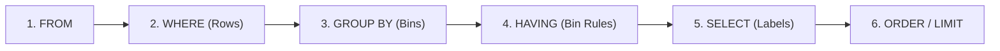

# Logical Execution Order, GROUP BY / HAVING, FILTER Clauses & CTE Pipelines

```json continuity
{
  "previously": "In Chapter 02 (`AeroLedger v0.2`), we used a small CTE to prevent `1:N` join fan-out and audited orphaned records safely with `NOT EXISTS`.",
  "painPoint": "Our SRE & QA dashboard now needs per-route checkout failure rates, refund ratios, and SLA breaches in one fast query—but engineers keep hitting `column alias does not exist in WHERE`, scanning the `bookings` table 4 separate times for 4 status counts, and writing unreadable 80-line nested subqueries.",
  "unlock": "Build AeroLedger v0.3: internalize SQL's true 6-phase logical execution pipeline, compute multi-condition funnel metrics in a single table scan via `COUNT(*) FILTER (WHERE ...)`, and compose clean, testable CTE pipelines."
}
```

```json walkthrough
[
  {
    "time": "0:00",
    "badge": "Execution Physics",
    "title": "You Write `SELECT` First—The Database Runs `SELECT` Almost Last!",
    "caption": "SQL is written `SELECT ... FROM ... WHERE ...`, which tricks beginners into using SELECT aliases inside WHERE. Under the hood, the engine runs `FROM -> WHERE -> GROUP BY -> HAVING -> SELECT -> ORDER BY`!",
    "nodes": ["1. FROM / JOIN", "2. WHERE (Rows)", "3. GROUP BY", "4. HAVING (Groups)", "5. SELECT", "6. ORDER / LIMIT"],
    "activeIndex": 1,
    "code": "-- Fails! WHERE runs at Phase 2, before SELECT defines `fare_usd` at Phase 5:\nSELECT fare_cents / 100 AS fare_usd FROM bookings WHERE fare_usd > 300;"
  },
  {
    "time": "0:25",
    "badge": "WHERE vs HAVING",
    "title": "Filter Raw Rows Early (`WHERE`), Filter Aggregated Buckets After (`HAVING`)",
    "caption": "WHERE throws away irrelevant rows BEFORE grouping (saving CPU and memory). HAVING filters entire route buckets AFTER `COUNT(*)` or `SUM()` has been computed.",
    "nodes": ["1M Bookings", "WHERE: Nov Only (50k)", "GROUP BY route", "HAVING: fail_rate > 2%"],
    "activeIndex": 3,
    "code": "SELECT route, COUNT(*) AS bookings\nFROM bookings\nWHERE booked_day >= '2026-11-01'  -- Row filter FIRST\nGROUP BY route\nHAVING COUNT(*) >= 100;           -- Bucket filter AFTER"
  },
  {
    "time": "0:50",
    "badge": "Single-Pass Pivots",
    "title": "Compute Total, Confirmed & Failed Rates in One Pass with `FILTER (WHERE ...)`",
    "caption": "Instead of scanning a 50M-row table three times with subqueries, ANSI SQL's `FILTER (WHERE ...)` (supported in both PostgreSQL 17 and SQLite 3.30+) buckets multiple conditional counts in one scan!",
    "nodes": ["Single Table Scan", "COUNT(*) Total", "FILTER status='FAILED'", "Exact Error %"],
    "activeIndex": 2,
    "code": "SELECT route,\n  COUNT(*) AS total,\n  COUNT(*) FILTER (WHERE status = 'FAILED') AS failed\nFROM bookings GROUP BY route;"
  },
  {
    "time": "1:15",
    "badge": "CTE Pipelines",
    "title": "`WITH` Clauses Turn Spaghetti Subqueries into Top-to-Bottom UNIX Pipes",
    "caption": "Common Table Expressions (`WITH step1 AS (...), step2 AS (...)`) let engineers read and unit-test analytical SQL top-to-bottom just like named functions—and PostgreSQL 12+ auto-inlines non-recursive CTEs!",
    "nodes": ["WITH valid_orders", "-> route_metrics", "-> sla_breaches", "Clean Final Assert"],
    "activeIndex": 2,
    "code": "WITH route_stats AS (...)\nSELECT * FROM route_stats WHERE failure_bps > 200;"
  }
]
```

```json pretraining
[
  {
    "term": "Logical Query Processing Order",
    "formula": "FROM -> WHERE -> GROUP BY -> HAVING -> SELECT -> ORDER BY",
    "meaning": "The exact order in which SQL conceptually evaluates clauses—explaining why `WHERE` cannot see `SELECT` column aliases or aggregate functions like `SUM()`."
  },
  {
    "term": "`WHERE` vs. `HAVING`",
    "formula": "`WHERE` = Pre-Group Row Gate · `HAVING` = Post-Group Bucket Gate",
    "meaning": "`WHERE` filters individual rows before bucketing; `HAVING` filters whole groups after aggregates (`COUNT`, `AVG`, `SUM`) are calculated."
  },
  {
    "term": "Filtered Aggregate (`FILTER (WHERE ...)`)",
    "formula": "AGG(col) FILTER (WHERE condition)",
    "meaning": "Clean ANSI SQL syntax (in PostgreSQL & SQLite) that feeds only matching rows into a specific aggregate during a single pass over the table."
  },
  {
    "term": "Common Table Expression (CTE)",
    "formula": "WITH step_a AS (...), step_b AS (...) SELECT ...",
    "meaning": "Named temporary query stages defined at the top of a SQL statement so complex pipelines read linearly from top to bottom instead of inside-out."
  }
]
```

## 🌱 Step 1: Plain-English Mental Model — The Airport Baggage Sorting Conveyor

Why does SQL reject `SELECT COUNT(*) AS c FROM bookings WHERE c > 5`? Because **SQL is written in English sentence order, not machine execution order**.

Picture an airport baggage sorting facility processing 10,000 suitcases:
1. **`FROM`**: Dump suitcases onto the main conveyor belt.
2. **`WHERE`**: Pull invalid or cancelled tags off the belt *immediately* so you don't waste effort sorting them.
3. **`GROUP BY`**: Route remaining suitcases into separate bins by destination (`BLR->SFO`, `DEL->LHR`).
4. **`HAVING`**: Keep only bins that have *more than 50 suitcases* (`HAVING COUNT(*) > 50`).
5. **`SELECT`**: Print a summary sticker (`route`, `total_weight`) for each surviving bin.
6. **`ORDER BY` / `LIMIT`**: Rank those stickers heaviest-first and hand the top 5 to the ramp manager.



Once this 6-step conveyor clicks, every SQL scoping rule makes instant sense: `WHERE` runs at **Station 2**, long before bins (`Station 3`) or `SELECT` labels (`Station 5`) even exist!

---

## 🔨 Step 2: Zero-to-Running Starter & CLI — Single-Pass Route SLA Gate (`AeroLedger v0.3`)

Both `PostgreSQL 17` and `SQLite 3.30+` support ANSI `FILTER (WHERE ...)` and `WITH` CTEs out of the box:

```bash
# Quick terminal verification of FILTER (WHERE ...) in built-in SQLite:
sqlite3 :memory: "WITH x(s) AS (VALUES ('OK'),('OK'),('ERR')) SELECT COUNT(*), COUNT(*) FILTER (WHERE s='ERR') FROM x;"
```

Let's write **`AeroLedger v0.3`** to flag flight routes whose checkout failure rate exceeds `20%` (`2,000` basis points) in a single scan:

```python
from __future__ import annotations
import sqlite3

# Subgoal 1: Seed checkout telemetry across two flight routes
conn = sqlite3.connect(":memory:")
conn.executescript("""
    CREATE TABLE checkout_events (
        event_id INTEGER PRIMARY KEY,
        route    TEXT NOT NULL,
        status   TEXT NOT NULL,
        is_bot   INTEGER NOT NULL DEFAULT 0
    );
    INSERT INTO checkout_events (route, status, is_bot) VALUES
        ('BLR-SFO', 'CONFIRMED', 0), ('BLR-SFO', 'CONFIRMED', 0),
        ('BLR-SFO', 'FAILED',    0), ('BLR-SFO', 'FAILED',    1),
        ('DEL-LHR', 'CONFIRMED', 0), ('DEL-LHR', 'CONFIRMED', 0);
""")

# Subgoal 2: Filter bot traffic in WHERE, pivot statuses via FILTER, and gate breaches in CTE
breaches = conn.execute("""
    WITH route_sla AS (
        SELECT route,
               COUNT(*) AS human_attempts,
               COUNT(*) FILTER (WHERE status = 'FAILED') AS failed_attempts,
               (COUNT(*) FILTER (WHERE status = 'FAILED') * 10000) / COUNT(*) AS fail_bps
        FROM checkout_events
        WHERE is_bot = 0
        GROUP BY route
        HAVING COUNT(*) >= 2
    )
    SELECT route, fail_bps FROM route_sla WHERE fail_bps > 2000
""").fetchall()

# Subgoal 3: Verify BLR-SFO has 1 human failure out of 3 human attempts = 3333 bps (33.33%)
assert breaches == [("BLR-SFO", 3333)]
print(f"AeroLedger v0.3 SLA gate caught route breach: {breaches}")
```

### Java 17 Equivalent

```java
import java.sql.*;
import java.util.*;

public class AeroLedgerV03RouteSla {
    // Subgoal 1: Single-pass conditional aggregation using ANSI FILTER (WHERE ...)
    private static final String SLA_BREACH_SQL = """
        WITH route_sla AS (
            SELECT route,
                   COUNT(*) AS human_attempts,
                   COUNT(*) FILTER (WHERE status = 'FAILED') AS failed_attempts,
                   (COUNT(*) FILTER (WHERE status = 'FAILED') * 10000) / COUNT(*) AS fail_bps
            FROM checkout_events
            WHERE is_bot = 0
            GROUP BY route
            HAVING COUNT(*) >= ?
        )
        SELECT route, fail_bps FROM route_sla WHERE fail_bps > ? ORDER BY fail_bps DESC
        """;

    // Subgoal 2: Bind minimum sample size and max basis-point threshold safely
    public static Map<String, Integer> detectBreachingRoutes(
            Connection conn, int minSamples, int maxFailBps) throws SQLException {
        Map<String, Integer> breaches = new LinkedHashMap<>();
        try (PreparedStatement ps = conn.prepareStatement(SLA_BREACH_SQL)) {
            ps.setInt(1, minSamples);
            ps.setInt(2, maxFailBps);
            try (ResultSet rs = ps.executeQuery()) {
                while (rs.next()) {
                    breaches.put(rs.getString("route"), rs.getInt("fail_bps"));
                }
            }
        }
        return breaches;
    }

    public static void main(String[] args) {
        assert SLA_BREACH_SQL.contains("FILTER (WHERE status = 'FAILED')");
    }
}
```

**Starter Walkthrough:**
- `WHERE is_bot = 0` strips synthetic bot traffic **before** `GROUP BY route` runs, so `BLR-SFO` counts `3` human attempts (`1` failed), not `4`.
- Multiplying by `10000` before integer division computes **basis points** (`3333 bps = 33.33%`) without integer-division truncation (`1 / 3 == 0` in SQL integer math!).

---

## 🛠️ Step 3: Everyday Practitioner Workflows & Where Naive Code Breaks

### Three Everyday Aggregation Gotchas in Backend & QA SQL

1. **Integer Division Truncation (`1 / 3 == 0` in PostgreSQL & SQLite!)**:
   - In both PostgreSQL and SQLite, dividing two integers (`COUNT(*) FILTER (...) / COUNT(*)`) performs **truncating integer division**, turning a `33%` outage into **`0`**! Multiply by `100.0` (or `10000` basis points) or cast `::NUMERIC` + wrap denominators in **`NULLIF(denom, 0)`** to prevent division-by-zero crashes.
2. **`COUNT(*)` vs. `COUNT(column)`**:
   - `COUNT(*)` counts **all rows** in the group; `COUNT(promo_code)` silently ignores `NULL`s! Mixing them up skews conversion denominators.
3. **Filtering Non-Aggregated Columns Inside `HAVING` Instead of `WHERE`**:
   - Writing `GROUP BY route, is_bot HAVING is_bot = 0` forces the database to hash and group millions of bot rows into memory hash tables only to throw them away afterward! Filtering `WHERE is_bot = 0` skips them at scan time and can use an index.

```json contrast
{
  "title": "Computing Multi-Metric Funnel Conversion & Error Rates",
  "leftLabel": "❌ Naive SQL (3 Table Scans + Integer Truncation)",
  "leftCode": "-- Scans checkout_events 2x + integer division yields 0!\nSELECT\n  (SELECT COUNT(*) FROM checkout_events WHERE status='FAILED') /\n  (SELECT COUNT(*) FROM checkout_events) AS err_rate;",
  "rightLabel": "✅ Staff SQL (1-Pass `FILTER` + `NULLIF` Precision)",
  "rightCode": "-- 1 table scan, zero-division safe, exact decimal ratio:\nSELECT\n  ROUND(\n    100.0 * COUNT(*) FILTER (WHERE status = 'FAILED')\n    / NULLIF(COUNT(*), 0), 2\n  ) AS err_pct\nFROM checkout_events;"
}
```

```json poe
{
  "question": "A table `api_logs(latency_ms INT)` has 4 rows: `100`, `200`, `300`, and `NULL` (a timed-out request with no recorded latency). What do `AVG(latency_ms)` and `COUNT(latency_ms)` return?",
  "options": [
    "`AVG = 150.0` and `COUNT = 4` (treating `NULL` as `0`)",
    "`AVG = 200.0` and `COUNT = 3`, because SQL aggregates (`AVG`, `SUM`, `COUNT(col)`) ignore `NULL`s completely!",
    "`AVG = NULL` and `COUNT = 0` because `NULL` poisons aggregates",
    "A runtime `NullPointerException`"
  ],
  "answerIndex": 1,
  "explanation": "All standard SQL aggregates *except* `COUNT(*)` ignore `NULL` inputs! `(100 + 200 + 300) / 3 = 200.0`. In QA & SRE telemetry, ignoring timed-out `NULL` rows makes a broken service look artificially fast unless you count timeouts explicitly via `COUNT(*) FILTER (WHERE latency_ms IS NULL)`!"
}
```

---

## 🏢 Step 4: How Big Tech Runs It at Scale, Staff Math & Production Blueprint

### 🏢 In the Wild: PostgreSQL 12+ CTE Optimization Fence (`MATERIALIZED` vs `NOT MATERIALIZED`)

At **GitLab**, **Shopify**, and **Cloudflare**, complex analytical and canary-gating queries are structured as 4–6 stage CTE pipelines. A critical version milestone every Senior/Staff engineer must know:
- **Before PostgreSQL 12**, every `WITH cte AS (...)` acted as an unconditional **optimization fence**: PostgreSQL materialized the full CTE into memory/temp files first and *refused* to push outer `WHERE tenant_id = 't-42'` predicates inside the CTE!
- **In PostgreSQL 12 through 17**, non-recursive, side-effect-free CTEs referenced **once** are **automatically inlined** (`NOT MATERIALIZED`), pushing outer `WHERE` filters right onto inner B+Tree indexes! And when an expensive aggregation *is* referenced multiple times, `WITH summary AS MATERIALIZED (...)` explicitly caches the result once instead of recomputing it twice.

### Staff Cost & Precision Math

Scanning an $N$-page table with $k$ separate scalar subqueries costs $k \cdot N$ buffer reads, whereas single-pass `FILTER` aggregation reduces I/O by factor $k$:

$$\text{Buffer Reads}_{\text{subqueries}} = k \cdot P_{\text{pages}} \quad \longrightarrow \quad \text{Buffer Reads}_{\text{FILTER}} = 1 \cdot P_{\text{pages}}$$

| Technique | Portable Alternative (MySQL / Legacy) | PostgreSQL 17 / SQLite 3.30+ | When NOT to Use |
| :--- | :--- | :--- | :--- |
| **`COUNT(*) FILTER (WHERE cond)`** | `SUM(CASE WHEN cond THEN 1 ELSE 0 END)` | Native `FILTER (WHERE ...)` | Works identically; prefer `FILTER` on PG/SQLite for clarity |
| **Inlined CTE (`WITH x AS (...)`)** | Derived subquery `FROM (...) x` | Default when referenced once (`NOT MATERIALIZED`) | Do NOT materialize a huge CTE if outer query filters 1 tenant! |
| **`WITH x AS MATERIALIZED (...)`** | Temp table | Forces single evaluation when referenced `>= 2` times | Avoid when outer `WHERE` needs index pushdown into `x` |

### Production Blueprint: Canary vs. Baseline Cohort Regression Gate

```python
from __future__ import annotations
import sqlite3


def evaluate_canary_release_gate(conn: sqlite3.Connection, max_delta_bps: int = 150) -> list[tuple[str, int, int]]:
    """Single-pass CTE cohort comparison between baseline and canary deployments."""
    return conn.execute(
        """
        WITH cohort_metrics AS (
            SELECT route,
                   cohort,
                   COUNT(*) AS total_reqs,
                   (COUNT(*) FILTER (WHERE http_status >= 500) * 10000) / NULLIF(COUNT(*), 0) AS err_5xx_bps,
                   AVG(COALESCE(latency_ms, 5000)) AS penalized_avg_ms
            FROM release_telemetry
            WHERE recorded_minute >= '2026-11-11T10:00Z'
            GROUP BY route, cohort
            HAVING COUNT(*) >= 3
        ),
        paired AS (
            SELECT b.route,
                   b.err_5xx_bps AS base_bps,
                   c.err_5xx_bps AS canary_bps
            FROM cohort_metrics b
            JOIN cohort_metrics c
              ON c.route = b.route
             AND b.cohort = 'baseline'
             AND c.cohort = 'canary'
        )
        SELECT route, base_bps, canary_bps
        FROM paired
        WHERE (canary_bps - base_bps) > ?
        ORDER BY route
        """,
        (max_delta_bps,),
    ).fetchall()


if __name__ == "__main__":
    db = sqlite3.connect(":memory:")
    db.execute("CREATE TABLE release_telemetry (route TEXT, cohort TEXT, http_status INT, latency_ms INT, recorded_minute TEXT)")
    rows = (
        [("BLR-SFO", "baseline", 200, 120, "2026-11-11T10:05Z")] * 10
        + [("BLR-SFO", "canary", 200, 125, "2026-11-11T10:05Z")] * 8
        + [("BLR-SFO", "canary", 503, None, "2026-11-11T10:05Z")] * 2
    )
    db.executemany("INSERT INTO release_telemetry VALUES (?, ?, ?, ?, ?)", rows)
    regressions = evaluate_canary_release_gate(db, max_delta_bps=150)
    assert regressions == [("BLR-SFO", 0, 2000)]
```

### Java 17 Equivalent

```java
import java.sql.*;
import java.util.*;

public final class CanaryCohortSqlGate {
    public record RouteRegression(String route, int baselineBps, int canaryBps) {}

    public static List<RouteRegression> findCanaryRegressions(Connection conn, int maxDeltaBps) throws SQLException {
        String sql = """
            WITH cohort_metrics AS (
                SELECT route, cohort,
                       (COUNT(*) FILTER (WHERE http_status >= 500) * 10000) / NULLIF(COUNT(*), 0) AS err_bps
                FROM release_telemetry
                GROUP BY route, cohort
                HAVING COUNT(*) >= 3
            )
            SELECT b.route, b.err_bps AS base_bps, c.err_bps AS canary_bps
            FROM cohort_metrics b
            JOIN cohort_metrics c ON c.route = b.route AND b.cohort = 'baseline' AND c.cohort = 'canary'
            WHERE (c.err_bps - b.err_bps) > ?
            """;
        List<RouteRegression> out = new ArrayList<>();
        try (PreparedStatement ps = conn.prepareStatement(sql)) {
            ps.setInt(1, maxDeltaBps);
            try (ResultSet rs = ps.executeQuery()) {
                while (rs.next()) {
                    out.add(new RouteRegression(rs.getString(1), rs.getInt(2), rs.getInt(3)));
                }
            }
        }
        return out;
    }
}
```

> [!WARNING]
> **Hiring Bar-Raiser Gotcha — `AVG(col)` Silently Ignores Timed-Out `NULL`s AND `SUM(empty)` Returns `NULL`, Not `0`!**
> Two subtle bugs fail candidates in live SQL rounds:
> 1. `COUNT(*)` on `0` matching rows returns **`0`**, whereas `SUM(fare_cents)` on `0` matching rows returns **`NULL`**! Always wrap `COALESCE(SUM(fare_cents), 0)` so downstream JSON serializers and Java `rs.getLong()` / Python `int()` assertions never crash on `None`.
> 2. If failed/timed-out requests store `latency_ms = NULL`, `AVG(latency_ms)` excludes every timeout and makes a `50%`-failing canary look blazingly fast! Penalize timeouts explicitly (`COALESCE(latency_ms, timeout_ceiling_ms)`) or measure `percentile_cont(0.99)`.

*Up Next in Chapter 04*: `GROUP BY` collapses rows into summary buckets—losing individual events! What if QA needs to find the **2nd duplicate webhook** or verify `PENDING -> CONFIRMED` transitions *without* collapsing rows? Enter **Window Functions**.

```json quiz
[
  {
    "id": "sql03-q1",
    "question": "Why does `SELECT route, COUNT(*) AS cnt FROM bookings WHERE cnt > 10 GROUP BY route` fail with a SQL error?",
    "options": [
      "`COUNT(*)` is deprecated in PostgreSQL 17",
      "`WHERE` executes logically BEFORE `GROUP BY` and `SELECT`, so neither the aggregate `COUNT(*)` nor the alias `cnt` exists yet—use `HAVING COUNT(*) > 10`",
      "`GROUP BY` must be written before `WHERE`",
      "Aliases must be enclosed in double quotes"
    ],
    "answerIndex": 1,
    "explanation": "SQL's logical execution order is `FROM -> WHERE -> GROUP BY -> HAVING -> SELECT`. Group-level aggregate predicates belong in `HAVING`."
  },
  {
    "id": "sql03-q2",
    "question": "What does `SELECT SUM(fare_cents), COUNT(*) FROM bookings WHERE 1 = 0` return in ANSI SQL (PostgreSQL & SQLite)?",
    "options": [
      "`(0, 0)`",
      "`(NULL, 0)` — `COUNT(*)` returns `0`, while `SUM` over an empty set returns `NULL`!",
      "`(NULL, NULL)`",
      "Zero rows (`empty result set`)"
    ],
    "answerIndex": 1,
    "explanation": "An ungrouped aggregate query without `GROUP BY` always returns 1 row: `COUNT(*)` is `0`, while `SUM`, `AVG`, `MIN`, and `MAX` over zero rows return `NULL`. Wrap sums in `COALESCE(SUM(...), 0)`."
  },
  {
    "id": "sql03-q3",
    "question": "How does PostgreSQL 17 treat a non-recursive CTE (`WITH active_users AS (...)`) that is referenced only once in the outer query?",
    "options": [
      "It always writes the entire CTE to disk temp files first",
      "By default (`NOT MATERIALIZED`), the planner folds/inlines the CTE into the outer query so outer `WHERE` filters can push down onto inner indexes",
      "It rejects CTEs without `RECURSIVE`",
      "It caches the CTE across separate database connections"
    ],
    "answerIndex": 1,
    "explanation": "Since PostgreSQL 12+, single-reference side-effect-free CTEs are automatically inlined by the optimizer unless explicitly marked `AS MATERIALIZED`."
  }
]
```

---

## 📋 Step 5: Master Cheat-Sheet, 60-Second Interview Pitch & Verified Sources

| Idiom | Exact PostgreSQL 17 / SQLite Syntax | Portable Fallback (MySQL / Spark) |
| :--- | :--- | :--- |
| **Conditional Count** | `COUNT(*) FILTER (WHERE status = 'ERR')` | `SUM(CASE WHEN status = 'ERR' THEN 1 ELSE 0 END)` |
| **Safe Percentage / Ratio** | `100.0 * num / NULLIF(denom, 0)` | Same (`100.0 *` avoids integer truncation; `NULLIF` avoids `/0`) |
| **Empty-Set Safe Sum** | `COALESCE(SUM(fare_cents), 0)` | Same (`SUM` on 0 rows is `NULL`, not `0`) |
| **PostgreSQL 99th Percentile** | `percentile_cont(0.99) WITHIN GROUP (ORDER BY ms)` | `approx_percentile(ms, 0.99)` (Warehouse) |
| **Force CTE Caching** | `WITH x AS MATERIALIZED (...)` | Temp table |

### 🎙️ 60-Second Interview Soundbite

> *"When building SLA or cohort verification queries, I structure them around SQL's true logical execution pipeline—pushing all row-level filters like tenant, timestamp, and bot exclusion into `WHERE` so B+Tree indexes prune rows before `GROUP BY` ever allocates hash memory, and reserving `HAVING` strictly for post-aggregation bucket thresholds. To compute multi-status error rates and funnel metrics without scanning a 50-million-row table multiple times, I use single-pass `COUNT(*) FILTER (WHERE ...)` paired with `100.0 * ... / NULLIF(COUNT(*), 0)` and `COALESCE(SUM(...), 0)` to guard against integer truncation, division by zero, and empty-set `NULL`s. Finally, in PostgreSQL 12+, I compose readable CTE stages knowing single-use CTEs inline automatically while `AS MATERIALIZED` caches shared intermediate rollups."*

### 📚 Verified Primary Sources
- [PostgreSQL 17 Official Docs — `WITH` Queries (Common Table Expressions & Materialization)](https://www.postgresql.org/docs/current/queries-with.html)
- [PostgreSQL 17 Official Docs — Aggregate Expressions & `FILTER (WHERE ...)`](https://www.postgresql.org/docs/current/sql-expressions.html#SYNTAX-AGGREGATES)
- [SQLite Official Documentation — Built-in Aggregate Functions & `FILTER` Clause](https://www.sqlite.org/lang_aggfunc.html)
