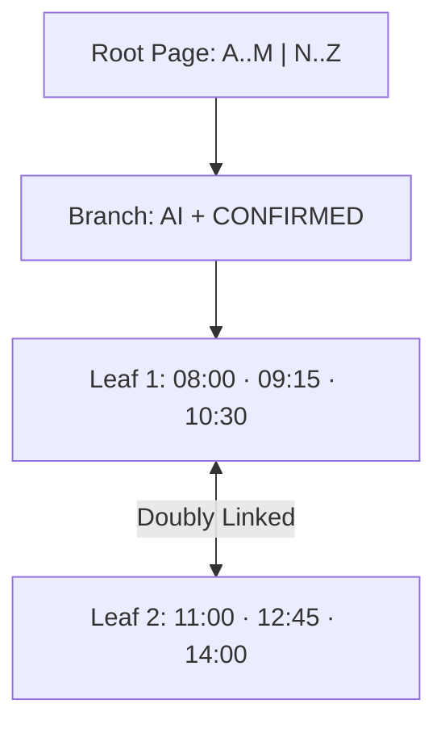

# B+Tree Internals, Composite Leftmost-Prefix Rules, Sargability & Covering Indexes

```json continuity
{
  "previously": "In Module 1 (`Chapters 01–04`), we mastered schemas, joins, conditional aggregations, and window functions across `AeroLedger`.",
  "painPoint": "Once `AeroLedger` hit 5,000,000 flight bookings in load testing, our checkout history API (`WHERE tenant_id = ? AND status = 'CONFIRMED' AND DATE(booked_at) = '2026-11-10'`) spiked to 412ms and pinned PostgreSQL CPU to 100%—even though an index existed on `(booked_at, tenant_id)`!",
  "unlock": "Evolve to AeroLedger v0.5: design composite B+Tree indexes using the Equality-Before-Range rule, rewrite non-sargable predicates into half-open timestamp ranges, and unlock zero-heap Index-Only Scans via Covering & Partial Indexes."
}
```

```json walkthrough
[
  {
    "time": "0:00",
    "badge": "B+Tree Physics",
    "title": "A Printed Phonebook Sorted by `(Last Name, First Name, Birth Year)`",
    "caption": "A B+Tree stores keys sorted across 8KB pages connected at the leaf level by a doubly linked list. In 3 to 4 page hops, PostgreSQL narrows 100,000,000 rows down to the exact leaf page!",
    "nodes": ["Root Page (8KB)", "Branch Page", "Sorted Leaf Chain", "Heap Tuple Pointer"],
    "activeIndex": 2,
    "code": "-- 3-level B+Tree with branching factor B=300 indexes 27,000,000+ keys:\nCREATE INDEX idx_bookings_lookup ON bookings (tenant_id, status, booked_at);"
  },
  {
    "time": "0:25",
    "badge": "Column Order Law",
    "title": "Leftmost Prefix + Equality Columns FIRST, Range Column LAST!",
    "caption": "In a phonebook sorted by `(Last Name, First Name)`, you cannot jump to `First Name = 'Maya'` without knowing `Last Name`. And once you scan a range (`booked_at >= ...`), subsequent index columns are no longer contiguous!",
    "nodes": ["1. tenant_id (=)", "2. status (=)", "3. booked_at (>=, <)", "Contiguous Leaf Slice!"],
    "activeIndex": 3,
    "code": "-- WRONG: (booked_at, tenant_id) scatters tenant rows across range!\n-- RIGHT: Equality columns first, Range column last:\nCREATE INDEX idx_opt ON bookings (tenant_id, status, booked_at);"
  },
  {
    "time": "0:50",
    "badge": "Sargability Trap",
    "title": "Wrapping a Column in `DATE(booked_at)` or `LOWER(email)` Blinds the Index",
    "caption": "The B+Tree stores raw `booked_at` timestamps—not `DATE(booked_at)`. Wrapping the column in a function forces PostgreSQL to evaluate the function on every single row! Rewrite as a half-open range.",
    "nodes": ["DATE(booked_at) = X", "Full Seq Scan (412ms!)", "booked_at >= X AND < X+1d", "Index Scan (0.2ms!)"],
    "activeIndex": 3,
    "code": "-- Sargable half-open range uses raw B+Tree order:\nWHERE booked_at >= '2026-11-10T00:00:00Z'\n  AND booked_at <  '2026-11-11T00:00:00Z'"
  },
  {
    "time": "1:15",
    "badge": "Covering & Partial",
    "title": "`INCLUDE (fare_cents)` & Partial `WHERE status = 'PENDING'` Cut I/O by 95%",
    "caption": "Appending `INCLUDE (fare_cents)` puts the payload right on the B+Tree leaf so Postgres never touches random heap pages (`Index Only Scan`). And `WHERE status = 'PENDING'` indexes only the 1% active rows!",
    "nodes": ["Covering INCLUDE", "0 Heap Random Reads", "Partial WHERE Clause", "99% Smaller Index"],
    "activeIndex": 1,
    "code": "CREATE INDEX idx_pending_jobs ON jobs (created_at)\nINCLUDE (payload_id) WHERE status = 'PENDING';"
  }
]
```

```json pretraining
[
  {
    "term": "B+Tree Leaf Chain",
    "formula": "Internal Routing Pages + Doubly Linked Sorted Leaf Pages",
    "meaning": "Database indexes store all key pointers in sorted leaf pages linked left-to-right, making both exact lookups (`=`) and range scans (`BETWEEN` / `ORDER BY`) fast."
  },
  {
    "term": "Leftmost-Prefix & ESR Rule",
    "formula": "E (Equality) -> S (Sort) -> R (Range)",
    "meaning": "Order composite index columns with exact `=` filters first, `ORDER BY` sort columns next, and inequality/range (`>`, `<`) filters last so matching rows sit side-by-side on leaf pages."
  },
  {
    "term": "Sargable Predicate (Search ARGument ABLE)",
    "formula": "`col >= val` (Sargable) vs. `FUNC(col) = val` (Non-Sargable)",
    "meaning": "A `WHERE` condition where the indexed column stands naked on one side of the operator, allowing the engine to seek directly into the B+Tree."
  },
  {
    "term": "Covering Index (`Index Only Scan`)",
    "formula": "Key Columns + `INCLUDE` Payload = Zero Heap Fetches",
    "meaning": "An index containing every column requested by the query so the database answers directly from compact index pages without random heap table reads."
  }
]
```

## 🌱 Step 1: Plain-English Mental Model — The Sorted Airport Directory

Without an index, finding one passenger among 5,000,000 rows requires a **Sequential Scan (`Seq Scan`)**: reading every single 8-kilobyte page of the table from start to finish, like flipping through an unsorted 50,000-page binder.

A **B+Tree Index** is like a multi-level printed directory sorted strictly from left to right—say by **`(Airline Code, Status, Departure Time)`**:
1. Because Airline Code comes first, all `'AI'` rows sit together.
2. Inside `'AI'`, all `'CONFIRMED'` rows sit together.
3. Inside `'AI' + 'CONFIRMED'`, rows are already sorted chronologically by `Departure Time`!



Now see why two mistakes ruin that directory instantly:
- **Wrong column order `(Departure Time, Airline Code)`**: Filtering a 24-hour range of `Departure Time` scatters `'AI'` flights across hundreds of non-adjacent leaf pages!
- **Wrapping the column in a function (`EXTRACT(HOUR FROM departure_time) = 10`)**: The directory is sorted by full date-time, not hour-of-day—forcing the engine back to reading every page!

---

## 🔨 Step 2: Zero-to-Running Starter & CLI — Proving Covering Index Plans (`AeroLedger v0.5`)

You can verify whether your SQL uses an index or falls back to a full table scan in **zero milliseconds** using `EXPLAIN QUERY PLAN` (SQLite) or `EXPLAIN (ANALYZE, BUFFERS)` (PostgreSQL 17):

```bash
# Inspect SQLite's B-Tree index plan directly from your terminal:
sqlite3 :memory: "CREATE TABLE t(a TEXT, b TEXT); CREATE INDEX idx ON t(a, b); EXPLAIN QUERY PLAN SELECT b FROM t WHERE a = 'AI';"
```

Let's build **`AeroLedger v0.5`** to prove how rewriting `SUBSTR(booked_at, 1, 10) = ...` into a sargable half-open range upgrades a full table scan into a **Covering Index Scan**:

```python
from __future__ import annotations
import sqlite3

# Subgoal 1: Create bookings table + ESR composite covering index (tenant_id, status, booked_at, fare_cents)
conn = sqlite3.connect(":memory:")
conn.executescript("""
    CREATE TABLE bookings (
        booking_id INTEGER PRIMARY KEY,
        tenant_id  TEXT NOT NULL,
        status     TEXT NOT NULL,
        booked_at  TEXT NOT NULL,
        fare_cents INTEGER NOT NULL
    );
    CREATE INDEX idx_bookings_esr_cover
        ON bookings (tenant_id, status, booked_at, fare_cents);
""")

# Subgoal 2: Non-sargable function wrapper blinds the booked_at range seek
bad_plan = str(conn.execute("""
    EXPLAIN QUERY PLAN
    SELECT SUM(fare_cents) FROM bookings
    WHERE SUBSTR(booked_at, 1, 10) = '2026-11-10'
""").fetchall())

# Subgoal 3: Sargable Equality-Before-Range predicate unlocks narrow COVERING INDEX range seek!
good_plan = str(conn.execute("""
    EXPLAIN QUERY PLAN
    SELECT SUM(fare_cents) FROM bookings
    WHERE tenant_id = 'airline-ai'
      AND status = 'CONFIRMED'
      AND booked_at >= '2026-11-10T00:00:00Z'
      AND booked_at <  '2026-11-11T00:00:00Z'
""").fetchall())

assert "booked_at>?" in good_plan and "USING COVERING INDEX idx_bookings_esr_cover" in good_plan
assert "booked_at>?" not in bad_plan
print("AeroLedger v0.5 verified sargable Covering Index range seek!")
```

### Java 17 Equivalent

```java
import java.sql.*;

public class AeroLedgerV05SargableIndex {
    // Subgoal 1: PostgreSQL 17 Covering Index using INCLUDE (keeps B+Tree branch nodes narrow!)
    public static final String PG_COVERING_INDEX_DDL = """
        CREATE INDEX CONCURRENTLY IF NOT EXISTS idx_bookings_esr_cover
        ON bookings (tenant_id, status, booked_at)
        INCLUDE (fare_cents);
        """;

    // Subgoal 2: Sargable half-open timestamp range [start, nextDayStart)
    public static long sumConfirmedFaresForWindow(
            Connection conn, String tenantId, Timestamp startInclusive, Timestamp endExclusive)
            throws SQLException {
        String sql = """
            SELECT COALESCE(SUM(fare_cents), 0)
            FROM bookings
            WHERE tenant_id = ?
              AND status = 'CONFIRMED'
              AND booked_at >= ?
              AND booked_at <  ?
            """;
        try (PreparedStatement ps = conn.prepareStatement(sql)) {
            ps.setString(1, tenantId);
            ps.setTimestamp(2, startInclusive);
            ps.setTimestamp(3, endExclusive);
            try (ResultSet rs = ps.executeQuery()) {
                return rs.next() ? rs.getLong(1) : 0L;
            }
        }
    }

    public static void main(String[] args) {
        assert PG_COVERING_INDEX_DDL.contains("INCLUDE (fare_cents)");
    }
}
```

**Starter Walkthrough:**
- **Why half-open `[>= '2026-11-10', < '2026-11-11')` instead of `BETWEEN '...00:00:00' AND '...23:59:59'`?** `BETWEEN` is inclusive on both ends: a booking at `23:59:59.450` (microseconds!) gets **dropped** if you end at `23:59:59`, or **double-counted** if you end at `00:00:00` of the next day! Half-open `[>= start, < end)` is exact at every timestamp resolution.

---

## 🛠️ Step 3: Everyday Practitioner Workflows & Where Naive Code Breaks

### Four Non-Sargable Anti-Patterns to Catch in Code Reviews

1. **Function on Column**: `WHERE LOWER(email) = 'a@b.com'` $\to$ Either create an **Expression Index** `CREATE INDEX ON users (LOWER(email))` or use `CITEXT` / normalized write storage.
2. **Leading Wildcard `LIKE '%302%'`**: B+Trees sort left-to-right; `'AI%'` uses a B+Tree range scan, whereas `'%302%'` cannot! For substring/trigram search in PostgreSQL, enable **`pg_trgm` + a `GIN` index** (`CREATE INDEX ON flights USING gin (code gin_trgm_ops)`).
3. **Implicit Type Cast / Arithmetic**: `WHERE booking_id_varchar = 10042` or `WHERE fare_cents / 100 > 50` $\to$ Rewrite as `WHERE fare_cents > 5000` so the column stands alone!
4. **Over-Indexing Write-Heavy Tables**: Adding 12 speculative indexes to `bookings` turns every `1` heap `INSERT` into **13 page writes + WAL entries**, destroying write throughput and breaking PostgreSQL **HOT (Heap-Only Tuple)** updates!

```json contrast
{
  "title": "Composite Index Column Order & Predicate Sargability",
  "leftLabel": "❌ Non-Sargable + Range-First Index (412ms)",
  "leftCode": "-- Range column FIRST breaks equality contiguity:\nCREATE INDEX idx_bad ON bookings (booked_at, tenant_id);\n\n-- Function on column + inclusive BETWEEN bug:\nSELECT fare_cents FROM bookings\nWHERE tenant_id = 't1'\n  AND DATE(booked_at) = '2026-11-10';",
  "rightLabel": "✅ ESR Composite + INCLUDE + Partial Index (0.18ms)",
  "rightCode": "-- Equality FIRST, Range LAST, Payload in INCLUDE:\nCREATE INDEX idx_good ON bookings (tenant_id, booked_at)\nINCLUDE (fare_cents)\nWHERE status = 'CONFIRMED';\n\nSELECT fare_cents FROM bookings\nWHERE tenant_id = 't1' AND status = 'CONFIRMED'\n  AND booked_at >= '2026-11-10' AND booked_at < '2026-11-11';"
}
```

```json poe
{
  "question": "You have a single composite B+Tree index `idx_abc ON orders (tenant_id, status, created_at)`. Which of the following queries CANNOT efficiently narrow its search using the primary prefix of `idx_abc`?",
  "options": [
    "`WHERE tenant_id = 'T1'`",
    "`WHERE tenant_id = 'T1' AND status = 'PAID'`",
    "`WHERE status = 'PAID' AND created_at >= '2026-11-01'` (omitting the leading `tenant_id` column!)",
    "`WHERE tenant_id = 'T1' AND status = 'PAID' ORDER BY created_at DESC LIMIT 20`"
  ],
  "answerIndex": 2,
  "explanation": "Because `tenant_id` is the leftmost column of `(tenant_id, status, created_at)`, omitting `tenant_id` means `'PAID'` rows are scattered across every tenant subtree in the B+Tree!"
}
```

---

## 🏢 Step 4: How Big Tech Runs It at Scale, Staff Math & Production Blueprint

### 🏢 In the Wild: Instagram / GitLab Partial Indexes & PostgreSQL Visibility Map Gotcha

At **GitLab** and **Linear**, background job and webhook tables hold `200,000,000+` historical `'COMPLETED'` rows alongside only `5,000` active `'PENDING'` rows:
- A full index on `(status, next_run_at)` wastes gigabytes of RAM caching dead `'COMPLETED'` keys. Creating a **Partial Index** (`CREATE INDEX idx_jobs_ready ON background_jobs (next_run_at) WHERE status = 'PENDING'`) shrinks the index from **`6.4 GB` to `400 KB`**, fitting permanently in L3/shared buffers!
- **PostgreSQL `Index Only Scan` Visibility Map Subtlety**: Because PostgreSQL stores MVCC tuple visibility (`xmin`/`xmax`) inside **heap pages** rather than index pages, an `Index Only Scan` still checks PostgreSQL's 2-bit-per-page **Visibility Map (VM)**! If `autovacuum` lags on a write-heavy table, `Heap Fetches: 45000` spikes inside `EXPLAIN ANALYZE`, silently degrading an `Index Only Scan` back into random heap I/O until `VACUUM` marks pages all-visible.

### B+Tree Height & Fan-Out Math

In PostgreSQL's `8,192`-byte (`8 KB`) pages, an internal B+Tree node storing 24-byte composite keys + 6-byte child pointers holds branching factor $B \approx \lfloor \frac{8168}{30} \rfloor \approx 272$ children. Therefore, tree height $h$ grows logarithmically with base $B$:

$$h = \lceil \log_{B}(N) \rceil \implies B^3 = 272^3 \approx 20,123,648 \text{ rows}, \quad B^4 \approx 5.47 \times 10^9 \text{ rows!}$$

Even **5 billion rows** require only **4 B+Tree levels**—and levels 1–3 stay pinned in RAM (`shared_buffers`), costing **at most 1 physical leaf read**!

| PostgreSQL Index Type | Underlying Data Structure | Ideal Workload | When NOT to Use |
| :--- | :--- | :--- | :--- |
| **`BTREE` (Default)** | Balanced sorted page tree | `=`, `<`, `<=`, `>`, `>=`, `BETWEEN`, `ORDER BY`, `LIKE 'abc%'` | Large JSONB containment or full-text token arrays |
| **`GIN` (Generalized Inverted)** | Token/Element $\to$ Posting List | `JSONB @>`, `ARRAY &&`, `tsvector` full-text, `pg_trgm` `%abc%` | High-frequency single-row updates without `fastupdate` tuning |
| **`BRIN` (Block Range Index)** | Min/Max summary per 128-page block | Append-only time-series logs (`1000x` smaller than B-Tree!) | Randomly updated or non-chronologically ordered columns |
| **`HASH`** | Bucketed 32-bit hash | Exact `=` on very wide URLs/strings | Cannot do ranges (`<`, `>`) or `ORDER BY` sorting |

### Production Blueprint: Automated Non-Sargable & Unused-Index Linter

```python
from __future__ import annotations
import re
import sqlite3

NON_SARGABLE_PATTERNS: tuple[tuple[str, str], ...] = (
    (r"\b(?:DATE|LOWER|UPPER|SUBSTR|YEAR|MONTH)\s*\(\s*[a-zA-Z_][a-zA-Z0-9_.]*\s*\)\s*=", "Function-wrapped column in WHERE prevents standard B+Tree seek"),
    (r"\bLIKE\s+'%[^']+", "Leading wildcard LIKE '%...' forces full scan without GIN trigram index"),
)


def lint_sql_sargability(sql: str) -> list[str]:
    findings: list[str] = []
    for pattern, reason in NON_SARGABLE_PATTERNS:
        if re.search(pattern, sql, flags=re.IGNORECASE):
            findings.append(reason)
    return findings


def verify_partial_index_plan() -> str:
    conn = sqlite3.connect(":memory:")
    conn.executescript("""
        CREATE TABLE outbox_jobs (
            job_id     INTEGER PRIMARY KEY,
            status     TEXT NOT NULL,
            run_after  INTEGER NOT NULL
        );
        CREATE INDEX idx_outbox_pending_only
            ON outbox_jobs (run_after)
            WHERE status = 'PENDING';
    """)
    plan = str(conn.execute("""
        EXPLAIN QUERY PLAN
        SELECT job_id FROM outbox_jobs
        WHERE status = 'PENDING' AND run_after <= 1762850000
        ORDER BY run_after ASC LIMIT 10
    """).fetchall())
    return plan


if __name__ == "__main__":
    bad_q = "SELECT * FROM bookings WHERE DATE(booked_at) = '2026-11-10' AND code LIKE '%302'"
    assert len(lint_sql_sargability(bad_q)) == 2
    assert "idx_outbox_pending_only" in verify_partial_index_plan()
```

### Java 17 Equivalent

```java
import java.sql.*;
import java.util.*;

public final class PostgresUnusedIndexAuditor {
    public record UnusedIndex(String tableName, String indexName, long sizeBytes) {}

    // Production SRE/SDET query against pg_stat_user_indexes to prune write-amplifying dead indexes
    public static List<UnusedIndex> findUnusedNonUniqueIndexes(Connection conn, long minBytes) throws SQLException {
        String sql = """
            SELECT s.relname AS table_name,
                   s.indexrelname AS index_name,
                   pg_relation_size(s.indexrelid) AS size_bytes
            FROM pg_stat_user_indexes s
            JOIN pg_index i ON i.indexrelid = s.indexrelid
            WHERE s.idx_scan = 0
              AND NOT i.indisunique
              AND NOT i.indisprimary
              AND pg_relation_size(s.indexrelid) >= ?
            ORDER BY size_bytes DESC
            """;
        List<UnusedIndex> out = new ArrayList<>();
        try (PreparedStatement ps = conn.prepareStatement(sql)) {
            ps.setLong(1, minBytes);
            try (ResultSet rs = ps.executeQuery()) {
                while (rs.next()) {
                    out.add(new UnusedIndex(rs.getString(1), rs.getString(2), rs.getLong(3)));
                }
            }
        }
        return out;
    }
}
```

> [!WARNING]
> **Hiring Bar-Raiser Gotcha — PostgreSQL Does NOT Automatically Create Indexes on `FOREIGN KEY` Columns!**
> PostgreSQL automatically indexes `PRIMARY KEY` and `UNIQUE` columns, **but NEVER automatically indexes `FOREIGN KEY` child columns** (`baggage_items.booking_id`)! Without an explicit index on `baggage_items(booking_id)`, deleting or updating 1 row in `bookings` forces PostgreSQL to execute a **full `Seq Scan` across the entire 50-million-row `baggage_items` table** just to verify referential integrity! Always index foreign key columns explicitly.

*Up Next in Chapter 06*: Even with the right composite index, why did PostgreSQL suddenly ignore our index in production after a bulk data load? Let's master **`EXPLAIN (ANALYZE, BUFFERS)`, Join Algorithms (`Nested Loop` vs `Hash` vs `Merge`) & Planner Statistics**.

```json quiz
[
  {
    "id": "sql05-q1",
    "question": "A query filters `WHERE tenant_id = $1 AND status = 'OPEN' AND created_at >= $2`. Which composite index column order minimizes scanned B+Tree leaf pages?",
    "options": [
      "`(created_at, tenant_id, status)`",
      "`(tenant_id, status, created_at)` — equality predicates (`=`) first, range predicate (`>=`) last (ESR rule)",
      "`(created_at, status)`",
      "Three separate single-column indexes"
    ],
    "answerIndex": 1,
    "explanation": "Placing equality columns (`tenant_id, status`) before the range column (`created_at`) ensures all matching rows sit in one contiguous slice of sorted B+Tree leaf pages."
  },
  {
    "id": "sql05-q2",
    "question": "What happens in PostgreSQL if you define `booking_id UUID REFERENCES bookings(booking_id) ON DELETE CASCADE` on a 100M-row `audit_events` table WITHOUT manually creating an index on `audit_events(booking_id)`?",
    "options": [
      "PostgreSQL automatically creates a hidden B+Tree index on every Foreign Key",
      "Every `DELETE FROM bookings WHERE booking_id = ...` triggers a full 100M-row `Seq Scan` on `audit_events` to check/cascade child rows!",
      "PostgreSQL refuses to run `DELETE` statements",
      "Foreign keys use Bloom filters automatically"
    ],
    "answerIndex": 1,
    "explanation": "PostgreSQL automatically indexes Primary/Unique keys (target side), NEVER Foreign Key referencing columns (child side). Unindexed FKs cause catastrophic lock contention and `Seq Scan` spikes on parent deletes/updates."
  },
  {
    "id": "sql05-q3",
    "question": "Why use `CREATE INDEX idx ON orders (tenant_id, created_at) INCLUDE (total_cents)` instead of putting `total_cents` inside the key list `(tenant_id, created_at, total_cents)`?",
    "options": [
      "`INCLUDE` encrypts `total_cents` on disk",
      "`INCLUDE` stores `total_cents` only on leaf pages (not internal branch pages), keeping branch fan-out high while still enabling heap-free `Index Only Scans`!",
      "`INCLUDE` allows `total_cents` to be negative",
      "Key columns cannot hold `BIGINT` values"
    ],
    "answerIndex": 1,
    "explanation": "Non-key `INCLUDE` columns are omitted from upper B+Tree routing nodes, keeping internal pages compact (higher fan-out $B$, shallower tree) while still satisfying `SELECT total_cents` directly from the leaf page."
  }
]
```

---

## 📋 Step 5: Master Cheat-Sheet, 60-Second Interview Pitch & Verified Sources

| Optimization Goal | Exact PostgreSQL 17 DDL / Query | Why It Matters |
| :--- | :--- | :--- |
| **ESR Composite Index** | `CREATE INDEX ON t (eq_col1, eq_col2, range_col)` | Contiguous leaf scan in $\mathcal{O}(\log_B N + K)$ |
| **Covering Index-Only Scan** | `CREATE INDEX ON t (tenant_id, ts) INCLUDE (amount)` | Zero random heap reads when VM is clean |
| **Partial Active-Queue Index** | `CREATE INDEX ON jobs (run_at) WHERE status = 'PENDING'` | 95–99% smaller RAM footprint & write cost |
| **Case-Insensitive Sargable** | `CREATE INDEX ON users (LOWER(email))` + `WHERE LOWER(email) = $1` | Matches exact expression stored in B+Tree |
| **Audit Unused Indexes** | Query `pg_stat_user_indexes WHERE idx_scan = 0` | Reclaims disk & restores `HOT` update speed |

### 🎙️ 60-Second Interview Soundbite

> *"When optimizing slow SQL queries, I start with B+Tree physics and the ESR rule: Equality columns first, Sort columns second, and Range columns last—so all matching tuples sit in one contiguous leaf-page slice. Second, I check sargability: stripping function wrappers like `DATE(booked_at)` in favor of half-open timestamp ranges `[>= start, < end)` and ensuring every Foreign Key child column is explicitly indexed, since Postgres doesn't auto-index FKs. Finally, on hot endpoints or job queues, I pair Partial Indexes (`WHERE status = 'PENDING'`) with `INCLUDE` covering columns while monitoring `Heap Fetches` in `EXPLAIN ANALYZE` to ensure `autovacuum` keeps the Visibility Map clean for true Index-Only Scans."*

### 📚 Verified Primary Sources
- [PostgreSQL 17 Official Docs — Multicolumn Indexes & Column Ordering](https://www.postgresql.org/docs/current/indexes-multicolumn.html)
- [PostgreSQL 17 Official Docs — Index-Only Scans, Covering `INCLUDE` Indexes & Visibility Map](https://www.postgresql.org/docs/current/indexes-index-only-scans.html)
- [Markus Winand — *Use The Index, Luke!* (The `WHERE` Clause, Leftmost Prefix & Sargability)](https://use-the-index-luke.com/sql/where-clause)
