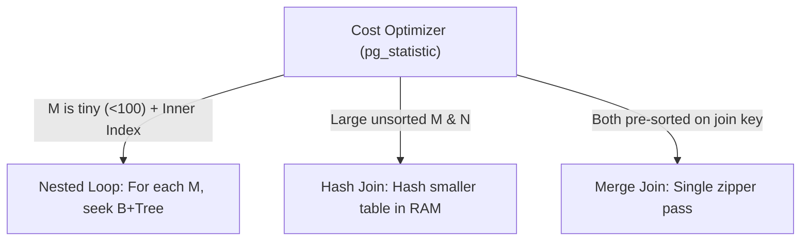

# Reading EXPLAIN (ANALYZE, BUFFERS), Join Algorithms & Planner Statistics

```json continuity
{
  "previously": "In Chapter 05 (`AeroLedger v0.5`), we built composite covering B+Tree indexes and rewrote non-sargable `WHERE` clauses.",
  "painPoint": "During a load test, two weird mysteries struck `AeroLedger`: (1) on a 20-row `airports` table, PostgreSQL IGNORED our index and ran a `Seq Scan`; (2) after bulk-inserting 1,000,000 holiday bookings, a join suddenly switched from `Hash Join` (18ms) to a `Nested Loop` taking 14.2 seconds (`rows=1` estimated vs `rows=48000` actual)!",
  "unlock": "Build AeroLedger v0.6: read `EXPLAIN (ANALYZE, BUFFERS)` trees inside-out, master the physics of `Nested Loop`, `Hash Join`, and `Merge Join`, and fix stale `ANALYZE` statistics & `work_mem` temp-disk spills."
}
```

```json walkthrough
[
  {
    "time": "0:00",
    "badge": "Plan Anatomy",
    "title": "Read `EXPLAIN` Trees Inside-Out (Deepest Indented Child Runs First!)",
    "caption": "An EXPLAIN output is a pipeline of iterators. The deepest indented lines pull raw tuples from indexes or heap pages; parent nodes join, sort, or aggregate them upward.",
    "nodes": ["Deepest Leaf: Index Scan", "Parent: Hash / Loop Join", "Top: Aggregate / Sort", "Buffers: hit vs read"],
    "activeIndex": 0,
    "code": "EXPLAIN (ANALYZE, BUFFERS)\nSELECT b.booking_id, f.origin\nFROM bookings b JOIN flights f USING (flight_id)\nWHERE b.tenant_id = 'airline-ai';"
  },
  {
    "time": "0:25",
    "badge": "3 Join Engines",
    "title": "Nested Loop (Tiny Outer), Hash Join (Unsorted Bulk), Merge Join (Pre-Sorted)",
    "caption": "Nested Loop probes an inner B+Tree for each outer row (great for 10 rows, fatal for 500k!). Hash Join builds an in-memory HashMap of the smaller table in O(M + N). Merge Join zips two already-sorted streams in O(M + N)!",
    "nodes": ["Nested Loop: O(M log N)", "Hash Join: O(M + N) RAM", "Merge Join: O(M + N) Sorted", "Cost Optimizer"],
    "activeIndex": 1,
    "code": "-- Planner picks lowest estimated total_cost:\n-- cost=0.43..18.20 rows=12 width=48 (actual time=0.04..0.19 rows=12 loops=1)"
  },
  {
    "time": "0:50",
    "badge": "Estimate Skew",
    "title": "`rows=1` Estimated vs. `rows=48,000` Actual = Stale `pg_statistic`!",
    "caption": "Right after a bulk load, `ANALYZE` hasn't refreshed histograms yet. Thinking the outer table has only 1 row, Postgres picks a Nested Loop and runs `loops=48000` random index probes! Running `ANALYZE bookings;` fixes it instantly.",
    "nodes": ["Bulk Insert 1M Rows", "Stale Stats: est rows=1", "Bad Nested Loop (14s!)", "ANALYZE -> Hash Join (18ms!)"],
    "activeIndex": 3,
    "code": "-- Refresh planner histograms immediately after bulk test seeding:\nANALYZE bookings;"
  },
  {
    "time": "1:15",
    "badge": "BUFFERS & Spills",
    "title": "Always Include `BUFFERS`—Latency Lies When Cache Is Warm, Page Counts Never Lie!",
    "caption": "Wall-clock `actual time` fluctuates 20x depending on OS RAM cache, whereas `Buffers: shared hit=4` vs `shared hit=95000` and `Sort Method: external merge Disk: 42MB` are deterministic signals in CI!",
    "nodes": ["Wall Time (Noisy)", "Buffers: shared hit/read", "temp read/written (Spill!)", "Deterministic Perf Gate"],
    "activeIndex": 1,
    "code": "-- Deterministic red flags in EXPLAIN (ANALYZE, BUFFERS):\n-- 1. Rows Removed by Filter: 998500\n-- 2. Sort Method: external merge  Disk: 43120kB"
  }
]
```

```json pretraining
[
  {
    "term": "`EXPLAIN` vs. `EXPLAIN (ANALYZE, BUFFERS)`",
    "formula": "Estimated Plan Only vs. Real Execution + 8KB Page I/O Counts",
    "meaning": "`EXPLAIN` only guesses; adding `(ANALYZE, BUFFERS)` actually executes the query and prints real row counts, loop multipliers, RAM buffer hits (`shared hit`), and disk reads (`shared read`)."
  },
  {
    "term": "Nested Loop vs. Hash Join vs. Merge Join",
    "formula": "Probe per Row · In-RAM HashMap · Zipper over Sorted Streams",
    "meaning": "The three physical algorithms SQL databases use to join two tables depending on row count, available `work_mem`, and index sort order."
  },
  {
    "term": "Cardinality Estimate Skew",
    "formula": "`estimated rows` << `actual rows`",
    "meaning": "When stale statistics or correlated columns trick the planner into thinking 50,000 rows is just 1 row—causing it to pick `Nested Loop` instead of `Hash Join`."
  },
  {
    "term": "`work_mem` Disk Spill (`temp written`)",
    "formula": "Sort / Hash Table > `work_mem` (default 4MB) -> Disk Temp File",
    "meaning": "Per-operation memory cap in PostgreSQL. Once a Hash Join or Sort exceeds `work_mem`, it spills temporary batches to disk and slows down by 10x–50x."
  }
]
```

## 🌱 Step 1: Plain-English Mental Model — How the Kitchen Chooses a Cooking Strategy

SQL is **declarative**: you tell the database *what* rows you want, and its **Cost-Based Optimizer** writes the step-by-step recipe (**Execution Plan**).

Why did PostgreSQL ignore our index on a tiny 20-row `airports` table? Because all 20 rows fit inside a **single 8 KB page**! Reading 1 index page + 1 table page (`2` page reads) is literally *slower* than reading that 1 table page directly (`Seq Scan = 1` page read). **Sequential scans on tiny tables (or queries returning `> 15–20%` of a table) are faster than random index hopping!**

And when joining two tables ($M$ outer rows $\bowtie$ $N$ inner rows), the optimizer chooses between three physical engines:



Whenever a production query suddenly slows down 100x overnight without any code deploy, **9 times out of 10** stale row-count estimates tricked the planner into picking the wrong box above!

---

## 🔨 Step 2: Zero-to-Running Starter & CLI — Automated Query-Plan CI Gate (`AeroLedger v0.6`)

Before running `EXPLAIN ANALYZE` on `UPDATE` or `DELETE` in production or staging, **always wrap it in `BEGIN; ... ROLLBACK;`** because `ANALYZE` *actually executes* the statement!

```bash
# Safe PostgreSQL 17 pattern for inspecting mutating query plans without committing changes:
# psql -c "BEGIN; EXPLAIN (ANALYZE, BUFFERS) DELETE FROM bookings WHERE booking_id = 'BK-1'; ROLLBACK;"

# Local zero-setup plan inspection using built-in SQLite:
sqlite3 :memory: "CREATE TABLE a(id INT PRIMARY KEY); CREATE TABLE b(id INT, a_id INT); CREATE INDEX idx_b ON b(a_id); EXPLAIN QUERY PLAN SELECT * FROM a JOIN b ON b.a_id = a.id WHERE a.id = 7;"
```

Let's build **`AeroLedger v0.6`**—a deterministic CI gate in Python 3 and Java 17 that inspects the database's execution plan and fails the build if a critical API query regresses into a full table scan (`SCAN bookings`):

```python
from __future__ import annotations
import sqlite3

# Subgoal 1: Seed flights + bookings + FK join index + run ANALYZE to populate planner stats
conn = sqlite3.connect(":memory:")
conn.executescript("""
    CREATE TABLE flights  (flight_id TEXT PRIMARY KEY, origin TEXT NOT NULL);
    CREATE TABLE bookings (booking_id TEXT PRIMARY KEY, flight_id TEXT NOT NULL, fare_cents INT NOT NULL);
    CREATE INDEX idx_bookings_flight ON bookings (flight_id);
    ANALYZE;
""")

# Subgoal 2: Inspect the physical join plan before shipping the query to production
plan_rows = conn.execute("""
    EXPLAIN QUERY PLAN
    SELECT f.origin, b.booking_id, b.fare_cents
    FROM flights f
    JOIN bookings b ON b.flight_id = f.flight_id
    WHERE f.flight_id = ?
""", ("AI-302",)).fetchall()

# Subgoal 3: Assert both tables use indexed SEARCH (zero full-table SCAN regressions!)
plan_details = [row[3] for row in plan_rows]
assert all("SEARCH" in step for step in plan_details), f"Full scan regression: {plan_details}"
print(f"AeroLedger v0.6 plan gate passed: {plan_details}")
```

### Java 17 Equivalent

```java
import java.sql.*;
import java.util.*;

public class AeroLedgerV06ExplainGate {
    // Subgoal 1: Request PostgreSQL 17 structured JSON plan with real buffer telemetry
    public static String fetchPostgresExplainJson(Connection conn, String parameterizedSelect, String arg)
            throws SQLException {
        String explainSql = "EXPLAIN (ANALYZE, BUFFERS, FORMAT JSON) " + parameterizedSelect;
        try (PreparedStatement ps = conn.prepareStatement(explainSql)) {
            ps.setString(1, arg);
            try (ResultSet rs = ps.executeQuery()) {
                return rs.next() ? rs.getString(1) : "[]";
            }
        }
    }

    // Subgoal 2: Fail CI if shared buffer reads + hits or disk spills breach budget
    public static void assertNoSeqScanOnLargeTable(String planJson) {
        if (planJson.contains("\"Node Type\": \"Seq Scan\"") && planJson.contains("\"Relation Name\": \"bookings\"")) {
            throw new AssertionError("Regression: Full Seq Scan detected on bookings table!");
        }
    }

    public static void main(String[] args) {
        assertNoSeqScanOnLargeTable("[{\"Plan\": {\"Node Type\": \"Index Scan\", \"Relation Name\": \"bookings\"}}]");
    }
}
```

**Starter Walkthrough:**
- Look at `EXPLAIN (ANALYZE, BUFFERS, FORMAT JSON)` in the Java 17 snippet: PostgreSQL emits a machine-parseable JSON tree containing `"Shared Hit Blocks"`, `"Shared Read Blocks"`, `"Temp Written Blocks"`, `"Plan Rows"`, and `"Actual Rows"`—making automated performance regression tests in CI 100% deterministic even on noisy cloud runners!

---

## 🛠️ Step 3: Everyday Practitioner Workflows & Where Naive Code Breaks

### Four `EXPLAIN (ANALYZE, BUFFERS)` Numbers You Must Check Every Time

1. **`loops=N` Multiplies `actual time`!**:
   - In `Index Scan on baggage (actual time=0.05..0.06 rows=2 loops=10000)`, that inner node did **NOT** take `0.06ms`—it took $0.06\text{ ms} \times 10,000\text{ loops} = \mathbf{600\text{ ms}}$!
2. **`Rows Removed by Filter: 980,000`**:
   - Means the index narrowed down to `980,010` rows, and PostgreSQL had to fetch and discard `980,000` heap tuples using a non-indexed residual predicate. Adding that filter column to the index eliminates 99.99% of wasted reads!
3. **`Estimate vs. Actual` (`rows=1` vs `rows=45000`)**:
   - Either `ANALYZE table_name;` hasn't run since a bulk insert, OR two columns are strongly correlated (e.g., `country = 'IN' AND currency = 'INR'`)—fixable in PostgreSQL via **`CREATE STATISTICS stats_country_curr (dependencies) ON country, currency FROM bookings;`**!
4. **`Batches: 16` or `Sort Method: external merge Disk: 64MB`**:
   - PostgreSQL's default `work_mem = 4MB` was too small for the Hash Join or Sort! Raising `SET LOCAL work_mem = '64MB';` inside that transaction keeps the hash/sort 100% in RAM.

```json contrast
{
  "title": "Diagnosing Slow Queries in Staging & CI",
  "leftLabel": "❌ Guessing with Wall-Clock Timing Alone",
  "leftCode": "-- 1. Only checks ms on a tiny 50-row local fixture (0.3ms!)\n-- 2. Never notices Seq Scan or external disk sort\n-- 3. Runs bare EXPLAIN ANALYZE UPDATE ... and mutates DB!",
  "rightLabel": "✅ Staff `EXPLAIN (ANALYZE, BUFFERS)` Audit",
  "rightCode": "BEGIN;\nSET LOCAL work_mem = '32MB';\nEXPLAIN (ANALYZE, BUFFERS)\nSELECT ...;\n-- Check: Actual Rows vs Plan Rows, loops, shared hit/read, temp written\nROLLBACK;"
}
```

```json poe
{
  "question": "In PostgreSQL `EXPLAIN (ANALYZE, BUFFERS)`, an inner `Index Scan` node inside a `Nested Loop` prints: `(cost=0.42..2.10 rows=1 width=32) (actual time=0.08..0.10 rows=1 loops=5000)`. How much total wall-clock time did this `Index Scan` node actually spend?",
  "options": [
    "`0.10 ms` total across the whole query",
    "`~500 ms` (`0.10 ms` average per iteration × `5,000` loops!)",
    "`2.10 ms`",
    "`5,000 seconds`"
  ],
  "answerIndex": 1,
  "explanation": "PostgreSQL reports `actual time` on inner loop nodes as the **per-execution average**! You MUST multiply `actual time` (and `rows`) by `loops=5000` ($0.10 \\times 5000 = 500\\text{ ms}$) to see the true bottleneck."
}
```

---

## 🏢 Step 4: How Big Tech Runs It at Scale, Staff Math & Production Blueprint

### 🏢 In the Wild: Slack, GitLab & Notion Buffer-Budget CI Gates

Wall-clock query benchmarks in GitHub Actions or Kubernetes CI runners are notoriously flaky because noisy neighbors steal CPU cycles. **GitLab's Database Merge Request Pipeline** solves this deterministically:
- Instead of asserting `latency_ms < 50`, CI parses `EXPLAIN (ANALYZE, BUFFERS, FORMAT JSON)` against production-scale anonymized histograms and asserts **logical page budgets** (`Shared Hit Blocks + Shared Read Blocks < budget` and `Temp Written Blocks == 0`). Because reading 4 B+Tree pages always touches 4 blocks regardless of CPU load, buffer assertions have **0% flakiness**!
- Additionally, PostgreSQL 16/17's `GENERIC_PLAN` option (`EXPLAIN (GENERIC_PLAN)`) catches **Prepared Statement Plan Cache Poisoning**: after 5 custom executions, Postgres may switch to a cached generic plan if parameter skew (e.g. a mega-tenant owning 40% of rows vs. a normal 10-row tenant) isn't accounted for!

### Join Algorithm Cost Equations

Given outer relation $M$ (`pages` $P_M$, `rows` $R_M$) and inner relation $N$ (`pages` $P_N$, `rows` $R_N$):

$$\text{Cost}_{\text{NestedLoop (Indexed)}} \approx P_M + R_M \cdot \log_B(R_N)$$

$$\text{Cost}_{\text{HashJoin (In-RAM)}} \approx P_M + P_N + c_{\text{cpu}}(R_M + R_N) \quad (\text{when } \min(P_M, P_N) \cdot \text{fudge} \le \texttt{work\_mem})$$

$$\text{Cost}_{\text{MergeJoin (Pre-Sorted)}} \approx P_M + P_N \quad (\text{zero sort cost when both inputs stream from B+Tree indexes!})$$

| Join Algorithm | Best Scenario | Worst Failure Mode |
| :--- | :--- | :--- |
| **`Nested Loop`** | Small outer set ($R_M < 500$) + indexed inner lookup (`LIMIT 20` pagination) | Stale stats underestimate $R_M$ (`1` vs `100,000`), causing 100k random probes |
| **`Hash Join`** | Large unsorted sets ($10^4 - 10^7$ rows) with `=` join keys | Build-side hash table exceeds `work_mem`, spilling multi-batch temp files to disk |
| **`Merge Join`** | Huge pre-sorted tables or non-equi/sorted joins with `ORDER BY` | Expensive $\mathcal{O}(N \log N)$ sort step if neither input has a matching B+Tree index |

### Production Blueprint: Deterministic `EXPLAIN (FORMAT JSON)` Regression Analyzer

```python
from __future__ import annotations
import json
from dataclasses import dataclass


@dataclass(frozen=True)
class PlanAuditReport:
    total_logical_blocks: int
    temp_spilled_blocks: int
    max_row_estimate_ratio: float
    seq_scan_tables: list[str]


def audit_postgres_explain_json(raw_json: str) -> PlanAuditReport:
    """Recursively audit PostgreSQL EXPLAIN (ANALYZE, BUFFERS, FORMAT JSON) output."""
    tree = json.loads(raw_json)[0]["Plan"]
    seq_scans: list[str] = []
    max_skew = 1.0

    def walk(node: dict) -> None:
        nonlocal max_skew
        if node.get("Node Type") == "Seq Scan" and node.get("Actual Rows", 0) > 1000:
            seq_scans.append(str(node.get("Relation Name", "unknown")))
        est = max(1, int(node.get("Plan Rows", 1)))
        act = max(1, int(node.get("Actual Rows", 1)))
        ratio = max(est / act, act / est)
        if ratio > max_skew:
            max_skew = ratio
        for child in node.get("Plans", []):
            walk(child)

    walk(tree)
    total_blocks = int(tree.get("Shared Hit Blocks", 0)) + int(tree.get("Shared Read Blocks", 0))
    temp_blocks = int(tree.get("Temp Written Blocks", 0))
    return PlanAuditReport(total_blocks, temp_blocks, round(max_skew, 2), seq_scans)


if __name__ == "__main__":
    sample_pg_plan = json.dumps([{
        "Plan": {
            "Node Type": "Nested Loop",
            "Plan Rows": 10,
            "Actual Rows": 10,
            "Shared Hit Blocks": 14,
            "Shared Read Blocks": 0,
            "Temp Written Blocks": 0,
            "Plans": [
                {"Node Type": "Index Scan", "Relation Name": "bookings", "Plan Rows": 10, "Actual Rows": 10},
                {"Node Type": "Seq Scan", "Relation Name": "airports", "Plan Rows": 20, "Actual Rows": 20}
            ]
        }
    }])
    rep = audit_postgres_explain_json(sample_pg_plan)
    assert rep.total_logical_blocks == 14 and rep.temp_spilled_blocks == 0 and rep.seq_scan_tables == []
```

### Java 17 Equivalent

```java
import java.sql.*;

public final class ScopedWorkMemExecutor {
    // Safely boost work_mem ONLY for a single heavy analytical transaction (never globally!)
    public static long runHeavyReconciliationQuery(Connection conn, String sql) throws SQLException {
        boolean prevAuto = conn.getAutoCommit();
        conn.setAutoCommit(false);
        try (Statement st = conn.createStatement()) {
            st.execute("SET LOCAL work_mem = '64MB'");
            try (ResultSet rs = st.executeQuery(sql)) {
                long result = rs.next() ? rs.getLong(1) : 0L;
                conn.commit();
                return result;
            }
        } catch (SQLException ex) {
            conn.rollback();
            throw ex;
        } finally {
            conn.setAutoCommit(prevAuto);
        }
    }
}
```

> [!WARNING]
> **Hiring Bar-Raiser Gotcha — Never Set Global `work_mem = '1GB'` in `postgresql.conf`!**
> Candidates often say *"If Hash Joins spill to disk, I'll set `work_mem = 1GB` globally!"* In PostgreSQL, `work_mem` is allocated **per sort/hash node, per query, per concurrent connection**! If 200 concurrent connections each run a query with 4 Hash/Sort nodes, $200 \times 4 \times 1\text{ GB} = \mathbf{800\text{ GB}}$—triggering the Linux Kernel **OOM Killer** (`SIGKILL`) on Postgres! Keep global `work_mem` conservative (`4MB–16MB`) and use `SET LOCAL work_mem = '64MB'` scoped to heavy analytical transactions.

*Up Next in Chapter 07*: Our queries now fly in `0.2ms`—until 16 passengers click **"Book Seat 12A"** at the exact same millisecond and **two passengers walk away with boarding passes for Seat 12A**! Let's conquer **ACID, MVCC Snapshots & `SELECT ... FOR UPDATE SKIP LOCKED`**.

```json quiz
[
  {
    "id": "sql06-q1",
    "question": "Why should you wrap `EXPLAIN (ANALYZE, BUFFERS) DELETE FROM bookings WHERE status = 'EXPIRED'` inside `BEGIN; ... ROLLBACK;`?",
    "options": [
      "PostgreSQL syntax forbids `EXPLAIN` outside transactions",
      "`EXPLAIN ANALYZE` genuinely executes the `DELETE` and modifies rows unless rolled back!",
      "`BUFFERS` only records metrics when `ROLLBACK` runs",
      "Without `BEGIN`, PostgreSQL truncates the table"
    ],
    "answerIndex": 1,
    "explanation": "Plain `EXPLAIN` only estimates without running the query, whereas `EXPLAIN ANALYZE` actually executes every insert, update, delete, and trigger!"
  },
  {
    "id": "sql06-q2",
    "question": "After seeding 2,000,000 rows in a staging test, a join suddenly picks `Nested Loop` instead of `Hash Join` and shows `(cost=0.43..8.50 rows=1) (actual rows=195000)`. What is the fastest root-cause fix?",
    "options": [
      "Drop and recreate all primary keys",
      "Run `ANALYZE <table_name>;` so PostgreSQL refreshes `pg_statistic` row-count histograms before planning",
      "Disable Hash Joins globally via `SET enable_hashjoin = off`",
      "Convert all columns to `TEXT`"
    ],
    "answerIndex": 1,
    "explanation": "Before `autovacuum` catches up after a bulk load, planner histograms still think the table is nearly empty (`rows=1`), causing disastrous `Nested Loop` selection until `ANALYZE` updates statistics."
  },
  {
    "id": "sql06-q3",
    "question": "Why is setting `work_mem = '2GB'` globally in `postgresql.conf` dangerous on an OLTP database with 300 active connections?",
    "options": [
      "PostgreSQL ignores `work_mem` values above `64MB`",
      "`work_mem` applies per sort/hash operation per concurrent query (not total server RAM), risking multi-hundred-GB spikes and Linux OOM-Killer crashes",
      "High `work_mem` disables B+Tree indexes",
      "It forces synchronous replication"
    ],
    "answerIndex": 1,
    "explanation": "`work_mem` is a per-node limit, not a shared global buffer pool. Boost it selectively per transaction via `SET LOCAL work_mem = '64MB'`."
  }
]
```

---

## 📋 Step 5: Master Cheat-Sheet, 60-Second Interview Pitch & Verified Sources

| Diagnostic Signal in `EXPLAIN (ANALYZE, BUFFERS)` | Meaning | Production Fix |
| :--- | :--- | :--- |
| **`Plan Rows: 1` vs `Actual Rows: 85000`** | Stale histograms or correlated columns | Run `ANALYZE tbl;` or `CREATE STATISTICS (dependencies)` |
| **`Rows Removed by Filter: 500000`** | Index missing selective `WHERE` column | Add filter column to composite/partial index |
| **`Heap Fetches: 42000` (on Index Only Scan)** | Dirty Visibility Map pages | Tune `autovacuum_vacuum_scale_factor` (e.g. `0.02`) / run `VACUUM` |
| **`Sort Method: external merge Disk` / `Batches > 1`** | Exceeded `work_mem` | `SET LOCAL work_mem = '64MB'` or add sort-matching index |
| **`Shared Hit` + `Shared Read` Blocks** | Deterministic logical page cost | Assert total block upper-bound in CI instead of flaky ms |

### 🎙️ 60-Second Interview Soundbite

> *"When diagnosing a slow SQL query, I always run `EXPLAIN (ANALYZE, BUFFERS)`—wrapped in `BEGIN ... ROLLBACK` if mutating—and read the plan inside-out. First, I multiply inner `actual time` by `loops` to spot hidden Nested Loop explosions. Second, I compare `Plan Rows` against `Actual Rows`: a 100x mismatch points straight to stale `pg_statistic` histograms needing `ANALYZE` or multi-column `CREATE STATISTICS`. Third, I inspect `Buffers`: high `Rows Removed by Filter` means our composite index is missing a predicate, high `Heap Fetches` on an Index-Only Scan points to Visibility Map lag, and `Temp Written Blocks` signals a `work_mem` spill that I fix safely per transaction with `SET LOCAL work_mem`, never globally. In CI, asserting logical buffer counts eliminates noisy-runner flakiness completely."*

### 📚 Verified Primary Sources
- [PostgreSQL 17 Official Docs — Using `EXPLAIN` (`ANALYZE`, `BUFFERS`, `loops`, and Plan Nodes)](https://www.postgresql.org/docs/current/using-explain.html)
- [PostgreSQL 17 Official Docs — Statistics Used by the Planner (`ANALYZE` & Extended `CREATE STATISTICS`)](https://www.postgresql.org/docs/current/planner-stats.html)
- [PostgreSQL 17 Official Docs — Resource Consumption (`shared_buffers` vs. per-node `work_mem`)](https://www.postgresql.org/docs/current/runtime-config-resource.html)
