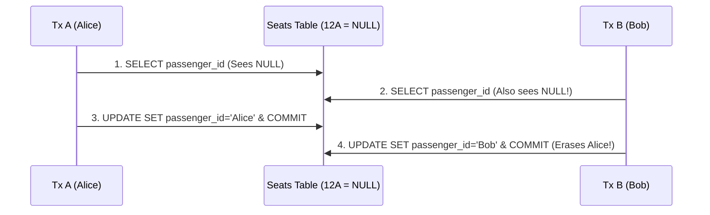

# ACID, MVCC Snapshots, Isolation Anomalies & Seat-12A Locking (FOR UPDATE SKIP LOCKED)

```json continuity
{
  "previously": "In Chapter 06 (`AeroLedger v0.6`), we tuned B+Tree indexes and `EXPLAIN (ANALYZE, BUFFERS)` so single-user seat lookups finish in 0.2ms.",
  "painPoint": "When a flash sale opened Flight `AI-302`, 16 concurrent passengers clicked 'Reserve Window Seat 12A' at the exact same millisecond. Because our checkout API ran `SELECT passenger_id FROM seats WHERE seat='12A'` (saw `NULL`) and then `UPDATE seats SET passenger_id = ?`, THREE passengers got confirmed boarding passes for Seat 12A!",
  "unlock": "Upgrade to AeroLedger v0.7: master PostgreSQL MVCC tuple snapshots, reproduce Lost Updates & Write Skew, and make concurrent inventory allocation 100% atomic with `SELECT ... FOR UPDATE`, `SKIP LOCKED`, and Optimistic `version` CAS."
}
```

```json walkthrough
[
  {
    "time": "0:00",
    "badge": "MVCC Golden Rule",
    "title": "Readers Never Block Writers, Writers Never Block Readers—And Why That Bites Naive Code!",
    "caption": "Under Multi-Version Concurrency Control (MVCC), each transaction sees a clean photo snapshot of committed rows. When Flyer A and Flyer B both read Seat 12A at t=0, BOTH snapshots show Seat 12A is empty!",
    "nodes": ["Tx A Snapshot: 12A=NULL", "Tx B Snapshot: 12A=NULL", "Tx A Writes PAX-A", "Tx B Overwrites PAX-B!"],
    "activeIndex": 3,
    "code": "-- BROKEN Check-Then-Act under default READ COMMITTED:\n-- Tx A & Tx B both see NULL, then Tx B silently overwrites Tx A!\nSELECT passenger_id FROM seats WHERE flight_id='AI-302' AND seat_no='12A';"
  },
  {
    "time": "0:26",
    "badge": "Atomic Fix #1",
    "title": "Pessimistic Row Lock (`SELECT ... FOR UPDATE`) + Atomic Predicate `AND passenger_id IS NULL`",
    "caption": "Adding `FOR UPDATE` grabs an exclusive row-level tuple lock immediately on read! Tx B blocks until Tx A commits, then re-evaluates and sees Seat 12A is now taken—returning a clean 409 Conflict!",
    "nodes": ["Tx A: FOR UPDATE Lock", "Tx B Waits on Tuple", "Tx A Commits PAX-A", "Tx B Sees Taken -> 409"],
    "activeIndex": 0,
    "code": "BEGIN;\nSELECT seat_no FROM seats\nWHERE flight_id = $1 AND seat_no = $2 AND passenger_id IS NULL\nFOR UPDATE;\n-- If 1 row returned -> UPDATE & COMMIT; else -> 409 Seat Taken!"
  },
  {
    "time": "0:52",
    "badge": "Queue Magic",
    "title": "`FOR UPDATE SKIP LOCKED`: Auto-Assign Any Available Window Seat Without Waiting!",
    "caption": "What if a passenger says 'Give me ANY open window seat'—or 32 workers pull jobs from a queue? `SKIP LOCKED` instantly bypasses seats locked by other flyers and grabs the next free seat in 0.2ms!",
    "nodes": ["Seat 12A (Locked by Tx A)", "SKIP LOCKED Bypasses 12A", "Tx B Claims Seat 14A!", "Zero Contention Queue"],
    "activeIndex": 2,
    "code": "SELECT seat_no FROM seats\nWHERE flight_id = $1 AND is_window = true AND passenger_id IS NULL\nORDER BY seat_no LIMIT 1\nFOR UPDATE SKIP LOCKED;"
  },
  {
    "time": "1:18",
    "badge": "Write Skew Trap",
    "title": "Why `REPEATABLE READ` Still Allows Disjoint-Row Write Skew (Needs `SERIALIZABLE` or Lock)",
    "caption": "If aviation law requires >= 1 pilot on standby, and Pilot A updates Row A while Pilot B updates Row B after both count 2 pilots, neither touched the SAME row—so `REPEATABLE READ` lets BOTH go off-duty!",
    "nodes": ["2 Pilots On-Call", "Pilot A Reads 2, Drops A", "Pilot B Reads 2, Drops B", "0 Pilots Left (Write Skew!)"],
    "activeIndex": 3,
    "code": "-- Prevent disjoint-row Write Skew via SERIALIZABLE (SQLSTATE 40001 retry)\n-- OR lock a shared parent `flight_roster` row with FOR UPDATE!"
  }
]
```

```json pretraining
[
  {
    "term": "MVCC (Multi-Version Concurrency Control)",
    "formula": "Tuple Versions (`xmin` birth XID · `xmax` death XID)",
    "meaning": "Instead of overwriting rows in place and blocking readers, PostgreSQL writes a new tuple version on `UPDATE` so concurrent readers keep reading consistent snapshots without locks."
  },
  {
    "term": "Lost Update (Check-Then-Act Race)",
    "formula": "Tx1 Read -> Tx2 Read -> Tx1 Write -> Tx2 Overwrite",
    "meaning": "Two transactions read the same state in application memory and both write updates based on that stale observation, silently erasing the first transaction's work."
  },
  {
    "term": "Write Skew Anomaly",
    "formula": "2 Transactions Read Overlapping Set, Mutate Disjoint Rows",
    "meaning": "A subtle concurrency bug (even under PostgreSQL `REPEATABLE READ`!) where two transactions check a multi-row invariant (e.g., `>= 1` on-call doctor or account total) and modify *different* rows, breaking the invariant together."
  },
  {
    "term": "`FOR UPDATE` vs. `FOR UPDATE SKIP LOCKED`",
    "formula": "Wait for Specific Row vs. Bypass Locked Rows Immediately",
    "meaning": "`FOR UPDATE` waits when reserving a specific chosen item (Seat `12A`); `SKIP LOCKED` skips busy rows immediately when claiming *any* next available item or queue job."
  }
]
```

## 🌱 Step 1: Plain-English Mental Model — Two Passengers Reaching for Seat `12A`

Wrapping SQL inside `BEGIN ... COMMIT` does **NOT** freeze the whole database for one user! By default, `PostgreSQL` runs at **`READ COMMITTED`** isolation powered by **MVCC (Multi-Version Concurrency Control)**: every `SELECT` sees a photo snapshot of rows committed just before that `SELECT` started, without locking anything.

Watch what happens when Alice and Bob click **"Book Seat 12A"** at `10:00:00.001`:



Both Alice and Bob received `"200 OK — Seat 12A Confirmed"`, yet Alice's seat was silently overwritten (`Lost Update`)! To make concurrent seat reservation airtight, you must move the check **into an atomic database lock or predicate**—never an application `if` statement between unlocked `SELECT` and `UPDATE` calls.

---

## 🔨 Step 2: Zero-to-Running Starter & CLI — 16-Thread Seat-12A Torture Test (`AeroLedger v0.7`)

Let's run our multi-threaded concurrency lab via CLI and then write a self-contained 16-thread **`AeroLedger v0.7`** proof in Python 3 (`BEGIN IMMEDIATE` + atomic conditional `UPDATE`) and Java 17 (`SELECT ... FOR UPDATE` + `SQLSTATE 40001` handling):

```bash
# Execute the 16-thread Seat-12A barrier stress test locally:
python3 frameworks/data-validation/01-sql-reconciliation-and-isolation/reference_solution.py
```

```python
from __future__ import annotations
import pathlib, sqlite3, tempfile, threading

# Subgoal 1: Create a WAL-mode database on disk with 1 open Seat 12A
tmp_dir = tempfile.TemporaryDirectory()
db_path = pathlib.Path(tmp_dir.name) / "aeroledger_v07.db"
init_conn = sqlite3.connect(str(db_path))
init_conn.executescript("""
    PRAGMA journal_mode = WAL;
    CREATE TABLE seats (flight_id TEXT, seat_no TEXT, pax_id TEXT, PRIMARY KEY (flight_id, seat_no));
    INSERT INTO seats VALUES ('AI-302', '12A', NULL);
""")
init_conn.close()

# Subgoal 2: Synchronize 12 threads on a Barrier to fire at the exact same microsecond
barrier = threading.Barrier(12)
winners: list[str] = []

def reserve_seat(idx: int) -> None:
    c = sqlite3.connect(str(db_path), timeout=10.0, isolation_level=None)
    barrier.wait()
    c.execute("BEGIN IMMEDIATE")  # Acquire write lock + atomic `AND pax_id IS NULL` predicate!
    cur = c.execute(
        "UPDATE seats SET pax_id = ? WHERE flight_id = 'AI-302' AND seat_no = '12A' AND pax_id IS NULL",
        (f"PAX-{idx}",),
    )
    c.execute("COMMIT")
    if cur.rowcount == 1:
        winners.append(f"PAX-{idx}")
    c.close()

# Subgoal 3: Assert strictly 1 winner and 11 clean rejections (zero double-booking!)
threads = [threading.Thread(target=reserve_seat, args=(i,)) for i in range(12)]
for t in threads: t.start()
for t in threads: t.join()
tmp_dir.cleanup()
assert len(winners) == 1, f"Double-booking bug! Winners: {winners}"
print(f"AeroLedger v0.7 12-thread race passed! Single winner: {winners[0]}")
```

### Java 17 Equivalent

```java
import java.sql.*;

public class AeroLedgerV07SeatLocker {
    // Subgoal 1: PostgreSQL 17 pessimistic row lock for a specific chosen seat (12A)
    public static boolean claimSpecificSeat(Connection conn, String flightId, String seatNo, String paxId)
            throws SQLException {
        conn.setAutoCommit(false);
        String lockSql = """
            SELECT seat_no FROM seats
            WHERE flight_id = ? AND seat_no = ? AND pax_id IS NULL
            FOR UPDATE
            """;
        try (PreparedStatement lockPs = conn.prepareStatement(lockSql)) {
            lockPs.setString(1, flightId);
            lockPs.setString(2, seatNo);
            try (ResultSet rs = lockPs.executeQuery()) {
                if (!rs.next()) {
                    conn.rollback();
                    return false; // Clean 409 Conflict — already booked!
                }
            }
            // Subgoal 2: Row is exclusively locked; update and commit atomically
            try (PreparedStatement upd = conn.prepareStatement(
                    "UPDATE seats SET pax_id = ? WHERE flight_id = ? AND seat_no = ?")) {
                upd.setString(1, paxId);
                upd.setString(2, flightId);
                upd.setString(3, seatNo);
                upd.executeUpdate();
                conn.commit();
                return true;
            }
        } catch (SQLException ex) {
            conn.rollback();
            throw ex;
        }
    }

    public static void main(String[] args) {
        assert AeroLedgerV07SeatLocker.class.getSimpleName().contains("SeatLocker");
    }
}
```

**Starter Walkthrough:**
- Notice **both** single-statement atomic `UPDATE ... WHERE pax_id IS NULL RETURNING seat_no` **and** `SELECT ... FOR UPDATE` solve the Lost Update cleanly! Use single-statement `UPDATE ... WHERE pax_id IS NULL` whenever no multi-step business logic sits in between; use `SELECT ... FOR UPDATE` when you must inspect row fields in application code before deciding how to update.

---

## 🛠️ Step 3: Everyday Practitioner Workflows & Where Naive Code Breaks

### PostgreSQL Isolation Matrix & Deadlock Prevention

1. **Know PostgreSQL's True Isolation Table (Slightly Stricter Than ANSI Minimums!)**:
   - **`READ COMMITTED` (Postgres Default)**: Prevents Dirty Reads, *allows* Non-Repeatable Reads, Phantom Reads, Lost Updates, and Write Skew.
   - **`REPEATABLE READ` (Snapshot Isolation in Postgres)**: Prevents Non-Repeatable Reads, **also prevents Phantom Reads in Postgres**, and automatically aborts **same-row Lost Updates** with `ERROR: could not serialize access due to concurrent update` (`SQLSTATE 40001`)—**but STILL allows disjoint-row Write Skew**!
   - **`SERIALIZABLE` (SSI — Serializable Snapshot Isolation)**: Detects read/write dependency cycles (`rw-antidependencies`) and prevents Write Skew too (requiring app-level retry on `SQLSTATE 40001`).
2. **Preventing AB/BA Deadlocks When Locking Multiple Seats**:
   - If Alice books Seats `['12B', '12A']` while Bob books `['12A', '12B']`, locking in user-input order causes a classic **AB/BA Deadlock** (`SQLSTATE 40P01`)! **Always sort primary keys lexicographically (`ORDER BY seat_no ASC FOR UPDATE`)** so every transaction acquires row locks in the exact same deterministic order.

```json contrast
{
  "title": "Concurrent Inventory Reservation & Multi-Row Lock Ordering",
  "leftLabel": "❌ Check-Then-Act + Unsorted Multi-Row Locks",
  "leftCode": "-- 1. Race condition: 2 flyers read NULL & double-book 12A\nSELECT pax_id FROM seats WHERE seat_no = '12A';\nUPDATE seats SET pax_id = 'P1' WHERE seat_no = '12A';\n\n-- 2. AB/BA Deadlock when locking seats in random order!",
  "rightLabel": "✅ Atomic Conditional `UPDATE` / Sorted `FOR UPDATE`",
  "rightCode": "-- 1. Single-roundtrip atomic claim in PostgreSQL 17:\nUPDATE seats SET pax_id = $1, version = version + 1\nWHERE flight_id = $2 AND seat_no = ANY($3)\n  AND pax_id IS NULL\nRETURNING seat_no;\n-- Lock multiple rows in deterministic sorted PK order:\n-- SELECT ... WHERE seat_no = ANY($3) ORDER BY seat_no ASC FOR UPDATE;"
}
```

```json poe
{
  "question": "Two airline dispatchers run at PostgreSQL `REPEATABLE READ` isolation. Rule: at least 1 of `{Pilot_A, Pilot_B}` must remain `on_call = true`. Both transactions read `COUNT(*) WHERE on_call = true` (both see `2`!), then Tx 1 sets `Pilot_A.on_call = false` and Tx 2 sets `Pilot_B.on_call = false`, and both `COMMIT`. What happens?",
  "options": [
    "PostgreSQL blocks Tx 2 automatically",
    "BOTH transactions commit (`0` pilots left on call!) because they modified *different* rows—classic Write Skew under Snapshot Isolation!",
    "PostgreSQL promotes `REPEATABLE READ` to table lock",
    "Both transactions roll back with a syntax error"
  ],
  "answerIndex": 1,
  "explanation": "PostgreSQL's `REPEATABLE READ` implements Snapshot Isolation: it aborts concurrent writes to the *same* row, but cannot detect Write Skew across *disjoint* rows unless you use `SERIALIZABLE` isolation or lock a shared parent `flight_schedule` row (`FOR UPDATE`)."
}
```

---

## 🏢 Step 4: How Big Tech Runs It at Scale, Staff Math & Production Blueprint

### 🏢 In the Wild: Airline GDS Inventory Holds, Ticketmaster & Postgres Queue Engines

How do **Amadeus/Sabre**, **BookMyShow/Ticketmaster**, and **Quick-Commerce dark-store pickers** handle 50,000 users clicking checkout without holding database transactions open while a user types their credit card for 5 minutes?
1. **Never Hold a DB Transaction Open Across External HTTP Calls (Stripe/3DS)!** Holding `SELECT ... FOR UPDATE` open for 30 seconds while waiting on a slow payment gateway exhausts your entire `HikariCP`/`PgBouncer` connection pool in seconds!
2. **Two-Phase Reservation Lease (`HELD` with `hold_expires_at`)**:
   - **Tx 1 (`< 2ms`)**: Atomically transition Seat `12A` from `AVAILABLE` (or expired hold `hold_expires_at < NOW()`) $\to$ `status = 'HELD', held_by = $pax, hold_expires_at = NOW() + INTERVAL '5 minutes'`. Commit immediately!
   - **External Payment (`1–60s`, zero DB connection held!)**: Charge card with `Idempotency-Key`.
   - **Tx 2 (`< 2ms`)**: Atomically transition `HELD -> CONFIRMED` (checking `held_by = $pax`).

### Contention vs. Retry Math: Pessimistic Lock vs. Optimistic CAS

With $C$ concurrent contenders targeting the same hot resource, Optimistic Concurrency (`WHERE version = ?`) forces $C - 1$ losers to roll back and retry up to $\frac{C(C-1)}{2}$ total attempts, whereas `FOR UPDATE SKIP LOCKED` assigns $C$ distinct seats in $C$ constant-time claims:

$$\text{Total DB Queries}_{\text{Optimistic Hot Key}} = \sum_{k=1}^{C} k = \frac{C(C+1)}{2} = \mathcal{O}(C^2) \quad \text{vs.} \quad \text{SKIP LOCKED Pool} = \mathcal{O}(C)$$

| Concurrency Strategy | Contention Sweet Spot | Connection Hold Time | Best Real-World Use Case |
| :--- | :--- | :--- | :--- |
| **Optimistic CAS (`WHERE version = v`)** | Low contention (`< 5%` collision) | Zero lock during user think-time | Editing user profiles, cart drafts, wiki docs |
| **Pessimistic `SELECT ... FOR UPDATE`** | High contention on specific key | Milliseconds inside DB Tx ONLY | Claiming exact Seat `12A` or transferring wallet funds |
| **`FOR UPDATE SKIP LOCKED`** | High worker pool contention | Milliseconds per worker | Auto-assigning *any* open seat; transactional job/outbox queues |
| **Lease State (`hold_expires_at`)** | Multi-minute checkout flows | `< 2ms` at start + `< 2ms` at confirm | Flight seat holds & concert tickets during payment 3DS |

### Production Blueprint: Expiring Seat-Hold Lease + Optimistic CAS Engine

```python
from __future__ import annotations
import sqlite3


class SeatHoldLeaseEngine:
    """Two-phase expiring seat lease preventing long-held DB locks during payment."""

    def __init__(self) -> None:
        self.conn = sqlite3.connect(":memory:")
        self.conn.execute("""
            CREATE TABLE seats (
                flight_id       TEXT NOT NULL,
                seat_no         TEXT NOT NULL,
                status          TEXT NOT NULL DEFAULT 'AVAILABLE',
                held_by         TEXT,
                hold_expires_epoch INTEGER,
                version         INTEGER NOT NULL DEFAULT 0,
                PRIMARY KEY (flight_id, seat_no)
            )
        """)
        self.conn.execute("INSERT INTO seats (flight_id, seat_no) VALUES ('AI-302', '12A')")
        self.conn.commit()

    def acquire_five_min_lease(self, flight_id: str, seat_no: str, pax_id: str, now_epoch: int) -> bool:
        cur = self.conn.execute(
            """
            UPDATE seats
            SET status = 'HELD',
                held_by = ?,
                hold_expires_epoch = ? + 300,
                version = version + 1
            WHERE flight_id = ?
              AND seat_no = ?
              AND (status = 'AVAILABLE' OR (status = 'HELD' AND hold_expires_epoch <= ?))
            """,
            (pax_id, now_epoch, flight_id, seat_no, now_epoch),
        )
        self.conn.commit()
        return cur.rowcount == 1

    def confirm_paid_lease(self, flight_id: str, seat_no: str, pax_id: str, now_epoch: int) -> bool:
        cur = self.conn.execute(
            """
            UPDATE seats
            SET status = 'CONFIRMED', hold_expires_epoch = NULL, version = version + 1
            WHERE flight_id = ? AND seat_no = ? AND status = 'HELD'
              AND held_by = ? AND hold_expires_epoch > ?
            """,
            (flight_id, seat_no, pax_id, now_epoch),
        )
        self.conn.commit()
        return cur.rowcount == 1


if __name__ == "__main__":
    eng = SeatHoldLeaseEngine()
    assert eng.acquire_five_min_lease("AI-302", "12A", "PAX-1", now_epoch=1000) is True
    assert eng.acquire_five_min_lease("AI-302", "12A", "PAX-2", now_epoch=1100) is False
    # Lease expires after 300s (at t=1301) if PAX-1 abandons payment!
    assert eng.acquire_five_min_lease("AI-302", "12A", "PAX-2", now_epoch=1301) is True
    assert eng.confirm_paid_lease("AI-302", "12A", "PAX-2", now_epoch=1350) is True
```

### Java 17 Equivalent

```java
import java.sql.*;
import java.util.Optional;

public final class PostgresSkipLockedSeatAssigner {
    // Auto-assign the next unlocked available window seat in O(1) without blocking!
    public static Optional<String> claimNextAvailableWindowSeat(
            Connection conn, String flightId, String paxId) throws SQLException {
        String sql = """
            WITH candidate AS (
                SELECT flight_id, seat_no
                FROM seats
                WHERE flight_id = ? AND is_window = true AND status = 'AVAILABLE'
                ORDER BY seat_no ASC
                LIMIT 1
                FOR UPDATE SKIP LOCKED
            )
            UPDATE seats s
            SET status = 'CONFIRMED', held_by = ?
            FROM candidate c
            WHERE s.flight_id = c.flight_id AND s.seat_no = c.seat_no
            RETURNING s.seat_no
            """;
        try (PreparedStatement ps = conn.prepareStatement(sql)) {
            ps.setString(1, flightId);
            ps.setString(2, paxId);
            try (ResultSet rs = ps.executeQuery()) {
                return rs.next() ? Optional.of(rs.getString(1)) : Optional.empty();
            }
        }
    }
}
```

> [!WARNING]
> **Hiring Bar-Raiser Gotcha — Never Hold `SELECT ... FOR UPDATE` Across a Payment Gateway HTTP Call!**
> In Staff System Design & SDET interviews, saying *"I lock the seat row with `SELECT ... FOR UPDATE`, call Stripe's `/v1/charges` API, and then `COMMIT`"* is an instant yellow/red flag: if Stripe slows down to `8s` with a `50`-connection DB pool, your entire service hits connection starvation at just **6 RPS** ($50 / 8\text{s} = 6.25\text{ RPS}$)—and if the app crashes after Stripe charges the card, the DB rolls back! Always use a short-lived **DB Lease (`HELD` + `hold_expires_at`)** + **Transactional Outbox / Idempotency Key**.

*Up Next in Chapter 08*: `AeroLedger` is live in production handling 2,000 RPS—and product asks us to add a `NOT NULL` constraint, an index, and a `JSONB` metadata column **with zero downtime**! Let's master **Expand-Contract Migrations, `CREATE INDEX CONCURRENTLY` & `NOT VALID` Constraints**.

```json quiz
[
  {
    "id": "sql07-q1",
    "question": "Why does running `SELECT pax_id FROM seats WHERE seat='12A'` (checking `pax_id is None` in Python) followed by `UPDATE seats SET pax_id='P1' WHERE seat='12A'` allow double-booking under PostgreSQL's default isolation?",
    "options": [
      "PostgreSQL disables transactions on `VARCHAR` keys",
      "Default `READ COMMITTED` uses non-locking MVCC snapshots on `SELECT`, so two concurrent requests both observe `NULL` before either executes `UPDATE`",
      "`UPDATE` statements do not acquire row locks in PostgreSQL",
      "Python's GIL reorders SQL packets"
    ],
    "answerIndex": 1,
    "explanation": "Plain `SELECT` acquires zero row locks under MVCC. Use `SELECT ... FOR UPDATE` inside a short transaction or a single atomic `UPDATE ... WHERE pax_id IS NULL RETURNING seat_no`."
  },
  {
    "id": "sql07-q2",
    "question": "32 background worker pods poll a PostgreSQL `outbox_events` table for pending webhooks. Which clause prevents workers from blocking each other OR processing the same webhook twice?",
    "options": [
      "`SELECT * FROM outbox_events WHERE status = 'PENDING' LIMIT 10`",
      "`SELECT * FROM outbox_events WHERE status = 'PENDING' ORDER BY id LIMIT 10 FOR UPDATE SKIP LOCKED`",
      "`LOCK TABLE outbox_events IN ACCESS EXCLUSIVE MODE`",
      "`SET TRANSACTION ISOLATION LEVEL READ UNCOMMITTED`"
    ],
    "answerIndex": 1,
    "explanation": "`FOR UPDATE SKIP LOCKED` locks the 10 claimed rows for Worker 1 while allowing Workers 2..32 to immediately skip locked rows and claim the next 10 unlocked jobs with zero blocking."
  },
  {
    "id": "sql07-q3",
    "question": "Why is holding a `SELECT ... FOR UPDATE` transaction open while calling an external payment API an anti-pattern at scale?",
    "options": [
      "PostgreSQL forbids network sockets while a transaction is active",
      "External HTTP latency (1–10s) pins scarce DB connections (`Little's Law: L = λW`), starving the entire connection pool under moderate traffic",
      "`FOR UPDATE` locks the entire table in PostgreSQL",
      "TLS 1.3 breaks inside database transactions"
    ],
    "answerIndex": 1,
    "explanation": "By Little's Law ($L = \\lambda W$), increasing transaction hold time $W$ from `2ms` to `5,000ms` multiplies required DB connections by `2,500x`! Commit a short `HELD` lease (`hold_expires_at`) first, call payment outside any DB transaction, then commit confirmation."
  }
]
```

---

## 📋 Step 5: Master Cheat-Sheet, 60-Second Interview Pitch & Verified Sources

| Concurrency Problem | Exact PostgreSQL 17 Solution | SQLSTATE / Retry Note |
| :--- | :--- | :--- |
| **Claim Specific Seat (`12A`)** | `UPDATE seats SET pax=$1 WHERE id=$2 AND pax IS NULL RETURNING id` | Single atomic statement; `0` rows = `409 Conflict` |
| **Claim Any Available Seat / Queue Job** | `SELECT ... WHERE pax IS NULL LIMIT 1 FOR UPDATE SKIP LOCKED` | Zero worker blocking; crash-safe rollback |
| **Multi-Row Lock Without Deadlock** | `SELECT ... WHERE id = ANY($1) ORDER BY id ASC FOR UPDATE` | Deterministic lock order prevents `40P01` AB/BA deadlock |
| **Disjoint-Row Invariant (Write Skew)** | `SET TRANSACTION ISOLATION LEVEL SERIALIZABLE` (or parent lock) | Catch & retry `SQLSTATE 40001` (`serialization_failure`) |
| **Checkout Across External Payment** | Two-phase `status='HELD' + hold_expires_at` lease | Keeps DB transaction hold time `< 2ms` |

### 🎙️ 60-Second Interview Soundbite

> *"In high-concurrency ticketing or inventory systems, PostgreSQL's default `READ COMMITTED` MVCC snapshot means plain `SELECT` never blocks—so application check-then-act patterns cause Lost Updates and double-bookings. For claiming a specific seat like `12A`, I use an atomic conditional `UPDATE ... WHERE pax_id IS NULL RETURNING seat_no` or `SELECT ... FOR UPDATE`, always sorting keys ascending when locking multiple rows to prevent AB/BA deadlocks. For auto-assigning from a pool or draining transactional outbox queues across 32 workers, `FOR UPDATE SKIP LOCKED` eliminates lock convoys completely. Finally, I never hold a DB transaction open across external payment gateways—instead I commit a `<2ms` expiring lease (`hold_expires_at`), process payment idempotently, and finalize in a second short transaction."*

### 📚 Verified Primary Sources
- [PostgreSQL 17 Official Docs — Transaction Isolation (`READ COMMITTED`, `REPEATABLE READ`, `SERIALIZABLE` SSI)](https://www.postgresql.org/docs/current/transaction-iso.html)
- [PostgreSQL 17 Official Docs — Explicit Locking (`FOR UPDATE`, `NOWAIT`, `SKIP LOCKED` & Deadlocks)](https://www.postgresql.org/docs/current/explicit-locking.html)
- [SQLite Official Documentation — Write-Ahead Logging (`WAL`) Concurrency & `BEGIN IMMEDIATE`](https://www.sqlite.org/wal.html)
