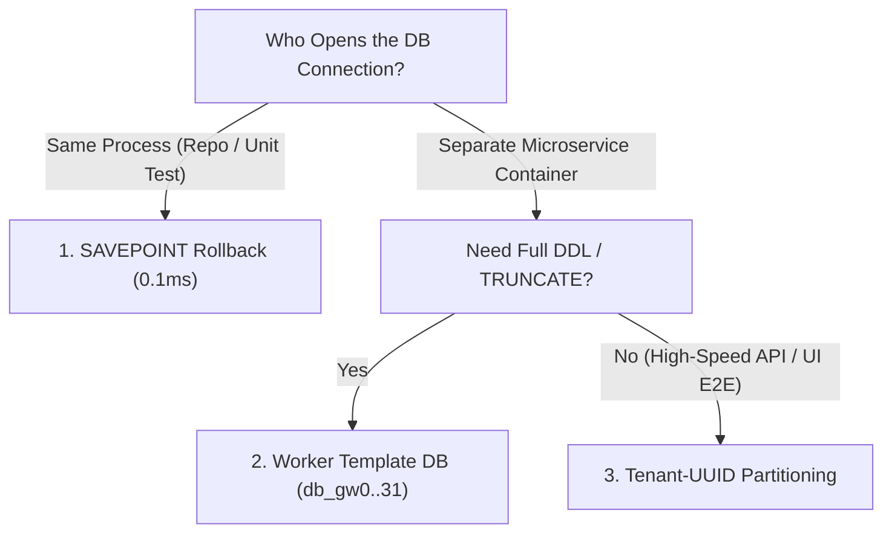

# Synthetic Test Data Seeding, Parallel DB Isolation & Connection Pool Math

```json continuity
{
  "previously": "In Module 2 (`Chapters 05–08`), we hardened `AeroLedger`'s indexes, query plans, MVCC seat locks, and zero-downtime migrations.",
  "painPoint": "Our 400 database integration tests pass when run 1-by-1, but when we run `pytest -n 32` (or Maven Surefire 32 threads) in CI: (1) Test A's `TRUNCATE TABLE bookings CASCADE` deletes Test B's mid-flight booking! (2) Inserting a `booking` fails with Foreign Key errors unless 4 parent tables are seeded in exact order; (3) 32 workers × 10 pool connections = 320 connections crashes PostgreSQL with `FATAL: sorry, too many clients already`!",
  "unlock": "Build AeroLedger v0.9: master the 3 Database Test Isolation Tiers (`SAVEPOINT` Rollback, Per-Worker DB Cloning `CREATE DATABASE ... TEMPLATE`, and Tenant-UUID Scoping), topological FK-graph builders, and HikariCP / PgBouncer sizing."
}
```

```json walkthrough
[
  {
    "time": "0:00",
    "badge": "Why Tests Collide",
    "title": "`TRUNCATE` and Hardcoded IDs (`'BK-1'`) Are Poison in Parallel CI!",
    "caption": "When 32 workers share one database, `TRUNCATE TABLE` wipes out rows created by other active workers, and hardcoded `'BK-1'` triggers `UniqueViolation`! Every test needs deterministic isolation.",
    "nodes": ["Worker 1: Inserts BK-1", "Worker 2: TRUNCATE!", "Worker 1: 404 Not Found!", "Flaky CI Pipeline"],
    "activeIndex": 1,
    "code": "-- NEVER run TRUNCATE or hardcoded IDs in shared parallel suites!\n-- Choose the right isolation tier for In-Process vs HTTP/E2E tests."
  },
  {
    "time": "0:25",
    "badge": "3 Isolation Tiers",
    "title": "Tier 1: `SAVEPOINT` Rollback (0.1ms) · Tier 2: Template DB per Worker · Tier 3: Tenant UUID",
    "caption": "In-process repository tests wrap each test in `SAVEPOINT sp_1 ... ROLLBACK TO SAVEPOINT sp_1` (0ms cleanup!). Multi-process E2E tests either clone a template DB per worker (`test_db_gw0..gw31`) or namespace every row by `tenant_id`!",
    "nodes": ["In-Process: SAVEPOINT", "Per-Worker: TEMPLATE DB", "Shared E2E: tenant_id UUID", "Zero Cross-Talk!"],
    "activeIndex": 0,
    "code": "-- Instant per-worker schema clone in PostgreSQL (<40ms):\nCREATE DATABASE aeroledger_worker_03 TEMPLATE aeroledger_migrated_base;"
  },
  {
    "time": "0:50",
    "badge": "FK Graph Seeder",
    "title": "Auto-Resolve Parent Foreign Keys with Deterministic Seeded Builders",
    "caption": "A `booking` requires a `flight`, which requires an `aircraft` and `airports`. A Fluent Topological Seeder automatically creates missing parent rows in DAG order using a seeded PRNG (`Random(seed)`) so failures reproduce 100%!",
    "nodes": ["seed=42", "1. airports", "2. flights", "3. bookings (FK Satisfied!)"],
    "activeIndex": 3,
    "code": "seeder = AeroLedgerSeeder(conn, seed=42)\nbooking = seeder.create_booking(fare_cents=44980)  # Auto-creates flight & airport!"
  },
  {
    "time": "1:15",
    "badge": "Pool Sizing Math",
    "title": "Why 20 Connections Beat 200 Connections: PostgreSQL Core Formula & `PgBouncer`",
    "caption": "PostgreSQL forks 1 OS process per connection. Too many active connections thrash CPU caches and spinlocks! Optimal pool size is `(2 * CPU_Cores) + Effective_Spindle_Count`, multiplexed across 32 workers via PgBouncer.",
    "nodes": ["32 CI Workers", "PgBouncer Transaction Pool", "16 Postgres Backend Procs", "Zero 'too many clients'"],
    "activeIndex": 1,
    "code": "// HikariCP standard sizing formula (PostgreSQL Wiki):\nint maxPoolSize = (cpuCores * 2) + 1; // e.g., 4 cores -> 9 connections!"
  }
]
```

```json pretraining
[
  {
    "term": "`SAVEPOINT` & `ROLLBACK TO SAVEPOINT`",
    "formula": "Nested Transaction Checkpoint -> Instant 0ms Undo",
    "meaning": "A SQL bookmark inside an open transaction that lets a test fixture undo all `INSERT`/`UPDATE`/`DELETE` mutations in `< 0.1ms` without touching disk or dropping tables."
  },
  {
    "term": "`CREATE DATABASE ... TEMPLATE`",
    "formula": "Run Migrations Once -> Clone Per Parallel Worker (`gw0..gw31`)",
    "meaning": "PostgreSQL feature that copies an already-migrated base database at the filesystem block level in milliseconds so each `pytest-xdist` or JUnit worker gets its own private database."
  },
  {
    "term": "Topological FK-Graph Seeding",
    "formula": "Parent Entities First (`Airports -> Flights -> Bookings`)",
    "meaning": "Inserting test data in Dependency DAG order on setup—and deleting in reverse LIFO order (`Bookings -> Flights -> Airports`) on teardown—so Foreign Key constraints never fail."
  },
  {
    "term": "Connection Pool Multiplexing (`HikariCP` / `PgBouncer`)",
    "formula": "Max Active DB Connections $\\approx (2 \\times \\text{Cores}) + \\text{Disks}$",
    "meaning": "Bounding physical database backend processes so hundreds of application/CI threads share a small pool of hot connections without exhausting `max_connections`."
  }
]
```

## 🌱 Step 1: Plain-English Mental Model — Three Ways to Keep 32 Chefs Out of Each Other's Soup

Why do database tests pass on a laptop (`1` worker) and fail randomly in CI (`32` parallel workers)? Because **databases are stateful**: if Worker 1 and Worker 2 share the same table and Worker 2 runs `TRUNCATE TABLE bookings`, Worker 2 just threw Worker 1's dinner into the trash mid-test!

Staff SDETs choose between **three battle-tested isolation patterns** depending on **who opens the database connection**:



1. **Same Process (`SAVEPOINT` Rollback)**: The test opens a transaction, creates a `SAVEPOINT`, runs the code, and rolls back at teardown. **Zero rows ever commit** (`0.1ms` teardown!).
2. **Separate Service Process (`CREATE DATABASE ... TEMPLATE` or `Tenant-UUID`)**: When testing an external HTTP microservice (`AeroCart`) over the network, the microservice commits its own transactions—so you isolate workers either by giving each worker its own cloned database (`db_worker_1`) or by scoping every API call with a unique **`X-Test-Tenant-ID: tenant-uuid`**!

---

## 🔨 Step 2: Zero-to-Running Starter & CLI — `SAVEPOINT` Fixture & Topological Seeder (`AeroLedger v0.9`)

Let's test `SAVEPOINT` rollback speed via CLI and build **`AeroLedger v0.9`** with a **Deterministic Topological Seeder** + **`SAVEPOINT` Test Harness** in Python 3 and Java 17:

```bash
# Verify nested SAVEPOINT rollback in built-in SQLite CLI:
sqlite3 :memory: "CREATE TABLE t(x INT); BEGIN; SAVEPOINT s1; INSERT INTO t VALUES (99); ROLLBACK TO s1; COMMIT; SELECT COUNT(*) FROM t;"
```

```python
from __future__ import annotations
import random, sqlite3
from dataclasses import dataclass

# Subgoal 1: Deterministic topological FK-graph seeder (Airports -> Flights -> Bookings)
@dataclass
class AeroLedgerTestSeeder:
    conn: sqlite3.Connection
    seed: int = 42

    def __post_init__(self) -> None:
        self._rng = random.Random(self.seed)

    def create_booking_graph(self, fare_cents: int | None = None) -> tuple[str, str]:
        suffix = f"{self._rng.randint(1000, 9999)}"
        flight_id = f"AI-{suffix}"
        booking_id = f"BK-{suffix}"
        actual_fare = fare_cents if fare_cents is not None else self._rng.choice([25000, 44980, 72000])
        # Insert parent flight FIRST, then child booking (satisfies FK DAG!)
        self.conn.execute("INSERT OR IGNORE INTO flights VALUES (?, 'BLR', 'SFO')", (flight_id,))
        self.conn.execute("INSERT INTO bookings VALUES (?, ?, ?)", (booking_id, flight_id, actual_fare))
        return flight_id, booking_id

# Subgoal 2: Run test inside SAVEPOINT and rollback in <0.1ms (leaving 0 leaked rows!)
conn = sqlite3.connect(":memory:", isolation_level=None)
conn.executescript("""
    PRAGMA foreign_keys = ON;
    CREATE TABLE flights  (flight_id TEXT PRIMARY KEY, origin TEXT, dest TEXT);
    CREATE TABLE bookings (booking_id TEXT PRIMARY KEY, flight_id TEXT REFERENCES flights(flight_id), fare_cents INT);
""")

conn.execute("BEGIN")
conn.execute("SAVEPOINT test_case_1")
seeder = AeroLedgerTestSeeder(conn, seed=101)
f_id, b_id = seeder.create_booking_graph(fare_cents=44980)
assert conn.execute("SELECT fare_cents FROM bookings WHERE booking_id = ?", (b_id,)).fetchone() == (44980,)

# Subgoal 3: Rollback savepoint -> database returns to 100% clean state instantly!
conn.execute("ROLLBACK TO SAVEPOINT test_case_1")
conn.execute("RELEASE SAVEPOINT test_case_1")
conn.execute("COMMIT")
assert conn.execute("SELECT COUNT(*) FROM bookings").fetchone()[0] == 0
print(f"AeroLedger v0.9 seeded {b_id} -> {f_id} and rolled back SAVEPOINT cleanly (0 leaked rows)!")
```

### Java 17 Equivalent

```java
import java.sql.*;

public class AeroLedgerV09SavepointHarness {
    // Subgoal 1: Execute any JDBC integration test inside an isolated Savepoint
    public static void runInRollbackSavepoint(Connection conn, SQLConsumer<Connection> testBody)
            throws SQLException {
        boolean prevAuto = conn.getAutoCommit();
        conn.setAutoCommit(false);
        Savepoint sp = conn.setSavepoint("test_isolation_sp");
        try {
            testBody.accept(conn);
        } finally {
            // Subgoal 2: Always rollback to Savepoint in finally block (0ms cleanup, zero table bloat)
            conn.rollback(sp);
            conn.releaseSavepoint(sp);
            conn.setAutoCommit(prevAuto);
        }
    }

    @FunctionalInterface
    public interface SQLConsumer<T> {
        void accept(T t) throws SQLException;
    }

    public static void main(String[] args) {
        assert AeroLedgerV09SavepointHarness.class.getSimpleName().contains("Savepoint");
    }
}
```

**Starter Walkthrough:**
- **Why `random.Random(self.seed)` instead of unseeded `uuid4()` or `Faker()`?** If a test fails in CI on seed `42198`, printing `--db-seed=42198` in the failure log lets any engineer reproduce the **exact same generated flight codes, fares, and edge-case strings** on their laptop instantly!

---

## 🛠️ Step 3: Everyday Practitioner Workflows & Where Naive Code Breaks

### High-Speed Bulk Seeding & Teardown Order

1. **Deleting in Reverse Topological (LIFO) Order**:
   - When cleaning up committed E2E tenant data without `ON DELETE CASCADE`, you MUST delete **children before parents** (`DELETE FROM baggage` $\to$ `DELETE FROM bookings` $\to$ `DELETE FROM flights`), mirroring the LIFO teardown stack from Course 02!
2. **Bulk Seeding 100,000 Rows in `< 200ms` (`COPY` vs. Row-by-Row `INSERT`)**:
   - Executing 100,000 individual `INSERT` statements over TCP takes **45+ seconds** (100,000 network roundtrips + 100,000 WAL `fsync` commits).
   - In PostgreSQL 17, **`COPY bookings FROM STDIN`** (or `cursor.copy()` in `psycopg 3` / `CopyManager` in Java `pgjdbc` / multi-row `UNNEST($1::text[], $2::bigint[])`) streams 100,000 rows in **one network stream (`~180ms` — `250x` faster!)**.

```json contrast
{
  "title": "Parallel Test Isolation & Bulk Data Seeding",
  "leftLabel": "❌ Naive `TRUNCATE` + 10,000 Single-Row `INSERT`s",
  "leftCode": "# 1. Wipes out other parallel CI workers & takes ACCESS EXCLUSIVE lock!\ncur.execute('TRUNCATE TABLE bookings CASCADE')\n\n# 2. 10,000 network roundtrips + 10,000 commits (18 seconds!):\nfor row in rows:\n    cur.execute('INSERT INTO bookings VALUES (%s, %s)', row)\n    conn.commit()",
  "rightLabel": "✅ Staff Tenant/Savepoint Isolation + Batch/COPY Seeding",
  "rightCode": "# 1. Scoped teardown (or SAVEPOINT rollback) never touches other workers:\ncur.execute('DELETE FROM bookings WHERE tenant_id = %s', (worker_tenant_id,))\n\n# 2. Single transaction + batched executemany / PostgreSQL COPY (<80ms!):\nwith conn:\n    cur.executemany('INSERT INTO bookings VALUES (?, ?, ?)', rows)"
}
```

```json poe
{
  "question": "You run 32 parallel `pytest-xdist` workers against a PostgreSQL test container configured with default `max_connections = 100`. Each worker boots an app instance with a SQLAlchemy/HikariCP pool of `max_pool_size = 5`. What happens during the test run?",
  "options": [
    "All 32 workers run smoothly",
    "`32 workers × 5 connections = 160 connections > 100`, causing intermittent `FATAL: sorry, too many clients already` errors under load!",
    "PostgreSQL automatically doubles `max_connections` at runtime",
    "Connections are shared across OS processes without PgBouncer"
  ],
  "answerIndex": 1,
  "explanation": "Each worker process maintains its own independent connection pool ($32 \\times 5 = 160 > 100$). Either cap per-worker pool size so $W \\times P_{\\text{worker}} < \\text{max\\_connections} - \\text{reserved}$ (e.g. `pool_size=2` per worker) or route through `PgBouncer` in transaction-pooling mode!"
}
```

---

## 🏢 Step 4: How Big Tech Runs It at Scale, Staff Math & Production Blueprint

### 🏢 In the Wild: Stripe & Shopify Parallel CI Database Architecture (`TEMPLATE` Cloning + `fsync=off`)

How do **Stripe**, **Shopify**, and **GitLab** run tens of thousands of PostgreSQL integration tests in under 3 minutes in CI?
1. **Ephemeral RAM-Backed Postgres Container (`tmpfs` + `fsync=off`)**:
   - In ephemeral CI containers (NEVER in production!), PostgreSQL mounts `/var/lib/postgresql/data` on a RAM disk (`tmpfs`) and starts with `-c fsync=off -c synchronous_commit=off -c full_page_writes=off`. Because a crashed CI container is simply discarded, skipping physical disk flushes speeds up schema migrations and test writes by **5x–12x**!
2. **Migrate Once, Clone 32 Times via `CREATE DATABASE ... TEMPLATE`**:
   - Instead of running 250 Flyway/Alembic migration files 32 separate times, the CI bootstrapper runs migrations **once** on `aeroledger_template`, then executes `CREATE DATABASE aeroledger_gw0 TEMPLATE aeroledger_template;` through `gw31` in `< 1.5s` total!

### Connection Pool Sizing & Worker Allocation Math

By PostgreSQL's canonical HikariCP/PostgreSQL Wiki benchmark formula, a database server with $C_{\text{cpu}}$ cores and $D_{\text{spindle}}$ disks achieves peak throughput (minimum context-switch & spinlock contention) at:

$$N_{\text{optimal\_active\_conns}} = (2 \times C_{\text{cpu}}) + D_{\text{spindle}}$$

And across $W$ parallel CI workers sharing a database with limit $M = \texttt{max\_connections}$ and superuser reserve $R$:

$$\text{Max Pool Size Per Worker } P_{\text{worker}} \le \left\lfloor \frac{M - R}{W} \right\rfloor \quad \left(\text{e.g. } \left\lfloor \frac{100 - 4}{32} \right\rfloor = 3 \text{ conns/worker}\right)$$

| Isolation Strategy | Setup / Teardown Speed | Supports External HTTP Microservices? | Best Fit |
| :--- | :--- | :--- | :--- |
| **`SAVEPOINT` Rollback** | **`~0.1 ms` (Fastest!)** | No (requires sharing the uncommitted DB conn) | In-process DAO/Repository/ORM integration tests |
| **`CREATE DATABASE ... TEMPLATE`** | `~30–50 ms` per worker at boot | **Yes** (each worker points service to `db_gwN`) | Parallel schema/migration tests & worker-isolated services |
| **`Tenant-UUID` Row Scoping** | **`~1 ms`** (zero DDL needed) | **Yes** (pass `X-Test-Tenant-ID` header) | High-concurrency E2E Playwright + API suites on shared staging |

### Production Blueprint: Parallel Tenant-Scoped Seeder & LIFO Cleaner

```python
from __future__ import annotations
import sqlite3
from dataclasses import dataclass, field


@dataclass
class TenantScopedHarnesses:
    """Thread-safe tenant-isolated test data factory with LIFO FK teardown."""
    conn: sqlite3.Connection
    tenant_id: str
    _created_bookings: list[str] = field(default_factory=list)
    _created_flights: list[str] = field(default_factory=list)

    def seed_flight_and_booking(self, seq: int, fare_cents: int) -> str:
        flight_id = f"{self.tenant_id}-FL-{seq}"
        booking_id = f"{self.tenant_id}-BK-{seq}"
        self.conn.execute(
            "INSERT INTO flights VALUES (?, ?)",
            (flight_id, self.tenant_id),
        )
        self._created_flights.append(flight_id)
        self.conn.execute(
            "INSERT INTO bookings VALUES (?, ?, ?, ?)",
            (booking_id, flight_id, self.tenant_id, fare_cents),
        )
        self._created_bookings.append(booking_id)
        self.conn.commit()
        return booking_id

    def teardown_lifo(self) -> None:
        # Delete children (bookings) BEFORE parents (flights) to honor Foreign Keys!
        self.conn.execute("DELETE FROM bookings WHERE tenant_id = ?", (self.tenant_id,))
        self.conn.execute("DELETE FROM flights WHERE tenant_id = ?", (self.tenant_id,))
        self.conn.commit()


if __name__ == "__main__":
    db = sqlite3.connect(":memory:")
    db.executescript("""
        PRAGMA foreign_keys = ON;
        CREATE TABLE flights  (flight_id TEXT PRIMARY KEY, tenant_id TEXT NOT NULL);
        CREATE TABLE bookings (
            booking_id TEXT PRIMARY KEY,
            flight_id  TEXT NOT NULL REFERENCES flights(flight_id),
            tenant_id  TEXT NOT NULL,
            fare_cents INTEGER NOT NULL
        );
    """)
    w1 = TenantScopedHarnesses(db, tenant_id="worker-01")
    w2 = TenantScopedHarnesses(db, tenant_id="worker-02")
    w1.seed_flight_and_booking(1, 40000)
    w2.seed_flight_and_booking(1, 55000)

    # Worker 1 tears down its tenant without affecting Worker 2!
    w1.teardown_lifo()
    surviving = db.execute("SELECT tenant_id, fare_cents FROM bookings").fetchall()
    assert surviving == [("worker-02", 55000)]
```

### Java 17 Equivalent

```java
import java.sql.*;
import java.util.*;

public final class BatchJdbcSeeder {
    public record SeedBooking(String bookingId, String flightId, String tenantId, long fareCents) {}

    // High-speed JDBC batch insert (rewriteBatchedStatements / pgjdbc multi-row batching)
    public static int bulkSeedBookings(Connection conn, List<SeedBooking> rows) throws SQLException {
        String sql = "INSERT INTO bookings (booking_id, flight_id, tenant_id, fare_cents) VALUES (?, ?, ?, ?)";
        boolean prevAuto = conn.getAutoCommit();
        conn.setAutoCommit(false);
        try (PreparedStatement ps = conn.prepareStatement(sql)) {
            for (SeedBooking r : rows) {
                ps.setString(1, r.bookingId());
                ps.setString(2, r.flightId());
                ps.setString(3, r.tenantId());
                ps.setLong(4, r.fareCents());
                ps.addBatch();
            }
            int[] counts = ps.executeBatch();
            conn.commit();
            return counts.length;
        } catch (SQLException ex) {
            conn.rollback();
            throw ex;
        } finally {
            conn.setAutoCommit(prevAuto);
        }
    }
}
```

> [!WARNING]
> **Hiring Bar-Raiser Gotcha — Why `SAVEPOINT` Rollback Tests Cannot Catch Missing `COMMIT` Bugs or Post-Commit Hooks!**
> In Senior/Staff SDET interviews, explain the trade-off of `SAVEPOINT` rollback fixtures: while `SAVEPOINT` is `100x` faster for repository unit tests, **it never executes a real `COMMIT` (`DEFERRED` constraints and `AFTER COMMIT` Kafka/outbox triggers do not fire until `COMMIT`)**! Therefore, always pair fast `SAVEPOINT` repository tests with a tier of real-commit **Tenant-UUID E2E tests** that exercise `DEFERRED` constraints and transactional outbox workers end-to-end.

*Up Next in Chapter 10 (Course 09 Capstone)*: We bring every skill together into **`AeroLedger v1.0`**—building a **Stripe-Grade Immutable Double-Entry Ledger (`SUM(debits) == SUM(credits)`), Kafka Transactional Outbox Reconciliation, and Automated Warehouse Data-QA Gates**!

```json quiz
[
  {
    "id": "sql09-q1",
    "question": "Why does running `TRUNCATE TABLE bookings CASCADE` inside the `afterEach` hook of a 32-worker parallel test suite cause flaky failures?",
    "options": [
      "`TRUNCATE` only deletes 10 rows at a time",
      "`TRUNCATE` acquires an `ACCESS EXCLUSIVE` table lock and wipes out rows actively being tested by the other 31 concurrent workers!",
      "`TRUNCATE` is not supported in PostgreSQL",
      "`TRUNCATE` corrupts B+Tree indexes"
    ],
    "answerIndex": 1,
    "explanation": "On a shared database, `TRUNCATE` is global across all connections—destroying concurrent workers' in-flight fixtures. Use `SAVEPOINT` rollbacks, per-worker `TEMPLATE` databases, or `DELETE WHERE tenant_id = ?`."
  },
  {
    "id": "sql09-q2",
    "question": "What is the fastest way in PostgreSQL CI to give 16 parallel test workers their own isolated, fully-migrated database without running 300 migration files 16 times?",
    "options": [
      "Run all 300 migrations sequentially 16 times",
      "Run the 300 migrations once on `test_template`, then run `CREATE DATABASE test_gw_N TEMPLATE test_template;` for each worker (`0..15`)",
      "Use `SELECT DISTINCT` in every test",
      "Disable all primary keys"
    ],
    "answerIndex": 1,
    "explanation": "`CREATE DATABASE ... TEMPLATE` copies the migrated base database at the filesystem level in milliseconds, avoiding redundant migration execution across workers."
  },
  {
    "id": "sql09-q3",
    "question": "When tearing down test data across tables `airports <- flights <- bookings <- baggage` (where arrows point from child Foreign Key to parent Primary Key), in what order must `DELETE` statements run?",
    "options": [
      "`airports`, then `flights`, then `bookings`, then `baggage`",
      "Reverse topological (LIFO) order: `baggage`, then `bookings`, then `flights`, then `airports` (children before parents)",
      "Alphabetical order by table name",
      "Random order"
    ],
    "answerIndex": 1,
    "explanation": "To satisfy Foreign Key constraints on teardown, child rows referencing a parent key must be deleted before the parent row itself is deleted."
  }
]
```

---

## 📋 Step 5: Master Cheat-Sheet, 60-Second Interview Pitch & Verified Sources

| CI / Test Challenge | Production-Grade Solution | Speed / Scale Impact |
| :--- | :--- | :--- |
| **In-Process Repo Test Cleanup** | `SAVEPOINT sp; ... ROLLBACK TO sp;` | `< 0.1ms` teardown, zero disk bloat |
| **Per-Worker Isolated DBs** | `CREATE DATABASE db_gwN TEMPLATE db_base;` | Clones 300 migrations in `~40ms` |
| **Shared Staging E2E Isolation** | `X-Test-Tenant-ID` (`tenant_id` column + LIFO delete) | 32/32 parallel workers with zero cross-talk |
| **Bulk Seed 100k Fixture Rows** | PostgreSQL `COPY ... FROM STDIN` / JDBC `executeBatch()` | `~180ms` vs. `45s` for single-row `INSERT`s |
| **Ephemeral CI Postgres Flags** | `tmpfs` + `fsync=off` + `synchronous_commit=off` | `5x–10x` faster CI container runs |

### 🎙️ 60-Second Interview Soundbite

> *"To run database-backed tests across 32 parallel CI workers with zero flakiness, I match the isolation tier to the test boundary. For in-process repository tests, I wrap each test in a `SAVEPOINT` and `ROLLBACK TO SAVEPOINT` at teardown—giving sub-millisecond cleanup with zero disk bloat. For multi-process service or E2E suites where the application commits its own transactions, I either clone a pre-migrated base database per worker using `CREATE DATABASE ... TEMPLATE` or enforce strict `tenant_id` UUID partitioning with deterministic seeded FK-graph builders that insert parents topologically and clean up children in LIFO order. Finally, I size worker connection pools so $W \times P_{\text{worker}} < \texttt{max\_connections}$ (or front Postgres with PgBouncer) so parallel CI never hits connection exhaustion."*

### 📚 Verified Primary Sources
- [PostgreSQL 17 Official Docs — `SAVEPOINT` & `ROLLBACK TO SAVEPOINT`](https://www.postgresql.org/docs/current/sql-savepoint.html)
- [PostgreSQL 17 Official Docs — `CREATE DATABASE ... TEMPLATE` & Bulk `COPY`](https://www.postgresql.org/docs/current/sql-copy.html)
- [Python 3 Official Docs — `sqlite3` Transaction Control & `executemany` Batching](https://docs.python.org/3/library/sqlite3.html)
