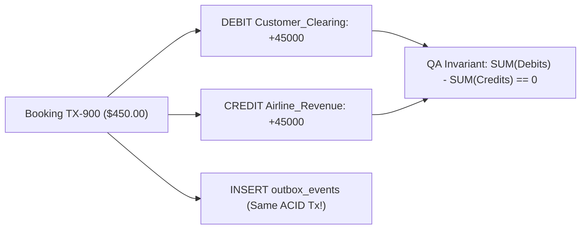

# Stripe-Grade Double-Entry Ledgers, Outbox CDC Reconciliation & Warehouse Data QA

```json continuity
{
  "previously": "Across Chapters 01–09, we evolved `AeroLedger` from Day-0 tables (`v0.1`) through grain-safe joins, window deduplication, B+Tree covering indexes, `EXPLAIN (ANALYZE, BUFFERS)`, MVCC seat locks, zero-downtime migrations, and 32-worker parallel test seeding (`v0.9`).",
  "painPoint": "In our final production audit before launch, two critical gaps emerged: (1) our wallet table used a mutable `UPDATE wallets SET balance_cents = balance_cents - 44980` column—so when a retry bug hit, $449.80 vanished with zero audit trail; (2) when the app crashed right after `COMMIT` but before publishing to Kafka, 12 confirmed bookings never reached the Snowflake/BigQuery analytics warehouse!",
  "unlock": "Ship AeroLedger v1.0 Capstone: enforce Stripe-style immutable Double-Entry Accounting (`SUM(debits) == SUM(credits)`), atomic Transactional Outbox CDC reconciliation, and automated 5-Pillar Data-QA contracts."
}
```

```json walkthrough
[
  {
    "time": "0:00",
    "badge": "Double-Entry Law",
    "title": "Never `UPDATE balance = balance - 400`! Append Balanced `DEBIT` + `CREDIT` Pairs",
    "caption": "In Stripe and airline settlement ledgers, money is never created, destroyed, or overwritten in place. Every $400 ticket appends at least two immutable ledger rows: `DEBIT Customer_Clearing $400` and `CREDIT Airline_Revenue $400`!",
    "nodes": ["Ticket Checkout ($400)", "Row 1: DEBIT Clearing +40000", "Row 2: CREDIT Revenue +40000", "Global SUM(Debit - Credit) == 0!"],
    "activeIndex": 3,
    "code": "-- The Fundamental Conservation of Money Invariant:\nSELECT COALESCE(SUM(debit_cents) - SUM(credit_cents), 0) AS drift\nFROM ledger_entries;  -- MUST ALWAYS EQUAL 0!"
  },
  {
    "time": "0:26",
    "badge": "Outbox CDC",
    "title": "Eliminate Dual-Write Orphans with a Same-Transaction `outbox_events` Table",
    "caption": "Publishing to Kafka inside an HTTP handler after `db.commit()` loses events if the pod crashes in between! Writing the `booking`, `ledger_entries`, and `outbox_events` row inside ONE ACID transaction guarantees 100% completeness.",
    "nodes": ["BEGIN ACID Tx", "1. INSERT booking", "2. INSERT ledger pair", "3. INSERT outbox_event -> COMMIT"],
    "activeIndex": 3,
    "code": "-- Reconciliation Anti-Join: must return 0 orphaned bookings!\nSELECT b.booking_id FROM bookings b\nWHERE NOT EXISTS (\n  SELECT 1 FROM outbox_events o WHERE o.aggregate_id = b.booking_id\n);"
  },
  {
    "time": "0:52",
    "badge": "Warehouse Recon",
    "title": "Cross-System Checksums: Reconciling OLTP Postgres vs. Analytical Warehouse",
    "caption": "How do you prove 10,000,000 OLTP rows arrived intact in BigQuery/Snowflake without copying all 10M rows back? Compare hourly bucket counts, `SUM(fare_cents)`, and order-independent XOR/hash aggregates!",
    "nodes": ["OLTP Hourly Rollup", "Warehouse Hourly Rollup", "Compare Count & Sum(Cents)", "Pinpoint Drifted Hour!"],
    "activeIndex": 2,
    "code": "SELECT substr(booked_at, 1, 13) AS hr,\n       COUNT(*) AS row_cnt,\n       COALESCE(SUM(fare_cents), 0) AS total_cents\nFROM bookings GROUP BY 1;"
  },
  {
    "time": "1:18",
    "badge": "5-Pillar Data QA",
    "title": "Automated Data Contracts: Completeness, Uniqueness, Conservation, Freshness & Drift",
    "caption": "AeroLedger v1.0 runs a deterministic 5-pillar SQL gate in CI and production cron: verifying zero ledger imbalance, zero outbox orphans, zero duplicate idempotency keys, SLA freshness, and schema contract parity.",
    "nodes": ["1. Conservation (0 Drift)", "2. Completeness (0 Orphans)", "3. Uniqueness (0 Dupes)", "4. Freshness & Schema Gate"],
    "activeIndex": 0,
    "code": "assert suite.run_all_invariants() == {'imbalance': 0, 'orphans': 0, 'duplicates': 0}"
  }
]
```

```json pretraining
[
  {
    "term": "Immutable Double-Entry Ledger",
    "formula": "$\\sum \\text{Debit Cents} - \\sum \\text{Credit Cents} = 0$",
    "meaning": "An append-only financial table where every transaction records equal and opposite `debit_cents` and `credit_cents` entries across accounts—never mutating or deleting historical rows."
  },
  {
    "term": "Transactional Outbox & CDC",
    "formula": "Domain Write + `outbox_events` Write in 1 ACID Commit",
    "meaning": "Saving outgoing Kafka/webhook events into a local `outbox_events` database table inside the same SQL transaction as the booking, then streaming them downstream via Change Data Capture (`Debezium` / WAL logical replication) or `SKIP LOCKED` workers."
  },
  {
    "term": "Bucketed Checksum Reconciliation",
    "formula": "Per-Hour `(COUNT(*), SUM(cents))` OLTP vs. Warehouse Diff",
    "meaning": "Comparing compact hourly or per-tenant aggregates between source OLTP databases and target analytical warehouses to isolate missing or corrupted CDC batches in milliseconds."
  },
  {
    "term": "5-Pillar Data Quality Contract",
    "formula": "Conservation · Completeness · Uniqueness · Freshness · Validity",
    "meaning": "The five measurable SQL invariants that Staff Data-QA suites run continuously to catch silent data corruption before finance reports or ML features consume bad data."
  }
]
```

## 🌱 Step 1: Plain-English Mental Model — Why Banks Never Use an Eraser

If a bank tracked your checking account with a single mutable column (`UPDATE accounts SET balance = 500`) and a software bug accidentally set it to `100`, **there is zero record of how `$400` disappeared**.

For 500+ years, accountants—and modern engineering teams at **Stripe, Uber, Square, and Airbnb**—have solved this with an **Immutable Double-Entry Ledger**:
1. **No Erasers (`INSERT`-Only)**: You never `UPDATE` or `DELETE` a posted ledger row. To refund a `$400` ticket, you append a new reversing pair of rows.
2. **Conservation of Money**: Every dollar comes *from* one account (`DEBIT`) and goes *to* another account (`CREDIT`). Across every transaction—and across the entire database—the sum of all debits minus the sum of all credits **must equal zero (`0`)**:



And notice the third box (`INSERT outbox_events`): by writing the outgoing Kafka/warehouse event inside the **exact same database transaction**, a pod crash can never create a confirmed booking without its matching downstream event!

---

## 🔨 Step 2: Zero-to-Running Starter & CLI — Double-Entry + Outbox Gate (`AeroLedger v1.0`)

Let's run our complete `AeroLedger v1.0` verification suite from the terminal and then build the core **Atomic Booking + Double-Entry Ledger + Outbox** transaction and reconciliation check in Python 3 and Java 17:

```bash
# Run the complete 5-check AeroLedger v1.0 verification suite:
python3 frameworks/data-validation/01-sql-reconciliation-and-isolation/reference_solution.py
```

```python
from __future__ import annotations
import sqlite3

# Subgoal 1: Create append-only double-entry ledger + transactional outbox tables
conn = sqlite3.connect(":memory:", isolation_level=None)
conn.executescript("""
    CREATE TABLE bookings (booking_id TEXT PRIMARY KEY, fare_cents INT NOT NULL CHECK (fare_cents > 0));
    CREATE TABLE ledger_entries (
        entry_id     INTEGER PRIMARY KEY AUTOINCREMENT,
        tx_id        TEXT NOT NULL,
        account_code TEXT NOT NULL,
        debit_cents  INTEGER NOT NULL DEFAULT 0 CHECK (debit_cents >= 0),
        credit_cents INTEGER NOT NULL DEFAULT 0 CHECK (credit_cents >= 0),
        CHECK ((debit_cents > 0 AND credit_cents = 0) OR (credit_cents > 0 AND debit_cents = 0))
    );
    CREATE TABLE outbox_events (event_id TEXT PRIMARY KEY, booking_id TEXT NOT NULL);
""")

# Subgoal 2: Commit booking + balanced DEBIT/CREDIT pair + outbox event in ONE atomic transaction
conn.execute("BEGIN IMMEDIATE")
conn.execute("INSERT INTO bookings VALUES ('BK-900', 45000)")
conn.executemany(
    "INSERT INTO ledger_entries (tx_id, account_code, debit_cents, credit_cents) VALUES (?, ?, ?, ?)",
    [("TX-900", "CUSTOMER_CLEARING", 45000, 0), ("TX-900", "AIRLINE_REVENUE", 0, 45000)],
)
conn.execute("INSERT INTO outbox_events VALUES ('EVT-900', 'BK-900')")
conn.execute("COMMIT")

# Subgoal 3: Assert zero monetary drift AND zero orphaned bookings missing an outbox event
imbalance = conn.execute("SELECT COALESCE(SUM(debit_cents) - SUM(credit_cents), 0) FROM ledger_entries").fetchone()[0]
orphans = conn.execute("""
    SELECT b.booking_id FROM bookings b
    WHERE NOT EXISTS (SELECT 1 FROM outbox_events o WHERE o.booking_id = b.booking_id)
""").fetchall()
assert imbalance == 0 and orphans == []
print("AeroLedger v1.0 verified: 0 ledger drift, 0 outbox orphans!")
```

### Java 17 Equivalent

```java
import java.sql.*;

public class AeroLedgerV10DoubleEntry {
    // Subgoal 1: Commit booking, double-entry debit/credit pair, and outbox event in one ACID tx
    public static void recordAtomicBookingLedger(
            Connection conn, String bookingId, String txId, long fareCents) throws SQLException {
        conn.setAutoCommit(false);
        try (PreparedStatement bk = conn.prepareStatement("INSERT INTO bookings VALUES (?, ?)");
             PreparedStatement le = conn.prepareStatement(
                 "INSERT INTO ledger_entries (tx_id, account_code, debit_cents, credit_cents) VALUES (?, ?, ?, ?)");
             PreparedStatement ob = conn.prepareStatement("INSERT INTO outbox_events VALUES (?, ?)")) {

            bk.setString(1, bookingId);
            bk.setLong(2, fareCents);
            bk.executeUpdate();

            // Entry 1: DEBIT Customer Clearing
            le.setString(1, txId);
            le.setString(2, "CUSTOMER_CLEARING");
            le.setLong(3, fareCents);
            le.setLong(4, 0L);
            le.addBatch();

            // Entry 2: CREDIT Airline Revenue
            le.setString(1, txId);
            le.setString(2, "AIRLINE_REVENUE");
            le.setLong(3, 0L);
            le.setLong(4, fareCents);
            le.addBatch();
            le.executeBatch();

            // Subgoal 2: Transactional Outbox row guarantees downstream Kafka/Warehouse delivery
            ob.setString(1, "EVT-" + bookingId);
            ob.setString(2, bookingId);
            ob.executeUpdate();

            conn.commit();
        } catch (SQLException ex) {
            conn.rollback();
            throw ex;
        }
    }

    public static void main(String[] args) {
        assert AeroLedgerV10DoubleEntry.class.getSimpleName().contains("DoubleEntry");
    }
}
```

**Starter Walkthrough:**
- Look at the `CHECK` constraint on `ledger_entries`: `CHECK ((debit_cents > 0 AND credit_cents = 0) OR (credit_cents > 0 AND debit_cents = 0))`. No entry can ever be negative, zero on both sides, or non-zero on both sides!
- Current account balance is simply derived from the immutable log (`SUM(credit_cents) - SUM(debit_cents)` for revenue/liability accounts) or cached in a materialized snapshot verified against the log.

---

## 🛠️ Step 3: Everyday Practitioner Workflows & Where Naive Code Breaks

### Catching Partial Ledger Postings & CDC Warehouse Drift

1. **Per-Transaction Balance Gate (`GROUP BY tx_id HAVING SUM(debit) != SUM(credit)`)**:
   - Checking only the global table `SUM(debit_cents) - SUM(credit_cents) == 0` can theoretically be fooled if Transaction A has `+$10` drift and Transaction B has `-$10` drift! Always assert **per-transaction conservation**:
     `SELECT tx_id FROM ledger_entries GROUP BY tx_id HAVING SUM(debit_cents) != SUM(credit_cents);` (must return **0 rows**!).
2. **Blocking Accidental `UPDATE` / `DELETE` on `ledger_entries`**:
   - Revoke `UPDATE, DELETE` permissions from the application database role on `ledger_entries` (or attach a `BEFORE UPDATE OR DELETE` trigger raising an exception) so even a buggy ORM call cannot mutate historical postings.

```json contrast
{
  "title": "Financial State Tracking & Event Publishing",
  "leftLabel": "❌ Mutable Balance + Dual-Write Kafka Publish",
  "leftCode": "# 1. Overwrites balance in place (no audit trail on retry bug):\ndb.execute('UPDATE accounts SET balance = balance - 45000 WHERE id = ?', (uid,))\ndb.commit()\n\n# 2. If pod crashes right here, Kafka & Warehouse NEVER learn about the charge!\nkafka_producer.send('bookings-topic', payload)",
  "rightLabel": "✅ Immutable Double-Entry + Transactional Outbox CDC",
  "rightCode": "# 1. Atomic ACID commit of booking + balanced ledger + outbox:\nwith db:\n    db.execute('INSERT INTO bookings ...')\n    db.execute('INSERT INTO ledger_entries ...')  # DEBIT + CREDIT\n    db.execute('INSERT INTO outbox_events ...')   # Same transaction!\n# 2. Debezium WAL CDC / SKIP LOCKED relay streams outbox -> Kafka!"
}
```

```json poe
{
  "question": "Your Data-QA pipeline checks global ledger conservation: `SELECT SUM(debit_cents) - SUM(credit_cents) FROM ledger_entries` and gets `0`. Yet a customer complains they were overcharged `$50`! How could a ledger bug slip past the global sum check, and what SQL catches it?",
  "options": [
    "`SUM` overflows on 64-bit integers",
    "Either (a) two buggy transactions had offsetting `+$50` and `-$50` imbalances, OR (b) the ledger was balanced (`$450` debit / `$450` credit) but disagreed with `bookings.fare_cents` (`$400`)! You need both `GROUP BY tx_id HAVING SUM(debit) != SUM(credit)` AND cross-table `bookings.fare_cents == ledger_entries.debit_cents` reconciliation!",
    "SQLite ignores `GROUP BY` on `TEXT` columns",
    "Credit rows are ignored by `SUM`"
  ],
  "answerIndex": 1,
  "explanation": "Internal ledger balance (`SUM(debits) == SUM(credits)` per `tx_id`) proves money wasn't created out of thin air, while external cross-table reconciliation (`bookings.fare_cents == ledger CUSTOMER_CLEARING debit`) proves the *right* amount was posted for every order!"
}
```

---

## 🏢 Step 4: How Big Tech Runs It at Scale, Staff Math & Production Blueprint

### 🏢 In the Wild: Stripe Clearing-Account Reconciliation & Netflix/Uber Warehouse Gates

At **Stripe**, **Uber**, and **Netflix**, data quality is enforced across two boundaries:
1. **Zero-Balance Clearing Accounts (Stripe Pattern)**:
   - When a customer checks out for `$450.00`, `Customer_Clearing` is debited `+45000`. When the payment processor settles the batch report 24 hours later, `Customer_Clearing` is credited `45000` and `Bank_Cash` is debited `45000`. Any item stuck in `Customer_Clearing` older than the settlement SLA window (`> 24h`) with a non-zero net balance automatically triggers a high-severity reconciliation alert!
2. **Write-Audit-Publish (`WAP`) in the Data Warehouse (Netflix / Uber Pattern)**:
   - Before nightly or streaming CDC tables in `Snowflake`/`BigQuery`/`Iceberg` are exposed to executive dashboards or ML feature stores, ETL jobs write into a staged branch/table, execute automated **5-Pillar SQL Data-Contract Audits** (row-count parity against OLTP hourly buckets, `0` duplicate primary keys via `ROW_NUMBER()`, null-rate thresholds, and freshness lag), and only publish/swap the table if 100% of assertions pass!

### Formal Double-Entry & Cross-System Reconciliation Equations

Let $D_{t,a}$ and $C_{t,a}$ be the debit and credit cents posted in transaction $t \in \mathcal{T}$ on account $a \in \mathcal{A}$. A valid `AeroLedger v1.0` state must satisfy three simultaneous invariants:

$$\underbrace{\forall t \in \mathcal{T}: \sum_{a \in \mathcal{A}} D_{t,a} - \sum_{a \in \mathcal{A}} C_{t,a} = 0}_{\text{1. Per-Transaction Double-Entry Conservation}}, \qquad \underbrace{\forall b \in \mathcal{B}_{\text{confirmed}}: \sum_{a=\text{Clearing}} D_{b,a} = \text{fare\_cents}(b)}_{\text{2. Booking-to-Ledger Parity}}$$

$$\underbrace{\forall h \in \text{Hours}: \left(\text{COUNT}_{\text{OLTP}}(h), \sum_{\text{OLTP}} \text{fare}(h)\right) = \left(\text{COUNT}_{\text{Warehouse}}(h), \sum_{\text{Warehouse}} \text{fare}(h)\right)}_{\text{3. OLTP-to-Warehouse Hourly Bucket Parity}}$$

| Data-QA Contract Pillar | Exact SQL Verification Pattern | Defect Caught |
| :--- | :--- | :--- |
| **1. Ledger Conservation** | `GROUP BY tx_id HAVING SUM(debit_cents) != SUM(credit_cents)` | Partial/unbalanced ledger postings |
| **2. Outbox Completeness** | `FROM bookings b WHERE NOT EXISTS (SELECT 1 FROM outbox o ...)` | Dual-write crash / missing Kafka event |
| **3. Warehouse Parity** | `SELECT hr, COUNT(*), SUM(cents) FROM oltp EXCEPT SELECT ... FROM dw` | Dropped CDC batch or duplicate ingestion |
| **4. Uniqueness & Dedup** | `GROUP BY idempotency_key HAVING COUNT(*) > 1` | At-least-once webhook retry leak |
| **5. Freshness SLA** | `EXTRACT(EPOCH FROM (NOW() - MAX(ingested_at))) < 300` | Stuck Debezium / Airflow / Kafka connector |

### Production Blueprint: Complete `AeroLedger v1.0` 5-Pillar Data-QA Gate

```python
from __future__ import annotations
import sqlite3
from dataclasses import dataclass


@dataclass(frozen=True)
class DataQualityAuditResult:
    unbalanced_tx_ids: list[str]
    fare_mismatch_bookings: list[str]
    missing_outbox_bookings: list[str]
    drifted_warehouse_hours: list[tuple[str, int, int]]

    @property
    def passed(self) -> bool:
        return not (
            self.unbalanced_tx_ids
            or self.fare_mismatch_bookings
            or self.missing_outbox_bookings
            or self.drifted_warehouse_hours
        )


def run_aeroledger_v1_audit(conn: sqlite3.Connection) -> DataQualityAuditResult:
    # 1. Per-transaction double-entry conservation check
    unbalanced = [
        r[0]
        for r in conn.execute("""
            SELECT tx_id FROM ledger_entries
            GROUP BY tx_id
            HAVING SUM(debit_cents) != SUM(credit_cents)
        """).fetchall()
    ]

    # 2. Booking fare vs. CUSTOMER_CLEARING ledger debit parity
    mismatches = [
        r[0]
        for r in conn.execute("""
            WITH clearing AS (
                SELECT booking_id, SUM(debit_cents) - SUM(credit_cents) AS net_debit
                FROM ledger_entries
                WHERE account_code = 'CUSTOMER_CLEARING'
                GROUP BY booking_id
            )
            SELECT b.booking_id
            FROM bookings b
            LEFT JOIN clearing c ON c.booking_id = b.booking_id
            WHERE b.fare_cents != COALESCE(c.net_debit, 0)
        """).fetchall()
    ]

    # 3. Transactional Outbox completeness (zero orphaned bookings)
    orphans = [
        r[0]
        for r in conn.execute("""
            SELECT b.booking_id FROM bookings b
            WHERE NOT EXISTS (
                SELECT 1 FROM outbox_events o WHERE o.booking_id = b.booking_id
            )
        """).fetchall()
    ]

    # 4. OLTP vs. Warehouse hourly bucket parity using EXCEPT
    drifted_hours = conn.execute("""
        SELECT SUBSTR(booked_at, 1, 13) AS hr, COUNT(*), COALESCE(SUM(fare_cents), 0)
        FROM bookings GROUP BY 1
        EXCEPT
        SELECT SUBSTR(booked_at, 1, 13) AS hr, COUNT(*), COALESCE(SUM(fare_cents), 0)
        FROM warehouse_bookings_fact GROUP BY 1
    """).fetchall()

    return DataQualityAuditResult(unbalanced, mismatches, orphans, drifted_hours)


if __name__ == "__main__":
    db = sqlite3.connect(":memory:")
    db.executescript("""
        CREATE TABLE bookings (booking_id TEXT PRIMARY KEY, booked_at TEXT, fare_cents INT);
        CREATE TABLE ledger_entries (tx_id TEXT, booking_id TEXT, account_code TEXT, debit_cents INT, credit_cents INT);
        CREATE TABLE outbox_events (event_id TEXT PRIMARY KEY, booking_id TEXT);
        CREATE TABLE warehouse_bookings_fact (booking_id TEXT PRIMARY KEY, booked_at TEXT, fare_cents INT);

        INSERT INTO bookings VALUES ('BK-1', '2026-11-11T10:15:00Z', 40000);
        INSERT INTO ledger_entries VALUES
            ('TX-1', 'BK-1', 'CUSTOMER_CLEARING', 40000, 0),
            ('TX-1', 'BK-1', 'AIRLINE_REVENUE',   0, 40000);
        INSERT INTO outbox_events VALUES ('EVT-1', 'BK-1');
        INSERT INTO warehouse_bookings_fact VALUES ('BK-1', '2026-11-11T10:15:00Z', 40000);
    """)
    audit = run_aeroledger_v1_audit(db)
    assert audit.passed is True
```

### Java 17 Equivalent

```java
import java.sql.*;
import java.util.*;

public final class AeroLedgerV10ReconciliationAuditor {
    public record UnbalancedTransaction(String txId, long netDeltaCents) {}

    public static List<UnbalancedTransaction> findUnbalancedTransactions(Connection conn) throws SQLException {
        String sql = """
            SELECT tx_id, SUM(debit_cents) - SUM(credit_cents) AS delta_cents
            FROM ledger_entries
            GROUP BY tx_id
            HAVING SUM(debit_cents) <> SUM(credit_cents)
            ORDER BY tx_id
            """;
        List<UnbalancedTransaction> broken = new ArrayList<>();
        try (PreparedStatement ps = conn.prepareStatement(sql);
             ResultSet rs = ps.executeQuery()) {
            while (rs.next()) {
                broken.add(new UnbalancedTransaction(rs.getString(1), rs.getLong(2)));
            }
        }
        return broken;
    }
}
```

> [!WARNING]
> **Hiring Bar-Raiser Gotcha — Why Reading `WHERE created_at > last_watermark` Misses In-Flight Transactions in CDC Polling!**
> Many engineers build incremental warehouse syncs or QA jobs by polling `SELECT * FROM bookings WHERE created_at > $last_seen_ts`. **Under MVCC, timestamps are assigned when a statement starts (`NOW()`), NOT when `COMMIT` finishes!** If Transaction A starts at `10:00:01.000` (slow, takes 3 seconds) and Transaction B starts at `10:00:02.000` and commits at `10:00:02.010`, a poller running at `10:00:02.500` sees Transaction B, advances `$last_seen_ts = 10:00:02.000`, and **permanently misses Transaction A** when it commits at `10:00:04.000`! Always stream from the **PostgreSQL Write-Ahead Log (WAL Logical Replication / Debezium LSN)** or use an `outbox_events` table drained with `FOR UPDATE SKIP LOCKED` + `published_at IS NULL`.

*Congratulations on completing Course 09 (`AeroLedger v0.1 -> v1.0`)!* You can now switch to **⚡ Revise Course** in the header (and click **⚡ Interview Cram**) to review all 10 chapters' Cheat-Sheets and 60-Second Interview Pitches on a single page!

```json quiz
[
  {
    "id": "sql10-q1",
    "question": "Why do financial systems like Stripe use an append-only Double-Entry Ledger (`debit_cents`, `credit_cents`) instead of updating a single `balance_cents` column in place?",
    "options": [
      "PostgreSQL `UPDATE` statements cannot modify `BIGINT` columns",
      "Append-only double-entry rows preserve an immutable audit trail and enforce mathematical conservation (`SUM(debits) == SUM(credits)` per transaction), catching partial writes or retry bugs immediately",
      "Double-entry tables use 50% less disk space",
      "B+Tree indexes only work on append-only tables"
    ],
    "answerIndex": 1,
    "explanation": "Mutating a balance column in place destroys history and masks bugs. Recording paired immutable debit/credit postings guarantees every cent has a traceable source and destination."
  },
  {
    "id": "sql10-q2",
    "question": "Why does polling `WHERE created_at > :last_watermark_ts` silently drop rows when replicating from an OLTP PostgreSQL database to a data warehouse?",
    "options": [
      "Timestamps in PostgreSQL only have 1-hour precision",
      "Transactions assign `created_at = NOW()` before `COMMIT`; a fast transaction with `ts=10:02` can commit before a slower concurrent transaction with `ts=10:01`, advancing the watermark past `10:01` before it becomes visible!",
      "`WHERE` clauses cannot compare `TIMESTAMPTZ` values",
      "Read replicas delete rows older than 5 seconds"
    ],
    "answerIndex": 1,
    "explanation": "Because MVCC hides uncommitted rows until commit time and commit order does not strictly match `NOW()` start order, timestamp-watermark polling misses straggling transactions unless it uses WAL logical replication (LSN order) or a lookback overlap window + deduplication."
  },
  {
    "id": "sql10-q3",
    "question": "How does the Transactional Outbox pattern prevent 'dual-write' inconsistency between PostgreSQL and Kafka?",
    "options": [
      "By disabling Kafka acknowledgments (`acks=0`)",
      "By inserting the outgoing event into an `outbox_events` table inside the exact same ACID database transaction as the business state change, then relaying committed outbox rows to Kafka asynchronously",
      "By running Kafka inside a PostgreSQL stored procedure",
      "By locking the entire database during HTTP requests"
    ],
    "answerIndex": 1,
    "explanation": "Writing both the domain rows (`bookings`, `ledger_entries`) and the `outbox_events` row in a single local ACID commit ensures either both succeed or both roll back together."
  }
]
```

---

## 📋 Step 5: Master Cheat-Sheet, 60-Second Interview Pitch & Verified Sources

| Reconciliation Layer | SQL Invariant / Pattern | Frequency |
| :--- | :--- | :--- |
| **Per-Tx Double-Entry Balance** | `SELECT tx_id FROM ledger GROUP BY tx_id HAVING SUM(debit) <> SUM(credit)` | Every CI run + 5m prod check |
| **Order-to-Ledger Amount Match** | `bookings.fare_cents == SUM(clearing_debit - clearing_credit)` | Every 15m prod check |
| **Transactional Outbox Drain** | `SELECT ... FROM outbox WHERE sent_at IS NULL LIMIT 100 FOR UPDATE SKIP LOCKED` | Continuous streaming / Debezium |
| **OLTP vs. Warehouse Parity** | Hourly `(COUNT(*), SUM(fare_cents))` diff via `EXCEPT` | Hourly Write-Audit-Publish gate |
| **Safe CDC Stream Source** | PostgreSQL Logical Replication (`pgoutput` / Debezium WAL LSN), NOT `created_at > ts` | Real-time CDC |

### 🎙️ 60-Second Interview Soundbite

> *"When architecting financial or order-lifecycle verification at scale, I never rely on mutable balance columns or dual-write Kafka calls. First, every monetary state change writes to an append-only Double-Entry Ledger inside the same ACID transaction as the booking and a `transactional_outbox` event—enforcing `CHECK` constraints so every row is strictly a positive debit or credit. Second, my automated Data-QA suite verifies three invariants continuously: per-transaction conservation (`GROUP BY tx_id HAVING SUM(debits) != SUM(credits)`), booking-to-clearing-account parity, and `NOT EXISTS` anti-joins ensuring zero bookings lack an outbox event. Finally, for OLTP-to-Warehouse pipelines, we stream from Postgres WAL LSNs rather than naive `created_at > watermark` polling—which drops out-of-order commits—and gate downstream warehouse tables with Write-Audit-Publish hourly bucket checksums."*

### 📚 Verified Primary Sources
- [Stripe Engineering — Designing Robust and Predictable APIs with Idempotency & Ledgers](https://stripe.com/blog/idempotency)
- [PostgreSQL 17 Official Docs — Logical Replication & Write-Ahead Log (`WAL`) Streaming](https://www.postgresql.org/docs/current/logical-replication.html)
- [PostgreSQL 17 Official Docs — Declarative Integrity Constraints (`CHECK`, `UNIQUE`, `FOREIGN KEY`)](https://www.postgresql.org/docs/current/ddl-constraints.html)
