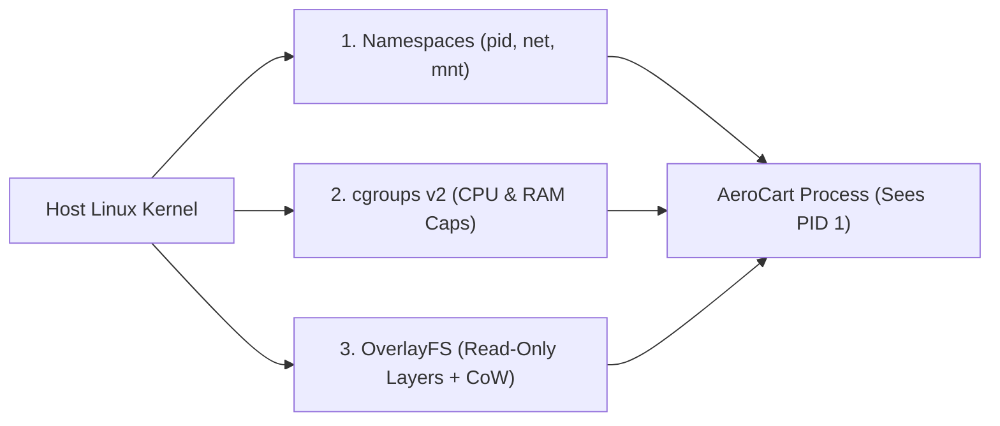

# Day-0 Containers: Linux Namespaces, cgroups v2 & OverlayFS Image Layers

```json continuity
{
  "previously": "Welcome to Day 1 of Course 10! Zero prior Docker, Linux kernel, or cloud infrastructure background is required.",
  "painPoint": "AeroCart's test suite passed on a developer's macOS laptop (Python 3.12, OpenSSL 3.3, local timezone PST) but crashed on the Ubuntu CI server (Python 3.10, OpenSSL 3.0, UTC)—the classic 'Works on My Machine' nightmare.",
  "unlock": "Launch AeroPipe v0.1: package AeroCart's exact runtime into a deterministic container by mastering Linux kernel namespaces (pid, net, mnt), cgroups v2 resource ceilings, and OverlayFS content-addressed image layers."
}
```

```json walkthrough
[
  {
    "time": "0:00",
    "badge": "Day-0 Mental Model",
    "title": "Houses (Virtual Machines) vs. Soundproofed Apartments (Containers)",
    "caption": "A hardware hypervisor Virtual Machine boots an entire guest operating system kernel and virtual hardware (gigabytes of RAM, 45s boot). A container shares the host Linux kernel and isolates a normal process in milliseconds.",
    "nodes": ["Host Linux Kernel", "Namespaces (What It Sees)", "cgroups v2 (What It Spends)", "OverlayFS (What It Reads)"],
    "activeIndex": 1,
    "code": "# A container is just a Linux process with 3 kernel guardrails:\n# 1. Namespaces: pid, net, mnt, uts, ipc, user\n# 2. cgroups v2: cpu.max, memory.max\n# 3. OverlayFS: immutable lowerdir + writable upperdir"
  },
  {
    "time": "0:25",
    "badge": "Namespaces",
    "title": "Kernel Namespaces: Private Illusions of PID 1, Network & Filesystem",
    "caption": "When Docker starts a container, the Linux kernel wraps the process in pid, net, and mnt namespaces. Inside the box, AeroCart believes it is PID 1 on a clean Debian filesystem with its own network card.",
    "nodes": ["Host PID 48291", "unshare / clone()", "Container PID 1", "Isolated /app Mount"],
    "activeIndex": 2,
    "code": "docker run --rm --cpus=1.5 --memory=256m python:3.12-slim \\\n  python3 -c \"import os; print('PID inside container:', os.getpid())\"\n# Prints: PID inside container: 1"
  },
  {
    "time": "0:50",
    "badge": "cgroups v2",
    "title": "Control Groups (cgroups v2): Hard Ceilings on CPU Quotas & Memory",
    "caption": "Namespaces restrict visibility, but not appetite. Linux cgroups v2 enforce cpu.max (CFS bandwidth quotas) and memory.max so a runaway test worker cannot starve neighboring containers on the same CI runner.",
    "nodes": ["cgroups v2 Hierarchy", "cpu.max (150000 100000)", "memory.max (268435456)", "OOM Killer (SIGKILL 9)"],
    "activeIndex": 2,
    "code": "# /sys/fs/cgroup/aeropipe/cpu.max -> '150000 100000' (1.5 CPUs)\n# /sys/fs/cgroup/aeropipe/memory.max -> '268435456' (256 MiB)"
  },
  {
    "time": "1:15",
    "badge": "OverlayFS",
    "title": "OverlayFS: Content-Addressed Immutable Layers + Copy-on-Write",
    "caption": "Ten containers running the same 400 MB base image do not use 4 GB of disk. They share read-only SHA-256 lowerdir layers and get a tiny ephemeral upperdir for runtime file writes.",
    "nodes": ["SHA-256 Base Layer", "SHA-256 App Layer", "Writable upperdir (CoW)", "Unified merged/ View"],
    "activeIndex": 3,
    "code": "mount -t overlay overlay \\\n  -o lowerdir=/layers/app:/layers/base,upperdir=/cow/rw,workdir=/cow/work \\\n  /containers/aeropipe/merged"
  }
]
```

```json pretraining
[
  {
    "term": "Linux Kernel Namespaces (pid, net, mnt)",
    "formula": "Process Visibility Filter = pid + net + mnt + uts + ipc + user",
    "meaning": "Kernel isolation walls that partition what a process can *see*—giving it its own private Process ID #1 (`pid`), network sockets/routing table (`net`), and root filesystem mount tree (`mnt`)."
  },
  {
    "term": "Control Groups (cgroups v2)",
    "formula": "Resource Meter & Ceiling = cpu.max + memory.max + pids.max",
    "meaning": "Kernel accounting rules that meter and cap how much hardware a process group can *consume*—throttling CPU microseconds when `cpu.max` is exceeded or triggering an OOM kill when `memory.max` is breached."
  },
  {
    "term": "OverlayFS & Copy-on-Write (CoW)",
    "formula": "merged = read-only lowerdir[] + writable upperdir",
    "meaning": "A union filesystem that stacks immutable, content-addressed (`sha256:...`) image layers beneath a thin writable container layer; modifying a lower file copies it up to `upperdir` on first write."
  },
  {
    "term": "Hardware Hypervisor VM vs. Container",
    "formula": "VM = Hardware Virtualization + Guest Kernel · Container = Shared Host Kernel",
    "meaning": "A Virtual Machine emulates hardware and runs a separate OS kernel per instance, whereas containers share the single host Linux kernel and start in ~50 milliseconds as isolated OS processes."
  }
]
```

## 🌱 Step 1: Plain-English Mental Model — Soundproofed Apartments vs. Detached Houses

Before containers, teams solved "Works on My Machine" by spinning up **Virtual Machines (VMs)**. A hardware hypervisor virtual machine is like building a **detached suburban house** for every microservice: each house pours its own concrete foundation, installs its own water heater and electrical grid (**a full guest OS kernel**), and takes minutes and gigabytes of RAM just to turn the lights on.

A **container** is not a tiny virtual machine—there is **no guest kernel inside a container**. Instead, think of a Linux host as a **high-rise apartment building** that shares one central plumbing and electrical grid (**the host Linux kernel**). When you run a container, the kernel simply puts a regular program inside a **soundproofed, metered studio apartment** using three built-in Linux features:



1. **Linux Kernel Namespaces (`pid`, `net`, `mnt`) — The Frosted Windows**: Namespaces control *what the process can see*. Your Python or Java process believes it is the only resident in the building (`PID 1`), with its own private network port (`8080`) and its own `/app` folder.
2. **Control Groups (`cgroups v2`) — The Utility Circuit Breaker**: Control groups control *how much the process can spend*. If a runaway test tries to eat 32 GB of RAM, the `cgroups v2` breaker trips at its `512 MB` ceiling so neighboring containers never lose power.
3. **OverlayFS Image Layers — The Shared Blueprint Catalog**: Ten containers running the same image share one read-only stack of base files on disk, writing temporary changes onto a thin scratchpad (**Copy-on-Write**) that vanishes when the container stops.

---

## 🔨 Step 2: Zero-to-Running Starter & CLI — Booting `AeroPipe v0.1`

Let's inspect how the `docker` CLI translates high-level flags directly into Linux kernel namespaces (`pid`, `net`, `mnt`), `cgroups v2` quotas, and OverlayFS layers:

```bash
# 1. Run an ephemeral container capped at 1.5 CPU cores and 256 MiB of RAM
docker run --rm --name aeropipe-v01 \
  --cpus="1.5" \
  --memory="256m" \
  python:3.12-slim \
  python3 -c "import os; print('Isolated PID:', os.getpid())"

# 2. Inspect content-addressed SHA-256 OverlayFS image layers
docker image inspect python:3.12-slim --format '{{json .RootFS.Layers}}'
```

Even without a Docker daemon running locally, we can model and verify **`AeroPipe v0.1`'s** `cgroups v2` quota math (`cpu.max`, `memory.max`) and OverlayFS Copy-on-Write layer stack directly in Python 3 and Java 17:

```python
from __future__ import annotations
import hashlib
from dataclasses import dataclass, field


# Subgoal 1: Translate --cpus and --memory CLI flags into Linux cgroups v2 kernel files
@dataclass(frozen=True)
class CgroupV2Spec:
    cpu_quota_us: int      # e.g., 150_000 microseconds per period
    cpu_period_us: int     # standard Linux CFS period: 100_000 us (100ms)
    memory_max_bytes: int  # hard RAM ceiling before kernel OOM killer fires

    @classmethod
    def from_docker_flags(cls, cpus: float, memory_mib: int) -> CgroupV2Spec:
        period = 100_000
        return cls(
            cpu_quota_us=int(cpus * period),
            cpu_period_us=period,
            memory_max_bytes=memory_mib * 1024 * 1024,
        )

    def format_cpu_max(self) -> str:
        return f"{self.cpu_quota_us} {self.cpu_period_us}"


# Subgoal 2: Model OverlayFS content-addressed lowerdir layers + Copy-on-Write upperdir
@dataclass
class OverlayFSContainer:
    lower_layers: list[dict[str, str]]
    upper_layer: dict[str, str] = field(default_factory=dict)

    def read_file(self, path: str) -> str:
        # Upper writable layer takes precedence over immutable lower layers (top-down)
        if path in self.upper_layer:
            return self.upper_layer[path]
        for layer in reversed(self.lower_layers):
            if path in layer:
                return layer[path]
        raise FileNotFoundError(path)

    def write_file_cow(self, path: str, content: str) -> str:
        # Copy-on-Write: writes never mutate lower_layers; they land in upper_layer
        self.upper_layer[path] = content
        return hashlib.sha256(content.encode()).hexdigest()[:12]


# Subgoal 3: Verify cgroups v2 formatting and Copy-on-Write isolation
cg = CgroupV2Spec.from_docker_flags(cpus=1.5, memory_mib=256)
assert cg.format_cpu_max() == "150000 100000"
assert cg.memory_max_bytes == 268_435_456

base_layer = {"/etc/os-release": "Debian 12", "/app/config.json": '{"env":"prod"}'}
container = OverlayFSContainer(lower_layers=[base_layer])
container.write_file_cow("/app/config.json", '{"env":"ci-test"}')

assert container.read_file("/app/config.json") == '{"env":"ci-test"}'
assert base_layer["/etc/os-release"] == "Debian 12"
assert base_layer["/app/config.json"] == '{"env":"prod"}', "Lower layer must stay immutable!"
print(f"AeroPipe v0.1 verified: cpu.max='{cg.format_cpu_max()}', CoW lower layer intact.")
```

### Java 17 Equivalent

```java
import java.util.*;

public class AeroPipeCh01Starter {
    // Subgoal 1: Represent cgroups v2 cpu.max and memory.max kernel specifications
    public record CgroupV2Config(long cpuQuotaUs, long cpuPeriodUs, long memoryMaxBytes) {
        public static CgroupV2Config fromFlags(double cpus, long memoryMiB) {
            long period = 100_000L;
            return new CgroupV2Config(Math.round(cpus * period), period, memoryMiB * 1024L * 1024L);
        }

        public String toCpuMaxString() {
            return cpuQuotaUs + " " + cpuPeriodUs;
        }
    }

    public static void main(String[] args) {
        CgroupV2Config cg = CgroupV2Config.fromFlags(1.5, 256);
        assert "150000 100000".equals(cg.toCpuMaxString());

        // Subgoal 2: Verify OverlayFS Copy-on-Write leaves lower immutable layer untouched
        Map<String, String> immutableLower = Map.of("/app/config.json", "{\"env\":\"prod\"}");
        Map<String, String> writableUpper = new HashMap<>();
        writableUpper.put("/app/config.json", "{\"env\":\"ci-test\"}");

        String mergedView = writableUpper.getOrDefault("/app/config.json", immutableLower.get("/app/config.json"));
        assert "{\"env\":\"ci-test\"}".equals(mergedView);
        assert "{\"env\":\"prod\"}".equals(immutableLower.get("/app/config.json"));
    }
}
```

**Quick Starter Walkthrough:**
- **How `--cpus="1.5"` works**: The Linux Completely Fair Scheduler (`CFS`) slices time into `100,000 µs` (`100 ms`) periods. Writing `150000 100000` into `/sys/fs/cgroup/.../cpu.max` grants the container's threads up to `150,000 µs` of CPU execution time every `100 ms` wall-clock window.
- **How OverlayFS protects base images**: Because `lowerdir` layers are mounted read-only and addressed by their SHA-256 content digest, `container.write_file_cow()` only writes to `upperdir`.

---

## 🛠️ Step 3: Everyday Practitioner Workflows & Where Naive Code Breaks

In day-to-day engineering, understanding namespaces, `cgroups v2`, and `OverlayFS` saves you from three classic container traps:
- **Inspecting live container namespaces on Linux**: `lsns` or `ls -l /proc/<pid>/ns` shows the exact `pid`, `net`, `mnt`, `ipc`, `uts`, and `user` namespace inodes attached to a container process.
- **Inspecting live cgroup throttling inside a container**: Reading `/sys/fs/cgroup/cpu.stat` reveals `nr_throttled` and `throttled_usec`—proving whether high API tail latency is caused by CPU quota throttling rather than slow code!
- **Checking real disk usage**: `docker system df -v` separates shared read-only image layers (`Shared Size`) from per-container Copy-on-Write scratch space (`Unique Size`).

### Where Naive Container Sizing Breaks: Host CPU Detection & Unbounded Memory

When a Python `pytest -n auto` or Java `ForkJoinPool.commonPool()` process runs inside a container on a **64-core CI host** with `--cpus=2` and **no `--memory` flag** (or using legacy host-level `os.cpu_count()`), the process sees all **64 host cores**, spawns 64 worker threads, gets violently throttled by `cgroups v2` after 3ms of every 100ms window, and allocates memory until the host kernel's OOM Killer assassinates the worker!

```json contrast
{
  "title": "Container Resource Boundaries & Worker Pool Sizing",
  "leftLabel": "❌ Naive Container (`os.cpu_count()` + Unbounded RAM)",
  "leftCode": "# 1. Unbounded container on a 64-core CI host:\ndocker run -d aerocart-tests:latest\n\n# 2. Naive app code inside container:\nimport os\n# Returns 64 (physical host cores!), spawning 64 workers\n# even when cgroups v2 cpu.max limits container to 2 cores!\nworkers = os.cpu_count()",
  "rightLabel": "✅ Staff Container (`cgroups v2` Quota-Aware + Pids Cap)",
  "rightCode": "# 1. Explicit CPU, Memory, Swap & Fork-Bomb limits:\ndocker run --rm --cpus=2.0 --memory=512m \\\n  --memory-swap=512m --pids-limit=256 aerocart-tests:1.0\n\n# 2. Quota-aware worker sizing (Python 3.13+ / cgroup v2):\n# Reads /sys/fs/cgroup/cpu.max (200000 / 100000 = 2 workers)\n# Java 17+ JVM uses -XX:+UseContainerSupport automatically!"
}
```

```json poe
{
  "question": "Before running the simulator: an AeroCart test container runs on a 32-core Linux CI machine with `--cpus=2.0` (`cpu.max = 200000 100000`). Inside the container, 8 parallel threads each try to run a 100% CPU-bound hash loop for 100ms of wall-clock time. What happens?",
  "options": [
    "All 8 threads run for the full 100ms because the host has 32 physical cores idle",
    "The container fails to start because threads cannot exceed `--cpus`",
    "The 8 threads burn through the 200,000µs cgroup quota in ~25ms of wall-clock time and are frozen (CFS throttled) for the remaining ~75ms of the 100ms period",
    "The Linux OOM killer terminates the container with exit code 137"
  ],
  "answerIndex": 2,
  "explanation": "Under Linux cgroups v2 CFS bandwidth control, CPU quota is accounted across ALL threads in the cgroup combined. Eight runnable threads consume 8µs of quota per 1µs of wall-clock time, exhausting the 200,000µs budget in 25ms (`200,000 / 8 = 25,000µs`) and pausing the container for the remaining 75ms!"
}
```

---

## 🏢 Step 4: How Big Tech Runs It at Scale, Staff Math & Production Blueprint

### 🏢 In the Wild: Google Borg, Spotify & Netflix Container Density

At **Google (Borg)**, **Spotify**, and **Netflix (Titus)**, tens of thousands of build, test, and microservice containers pack onto shared bare-metal fleets governed by `cgroups v2` and `OverlayFS`:
1. **CFS Quota Period Tuning & Throttling Elimination**: Netflix and Spotify discovered that bursts of multi-threaded Java/Python services inside tight `cpu.max` quotas suffered artificial `p99` latency spikes due to 100ms CFS throttling stalls. Sizing thread pools strictly to $\lceil Q_{\text{cpu}} / P_{\text{cpu}} \rceil$ (and using Java 17's `-XX:+UseContainerSupport -XX:ActiveProcessorCount=N`) eliminated cross-thread quota exhaustion.
2. **Copy-on-Write (`OverlayFS`) Write Amplification Avoidance**: When a container modifies a `500 MB` SQLite database or log file stored in a lower image layer, `OverlayFS` must **copy the entire 500 MB file up (`copy_up`)** from `lowerdir` to `upperdir` on the very first byte written! Big Tech CI runners mount scratch test databases and logs on `tmpfs` (RAM disk) or dedicated Docker volumes to bypass `OverlayFS` `copy_up` stalls completely.

### Staff Capacity & CFS Quota Math

In `cgroups v2`, a container's effective CPU ceiling $C_{\text{eff}}$ is the ratio of its quota $Q_{\text{us}}$ to the scheduler period $P_{\text{us}}$ (`cpu.max`), and if $N_{\text{threads}}$ active threads execute concurrently, the wall-clock time $T_{\text{stall}}$ spent throttled per period is:

$$C_{\text{eff}} = \frac{Q_{\text{us}}}{P_{\text{us}}}, \qquad T_{\text{stall}} = \max\left(0,\; P_{\text{us}} - \frac{Q_{\text{us}}}{N_{\text{threads}}}\right)$$

Meanwhile, for $M$ concurrent test containers sharing $L$ read-only image layers of size $S_i$ with per-container Copy-on-Write mutations $U_j$, total host disk footprint $D_{\text{total}}$ scales linearly with *unique mutations* rather than base image size:

$$D_{\text{total}} = \sum_{i=1}^{L} S_i + \sum_{j=1}^{M} U_j \ll M \times \sum_{i=1}^{L} S_i$$

| Isolation Mechanism | Startup Latency | Kernel / OS Overhead | Security Boundary | When to Use / When NOT to Use |
| :--- | :--- | :--- | :--- | :--- |
| **Linux Container (`Namespaces + cgroups v2`)** | **~50 ms** | **Shared Host Kernel (Near-0 RAM overhead)** | Process syscall boundary (`seccomp`, `AppArmor`) | **Default for CI jobs, Testcontainers & K8s microservices**. |
| **MicroVM (`Firecracker` / `gVisor`)** | **~125 ms** | Lightweight guest kernel / user-space syscall proxy | Hardware KVM / Virtualized syscall boundary | **Use for multi-tenant untrusted code execution** (e.g., AWS Lambda, public CI runners). |
| **Full Hardware Hypervisor VM (`EC2` / `KVM`)** | **30–60 sec** | Full Guest OS + Virtual PCI/BIOS (**512MB+ overhead**) | Hardware Hypervisor (`VT-x` / `AMD-V`) | **Use for outer node isolation** or running non-Linux OS kernels (Windows/macOS). **NEVER spin up a full VM per test case!** |

### Production Blueprint: `AeroPipe v0.1` Cgroup v2 Throttling & OverlayFS Inspector

```python
from __future__ import annotations
from dataclasses import dataclass


@dataclass(frozen=True)
class ContainerRuntimeAudit:
    effective_cpus: float
    recommended_workers: int
    Burst_unthrottled_ms: float
    throttled_stall_ms: float
    shared_image_mib: float
    total_cow_disk_mib: float


class AeroPipeContainerAuditor:
    """Evaluates cgroups v2 CFS throttling physics and OverlayFS CoW disk footprints."""

    @staticmethod
    def parse_cpu_max(cpu_max_line: str) -> tuple[ int | None, int ]:
        parts = cpu_max_line.strip().split()
        if parts[0] == "max":
            return None, int(parts[1])
        return int(parts[0]), int(parts[1])

    @classmethod
    def audit_runtime(
        cls,
        cpu_max_line: str,
        host_cores: int,
        active_threads: int,
        base_layers_mib: list[float],
        num_containers: int,
        cow_upper_mib_per_container: float,
    ) -> ContainerRuntimeAudit:
        quota_us, period_us = cls.parse_cpu_max(cpu_max_line)
        eff_cpus = float(host_cores) if quota_us is None else quota_us / period_us
        rec_workers = max(1, int(eff_cpus))

        period_ms = period_us / 1000.0
        if quota_us is None or active_threads <= eff_cpus:
            unthrottled_ms = period_ms
            stall_ms = 0.0
        else:
            unthrottled_ms = (quota_us / active_threads) / 1000.0
            stall_ms = max(0.0, period_ms - unthrottled_ms)

        shared_mib = sum(base_layers_mib)
        total_disk = shared_mib + (num_containers * cow_upper_mib_per_container)
        return ContainerRuntimeAudit(
            effective_cpus=round(eff_cpus, 2),
            recommended_workers=rec_workers,
            Burst_unthrottled_ms=round(unthrottled_ms, 2),
            throttled_stall_ms=round(stall_ms, 2),
            shared_image_mib=round(shared_mib, 2),
            total_cow_disk_mib=round(total_disk, 2),
        )


if __name__ == "__main__":
    # Audit 10 parallel test containers on a 32-core host with 2.0 CPUs each, spawning 8 naive threads
    audit = AeroPipeContainerAuditor.audit_runtime(
        cpu_max_line="200000 100000",
        host_cores=32,
        active_threads=8,
        base_layers_mib=[120.0, 210.0, 45.0],
        num_containers=10,
        cow_upper_mib_per_container=15.0,
    )
    assert audit.effective_cpus == 2.0
    assert audit.recommended_workers == 2
    assert audit.Burst_unthrottled_ms == 25.0
    assert audit.throttled_stall_ms == 75.0
    assert audit.shared_image_mib == 375.0
    assert audit.total_cow_disk_mib == 525.0  # 375 MiB shared + (10 * 15 MiB) CoW
```

### Java 17 Equivalent

```java
import java.util.List;

public final class AeroPipeCh01Blueprint {
    public record CfsAuditResult(
            double effectiveCpus,
            int recommendedWorkers,
            double unthrottledMs,
            double throttledStallMs,
            double totalOverlayDiskMiB) {}

    public static CfsAuditResult auditContainer(
            String cpuMaxLine,
            int hostCores,
            int activeThreads,
            List<Double> lowerLayersMiB,
            int containerCount,
            double upperCowMiB) {
        String[] parts = cpuMaxLine.trim().split("\\s+");
        long periodUs = Long.parseLong(parts[1]);
        double effCpus = "max".equals(parts[0])
                ? hostCores
                : (double) Long.parseLong(parts[0]) / periodUs;
        int workers = Math.max(1, (int) Math.ceil(effCpus));

        double periodMs = periodUs / 1000.0;
        double unthrottledMs = ("max".equals(parts[0]) || activeThreads <= effCpus)
                ? periodMs
                : (Long.parseLong(parts[0]) / (double) activeThreads) / 1000.0;
        double stallMs = Math.max(0.0, periodMs - unthrottledMs);

        double sharedBase = lowerLayersMiB.stream().mapToDouble(Double::doubleValue).sum();
        double totalDisk = sharedBase + (containerCount * upperCowMiB);
        return new CfsAuditResult(effCpus, workers, unthrottledMs, stallMs, totalDisk);
    }

    public static void main(String[] args) {
        CfsAuditResult res = auditContainer("200000 100000", 32, 8, List.of(120.0, 210.0, 45.0), 10, 15.0);
        assert res.effectiveCpus() == 2.0;
        assert res.throttledStallMs() == 75.0;
        assert res.totalOverlayDiskMiB() == 525.0;
    }
}
```

> [!WARNING]
> **Hiring Bar-Raiser Gotcha — OverlayFS `copy_up` Latency & Why `chmod -R` Doubles Image Size!**
> Because `OverlayFS` operates at the **file level (not block level)**, modifying even a single byte of a file—or running `chmod -R` / `chown -R` on a `/app/vendor` directory inherited from a previous image layer—triggers a full **`copy_up`**: the kernel duplicates the entire file into the new layer! Never run `chown -R` in a separate `RUN` step on large directories; use `COPY --chown=appuser:appgroup` so permissions are set as the layer is created.

*Up Next in Chapter 02*: Now that we know how containers isolate processes and stack `OverlayFS` layers, we will build `AeroPipe v0.2`—shrinking a bloated `1.18 GB` image that takes 4 minutes to rebuild down to a `78 MB` multi-stage BuildKit image that rebuilds in `1.4 seconds`!

```json quiz
[
  {
    "id": "infra01-q1",
    "question": "What is the fundamental architectural difference between a hardware hypervisor Virtual Machine and a Linux container?",
    "options": [
      "Containers emulate x86 CPU instructions in software while VMs run directly on bare metal",
      "A VM boots a separate guest OS kernel on virtualized hardware, whereas a container is an ordinary host OS process isolated by Linux kernel namespaces (`pid`, `net`, `mnt`), `cgroups v2`, and `OverlayFS`",
      "Containers cannot enforce memory ceilings without a hypervisor",
      "Virtual machines share the host `/proc` filesystem with all sibling VMs"
    ],
    "answerIndex": 1,
    "explanation": "Containers share the host Linux kernel and isolate processes using kernel namespaces (visibility), cgroups v2 (resource quotas), and OverlayFS (union filesystem layers), avoiding guest-kernel boot and RAM overhead."
  },
  {
    "id": "infra01-q2",
    "question": "Inside a Linux container using `cgroups v2`, `/sys/fs/cgroup/cpu.max` contains `150000 100000`. What does this enforce?",
    "options": [
      "The container can use up to 150,000 MB of RAM and 100,000 IOPS",
      "Across every 100,000µs (100ms) scheduler period, all threads in the container combined may consume at most 150,000µs (150ms) of CPU time—equivalent to 1.5 CPU cores",
      "The container is pinned exclusively to physical CPU core #15",
      "The container is killed with SIGKILL if a request takes longer than 150ms"
    ],
    "answerIndex": 1,
    "explanation": "In cgroups v2, `cpu.max` specifies `<quota_us> <period_us>`. A quota of 150,000µs per 100,000µs period grants 1.5 cores worth of CPU time per 100ms window before CFS throttling pauses the cgroup until the next period."
  },
  {
    "id": "infra01-q3",
    "question": "Why does running `chmod -R 755 /opt/sdk` in a new `Dockerfile` `RUN` instruction double the disk footprint of a 400 MB `/opt/sdk` directory from a parent layer?",
    "options": [
      "Docker compresses files with gzip before `chmod` and decompresses them afterward",
      "OverlayFS Copy-on-Write (`copy_up`) operates on whole files: changing metadata (permissions/ownership) on files in a read-only `lowerdir` copies the entire 400 MB of files into the new layer's `upperdir`",
      "The Linux `mnt` namespace duplicates all directories on every `RUN` command",
      "`cgroups v2` charges double memory for executable files"
    ],
    "answerIndex": 1,
    "explanation": "Because lower image layers are content-addressed and immutable, modifying even file permissions triggers an OverlayFS `copy_up` of the entire file into the new layer."
  }
]
```

---

## 📋 Step 5: Master Cheat-Sheet, 60-Second Interview Pitch & Verified Sources

| Kernel Pillar / CLI | Linux Kernel Interface (`cgroups v2` / `ns`) | Docker CLI Flag | Python 3 / Java 17 Runtime Behavior |
| :--- | :--- | :--- | :--- |
| **PID & Network Isolation** | `clone(CLONE_NEWPID \| CLONE_NEWNET \| CLONE_NEWNS)` | Default (isolated per container) | Process sees `PID 1` & private network interface `eth0` |
| **CPU Quota Throttling** | `/sys/fs/cgroup/cpu.max` (`<quota_us> <period_us>`) | `--cpus="1.5"` | Java 17 `-XX:+UseContainerSupport` sizes `ForkJoinPool` to quota; Python `<3.13` `os.cpu_count()` reads host cores! |
| **Hard Memory Ceiling** | `/sys/fs/cgroup/memory.max` (bytes) | `--memory="512m" --memory-swap="512m"` | Exceeding `memory.max` triggers kernel OOM killer (`SIGKILL` / Exit `137`) |
| **Fork-Bomb Protection** | `/sys/fs/cgroup/pids.max` | `--pids-limit=256` | Caps total threads/processes (`pthread_create` / `fork` returns `EAGAIN`) |
| **Union Filesystem Layers** | `mount -t overlay` (`lowerdir`, `upperdir`, `merged`) | `docker image inspect` / `docker diff` | Mount high-churn DB/log paths on `--tmpfs` or volumes to avoid `copy_up` stalls |

### 🎙️ 60-Second Interview Soundbite

> *"At the OS level, a container isn't a miniature virtual machine—it's a standard host Linux process wrapped in three kernel primitives: **namespaces** (`pid`, `net`, `mnt`, `ipc`, `uts`, `user`) that restrict what the process can see, **control groups (`cgroups v2`)** that meter and cap what it can spend via `cpu.max` and `memory.max`, and **OverlayFS** content-addressed layers that share immutable read-only `lowerdir` layers across containers with a thin Copy-on-Write `upperdir`. In CI/CD and production, two details separate Staff setups from naive ones: first, sizing test worker pools to the cgroup CPU quota rather than physical host cores so multi-threaded bursts don't suffer 75ms CFS throttling stalls; and second, keeping high-write scratch files off `OverlayFS` on `tmpfs` or volumes to eliminate Copy-on-Write `copy_up` I/O amplification."*

### 📚 Verified Primary Sources
- [Docker Official Documentation — Docker Overview & Underlying Container Technology](https://docs.docker.com/get-started/docker-overview/)
- [Docker Official Storage Drivers — How the OverlayFS Driver Works (`lowerdir`, `upperdir`, `copy_up`)](https://docs.docker.com/engine/storage/drivers/overlayfs-driver/)
- [Linux Kernel Official Documentation — Control Group v2 (`cpu.max`, `memory.max`, `pids.max`)](https://www.kernel.org/doc/html/latest/admin-guide/cgroup-v2.html)
