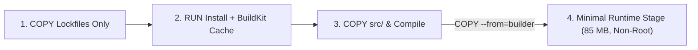

# Multi-Stage Dockerfiles, Lockfile Layer Caching, BuildKit Mounts & Non-Root Hardening

```json continuity
{
  "previously": "In Chapter 01, we launched `AeroPipe v0.1` and saw how Linux containers combine kernel namespaces, `cgroups v2` resource ceilings, and immutable `OverlayFS` layers.",
  "painPoint": "Our first `AeroPipe v0.1` `Dockerfile` started with `COPY . .` followed by `RUN pip install -r requirements.txt`. Every time a developer edited a 1-line comment in `test_checkout.py`, Docker invalidated the layer cache and spent 3 minutes re-downloading 85 packages—producing a bloated `1.18 GB` image running as `root` with `.git` secrets baked inside!",
  "unlock": "Evolve to AeroPipe v0.2: master lockfile-first layer cache ordering, multi-stage builds separating heavy compiler/SDK stages from minimal runtime images, BuildKit `--mount=type=cache`, `.dockerignore` hygiene, and non-root `USER` privilege dropping."
}
```

```json walkthrough
[
  {
    "time": "0:00",
    "badge": "Cache Cascade Trap",
    "title": "Why `COPY . .` Before Installing Dependencies Breaks Every CI Build",
    "caption": "Docker caches layers top-down like a stack of Jenga blocks. As soon as one layer's checksum changes, EVERY layer below it is invalidated and rebuilt from scratch!",
    "nodes": ["FROM base (HIT)", "COPY . . (MISS on code edit!)", "RUN install deps (FORCED RE-RUN!)", "3m 40s Wasted"],
    "activeIndex": 1,
    "code": "# ❌ Anti-pattern: editing any .py/.java file busts the dependency layer!\nCOPY . /app\nRUN pip install -r requirements.txt"
  },
  {
    "time": "0:25",
    "badge": "Lockfile-First",
    "title": "Copy Lockfiles First, Install Dependencies, Then Copy Source Code",
    "caption": "Because requirements.txt or pom.xml changes rarely while source code changes on every commit, copying lockfiles first keeps the heavy dependency layer 100% cached!",
    "nodes": ["COPY requirements.txt (HIT)", "RUN pip install (HIT - 0.0s!)", "COPY src/ (Rebuilds in 0.4s)", "Fast Image Ready"],
    "activeIndex": 1,
    "code": "# ✅ Lockfile-first ordering:\nCOPY pyproject.toml poetry.lock ./\nRUN --mount=type=cache,target=/root/.cache/pip pip install -r requirements.txt\nCOPY src/ ./src/"
  },
  {
    "time": "0:50",
    "badge": "Multi-Stage Builds",
    "title": "Leave the Scaffolding Behind: Builder Stage vs. Runtime Stage",
    "caption": "Compiling wheels or Maven JARs requires gcc, JDK compilers, and build caches (~900 MB). A multi-stage Dockerfile compiles in `AS builder` and copies only the clean artifact into a slim JRE/Python runtime image (~85 MB).",
    "nodes": ["Stage 1: AS builder (920 MB)", "Compile Wheels / JAR", "Stage 2: Runtime (85 MB)", "COPY --from=builder"],
    "activeIndex": 3,
    "code": "FROM eclipse-temurin:17-jdk-jammy AS builder\n# ... mvn package -DskipTests ...\nFROM eclipse-temurin:17-jre-jammy AS runtime\nCOPY --from=builder /workspace/target/aerocart.jar /app/aerocart.jar"
  },
  {
    "time": "1:15",
    "badge": "Security & Hygiene",
    "title": "`.dockerignore` Build Context & Non-Root `USER` Privilege Dropping",
    "caption": "Exclude `.git`, `node_modules`, and `.env` via `.dockerignore` so the build context transfers in milliseconds, and switch to a non-root UID (`USER 10001`) before `ENTRYPOINT`.",
    "nodes": [".dockerignore Filter", "Minimal Build Context", "USER appuser (UID 10001)", "Hardened OCI Image"],
    "activeIndex": 2,
    "code": "RUN groupadd -g 10001 aerogrp && useradd -u 10001 -g aerogrp -m aerouser\nUSER 10001:10001\nENTRYPOINT [\"python3\", \"-m\", \"aerocart\"]"
  }
]
```

```json pretraining
[
  {
    "term": "Layer Cache Cascade Invalidation",
    "formula": "Layer_k = MISS => Layer_{k+1..N} = MISS",
    "meaning": "Docker computes a cache key for each `Dockerfile` instruction (`COPY` file SHA-256 hashes or `RUN` command string); once any step misses cache, every subsequent instruction in that stage must re-execute."
  },
  {
    "term": "Multi-Stage Build (`AS builder` -> `COPY --from=builder`)",
    "formula": "Final Image = Runtime Base + Selected Build Artifacts Only",
    "meaning": "A single `Dockerfile` with multiple `FROM` statements where early stages contain compilers, SDKs, and build tools, while the final stage copies only compiled binaries/wheels into a minimal runtime image."
  },
  {
    "term": "BuildKit Cache Mount (`--mount=type=cache`)",
    "formula": "Persistent Build Cache Outside Image Layers",
    "meaning": "A BuildKit feature that mounts a persistent host directory (such as `/root/.cache/pip` or `/root/.m2`) during `RUN` without baking those gigabytes of downloaded archives into the final image layer."
  },
  {
    "term": "Build Context & `.dockerignore`",
    "formula": "Context Payload = Directory Tree - .dockerignore Patterns",
    "meaning": "The tarball of files sent to the BuildKit builder when `docker build .` starts; a `.dockerignore` file blocks `.git`, `.venv`, test reports, and local `.env` secrets from bloating the build or leaking into layers."
  }
]
```

## 🌱 Step 1: Plain-English Mental Model — Jenga Tower Caching & Leaving Construction Scaffolding Behind

Imagine baking a wedding cake where the recipe says:
1. Pour flour and sugar (**Base OS Layer**).
2. Write the couple's custom name in frosting on top (**Your Source Code**).
3. Bake the sponge cake for 3 hours (**Install 100 Dependencies**).

If the couple changes one letter in their name, you have to throw away the whole cake and bake for another 3 hours! That is exactly what happens when a `Dockerfile` puts `COPY . .` *before* installing dependencies.

In **Docker BuildKit**, instructions are stacked top-to-bottom like a **Jenga tower**. If layer #2 changes, layers #3, #4, and #5 above it tumble down and must rebuild from scratch. Ordering instructions from **least-frequently changed** (OS -> Lockfiles -> Dependencies) to **most-frequently changed** (Application Source Code) keeps the heavy steps 100% cached.

Even better, when construction workers finish building a skyscraper, they **do not leave the steel cranes, cement mixers, and scaffolding inside the penthouse**. A **multi-stage build** uses Stage 1 (`AS builder`) as the noisy construction yard with compilers (`gcc`, `javac`, `maven`) and Stage 2 (`AS runtime`) as the clean finished apartment:



---

## 🔨 Step 2: Zero-to-Running Starter & CLI — Building `AeroPipe v0.2`

First, always guard your build context with a `.dockerignore` file (`**/.git`, `**/.venv`, `**/target`, `**/.env`, `**/__pycache__`), and build using **Docker BuildKit**:

```bash
# 1. Verify BuildKit is active and build the hardened runtime stage of AeroPipe v0.2
DOCKER_BUILDKIT=1 docker build --target runtime -t aerocart-api:v0.2 .

# 2. Compare image size and verify the container runs as non-root UID 10001
docker images aerocart-api:v0.2
docker run --rm aerocart-api:v0.2 id -u
```

Here is the production multi-stage `Dockerfile` pattern alongside a runnable Python 3 and Java 17 **Dockerfile Layer Cache & Security Simulator** that models how lockfile-first ordering and multi-stage builds cut rebuild times from `180s` to `1.2s`:

```python
from __future__ import annotations
import hashlib
from dataclasses import dataclass


# Subgoal 1: Represent each Dockerfile instruction with its stage, inputs, and cost
@dataclass(frozen=True)
class DockerInstruction:
    stage: str
    cmd: str
    input_hash: str
    duration_sec: float
    size_mib: float


# Subgoal 2: Simulate Docker top-down layer cache invalidation and multi-stage pruning
def simulate_build(
    prev_instructions: list[DockerInstruction],
    curr_instructions: list[DockerInstruction],
    target_stage: str = "runtime",
) -> tuple[float, float, list[bool]]:
    cache_broken_in_stage: dict[str, bool] = {}
    hits: list[bool] = []
    rebuild_time_sec = 0.0
    final_stage_size_mib = 0.0

    for idx, curr in enumerate(curr_instructions):
        st = curr.stage
        prev = prev_instructions[idx] if idx < len(prev_instructions) else None
        is_hit = (
            not cache_broken_in_stage.get(st, False)
            and prev is not None
            and prev.stage == curr.stage
            and prev.cmd == curr.cmd
            and prev.input_hash == curr.input_hash
        )
        if not is_hit:
            cache_broken_in_stage[st] = True
            rebuild_time_sec += curr.duration_sec
        hits.append(is_hit)
        if st == target_stage:
            final_stage_size_mib += curr.size_mib

    return round(rebuild_time_sec, 2), round(final_stage_size_mib, 2), hits


# Subgoal 3: Compare a source-code edit under Lockfile-First Multi-Stage vs Naive Build
lock_hash = hashlib.sha256(b"pytest==8.3.0\nfastapi==0.115.0").hexdigest()[:8]
v1_src = hashlib.sha256(b"def checkout(): return 200").hexdigest()[:8]
v2_src = hashlib.sha256(b"def checkout(): return 201").hexdigest()[:8]

build_v1 = [
    DockerInstruction("builder", "FROM python:3.12-bookworm", "base1", 5.0, 920.0),
    DockerInstruction("builder", "COPY requirements.txt .", lock_hash, 0.2, 0.1),
    DockerInstruction("builder", "RUN pip wheel --wheel-dir=/wheels -r requirements.txt", lock_hash, 120.0, 210.0),
    DockerInstruction("runtime", "FROM python:3.12-slim", "slim1", 2.0, 48.0),
    DockerInstruction("runtime", "COPY --from=builder /wheels /wheels && pip install /wheels/*", lock_hash, 4.0, 35.0),
    DockerInstruction("runtime", "COPY src/ /app/src/", v1_src, 0.8, 2.0),
]
# Only v2_src changed! Lockfile and wheel layers remain 100% cache hits:
build_v2 = [*build_v1[:-1], DockerInstruction("runtime", "COPY src/ /app/src/", v2_src, 0.8, 2.0)]

rebuild_sec, final_mib, hit_map = simulate_build(build_v1, build_v2, target_stage="runtime")
assert rebuild_sec == 0.8, f"Expected 0.8s rebuild on source edit, got {rebuild_sec}s"
assert final_mib == 85.0, f"Builder stage (1130 MiB) excluded! Runtime is {final_mib} MiB"
assert hit_map == [True, True, True, True, True, False]
print(f"AeroPipe v0.2 verified: rebuild={rebuild_sec}s, runtime_size={final_mib} MiB, hits={hit_map}")
```

### Java 17 Equivalent

```java
import java.util.*;

public class AeroPipeCh02Starter {
    // Subgoal 1: Model Dockerfile instruction layer metadata
    public record LayerStep(String stage, String instruction, String contentDigest, double seconds, double sizeMiB) {}

    // Subgoal 2: Compute rebuild duration and final runtime image footprint
    public static double[] evaluateMultiStageBuild(List<LayerStep> prev, List<LayerStep> curr, String finalStage) {
        Set<String> invalidatedStages = new HashSet<>();
        double rebuildSeconds = 0.0;
        double finalImageMiB = 0.0;

        for (int i = 0; i < curr.size(); i++) {
            LayerStep c = curr.get(i);
            LayerStep p = i < prev.size() ? prev.get(i) : null;
            boolean hit = !invalidatedStages.contains(c.stage())
                    && p != null
                    && p.stage().equals(c.stage())
                    && p.instruction().equals(c.instruction())
                    && p.contentDigest().equals(c.contentDigest());
            if (!hit) {
                invalidatedStages.add(c.stage());
                rebuildSeconds += c.seconds();
            }
            if (finalStage.equals(c.stage())) {
                finalImageMiB += c.sizeMiB();
            }
        }
        return new double[]{rebuildSeconds, finalImageMiB};
    }

    public static void main(String[] args) {
        List<LayerStep> v1 = List.of(
                new LayerStep("builder", "COPY pom.xml .", "pom-sha1", 0.2, 0.1),
                new LayerStep("builder", "RUN mvn dependency:go-offline", "pom-sha1", 95.0, 650.0),
                new LayerStep("runtime", "FROM eclipse-temurin:17-jre-jammy", "jre-sha1", 1.5, 88.0),
                new LayerStep("runtime", "COPY --from=builder app.jar .", "src-v1", 0.9, 24.0)
        );
        List<LayerStep> v2 = List.of(
                v1.get(0), v1.get(1), v1.get(2),
                new LayerStep("runtime", "COPY --from=builder app.jar .", "src-v2", 0.9, 24.0)
        );
        double[] metrics = evaluateMultiStageBuild(v1, v2, "runtime");
        assert Math.abs(metrics[0] - 0.9) < 1e-6;
        assert Math.abs(metrics[1] - 112.0) < 1e-6;
    }
}
```

---

## 🛠️ Step 3: Everyday Practitioner Workflows & Where Naive Code Breaks

When writing production `Dockerfile`s for Python (`pytest` / `Playwright` / `FastAPI`) or Java (`Maven` / `Gradle` / `Spring Boot`), combine four BuildKit practitioner idioms:
1. **`# syntax=docker/dockerfile:1` at line 1**: Unlocks the latest BuildKit features including `--mount=type=cache`, `--mount=type=secret`, and `COPY --link`.
2. **BuildKit Cache Mounts (`RUN --mount=type=cache,target=/root/.cache/pip` or `target=/root/.m2`)**: Even when `requirements.txt` or `pom.xml` adds one new library, BuildKit reuses previously downloaded wheels/JARs from the persistent cache mount instead of re-fetching all 85 packages over the network!
3. **Combine `apt-get update && apt-get install` in a SINGLE `RUN` block**: Never split `RUN apt-get update` and `RUN apt-get install -y curl` into two lines—otherwise Docker caches the stale `apt-get update` index layer for months and fails with `404 Not Found` when you add a new package later.
4. **Drop Root Privileges (`USER 10001:10001`)**: By default, processes inside a Docker container run as `root` (`UID 0`). Always create a dedicated unprivileged user (`USER 10001`) before `ENTRYPOINT`.

```json contrast
{
  "title": "Single-Stage Naive Dockerfile vs. Multi-Stage BuildKit Hardened Dockerfile",
  "leftLabel": "❌ Naive Single-Stage (1.18 GB, Root, Cache-Busting)",
  "leftCode": "FROM python:3.12\nWORKDIR /app\n# 1. Copies .git, .venv, and source code FIRST!\nCOPY . .\n# 2. Separate apt-get update (stale cache bug)\nRUN apt-get update\nRUN apt-get install -y gcc libpq-dev\n# 3. Re-downloads all pip packages on every code edit\nRUN pip install -r requirements.txt\n# 4. Runs as UID 0 (root) with shell form CMD\nCMD python main.py",
  "rightLabel": "✅ Staff Multi-Stage BuildKit (85 MB, Non-Root, 1s Cache)",
  "rightCode": "# syntax=docker/dockerfile:1\nFROM python:3.12-bookworm AS builder\nWORKDIR /build\nCOPY requirements.lock .\nRUN --mount=type=cache,target=/root/.cache/pip \\\n    pip wheel --no-deps --wheel-dir /wheels -r requirements.lock\n\nFROM python:3.12-slim-bookworm AS runtime\nWORKDIR /app\nRUN groupadd -g 10001 aero && useradd -u 10001 -g aero -m aero\nCOPY --from=builder /wheels /wheels\nRUN pip install --no-cache-dir /wheels/* && rm -rf /wheels\nCOPY --chown=10001:10001 src/ ./src/\nUSER 10001:10001\nENTRYPOINT [\"python3\", \"-m\", \"src.main\"]"
}
```

```json poe
{
  "question": "Before running the simulator: a Dockerfile has Stage 1 (`FROM maven:3.9-eclipse-temurin-17 AS builder`) where step #2 is `COPY . .` and step #3 is `RUN mvn package -DskipTests` (without a BuildKit cache mount). A developer modifies one test assertion in `src/test/java/CheckoutTest.java` and runs `docker build`. What happens at step #2 and step #3?",
  "options": [
    "Step #2 and #3 are both cache hits because `-DskipTests` ignores `src/test/`",
    "Step #2 (`COPY . .`) misses cache because `CheckoutTest.java` is inside `.` (and not excluded by `.dockerignore`), cascading a cache miss to step #3 (`RUN mvn package`) and forcing a full dependency download",
    "Only `src/test/` is recompiled while `pom.xml` dependencies stay cached inside the image layer",
    "BuildKit automatically rewrites `COPY . .` into `COPY pom.xml .`"
  ],
  "answerIndex": 1,
  "explanation": "`COPY . .` hashes every file in the build context (not ignored by `.dockerignore`). Editing any file inside `.` changes the `COPY . .` layer checksum, which invalidates step #2 and cascades invalidation to step #3 (`RUN mvn package`), even though `-DskipTests` was passed!"
}
```

---

## 🏢 Step 4: How Big Tech Runs It at Scale, Staff Math & Production Blueprint

### 🏢 In the Wild: Uber & Netflix BuildKit DAGs & Distroless Runtime Images

At **Uber** and **Netflix**, developer platform teams run centralized BuildKit build farms that build 50,000+ container images per day across Java, Go, Python, and Node.js:
1. **Parallel Multi-Stage BuildKit DAGs**: Unlike the legacy Docker builder (which executed stages sequentially top-to-bottom), **BuildKit parses the `Dockerfile` into a concurrent Directed Acyclic Graph (DAG)**. Independent stages (`AS lint`, `AS unit-test`, `AS wheel-builder`, `AS frontend-assets`) execute in parallel, and stages not needed by `--target runtime` are skipped entirely.
2. **Exec Form `ENTRYPOINT ["java", "-jar", "app.jar"]` for Signal Forwarding (`PID 1`)**: When you write shell form `ENTRYPOINT java -jar app.jar`, Docker wraps your command in `/bin/sh -c "java -jar app.jar"`. Because `/bin/sh` becomes `PID 1` and **does not forward `SIGTERM` signals** to child processes, Kubernetes graceful shutdowns hang for 30 seconds before violently `SIGKILL`ing your app! Using JSON array **exec form** (`ENTRYPOINT ["java", "-jar", "/app/app.jar"]`) makes your application `PID 1` directly (or pairs it with `--init` / `tini`).

### Staff Build Latency & Pull Bandwidth Economics

For a CI pipeline running $R$ daily builds with lockfile change probability $p_{\text{lock}} \approx 0.03$ (3% of commits touch dependencies) vs. source code change probability $p_{\text{src}} = 1.0$, expected build time $\mathbb{E}[T_{\text{build}}]$ under lockfile-first caching vs. naive `COPY . .` is:

$$\mathbb{E}[T_{\text{naive}}] = T_{\text{deps}} + T_{\text{src}}, \qquad \mathbb{E}[T_{\text{lockfile-first}}] = p_{\text{lock}} \cdot T_{\text{deps}} + T_{\text{src}}$$

With $T_{\text{deps}} = 120\text{s}$, $T_{\text{src}} = 2\text{s}$, and $p_{\text{lock}} = 0.03$, expected build time drops from **$122\text{s}$ to $5.6\text{s}$ (a $21.8\times$ speedup)**! Meanwhile, shrinking runtime image size $S_{\text{img}}$ from $1,180\text{ MiB}$ to $85\text{ MiB}$ across $W$ ephemeral CI runners pulling at bandwidth $B_{\text{net}}$ saves network pull time $T_{\text{pull}} = \frac{W \cdot \Delta S_{\text{img}}}{B_{\text{net}}}$.

| Base Image Strategy | Typical Image Size | Shell / Package Manager Included? | `libc` Compatibility | When to Use / When NOT to Use |
| :--- | :--- | :--- | :--- | :--- |
| **Full SDK (`python:3.12` / `eclipse-temurin:17-jdk`)** | `900–1,100 MB` | Yes (`bash`, `apt`, `gcc`, `javac`) | `glibc` (Debian/Ubuntu) | **Use ONLY in `AS builder` stages**. Never ship compilers to production! |
| **Debian Slim (`python:3.12-slim` / `temurin:17-jre`)** | `75–160 MB` | Yes (`sh`, `apt-get`) | **`glibc` (100% manylinux wheel compatible)** | **Default for Python & Java runtime stages**. Fast pulls + zero `musl` wheel headaches. |
| **Alpine Linux (`python:3.12-alpine`)** | `45–60 MB` | Yes (`ash`, `apk`) | **`musl` libc** | **Great for static Go/Rust binaries**. **AVOID for Python ML/Data/Playwright** (`musl` breaks `manylinux` C-extension wheels and Chromium!). |
| **Google Distroless (`gcr.io/distroless/java17-debian12`)** | `50–120 MB` | **No shell (`sh`), no `apt`** | `glibc` | **Best for high-security production runtime stages** (blocks RCE shell spawns). Debug via `kubectl debug` ephemeral containers. |

### Production Blueprint: `AeroPipe v0.2` Static Dockerfile Linter & Cache Optimizer

```python
from __future__ import annotations
import re
from dataclasses import dataclass


@dataclass(frozen=True)
class DockerfileAuditReport:
    is_compliant: bool
    has_buildkit_syntax: bool
    is_multistage: bool
    runs_as_non_root: bool
    uses_exec_entrypoint: bool
    violations: list[str]


class AeroPipeDockerfileLinter:
    """Static analyzer enforcing AeroPipe v0.2 multi-stage, caching, and security laws."""

    @staticmethod
    def audit(dockerfile_text: str) -> DockerfileAuditReport:
        lines = [ln.strip() for ln in dockerfile_text.strip().splitlines() if ln.strip()]
        has_syntax = lines[0].startswith("# syntax=docker/dockerfile:1") if lines else False

        body_lines = [ln for ln in lines if not ln.startswith("#")]
        from_lines = [ln for ln in body_lines if ln.upper().startswith("FROM ")]
        is_multistage = len(from_lines) >= 2

        violations: list[str] = []
        if not has_syntax:
            violations.append("Missing '# syntax=docker/dockerfile:1' BuildKit directive on line 1")
        if not is_multistage:
            violations.append("Single-stage Dockerfile detected; separate builder and runtime stages")

        # Check for COPY . . appearing before dependency installation in the same stage
        copied_all_in_stage = False
        for ln in body_lines:
            upper = ln.upper()
            if upper.startswith("FROM "):
                copied_all_in_stage = False
            elif re.match(r"^COPY\s+(--\S+\s+)*\.\s+", ln, flags=re.IGNORECASE):
                copied_all_in_stage = True
            elif copied_all_in_stage and any(
                pkg in ln for pkg in ("pip install", "poetry install", "npm ci", "mvn ", "gradle ")
            ):
                violations.append(f"Cache-busting violation: '{ln}' runs after 'COPY . .' in the same stage")

        # Check for standalone apt-get update without install
        for ln in body_lines:
            if "apt-get update" in ln and "apt-get install" not in ln:
                violations.append("Standalone 'apt-get update' without 'apt-get install' in same RUN layer")

        # Check final stage USER and exec-form ENTRYPOINT/CMD
        user_lines = [ln for ln in body_lines if ln.upper().startswith("USER ")]
        runs_non_root = bool(user_lines) and not user_lines[-1].split()[1].startswith(("root", "0"))
        if not runs_non_root:
            violations.append("Final stage must switch to a non-root USER (e.g., USER 10001:10001)")

        ep_lines = [ln for ln in body_lines if ln.upper().startswith(("ENTRYPOINT", "CMD"))]
        uses_exec = bool(ep_lines) and "[" in ep_lines[-1] and "]" in ep_lines[-1]
        if not uses_exec:
            violations.append("Final ENTRYPOINT/CMD must use JSON exec array form [\"cmd\", \"arg\"] for SIGTERM forwarding")

        return DockerfileAuditReport(
            is_compliant=len(violations) == 0,
            has_buildkit_syntax=has_syntax,
            is_multistage=is_multistage,
            runs_as_non_root=runs_non_root,
            uses_exec_entrypoint=uses_exec,
            violations=violations,
        )


if __name__ == "__main__":
    good_dockerfile = """
    # syntax=docker/dockerfile:1
    FROM python:3.12-bookworm AS builder
    WORKDIR /build
    COPY requirements.lock .
    RUN --mount=type=cache,target=/root/.cache/pip pip wheel --wheel-dir /wheels -r requirements.lock

    FROM python:3.12-slim-bookworm AS runtime
    WORKDIR /app
    COPY --from=builder /wheels /wheels
    RUN pip install --no-cache-dir /wheels/* && rm -rf /wheels
    COPY --chown=10001:10001 src/ ./src/
    USER 10001:10001
    ENTRYPOINT ["python3", "-m", "src.main"]
    """
    report = AeroPipeDockerfileLinter.audit(good_dockerfile)
    assert report.is_compliant, f"Unexpected violations: {report.violations}"

    bad_dockerfile = """
    FROM python:3.12
    COPY . .
    RUN apt-get update
    RUN pip install -r requirements.txt
    CMD python main.py
    """
    bad_report = AeroPipeDockerfileLinter.audit(bad_dockerfile)
    assert not bad_report.is_compliant
    assert len(bad_report.violations) >= 4
```

### Java 17 Equivalent

```java
import java.util.*;

public final class AeroPipeCh02Blueprint {
    public record LintResult(boolean compliant, List<String> violations) {}

    public static LintResult lintDockerfile(String rawDockerfile) {
        List<String> lines = rawDockerfile.lines()
                .map(String::trim)
                .filter(s -> !s.isEmpty())
                .toList();
        List<String> violations = new ArrayList<>();

        if (lines.isEmpty() || !lines.get(0).startsWith("# syntax=docker/dockerfile:1")) {
            violations.add("Missing '# syntax=docker/dockerfile:1' header");
        }
        long fromCount = lines.stream().filter(l -> l.toUpperCase(Locale.ROOT).startsWith("FROM ")).count();
        if (fromCount < 2) {
            violations.add("Must use multi-stage build (>= 2 FROM instructions)");
        }

        boolean copiedAll = false;
        String lastUser = "root";
        String lastEntrypoint = "";
        for (String line : lines) {
            if (line.startsWith("#")) continue;
            String upper = line.toUpperCase(Locale.ROOT);
            if (upper.startsWith("FROM ")) copiedAll = false;
            if (line.matches("(?i)^COPY\\s+(--\\S+\\s+)*\\.\\s+.*")) copiedAll = true;
            if (copiedAll && (line.contains("pip install") || line.contains("mvn ") || line.contains("npm ci"))) {
                violations.add("Dependency install after 'COPY . .' busts layer cache");
            }
            if (upper.startsWith("USER ")) lastUser = line.substring(5).trim();
            if (upper.startsWith("ENTRYPOINT") || upper.startsWith("CMD")) lastEntrypoint = line;
        }
        if (lastUser.equals("root") || lastUser.startsWith("0")) {
            violations.add("Must drop privileges via non-root USER");
        }
        if (!lastEntrypoint.contains("[")) {
            violations.add("Must use JSON exec form for ENTRYPOINT/CMD");
        }
        return new LintResult(violations.isEmpty(), violations);
    }

    public static void main(String[] args) {
        String valid = """
                # syntax=docker/dockerfile:1
                FROM eclipse-temurin:17-jdk-jammy AS builder
                COPY pom.xml .
                RUN mvn dependency:go-offline
                FROM eclipse-temurin:17-jre-jammy AS runtime
                COPY --from=builder /app/target/app.jar /app/app.jar
                USER 10001:10001
                ENTRYPOINT ["java", "-jar", "/app/app.jar"]
                """;
        LintResult res = lintDockerfile(valid);
        assert res.compliant() : "Expected compliant Dockerfile, got: " + res.violations();
    }
}
```

> [!WARNING]
> **Hiring Bar-Raiser Gotcha — Never Pass Secrets via `ARG` or `ENV` in a `Dockerfile`!**
> Anything passed to `ARG NPM_TOKEN=...` or `ENV GITHUB_TOKEN=...`—or even deleted in a later `RUN rm ~/.npmrc` layer—is **permanently recorded in plain text inside `docker history <image>` and the lower `OverlayFS` layers**! Anyone who pulls the image can extract the secret in 5 seconds. Always inject build-time credentials using **BuildKit Secret Mounts**: `RUN --mount=type=secret,id=pip_netrc,target=/root/.netrc pip install ...` with `docker build --secret id=pip_netrc,src=.netrc .`, which mounts the secret in an ephemeral in-memory `tmpfs` during that single `RUN` step and leaves **zero trace** in any image layer.

*Up Next in Chapter 03*: Our `AeroCart` container image is now fast, tiny (`85 MB`), and non-root. Next, we launch `AeroPipe v0.3` with multi-container `Docker Compose` topologies (`Postgres 17 + Redis + AeroCart + Playwright`) and solve the #1 cause of flaky container startup failures: why `depends_on` lies about database readiness!

```json quiz
[
  {
    "id": "infra02-q1",
    "question": "Why should a `Dockerfile` copy only `pyproject.toml` / `poetry.lock` (or `pom.xml`) and run dependency installation *before* running `COPY src/ ./src/`?",
    "options": [
      "Docker refuses to execute `pip` or `mvn` if `.py` or `.java` files exist in the directory",
      "Because source code changes on almost every commit while lockfiles change rarely; placing lockfiles and dependency installation first keeps the expensive dependency layer cached across source-only edits",
      "It compresses the final image using Zstandard instead of gzip",
      "It prevents `cgroups v2` from throttling the compiler"
    ],
    "answerIndex": 1,
    "explanation": "Docker invalidates layer cache top-down. Copying lockfiles and installing dependencies before copying rapidly changing source files prevents source edits from busting the dependency layer cache."
  },
  {
    "id": "infra02-q2",
    "question": "What is the difference between `RUN --mount=type=cache,target=/root/.cache/pip pip install -r requirements.txt` and a normal `RUN pip install -r requirements.txt`?",
    "options": [
      "`--mount=type=cache` mounts a persistent BuildKit host cache directory during the `RUN` step without writing the downloaded wheel cache into the image layer, and preserves cached wheels across builds even when `requirements.txt` changes",
      "`--mount=type=cache` stores the cache inside the container's runtime RAM after deployment",
      "`--mount=type=cache` disables SSL verification for faster downloads",
      "There is no difference unless running on Kubernetes"
    ],
    "answerIndex": 0,
    "explanation": "BuildKit cache mounts persist the package manager's download cache across builds outside the image layers, avoiding both image bloat and full re-downloads when a single dependency is added to the lockfile."
  },
  {
    "id": "infra02-q3",
    "question": "Why do Staff Engineers enforce JSON exec form (`ENTRYPOINT [\"java\", \"-jar\", \"app.jar\"]`) instead of shell form (`ENTRYPOINT java -jar app.jar`)?",
    "options": [
      "Shell form is deprecated and causes a syntax error in BuildKit",
      "Shell form wraps the process in `/bin/sh -c`, making `/bin/sh` PID 1; `/bin/sh` does not forward `SIGTERM` signals to child processes, breaking graceful shutdowns and causing 30s timeouts followed by `SIGKILL`",
      "Exec form automatically enables multi-stage builds",
      "Shell form cannot read environment variables at runtime"
    ],
    "answerIndex": 1,
    "explanation": "In shell form, `/bin/sh` becomes PID 1 inside the container's `pid` namespace and ignores/drops `SIGTERM` instead of forwarding it to the application process."
  }
]
```

---

## 📋 Step 5: Master Cheat-Sheet, 60-Second Interview Pitch & Verified Sources

| Dockerfile / BuildKit Concern | Anti-Pattern (`❌ Naive`) | Staff Standard (`✅ AeroPipe v0.2`) | Why It Matters |
| :--- | :--- | :--- | :--- |
| **Instruction Ordering** | `COPY . .` then `RUN pip install` | `COPY requirements.lock .` -> `RUN pip install` -> `COPY src/` | Prevents 1-line code edits from busting the dependency cache |
| **Compiler / SDK Isolation** | Single-stage `FROM python:3.12` (`1.1 GB`) | `FROM ... AS builder` -> `COPY --from=builder` into `-slim`/`-jre` (`85 MB`) | Strips compilers (`gcc`/`javac`) & cuts pull latency by 10x |
| **Package Manager Cache** | Re-downloading all packages on lockfile diff | `RUN --mount=type=cache,target=/root/.cache/pip` (or `/root/.m2`) | Reuses cached wheels/JARs across lockfile updates without bloating layers |
| **Build-Time Secrets** | `ARG PIP_TOKEN` or `COPY .npmrc` + `RUN rm` | `RUN --mount=type=secret,id=netrc,target=/root/.netrc` | Ephemeral `tmpfs` mount; zero secret leakage in `docker history` |
| **Runtime Process & User** | Root (`UID 0`) + `CMD python app.py` | `USER 10001:10001` + `ENTRYPOINT ["python3", "app.py"]` | Drops root privileges & ensures `PID 1` receives `SIGTERM` cleanly |

### 🎙️ 60-Second Interview Soundbite

> *"When I design or audit a `Dockerfile` for CI/CD, I optimize for three things: cache hit ratio, minimal attack surface, and signal hygiene. First, I guard the build context with `.dockerignore` and order instructions from least-to-most volatile—copying only lockfiles (`poetry.lock`, `pom.xml`) and running dependency installation with BuildKit `--mount=type=cache` before copying application source code, so code commits rebuild in under two seconds. Second, I use multi-stage builds (`AS builder` to `AS runtime`) so compilers, headers, and test caches stay out of the final image, shrinking it from over a gigabyte to ~80 MB on `debian-slim` or `distroless`. Finally, I never pass secrets via `ARG` or `ENV`—I use `--mount=type=secret`—and I always switch to a non-root `USER 10001` with JSON exec-form `ENTRYPOINT` so the app runs as PID 1 and handles `SIGTERM` graceful shutdowns cleanly."*

### 📚 Verified Primary Sources
- [Docker BuildKit Official Documentation — Multi-Stage Builds (`AS builder`, `COPY --from`)](https://docs.docker.com/build/building/multi-stage/)
- [Docker Build Official Documentation — Optimize Cache Usage & BuildKit `--mount=type=cache`](https://docs.docker.com/build/cache/)
- [Docker Official Guide — Building Best Practices (`.dockerignore`, Layer Ordering, Non-Root `USER`)](https://docs.docker.com/build/building/best-practices/)
