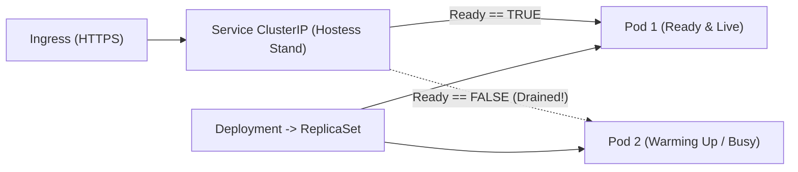

# Kubernetes Workloads: Pods, Deployments, Services, QoS Classes & Three-Probe Topologies

```json continuity
{
  "previously": "In Module 1 (`Chapters 01–04`), we mastered single-host containers, multi-stage BuildKit images, Docker Compose DAGs, and hermetic Testcontainers (`AeroPipe v0.1 -> v0.4`).",
  "painPoint": "When we deployed `AeroCart` across a 10-node Kubernetes cluster, two disasters struck during our Black Friday load test: (1) our JVM service took 28 seconds to warm up, so `livenessProbe` killed it at `t=15s` in an infinite restart loop; (2) our `livenessProbe` checked `SELECT 1` on PostgreSQL—so when the DB hiccuped for 4 seconds, Kubernetes simultaneously restarted all 20 healthy `AeroCart` pods, turning a minor blip into a 15-minute total outage!",
  "unlock": "Evolve to AeroPipe v0.5: master the Kubernetes routing hierarchy (`Ingress -> Service -> ReplicaSet -> Pod`), decouple `startupProbe`, `readinessProbe`, and `livenessProbe`, and configure CPU/Memory `requests` vs. `limits`."
}
```

```json walkthrough
[
  {
    "time": "0:00",
    "badge": "K8s Routing Hierarchy",
    "title": "Why Clients Never Call Pod IPs Directly: Ingress -> Service -> Pod",
    "caption": "Pods are mortal cattle: whenever a Pod scales or restarts, it gets a brand-new IP address. A Kubernetes `Service` (`ClusterIP`) provides a stable virtual IP and DNS name that load-balances only across currently *Ready* Pods.",
    "nodes": ["Ingress (L7 HTTP/TLS)", "Service (Stable ClusterIP)", "EndpointSlice (Ready IPs Only)", "Deployment -> ReplicaSet -> Pods"],
    "activeIndex": 2,
    "code": "# Traffic only routes to Pods whose readinessProbe == PASS!\nIngress (aerocart.io) -> Service (aerocart-svc:80) -> Ready Pod IPs (10.244.1.8:8080)"
  },
  {
    "time": "0:25",
    "badge": "startupProbe",
    "title": "Probe 1 (`startupProbe`): Hold Off Liveness Until Cold Boot Finishes",
    "caption": "As long as `startupProbe` is running, `livenessProbe` and `readinessProbe` are disabled! Give slow-starting apps (JVM / ML model loaders) a generous startup budget (`failureThreshold: 30 * periodSeconds: 2 = 60s`) while keeping post-boot liveness detection fast.",
    "nodes": ["Pod Created", "startupProbe Polls (/healthz/live)", "Cold Boot Complete (28s)", "Hand Off to Liveness & Readiness"],
    "activeIndex": 1,
    "code": "startupProbe:\n  httpGet: { path: /healthz/live, port: 8080 }\n  periodSeconds: 2\n  failureThreshold: 30 # Up to 60s for cold boot!"
  },
  {
    "time": "0:50",
    "badge": "Readiness vs. Liveness",
    "title": "Probe 2 (`readinessProbe` = Traffic Gate) vs. Probe 3 (`livenessProbe` = Restart Trigger)",
    "caption": "When `readinessProbe` fails, K8s removes the Pod IP from the Service EndpointSlice (zero restarts!). When `livenessProbe` fails, `kubelet` kills and restarts the container. NEVER check downstream DBs in `livenessProbe`!",
    "nodes": ["DB Slowdown (4s)", "readinessProbe FAILS (Drain Traffic)", "livenessProbe PASSES (Shallow Check)", "Zero Cascading Restarts!"],
    "activeIndex": 1,
    "code": "# readinessProbe (/healthz/ready): checks local cache warm + DB pool available\n# livenessProbe  (/healthz/live):  checks ONLY local event loop / deadlock (NO DB calls!)"
  },
  {
    "time": "1:15",
    "badge": "Requests vs. Limits",
    "title": "Resource `requests` (`kube-scheduler` Reservation) vs. `limits` (`cgroups v2` Cap)",
    "caption": "`requests` tell `kube-scheduler` how much CPU/RAM a node must have free to place the Pod. `limits` configure the kernel `cgroups v2` ceiling: exceeding CPU limit throttles (`cpu.max`), while exceeding Memory limit triggers an immediate `OOMKilled` (Exit 137)!",
    "nodes": ["requests (Scheduling Guarantee)", "limits.cpu (CFS Throttle)", "limits.memory (OOMKill 137)", "QoS Class (Guaranteed / Burstable)"],
    "activeIndex": 3,
    "code": "resources:\n  requests: { cpu: \"500m\", memory: \"512Mi\" }\n  limits:   { memory: \"512Mi\" } # Equal memory request == limit prevents node OOM eviction!"
  }
]
```

```json pretraining
[
  {
    "term": "Pod, ReplicaSet, Deployment & Service (`ClusterIP`)",
    "formula": "Deployment -> manages ReplicaSet -> maintains N Pods <- routed by Service",
    "meaning": "A **Pod** is the smallest deployable unit (1+ containers sharing a `net` namespace/IP); a **Deployment** manages rolling updates across **ReplicaSets**; a **Service** routes traffic only to Pods passing their `readinessProbe`."
  },
  {
    "term": "`startupProbe` vs. `readinessProbe` vs. `livenessProbe`",
    "formula": "Startup = Boot Gate · Readiness = Traffic Gate · Liveness = Restart Gate",
    "meaning": "`startupProbe` disables other probes until the app finishes booting; `readinessProbe` controls whether the Pod receives Service traffic; `livenessProbe` restarts the container only if the process itself is irreversibly deadlocked."
  },
  {
    "term": "CPU & Memory `requests` vs. `limits`",
    "formula": "requests = Node Scheduler Reservation · limits = Kernel cgroups v2 Hard Cap",
    "meaning": "CPU is a **compressible** resource (exceeding `limits.cpu` causes CFS throttling), whereas Memory is **incompressible** (exceeding `limits.memory` invokes the Linux kernel OOM Killer with `SIGKILL` / Exit `137`)."
  },
  {
    "term": "Kubernetes Quality of Service (`QoS`) Classes",
    "formula": "Guaranteed (req == lim) > Burstable (req < lim) > BestEffort (no req/lim)",
    "meaning": "When a Kubernetes node runs low on memory, `kubelet` evicts `BestEffort` Pods first, then `Burstable` Pods exceeding their requests, and protects `Guaranteed` Pods until last."
  }
]
```

## 🌱 Step 1: Plain-English Mental Model — Restaurant Franchises, Hostess Stands & Three Different Health Inspections

Docker Compose runs containers on a **single machine**. What happens when one machine crashes at 3:00 AM, or when you need 20 copies of `AeroCart` across 5 cloud servers with zero-downtime upgrades? That is the job of **Kubernetes (`K8s`)**:

- **Pod**: One kitchen crew working inside a shared apartment (usually 1 main app container + optional helper sidecars sharing the same IP address).
- **Deployment & ReplicaSet**: The **Franchise Manager** whose clipboard says *"Always keep 4 healthy kitchens running."* If Node #2 catches fire, the manager automatically boots replacement Pods on Node #3.
- **Service (`ClusterIP`)**: The **Front Hostess Stand**. Customers never walk into the back kitchen directly (since kitchens open and close dynamically); they walk up to `aerocart-svc`, and the hostess only seats customers at kitchens that currently have their **"OPEN FOR ORDERS" (`readinessProbe`)** sign lit!



Why does Kubernetes have **three** separate probes instead of one?
1. **`startupProbe` ("Is the kitchen still unlocking the doors at 6 AM?")**: Gives slow apps up to 60 seconds to boot before any other checks start.
2. **`readinessProbe` ("Can this kitchen take a new customer order right now?")**: If fails, the hostess **stops sending new customers** to this Pod until it catches up—**without firing the chef**!
3. **`livenessProbe` ("Did the chef faint on the floor?")**: If fails, Kubernetes **kills and restarts** the container.

---

## 🔨 Step 2: Zero-to-Running Starter & CLI — Deploying `AeroPipe v0.5`

You can spin up a local Kubernetes cluster in 20 seconds using `kind` (Kubernetes IN Docker) or `minikube` and apply declarative manifests:

```bash
# 1. Create a local Kubernetes cluster inside Docker (kind) and apply AeroPipe v0.5
kind create cluster --name aeropipe-local
kubectl apply -f k8s/aerocart-deployment.yaml

# 2. Watch rollout status and inspect Service EndpointSlices (Ready Pod IPs)
kubectl rollout status deployment/aerocart-api --timeout=90s
kubectl get pods,svc,endpointslices -l app=aerocart-api
```

Let's build a runnable Python 3 and Java 17 **Kubernetes Probe State Machine & Service Endpoint Controller** that simulates how `startupProbe`, `readinessProbe`, and `livenessProbe` interact during cold boot, transient database slowdowns, and true process deadlocks:

```python
from __future__ import annotations
from dataclasses import dataclass


# Subgoal 1: Define Kubelet probe configuration (periodSeconds, failureThreshold)
@dataclass(frozen=True)
class ProbeSpec:
    period_sec: int
    failure_threshold: int

    @property
    def max_tolerance_sec(self) -> int:
        return self.period_sec * self.failure_threshold


# Subgoal 2: Simulate Kubelet 3-probe evaluation and Service EndpointSlice membership
@dataclass
class PodProbeSimulator:
    pod_name: str
    startup_spec: ProbeSpec
    readiness_spec: ProbeSpec
    liveness_spec: ProbeSpec
    startup_completed: bool = False
    in_service_endpoints: bool = False
    restart_count: int = 0
    _startup_failures: int = 0
    _readiness_failures: int = 0
    _liveness_failures: int = 0

    def tick(self, process_alive: bool, ready_for_traffic: bool) -> str:
        # Phase 1: Until startupProbe succeeds once, liveness & readiness are suppressed!
        if not self.startup_completed:
            if process_alive:
                self.startup_completed = True
                self._startup_failures = 0
                return "STARTUP_PASSED"
            self._startup_failures += 1
            if self._startup_failures >= self.startup_spec.failure_threshold:
                self.restart_count += 1
                self._startup_failures = 0
                return "RESTARTED_BY_STARTUP_PROBE"
            return "WARMING_UP"

        # Phase 2: Evaluate livenessProbe ( ONLY checks local process health, NOT downstream DB!)
        if not process_alive:
            self._liveness_failures += 1
            if self._liveness_failures >= self.liveness_spec.failure_threshold:
                self.restart_count += 1
                self.startup_completed = False
                self.in_service_endpoints = False
                self._liveness_failures = 0
                return "RESTARTED_BY_LIVENESS_PROBE"
        else:
            self._liveness_failures = 0

        # Phase 3: Evaluate readinessProbe (Controls Service EndpointSlice traffic routing)
        if ready_for_traffic and process_alive:
            self._readiness_failures = 0
            self.in_service_endpoints = True
            return "SERVING_TRAFFIC"
        self._readiness_failures += 1
        if self._readiness_failures >= self.readiness_spec.failure_threshold:
            self.in_service_endpoints = False
        return "DRAINED_FROM_SERVICE"


# Subgoal 3: Verify slow 24s cold boot + 10s DB outage causes 0 restarts when probes are decoupled
pod = PodProbeSimulator(
    pod_name="aerocart-api-7f8b9-x2k",
    startup_spec=ProbeSpec(period_sec=2, failure_threshold=30),   # 60s cold-boot budget
    readiness_spec=ProbeSpec(period_sec=2, failure_threshold=2),  # 4s to pull from Service
    liveness_spec=ProbeSpec(period_sec=5, failure_threshold=3),   # 15s deadlock detection
)

# 12 ticks (24s) of cold boot: startupProbe protects the Pod from liveness kills!
for _ in range(12):
    assert pod.tick(process_alive=False, ready_for_traffic=False) == "WARMING_UP"
assert pod.tick(process_alive=True, ready_for_traffic=True) == "STARTUP_PASSED"
assert pod.tick(process_alive=True, ready_for_traffic=True) == "SERVING_TRAFFIC"
assert pod.in_service_endpoints and pod.restart_count == 0

# Simulate downstream DB slowdown: readiness fails (drained from Service), liveness stays green (0 restarts!)
pod.tick(process_alive=True, ready_for_traffic=False)
pod.tick(process_alive=True, ready_for_traffic=False)
assert not pod.in_service_endpoints and pod.restart_count == 0
print(f"AeroPipe v0.5 verified: cold-boot safe, drained on DB blip with {pod.restart_count} restarts.")
```

### Java 17 Equivalent

```java
public class AeroPipeCh05Starter {
    // Subgoal 1: Determine Kubernetes Pod QoS class from CPU and Memory requests/limits
    public enum QosClass { GUARANTEED, BURSTABLE, BEST_EFFORT }

    public static QosClass classifyPodQos(
            long cpuReqMillis, long cpuLimMillis,
            long memReqMiB, long memLimMiB) {
        if (cpuReqMillis == 0 && cpuLimMillis == 0 && memReqMiB == 0 && memLimMiB == 0) {
            return QosClass.BEST_EFFORT;
        }
        if (cpuReqMillis > 0 && cpuReqMillis == cpuLimMillis
                && memReqMiB > 0 && memReqMiB == memLimMiB) {
            return QosClass.GUARANTEED;
        }
        return QosClass.BURSTABLE;
    }

    // Subgoal 2: Verify startupProbe budget prevents liveness restart during cold start
    public static boolean survivesColdStart(int coldBootSec, int startupPeriodSec, int startupFailureThreshold) {
        int maxStartupBudgetSec = startupPeriodSec * startupFailureThreshold;
        return coldBootSec < maxStartupBudgetSec;
    }

    public static void main(String[] args) {
        assert classifyPodQos(1000, 1000, 512, 512) == QosClass.GUARANTEED;
        assert classifyPodQos(500, 0, 512, 512) == QosClass.BURSTABLE;
        assert classifyPodQos(0, 0, 0, 0) == QosClass.BEST_EFFORT;
        assert survivesColdStart(28, 2, 30); // 28s boot < 60s startupProbe budget
    }
}
```

---

## 🛠️ Step 3: Everyday Practitioner Workflows & Where Naive Code Breaks

### Where Naive Kubernetes Manifests Break: The Cascading Liveness Restart Storm

The single most destructive Kubernetes anti-pattern in industry is **wiring `livenessProbe` and `readinessProbe` to the same deep `/health` endpoint that queries PostgreSQL, Redis, or an external microservice**:
1. Suppose PostgreSQL experiences a brief 5-second CPU spike or failover.
2. All 20 `AeroCart` Pods fail their `/health` check simultaneously.
3. Because `livenessProbe` is pointed at `/health`, `kubelet` **kills and restarts all 20 `AeroCart` Pods at the exact same time**!
4. When all 20 restarting Pods boot up together, they slam PostgreSQL with 400 simultaneous connection-pool handshakes, cold-cache queries, and JIT compilations—knocking PostgreSQL over again and locking the entire platform in a **Cascading Restart Death Spiral**!

**The Staff Rule**:
- **`livenessProbe` (`/healthz/live`)**: Must be **100% local and shallow**. It only verifies that the HTTP event loop responds (`200 OK`) and local worker threads are not deadlocked. It must **NEVER** call a database, cache, or external API!
- **`readinessProbe` (`/healthz/ready`)**: Checks whether this Pod is ready to serve requests (local warmup finished, DB connection pool initialized).

```json contrast
{
  "title": "Coupled Deep Liveness Probe (Outage Amplifier) vs. Decoupled 3-Probe Topology",
  "leftLabel": "❌ Naive Manifest (No startupProbe + Deep DB Liveness)",
  "leftCode": "livenessProbe:\n  # FATAL: Queries Postgres! If DB blips for 6s, K8s\n  # kills all 20 healthy API pods simultaneously!\n  httpGet: { path: /health-with-db, port: 8080 }\n  initialDelaySeconds: 10 # Kills slow 25s cold boots!\n  periodSeconds: 3\n  failureThreshold: 2\nreadinessProbe:\n  httpGet: { path: /health-with-db, port: 8080 }",
  "rightLabel": "✅ Staff Manifest (`startupProbe` + Shallow Liveness + Readiness)",
  "rightCode": "startupProbe:\n  httpGet: { path: /healthz/live, port: 8080 }\n  periodSeconds: 2\n  failureThreshold: 30 # Up to 60s for cold boot\nreadinessProbe:\n  httpGet: { path: /healthz/ready, port: 8080 }\n  periodSeconds: 3\n  failureThreshold: 2  # Pulls Pod from Service in 6s\nlivenessProbe:\n  # SHALLOW ONLY: zero external DB/network dependencies!\n  httpGet: { path: /healthz/live, port: 8080 }\n  periodSeconds: 10\n  failureThreshold: 3"
}
```

```json poe
{
  "question": "Before running the simulator: an `AeroCart` Pod has `startupProbe: { periodSeconds: 5, failureThreshold: 12 }`, `livenessProbe: { periodSeconds: 5, failureThreshold: 3 }`, and takes `35 seconds` to load ML fraud weights into memory on startup before its HTTP server binds port 8080. What happens during startup?",
  "options": [
    "The Pod is killed at 15 seconds because `livenessProbe` fails 3 times (`3 * 5s = 15s`)",
    "Because `startupProbe` disables `livenessProbe` until `startupProbe` succeeds once, and `startupProbe` allows up to `5s * 12 = 60s`, the Pod finishes booting at 35s, passes `startupProbe` on tick #8 (40s), and then hands off to `livenessProbe` with zero restarts",
    "Both probes run in parallel and their failure counts are summed",
    "The Service routes production traffic to the Pod during the first 35 seconds"
  ],
  "answerIndex": 1,
    "explanation": "Kubernetes disables both `livenessProbe` and `readinessProbe` while `startupProbe` is active. With a `60s` startup budget (`5s * 12`), the 35s cold start completes cleanly, and once `startupProbe` succeeds once, `livenessProbe` takes over with a tight `15s` (`5s * 3`) deadlock window."
}
```

---

## 🏢 Step 4: How Big Tech Runs It at Scale, Staff Math & Production Blueprint

### 🏢 In the Wild: Google SRE & Uber Kubernetes Resource Governance

Across **Google Borg / GKE** and **Uber's compute fleet**, production admission controllers (`OPA Gatekeeper` / `Kyverno`) enforce two resource laws alongside probe separation:
1. **Memory `requests == limits` (`Guaranteed` Memory)**: Because memory is **incompressible**, if a Pod requests `512Mi` with `limits: 2Gi`, `kube-scheduler` packs Pods onto nodes assuming `512Mi` each. When several Pods burst to `1.5Gi` simultaneously, the node runs out of physical RAM and the Linux kernel OOM killer starts slaughtering containers across the node! Setting `requests.memory == limits.memory` guarantees every byte the Pod is allowed to allocate is reserved on the node up front.
2. **CPU `requests` With Generous (or Unset) CPU `limits` to Avoid CFS Throttling**: Unlike memory, CPU is **compressible**. When a node has 8 idle cores, setting a tight `limits.cpu: 500m` forces `cgroups v2` to throttle a multi-threaded JVM or Python worker even while 90% of the node's CPUs sit completely idle!

### Staff Probe Tolerance & Surge Capacity Math

For any Kubernetes probe (`startup`, `readiness`, or `liveness`), the maximum failure window $W_{\text{probe}}$ before `kubelet` triggers a state transition is:

$$W_{\text{probe}} = \text{periodSeconds} \times \text{failureThreshold} \quad (\text{where } \text{timeoutSeconds} < \text{periodSeconds})$$

To guarantee zero cold-start `CrashLoopBackOff` loops under $p99.9$ startup latency $T_{\text{boot}, p99.9}$ while detecting runtime deadlocks within $T_{\text{deadlock}}$:

$$\text{period}_S \times \text{threshold}_S > \gamma \cdot T_{\text{boot}, p99.9} \quad (\gamma \ge 1.5), \qquad \text{period}_L \times \text{threshold}_L \le T_{\text{deadlock}}$$

Meanwhile, during a `RollingUpdate` of a `Deployment` with $N$ desired replicas, `maxUnavailable` ($u$), and `maxSurge` ($s$), minimum available capacity $N_{\text{min}}$ and peak cluster Pod count $N_{\text{peak}}$ are bounded by:

$$N_{\text{min}} = N - \lfloor u \cdot N \rfloor, \qquad N_{\text{peak}} = N + \lceil s \cdot N \rceil$$

| Probe / Resource Knob | What Happens on Failure / Breach? | Should It Check External DBs? | Recommended Production Setting |
| :--- | :--- | :--- | :--- |
| **`startupProbe`** | Kills & restarts Pod if cold boot exceeds budget | No (or local schema/model init only) | `periodSeconds: 2`, `failureThreshold: 30` (`60s` boot budget) |
| **`readinessProbe`** | Removes Pod IP from `Service` `EndpointSlice` (**0 restarts!**) | Only if Pod **cannot serve any endpoint** without it | `periodSeconds: 3`, `failureThreshold: 2`, `successThreshold: 1` |
| **`livenessProbe`** | **`kubelet` kills container (`SIGTERM -> SIGKILL`)** | **NEVER!** Strictly local process/event-loop check | `periodSeconds: 10`, `failureThreshold: 3`, `timeoutSeconds: 2` |
| **`resources.memory`** | Exceeding `limits.memory` -> **`OOMKilled` (`Exit 137`)** | N/A | Set `requests.memory == limits.memory` (`512Mi`–`2Gi`) |

### Production Blueprint: `AeroPipe v0.5` Kubernetes Manifest & Probe Policy Validator

```python
from __future__ import annotations
from dataclasses import dataclass


@dataclass(frozen=True)
class K8sProbeConfig:
    path: str
    period_seconds: int
    timeout_seconds: int
    failure_threshold: int
    checks_external_db: bool = False

    @property
    def window_seconds(self) -> int:
        return self.period_seconds * self.failure_threshold


@dataclass(frozen=True)
class K8sDeploymentSpec:
    name: str
    replicas: int
    p99_cold_boot_seconds: int
    startup_probe: K8sProbeConfig | None
    readiness_probe: K8sProbeConfig | None
    liveness_probe: K8sProbeConfig | None
    mem_request_mib: int
    mem_limit_mib: int
    cpu_request_m: int


@dataclass(frozen=True)
class K8sPolicyReport:
    is_compliant: bool
    startup_budget_sec: int
    liveness_window_sec: int
    violations: list[str]


class AeroPipeK8sAdmissionGate:
    """Validates Kubernetes Deployment probe decoupling, cold-start budgets, and memory QoS rules."""

    @staticmethod
    def validate(spec: K8sDeploymentSpec) -> K8sPolicyReport:
        violations: list[str] = []

        if spec.replicas < 2:
            violations.append("Production Deployment must run >= 2 replicas for high availability")

        # 1. Validate startupProbe covers 1.5x p99 cold boot time
        startup_budget = spec.startup_probe.window_seconds if spec.startup_probe else 0
        required_boot = int(spec.p99_cold_boot_seconds * 1.5)
        if spec.startup_probe is None:
            violations.append("Missing startupProbe: slow cold boots will be killed by livenessProbe")
        elif startup_budget < required_boot:
            violations.append(
                f"startupProbe budget ({startup_budget}s) < 1.5x p99 cold boot ({required_boot}s)"
            )

        # 2. Validate readinessProbe and livenessProbe decoupling
        if spec.readiness_probe is None:
            violations.append("Missing readinessProbe: Service will route traffic to unready Pods")
        if spec.liveness_probe is None:
            violations.append("Missing livenessProbe")
        else:
            if spec.liveness_probe.checks_external_db:
                violations.append(
                    "CRITICAL: livenessProbe checks external DB! Downstream hiccups will trigger cascading restart storms"
                )
            if spec.liveness_probe.timeout_seconds >= spec.liveness_probe.period_seconds:
                violations.append("livenessProbe timeoutSeconds should be < periodSeconds")

        # 3. Validate memory requests == limits to prevent node overcommit OOMs
        if spec.mem_request_mib <= 0 or spec.mem_request_mib != spec.mem_limit_mib:
            violations.append(
                f"Memory request ({spec.mem_request_mib}Mi) must equal limit ({spec.mem_limit_mib}Mi)"
            )

        liveness_win = spec.liveness_probe.window_seconds if spec.liveness_probe else 0
        return K8sPolicyReport(
            is_compliant=len(violations) == 0,
            startup_budget_sec=startup_budget,
            liveness_window_sec=liveness_win,
            violations=violations,
        )


if __name__ == "__main__":
    good_spec = K8sDeploymentSpec(
        name="aerocart-api",
        replicas=3,
        p99_cold_boot_seconds=28,
        startup_probe=K8sProbeConfig("/healthz/live", period_seconds=2, timeout_seconds=1, failure_threshold=30),
        readiness_probe=K8sProbeConfig("/healthz/ready", period_seconds=3, timeout_seconds=1, failure_threshold=2, checks_external_db=True),
        liveness_probe=K8sProbeConfig("/healthz/live", period_seconds=10, timeout_seconds=2, failure_threshold=3, checks_external_db=False),
        mem_request_mib=512,
        mem_limit_mib=512,
        cpu_request_m=500,
    )
    rep = AeroPipeK8sAdmissionGate.validate(good_spec)
    assert rep.is_compliant, f"Unexpected violations: {rep.violations}"
    assert rep.startup_budget_sec == 60 and rep.liveness_window_sec == 30
```

### Java 17 Equivalent

```java
import java.util.*;

public final class AeroPipeCh05Blueprint {
    public record ProbeDef(String path, int periodSec, int timeoutSec, int failureThreshold, boolean checksExternalDb) {
        public int windowSec() { return periodSec * failureThreshold; }
    }

    public static List<String> auditDeploymentProbes(
            int p99ColdBootSec,
            ProbeDef startup,
            ProbeDef readiness,
            ProbeDef liveness,
            int memRequestMiB,
            int memLimitMiB) {
        List<String> errs = new ArrayList<>();
        if (startup == null || startup.windowSec() < Math.ceil(p99ColdBootSec * 1.5)) {
            errs.add("startupProbe window must be >= 1.5x p99 cold boot time");
        }
        if (readiness == null) {
            errs.add("readinessProbe is required for Service EndpointSlice gating");
        }
        if (liveness == null || liveness.checksExternalDb()) {
            errs.add("livenessProbe must exist and NEVER query external databases");
        }
        if (memRequestMiB <= 0 || memRequestMiB != memLimitMiB) {
            errs.add("Memory requests must equal memory limits");
        }
        return errs;
    }

    public static void main(String[] args) {
        ProbeDef startup = new ProbeDef("/healthz/live", 2, 1, 30, false);
        ProbeDef readiness = new ProbeDef("/healthz/ready", 3, 1, 2, true);
        ProbeDef liveness = new ProbeDef("/healthz/live", 10, 2, 3, false);
        assert auditDeploymentProbes(28, startup, readiness, liveness, 512, 512).isEmpty();
    }
}
```

> [!WARNING]
> **Hiring Bar-Raiser Gotcha — The Kubernetes Default `timeoutSeconds: 1` Trap!**
> In Kubernetes, if you omit `timeoutSeconds` on a `livenessProbe` or `readinessProbe`, the default is **`1 second` (`timeoutSeconds: 1`)**! Under high load or a minor JVM garbage-collection pause (`1.1 seconds`), a 1-second timeout causes false-positive probe failures that pull healthy Pods out of `Service` rotation or restart them unnecessarily. Always declare an explicit `timeoutSeconds: 2` or `3` on production HTTP probes.

*Up Next in Chapter 06*: What happens when a Pod in production enters `CrashLoopBackOff`, `OOMKilled (Exit Code 137)`, or drops in-flight HTTP requests with `502 Bad Gateway` during a deployment (`Exit Code 143`)? Next, we build `AeroPipe v0.6`'s **`kubectl` Incident Triage & Graceful Shutdown Runbook**!

```json quiz
[
  {
    "id": "infra05-q1",
    "question": "Why is it a severe production anti-pattern for a Kubernetes `livenessProbe` endpoint (`/healthz/live`) to execute a `SELECT 1` query against a shared PostgreSQL database?",
    "options": [
      "Kubernetes `kubelet` cannot parse SQL query results",
      "If PostgreSQL experiences a brief 5-second latency spike or failover, `livenessProbe` will fail across ALL API Pods simultaneously, causing `kubelet` to kill and restart the entire fleet at once and trigger a cascading connection-storm outage",
      "`livenessProbe` only supports TCP sockets, not HTTP GET requests",
      "Checking a database in `livenessProbe` disables `startupProbe`"
    ],
    "answerIndex": 1,
    "explanation": "`livenessProbe` failures trigger a container restart (`SIGTERM -> SIGKILL`). Restarting an application container cannot fix a slow downstream database; it only destroys healthy app capacity and floods the recovering database with reconnection storms."
  },
  {
    "id": "infra05-q2",
    "question": "What happens in Kubernetes when a Pod's `readinessProbe` fails while its `livenessProbe` continues to succeed?",
    "options": [
      "`kubelet` immediately kills the container with `SIGKILL` (`Exit 137`)",
      "The Pod stays running without restarting, and the Kubernetes control plane removes the Pod's IP address from the `Service` `EndpointSlice` so no new traffic is routed to it until `readinessProbe` succeeds again",
      "The `Deployment` scales down `replicas` to zero",
      "`startupProbe` restarts from the beginning"
    ],
    "answerIndex": 1,
    "explanation": "`readinessProbe` is a traffic gate, not a restart trigger. Failing `readinessProbe` cleanly drains the Pod from `Service` load-balancing until the Pod recovers."
  },
  {
    "id": "infra05-q3",
    "question": "A JVM microservice takes 35 seconds to warm up on cold start, after which you want deadlocks detected within 15 seconds. How should you configure its probes?",
    "options": [
      "Set `livenessProbe.periodSeconds: 40` and `failureThreshold: 3`",
      "Configure a `startupProbe` with `periodSeconds: 2, failureThreshold: 30` (up to 60s cold-start budget) paired with a `livenessProbe` of `periodSeconds: 5, failureThreshold: 3` (15s runtime deadlock detection)",
      "Remove `livenessProbe` completely",
      "Set `readinessProbe.initialDelaySeconds: 120`"
    ],
    "answerIndex": 1,
    "explanation": "`startupProbe` suppresses `livenessProbe` until the application finishes booting once, allowing a generous 60s cold-start ceiling without compromising fast 15s deadlock detection after boot."
  }
]
```

---

## 📋 Step 5: Master Cheat-Sheet, 60-Second Interview Pitch & Verified Sources

| K8s Primitive / Probe | Primary Responsibility | Action on Failure / Breach | Staff Configuration Standard |
| :--- | :--- | :--- | :--- |
| **`Service` (`ClusterIP`) + `EndpointSlice`** | Stable virtual IP & DNS routing across dynamic Pods | Drops Pods where `Ready == False` | Never hardcode Pod IPs; route via `<svc>.<ns>.svc.cluster.local` |
| **`startupProbe`** | Protects slow-booting apps during cold initialization | Kills & restarts Pod if boot > `period * threshold` | `periodSeconds: 2, failureThreshold: 30` (`60s` window) |
| **`readinessProbe`** | Gates whether Pod receives new traffic from `Service` | Removes Pod IP from `EndpointSlice` (**0 restarts**) | `periodSeconds: 3, timeoutSeconds: 2, failureThreshold: 2` |
| **`livenessProbe`** | Detects irreversible local process deadlock | **`kubelet` kills & restarts container** | Shallow local check ONLY; **zero downstream DB/API calls** |
| **Memory `requests` & `limits`** | Node scheduling (`requests`) & `cgroups v2` ceiling (`limits`) | Breach of `limits.memory` -> **`OOMKilled` (`Exit 137`)** | Set `requests.memory == limits.memory` |

### 🎙️ 60-Second Interview Soundbite

> *"When I design Kubernetes manifests for production microservices, my top priority is decoupling the three probe types so a transient dependency slowdown never causes a cascading restart storm. First, I configure a `startupProbe` (`periodSeconds: 2, failureThreshold: 30`) so slow cold boots—like JVM warmup or model loading—have up to 60 seconds before `livenessProbe` activates. Second, I strictly separate `/healthz/ready` from `/healthz/live`: `readinessProbe` gates whether the Pod's IP stays in the `Service` `EndpointSlice`, while `livenessProbe` is a 100% shallow local event-loop check that never queries databases or downstream APIs—because restarting 20 healthy API pods won't fix a slow database! Finally, on resources, I set `requests.memory` equal to `limits.memory` so the scheduler reserves every byte against `OOMKilled` evictions, while sizing CPU requests to steady-state load without overly tight CPU limits that trigger `cgroups v2` CFS throttling."*

### 📚 Verified Primary Sources
- [Kubernetes Official Documentation — Configure Liveness, Readiness and Startup Probes](https://kubernetes.io/docs/tasks/configure-pod-container/configure-liveness-readiness-startup-probes/)
- [Kubernetes Official Documentation — Resource Management for Pods and Containers (`requests`, `limits`, QoS)](https://kubernetes.io/docs/concepts/configuration/manage-resources-containers/)
- [Kubernetes Official Documentation — Deployments & RollingUpdate Strategy (`maxSurge`, `maxUnavailable`)](https://kubernetes.io/docs/concepts/workloads/controllers/deployment/)
