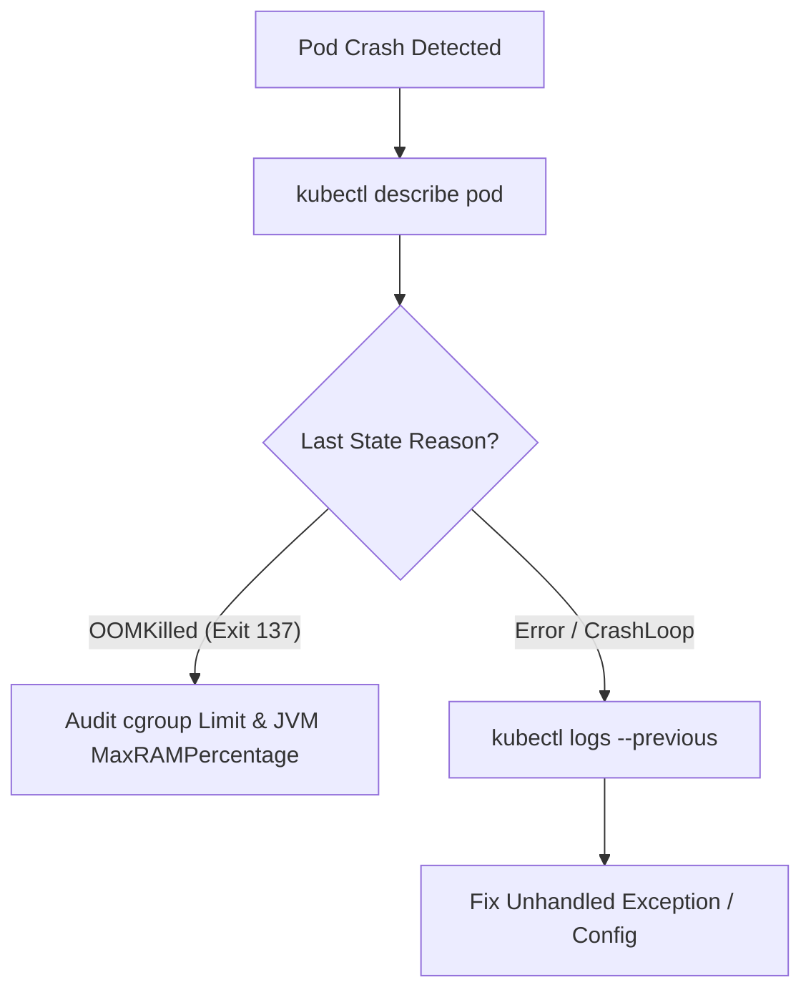

# kubectl Production Incident Triage: CrashLoopBackOff, OOMKilled Exit 137 & SIGTERM 143 Shutdowns

```json continuity
{
  "previously": "In Chapter 05, we decoupled startupProbe, readinessProbe, and livenessProbe and sized CPU/memory requests and limits for AeroPipe v0.5.",
  "painPoint": "During an on-call release, two pods crashed: Pod A entered CrashLoopBackOff and wiped its console logs on restart; Pod B died silently with exit code 137 (128 + SIGKILL 9) because the JVM heap breached the cgroups v2 container limit!",
  "unlock": "Build AeroPipe v0.6 triage runbooks: use kubectl describe pod, kubectl logs --previous, and kubectl get events, tune JVM MaxRAMPercentage, and handle Exit 143 SIGTERM with preStop hooks and terminationGracePeriodSeconds."
}
```

```json walkthrough
[
  {
    "time": "0:00",
    "badge": "Incident Triage Workflow",
    "title": "The Golden Triad: describe -> logs --previous -> events",
    "caption": "When a pod fails, running kubectl describe pod shows the termination reason (OOMKilled vs Error) and exit code. Adding --previous pulls logs from the crashed container instance before restart.",
    "nodes": ["Alert Fired", "kubectl describe pod", "kubectl logs --previous", "kubectl get events"],
    "activeIndex": 1,
    "code": "kubectl describe pod aerocart-7b69-x92zk -n prod\nkubectl logs aerocart-7b69-x92zk -n prod --previous --tail=100"
  },
  {
    "time": "0:25",
    "badge": "Exit 137 OOMKilled",
    "title": "Decoding Exit 137: Linux cgroups v2 SIGKILL (128 + 9)",
    "caption": "Exit code 137 means the process was terminated by signal 9 (SIGKILL). When total RSS exceeds container memory limits, the kernel OOM killer terminates the process instantly without catching exceptions.",
    "nodes": ["Memory Limit (1024Mi)", "JVM Heap + Off-Heap RSS", "Kernel cgroup breach", "OOMKilled Exit 137"],
    "activeIndex": 2,
    "code": "# 128 + 9 (SIGKILL) = 137\nLast State: Terminated\n  Reason: OOMKilled\n  Exit Code: 137"
  },
  {
    "time": "0:50",
    "badge": "JVM Memory Tuning",
    "title": "Container Headroom: -XX:MaxRAMPercentage=75.0",
    "caption": "Never set -Xmx equal to container memory limit! JVM needs 25% headroom for Metaspace, threads, GC buffers, and NIO off-heap buffers. Set MaxRAMPercentage=75.0.",
    "nodes": ["Pod Limit: 1024Mi", "Heap (75% = 768Mi)", "Off-Heap/Buffers (256Mi)", "Stable JVM"],
    "activeIndex": 3,
    "code": "JAVA_TOOL_OPTIONS: \"-XX:MaxRAMPercentage=75.0 -XX:+ExitOnOutOfMemoryError\""
  },
  {
    "time": "1:15",
    "badge": "Exit 143 SIGTERM",
    "title": "Graceful Shutdown: preStop Hooks & terminationGracePeriodSeconds",
    "caption": "When a deployment updates, kubelet sends SIGTERM (Exit 143 = 128 + 15). A preStop sleep ensures ingress EndpointSlice removal completes before the container closes active HTTP connections.",
    "nodes": ["EndpointSlice Removal", "preStop sleep 5", "SIGTERM to App", "Active Requests Drain"],
    "activeIndex": 1,
    "code": "lifecycle:\n  preStop:\n    exec:\n      command: [\"/bin/sh\", \"-c\", \"sleep 5\"]\nterminationGracePeriodSeconds: 30"
  }
]
```

```json pretraining
[
  {
    "term": "CrashLoopBackOff",
    "formula": "Exit != 0 -> Restart Delay = min(300s, 2^N * 10s)",
    "meaning": "Kubernetes status indicating a container repeatedly crashes on startup, causing kubelet to back off restart attempts exponentially up to 5 minutes."
  },
  {
    "term": "Exit Code 137 (OOMKilled)",
    "formula": "128 + 9 (SIGKILL) = 137",
    "meaning": "The container was killed by Linux kernel control groups (cgroups v2) because its memory consumption breached resources.limits.memory."
  },
  {
    "term": "Exit Code 143 (SIGTERM)",
    "formula": "128 + 15 (SIGTERM) = 143",
    "meaning": "The process received a graceful termination request from kubelet during pod eviction, deployment rolling update, or node drain."
  },
  {
    "term": "preStop Hook",
    "formula": "K8s Service Deregistration || preStop Execution -> SIGTERM",
    "meaning": "A lifecycle command executed inside the container immediately before kubelet sends SIGTERM, allowing in-flight network packets to complete."
  }
]
```

## 🌱 Step 1: Plain-English Mental Model — The Doctor's ER Triage Chart

When an airport flight gate crashes, shouting doesn't help; the emergency response team follows a checklist. In Kubernetes, a crashed pod is not a mystery:
1. `kubectl get events`: What did the cluster manager see happen recently?
2. `kubectl describe pod`: Why did the container stop (`Exit Code`, `Reason`, `Restart Count`)?
3. `kubectl logs --previous`: What was the last sentence the dying application logged before it crashed?



---

## 🔨 Step 2: Zero-to-Running Starter & CLI — Simulating Exit Code Decoders

Inspect real pod exit status codes directly in your terminal:

```bash
# Incident Triage Golden Sequence in any K8s cluster
kubectl get pods -n default --field-selector=status.phase!=Running
kubectl describe pod <pod-name> -n default
kubectl logs <pod-name> -n default --previous --tail=50
kubectl get events -n default --sort-by='.metadata.creationTimestamp'
```

Let's build an automated exit-code decoder and incident classifier in Python:

```python
from __future__ import annotations
from dataclasses import dataclass

# Subgoal 1: Model pod termination states according to Linux signal conventions
@dataclass(frozen=True)
class PodExitDiagnosis:
    exit_code: int
    signal_name: str
    root_cause: str
    recommended_action: str

def diagnose_pod_exit(exit_code: int, termination_reason: str) -> PodExitDiagnosis:
    # Subgoal 2: Map standard Unix signals (128 + SIG)
    if exit_code == 137 or termination_reason == "OOMKilled":
        return PodExitDiagnosis(
            exit_code=137,
            signal_name="SIGKILL (9)",
            root_cause="Linux cgroups v2 memory ceiling breached (OOMKilled).",
            recommended_action="Increase resources.limits.memory or tune JVM -XX:MaxRAMPercentage=75.0.",
        )
    if exit_code == 143:
        return PodExitDiagnosis(
            exit_code=143,
            signal_name="SIGTERM (15)",
            root_cause="Graceful shutdown signal initiated by kubelet.",
            recommended_action="Normal during rolling update; verify preStop hook and terminationGracePeriodSeconds.",
        )
    if exit_code == 1:
        return PodExitDiagnosis(
            exit_code=1,
            signal_name="SIGHUP / General Error",
            root_cause="Application threw an unhandled exception or missing env var.",
            recommended_action="Inspect application stacktrace with kubectl logs --previous.",
        )
    return PodExitDiagnosis(
        exit_code=exit_code,
        signal_name=f"Signal {exit_code - 128}" if exit_code > 128 else "Application Error",
        root_cause=f"Terminated with custom code {exit_code}.",
        recommended_action="Review container entrypoint logs.",
    )

if __name__ == "__main__":
    d137 = diagnose_pod_exit(137, "OOMKilled")
    assert d137.signal_name == "SIGKILL (9)"
    assert "cgroups v2" in d137.root_cause
    d143 = diagnose_pod_exit(143, "Completed")
    assert d143.signal_name == "SIGTERM (15)"
    print(f"Diagnostics verified: 137 -> {d137.signal_name}, 143 -> {d143.signal_name}")
```

### Java 17 Equivalent

```java
public class AeroPipeCh06Starter {
    public record PodExitDiagnosis(int exitCode, String signalName, String rootCause, String recommendedAction) {}

    public static PodExitDiagnosis diagnose(int exitCode, String reason) {
        // Subgoal 1: Check for OOMKilled exit code 137
        if (exitCode == 137 || "OOMKilled".equalsIgnoreCase(reason)) {
            return new PodExitDiagnosis(137, "SIGKILL (9)", "cgroups v2 OOM limit", "Increase memory or tune MaxRAMPercentage");
        }
        // Subgoal 2: Check for SIGTERM graceful shutdown 143
        if (exitCode == 143) {
            return new PodExitDiagnosis(143, "SIGTERM (15)", "Graceful shutdown", "Review preStop and terminationGracePeriodSeconds");
        }
        return new PodExitDiagnosis(exitCode, "Custom", "Application error", "Check logs --previous");
    }

    public static void main(String[] args) {
        PodExitDiagnosis d = diagnose(137, "OOMKilled");
        assert d.exitCode() == 137 && d.signalName().contains("9");
        System.out.println("Java triage starter verified: " + d.signalName());
    }
}
```

---

## 🛠️ Step 3: Everyday Practitioner Workflows & Where Naive Code Breaks

During an outage, naive engineers restart pods blindly using `kubectl delete pod`, destroying ephemeral debugging clues:
- `kubectl describe pod` provides the container's `Last State` with exact `Exit Code` and `Finished At` timestamp.
- `kubectl logs --previous` captures stdout/stderr before container resurrection.
- `kubectl get events --sort-by='.metadata.creationTimestamp'` isolates whether node-level pressure (`Evicted`, `FailedScheduling`) killed the pod.

```json contrast
{
  "title": "On-Call Incident Triage: Blind Restarts vs. Evidence-First Golden Path",
  "leftLabel": "❌ Naive Triage (Destroys Forensics)",
  "leftCode": "# Deletes container and wipes previous container state!\nkubectl delete pod -l app=aerocart\n# Logs return nothing because new pod has clean buffer\nkubectl logs -l app=aerocart",
  "rightLabel": "✅ Staff Triage (Preserves Evidence)",
  "rightCode": "# 1. Inspect exit status and reason\nkubectl describe pod -l app=aerocart\n# 2. Extract crash logs from previous instance\nkubectl logs <pod-id> --previous --tail=200\n# 3. Check cluster events\nkubectl get events --field-selector reason=OOMKilled"
}
```

```json poe
{
  "question": "A production Java pod crashes repeatedly under load with Exit Code 137. An engineer increases container memory limit from 1Gi to 2Gi, but sets JVM parameter -Xmx2048m. What happens next?",
  "options": [
    "The pod runs stably because heap equals container limit",
    "The pod still gets OOMKilled with Exit Code 137 because off-heap memory, Metaspace, and GC buffers push total RSS past 2Gi",
    "Kubernetes automatically compresses JVM off-heap memory into swap",
    "kubelet converts SIGKILL into a warning event"
  ],
  "answerIndex": 1,
  "explanation": "Setting JVM heap equal to container memory limit guarantees OOMKill Exit 137. The JVM consumes memory beyond heap for thread stacks, Metaspace, GC tables, and native buffers. Setting -XX:MaxRAMPercentage=75.0 reserves 25% safety headroom."
}
```

---

## 🏢 Step 4: How Big Tech Runs It at Scale, Staff Math & Production Blueprint

### 🏢 In the Wild: Netflix & Spotify Zero-Downtime Eviction and Safe Memory Budgeting

At **Spotify** and **Netflix**, thousands of microservices run on multi-tenant Kubernetes clusters. Two mission-critical rules prevent deployment brownouts:
1. **The preStop Sleep Window**: When kubelet terminates a pod, iptables / IPVS rules take 2–5 seconds to propagate across all cluster nodes. If the pod stops accepting connections instantly, callers experience HTTP 502/503 errors. A `preStop` hook executing `sleep 5` ensures traffic is fully drained before the process receives `SIGTERM`.
2. **Deterministic JVM Container Sizing Math**:
   $$M_{\text{limit}} \ge M_{\text{heap}} + M_{\text{metaspace}} + (N_{\text{threads}} \times S_{\text{stack}}) + M_{\text{direct}} + M_{\text{native}}$$
   To satisfy this without hardcoding MBs, teams set:
   $$-XX:MaxRAMPercentage=75.0 \quad -XX:+ExitOnOutOfMemoryError$$

| Exit Code | Signal / Cause | Kubernetes Event | Correct Remediation |
| :--- | :--- | :--- | :--- |
| **`137`** | `SIGKILL (9)` | `OOMKilled` | Lower JVM MaxRAMPercentage to 75% or increase pod limit |
| **`143`** | `SIGTERM (15)` | `Evicted` / `Terminated` | Tune `terminationGracePeriodSeconds` & `preStop` hook |
| **`1` / `2`** | Application Exception | `CrashLoopBackOff` | Run `kubectl logs --previous` to fix runtime crash |
| **`139`** | `SIGSEGV (11)` | `Error` | Inspect native C/JNI extensions or memory corruption |

```python
from __future__ import annotations
import math

class AeroPipePodHealthAuditor:
    """Production Kubernetes pod resource and lifecycle validator."""

    @staticmethod
    def audit_memory_and_lifecycle(
        container_limit_mb: int,
        jvm_heap_pct: float,
        thread_count: int,
        metaspace_mb: int = 128,
        has_prestop_sleep: bool = True,
        grace_period_sec: int = 30,
    ) -> dict[str, object]:
        heap_mb = container_limit_mb * (jvm_heap_pct / 100.0)
        # Approximate 1MB per thread stack
        thread_stack_mb = thread_count * 1.0
        projected_rss = heap_mb + metaspace_mb + thread_stack_mb + 64.0  # 64MB native buffer
        headroom_mb = container_limit_mb - projected_rss
        oom_risk = headroom_mb < 0 or jvm_heap_pct > 75.0
        lifecycle_safe = has_prestop_sleep and grace_period_sec >= 15

        return {
            "container_limit_mb": container_limit_mb,
            "projected_rss_mb": round(projected_rss, 1),
            "headroom_mb": round(headroom_mb, 1),
            "oom_risk": oom_risk,
            "lifecycle_safe": lifecycle_safe,
            "status": "PASS" if (not oom_risk and lifecycle_safe) else "FAIL",
        }

if __name__ == "__main__":
    auditor = AeroPipePodHealthAuditor()
    safe = auditor.audit_memory_and_lifecycle(1024, jvm_heap_pct=70.0, thread_count=100)
    assert safe["status"] == "PASS" and not safe["oom_risk"]
    unsafe = auditor.audit_memory_and_lifecycle(1024, jvm_heap_pct=90.0, thread_count=150)
    assert unsafe["status"] == "FAIL" and unsafe["oom_risk"]
    print("AeroPipeCh06 Blueprint verified successfully.")
```

### Java 17 Equivalent

```java
public class AeroPipeCh06Blueprint {
    public static boolean isSafePodBudget(int limitMb, double maxRamPct, int threads) {
        double heapMb = limitMb * (maxRamPct / 100.0);
        double totalRss = heapMb + 128.0 + (threads * 1.0) + 64.0;
        return maxRamPct <= 75.0 && totalRss <= limitMb;
    }

    public static void main(String[] args) {
        boolean safe = isSafePodBudget(1024, 70.0, 100);
        boolean unsafe = isSafePodBudget(1024, 90.0, 100);
        assert safe && !unsafe;
        System.out.println("Java AeroPipeCh06Blueprint budget verification passed.");
    }
}
```

> [!WARNING]
> **Hiring Bar-Raiser Gotcha — Exit Code 137 Is Not Always OOMKilled!**
> A container killed by an unhandled `kill -9` from an external supervisor or custom sidecar also produces exit code 137 (`128 + 9`). In Staff interviews, never assume 137 is an OOMKill without confirming `Reason: OOMKilled` in `kubectl describe pod` or searching for `Out of memory: Kill process` in `dmesg`!

```json quiz
[
  {
    "id": "infra06-q1",
    "question": "What is the primary difference between Exit Code 137 and Exit Code 143 in a Kubernetes pod?",
    "options": [
      "Exit 137 is a compiler syntax error, while Exit 143 is an invalid ingress host",
      "Exit 137 is SIGKILL (9) often triggered by cgroups OOM, while Exit 143 is SIGTERM (15) for graceful termination",
      "Exit 137 means readinessProbe failure, while Exit 143 means livenessProbe failure",
      "Both indicate identical unhandled Java null pointer exceptions"
    ],
    "answerIndex": 1,
    "explanation": "Unix signals add 128 to the signal number: 128 + 9 = 137 (SIGKILL, immediate termination by kernel OOM or operator), while 128 + 15 = 143 (SIGTERM, graceful termination request)."
  },
  {
    "id": "infra06-q2",
    "question": "Why should a Kubernetes deployment include a preStop hook with a brief sleep during rolling updates?",
    "options": [
      "To give developers time to cancel deployments manually",
      "To allow the Kubernetes control plane to remove the pod IP from EndpointSlices before the container stops processing HTTP requests",
      "To cool down the host CPU fans",
      "To force memory swap back to disk"
    ],
    "answerIndex": 1,
    "explanation": "Service endpoint removal is asynchronous. Adding a preStop sleep ensures ingress controllers stop routing new requests to the pod before it receives SIGTERM."
  },
  {
    "id": "infra06-q3",
    "question": "How do you fetch logs from a crashed container instance that has already restarted in Kubernetes?",
    "options": [
      "kubectl logs <pod-name> --previous",
      "kubectl dump memory",
      "kubectl inspect --history",
      "Crash logs are permanently destroyed upon container restart"
    ],
    "answerIndex": 0,
    "explanation": "Passing --previous to kubectl logs instructs kubelet to return logs from the prior terminated container execution."
  }
]
```

---

## 📋 Step 5: Master Cheat-Sheet, 60-Second Interview Pitch & Verified Sources

| Triage Command | What It Reveals | When to Use |
| :--- | :--- | :--- |
| **`kubectl describe pod <p>`** | State, Reason, Exit Code, Restart Count, Events | Step 1 for any failing pod |
| **`kubectl logs <p> --previous`** | Fatal stack trace before container restart | Diagnosing CrashLoopBackOff & exit 1 |
| **`kubectl get events --sort-by`** | Cluster-level eviction, scheduling, or OOM events | Correlating node-wide incidents |
| **`-XX:MaxRAMPercentage=75.0`** | JVM leaves 25% for Metaspace/off-heap | Preventing Exit 137 OOMKill |
| **`preStop: sleep 5`** | Allows ingress IPVS/iptables deregistration | Preventing HTTP 502 on rolling update |

### 🎙️ 60-Second Interview Soundbite

> *"When triaging Kubernetes pod crashes, I follow an evidence-first golden sequence rather than deleting pods blindly. First, `kubectl describe pod` reveals the exact termination reason and exit code. If I see Exit Code 137 (`128 + 9`), I verify whether `Reason: OOMKilled` was reported by cgroups v2 and check whether the JVM or runtime exceeded memory limits—tuning `-XX:MaxRAMPercentage=75.0` to reserve headroom for native memory. For Exit Code 1, `kubectl logs --previous` captures the crash stacktrace. Finally, during rolling updates, I prevent HTTP 502 dropped requests by combining `preStop` sleep hooks with `terminationGracePeriodSeconds`, allowing endpoints to drain cleanly before SIGTERM."*

### 📚 Verified Primary Sources
- [Kubernetes Official Documentation — Debug Pods and Applications](https://kubernetes.io/docs/tasks/debug/debug-application/debug-pods/)
- [Kubernetes Official Documentation — Pod Lifecycle and Termination Stages](https://kubernetes.io/docs/concepts/workloads/pods/pod-lifecycle/)
