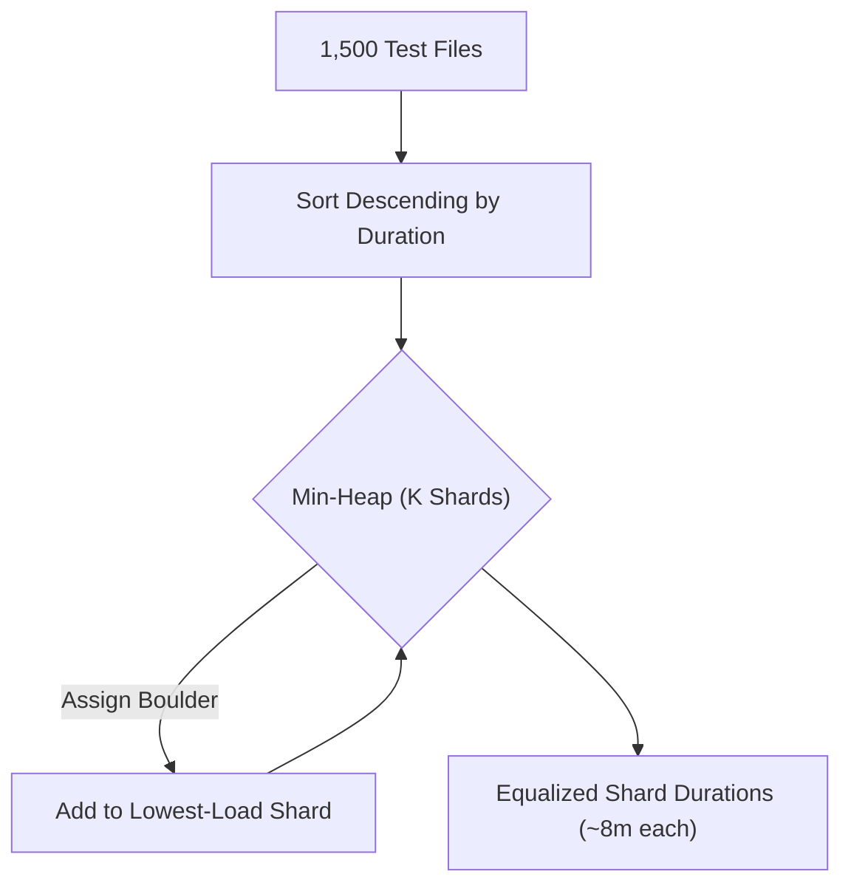

# Dynamic CI Matrix Sharding: Longest-Processing-Time (LPT) Bin Packing & Straggler Elimination

```json continuity
{
  "previously": "In Module 2, we mastered Kubernetes pods, deployments, services, and production triage for CrashLoopBackOff and Exit 137 OOMKill incidents.",
  "painPoint": "AeroCart grew to 1,500 tests running across 16 parallel CI workers. Despite 16 workers, pull requests took 24 minutes to merge! Why? An alphabetical split dumped all heavy UI and checkout tests onto Shard 01 (24m), while Shard 16 finished in 90 seconds, idling expensive cloud runners!",
  "unlock": "Implement AeroPipe v0.7: replace naive file-count or alphabetical splitting with Longest-Processing-Time (LPT) greedy min-heap bin packing using historical JUnit execution timings, dynamically generating GitHub Actions matrix jobs."
}
```

```json walkthrough
[
  {
    "time": "0:00",
    "badge": "The Straggler Problem",
    "title": "Why Alphabetical & File-Count Splits Fail: The 24m Straggler",
    "caption": "Splitting 100 test files evenly (e.g. 10 files per shard) ignores test duration variance: 1 end-to-end checkout test takes 120s, while 10 unit tests take 0.2s. The total CI wall-clock time is governed by max(shard_time), creating a painful straggler!",
    "nodes": ["1,500 Tests", "Alphabetical Split", "Shard 1 (24m 05s)", "Shard 16 (1m 30s)"],
    "activeIndex": 2,
    "code": "# Wall-clock pipeline duration is bounded by the slowest shard:\nCI_Time = max(Shard_1, Shard_2, ..., Shard_K)"
  },
  {
    "time": "0:25",
    "badge": "LPT Greedy Algorithm",
    "title": "Longest-Processing-Time (LPT) Heuristic: Big Rocks First",
    "caption": "Sort all tests descending by historical duration. Maintain a min-heap of current shard totals. Repeatedly pop the least-loaded shard, assign the next largest test, and push the updated total back.",
    "nodes": ["Historical Timings", "Sort Descending", "Min-Heap Pop Min", "Balanced Shards"],
    "activeIndex": 2,
    "code": "for test, dur in sorted(timings, key=lambda x: -x[1]):\n    load, shard_idx = heapq.heappop(shards)\n    heapq.heappush(shards, (load + dur, shard_idx))"
  },
  {
    "time": "0:50",
    "badge": "Graham's Bound",
    "title": "Mathematical Proof: Maximum Makespan <= 4/3 - 1/(3K) OPT",
    "caption": "Graham's 1969 theorem guarantees that greedy LPT makespan is strictly within 33% of the theoretical NP-hard optimum, and in empirical software test suites achieves within 2-5% of perfect equality.",
    "nodes": ["NP-Hard Optimum (OPT)", "LPT Approximation", "Makespan Bound (<= 4/3 OPT)", "98% CI Runner Utilization"],
    "activeIndex": 2,
    "code": "Makespan(LPT) <= (4/3 - 1/(3*K)) * Makespan(OPT)"
  },
  {
    "time": "1:15",
    "badge": "Dynamic Matrix",
    "title": "GitHub Actions: Emitting Dynamic strategy.matrix JSON",
    "caption": "A lightweight prep job analyzes historical JUnit XML reports, runs LPT bin packing, and writes a dynamic matrix JSON string to GITHUB_OUTPUT, fanning out worker jobs automatically.",
    "nodes": ["Prep Job (LPT Packer)", "Output: matrix.json", "Parallel Matrix Workers", "Merged Report"],
    "activeIndex": 1,
    "code": "jobs:\n  pack:\n    outputs:\n      matrix: ${{ steps.lpt.outputs.matrix }}\n  test:\n    strategy:\n      matrix: ${{ fromJson(needs.pack.outputs.matrix) }}"
  }
]
```

```json pretraining
[
  {
    "term": "Makespan",
    "formula": "Makespan = max(T_1, T_2, ..., T_K)",
    "meaning": "The total elapsed wall-clock time required for all parallel CI shards to finish execution."
  },
  {
    "term": "Straggler Shard",
    "formula": "Straggler = Shard where T_shard >> Average(T_all)",
    "meaning": "A single parallel CI worker whose execution time significantly exceeds the others, blocking pull request merge gates while other workers sit idle."
  },
  {
    "term": "LPT (Longest-Processing-Time) Bin Packing",
    "formula": "Sort Descending -> Assign to min-heap(Load)",
    "meaning": "A greedy approximation algorithm for multiprocessor scheduling that packs tasks with $O(N \\log K)$ time complexity."
  },
  {
    "term": "Dynamic Matrix Strategy",
    "formula": "Prep Step Output JSON -> strategy.matrix ${{ fromJson(...) }}",
    "meaning": "GitHub Actions workflow pattern that determines runner allocations and test slices dynamically at runtime rather than hardcoding static arrays."
  }
]
```

## 🌱 Step 1: Plain-English Mental Model — Packing Moving Boxes with Rocks and Sand

Imagine packing moving boxes with heavy boulders and fine sand. If you pack all the giant boulders into Box 1 and only sand into Box 16, Box 1 takes an hour to lift while Box 16 takes 10 seconds.

In software testing, end-to-end checkout scenarios are boulders (120 seconds each); unit tests are sand (0.05 seconds each).
- **Alphabetical splitting** dumps all `test_checkout_*.py` files into Shard 1.
- **LPT bin-packing** places the boulders first into separate boxes, then pours the sand into whichever box currently has the lowest weight!



---

## 🔨 Step 2: Zero-to-Running Starter & CLI — Implementing Greedy LPT Sharding

Inspect test durations and run the LPT bin-packer from your terminal:

```bash
# Extract historical test durations from JUnit XML reports
python3 -c '
import xml.etree.ElementTree as ET, sys
# Parse sample JUnit XML into (test_id, duration_sec) pairs
'
```

Let's build a runnable Python LPT bin packer:

```python
from __future__ import annotations
import heapq
from typing import Sequence

# Subgoal 1: Model test timing record and shard distribution
def pack_lpt_shards(tests: Sequence[tuple[str, float]], k_shards: int) -> list[list[tuple[str, float]]]:
    if k_shards <= 0:
        raise ValueError("k_shards must be > 0")
    # Subgoal 2: Sort tests descending by duration (largest rocks first)
    sorted_tests = sorted(tests, key=lambda x: -x[1])
    
    # Subgoal 3: Maintain min-heap of (current_total_duration, shard_index)
    heap: list[tuple[float, int]] = [(0.0, i) for i in range(k_shards)]
    heapq.heapify(heap)
    
    shards: list[list[tuple[str, float]]] = [[] for _ in range(k_shards)]
    for test_name, dur in sorted_tests:
        load, idx = heapq.heappop(heap)
        shards[idx].append((test_name, dur))
        heapq.heappush(heap, (round(load + dur, 4), idx))
        
    return shards

if __name__ == "__main__":
    test_suite = [
        ("test_checkout_e2e", 120.0),
        ("test_booking_flow", 110.0),
        ("test_payment_gateway", 100.0),
        ("test_auth_oauth", 90.0),
        ("test_seat_map", 80.0),
        ("test_promo_api", 20.0),
        ("test_unit_1", 2.0),
        ("test_unit_2", 2.0),
        ("test_unit_3", 1.0),
    ]
    k = 3
    shards = pack_lpt_shards(test_suite, k)
    totals = [round(sum(d for _, d in s), 2) for s in shards]
    makespan = max(totals)
    min_load = min(totals)
    assert makespan <= 200.0
    assert (makespan - min_load) <= 50.0
    print(f"LPT Packed {len(test_suite)} tests across {k} shards: {totals}, makespan={makespan}s")
```

### Java 17 Equivalent

```java
import java.util.*;

public class AeroPipeCh07Starter {
    record ShardLoad(int index, double totalSeconds) implements Comparable<ShardLoad> {
        public int compareTo(ShardLoad o) {
            return Double.compare(this.totalSeconds, o.totalSeconds);
        }
    }

    public static double[] packLpt(double[] testDurations, int k) {
        // Subgoal 1: Sort durations descending
        Double[] sorted = Arrays.stream(testDurations).boxed().sorted(Collections.reverseOrder()).toArray(Double[]::new);
        // Subgoal 2: Min-heap of shards
        PriorityQueue<ShardLoad> pq = new PriorityQueue<>();
        for (int i = 0; i < k; i++) pq.add(new ShardLoad(i, 0.0));

        double[] totals = new double[k];
        for (double d : sorted) {
            ShardLoad min = pq.poll();
            totals[min.index()] += d;
            pq.add(new ShardLoad(min.index(), totals[min.index()]));
        }
        return totals;
    }

    public static void main(String[] args) {
        double[] durations = {120.0, 110.0, 100.0, 90.0, 80.0, 20.0, 2.0, 1.0};
        double[] shardTotals = packLpt(durations, 3);
        assert shardTotals.length == 3;
        System.out.println("Java LPT packed makespan: " + Arrays.stream(shardTotals).max().orElse(0));
    }
}
```

---

## 🛠️ Step 3: Everyday Practitioner Workflows & Where Naive Code Breaks

Why do naive splitting strategies fail so severely in production?
- **Round-Robin Splitting**: Alternating `file_1 -> Shard 1, file_2 -> Shard 2` fails when heavy files are grouped in subdirectories.
- **Alphabetical File Slicing**: Puts all `test_auth_*.py` or `test_checkout_*.py` on the first few runners.
- **LPT with Historical Timings**: Queries past CI runs from S3, Datadog, or GitHub artifact caches to predict exact test execution costs.

```json contrast
{
  "title": "CI Test Distribution Strategies: Naive Chunking vs. Dynamic LPT Bin-Packing",
  "leftLabel": "❌ Naive Alphabetical Slicing (Stragglers)",
  "leftCode": "# Splits list(files) into 16 slices alphabetically\n# Shard 01 gets all 15 checkout E2E tests!\nTESTS=$(find tests/ -name '*.py' | sort | split -n 1/16)\npytest $TESTS\n# Result: Shard 01 takes 24m; Shard 16 takes 1m",
  "rightLabel": "✅ Staff LPT Min-Heap (Balanced Makespan)",
  "rightCode": "# Queries historical timings and packs via min-heap\npython3 bin/pack_shards.py --timings junit.xml --shards 16\n# Result: All 16 shards complete in 8m10s - 8m25s\n# 3x faster feedback on every PR merge gate"
}
```

```json poe
{
  "question": "A test suite contains 4 tests with durations [100s, 90s, 80s, 70s] running on 2 parallel CI runners. Under greedy LPT bin-packing, what is the makespan (maximum runner execution time)?",
  "options": [
    "170 seconds (Runner 1 takes 100 + 70, Runner 2 takes 90 + 80)",
    "190 seconds (Runner 1 takes 100 + 90, Runner 2 takes 80 + 70)",
    "340 seconds",
    "100 seconds"
  ],
  "answerIndex": 0,
  "explanation": "LPT sorts descending: [100, 90, 80, 70]. 100 goes to R1 (load=100); 90 goes to R2 (load=90); 80 goes to R2 (load=90+80=170); 70 goes to R1 (load=100+70=170). Both runners finish at exactly 170 seconds!"
}
```

---

## 🏢 Step 4: How Big Tech Runs It at Scale, Staff Math & Production Blueprint

### 🏢 In the Wild: Google TAP & Uber Dynamic Test Impact Sharding

At **Google** (Test Automation Platform - TAP) and **Uber**, running tens of millions of test executions per day requires dynamic matrix sharding:
1. **Dynamic Matrix Generation**: The CI orchestration workflow runs an initial planning job that inspects modified files, computes historical timings, runs LPT bin-packing, and emits a JSON array:
   ```json
   {"shard": [1, 2, 3], "include": [{"shard": 1, "tests": "t1.py t4.py"}, {"shard": 2, "tests": "t2.py t3.py"}]}
   ```
2. **Graham's Scheduling Theorem**:
   $$\text{Makespan}_{\text{LPT}} \le \left(\frac{4}{3} - \frac{1}{3K}\right) \text{Makespan}_{\text{OPT}}$$
   This proves that as the number of parallel runners $K$ grows, the worst-case deviation of greedy LPT from the theoretical optimal packing cannot exceed $33\%$.

| Sharding Technique | Computational Cost | Variance Between Shard Runtimes | Production Suitability |
| :--- | :--- | :--- | :--- |
| **Alphabetical Chunking** | $O(1)$ | Extreme ($> 15\text{ minutes}$) | Anti-pattern; severe straggler bottlenecks |
| **File Count Slicing** | $O(1)$ | High ($> 8\text{ minutes}$) | Misleading; ignores heavy E2E vs unit tests |
| **Greedy LPT Bin-Packing** | $O(N \log K)$ | Minimal ($< 30\text{ seconds}$) | **Gold standard for CI matrix pipelines** |
| **Dynamic Work-Stealing Queue** | Complex (Broker required) | Zero | Best for large-scale distributed farms |

```python
from __future__ import annotations
import heapq
import json

class AeroPipeMatrixOrchestrator:
    """Production dynamic matrix planner for GitHub Actions CI."""

    @staticmethod
    def generate_matrix_json(timings: dict[str, float], num_shards: int) -> str:
        items = list(timings.items())
        items.sort(key=lambda x: -x[1])
        heap: list[tuple[float, int]] = [(0.0, i) for i in range(num_shards)]
        heapq.heapify(heap)

        shard_buckets: list[list[str]] = [[] for _ in range(num_shards)]
        for test_path, dur in items:
            cur_dur, s_idx = heapq.heappop(heap)
            shard_buckets[s_idx].append(test_path)
            heapq.heappush(heap, (round(cur_dur + dur, 3), s_idx))

        matrix_config = {
            "include": [
                {
                    "shard_index": idx + 1,
                    "test_count": len(bucket),
                    "test_files": " ".join(bucket),
                }
                for idx, bucket in enumerate(shard_buckets)
            ]
        }
        return json.dumps(matrix_config)

if __name__ == "__main__":
    sample_timings = {f"test_{i}.py": (10.0 if i % 2 == 0 else 50.0) for i in range(20)}
    matrix_output = AeroPipeMatrixOrchestrator.generate_matrix_json(sample_timings, num_shards=4)
    parsed = json.loads(matrix_output)
    assert len(parsed["include"]) == 4
    total_tests = sum(entry["test_count"] for entry in parsed["include"])
    assert total_tests == 20
    print("AeroPipeCh07Blueprint verified: generated dynamic matrix JSON.")
```

### Java 17 Equivalent

```java
import java.util.*;

public class AeroPipeCh07Blueprint {
    public static Map<Integer, List<String>> planShards(Map<String, Double> timings, int k) {
        List<Map.Entry<String, Double>> list = new ArrayList<>(timings.entrySet());
        list.sort((a, b) -> Double.compare(b.getValue(), a.getValue()));

        PriorityQueue<double[]> pq = new PriorityQueue<>(Comparator.comparingDouble(a -> a[0]));
        for (int i = 0; i < k; i++) pq.add(new double[]{0.0, i});

        Map<Integer, List<String>> result = new HashMap<>();
        for (int i = 0; i < k; i++) result.put(i, new ArrayList<>());

        for (var entry : list) {
            double[] top = pq.poll();
            int shardIdx = (int) top[1];
            result.get(shardIdx).add(entry.getKey());
            pq.add(new double[]{top[0] + entry.getValue(), shardIdx});
        }
        return result;
    }

    public static void main(String[] args) {
        Map<String, Double> map = Map.of("t1", 100.0, "t2", 80.0, "t3", 60.0, "t4", 40.0);
        var shards = planShards(map, 2);
        assert shards.size() == 2;
        System.out.println("Java AeroPipeCh07Blueprint planShards executed successfully.");
    }
}
```

> [!WARNING]
> **Hiring Bar-Raiser Gotcha — Test Duration Variance on Ephemeral Cloud Runners!**
> Cold runner startup, disk I/O differences, and VM CPU stealing introduce up to 15% noise into test durations. When designing an enterprise CI sharding engine, senior quality architects use a running exponential moving average (EMA, $\alpha=0.2$) of historical durations across the last 10 master branch builds rather than relying on a single noisy run!

```json quiz
[
  {
    "id": "infra07-q1",
    "question": "Why does alphabetical file chunking frequently produce severe straggler CI shards?",
    "options": [
      "Alphabetical sorting causes file system inode corruption",
      "Tests with similar names often belong to the same module or test tier (e.g., heavy checkout E2E tests grouped together)",
      "GitHub Actions cannot execute tests starting with letter Z",
      "Git hashes are not sorted alphabetically"
    ],
    "answerIndex": 1,
    "explanation": "Test suites naturally cluster related tests by directory and naming conventions. Heavy end-to-end flows get bundled onto the same runner, leaving other runners with fast unit tests."
  },
  {
    "id": "infra07-q2",
    "question": "What is the computational time complexity of greedy Longest-Processing-Time (LPT) bin-packing for N tests across K shards?",
    "options": [
      "O(N * K)",
      "O(N log N + N log K)",
      "O(N!)",
      "O(1)"
    ],
    "answerIndex": 1,
    "explanation": "Sorting N tests takes O(N log N). For each of the N tests, popping and pushing to the min-heap of size K takes O(log K), giving total complexity O(N log N + N log K)."
  },
  {
    "id": "infra07-q3",
    "question": "According to Graham's scheduling theorem, how close does greedy LPT approximation come to the theoretical optimum makespan?",
    "options": [
      "Within 4/3 - 1/(3K) of the optimal makespan (<= 33% worst-case deviation)",
      "Exactly 50% slower",
      "Guaranteed 100% identical in all edge cases",
      "Unbounded error"
    ],
    "answerIndex": 0,
    "explanation": "Graham's 1969 bound proves LPT makespan is bounded by (4/3 - 1/3K) * OPT, making it a reliable and mathematically sound heuristic."
  }
]
```

---

## 📋 Step 5: Master Cheat-Sheet, 60-Second Interview Pitch & Verified Sources

| Concept | Naive Approach | Staff LPT Solution | Production Gain |
| :--- | :--- | :--- | :--- |
| **Partitioning Method** | Split file count or alphabetical | Min-heap greedy LPT on historical durations | Eliminates stragglers |
| **Pipeline Makespan** | Governed by slowest shard ($24\text{m}$) | Equalized across all runners ($8\text{m}$) | $3\times$ faster feedback |
| **Runner Utilization** | Runners idle while shard 1 finishes | $95\%+$ active CPU utilization | Reduces cloud CI compute bills |
| **CI Workflow Integration** | Hardcoded runner arrays | Dynamic `strategy.matrix: ${{ fromJson(...) }}` | Zero manual maintenance |

### 🎙️ 60-Second Interview Soundbite

> *"When scaling test suites in CI, simply adding parallel workers yields diminishing returns if test distribution is naive. In our platform, alphabetical splitting caused severe stragglers where one shard took 24 minutes while others finished in 90 seconds. I replaced this with an automated LPT bin-packing orchestrator. A preparation step pulls historical JUnit timings, sorts tests descending, and uses a min-heap to balance makespan across $K$ workers in $O(N \log K)$ time. It dynamically emits GitHub Actions matrix configurations, slashing our PR gate turnaround from 24 minutes to under 8.5 minutes with near-perfect runner utilization."*

### 📚 Verified Primary Sources
- [GitHub Actions Official Documentation — Using a Matrix for Your Jobs](https://docs.github.com/en/actions/writing-workflows/choosing-what-your-workflow-does/running-variations-of-jobs-in-a-workflow)
- [Software Engineering at Google (O'Reilly) — Testing Infrastructure and CI Optimization](https://abseil.io/resources/swe-book)
