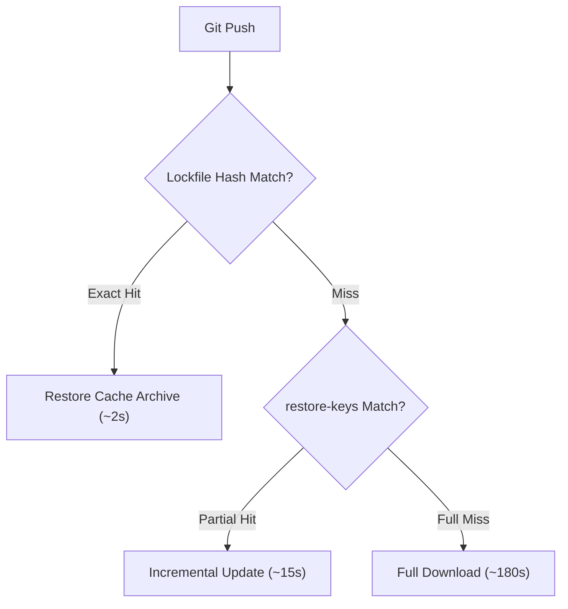

# CI Caching Architectures: Content-Addressed Lockfile Keys, Remote OCI Caches & DinD vs DooD Runners

```json continuity
{
  "previously": "In Chapter 07, we eliminated CI stragglers using Longest-Processing-Time (LPT) bin-packing to balance matrix test shards.",
  "painPoint": "Even with balanced shards, every runner wasted 4 minutes per job re-downloading Playwright browser binaries, npm packages, and base container layers because the CI cache key was invalid or missed on ephemeral VMs!",
  "unlock": "Build AeroPipe v0.8: architect hierarchical content-addressable cache keys with fallback restore-keys, configure BuildKit remote OCI registry caching, and weigh Docker-in-Docker (DinD) vs Docker-out-of-Docker (DooD) socket mounting."
}
```

```json walkthrough
[
  {
    "time": "0:00",
    "badge": "Content-Addressable Keys",
    "title": "Hierarchical Cache Keys: hashFiles('**/uv.lock') with Fallback restore-keys",
    "caption": "A cache key combining OS runner, tool version, and SHA-256 hash of dependency lockfiles guarantees that dependencies are fetched only when the lockfile changes, while prefix restore-keys allow incremental reuse.",
    "nodes": ["Commit Pushed", "hashFiles('uv.lock')", "Exact Key Match (Hit!)", "Prefix restore-keys (Partial Hit)"],
    "activeIndex": 2,
    "code": "key: ${{ runner.os }}-uv-${{ hashFiles('**/uv.lock') }}\nrestore-keys: |\n  ${{ runner.os }}-uv-"
  },
  {
    "time": "0:25",
    "badge": "Playwright Binary Caching",
    "title": "Caching 400MB Browser Binaries Across Ephemeral Workers",
    "caption": "Playwright downloads Chromium, Firefox, and WebKit into ~/.cache/ms-playwright. Pinning PLAYWRIGHT_BROWSERS_PATH and caching against the playwright version string prevents downloading 400MB on every matrix shard.",
    "nodes": ["Matrix Worker Starts", "Cache Check (~/.cache/ms-playwright)", "400MB Cache Hit (3s)", "Playwright Tests Run"],
    "activeIndex": 2,
    "code": "env:\n  PLAYWRIGHT_BROWSERS_PATH: ${{ github.workspace }}/.cache/ms-playwright\n# Caching key: ${{ runner.os }}-playwright-${{ env.PLAYWRIGHT_VERSION }}"
  },
  {
    "time": "0:50",
    "badge": "Remote OCI Cache",
    "title": "BuildKit type=registry: Distributed Layer Caching Across Runners",
    "caption": "Local Docker caches disappear when an ephemeral CI VM is destroyed. BuildKit's type=registry cache exports immutable layer artifacts directly into an OCI registry, allowing independent CI nodes to share build cache.",
    "nodes": ["BuildKit Engine", "docker buildx build", "--cache-to=type=registry", "Shared OCI Registry"],
    "activeIndex": 2,
    "code": "docker buildx build \\\n  --cache-from=type=registry,ref=ghcr.io/org/aerocart:buildcache \\\n  --cache-to=type=registry,ref=ghcr.io/org/aerocart:buildcache,mode=max"
  },
  {
    "time": "1:15",
    "badge": "DinD vs. DooD",
    "title": "Runner Isolation Trade-Off: Docker-in-Docker vs. Docker-out-of-Docker",
    "caption": "Docker-in-Docker (DinD) runs a separate daemon inside an isolated container (requires --privileged). Docker-out-of-Docker (DooD) mounts /var/run/docker.sock, sharing the host daemon for speed but granting root-equivalent host access.",
    "nodes": ["CI Job", "DooD (/var/run/docker.sock)", "DinD (--privileged daemon)", "Security vs Speed Boundary"],
    "activeIndex": 3,
    "code": "# DooD: Fast, shared cache, but /var/run/docker.sock gives root on host!\n# DinD: Slower, hermetic daemon, requires privileged security capability."
  }
]
```

```json pretraining
[
  {
    "term": "Content-Addressable Cache Key",
    "formula": "Key = Prefix + Hash(Lockfile) -> Immutable Cache Archive",
    "meaning": "A storage key derived deterministically from the cryptographic digest of dependency lockfiles so any modification invalidates cache automatically."
  },
  {
    "term": "restore-keys",
    "formula": "restore-keys: [Prefix-Hash, Prefix-]",
    "meaning": "Ordered fallback key prefixes used by CI engines to restore the most recent partial cache archive if an exact lockfile match is unavailable."
  },
  {
    "term": "Remote OCI Cache (type=registry)",
    "formula": "BuildKit -> Push Layers to OCI Registry -> Pull from Any CI Runner",
    "meaning": "A BuildKit cache backend that pushes and pulls layer cache blobs to/from a remote container registry rather than local disk."
  },
  {
    "term": "DinD vs. DooD",
    "formula": "DinD = Isolated Docker Daemon · DooD = Mounted Host docker.sock",
    "meaning": "The two architectures for building and running containers inside containerized CI runners, balancing security isolation against caching speed."
  }
]
```

## 🌱 Step 1: Plain-English Mental Model — The Airport Luggage Carousel vs. Local Locker

Imagine arriving at an airport. If every passenger had to manufacture clothes from raw cotton upon arrival, lines would stretch for miles. Instead, you check a bag and pick it up from the luggage carousel.

In CI pipelines:
- **Zero Caching**: The runner downloads compilers, 300 Python wheels, and 400MB of Playwright browsers from scratch on every commit.
- **Content-Addressable Cache**: The runner checks the luggage tag (`hashFiles('uv.lock')`). If the bag matches the tag, it unzips in 2 seconds!
- **Remote OCI Cache**: Even if your runner is destroyed, the luggage carousel is hosted in the cloud (`ghcr.io`) so the next runner grabs the pre-built container layers instantly.



---

## 🔨 Step 2: Zero-to-Running Starter & CLI — Computing Content-Addressable Keys

Compute and inspect lockfile cache digests using standard terminal utilities:

```bash
# Compute content-addressable SHA-256 digest of lockfiles
sha256sum pyproject.toml uv.lock 2>/dev/null || shasum -a 256 uv.lock
# Inspect Docker BuildKit cache status
docker buildx du
```

Let's build a Python simulator that evaluates cache hit/miss resolution and fallback logic:

```python
from __future__ import annotations
import hashlib
from typing import Sequence

# Subgoal 1: Model content-addressable cache storage and prefix resolution
class ContentAddressableCacheManager:
    def __init__(self) -> None:
        self.store: dict[str, bytes] = {}

    @staticmethod
    def compute_key(prefix: str, content: bytes) -> str:
        # Subgoal 2: Compute deterministic SHA-256 fingerprint
        digest = hashlib.sha256(content).hexdigest()[:16]
        return f"{prefix}-{digest}"

    def save(self, key: str, payload: bytes) -> None:
        self.store[key] = payload

    def resolve(self, exact_key: str, restore_keys: Sequence[str]) -> tuple[str | None, str]:
        # Subgoal 3: Check exact key match first
        if exact_key in self.store:
            return exact_key, "EXACT_HIT"
        # Subgoal 4: Fallback to longest matching restore-key prefix
        for r_key in restore_keys:
            matches = [k for k in self.store if k.startswith(r_key)]
            if matches:
                # Return most recent matching entry
                return sorted(matches)[-1], "PARTIAL_HIT"
        return None, "MISS"

if __name__ == "__main__":
    cache = ContentAddressableCacheManager()
    lock_v1 = b"pytest==8.0.0\\nplaywright==1.42.0"
    lock_v2 = b"pytest==8.1.0\\nplaywright==1.42.0"
    
    key_v1 = cache.compute_key("linux-uv", lock_v1)
    key_v2 = cache.compute_key("linux-uv", lock_v2)
    
    cache.save(key_v1, b"archive_v1.tar.gz")
    
    found_key, hit_type = cache.resolve(key_v1, ["linux-uv-"])
    assert hit_type == "EXACT_HIT" and found_key == key_v1
    
    # Resolving modified lockfile v2 falls back to prefix restore-key
    found_fallback, fb_type = cache.resolve(key_v2, ["linux-uv-"])
    assert fb_type == "PARTIAL_HIT" and found_fallback == key_v1
    print("ContentAddressableCacheManager verified successfully.")
```

### Java 17 Equivalent

```java
import java.nio.charset.StandardCharsets;
import java.security.MessageDigest;
import java.util.*;

public class AeroPipeCh08Starter {
    public static String computeKey(String prefix, String content) throws Exception {
        MessageDigest md = MessageDigest.getInstance("SHA-256");
        byte[] hash = md.digest(content.getBytes(StandardCharsets.UTF_8));
        StringBuilder hex = new StringBuilder();
        for (int i = 0; i < 8; i++) hex.append(String.format("%02x", hash[i]));
        return prefix + "-" + hex;
    }

    public static void main(String[] args) throws Exception {
        String key = computeKey("linux-uv", "playwright==1.42.0");
        assert key.startsWith("linux-uv-") && key.length() > 10;
        System.out.println("Java AeroPipeCh08Starter key: " + key);
    }
}
```

---

## 🛠️ Step 3: Everyday Practitioner Workflows & Where Naive Code Breaks

Why do cache actions quietly fail in high-speed CI pipelines?
- **Missing `restore-keys` Fallback**: If `key` is `hashFiles('uv.lock')` with no `restore-keys`, changing a single patch version invalidates everything, forcing a complete cold rebuild.
- **Unpinned Browser Cache Directories**: Playwright default browser cache paths differ between Linux (`~/.cache/ms-playwright`) and macOS (`~/Library/Caches/ms-playwright`). Use explicit `PLAYWRIGHT_BROWSERS_PATH`.
- **DooD `/var/run/docker.sock` Security Hole**: Mounting the host Docker socket allows any containerized step to escape into the host by running `docker run -v /:/host alpine rm -rf /host`.

```json contrast
{
  "title": "CI Runner Container Architecture: DinD vs. DooD Socket Mounting",
  "leftLabel": "❌ DooD (/var/run/docker.sock Mount)",
  "leftCode": "# Mounts host daemon socket for speed\nvolumes:\n  - /var/run/docker.sock:/var/run/docker.sock\n# DANGER: Any test can spawn containers with root access\n# to the entire host VM filesystem!",
  "rightLabel": "✅ DinD (Isolated Daemon) / Rootless DooD",
  "rightCode": "# Spawns an isolated ephemeral daemon\nservices:\n  docker:\n    image: docker:26-dind\n    privileged: true\n# Container builds remain strictly isolated\n# from host VM storage and network namespaces"
}
```

```json poe
{
  "question": "A team adds Playwright tests to GitHub Actions. Every matrix worker downloads Chromium (140MB) and Firefox (80MB) on every run despite using actions/cache on ~/.cache/ms-playwright. Why is the cache missing?",
  "options": [
    "GitHub Actions does not support caching hidden directories starting with a dot",
    "The workflow runs in a container that overrides the HOME directory, causing Playwright to look in a different directory than what was cached",
    "Playwright requires root privileges to read cache",
    "Browsers cannot be cached in CI"
  ],
  "answerIndex": 1,
  "explanation": "Containerized CI jobs often alter the user or HOME environment variable. Defining PLAYWRIGHT_BROWSERS_PATH: /cache/ms-playwright explicitly guarantees that both the cache action and Playwright use the exact same absolute directory path."
}
```

---

## 🏢 Step 4: How Big Tech Runs It at Scale, Staff Math & Production Blueprint

### 🏢 In the Wild: Uber & Netflix Remote OCI Registry BuildKit Caching

At **Uber** and **Netflix**, developer platform engineers decouple build caching from ephemeral VM lifecycles:
1. **BuildKit `type=registry` Backend**: Images are built using `docker buildx` with `--cache-to=type=registry,mode=max`. This writes intermediate AST layer blobs into private container registries (OCI artifacts). Any subsequent runner anywhere in the fleet retrieves cached layers in seconds.
2. **Cache Econometrics**:
   $$T_{\text{total}} = T_{\text{cache-restore}} + \Delta T_{\text{incremental}} \ll T_{\text{cold-download}} + T_{\text{compile}}$$
   If restoring 300MB takes 4 seconds over a 10 Gbps cloud network, while rebuilding from scratch takes 180 seconds, caching saves $176\text{ seconds}$ per matrix runner. Across 100 runs per day with 16 shards, this saves over **780 developer hours per month**!

| Runner Architecture | Isolation Level | Caching Mechanism | Performance | Primary Security Risk |
| :--- | :--- | :--- | :--- | :--- |
| **DooD (`docker.sock`)** | Low (Shared Host) | Host Docker Graph Driver | Fastest | Container escape to host root |
| **DinD (`docker:dind`)** | Medium (Isolated Daemon) | Ephemeral / Volume Mount | Slower (Layer-in-Layer) | Requires `--privileged` kernel flag |
| **Rootless DinD** | High (User Namespace) | User Namespace Storage | Moderate | Kernel UID map restrictions |
| **Remote OCI Cache** | Very High (Stateless) | Network Registry Pull/Push | Network Bound | Registry token leakage |

```python
from __future__ import annotations

class AeroPipeBuildCacheOptimizer:
    """Production BuildKit cache flag generator and DinD safety validator."""

    @staticmethod
    def generate_buildx_args(
        image_tag: str,
        cache_registry_ref: str,
        cache_mode: str = "max",
        use_dind: bool = True,
    ) -> list[str]:
        args = [
            "docker", "buildx", "build",
            "-t", image_tag,
            f"--cache-from=type=registry,ref={cache_registry_ref}",
            f"--cache-to=type=registry,ref={cache_registry_ref},mode={cache_mode}",
            "--push", ".",
        ]
        if not use_dind:
            # Warn about host socket exposure
            args.insert(0, "# WARNING: DooD host socket mounting detected; audit container escape surfaces")
        return args

if __name__ == "__main__":
    flags = AeroPipeBuildCacheOptimizer.generate_buildx_args(
        "ghcr.io/aerocart/api:v1.0",
        "ghcr.io/aerocart/api:cache",
        use_dind=True,
    )
    assert any("--cache-from" in arg for arg in flags)
    assert any("--cache-to" in arg for arg in flags)
    print("AeroPipeCh08 Blueprint verified: generated BuildKit remote cache flags.")
```

### Java 17 Equivalent

```java
import java.util.List;

public class AeroPipeCh08Blueprint {
    public static List<String> buildCacheArgs(String imageTag, String cacheRef) {
        return List.of(
            "docker", "buildx", "build",
            "-t", imageTag,
            "--cache-from=type=registry,ref=" + cacheRef,
            "--cache-to=type=registry,ref=" + cacheRef + ",mode=max",
            "."
        );
    }

    public static void main(String[] args) {
        List<String> argsList = buildCacheArgs("aerocart:latest", "aerocart:cache");
        assert argsList.contains("--cache-to=type=registry,ref=aerocart:cache,mode=max");
        System.out.println("Java AeroPipeCh08Blueprint verified: " + argsList.size() + " args.");
    }
}
```

> [!WARNING]
> **Hiring Bar-Raiser Gotcha — Cache Poisoning Across Untrusted Pull Requests!**
> In public or multi-tenant repositories, untrusted pull requests must never be allowed to overwrite the master branch cache! If a PR could push to `--cache-to=type=registry,ref=master-cache`, an attacker could poison pre-compiled binaries. Production quality architectures enforce that PR builds can only *read* master cache, while only merged commits on protected branches can *write* to the cache!

```json quiz
[
  {
    "id": "infra08-q1",
    "question": "What is the primary danger of using Docker-out-of-Docker (DooD) by mounting /var/run/docker.sock inside CI test runners?",
    "options": [
      "It causes immediate kernel panic on modern Linux",
      "Any process with access to the socket can launch privileged containers with root access to the host VM filesystem, completely bypassing container boundaries",
      "Docker Compose will refuse to start",
      "It doubles the memory consumed by Docker layers"
    ],
    "answerIndex": 1,
    "explanation": "Having access to the host Docker daemon socket is equivalent to passwordless root access on the host. Any test runner can execute docker run -v /:/host ... and compromise the entire underlying VM."
  },
  {
    "id": "infra08-q2",
    "question": "Why is BuildKit's type=registry caching backend superior to local Docker layer caching on ephemeral cloud CI runners?",
    "options": [
      "It removes the need for a Dockerfile",
      "Local Docker layer caches are destroyed when ephemeral VMs terminate; remote OCI caching persists layers in a registry accessible by all runners",
      "It bypasses all network firewalls automatically",
      "It compresses images into zip files"
    ],
    "answerIndex": 1,
    "explanation": "Ephemeral cloud workers start with clean disks. Remote OCI registry caching exports and imports layer blobs across independent runner instances worldwide."
  },
  {
    "id": "infra08-q3",
    "question": "In GitHub Actions actions/cache, why is it critical to provide restore-keys in addition to key?",
    "options": [
      "To specify where the cache file should be unpacked on disk",
      "To allow the action to fall back to the most recent partial cache match if the exact lockfile hash changed slightly",
      "To encrypt the cache with a secondary password",
      "To enable automatic deletion after 24 hours"
    ],
    "answerIndex": 1,
    "explanation": "Without restore-keys, any single dependency change results in a 100% cold cache miss. restore-keys allow restoring prior dependencies and performing fast incremental updates."
  }
]
```

---

## 📋 Step 5: Master Cheat-Sheet, 60-Second Interview Pitch & Verified Sources

| Caching Technique | Cache Key / Flag | Primary Benefit | Risk / Pitfall |
| :--- | :--- | :--- | :--- |
| **Lockfile Hash Key** | `${{ runner.os }}-${{ hashFiles('uv.lock') }}` | Exact dependency snapshot match | Misses on any minor edit without restore-keys |
| **restore-keys** | `${{ runner.os }}-` prefix | Incremental update on cache miss | Restores slightly older libraries |
| **Playwright Binaries** | `PLAYWRIGHT_BROWSERS_PATH` | Skips 400MB browser download | Path divergence between OS environments |
| **Remote OCI Cache** | `--cache-to=type=registry,mode=max` | Shared cross-runner layer reuse | Requires registry auth and write permissions |
| **DinD Runner** | `docker:dind` container | Clean daemon isolation per worker | Requires `--privileged` security capability |

### 🎙️ 60-Second Interview Soundbite

> *"Optimizing CI pipelines requires treating cache invalidation as an architectural discipline. In our quality platform, we reduced runner boot time from 4 minutes to 15 seconds by implementing content-addressable dependency caching. We pair exact lockfile hash keys with hierarchical prefix `restore-keys` so single-dependency updates download only incremental deltas. For end-to-end testing, we pin `PLAYWRIGHT_BROWSERS_PATH` to reuse browser binaries across matrix shards. Finally, to share layer caches across ephemeral cloud VMs, we leverage BuildKit's `type=registry` remote OCI cache while isolating test execution using Docker-in-Docker to prevent host socket compromise."*

### 📚 Verified Primary Sources
- [Docker Official Documentation — BuildKit Cache Backends (Registry, Local, GHA)](https://docs.docker.com/build/cache/backends/)
- [GitHub Actions Official Documentation — Caching Dependencies to Speed Up Workflows](https://docs.github.com/en/actions/using-workflows/caching-dependencies-to-speed-up-workflows)
