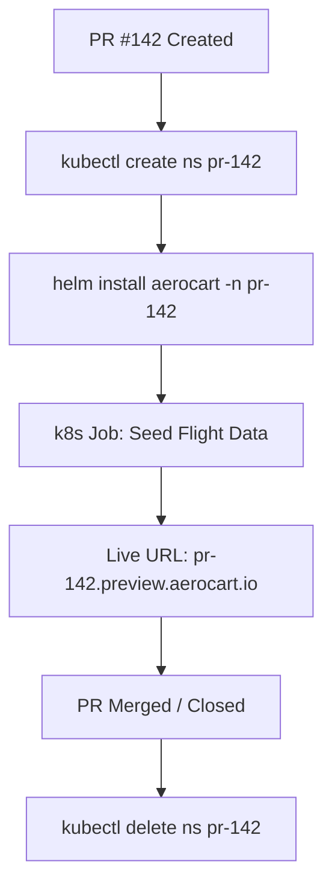

# Ephemeral PR Preview Environments: Dynamic Namespaces, Helm Templating & TTL Cleanups

```json continuity
{
  "previously": "In Chapter 08, we designed content-addressable lockfile cache keys, BuildKit remote OCI layer caching, and isolated DinD runners.",
  "painPoint": "Before merging PRs, 30 engineers shared one static 'staging' environment. PR #142 truncated database tables while PR #143 was running checkout tests, causing 40% of test failures to be false-alarm staging collisions!",
  "unlock": "Launch AeroPipe v0.9: provision isolated per-Pull-Request Kubernetes preview namespaces (`pr-142`), render dynamic Helm values and Kustomize overlays, seed isolated test fixtures, and enforce automated TTL teardown hooks."
}
```

```json walkthrough
[
  {
    "time": "0:00",
    "badge": "Shared Staging Bottleneck",
    "title": "Why Shared Staging Fails: Data Clashes & Schema Lockouts",
    "caption": "A single shared staging server creates contention: feature branch A runs DB migrations that break feature branch B, and test cleanups drop tables out from under concurrent runners.",
    "nodes": ["PR #142 (Migration A)", "PR #143 (Test Run B)", "Shared Staging DB", "Mutual Test Crashes"],
    "activeIndex": 2,
    "code": "# Shared Staging Anti-Pattern:\nTwo PRs modifying user schemas simultaneously crash each other!"
  },
  {
    "time": "0:25",
    "badge": "Dynamic PR Namespaces",
    "title": "Ephemeral Kubernetes Namespaces: namespace: pr-${{ pr_num }}",
    "caption": "Every PR triggers a workflow that creates an isolated Kubernetes namespace (e.g. pr-142). NetworkPolicies ensure namespaces cannot cross-talk or interfere with production.",
    "nodes": ["GitHub PR Opened", "K8s API", "kubectl create ns pr-142", "Isolated Pods & Services"],
    "activeIndex": 2,
    "code": "kubectl create namespace pr-${{ github.event.pull_request.number }}\nhelm upgrade --install aerocart-preview ./charts/aerocart -n pr-142"
  },
  {
    "time": "0:50",
    "badge": "Helm Manifest Rendering",
    "title": "Parameterized Values: Dynamic Hostnames & Isolated DBs",
    "caption": "Helm renders templated manifests using dynamic values: image tag is pinned to the PR git commit SHA, and ingress creates preview hostname https://pr-142.preview.aerocart.io.",
    "nodes": ["Helm Values (pr_num=142)", "Template Engine", "Rendered Manifests", "Live Preview Ingress"],
    "activeIndex": 2,
    "code": "ingress:\n  host: pr-142.preview.aerocart.io\nimage:\n  tag: ${{ github.sha }}"
  },
  {
    "time": "1:15",
    "badge": "TTL Garbage Collection",
    "title": "Automated Teardown: PR Close Events & Reaper Jobs",
    "caption": "Orphaned preview environments waste thousands in cloud bills. We pair PR close webhook events with a secondary cronjob that deletes any preview namespace older than 6 hours.",
    "nodes": ["PR Merged / Closed", "Teardown Hook", "kubectl delete ns pr-142", "Cloud Resources Reclaimed"],
    "activeIndex": 2,
    "code": "on:\n  pull_request:\n    types: [closed]\njobs:\n  destroy:\n    run: kubectl delete ns pr-${{ github.event.pull_request.number }}"
  }
]
```

```json pretraining
[
  {
    "term": "Ephemeral Preview Environment",
    "formula": "PR Lifecycle = Namespace Provision -> Deploy -> Seed -> Test -> Destroy",
    "meaning": "A short-lived, dedicated full-stack application environment created on-demand for a pull request and deleted as soon as the PR merges or closes."
  },
  {
    "term": "Helm Values Templating",
    "formula": "Manifest Template + values-override.yaml = Static K8s Spec",
    "meaning": "Parameterizing Kubernetes YAML templates with environment-specific variables like image tags, replica counts, and DNS hostnames."
  },
  {
    "term": "Synthetic Test Data Seeding",
    "formula": "K8s Post-Deploy Job -> Seed Pre-Configured Users/Flights -> Ready",
    "meaning": "A one-shot Kubernetes Job running immediately after preview deployment that populates a clean ephemeral database with reproducible test fixtures."
  },
  {
    "term": "TTL Namespace Reaper",
    "formula": "Age(Namespace) > MaxTTL (e.g. 6h) -> Auto-Delete",
    "meaning": "An automated background cleaner that deletes stale preview environments if a developer closes a PR without triggering the teardown webhook."
  }
]
```

## 🌱 Step 1: Plain-English Mental Model — Hotel Rooms vs. A Shared Dormitory

Imagine 50 traveling business executives forced to share a single hotel room. If Executive A changes the TV channel or locks the bathroom door, Executive B's meeting prep is ruined.

That is shared staging.
**Ephemeral preview environments** give every pull request its own private hotel room (`pr-142`). The room has its own bed, bathroom, and keycard:
- When the PR opens, the room is booked and prepared.
- Automated tests and stakeholders inspect the live feature in isolation.
- When the PR closes or checks out, the room is completely cleaned and reset for the next traveler.



---

## 🔨 Step 2: Zero-to-Running Starter & CLI — Generating Preview Namespaces

Simulate rendering Helm templates and preview environment names from the CLI:

```bash
# Render Helm templates locally with custom values without a live cluster
helm template aerocart-preview ./charts/aerocart \
  --set ingress.host="pr-142.preview.aerocart.io" \
  --set image.tag="sha-a1b2c3d" \
  --namespace="pr-142"
```

Let's build a Python simulator that manages preview environment lifecycle states:

```python
from __future__ import annotations
import time

# Subgoal 1: Model preview namespace tracking and TTL expiration
class EphemeralPreviewManager:
    def __init__(self, max_ttl_seconds: int = 3600) -> None:
        self.max_ttl = max_ttl_seconds
        # Maps namespace_name -> creation_timestamp
        self.active_namespaces: dict[str, float] = {}

    def provision_pr_namespace(self, pr_number: int, current_time: float) -> str:
        # Subgoal 2: Construct isolated per-PR namespace identifier
        ns_name = f"pr-{pr_number}"
        self.active_namespaces[ns_name] = current_time
        return ns_name

    def teardown_pr_namespace(self, pr_number: int) -> bool:
        # Subgoal 3: Handle explicit PR close teardown
        ns_name = f"pr-{pr_number}"
        if ns_name in self.active_namespaces:
            del self.active_namespaces[ns_name]
            return True
        return False

    def reap_expired_namespaces(self, current_time: float) -> list[str]:
        # Subgoal 4: Automated TTL reaper for abandoned branches
        expired = [
            ns for ns, created in self.active_namespaces.items()
            if (current_time - created) > self.max_ttl
        ]
        for ns in expired:
            del self.active_namespaces[ns]
        return expired

if __name__ == "__main__":
    mgr = EphemeralPreviewManager(max_ttl_seconds=3600)
    t0 = 1000.0
    ns142 = mgr.provision_pr_namespace(142, current_time=t0)
    assert ns142 == "pr-142"
    assert "pr-142" in mgr.active_namespaces
    
    # Simulate time jump past TTL (4,000s later)
    reaped = mgr.reap_expired_namespaces(current_time=t0 + 4000.0)
    assert reaped == ["pr-142"]
    assert len(mgr.active_namespaces) == 0
    print("EphemeralPreviewManager verified successfully.")
```

### Java 17 Equivalent

```java
import java.util.*;

public class AeroPipeCh09Starter {
    private final Map<String, Long> namespaces = new HashMap<>();
    private final long maxTtlSec = 3600;

    public String provision(int prNum, long nowSec) {
        String ns = "pr-" + prNum;
        namespaces.put(ns, nowSec);
        return ns;
    }

    public List<String> reap(long nowSec) {
        List<String> expired = new ArrayList<>();
        namespaces.forEach((ns, created) -> {
            if (nowSec - created > maxTtlSec) expired.add(ns);
        });
        expired.forEach(namespaces::remove);
        return expired;
    }

    public static void main(String[] args) {
        AeroPipeCh09Starter starter = new AeroPipeCh09Starter();
        starter.provision(142, 1000L);
        List<String> reaped = starter.reap(5000L);
        assert reaped.contains("pr-142");
        System.out.println("Java AeroPipeCh09Starter verified: reaped " + reaped);
    }
}
```

---

## 🛠️ Step 3: Everyday Practitioner Workflows & Where Naive Code Breaks

Why do teams struggle with preview environments?
- **Cloud Cost Explosion**: Deploying full databases and Kafka clusters per PR runs up massive bills unless lightweight mock containers or shared multi-tenant databases with schema isolation are used.
- **Dangling Ingress DNS**: Leaving old DNS records pointing to dead pods yields confusing 502 Bad Gateway errors for reviewers.
- **Teardown Failures**: Relying exclusively on GitHub Actions `types: [closed]` fails if the branch is deleted via git CLI or if the workflow run is cancelled. A secondary cronjob reaper is mandatory.

```json contrast
{
  "title": "Preview Environment Strategy: Heavy Full-Stack vs. Lightweight Namespace Overlays",
  "leftLabel": "❌ Heavy Multi-Cluster Duplicate",
  "leftCode": "# Spawns an entire cloud VPC, RDS, and Redis per PR!\n# Cost: $400/month per active PR\n# Boot Time: 28 minutes before tests can run\n# 50 PRs = $20,000 cloud bill spike!",
  "rightLabel": "✅ Staff Dynamic Namespace Overlay",
  "rightCode": "# Uses Helm/Kustomize overlay in a shared preview cluster\n# Reuses shared Kafka with isolated topic prefixes\n# Ephemeral Postgres container with seeded fixtures\n# Boot Time: 45 seconds | Cost: $2/day per PR"
}
```

```json poe
{
  "question": "A developer opens PR #88 and merges it 2 hours later. The GitHub Actions teardown workflow fails because a cluster credentials secret was rotated during the merge. How does a Staff Quality Platform prevent the preview namespace from leaking permanently?",
  "options": [
    "It cannot; leaked namespaces must be deleted manually by on-call engineers",
    "A Kubernetes CronJob running in the cluster inspects namespace metadata annotations ('created-at') and deletes any preview namespace exceeding its maximum TTL",
    "Kubernetes automatically restarts the PR",
    "The developer's laptop shuts down"
  ],
  "answerIndex": 1,
  "explanation": "A resilient quality platform never relies on a single external webhook. An in-cluster CronJob acts as a garbage collector, querying namespaces labeled 'environment=preview' and deleting any whose age exceeds the TTL."
}
```

---

## 🏢 Step 4: How Big Tech Runs It at Scale, Staff Math & Production Blueprint

### 🏢 In the Wild: Airbnb & Uber Ephemeral Preview Fleets

At **Airbnb** and **Uber**, preview environments (often called "PR Preview Environments" or "Ephemeral Namespaces") allow engineers, product managers, and automated Playwright suites to test features before touching staging or trunk:
1. **Kustomize Overlay Hierarchy**: Production manifests remain pristine in `base/`. A preview generator creates an ephemeral overlay with modified image tags, custom ingress annotations, and memory caps:
   ```yaml
   apiVersion: kustomize.config.k8s.io/v1beta1
   kind: Kustomization
   resources: [../../base]
   namespace: pr-142
   patches:
     - target: { kind: Ingress }
       patch: |-
         - op: replace
           path: /spec/rules/0/host
           value: pr-142.preview.aerocart.io
   ```
2. **Preview Capacity Math**:
   $$N_{\text{max\_concurrent}} = \frac{\text{Cluster Memory Pool}}{\text{RAM per Preview Suite}} = \frac{128\text{ GiB}}{4\text{ GiB}} = 32 \text{ concurrent previews}$$
   To prevent exceeding node pools, a queuing admission controller rejects new preview builds when concurrent previews breach limits, prompting developers to close stale PRs.

| Attribute | Shared Staging Environment | Ephemeral PR Namespaces | Production Parity Staging |
| :--- | :--- | :--- | :--- |
| **Isolation Level** | Zero (High Collisions) | **100% per PR** | Moderate |
| **Startup Latency** | Instant (Pre-existing) | **~45 seconds** | Hours / Days |
| **Cost Model** | Fixed monthly cost | **Pay-as-you-go per active PR** | Expensive duplicate |
| **Teardown Mechanism** | None (Permanent) | **Automated TTL Reaper** | Manual |

```python
from __future__ import annotations

class AeroPipeKustomizeOverlayRenderer:
    """Production Kustomize overlay generator for ephemeral preview environments."""

    @staticmethod
    def render_overlay(pr_number: int, commit_sha: str, base_domain: str = "preview.aerocart.io") -> dict[str, object]:
        ns_name = f"pr-{pr_number}"
        preview_host = f"{ns_name}.{base_domain}"
        
        return {
            "apiVersion": "kustomize.config.k8s.io/v1beta1",
            "kind": "Kustomization",
            "namespace": ns_name,
            "commonLabels": {
                "environment": "ephemeral-preview",
                "pr-number": str(pr_number),
            },
            "images": [
                {
                    "name": "aerocart-api",
                    "newTag": commit_sha[:8],
                }
            ],
            "ingressHost": preview_host,
        }

if __name__ == "__main__":
    overlay = AeroPipeKustomizeOverlayRenderer.render_overlay(142, "c98a72b4f128e930")
    assert overlay["namespace"] == "pr-142"
    assert overlay["ingressHost"] == "pr-142.preview.aerocart.io"
    print("AeroPipeCh09Blueprint verified: successfully rendered Kustomize overlay.")
```

### Java 17 Equivalent

```java
import java.util.Map;

public class AeroPipeCh09Blueprint {
    public static Map<String, Object> renderPreviewConfig(int prNumber, String commitSha) {
        String ns = "pr-" + prNumber;
        String host = ns + ".preview.aerocart.io";
        return Map.of(
            "namespace", ns,
            "ingressHost", host,
            "tag", commitSha.substring(0, Math.min(8, commitSha.length()))
        );
    }

    public static void main(String[] args) {
        var config = renderPreviewConfig(142, "c98a72b4f128e930");
        assert "pr-142".equals(config.get("namespace"));
        System.out.println("Java AeroPipeCh09Blueprint verified: " + config);
    }
}
```

> [!WARNING]
> **Hiring Bar-Raiser Gotcha — Database Migration Teardown vs. Orphaned Cloud Volumes!**
> Deleting a Kubernetes namespace deletes the pods and services, but **PersistentVolumeClaims (PVCs)** configured with `persistentVolumeReclaimPolicy: Retain` remain on cloud storage (EBS/GCP Persistent Disk), silently accumulating thousands of dollars in cloud storage debt! Senior quality architects always configure preview storage classes with `reclaimPolicy: Delete` to ensure cloud volumes vanish with the namespace!

```json quiz
[
  {
    "id": "infra09-q1",
    "question": "Why are ephemeral preview environments superior to a single shared staging environment for pull request testing?",
    "options": [
      "They eliminate test state and database migration collisions between concurrent feature branches",
      "They make CSS files download faster",
      "They eliminate the need for container images",
      "They require zero CPU resources"
    ],
    "answerIndex": 0,
    "explanation": "Shared staging environments suffer from race conditions when multiple branches run migrations or mutate shared state. Ephemeral namespaces isolate each PR completely."
  },
  {
    "id": "infra09-q2",
    "question": "What happens if a preview namespace is deleted while PersistentVolumeClaims use persistentVolumeReclaimPolicy: Retain?",
    "options": [
      "The cloud disks remain allocated in AWS/GCP, accumulating storage costs even though the namespace is gone",
      "The entire cluster terminates",
      "Kubernetes automatically converts the disks to RAM",
      "All pods are restored"
    ],
    "answerIndex": 0,
    "explanation": "A reclaim policy of Retain leaves underlying cloud block devices intact after PVC deletion, causing silent cost leaks unless explicitly set to Delete."
  },
  {
    "id": "infra09-q3",
    "question": "How should automated teardown of ephemeral preview environments be engineered to survive failed GitHub Actions workflows?",
    "options": [
      "Ask developers to delete them manually in Slack",
      "Pair PR-close webhooks with an in-cluster CronJob reaper that deletes any preview namespace exceeding a max TTL",
      "Disable previews entirely",
      "Never delete any environments"
    ],
    "answerIndex": 1,
    "explanation": "Relying on external webhooks alone is brittle. A background cronjob reaper checking namespace creation timestamps provides bulletproof garbage collection."
  }
]
```

---

## 📋 Step 5: Master Cheat-Sheet, 60-Second Interview Pitch & Verified Sources

| Lifecycle Stage | Tool / Command | Invariant Enforced |
| :--- | :--- | :--- |
| **Namespace Provisioning** | `kubectl create ns pr-<num>` | Complete resource isolation |
| **Parameterized Deploy** | `helm upgrade --install -n pr-<num>` | Dynamic hostnames and commit image tags |
| **Data Fixture Seeding** | K8s Job (`helm.sh/hook: post-install`) | Predictable synthetic test fixtures |
| **Network Boundaries** | K8s `NetworkPolicy` | Prevents preview pods calling production |
| **Automated Teardown** | PR Webhook + In-cluster TTL Reaper | Zero cloud storage or runner cost leaks |

### 🎙️ 60-Second Interview Soundbite

> *"To eliminate staging bottlenecks and false test failures, I architected ephemeral preview environments for our quality platform. When a developer opens a pull request, CI deploys an isolated Kubernetes namespace (`pr-142`) using Helm and Kustomize overlays. A post-install Kubernetes job seeds isolated synthetic test fixtures, and Ingress creates a unique preview hostname for manual verification and Playwright suites. To ensure zero cost leakage, we enforce a two-tier teardown strategy: PR close events trigger immediate uninstallation, while an in-cluster TTL reaper CronJob cleans up any dangling namespaces older than six hours."*

### 📚 Verified Primary Sources
- [Kubernetes Official Documentation — Working with Namespaces](https://kubernetes.io/docs/concepts/overview/working-with-objects/namespaces/)
- [Helm Official Documentation — The Chart Template Developer's Guide](https://helm.sh/docs/chart_template_guide/)
