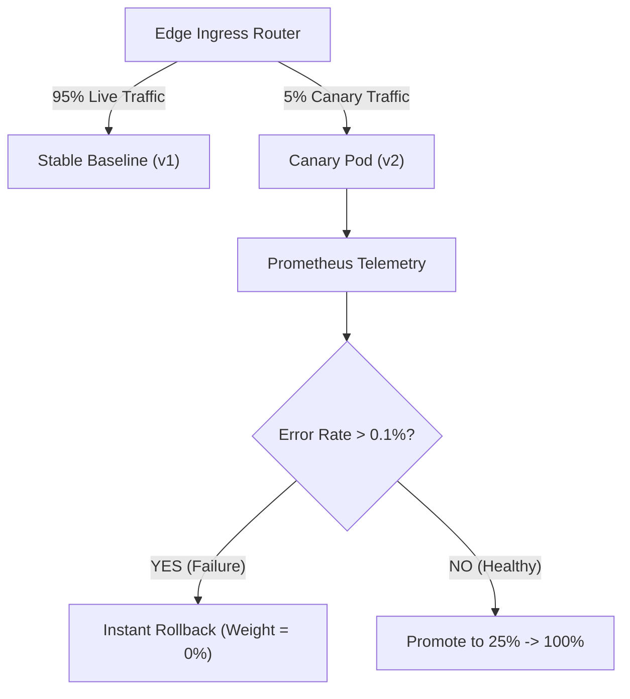

# Progressive Delivery & Quality Gates: Blue-Green, Canary Traffic Shifts & Automated Rollbacks

```json continuity
{
  "previously": "In Chapter 09, we built ephemeral Kubernetes preview environments (pr-142) with Helm overlays and automated TTL garbage collection.",
  "painPoint": "After PR tests pass and merge into trunk, deploying to production remains terrifying: a subtle memory leak or database deadlock slips past synthetic tests and crashes 100% of production traffic instantly!",
  "unlock": "Complete AeroPipe v1.0: aggregate sharded JUnit XML and Playwright blob reports into unified quality gates, and implement progressive canary delivery (1% -> 10% -> 50% -> 100%) with automated rollbacks on error-budget breaches."
}
```

```json walkthrough
[
  {
    "time": "0:00",
    "badge": "Sharded Report Merging",
    "title": "Aggregating 16 Sharded JUnit Reports into One Merge Gate",
    "caption": "When running 16 matrix shards in parallel, each runner outputs isolated junit-shard-*.xml and Playwright blob reports. A final gate job downloads all artifacts, parses failures, and blocks the merge if any shard failed.",
    "nodes": ["16 Matrix Shards", "Upload Artifacts", "Merge Job (junit-merge)", "Unified Allure/CTR Report"],
    "activeIndex": 2,
    "code": "# Aggregates reports across all workers into unified summary:\nmerge-junit -o unified-report.xml reports/*.xml"
  },
  {
    "time": "0:25",
    "badge": "Deployment Topologies",
    "title": "Rolling Update vs. Blue-Green vs. Progressive Canary",
    "caption": "Rolling updates replace pods incrementally but expose 100% of users to potential latent bugs. Blue-Green creates duplicate idle clusters. Canary shifts traffic gradually (1% -> 5% -> 25% -> 100%) while inspecting metrics.",
    "nodes": ["Big Bang (DANGEROUS)", "Rolling Update (Standard)", "Blue-Green (Instant Switch)", "Canary (Safest)"],
    "activeIndex": 3,
    "code": "# Canary routing via service mesh or ingress weight:\nspec:\n  traffic:\n    - revision: aerocart-v1\n      percent: 90\n    - revision: aerocart-v2-canary\n      percent: 10"
  },
  {
    "time": "0:50",
    "badge": "Automated Canary Analysis",
    "title": "Automated Canary Analysis (ACA): Error Rate & Latency Triggers",
    "caption": "Never rely on manual human observation during a release. Automated analyzers compare baseline vs canary error rate and p99 latency every 60 seconds, halting promotion if thresholds are breached.",
    "nodes": ["Canary 5% Traffic", "Prometheus Telemetry", "Threshold Gate (Errors < 0.1%)", "Promote to 25%"],
    "activeIndex": 2,
    "code": "analysis:\n  interval: 60s\n  thresholds:\n    error_rate: \"< 0.1%\"\n    latency_p99: \"< 250ms\""
  },
  {
    "time": "1:15",
    "badge": "Automated Rollback",
    "title": "Instant Automated Rollback: 0% Weight in < 5 Seconds",
    "caption": "If the canary breaches error budgets, the ingress immediately redirects 100% of traffic back to baseline (v1), quarantining the faulty revision before real users notice.",
    "nodes": ["Canary Error Breach", "Rollback Trigger", "Weight -> 0%", "Zero Outage Incident"],
    "activeIndex": 2,
    "code": "# Emergency Rollback: Shift 100% back to stable baseline\ntraffic:\n  - revision: aerocart-v1\n    percent: 100\n  - revision: aerocart-v2\n    percent: 0"
  }
]
```

```json pretraining
[
  {
    "term": "Sharded JUnit XML Merger",
    "formula": "Files[1..K] -> Combined TestSuite XML (Total, Passed, Failed)",
    "meaning": "A utility that stitches together fragmented test execution reports produced by parallel matrix workers into a unified report for CI gates."
  },
  {
    "term": "Blue-Green Deployment",
    "formula": "Two Identical Environments: Blue (Live) + Green (Idle) -> Router Flip",
    "meaning": "A release technique where a new version is fully deployed to an idle clone environment and switched instantaneously via a load balancer update."
  },
  {
    "term": "Canary Traffic Shifting",
    "formula": "Stepwise Routing: 1% -> 5% -> 25% -> 100% Traffic",
    "meaning": "Routing a tiny fraction of real user traffic to the new software release while monitoring health telemetry before full promotion."
  },
  {
    "term": "Automated Canary Rollback",
    "formula": "Breached Metric (p99 or Error Rate) -> Ingress Weight = 0%",
    "meaning": "An automated supervisor (e.g., Argo Rollouts, Flagger) that immediately diverts traffic away from a failing canary deployment without human intervention."
  }
]
```

## 🌱 Step 1: Plain-English Mental Model — The Canary in the Coal Mine

Before modern gas sensors, miners brought a small canary into coal tunnels. If toxic gas leaked, the canary showed distress long before miners felt symptoms, giving them time to evacuate safely.

In software deployment:
- **Big Bang Deployment**: You blast gas into the entire city without warning.
- **Canary Deployment**: You expose 1% of flight bookings to the new software version. If database deadlocks spike, the automated supervisor immediately pulls the plug and rolls back to 0% traffic. Only 1 in 100 users experienced a glitch, and your company avoided a front-page outage!



---

## 🔨 Step 2: Zero-to-Running Starter & CLI — Evaluating Canary Health Signals

Simulate merging sharded JUnit reports and evaluating canary health gates from your terminal:

```bash
# Example merging JUnit files using standard command line tools
cat << 'EOF' > /tmp/sample_junit.xml
<testsuite tests="10" failures="0" errors="0" time="15.2"></testsuite>
EOF
```

Let's build an automated report merger and canary traffic progression engine:

```python
from __future__ import annotations
from dataclasses import dataclass
from typing import Sequence

# Subgoal 1: Model sharded test report outcomes
@dataclass(frozen=True)
class ShardReport:
    shard_id: int
    total_tests: int
    failed_tests: int
    duration_sec: float

def aggregate_sharded_reports(shards: Sequence[ShardReport]) -> dict[str, object]:
    # Subgoal 2: Merge test counts and calculate makespan
    total = sum(s.total_tests for s in shards)
    failed = sum(s.failed_tests for s in shards)
    makespan = max((s.duration_sec for s in shards), default=0.0)
    passed = (failed == 0)
    return {
        "total_shards": len(shards),
        "total_tests": total,
        "failed_tests": failed,
        "makespan_sec": round(makespan, 2),
        "ci_gate_status": "PASS" if passed else "FAIL",
    }

# Subgoal 3: Model canary traffic shift state machine
class CanaryTrafficController:
    def __init__(self, steps: Sequence[int] = (1, 10, 50, 100)) -> None:
        self.steps = list(steps)
        self.current_step_idx = 0
        self.aborted = False

    def evaluate_step(self, error_rate_pct: float, max_allowed_error_pct: float = 0.1) -> int:
        if self.aborted:
            return 0
        if error_rate_pct > max_allowed_error_pct:
            # Subgoal 4: Immediate automatic rollback
            self.aborted = True
            return 0
        current_weight = self.steps[self.current_step_idx]
        if self.current_step_idx < len(self.steps) - 1:
            self.current_step_idx += 1
        return current_weight

if __name__ == "__main__":
    shards = [
        ShardReport(shard_id=1, total_tests=500, failed_tests=0, duration_sec=120.5),
        ShardReport(shard_id=2, total_tests=450, failed_tests=0, duration_sec=118.2),
        ShardReport(shard_id=3, total_tests=550, failed_tests=0, duration_sec=124.0),
    ]
    summary = aggregate_sharded_reports(shards)
    assert summary["ci_gate_status"] == "PASS"
    assert summary["total_tests"] == 1500
    
    canary = CanaryTrafficController()
    w1 = canary.evaluate_step(error_rate_pct=0.02)
    assert w1 == 1
    # Error spike triggers automatic rollback
    w2 = canary.evaluate_step(error_rate_pct=0.85)
    assert w2 == 0 and canary.aborted
    print(f"AeroPipeCh10 Starter verified: summary={summary['ci_gate_status']}, canary rollback={w2}%.")
```

### Java 17 Equivalent

```java
import java.util.List;

public class AeroPipeCh10Starter {
    public record ShardReport(int id, int total, int failed, double duration) {}

    public static boolean evaluateGate(List<ShardReport> shards) {
        int failures = 0;
        for (ShardReport s : shards) failures += s.failed();
        return failures == 0;
    }

    public static void main(String[] args) {
        List<ShardReport> shards = List.of(
            new ShardReport(1, 500, 0, 120.0),
            new ShardReport(2, 500, 0, 115.0)
        );
        boolean gatePass = evaluateGate(shards);
        assert gatePass;
        System.out.println("Java AeroPipeCh10Starter gate passed: " + gatePass);
    }
}
```

---

## 🛠️ Step 3: Everyday Practitioner Workflows & Where Naive Code Breaks

What goes wrong in real-world progressive deployments?
- **Premature Promotion**: Bumping canary traffic from 1% to 100% within 2 minutes before statistical errors or slow memory leaks have time to emerge.
- **Ignoring Ingress Sticky Sessions**: If session affinity is enabled, a user pinned to the canary pod remains on the failing canary even during rollback. Ingress must honor weight shifts strictly.
- **Unmerged Test Reporting**: When 1 out of 16 matrix shards fails, a poorly configured CI pipeline can report green if only the final step exit code is inspected.

```json contrast
{
  "title": "Release Rollout: Unmonitored Rolling Update vs. Automated Canary Analysis",
  "leftLabel": "❌ Blind Rolling Update",
  "leftCode": "# Replaces 100% of pods over 2 minutes\nkubectl set image deployment/aerocart-api aerocart=v2\n# High latency or DB deadlocks hit all users simultaneously\n# Manual on-call panic rollback required!",
  "rightLabel": "✅ Automated Canary Analysis (Argo / Flagger)",
  "rightCode": "# Shifts 5% traffic and analyzes p99 and 5xx errors\nspec:\n  stepWeight: 10\n  maxFailedChecks: 2\n  metrics:\n    - name: request-success-rate\n      thresholdRange: { min: 99.9 }\n# Auto-reverts to stable v1 if metrics degrade"
}
```

```json poe
{
  "question": "A production canary receives 5% of traffic. Over a 5-minute evaluation window, baseline v1 shows a 0.01% error rate, while canary v2 shows a 1.2% error rate. What action should the progressive delivery controller take?",
  "options": [
    "Promote the canary to 20% to see if the error rate smooths out",
    "Immediately abort the rollout, shift traffic back to 100% baseline v1, and notify engineering via webhook",
    "Restart the Kubernetes cluster nodes",
    "Delete all databases"
  ],
  "answerIndex": 1,
  "explanation": "Canary analysis is designed to fail fast. A 120x increase in error rate breaches safety limits, mandating an immediate automated rollback to protect production users."
}
```

---

## 🏢 Step 4: How Big Tech Runs It at Scale, Staff Math & Production Blueprint

### 🏢 In the Wild: Netflix & Uber Kayenta Automated Canary Analysis (ACA)

At **Netflix** and **Uber**, software is deployed thousands of times per week with zero scheduled downtime using tools like Kayenta and Argo Rollouts:
1. **The Mann-Whitney U Non-Parametric Metric Comparison**: Rather than comparing arbitrary averages, statistical engines compare the distributions of latency and errors between a **Baseline** (stable v1 with 5% traffic) and a **Canary** (new v2 with 5% traffic). This eliminates false alarms caused by noisy external traffic shifts.
2. **Canary Blast Radius Economics**:
   $$\text{Blast Radius} = \frac{\text{Canary Traffic Fraction} \times \text{Detection Time (s)}}{\text{Total User Volume}}$$
   By keeping canary traffic at $1\%$ and automated detection under $60\text{ seconds}$, an undetected critical bug affects at most $0.01 \times \frac{60}{3600} \approx 0.016\%$ of hourly users.

| Rollout Topology | Blast Radius | Rollback Speed | Infrastructure Cost |
| :--- | :--- | :--- | :--- |
| **Big Bang** | $100\%$ of users | Slow ($> 15\text{m}$) | Low |
| **Rolling Update** | Progressive up to $100\%$ | Moderate ($2–5\text{m}$) | Low |
| **Blue-Green** | $0\%$ until switch, then $100\%$ | Instant ($< 5\text{s}$) | High ($2\times$ idle cluster capacity) |
| **Progressive Canary** | Strictly bounded ($1\%–5\%$) | Instant ($< 5\text{s}$) | Low (Incremental container allocation) |

```python
from __future__ import annotations

class AeroPipeCanaryGovernor:
    """Production automated canary analyzer and safety gate."""

    @staticmethod
    def should_promote(
        baseline_error_rate: float,
        canary_error_rate: float,
        baseline_p99_ms: float,
        canary_p99_ms: float,
        max_relative_degradation: float = 0.20,
    ) -> tuple[bool, str]:
        # Check error rate degradation
        if canary_error_rate > baseline_error_rate * (1.0 + max_relative_degradation) and canary_error_rate > 0.001:
            return False, f"ROLLBACK: Error rate degraded from {baseline_error_rate:.4f} to {canary_error_rate:.4f}"
            
        # Check latency degradation
        if canary_p99_ms > baseline_p99_ms * (1.0 + max_relative_degradation):
            return False, f"ROLLBACK: p99 latency degraded from {baseline_p99_ms:.1f}ms to {canary_p99_ms:.1f}ms"
            
        return True, "PROMOTE: Canary metrics within acceptable variance"

if __name__ == "__main__":
    gov = AeroPipeCanaryGovernor()
    healthy_ok, msg1 = gov.should_promote(0.0005, 0.0005, 45.0, 48.0)
    assert healthy_ok
    unhealthy_ok, msg2 = gov.should_promote(0.0005, 0.0080, 45.0, 120.0)
    assert not unhealthy_ok and "ROLLBACK" in msg2
    print(f"AeroPipeCh10Blueprint verified: {msg1}")
```

### Java 17 Equivalent

```java
public class AeroPipeCh10Blueprint {
    public static boolean checkCanary(double baseErr, double canaryErr, double baseP99, double canaryP99) {
        if (canaryErr > baseErr * 1.25 && canaryErr > 0.001) return false;
        if (canaryP99 > baseP99 * 1.25) return false;
        return true;
    }

    public static void main(String[] args) {
        boolean pass = checkCanary(0.001, 0.0011, 50.0, 52.0);
        boolean fail = checkCanary(0.001, 0.0050, 50.0, 95.0);
        assert pass && !fail;
        System.out.println("Java AeroPipeCh10Blueprint verified: canary checks pass.");
    }
}
```

> [!WARNING]
> **Hiring Bar-Raiser Gotcha — Database Backward Compatibility in Canary Deployments!**
> In a canary release, **both version 1 and version 2 are actively reading and writing to the database simultaneously**! If version 2 renames or drops a column in an eager database migration, version 1 pods will crash immediately on live user requests! Staff quality platform architects mandate **Expand-Contract (Parallel Change)** database migrations: first expand by adding new nullable columns, deploy code, backfill data, and only drop old columns in a subsequent release cycle!

```json quiz
[
  {
    "id": "infra10-q1",
    "question": "Why must database schema migrations follow the Expand-Contract pattern during canary deployments?",
    "options": [
      "Because SQL databases do not support canary deployments",
      "Because stable v1 pods and canary v2 pods run simultaneously against the same database, requiring backward and forward schema compatibility",
      "To reduce the number of tables in the database",
      "Because Kubernetes disables database transactions"
    ],
    "answerIndex": 1,
    "explanation": "During progressive traffic shifting, both versions operate concurrently. Dropping or renaming columns breaks active v1 instances instantly."
  },
  {
    "id": "infra10-q2",
    "question": "What is the primary advantage of Blue-Green deployments over standard rolling updates?",
    "options": [
      "Blue-Green uses half the memory of rolling updates",
      "Blue-Green provides instantaneous cutover and immediate one-click rollback by switching the router/load balancer endpoint",
      "Blue-Green requires zero test execution",
      "Blue-Green compiles code faster"
    ],
    "answerIndex": 1,
    "explanation": "Blue-Green deploys the entire new version to an idle environment. Once verified, updating the load balancer switches all traffic instantly, and rolling back is as simple as flipping it back."
  },
  {
    "id": "infra10-q3",
    "question": "How should automated canary analysis handle organic cluster-wide traffic fluctuations (e.g., flash sales)?",
    "options": [
      "Disable all alerts during peak hours",
      "Compare the Canary revision against a concurrent Baseline revision receiving identical production traffic, rather than against fixed historical thresholds",
      "Manually override the canary gate",
      "Scale the database to zero"
    ],
    "answerIndex": 1,
    "explanation": "Comparing a canary directly to a concurrent baseline running on identical infrastructure ensures that cluster-wide traffic spikes or downstream network delays affect both equally, preventing false rollback alerts."
  }
]
```

---

## 📋 Step 5: Master Cheat-Sheet, 60-Second Interview Pitch & Verified Sources

| Release Strategy | Blast Radius | Rollback Latency | Database Requirement |
| :--- | :--- | :--- | :--- |
| **Rolling Update** | Progressive to $100\%$ | Minutes ($2–5\text{m}$) | Forward/backward compatible schema |
| **Blue-Green** | Instantaneous $100\%$ | Seconds ($< 5\text{s}$) | Forward/backward compatible schema |
| **Canary Release** | Strictly bounded ($1\%–10\%$) | Seconds ($< 5\text{s}$) | Expand-Contract schema required |
| **Feature Flags** | Scoped per-user/tenant | Milliseconds | Application-layer toggling |

### 🎙️ 60-Second Interview Soundbite

> *"Deploying software safely to production requires combining unified quality gates in CI with automated progressive delivery in production. In our pipeline, after parallel matrix shards finish, an aggregator merges isolated JUnit XML and Playwright reports into a single blocking gate. In production, we avoid big-bang rolling updates by implementing canary releases via Argo Rollouts. We route an initial 2% of real user traffic to the canary and run automated analysis every 60 seconds against a concurrent baseline. If error rates or p99 latencies breach our error budget thresholds, the ingress immediately reverts traffic to the baseline in under 5 seconds, bounding our blast radius before end users are impacted."*

### 📚 Verified Primary Sources
- [Kubernetes Official Documentation — Deployments and Rolling Update Strategies](https://kubernetes.io/docs/concepts/workloads/controllers/deployment/#strategy)
- [Martin Fowler — Blue-Green and Canary Deployment Architectural Patterns](https://martinfowler.com/bliki/BlueGreenDeployment.html)
