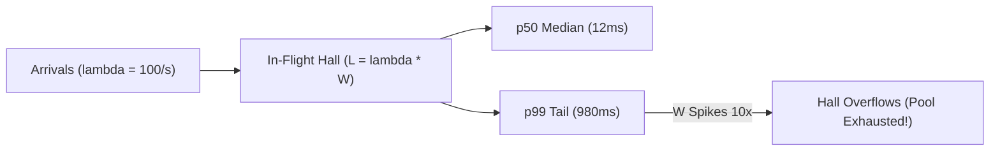

# Day-0 Load Physics: Little's Law, Tail Percentiles & the 5-Workload Taxonomy

```json continuity
{
  "previously": "Welcome to Day 1 of Course 11! Zero prior load testing, queueing theory, or Site Reliability Engineering (SRE) background is required.",
  "painPoint": "AeroCart's checkout team celebrated an 'average' response time of 48ms on staging—only to watch 1 in 20 Black Friday passengers hit 4,500ms payment timeouts and exhaust every worker thread in production.",
  "unlock": "Launch AeroPulse v0.1 to replace misleading arithmetic averages with exact p50/p95/p99/p99.9 tail percentiles, calculate in-flight concurrency via Little's Law, and design the 5-workload performance taxonomy."
}
```

```json walkthrough
[
  {
    "time": "0:00",
    "badge": "Day-0 Mental Model",
    "title": "Why Arithmetic Average Latency Is a Lie",
    "caption": "If 99 passengers breeze through security in 10ms and 1 passenger is stuck for 5,000ms, the arithmetic average is 59.9ms—looking healthy on a dashboard while high-value multi-service pages time out.",
    "nodes": ["99 Fast (10ms)", "1 Slow (5,000ms)", "Avg = 59.9ms (Hides Pain)", "p99 = 5,000ms (Truth)"],
    "activeIndex": 3,
    "code": "# 99 requests @ 10ms + 1 request @ 5000ms\nsamples = [10.0] * 99 + [5000.0]\n# Mean = 59.9ms (Green!) vs p99 = 5000.0ms (Red Alert!)"
  },
  {
    "time": "0:25",
    "badge": "Little's Law",
    "title": "How Slow Latency Explodes In-Flight Concurrency",
    "caption": "Little's Law states that average in-flight requests (L) equal arrival rate (lambda) times average latency (W). When a database slowdown multiplies latency by 10x, in-flight threads multiply by 10x at the exact same RPS!",
    "nodes": ["Arrival Rate (lambda)", "Response Time (W)", "In-Flight Concurrency (L)", "Thread Pool Saturation"],
    "activeIndex": 2,
    "code": "# 500 RPS * 0.05s latency = 25 in-flight requests\n# 500 RPS * 0.50s latency = 250 in-flight requests (Pool Exhausted!)"
  },
  {
    "time": "0:50",
    "badge": "5 Load Archetypes",
    "title": "Smoke, Baseline, Stress, Spike & 24-Hour Soak",
    "caption": "Never run one generic 'load test'. Each workload shape answers a distinct engineering question: from 5-VU CI Smoke sanity to instantaneous flash-sale Spike survival and 24-Hour Soak memory-leak detection.",
    "nodes": ["Smoke & Baseline", "Stress / Breakpoint", "Flash-Sale Spike", "24h Soak Endurance"],
    "activeIndex": 2,
    "code": "# Workload taxonomy:\n# Smoke -> Baseline -> Stress -> Spike -> 24h Soak"
  },
  {
    "time": "1:15",
    "badge": "Big Tech Scale",
    "title": "Why Fan-Out Multiplies Tail Latency Across Microservices",
    "caption": "When a single AeroCart checkout call fans out to 10 downstream microservices, a 99% fast probability per service drops to 0.99^10 = 90.4% at the user edge—making p99 the everyday experience for 1 in 10 users.",
    "nodes": ["User Checkout", "10 Microservice Calls", "1 - 0.99^10 = 9.56% Hit p99", "Strict Tail SLOs"],
    "activeIndex": 2,
    "code": "edge_tail_prob = 1.0 - (1.0 - 0.01) ** 10  # 9.56% of users hit p99!"
  }
]
```

```json pretraining
[
  {
    "term": "Tail Percentile (p50, p95, p99, p99.9)",
    "formula": "p99 = 99% of requests are faster, 1% are slower",
    "meaning": "Sorting all response times from fastest to slowest and reading the value at the 50th, 95th, or 99th percent mark so extreme customer slowdowns are never hidden by fast cache hits."
  },
  {
    "term": "Little's Law",
    "formula": "L = lambda * W",
    "meaning": "The universal queueing law: the number of concurrent requests inside a system (L) equals the arrival rate per second (lambda) multiplied by the average time each request spends inside (W)."
  },
  {
    "term": "Throughput (RPS / QPS) vs. Concurrency",
    "formula": "RPS = Rate per Second · Concurrency = Simultaneous In-Flight",
    "meaning": "Throughput measures how many requests finish per second, whereas concurrency measures how many requests are actively occupying threads or connections at the same instant."
  },
  {
    "term": "Workload Taxonomy",
    "formula": "Smoke · Baseline · Stress · Spike · Soak",
    "meaning": "Five distinct traffic shapes designed to isolate script bugs (Smoke), SLO compliance (Baseline), capacity ceilings (Stress), autoscaler shock (Spike), and slow resource leaks (Soak)."
  }
]
```

## 🌱 Step 1: Plain-English Mental Model — Airport Security Lines & Why Averages Lie

Picture an international airport check-in hall for `AeroCart` airlines. Suppose **99 passengers** scan their boarding passes in **10 seconds**, while **1 passenger** triggers a legacy visa system freeze and waits **1,000 seconds** (~16.6 minutes). If the airport manager reports the **arithmetic average wait time**, the dashboard reads **19.9 seconds**—and everyone gets a bonus! Yet the 100th passenger missed their flight, and in e-commerce, that 100th request is often your highest-spending customer with the largest shopping cart.

That is why reliability engineers banish arithmetic averages and measure **percentiles** (`p50`, `p95`, `p99`, `p99.9`), alongside **Little's Law** (`L = lambda * W`), which connects how fast passengers arrive (`lambda`) and how long each check-in takes (`W`) to how many people are standing inside the building at once (`L`):



Notice two foundational truths before writing a single line of load-test code:
1. **Tail percentiles expose real user pain**: `p50` (the median) tells you what a typical cache hit looks like; `p95`, `p99`, and `p99.9` reveal the slowest 5%, 1%, and 0.1% of requests where database locks, garbage collection pauses, and retries live.
2. **Latency spikes cause concurrency explosions**: Even if customer traffic stays completely flat at `100 requests/sec`, if a slow database query pushes response time from `0.05s` to `1.0s`, the number of simultaneous in-flight requests jumps from `5` to `100`—instantly exhausting a 64-worker server pool!

---

## 🔨 Step 2: Zero-to-Running Starter & CLI — Booting `AeroPulse v0.1`

Before installing external load generators like Grafana `k6` or Python `Locust`, let's verify our local runtime and build **`AeroPulse v0.1`**—a zero-dependency percentile and Little's Law calculator that runs anywhere in milliseconds:

```bash
# Verify Python 3 stdlib runtime and inspectGrafana k6 / Locust CLI readiness
python3 --version
# Optional: check k6 or locust if installed locally
command -v k6 || echo "k6 runs via Docker: grafana/k6"
```

Let's write a self-contained Python 3 starter that computes exact nearest-rank percentiles (`p50`, `p95`, `p99`, `p99.9`) vs. arithmetic mean and sizes `AeroCart` worker pools using Little's Law:

```python
from __future__ import annotations
import math


# Subgoal 1: Compute exact nearest-rank percentile without external libraries
def percentile(samples_ms: list[float], pct: float) -> float:
    ordered = sorted(samples_ms)
    rank = max(0, math.ceil((pct / 100.0) * len(ordered)) - 1)
    return ordered[rank]


# Subgoal 2: Size in-flight concurrency via Little's Law (L = lambda * W)
def littles_law_concurrency(arrival_rps: float, mean_latency_ms: float) -> float:
    return arrival_rps * (mean_latency_ms / 1000.0)


# Subgoal 3: Compare arithmetic average vs p95/p99 on bimodal checkout telemetry
latencies = [12.0] * 95 + [45.0] * 4 + [1850.0]  # 100 requests total
mean_ms = sum(latencies) / len(latencies)
p50_ms = percentile(latencies, 50)
p95_ms = percentile(latencies, 95)
p99_ms = percentile(latencies, 99)
in_flight = littles_law_concurrency(arrival_rps=400.0, mean_latency_ms=mean_ms)

assert p50_ms == 12.0 and p95_ms == 12.0 and p99_ms == 45.0
assert percentile(latencies, 99.9) == 1850.0
print(f"Mean={mean_ms:.1f}ms | p50={p50_ms}ms | p99={p99_ms}ms | L={in_flight:.1f} in-flight")
```

### Java 17 Equivalent

```java
import java.util.Arrays;

public class AeroPulseCh01Starter {
    // Subgoal 1: Nearest-rank percentile over sorted latency array
    public static double percentile(double[] samplesMs, double pct) {
        double[] copy = Arrays.copyOf(samplesMs, samplesMs.length);
        Arrays.sort(copy);
        int idx = Math.max(0, (int) Math.ceil((pct / 100.0) * copy.length) - 1);
        return copy[idx];
    }

    // Subgoal 2: Little's Law (L = lambda * W) converting milliseconds to seconds
    public static double littlesLawConcurrency(double arrivalRps, double meanLatencyMs) {
        return arrivalRps * (meanLatencyMs / 1000.0);
    }

    public static void main(String[] args) {
        // Subgoal 3: Verify tail latency separation from arithmetic mean
        double[] samples = new double[100];
        Arrays.fill(samples, 0, 95, 12.0);
        Arrays.fill(samples, 95, 99, 45.0);
        samples[99] = 1850.0;

        double p99 = percentile(samples, 99.0);
        double p999 = percentile(samples, 99.9);
        double inFlight = littlesLawConcurrency(400.0, 31.7);
        assert p99 == 45.0 && p999 == 1850.0 && inFlight > 12.0;
    }
}
```

**Quick Starter Walkthrough:**
- **Why `math.ceil((pct / 100.0) * N) - 1`?** The **nearest-rank method** guarantees that `percentile(samples, 99)` returns an actual observed request latency from your dataset rather than an interpolated synthetic number.
- **Why divide `mean_latency_ms` by `1000.0` in Little's Law?** Arrival rate $\lambda$ is measured in **requests per second**, so wait time $W$ must also be expressed in **seconds** ($50\text{ ms} = 0.05\text{ s}$) for units to cancel cleanly into dimensionless in-flight requests $L$.

---

## 🛠️ Step 3: Everyday Practitioner Workflows & Where Naive Code Breaks

In day-to-day performance engineering, you never run a single monolithic "load test". Instead, you match one of **five canonical workload shapes** to the exact failure mode you are hunting:

1. **Smoke Test** (`1–5 VUs`, `30s–1m`): Runs on every pull request to verify the load script, auth tokens, and assertions work with zero errors before provisioning large load generators.
2. **Baseline Load Test** (`Expected Average → Peak RPS`, `15m–30m`): Validates that `AeroCart` meets its `p95 < 150ms` and `p99 < 300ms` Service Level Objectives (SLOs) under normal daily peak traffic.
3. **Stress / Breakpoint Test** (`Ramp RPS steadily until failure`): Discovers the exact saturation ceiling (`knee of the curve`) where CPU, database connections, or lock queues buckle, and verifies whether the system recovers cleanly once traffic drops.
4. **Spike Test** (`100 RPS → 3,000 RPS in 5 seconds`): Simulates a flash sale or ticket drop to test connection-pool queues, rate limiters, and Kubernetes Horizontal Pod Autoscaler (HPA) lag.
5. **24-Hour Soak (Endurance) Test** (`70–80% Peak RPS for 4h–24h`): Detects slow memory leaks, unclosed file descriptors (`EMFILE`), connection pool leaks, and disk-filling debug logs that never appear in a 5-minute run.

### Where Naive Performance Assertions Break: Averaging Percentiles & Asserting Mean Latency

Two subtle bugs ruin production load reports every week:
1. **Gatekeeping on `avg(latency) < 200ms`**: A bimodal distribution where 95% of requests hit Redis in `2ms` and 5% hit a locked PostgreSQL table for `3,500ms` produces an average of **`176.9ms`—passing CI while 1 in 20 customers time out!**
2. **Averaging `p99` across pods or 1-minute windows**: You **cannot** take the arithmetic mean of ten servers' `p99` values (or use `AVG(p99)` in SQL/PromQL) when traffic is uneven across shards—doing so mathematically fabricates a fake percentile! You must merge raw histograms (`histogram_quantile(0.99, sum(rate(bucket[5m])) by (le))`).

```json contrast
{
  "title": "CI Latency Gatekeeping & Multi-Worker Aggregation",
  "leftLabel": "❌ Naive Gate (Asserts Mean & Averages p99s)",
  "leftCode": "# BROKEN 1: Mean hides 5% catastrophic 3.5s timeouts!\nassert sum(latencies) / len(latencies) < 200.0\n\n# BROKEN 2: Averaging p99 across unevenly loaded pods!\ncluster_p99 = sum(pod.p99 for pod in pods) / len(pods)",
  "rightLabel": "✅ Staff Gate (Multi-Percentile + Merged Histogram)",
  "rightCode": "# SAFE 1: Gate simultaneously on p50, p95, p99, and error rate\nassert percentile(latencies, 95) < 150.0\nassert percentile(latencies, 99) < 300.0\n\n# SAFE 2: Merge raw latency samples/buckets across all pods first\ncluster_p99 = percentile(all_merged_pod_samples, 99)"
}
```

```json poe
{
  "question": "Before running the simulator: AeroCart's checkout service receives a steady arrival rate of `lambda = 800 RPS`. During a downstream payment gateway slowdown, average response latency `W` rises from `50ms` to `750ms`. According to Little's Law (`L = lambda * W`), what happens to the average number of concurrent in-flight requests `L`?",
  "options": [
    "L stays constant at 40 in-flight requests because arrival RPS did not change",
    "L jumps 15x from 40 to 600 concurrent in-flight requests, exhausting a 200-thread worker pool",
    "L drops from 40 to 2.6 in-flight requests because slower threads accept fewer sockets",
    "L increases linearly by 15 requests to 55 in-flight requests"
  ],
  "answerIndex": 1,
  "explanation": "At 50ms (`0.05s`), `L = 800 * 0.05 = 40` concurrent requests. When `W` rises 15x to 750ms (`0.75s`) at the same 800 RPS arrival rate, `L = 800 * 0.75 = 600` concurrent requests—immediately saturating a 200-thread pool even though external traffic volume never increased!"
}
```

---

## 🏢 Step 4: How Big Tech Runs It at Scale, Staff Math & Production Blueprint

### 🏢 In the Wild: Google Tail-at-Scale & Amazon E-Commerce Fan-Out

In **Jeff Dean and Luiz André Barroso's seminal Google paper *"The Tail at Scale"*** and **Amazon's retail checkout studies**, engineers proved why `p99` latency in a single microservice becomes the **median user experience** in a distributed architecture.

When a customer loads an `AeroCart` flight confirmation page, the API Gateway fans out in parallel to **$k = 12$ downstream microservices** (pricing, seat inventory, loyalty points, baggage rules, fraud scoring, currency conversion, etc.). Even if every individual microservice meets a `p99 < 50ms` target (meaning each call has only a $p = 0.01$ probability of exceeding `50ms`), the user's page waits for the **slowest** of the 12 parallel calls!

### Staff Tail-Amplification & Queueing Math

If a single user request fans out to $k$ independent downstream services, each with tail-event probability $p$ (e.g., $p = 0.01$ for `p99`), the probability $P_{\text{slow}}$ that the user's top-level request suffers at least one tail delay is:

$$P_{\text{slow}}(k, p) = 1 - (1 - p)^k$$

For $k = 20$ microservices and $p = 0.01$ (`p99`):

$$P_{\text{slow}}(20, 0.01) = 1 - (0.99)^{20} = 1 - 0.8179 = 18.21\% \text{ of all user requests hit the tail!}$$

And by **Little's Law**, the steady-state concurrent in-flight occupancy $L$ across the service boundary is:

$$L = \lambda \cdot W$$

where $\lambda$ is the request arrival rate ($\text{requests/sec}$) and $W$ is the mean residence time ($\text{seconds}$) in the system (queue wait time $W_q$ plus service execution time $W_s$).

| Workload Type | Traffic Profile | Duration | Primary Question Answered | When NOT to Use It |
| :--- | :--- | :--- | :--- | :--- |
| **Smoke Test** | `1–5 VUs` minimal load | `30s – 1m` | Does the test script & SUT run with `0%` errors? | **Never** use to judge latency SLOs or capacity. |
| **Baseline Load** | Normal average $\to$ daily peak RPS | `15m – 30m` | Do `p95`/`p99` meet SLOs under normal peak? | Does not reveal breaking point or 12-hour memory leaks. |
| **Stress / Breakpoint** | Stepwise ramp beyond peak until failure | `20m – 45m` | What is the exact saturation RPS & recovery behavior? | Avoid running against shared multi-tenant prod dependencies. |
| **Spike Test** | Instant `10x` surge in `< 10s` | `5m – 10m` | Do admission queues, circuit breakers & HPA survive shock? | Too brief to warm JVM JIT caches or detect slow leaks. |
| **Soak (Endurance)** | `70%–80%` peak sustained flat | `4h – 24h` | Do heap memory, FDs, or DB pools leak over time? | Too slow for per-commit PR gates; run nightly/pre-release. |

### Production Blueprint: `AeroPulse v0.1` Telemetry, Little's Law & Fan-Out Analyzer

```python
from __future__ import annotations
import math
from dataclasses import dataclass


@dataclass(frozen=True)
class LatencySummary:
    count: int
    mean_ms: float
    p50_ms: float
    p95_ms: float
    p99_ms: float
    p999_ms: float
    required_concurrency: int
    fanout_tail_risk_pct: float


class AeroPulseTelemetryAnalyzer:
    """Computes nearest-rank tail percentiles, Little's Law pool sizing, and fan-out tail risk."""

    @staticmethod
    def nearest_rank_percentile(sorted_ms: list[float], pct: float) -> float:
        if not sorted_ms:
            return 0.0
        idx = max(0, math.ceil((pct / 100.0) * len(sorted_ms)) - 1)
        return sorted_ms[min(idx, len(sorted_ms) - 1)]

    @classmethod
    def analyze(
        cls,
        samples_ms: list[float],
        arrival_rps: float,
        downstream_fanout: int = 1,
    ) -> LatencySummary:
        ordered = sorted(samples_ms)
        mean_val = sum(ordered) / len(ordered)
        # Little's Law L = lambda * W (with 30% headroom buffer for worker sizing)
        raw_l = arrival_rps * (mean_val / 1000.0)
        sized_workers = math.ceil(raw_l * 1.30)
        # Tail amplification probability for p99 (p = 0.01) across k downstream calls
        tail_risk = (1.0 - (0.99 ** max(1, downstream_fanout))) * 100.0

        return LatencySummary(
            count=len(ordered),
            mean_ms=round(mean_val, 2),
            p50_ms=cls.nearest_rank_percentile(ordered, 50.0),
            p95_ms=cls.nearest_rank_percentile(ordered, 95.0),
            p99_ms=cls.nearest_rank_percentile(ordered, 99.0),
            p999_ms=cls.nearest_rank_percentile(ordered, 99.9),
            required_concurrency=sized_workers,
            fanout_tail_risk_pct=round(tail_risk, 2),
        )


if __name__ == "__main__":
    # Simulate 1,000 AeroCart checkout calls: 980 fast, 15 moderate, 5 tail spikes
    sample_latencies = [15.0] * 980 + [120.0] * 15 + [1400.0] * 5
    report = AeroPulseTelemetryAnalyzer.analyze(
        samples_ms=sample_latencies,
        arrival_rps=500.0,
        downstream_fanout=15,
    )
    assert report.p50_ms == 15.0
    assert report.p99_ms == 120.0
    assert report.p999_ms == 1400.0
    assert report.fanout_tail_risk_pct == 13.99
    assert report.required_concurrency == 16
```

### Java 17 Equivalent

```java
import java.util.Arrays;

public final class AeroPulseCh01Blueprint {
    public record TelemetryReport(
        double meanMs,
        double p50Ms,
        double p95Ms,
        double p99Ms,
        double p999Ms,
        int recommendedPoolSize,
        double fanoutTailRiskPct
    ) {}

    public static TelemetryReport evaluate(double[] latenciesMs, double arrivalRps, int fanoutServices) {
        double[] sorted = Arrays.copyOf(latenciesMs, latenciesMs.length);
        Arrays.sort(sorted);

        double sum = 0.0;
        for (double v : sorted) {
            sum += v;
        }
        double meanMs = sum / sorted.length;
        double inFlightL = arrivalRps * (meanMs / 1000.0);
        int poolWithHeadroom = (int) Math.ceil(inFlightL * 1.30);
        double tailRiskPct = (1.0 - Math.pow(0.99, Math.max(1, fanoutServices))) * 100.0;

        return new TelemetryReport(
            meanMs,
            rank(sorted, 50.0),
            rank(sorted, 95.0),
            rank(sorted, 99.0),
            rank(sorted, 99.9),
            poolWithHeadroom,
            Math.round(tailRiskPct * 100.0) / 100.0
        );
    }

    private static double rank(double[] sorted, double pct) {
        int idx = Math.max(0, (int) Math.ceil((pct / 100.0) * sorted.length) - 1);
        return sorted[Math.min(idx, sorted.length - 1)];
    }

    public static void main(String[] args) {
        double[] data = new double[1000];
        Arrays.fill(data, 0, 980, 15.0);
        Arrays.fill(data, 980, 995, 120.0);
        Arrays.fill(data, 995, 1000, 1400.0);

        TelemetryReport rep = evaluate(data, 500.0, 15);
        assert rep.p50Ms() == 15.0 && rep.p99Ms() == 120.0 && rep.p999Ms() == 1400.0;
        assert rep.recommendedPoolSize() == 16 && rep.fanoutTailRiskPct() == 13.99;
    }
}
```

> [!WARNING]
> **Hiring Bar-Raiser Gotcha — Never Average Percentiles Across Time Windows or Pods!**
> If an interviewer asks *"How do you compute the cluster-wide `p99` across 20 Kubernetes pods?"*, **never** say *"I average the 20 pod `p99` metrics."* If Pod A served `10,000` requests (`p99 = 40ms`) and Pod B served `2` health-check requests (`p99 = 900ms`), averaging their `p99`s yields `470ms`—completely wrong! You must aggregate **histogram buckets** (`Prometheus` `sum(rate(http_request_duration_seconds_bucket[5m])) by (le)` or merge `HdrHistogram` / `DDSketch` sketches) before computing the quantile.

*Up Next in Chapter 02*: Even if you compute `p99` accurately from merged histograms, your load generator itself can silently drop the worst 95% of latency samples during a server freeze! We will uncover Gil Tene's **Coordinated Omission** bug and upgrade `AeroPulse v0.2` to an open-loop `HdrHistogram` harness.

```json quiz
[
  {
    "id": "perf01-q1",
    "question": "An API Gateway calls 15 independent downstream microservices in parallel to assemble a flight checkout screen. Each microservice individually meets a strict `p99 <= 80ms` latency target (1% chance of exceeding 80ms). What percentage of top-level checkout requests will take longer than 80ms?",
    "options": [
      "1.0%, because parallel requests execute simultaneously",
      "13.99% (`1 - 0.99^15`), because the top-level response waits for the slowest of the 15 parallel calls",
      "15.0%, by adding 1% per downstream microservice linearly",
      "0.067%, because parallel calls divide the tail risk"
    ],
    "answerIndex": 1,
    "explanation": "By tail amplification (`P = 1 - (1 - p)^k`), all 15 services must respond within 80ms (`0.99^15 = 0.86005`) for the user request to finish within 80ms. Thus `1 - 0.86005 = 13.99%` of users experience tail latency."
  },
  {
    "id": "perf01-q2",
    "question": "AeroCart's flight-search endpoint handles a steady arrival rate of `1,200 requests/second` with a mean latency of `25ms`. How many concurrent requests are in flight on average (`L`), and what happens to `L` if a cache outage increases mean latency to `250ms` at the same arrival rate?",
    "options": [
      "L = 30 in-flight requests normally, jumping to L = 300 in-flight requests during the cache outage",
      "L = 48 in-flight requests normally, dropping to L = 4.8 during the cache outage",
      "L = 1,200 in-flight requests in both cases because arrival rate is 1,200 RPS",
      "L = 300 in-flight requests normally, jumping to L = 3,000 during the cache outage"
    ],
    "answerIndex": 0,
    "explanation": "Using Little's Law (`L = lambda * W`), `1,200 RPS * 0.025s = 30` concurrent requests. At `250ms` (`0.25s`), `1,200 RPS * 0.25s = 300` concurrent requests."
  },
  {
    "id": "perf01-q3",
    "question": "Which workload type is specifically designed to uncover slow native memory leaks, unclosed file descriptors (`EMFILE`), or database connection leaks that do not trigger during a 10-minute peak test?",
    "options": [
      "Smoke Test (1-5 VUs for 60 seconds)",
      "Spike Test (instant 10x burst for 3 minutes)",
      "24-Hour Soak / Endurance Test (sustained 70-80% peak traffic over many hours)",
      "Breakpoint Stress Test (ramping until immediate HTTP 503 failure)"
    ],
    "answerIndex": 2,
    "explanation": "Soak (endurance) testing runs sustained sub-saturation traffic over 4 to 24 hours so cumulative resource leaks (heap growth per hour, leaked sockets, log disk exhaustion) cross observable thresholds."
  }
]
```

---

## 📋 Step 5: Master Cheat-Sheet, 60-Second Interview Pitch & Verified Sources

| Metric / Workload Concept | Formula / Definition | Engineering Purpose | Common Anti-Pattern to Avoid |
| :--- | :--- | :--- | :--- |
| **Little's Law (`L`)** | `L = lambda * W` (`RPS * Latency_sec`) | Size thread pools, DB connections & queue limits | Forgetting to convert `ms` to `seconds` (`W / 1000`) |
| **`p50` (Median)** | `50%` of requests are $\le$ this value | Baseline cache-hit / happy-path speed | Using `mean` instead of `p50` + `p99` |
| **`p95` / `p99` / `p99.9`** | Slowest `5%`, `1%`, and `0.1%` tail | Protecting high-value users & multi-call fan-out | Averaging `p99` values across pods (`AVG(p99)`) |
| **Tail Amplification** | `P_slow = 1 - (1 - p)^k` | Quantifying microservice fan-out latency risk | Making 20 synchronous serial/parallel calls per page |
| **5 Workload Shapes** | `Smoke`, `Baseline`, `Stress`, `Spike`, `Soak` | Match traffic shape to specific failure mode | Running only a 3-minute average load test before launch |

### 🎙️ 60-Second Interview Soundbite

> *"When I design performance gates for a distributed service like AeroCart, I never rely on arithmetic mean latency because a bimodal distribution—say, 98% fast Redis hits at 5ms and 2% database lock stalls at 3 seconds—reports a green 65ms average while breaking checkout for 1 in 50 users. Instead, I enforce multi-percentile SLOs (`p50`, `p95`, `p99`, `p99.9`) computed from merged histogram buckets rather than averaged pod percentiles. I pair that with Little's Law (`L = lambda * W`) to size worker and connection pools, because a 10x latency degradation immediately multiplies in-flight concurrency by 10x at constant RPS. Finally, I separate testing into five distinct shapes: PR Smoke checks, Baseline SLO runs, Stress breakpoint ramps, instantaneous flash-sale Spikes, and multi-hour Soak runs to catch slow memory and file-descriptor leaks."*

### 📚 Verified Primary Sources
- [Grafana k6 Official Documentation — Load Testing Types (Smoke, Load, Stress, Spike, Soak, Breakpoint)](https://grafana.com/docs/k6/latest/testing-guides/test-types/)
- [Google Site Reliability Engineering (SRE) Book — Monitoring Distributed Systems & Why Averages Lie](https://sre.google/sre-book/monitoring-distributed-systems/)
- [Brendan Gregg — Systems Performance: Enterprise and the Cloud (2nd Edition)](https://www.brendangregg.com/systems-performance-2nd-edition-book.html)
