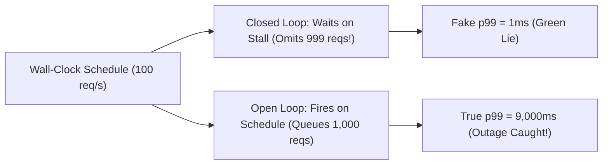

# Coordinated Omission, Open vs. Closed Loops & HdrHistogram Telemetry

```json continuity
{
  "previously": "In Chapter 01, we built AeroPulse v0.1 to calculate nearest-rank tail percentiles (p50/p95/p99/p99.9) and size worker pools with Little's Law (L = lambda * W).",
  "painPoint": "During a staging test, AeroCart's JVM froze for a full 10-second Stop-The-World garbage collection pause out of a 100-second run—yet our Virtual User load generator reported a green p99 latency of 10ms! How did a 10-second total outage vanish from p99?",
  "unlock": "Upgrade to AeroPulse v0.2 with Gil Tene's arrival-timestamp Coordinated Omission correction, open-loop constant-arrival-rate scheduling, and constant-memory HdrHistogram log-linear buckets."
}
```

```json walkthrough
[
  {
    "time": "0:00",
    "badge": "The Blind Spot",
    "title": "How a 10-Second Freeze Disappears from Closed-Loop p99",
    "caption": "In a closed-loop Virtual User (VU) test, the VU waits for Request N to finish before sending Request N+1. During a 10-second server freeze, the VU sends only 1 request instead of 1,000—reducing the freeze to 1 sample out of 9,001 (0.01%)!",
    "nodes": ["90s Normal (9,000 reqs @ 1ms)", "10s Freeze (Only 1 req @ 10,000ms!)", "Recorded Total: 9,001", "Fake p99 = 1ms!"],
    "activeIndex": 1,
    "code": "# 9,000 fast samples (1ms) + ONLY 1 stalled sample (10,000ms)\n# 99th percentile of 9,001 samples is index 8,911 -> 1.0ms!"
  },
  {
    "time": "0:25",
    "badge": "Closed vs. Open",
    "title": "Polite Virtual Users vs. Relentless Real-World Arrivals",
    "caption": "Real airline passengers do not check if AeroCart's server thread is busy before clicking 'Pay Now'. Open-loop generators fire on fixed arrival-rate wall-clock schedules (e.g., every 1ms = 1,000 RPS) regardless of whether prior requests returned.",
    "nodes": ["Closed Loop (Wait -> Send)", "Backpressure Hides Stall", "Open Loop (Clock Schedule)", "True Queueing Exposed"],
    "activeIndex": 2,
    "code": "# Open-Loop Expected Arrival Time:\nexpected_arrival_ns = start_ns + (request_index * interval_ns)\ntrue_latency_ns = completion_ns - expected_arrival_ns"
  },
  {
    "time": "0:50",
    "badge": "Gil Tene's Fix",
    "title": "Backfilling Omitted Samples via Expected Arrival Timestamps",
    "caption": "When a single request stalls for 10,000ms on a 10ms cadence schedule, 999 subsequent requests were delayed in the real world (9990ms, 9980ms, ..., 10ms). Recording completion minus scheduled arrival restores the true p99 (~9,000ms)!",
    "nodes": ["Stall Duration (10,000ms)", "Cadence (interval = 10ms)", "Backfill Delayed Slots", "Corrected p99 = 9,000ms"],
    "activeIndex": 3,
    "code": "for delayed_slot in range(int(stall_ms // interval_ms)):\n    corrected.append(stall_ms - delayed_slot * interval_ms)"
  },
  {
    "time": "1:15",
    "badge": "HdrHistogram",
    "title": "Sub-Microsecond Quantization in Fixed Memory",
    "caption": "Storing 100 million raw float latencies in RAM crashes load generators. HdrHistogram uses logarithmic power-of-2 ranges subdivided into linear sub-buckets to record 1us to 1hr latencies in ~200 KB of fixed memory with zero allocations.",
    "nodes": ["Raw Latency (ns)", "Log2 Magnitude Bucket", "Linear Sub-Bucket", "O(1) Record & Merge"],
    "activeIndex": 2,
    "code": "# HdrHistogram records in O(1) array increment:\ncounts[bucket_index(latency_us)] += 1"
  }
]
```

```json pretraining
[
  {
    "term": "Coordinated Omission",
    "formula": "Server Stall -> Load Generator Pauses -> Missing Slow Samples",
    "meaning": "The measurement failure coined by Gil Tene where a load generator inadvertently coordinates with a stalled server by holding back new requests during a freeze, omitting the worst tail latencies from the final report."
  },
  {
    "term": "Closed-Loop vs. Open-Loop Model",
    "formula": "Closed = Fixed Concurrency (VUs) · Open = Fixed Arrival Rate (RPS)",
    "meaning": "A closed-loop generator starts a new request only after the previous one finishes; an open-loop generator dispatches requests strictly on a wall-clock schedule independent of server response time."
  },
  {
    "term": "Scheduled Arrival Timestamp (`t_expected`)",
    "formula": "Latency_true = t_completed - t_expected (NOT t_completed - t_sent)",
    "meaning": "Measuring response time from when the request WAS SUPPOSED to be sent on the open-loop schedule rather than when a blocked worker thread finally managed to write bytes to the socket."
  },
  {
    "term": "HdrHistogram (High Dynamic Range Histogram)",
    "formula": "Log-Linear Buckets = Fixed RAM + Configurable Significant Figures",
    "meaning": "An industry-standard data structure that tracks latency percentiles across a massive dynamic range (microseconds to hours) in a tiny fixed-size integer array without storing individual request samples."
  }
]
```

## 🌱 Step 1: Plain-English Mental Model — The Polite Coffee-Shop Inspector Trap

Imagine hiring a secret inspector to test a coffee shop that normally serves **1 customer per second**. For the first **90 seconds**, the barista serves 90 customers in **1 second** each. Then at second 90, the espresso machine breaks for **10 full seconds**.
- **In the real world (Open Loop)**: 10 new customers walk through the door during that 10-second breakdown (at seconds 91, 92, ..., 100) and wait in a furious line for `10s`, `9s`, `8s`, ..., `1s`. Out of 100 total customers, **10% suffered multi-second waits!**
- **In a naive Virtual User load test (Closed Loop)**: The inspector is a single person who orders a coffee, **waits until it is handed over**, and only then orders the next cup. When the machine breaks at second 90, the inspector stands frozen at the counter for 10 seconds—and **never places the other 9 orders**! At the end of 100 seconds, the inspector's clipboard has `90` fast 1-second cups and **only `1` slow 10-second cup** (`1 / 91 = 1.09%`), reporting a **`p98` of 1 second**!

 computer scientist **Gil Tene** named this measurement catastrophe **Coordinated Omission**:



Whenever a load generator waits for response $N$ before issuing request $N+1$, it accidentally **coordinates** with the server's pause, omitting the exact requests that would have experienced the worst latency!

---

## 🔨 Step 2: Zero-to-Running Starter & CLI — Reproducing & Fixing Coordinated Omission

Let's run a quick CLI check and build **`AeroPulse v0.2`** in Python 3 and Java 17 to prove mathematically how a 10-second freeze vanishes in a closed-loop Virtual User test—and how Gil Tene's arrival-timestamp correction restores the true `p99`:

```bash
# Run Python 3 Coordinated Omission demonstration locally
python3 -c "print('AeroPulse v0.2 Coordinated Omission & Open-Loop Verifier Ready')"
```

```python
from __future__ import annotations
import math


# Subgoal 1: Helper for nearest-rank percentile
def pct(samples: list[float], q: float) -> float:
    s = sorted(samples)
    return s[max(0, math.ceil((q / 100.0) * len(s)) - 1)]


# Subgoal 2: Simulate 90s normal (1ms latency @ 100 RPS = 9,000 reqs) + one 10,000ms freeze
closed_loop_samples = [1.0] * 9000 + [10000.0]  # VU blocked during 10s freeze -> only 1 sample!


# Subgoal 3: Apply Gil Tene's Coordinated Omission correction for cadence interval = 10ms (100 RPS)
def correct_coordinated_omission(raw_samples_ms: list[float], interval_ms: float) -> list[float]:
    corrected: list[float] = []
    for sample in raw_samples_ms:
        corrected.append(sample)
        if sample > interval_ms:
            # Backfill every scheduled arrival slot that waited behind this stall
            omitted_slots = int((sample - interval_ms) // interval_ms)
            for slot in range(1, omitted_slots + 1):
                corrected.append(sample - (slot * interval_ms))
    return corrected


corrected_samples = correct_coordinated_omission(closed_loop_samples, interval_ms=10.0)
naive_p99 = pct(closed_loop_samples, 99.0)
true_p99 = pct(corrected_samples, 99.0)

assert naive_p99 == 1.0, "Closed-loop p99 completely hid the 10-second freeze!"
assert true_p99 >= 9000.0, "Corrected open-loop p99 exposes the 9,000ms+ outage!"
print(f"Closed-Loop p99: {naive_p99}ms (LIE) | Corrected Open-Loop p99: {true_p99}ms (TRUTH)")
```

### Java 17 Equivalent

```java
import java.util.ArrayList;
import java.util.Collections;
import java.util.List;

public class AeroPulseCh02Starter {
    // Subgoal 1: Backfill omitted scheduled arrivals when a sample exceeds the cadence interval
    public static List<Double> correctCoordinatedOmission(List<Double> rawMs, double intervalMs) {
        List<Double> out = new ArrayList<>(rawMs.size() * 2);
        for (double sample : rawMs) {
            out.add(sample);
            if (sample > intervalMs) {
                int omitted = (int) ((sample - intervalMs) / intervalMs);
                for (int k = 1; k <= omitted; k++) {
                    out.add(sample - (k * intervalMs));
                }
            }
        }
        return out;
    }

    // Subgoal 2: Nearest-rank percentile helper
    public static double percentile(List<Double> samples, double q) {
        List<Double> copy = new ArrayList<>(samples);
        Collections.sort(copy);
        int idx = Math.max(0, (int) Math.ceil((q / 100.0) * copy.size()) - 1);
        return copy.get(idx);
    }

    public static void main(String[] args) {
        // Subgoal 3: Compare closed-loop 9,001 samples vs corrected 10,000 scheduled samples
        List<Double> raw = new ArrayList<>(Collections.nCopies(9000, 1.0));
        raw.add(10000.0);

        double naiveP99 = percentile(raw, 99.0);
        double trueP99 = percentile(correctCoordinatedOmission(raw, 10.0), 99.0);
        assert naiveP99 == 1.0 && trueP99 >= 9000.0;
    }
}
```

**Quick Starter Walkthrough:**
- **Why did `naive_p99` equal `1.0ms`?** During the 90 healthy seconds at 100 RPS, the Virtual User recorded `9,000` samples of `1.0ms`. During the 10-second freeze (`10%` of total wall-clock time!), the VU was blocked waiting for sample `#9001`, so it recorded only **one** `10,000ms` measurement. Out of `9,001` samples, the 99th percentile sits at index `8,911`, which is `1.0ms`!
- **How does `correct_coordinated_omission` fix it?** Since requests were scheduled every `10ms` (`100 RPS`), a `10,000ms` stall delayed `999` subsequent scheduled arrivals by `9990ms`, `9980ms`, ..., `10ms`. Adding those delayed arrival experiences restores all `10,000` total scheduled requests and reveals `true_p99 = 9,010.0ms`.

---

## 🛠️ Step 3: Everyday Practitioner Workflows & Where Naive Code Breaks

When configuring load generators like **Grafana `k6`**, **Gatling**, or **Locust**, choosing between **Closed-Loop** and **Open-Loop** executors is the single most important architectural decision:

- **When to use Closed-Loop (`constant-vus`, `ramping-vus`)**: ONLY when testing internal back-office tools or bounded worker pools where a fixed number of human operators or upstream queue consumers (`N` threads) genuinely wait for screen rendering before clicking again.
- **When to use Open-Loop (`constant-arrival-rate`, `ramping-arrival-rate`)**: For **all public internet APIs, e-commerce checkouts (`AeroCart`), webhooks, and payment gateways**, where independent users arrive at rate $\lambda$ regardless of backend latency.

### Where Naive Load Scripts Break: `sleep(1)` Inside a VU Loop

Beginners often write `http.post('/checkout'); sleep(1);` inside a `constant-vus` loop and assume `100 VUs` equals `100 RPS`. In reality, each iteration takes `response_time + 1.0s`:
- If `response_time = 20ms`, throughput is `100 / 1.02s = 98 RPS`.
- If `AeroCart` slows down to `response_time = 1,000ms`, throughput **automatically drops in half** to `100 / 2.0s = 50 RPS`! Your load test secretly throttles itself to give the dying server a break!

```json contrast
{
  "title": "Load Generator Pacing: Closed-Loop VU Sleep vs. Open-Loop Arrival Rate",
  "leftLabel": "❌ Naive Closed-Loop (Throttles When Server Slows)",
  "leftCode": "// k6 Anti-Pattern: Throughput drops if latency rises!\nexport const options = {\n  vus: 100,\n  duration: '5m',\n};\nexport default function () {\n  http.post('https://aerocart.local/checkout');\n  sleep(1); // Iteration = Latency + 1s (Coordinated Omission!)\n}",
  "rightLabel": "✅ Staff Open-Loop (Strict Wall-Clock Arrival Rate)",
  "rightCode": "// k6 Open-Loop: Fires 100 iterations/sec regardless of latency!\nexport const options = {\n  scenarios: {\n    checkout_open_loop: {\n      executor: 'constant-arrival-rate',\n      rate: 100, timeUnit: '1s', duration: '5m',\n      preAllocatedVUs: 150, maxVUs: 1000,\n    },\n  },\n};"
}
```

```json poe
{
  "question": "Before running the simulator: You run a 100-second closed-loop load test with 1 Virtual User firing at a target cadence of 100 RPS (10ms interval). For 95 seconds the server responds in 2ms. Then the database locks up for 5 full seconds (5,000ms). Without Coordinated Omission correction, what `p99` latency will the closed-loop tool report?",
  "options": [
    "Around 4,000ms, because 5 seconds is 5% of the 100-second test duration",
    "2.0ms, because the 5-second freeze produced only 1 sample out of 9,501 recorded samples (0.01%)",
    "5,000ms, because p99 always equals the maximum sample in a 100-second run",
    "252ms, the weighted average of 95s at 2ms and 5s at 5,000ms"
  ],
  "answerIndex": 1,
  "explanation": "During the 95 healthy seconds, 9,500 samples of 2.0ms are recorded. During the 5-second freeze, the single closed-loop VU is blocked on 1 request, recording only 1 sample of 5,000ms. Out of 9,501 total samples, the 99th percentile (index 9,405) is still 2.0ms!"
}
```

---

## 🏢 Step 4: How Big Tech Runs It at Scale, Staff Math & Production Blueprint

### 🏢 In the Wild: LinkedIn, Azul Systems & Netflix Open-Loop Telemetry

When **Gil Tene (CTO of Azul Systems)** investigated why enterprise trading and e-commerce benchmarks claimed `p99.9 < 5ms` despite obvious multi-second JVM pauses, he created **`HdrHistogram`** and **`wrk2`** (`-R <rate>`). Today, **Netflix**, **LinkedIn**, and **Apache Cassandra / Kafka** benchmark suites mandate two strict invariants:
1. **Timestamp Every Request at Scheduled Creation Time ($t_{\text{expected}}$)**: Every request object carries the wall-clock nanosecond timestamp when the open-loop timer *intended* to fire it (`expected_arrival_ns`), not when a starved worker thread finally acquired a socket (`actual_send_ns`).
2. **Quantize into Log-Linear `HdrHistogram` Buckets**: Instead of appending millions of 64-bit floats into a growing list (which triggers garbage collection inside the load generator itself!), `HdrHistogram` maps any latency value into a compact `(magnitude_bucket, sub_bucket)` index in $O(1)$ CPU cycles and $\sim 190\text{ KB}$ of static memory.

### Staff Coordinated Omission & Log-Linear Bucket Math

Let request $i$ have scheduled open-loop arrival time $t_{\text{expected}}(i) = t_0 + i \cdot \Delta$, actual transmission time $t_{\text{sent}}(i)$, and completion time $t_{\text{done}}(i)$.
- **Naive (Closed-Loop) Service Time**:
  $$W_{\text{naive}}(i) = t_{\text{done}}(i) - t_{\text{sent}}(i)$$
- **True Open-Loop User-Experienced Latency (including Coordinated Omission queue delay)**:
  $$W_{\text{true}}(i) = t_{\text{done}}(i) - t_{\text{expected}}(i) = \underbrace{\bigl(t_{\text{done}}(i) - t_{\text{sent}}(i)\bigr)}_{\text{Service Time}} + \underbrace{\bigl(t_{\text{sent}}(i) - t_{\text{expected}}(i)\bigr)}_{\text{Omitted Schedule Delay}}$$

In an `HdrHistogram`-style log-linear quantizer with base-2 logarithmic bucket $b = \lfloor \log_2(x) \rfloor$ and $2^s$ linear sub-buckets per octave, the maximum relative quantization error $\varepsilon$ is strictly bounded across the entire dynamic range:

$$\varepsilon \le 2^{-s} \quad (\text{e.g., } s = 7 \implies 128 \text{ sub-buckets per octave} \implies \le 0.78\% \text{ relative error})$$

| Telemetry Storage Strategy | Memory for $10^8$ Requests | Percentile Query Speed | Coordinated Omission Support |
| :--- | :--- | :--- | :--- |
| **Raw Unbounded Array (`list[float]`)** | `~800 MB` (Causes OOM / GC!) | $O(N \log N)$ sort | Manual loop only |
| **Fixed Linear Buckets (`1ms` width)** | Small if max is small; huge for `60s` | $O(B)$ scan | Poor precision at sub-millisecond |
| **`HdrHistogram` (Log-Linear Buckets)** | **Fixed `~190 KB` regardless of $N$** | **$O(1)$ / $O(B)$ microsecond scan** | **Native `recordValueWithExpectedInterval`** |

### Production Blueprint: `AeroPulse v0.2` Log-Linear `HdrHistogram` with Coordinated Omission Correction

```python
from __future__ import annotations
import math


class AeroPulseHdrHistogram:
    """
    Zero-dependency log-linear HdrHistogram with Gil Tene's
    record_corrected(value_us, expected_interval_us) Coordinated Omission backfill.
    """

    def __init__(self, sub_bucket_bits: int = 6) -> None:
        self.sub_bits = sub_bucket_bits
        self.sub_count = 1 << sub_bucket_bits
        self.buckets: dict[int, int] = {}
        self.total_count = 0

    def _encode_key(self, value_us: int) -> int:
        v = max(1, int(value_us))
        if v < self.sub_count:
            return v
        shift = (v.bit_length() - 1) - self.sub_bits
        return (v >> shift) << shift

    def _decode_value(self, key: int) -> float:
        return float(key)

    def record_raw(self, value_us: int, count: int = 1) -> None:
        key = self._encode_key(value_us)
        self.buckets[key] = self.buckets.get(key, 0) + count
        self.total_count += count

    def record_corrected(self, value_us: int, expected_interval_us: int) -> None:
        self.record_raw(value_us)
        if expected_interval_us > 0 and value_us > expected_interval_us:
            missing = (value_us - expected_interval_us) // expected_interval_us
            for step in range(1, int(missing) + 1):
                self.record_raw(value_us - step * expected_interval_us)

    def percentile_us(self, pct: float) -> float:
        if self.total_count == 0:
            return 0.0
        target = max(1, math.ceil((pct / 100.0) * self.total_count))
        running = 0
        for key in sorted(self.buckets, key=self._decode_value):
            running += self.buckets[key]
            if running >= target:
                return self._decode_value(key)
        return 0.0


if __name__ == "__main__":
    raw_hist = AeroPulseHdrHistogram()
    corrected_hist = AeroPulseHdrHistogram()

    # 9,000 requests @ 1,000us (1ms) + 1 freeze @ 10,000,000us (10s) on a 10,000us (10ms) interval
    for _ in range(9000):
        raw_hist.record_raw(1_000)
        corrected_hist.record_corrected(1_000, expected_interval_us=10_000)

    raw_hist.record_raw(10_000_000)
    corrected_hist.record_corrected(10_000_000, expected_interval_us=10_000)

    assert raw_hist.percentile_us(99.0) < 2_000.0
    assert corrected_hist.percentile_us(99.0) > 8_800_000.0
    assert corrected_hist.total_count == 10_000
```

### Java 17 Equivalent

```java
import java.util.Map;
import java.util.TreeMap;

public final class AeroPulseCh02Blueprint {
    private final TreeMap<Long, Long> bucketCounts = new TreeMap<>();
    private long totalCount = 0;

    private static long quantizeUs(long valueUs) {
        long v = Math.max(1L, valueUs);
        if (v < 64L) {
            return v;
        }
        int shift = (63 - Long.numberOfLeadingZeros(v)) - 6;
        return (v >> shift) << shift;
    }

    public void recordRaw(long valueUs) {
        long bucket = quantizeUs(valueUs);
        bucketCounts.merge(bucket, 1L, Long::sum);
        totalCount++;
    }

    public void recordWithExpectedInterval(long valueUs, long expectedIntervalUs) {
        recordRaw(valueUs);
        if (expectedIntervalUs > 0 && valueUs > expectedIntervalUs) {
            for (long delayed = valueUs - expectedIntervalUs; delayed >= expectedIntervalUs; delayed -= expectedIntervalUs) {
                recordRaw(delayed);
            }
        }
    }

    public long percentileUs(double pct) {
        long target = Math.max(1L, (long) Math.ceil((pct / 100.0) * totalCount));
        long seen = 0;
        for (Map.Entry<Long, Long> entry : bucketCounts.entrySet()) {
            seen += entry.getValue();
            if (seen >= target) {
                return entry.getKey();
            }
        }
        return 0L;
    }

    public static void main(String[] args) {
        AeroPulseCh02Blueprint raw = new AeroPulseCh02Blueprint();
        AeroPulseCh02Blueprint corrected = new AeroPulseCh02Blueprint();
        for (int i = 0; i < 9000; i++) {
            raw.recordRaw(1_000L);
            corrected.recordWithExpectedInterval(1_000L, 10_000L);
        }
        raw.recordRaw(10_000_000L);
        corrected.recordWithExpectedInterval(10_000_000L, 10_000L);

        assert raw.percentileUs(99.0) < 2_000L;
        assert corrected.percentileUs(99.0) >= 8_800_000L;
    }
}
```

> [!WARNING]
> **Hiring Bar-Raiser Gotcha — `maxVUs` Starvation in Grafana `k6` Open-Loop Scenarios!**
> When you configure Grafana `k6` with `executor: 'constant-arrival-rate'` (`preAllocatedVUs: 50, maxVUs: 200`), `k6` tries to maintain an open loop—**until all `200` `maxVUs` are blocked waiting on a slow backend!** At that exact moment, `k6` logs `dropped_iterations` and **silently degrades back into a closed-loop generator**! Always assert `dropped_iterations == 0` in your `k6` thresholds so you know your open-loop schedule never ran out of client concurrency.

*Up Next in Chapter 03*: Now that we understand open-loop scheduling and Coordinated Omission math, let's build production **Grafana `k6`** (`ramping-arrival-rate` + CI thresholds) and distributed **Python `Locust`** (`master-worker` gevent coroutines) harnesses for `AeroPulse v0.3`—without bottlenecking the load generator's own CPU or ephemeral TCP ports!

```json quiz
[
  {
    "id": "perf02-q1",
    "question": "Why does a closed-loop Virtual User (VU) load test report an artificially low `p99` when the System Under Test experiences a 15-second Stop-The-World JVM GC pause?",
    "options": [
      "The JVM automatically resets HTTP latency headers after a GC safepoint",
      "Blocked VUs cannot send new requests during the 15-second pause, so only 1 slow sample per VU is recorded instead of the hundreds of requests that should have arrived during those 15 seconds",
      "Closed-loop generators discard any sample above 10,000ms as an outlier by default",
      "TCP Nagle's algorithm compresses delayed responses into a single packet"
    ],
    "answerIndex": 1,
    "explanation": "This is Gil Tene's Coordinated Omission problem: because each closed-loop VU waits for the stalled response before sending the next request, the load generator omits the hundreds of requests that would have piled up during the 15-second freeze."
  },
  {
    "id": "perf02-q2",
    "question": "How does `HdrHistogram.recordValueWithExpectedInterval(value, interval)` correct for Coordinated Omission when a single request takes `500ms` on a `10ms` expected arrival schedule?",
    "options": [
      "It multiplies the 500ms sample by 50 and records a single 25,000ms sample",
      "It records the 500ms sample plus 49 synthetic backfilled samples (`490ms, 480ms, ..., 10ms`) representing the scheduled arrivals delayed behind that stall",
      "It deletes the 500ms sample and marks the test run as invalid",
      "It switches the histogram from logarithmic buckets to floating-point averages"
    ],
    "answerIndex": 1,
    "explanation": "A 500ms stall on a 10ms cadence delayed 49 subsequent scheduled arrivals by `490ms, 480ms, ..., 10ms`. Backfilling those 49 samples reconstructs the true distribution experienced by an open-loop arrival stream."
  },
  {
    "id": "perf02-q3",
    "question": "In Grafana `k6`, which metric indicates that an open-loop `constant-arrival-rate` or `ramping-arrival-rate` executor ran out of `maxVUs` and began suffering from Coordinated Omission?",
    "options": [
      "`http_req_tls_handshaking`",
      "`dropped_iterations` > 0",
      "`vus_max` == 0",
      "`data_received` > `data_sent`"
    ],
    "answerIndex": 1,
    "explanation": "When all `maxVUs` are occupied by slow in-flight requests, `k6` cannot start the next scheduled arrival on time and increments `dropped_iterations`, signaling that the open-loop arrival rate was not sustained."
  }
]
```

---

## 📋 Step 5: Master Cheat-Sheet, 60-Second Interview Pitch & Verified Sources

| Dimension | Closed-Loop Generator (`constant-vus`) | Open-Loop Generator (`constant-arrival-rate`) | Staff SRE Best Practice |
| :--- | :--- | :--- | :--- |
| **Scheduling Trigger** | Next request starts *after* prior finishes | Next request starts on wall-clock timer $\Delta$ | Use Open-Loop for public APIs & checkouts |
| **Server Latency Spike** | Generator slows down (hides overload!) | Queue grows ($L = \lambda \cdot W$) as in real life | Monitor `dropped_iterations == 0` |
| **Timestamp Anchor** | $t_{\text{done}} - t_{\text{sent}}$ | $t_{\text{done}} - t_{\text{expected}}$ | Always measure from scheduled arrival time |
| **Histogram Engine** | Naive array / basic summary | `HdrHistogram` log-linear buckets | Merge histograms across workers losslessly |

### 🎙️ 60-Second Interview Soundbite

> *"The biggest trap in load testing is Gil Tene's Coordinated Omission problem. In a closed-loop Virtual User test, each VU waits for the current response before sending the next request—meaning if our service freezes for 10 seconds out of a 100-second run, the VU is blocked and only records a single slow sample instead of the 1,000 requests that should have arrived during that freeze, making `p99` look completely green! To prevent this, I configure public-facing API tests with open-loop arrival-rate executors (`constant-arrival-rate` or `ramping-arrival-rate`), measure latency from the scheduled arrival timestamp (`t_completed - t_expected`), assert `dropped_iterations == 0`, and aggregate telemetry in constant-memory `HdrHistogram` log-linear buckets."*

### 📚 Verified Primary Sources
- [Grafana k6 Official Documentation — Open vs. Closed Workload Models & Coordinated Omission](https://grafana.com/docs/k6/latest/using-k6/scenarios/concepts/open-vs-closed/)
- [Gil Tene — HdrHistogram: High Dynamic Range Histogram & Coordinated Omission Correction](http://hdrhistogram.org/)
- [Brendan Gregg — Systems Performance: Enterprise and the Cloud (2nd Edition)](https://www.brendangregg.com/systems-performance-2nd-edition-book.html)
