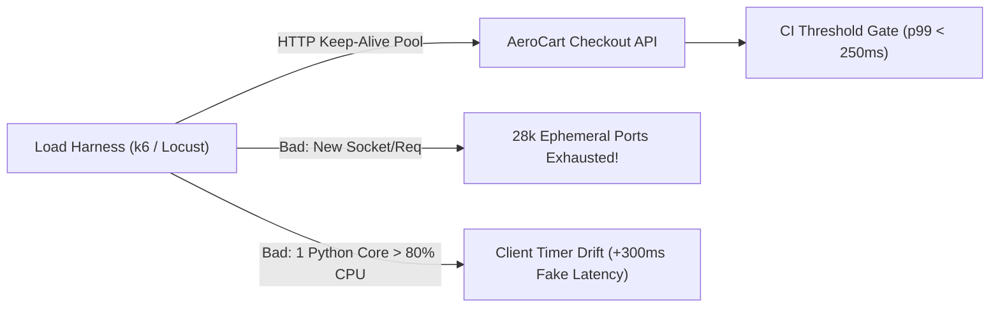

# Grafana k6 & Distributed Python Locust Harnesses Without Client Self-Bottlenecking

```json continuity
{
  "previously": "In Chapter 02, we upgraded AeroPulse v0.2 with open-loop arrival-timestamp telemetry and HdrHistogram buckets to defeat Gil Tene's Coordinated Omission trap.",
  "painPoint": "When the QA team tried to drive 15,000 RPS against AeroCart from a single laptop, client CPU hit 100%, Python's GIL stalled request timers by 400ms, and Linux ran out of ephemeral TCP ports (`EADDRNOTAVAIL`)—reporting a fake server outage caused entirely by the load generator itself!",
  "unlock": "Build AeroPulse v0.3 with Grafana k6 `ramping-arrival-rate` scenarios, fail-fast `abortOnFail` CI thresholds, distributed Python Locust master-worker gevent coroutines, and HTTP keep-alive connection-pool hygiene."
}
```

```json walkthrough
[
  {
    "time": "0:00",
    "badge": "k6 vs. Locust",
    "title": "Two Production Titans: Go-Powered k6 & Python-Powered Locust",
    "caption": "Grafana k6 compiles a Go engine with an embedded JS runtime for ultra-high single-node RPS and declarative CI thresholds. Python Locust uses lightweight gevent coroutines and distributed master-worker processes so teams can reuse existing Python SDKs and data builders.",
    "nodes": ["Grafana k6 (Go + JS)", "ramping-arrival-rate", "Python Locust (gevent)", "Master + N Workers"],
    "activeIndex": 0,
    "code": "// k6 ramping-arrival-rate executor:\nexecutor: 'ramping-arrival-rate',\nstartRate: 50, timeUnit: '1s',\nstages: [{ target: 2000, duration: '2m' }]"
  },
  {
    "time": "0:25",
    "badge": "CI Thresholds",
    "title": "Declarative SLO Gates & Fail-Fast Circuit Breaking (`abortOnFail`)",
    "caption": "In k6, thresholds turn telemetry into non-zero CI exit codes (`p(99)<250`, `rate<0.01`) and can automatically abort a runaway test after a `delayAbortEval` grace period so you never DDoS a broken staging cluster.",
    "nodes": ["http_req_duration", "p(99)<250ms", "abortOnFail: true", "Exit Code 99 on Breach"],
    "activeIndex": 2,
    "code": "thresholds: {\n  http_req_failed: [{ threshold: 'rate<0.01', abortOnFail: true, delayAbortEval: '10s' }],\n  http_req_duration: ['p(95)<150', 'p(99)<250'],\n}"
  },
  {
    "time": "0:50",
    "badge": "Locust Scaling",
    "title": "Bypassing Python's GIL via Master-Worker Processes",
    "caption": "Because CPython's GIL restricts one process to a single CPU core, a single Locust process saturates around 1,000–2,500 RPS. Running 1 `--master` and 1 `--worker` per physical CPU core scales linearly across cores and machines.",
    "nodes": ["Locust Master (Coordinator)", "Worker 1 (Core 1)", "Worker 2 (Core 2)", "Worker N (Core N)"],
    "activeIndex": 1,
    "code": "locust -f locustfile.py --master --expect-workers 4 --headless -u 2000 -r 200 -t 5m"
  },
  {
    "time": "1:15",
    "badge": "Port Exhaustion",
    "title": "Why Disabling Keep-Alive Exhausts 28,232 Ephemeral TCP Ports",
    "caption": "Linux provides ~28,232 ephemeral ports by default (`32768–60999`) and holds closed sockets in `TIME_WAIT` for 60 seconds. Opening a new TCP socket per request caps a single IP at `28232 / 60 = 470 RPS` before failing with `EADDRNOTAVAIL`!",
    "nodes": ["New Socket / Request", "60s TCP TIME_WAIT", "470 RPS Ceiling!", "HTTP Keep-Alive Pool (50k+ RPS)"],
    "activeIndex": 3,
    "code": "max_rps_without_keepalive = (60999 - 32768) / 60.0  # 470.5 RPS max!"
  }
]
```

```json pretraining
[
  {
    "term": "Grafana k6 `ramping-arrival-rate` Executor",
    "formula": "Open-Loop Stage Ramp (RPS_start -> RPS_peak -> RPS_cooldown)",
    "meaning": "A k6 scenario executor that varies the open-loop iteration arrival rate across timed stages while dynamically scaling Virtual Users between `preAllocatedVUs` and `maxVUs`."
  },
  {
    "term": "Locust Gevent Coroutine (Greenlet) & Master-Worker",
    "formula": "1 OS Process per CPU Core * Thousands of Async Greenlets",
    "meaning": "Locust runs thousands of cooperative lightweight greenlets inside a single OS thread via `gevent`, and scales across multiple CPU cores by spawning one `--worker` OS process per core coordinated by a `--master` process."
  },
  {
    "term": "Ephemeral Port Exhaustion (`TIME_WAIT` / `EADDRNOTAVAIL`)",
    "formula": "Max New Conns/sec = Ephemeral_Port_Range / TIME_WAIT_Seconds",
    "meaning": "When a load generator opens a brand-new TCP connection per request instead of reusing HTTP Keep-Alive sockets, all ~28,000 client ephemeral ports get stuck in the 60-second TCP `TIME_WAIT` state."
  },
  {
    "term": "Load-Generator Self-Bottlenecking",
    "formula": "Client CPU > 80% -> Timer Drift -> Inflated Client Latency",
    "meaning": "When the load-testing machine's own CPU, event loop, or network interface saturates, response packets sit unread in the client OS kernel buffer—falsely inflating measured server latency."
  }
]
```

## 🌱 Step 1: Plain-English Mental Model — The Stopwatch Operator Who Runs Out of Breath

Imagine timing an Olympic sprinter, except the person holding the stopwatch has to sprint alongside the athlete while juggling ten clipboards. If the timer operator trips and takes 3 extra seconds to press the button, the scoreboard blames the athlete for running a 13-second 100-meter dash!

In performance engineering, this happens whenever your **load generator** becomes the bottleneck instead of the **System Under Test (`AeroCart`)**:



To drive reliable load without self-inflicted false alarms, Senior/Staff engineers rely on two complementary harnesses and three ironclad laws:
1. **Grafana `k6` (Go runtime + JS scripting)**: Ideal for open-loop `ramping-arrival-rate` tests and CI pipelines where a single binary can push `10,000–50,000 RPS` with built-in exit-code thresholds.
2. **Python `Locust` (`gevent` greenlets + `--master`/`--worker`)**: Ideal when your team wants to write complex stateful user flows in pure Python—provided you spawn **one worker process per CPU core** to bypass Python's Global Interpreter Lock (GIL).
3. **Reuse TCP connections (`Keep-Alive`) and keep client CPU `< 75%`**: Otherwise, ephemeral port exhaustion (`TIME_WAIT`) and client event-loop lag corrupt every latency number you collect.

---

## 🔨 Step 2: Zero-to-Running Starter & CLI — `AeroPulse v0.3` k6 & Locust Harnesses

Here are the exact CLI commands to run an open-loop **Grafana `k6`** script and a headless distributed **Python `Locust`** master-worker cluster locally or in CI:

```bash
# 1. Grafana k6 CLI: run open-loop scenario and export JSON summary (non-zero exit on threshold breach)
# k6 run --summary-export=aeropulse-k6-summary.json aeropulse_checkout.js

# 2. Locust Distributed CLI: 1 Master + 4 Workers (1 per CPU core) in headless CI mode
# locust -f locustfile.py --master --expect-workers 4 --headless -u 1000 -r 100 -t 2m --host http://127.0.0.1:8090
# for i in 1 2 3 4; do locust -f locustfile.py --worker & done
python3 -c "print('AeroPulse v0.3 k6 & Locust Configuration Generator Ready')"
```

Let's build a runnable Python 3 starter that generates a production `k6` `ramping-arrival-rate` configuration, models a `Locust` custom event-hook tracker, and verifies ephemeral port capacity math:

```python
from __future__ import annotations
import json


# Subgoal 1: Build a Grafana k6 open-loop ramping-arrival-rate config with fail-fast thresholds
def build_k6_options(peak_rps: int, p99_limit_ms: int) -> dict[str, object]:
    return {
        "scenarios": {
            "aerocart_checkout": {
                "executor": "ramping-arrival-rate",
                "startRate": 50,
                "timeUnit": "1s",
                "preAllocatedVUs": max(100, peak_rps // 4),
                "maxVUs": peak_rps * 2,
                "stages": [
                    {"target": peak_rps, "duration": "2m"},
                    {"target": peak_rps, "duration": "5m"},
                    {"target": 0, "duration": "30s"},
                ],
            }
        },
        "thresholds": {
            "http_req_failed": [{"threshold": "rate<0.01", "abortOnFail": True, "delayAbortEval": "10s"}],
            "http_req_duration": [f"p(95)<{int(p99_limit_ms * 0.6)}", f"p(99)<{p99_limit_ms}"],
            "dropped_iterations": ["count==0"],
        },
    }


# Subgoal 2: Calculate max RPS before Linux ephemeral TCP port exhaustion (without Keep-Alive)
def max_rps_without_keepalive(port_low: int = 32768, port_high: int = 60999, time_wait_s: int = 60) -> float:
    available_ports = (port_high - port_low) + 1
    return available_ports / float(time_wait_s)


# Subgoal 3: Verify config invariants and ephemeral port limit (28,232 ports / 60s = 470.53 RPS)
k6_cfg = build_k6_options(peak_rps=1200, p99_limit_ms=250)
port_ceiling = max_rps_without_keepalive()
assert "ramping-arrival-rate" in json.dumps(k6_cfg)
assert round(port_ceiling, 2) == 470.53
print(f"k6 maxVUs={k6_cfg['scenarios']['aerocart_checkout']['maxVUs']} | No-KeepAlive Ceiling={port_ceiling:.1f} RPS")
```

### Java 17 Equivalent

```java
public class AeroPulseCh03Starter {
    // Subgoal 1: Calculate ephemeral port RPS limit when HTTP Keep-Alive is disabled
    public static double maxRpsWithoutKeepAlive(int portLow, int portHigh, int timeWaitSeconds) {
        int totalPorts = (portHigh - portLow) + 1;
        return (double) totalPorts / timeWaitSeconds;
    }

    // Subgoal 2: Size Locust worker processes (1 OS process per physical core, capped at 75% CPU target)
    public static int recommendedLocustWorkers(int targetRps, int rpsPerSingleCoreWorker) {
        return Math.max(1, (int) Math.ceil((double) targetRps / (rpsPerSingleCoreWorker * 0.75)));
    }

    public static void main(String[] args) {
        // Subgoal 3: Verify Linux default port ceiling (32768..60999 / 60s) and Locust worker count
        double portCeiling = maxRpsWithoutKeepAlive(32768, 60999, 60);
        int workers = recommendedLocustWorkers(6000, 1500);
        assert Math.abs(portCeiling - 470.533) < 0.01;
        assert workers == 6;
    }
}
```

**Quick Starter Walkthrough:**
- **Why include `"dropped_iterations": ["count==0"]` in `k6` thresholds?** If your test passes `p(99)<250` only because `k6` dropped 40% of scheduled iterations when `maxVUs` maxed out, your test is invalid. Making `dropped_iterations` a hard threshold catches Coordinated Omission automatically!
- **Why does `max_rps_without_keepalive()` return `470.53 RPS`?** Linux allocates outgoing client sockets from `net.ipv4.ip_local_port_range = 32768 60999` (`28,232` ports) and holds closed sockets in `TIME_WAIT` for `60` seconds (`tcp_fin_timeout`). Without connection reuse (`HTTP Keep-Alive`), $28,232 / 60 = 470.53\text{ req/s}$ exhausts every port on the client NIC!

---

## 🛠️ Step 3: Everyday Practitioner Workflows & Where Naive Code Breaks

### Everyday `k6` & `Locust` Idioms Every Senior Engineer Should Know

1. **In Grafana `k6`: `check()` Does NOT Fail the Test Run by Default!**
   Many engineers write `check(res, { 'status is 200': (r) => r.status === 200 })` in `k6` and assume `k6` will exit with code `1` if `check()` fails. **It will not!** In `k6`, `check()` only records a boolean metric (`checks`). To fail CI, you **must** pair it with a threshold: `thresholds: { checks: ['rate>0.99'] }`.
2. **In Python `Locust`: Use `FastHttpUser` (`geventhttpclient`) + `@events.request.add_listener`**:
   Standard `HttpUser` wraps `python-requests` (`urllib3`), which uses significantly more CPU per request. Switching to `FastHttpUser` cuts client CPU usage by `3x–5x`, and registering `@events.request.add_listener` lets you emit custom OpenTelemetry or HdrHistogram metrics on every request.
3. **Tag Dynamic URLs (`name="/api/v1/flights/[id]"`)**:
   If your load test hits `/api/v1/flights/BK-1001`, `/api/v1/flights/BK-1002`, ..., `/api/v1/flights/BK-99999` without grouping the URL name (`{ tags: { name: 'GetFlight' } }` in `k6` or `name="/api/v1/flights/[id]"` in `Locust`), your metrics backend will create **100,000 separate time-series**, crashing Prometheus and the Locust web UI via **high-cardinality metric explosion**!

```json contrast
{
  "title": "k6 & Locust Production Hygiene: URL Grouping, Keep-Alive & Thresholds",
  "leftLabel": "❌ Naive Harness (High Cardinality, No Keep-Alive, Silent Check Fail)",
  "leftCode": "// k6 Anti-Pattern:\nexport const options = { noConnectionReuse: true }; // Exhausts TIME_WAIT ports!\nexport default function () {\n  // Explodes cardinality with 100k unique URLs!\n  const res = http.get(`https://aerocart.local/orders/${__ITER}`);\n  // check() alone NEVER fails CI exit code!\n  check(res, { '200 OK': (r) => r.status === 200 });\n}",
  "rightLabel": "✅ Staff Harness (Grouped Tags, Keep-Alive Pool & Enforced Thresholds)",
  "rightCode": "// k6 Production Pattern (Keep-Alive ON by default):\nexport const options = {\n  thresholds: {\n    checks: ['rate>0.999'], // Forces CI exit code != 0!\n    'http_req_duration{name:GetOrder}': ['p(99)<200'],\n  },\n};\nexport default function () {\n  const res = http.get(`https://aerocart.local/orders/${__ITER}`, {\n    tags: { name: 'GetOrder' }, // Prevents cardinality explosion!\n  });\n  check(res, { '200 OK': (r) => r.status === 200 });\n}"
}
```

```json poe
{
  "question": "Before running the simulator: You write a Grafana `k6` script with `check(res, { 'is 200': (r) => r.status === 200 })`, but you omit `checks` from `options.thresholds`. During a CI run, 100% of AeroCart responses return `HTTP 500 Internal Server Error`. What exit code does `k6 run` return by default?",
  "options": [
    "Exit code 1, because any failed `check()` automatically fails the k6 run",
    "Exit code 0 (Success!), because `check()` only records telemetry unless bound to a threshold like `thresholds: { checks: ['rate>0.99'] }` or `http_req_failed`",
    "Exit code 99, because HTTP 500 responses trigger automatic panic in the Go runtime",
    "Exit code 255, because `check()` throws an unhandled JavaScript exception"
  ],
  "answerIndex": 1,
  "explanation": "By design in Grafana k6, `check()` assertions do not abort a test or return a non-zero exit code on their own—they only populate the `checks` metric. You MUST define `thresholds: { checks: ['rate>0.99'], http_req_failed: ['rate<0.01'] }` so k6 exits with code 99 in CI!"
}
```

---

## 🏢 Step 4: How Big Tech Runs It at Scale, Staff Math & Production Blueprint

### 🏢 In the Wild: Shopify Flash-Sale Harnesses & Uber Hailstorm Load Generation

To test **Shopify Black Friday / Cyber Monday** flash sales (`100,000+ checkouts/min`) and **Uber's regional dispatch clusters**, reliability teams operate dedicated distributed load-generation clusters governed by three non-negotiable telemetry rules:
1. **Load Generator CPU Utilization Must Stay Below `70%–75%`**: Once a load generator's CPU crosses `80%`, OS thread scheduling and garbage collection delay the reading of incoming TCP socket buffers. The client clock ticks while response bytes sit waiting in the client kernel's `sk_buff` receive queue—adding `50ms–300ms` of **phantom client-side latency** that does not exist on the server!
2. **Compare Client-Side vs. Server-Side `p99` (`Δ_skew = p99_client - p99_server`)**: If client-side `p99` jumps from `40ms` to `280ms` while server-side Envoy/application `p99` remains `38ms`, either the load generator is CPU-saturated or an intermediate NAT gateway / firewall state table is dropping packets.
3. **Disable Response Body Parsing When Testing Pure Throughput (`discardResponseBodies: true`)**: Allocating and JSON-parsing megabytes of response bodies per second inside `k6` or `Locust` wastes up to `60%` of client CPU and memory when you only need status codes and headers.

### Staff Client Saturation & Distributed Worker Sizing Math

Let single-connection sequential throughput be bounded by latency $W$: $\text{RPS}_{\text{conn}} = 1 / W$. Without HTTP Keep-Alive, a single source IP with ephemeral port range $[P_{\min}, P_{\max}]$ and kernel `TIME_WAIT` duration $T_{\text{tw}}$ hits a hard socket ceiling:

$$\lambda_{\max,\text{no-keepalive}} = \frac{P_{\max} - P_{\min} + 1}{T_{\text{tw}}} = \frac{60999 - 32768 + 1}{60\text{ s}} \approx 470.5\text{ RPS}$$

To drive target arrival rate $\lambda_{\text{target}}$ across distributed `Locust` workers where each single-core worker process sustains $C_{\text{worker}}$ RPS at $100\%$ CPU, the required worker count $M$ with safety utilization cap $u_{\max} = 0.70$ is:

$$M = \left\lceil \frac{\lambda_{\text{target}}}{C_{\text{worker}} \cdot u_{\max}} \right\rceil$$

| Harness Choice | Runtime Architecture | Single-Core RPS | Best Fit Use Case | When NOT to Use It |
| :--- | :--- | :--- | :--- | :--- |
| **Grafana `k6`** | Go engine + Sobek JS VM | `5,000 – 25,000+ RPS` | Open-loop API SLO gates, CI thresholds, Kubernetes operator | When tests require heavy Python data-science / ML libraries |
| **Python `Locust` (`FastHttpUser`)** | CPython + `gevent` C-extension | `1,500 – 4,000 RPS/worker` | Complex stateful Python workflows reusing existing test SDKs | Single-process runs without `--master`/`--worker` at `>2k RPS` |
| **Python `Locust` (`HttpUser`)** | CPython + `requests`/`urllib3` | `400 – 1,200 RPS/worker` | Quick functional prototyping with `requests.Session` plugins | High-RPS load tests where client CPU cost dominates |

### Production Blueprint: `AeroPulse v0.3` Distributed Harness & Client-Skew Auditor

```python
from __future__ import annotations
import math
from dataclasses import dataclass


@dataclass(frozen=True)
class HarnessHealthAudit:
    is_valid_run: bool
    recommended_workers: int
    ephemeral_port_safe: bool
    client_skew_ms: float
    thresholds_passed: bool
    failure_reasons: tuple[str, ...]


class AeroPulseHarnessAuditor:
    """
    Audits distributed k6 / Locust load-run telemetry to ensure client CPU saturation,
    dropped open-loop iterations, or ephemeral port exhaustion did not corrupt results.
    """

    @staticmethod
    def audit_run(
        target_rps: int,
        keep_alive_enabled: bool,
        max_worker_cpu_pct: float,
        dropped_iterations: int,
        client_p99_ms: float,
        server_p99_ms: float,
        error_rate: float,
        slo_p99_ms: float = 250.0,
    ) -> HarnessHealthAudit:
        reasons: list[str] = []
        # 1. Verify ephemeral port ceiling if Keep-Alive was disabled
        port_safe = keep_alive_enabled or (target_rps < 450)
        if not port_safe:
            reasons.append("Ephemeral TCP port exhaustion risk: Keep-Alive disabled at >= 450 RPS")

        # 2. Check load generator CPU self-bottlenecking (> 75% causes timer drift)
        if max_worker_cpu_pct > 75.0:
            reasons.append(f"Load generator CPU saturated ({max_worker_cpu_pct:.1f}% > 75.0%)")

        # 3. Check open-loop dropped iterations (Coordinated Omission indicator)
        if dropped_iterations > 0:
            reasons.append(f"Open-loop schedule dropped {dropped_iterations} iterations (increase maxVUs)")

        # 4. Check client-vs-server telemetry skew (excluding normal ~10ms network RTT)
        skew_ms = max(0.0, client_p99_ms - server_p99_ms)
        if skew_ms > 50.0 and max_worker_cpu_pct > 70.0:
            reasons.append(f"Severe client-side timer skew detected ({skew_ms:.1f}ms)")

        # 5. Evaluate SUT SLO thresholds
        slo_ok = (client_p99_ms <= slo_p99_ms) and (error_rate < 0.01)
        if not slo_ok:
            reasons.append(f"SLO breach: p99={client_p99_ms}ms (limit {slo_p99_ms}ms), err={error_rate:.2%}")

        workers = math.ceil(target_rps / (2000.0 * 0.70))
        return HarnessHealthAudit(
            is_valid_run=(len(reasons) == 0),
            recommended_workers=max(1, workers),
            ephemeral_port_safe=port_safe,
            client_skew_ms=round(skew_ms, 2),
            thresholds_passed=slo_ok and (dropped_iterations == 0),
            failure_reasons=tuple(reasons),
        )


if __name__ == "__main__":
    # Healthy distributed run
    good = AeroPulseHarnessAuditor.audit_run(
        target_rps=5000,
        keep_alive_enabled=True,
        max_worker_cpu_pct=58.0,
        dropped_iterations=0,
        client_p99_ms=142.0,
        server_p99_ms=135.0,
        error_rate=0.001,
    )
    assert good.is_valid_run and good.recommended_workers == 4

    # Self-bottlenecked run (Keep-Alive off + 92% client CPU + dropped iterations)
    bad = AeroPulseHarnessAuditor.audit_run(
        target_rps=3000,
        keep_alive_enabled=False,
        max_worker_cpu_pct=92.0,
        dropped_iterations=410,
        client_p99_ms=390.0,
        server_p99_ms=85.0,
        error_rate=0.0,
    )
    assert not bad.is_valid_run and len(bad.failure_reasons) >= 4
```

### Java 17 Equivalent

```java
import java.util.ArrayList;
import java.util.List;

public final class AeroPulseCh03Blueprint {
    public record AuditResult(
        boolean validRun,
        int recommendedWorkers,
        double clientSkewMs,
        List<String> violations
    ) {}

    public static AuditResult verifyLoadRun(
        int targetRps,
        boolean keepAlive,
        double maxWorkerCpuPct,
        int droppedIterations,
        double clientP99Ms,
        double serverP99Ms,
        double errorRate,
        double sloP99Ms
    ) {
        List<String> violations = new ArrayList<>();
        if (!keepAlive && targetRps >= 450) {
            violations.add("TIME_WAIT ephemeral port exhaustion: enable HTTP Keep-Alive");
        }
        if (maxWorkerCpuPct > 75.0) {
            violations.add("Load generator CPU > 75%: client event-loop timer drift");
        }
        if (droppedIterations > 0) {
            violations.add("Open-loop dropped_iterations > 0: Coordinated Omission occurred");
        }
        if (clientP99Ms > sloP99Ms || errorRate >= 0.01) {
            violations.add("SLO threshold breached");
        }
        int workers = Math.max(1, (int) Math.ceil(targetRps / (2000.0 * 0.70)));
        double skew = Math.max(0.0, clientP99Ms - serverP99Ms);
        return new AuditResult(violations.isEmpty(), workers, skew, List.copyOf(violations));
    }

    public static void main(String[] args) {
        AuditResult ok = verifyLoadRun(5000, true, 58.0, 0, 142.0, 135.0, 0.001, 250.0);
        AuditResult bad = verifyLoadRun(3000, false, 92.0, 410, 390.0, 85.0, 0.0, 250.0);
        assert ok.validRun() && ok.recommendedWorkers() == 4;
        assert !bad.validRun() && bad.violations().size() == 4;
    }
}
```

> [!WARNING]
> **Hiring Bar-Raiser Gotcha — Always Cross-Check Client `p99` Against Server APM `p99`!**
> In Staff SRE interviews, a classic troubleshooting question is: *"Your Locust load test shows `p99` jumping from `45ms` to `600ms` at `3,000 RPS`, but your backend Datadog/Prometheus latency histogram on the server still shows `p99 = 42ms` and `25%` CPU. Where is the bottleneck?"*
> The bottleneck is **outside the application process**—specifically:
> 1. **Load-generator CPU / GIL saturation** delaying client socket reads,
> 2. **Ephemeral port / conntrack table exhaustion** on the client or intermediate NAT gateway, or
> 3. **Reverse-proxy / AWS ALB queue wait time** upstream of the application container!

*Up Next in Chapter 04*: What happens when the bottleneck *is* inside the backend—specifically when 500 concurrent requests hit a database connection pool? We will derive the **PostgreSQL & HikariCP Pool Sizing Formula** and see why shrinking a connection pool from `500` to `20` can double checkout throughput!

```json quiz
[
  {
    "id": "perf03-q1",
    "question": "A single load-generator VM with default Linux sysctl settings (`net.ipv4.ip_local_port_range = 32768 60999`, `60s TIME_WAIT`) runs a test with `noConnectionReuse: true` (HTTP Keep-Alive disabled). Around what RPS will the generator begin failing with `EADDRNOTAVAIL` (cannot assign requested address)?",
    "options": [
      "Around 470 RPS (`28,232 ports / 60 seconds`), because every request burns a new ephemeral port that remains locked in TIME_WAIT for 60 seconds",
      "Around 65,535 RPS, because TCP recycles all 16-bit ports every 1 second",
      "Around 10,000 RPS, limited only by Gigabit Ethernet bandwidth",
      "Around 50 RPS, because Linux restricts each process to 50 sockets"
    ],
    "answerIndex": 0,
    "explanation": "With `28,232` ephemeral ports (`32768..60999`) and a `60s` `TIME_WAIT` duration, opening a new TCP socket per request exhausts the entire port range at `28,232 / 60 = 470.5 RPS`. Enabling HTTP Keep-Alive reuses existing sockets for tens of thousands of RPS."
  },
  {
    "id": "perf03-q2",
    "question": "Why must high-throughput Python `Locust` tests run in distributed `--master` / `--worker` mode with one worker process per CPU core?",
    "options": [
      "Locust's `gevent` library cannot open more than 10 sockets per process",
      "CPython's Global Interpreter Lock (GIL) restricts a single Locust OS process to executing Python bytecode on a single CPU core, causing client timer drift above ~75% core utilization",
      "The `--master` process is required to encrypt HTTPS TLS 1.3 traffic",
      "Kubernetes pods prohibit running single-process Python scripts"
    ],
    "answerIndex": 1,
    "explanation": "Although `gevent` multiplexes I/O cooperatively across greenlets, each Locust process runs on a single OS thread bound by the Python GIL. Spawning one `--worker` process per physical core scales CPU capacity linearly."
  },
  {
    "id": "perf03-q3",
    "question": "What happens in Grafana `k6` or Prometheus if your load script calls `http.get('https://aerocart.local/bookings/' + uuid)` for 500,000 unique UUIDs without passing a URL grouping tag (`{ tags: { name: 'GetBooking' } }`)?",
    "options": [
      "k6 automatically strips all path parameters using AI",
      "It causes a high-cardinality metric explosion (500,000 distinct `url` time-series), exhausting memory in k6 and downstream Prometheus/InfluxDB sinks",
      "HTTP Keep-Alive is disabled whenever a URL path changes",
      "k6 refuses to compile the JavaScript file"
    ],
    "answerIndex": 1,
    "explanation": "By default, k6 tags each HTTP metric with its full URL string. Dynamic path IDs must be grouped with `tags: { name: 'GetBooking' }` (or `http.url` template strings) to prevent creating hundreds of thousands of unique time-series."
  }
]
```

---

## 📋 Step 5: Master Cheat-Sheet, 60-Second Interview Pitch & Verified Sources

| Capability | Grafana `k6` (Go + JS) | Python `Locust` (`gevent`) | Staff Reliability Guardrail |
| :--- | :--- | :--- | :--- |
| **Open-Loop Executor** | `executor: 'ramping-arrival-rate'` | Custom pacing / `constant_throughput` | Assert `dropped_iterations == 0` |
| **CI Fail-Fast Gate** | `thresholds: { 'http_req_duration': ['p(99)<250'] }` | `@events.quitting` -> `environment.process_exit_code = 1` | Set `abortOnFail: true` to protect staging |
| **Dynamic URL Grouping** | `{ tags: { name: 'GetBooking' } }` | `client.get(f"/bookings/{id}", name="/bookings/[id]")` | Prevent time-series cardinality OOM |
| **Multi-Core Scaling** | Native multi-goroutine in 1 binary | `1 --master` + `N --worker` OS processes | Keep load-gen CPU `< 70%–75%` |
| **Socket Hygiene** | Keep-Alive ON by default (`batch` / HTTP/2) | Use `FastHttpUser` connection pool | Never set `noConnectionReuse: true` at high RPS |

### 🎙️ 60-Second Interview Soundbite

> *"When I build load harnesses in Grafana k6 or Python Locust, my first priority is ensuring the load generator never bottlenecks itself and fabricates client-side latency. In k6, I use open-loop `ramping-arrival-rate` executors, tag dynamic URLs with `tags: { name: '...' }` to prevent high-cardinality time-series explosions, and bind `check()` metrics and `dropped_iterations == 0` to `abortOnFail` CI thresholds. When using Python Locust, I switch to `FastHttpUser` and run one `--worker` OS process per physical CPU core to bypass the Python GIL, keeping worker CPU under 70%. Finally, I verify HTTP Keep-Alive pooling is active—because without socket reuse, Linux's 28,232 ephemeral ports and 60-second `TIME_WAIT` state cap a single client IP at 470 RPS—and I always cross-check client `p99` against server-side APM `p99`."*

### 📚 Verified Primary Sources
- [Grafana k6 Official Documentation — Ramping Arrival Rate Open-Loop Executor](https://grafana.com/docs/k6/latest/using-k6/scenarios/executors/ramping-arrival-rate/)
- [Grafana k6 Official Documentation — Thresholds, `abortOnFail` & CI Exit Codes](https://grafana.com/docs/k6/latest/using-k6/thresholds/)
- [Locust Official Documentation — Running Distributed Master-Worker Load Tests](https://docs.locust.io/en/stable/running-distributed.html)
