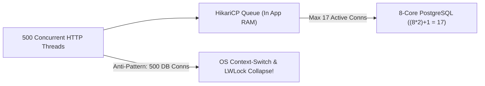

# Connection Pool Physics: HikariCP Sizing, PostgreSQL LWLocks & Thread Starvation

```json continuity
{
  "previously": "In Chapter 03, we built AeroPulse v0.3 to drive clean open-loop traffic with Grafana k6 and distributed Locust workers without client-side CPU or ephemeral port bottlenecks.",
  "painPoint": "Under a 2,000 RPS Baseline Load test, AeroCart's checkout service slowed to a crawl. An engineer tried to 'fix' it by raising each microservice pod's database connection pool from 20 to 500—and PostgreSQL CPU immediately pinned at 100% system time while checkout throughput dropped by 70%!",
  "unlock": "Build AeroPulse v0.4 to size database connection pools scientifically via ((core_count * 2) + effective_spindle_count), eliminate `@Transactional` external HTTP hold times, and tune `connectionTimeout` (`connectionAcquisitionTimeoutMs`) for fast failure."
}
```

```json walkthrough
[
  {
    "time": "0:00",
    "badge": "The 500-Conn Myth",
    "title": "Why 500 Database Connections Run Slower Than 20",
    "caption": "An 8-core PostgreSQL server can only execute 8 CPU instructions simultaneously. Giving it 500 active connections forces the Linux kernel scheduler and Postgres LWLocks (Lightweight Locks) to spend more CPU time context-switching processes than running SQL!",
    "nodes": ["500 Active DB Conns", "8 Physical CPU Cores", "OS Context-Switch Storm", "Throughput Collapses 70%"],
    "activeIndex": 2,
    "code": "# PostgreSQL & HikariCP Golden Formula:\n# connections = (core_count * 2) + effective_spindle_count\n# For 8-core NVMe SSD (spindle=1): (8 * 2) + 1 = 17 connections!"
  },
  {
    "time": "0:25",
    "badge": "Pool Starvation",
    "title": "How One Slow External HTTP Call Kills Every DB Query",
    "caption": "If AeroCart opens a `@Transactional` DB connection (`2ms` SQL) and calls Stripe (`800ms` HTTP) BEFORE committing, connection hold time `W` jumps 400x from `2ms` to `802ms`! By Little's Law, a 20-connection pool now caps the entire service at 24.9 RPS!",
    "nodes": ["Acquire DB Conn", "Call Slow Stripe API (800ms!)", "Commit (2ms)", "Max Throughput = 25 RPS!"],
    "activeIndex": 1,
    "code": "# Hold time W = 802ms -> Max RPS for 20 connections = 20 / 0.802s = 24.9 RPS!\n# Fix: Move HTTP call OUTSIDE DB transaction -> W = 2ms -> Max RPS = 10,000 RPS!"
  },
  {
    "time": "0:50",
    "badge": "Multi-Pod Math",
    "title": "Sizing Across 20 Kubernetes Pods & PgBouncer Transaction Pooling",
    "caption": "If your 8-core Postgres DB handles 40 active connections total and you run 20 Kubernetes pods, each pod's HikariCP `maximumPoolSize` gets only 2 connections—unless you multiplex via PgBouncer in `pool_mode = transaction`.",
    "nodes": ["20 App Pods", "HikariCP per Pod", "PgBouncer Multiplexer", "PostgreSQL (Max 40 Active)"],
    "activeIndex": 2,
    "code": "per_pod_pool_size = total_db_budget // active_k8s_pods"
  },
  {
    "time": "1:15",
    "badge": "Fast Timeout",
    "title": "Tuning `connectionTimeout` (`connectionAcquisitionTimeoutMs`)",
    "caption": "HikariCP defaults `connectionTimeout` to 30,000ms (30s). Waiting 30 seconds in line for a DB connection when your user HTTP timeout is 2,000ms just wastes threads on requests the user already abandoned! Tune acquisition timeout to 250ms–1,000ms.",
    "nodes": ["Pool Full", "Bad: 30,000ms Wait", "Good: 500ms Fail-Fast", "Healthy Thread Pool"],
    "activeIndex": 2,
    "code": "hikariConfig.setMaximumPoolSize(16);\nhikariConfig.setConnectionTimeout(500); // Fail fast in 500ms, never 30s!"
  }
]
```

```json pretraining
[
  {
    "term": "HikariCP / PostgreSQL Pool Sizing Formula",
    "formula": "connections = (core_count * 2) + effective_spindle_count",
    "meaning": "The empirically proven formula from the PostgreSQL team and HikariCP author Brett Wooldridge showing that an N-core database achieves peak throughput with roughly `2N + 1` active connections on SSDs."
  },
  {
    "term": "OS Context Switching & Postgres `LWLock` Contention",
    "formula": "Active Processes >> CPU Cores -> Cache Thrashing + Lock Spin",
    "meaning": "In PostgreSQL's process-per-connection architecture, hundreds of concurrent queries fight over shared-memory Lightweight Locks (`LWLock`) and flush CPU L1/L2 caches on every OS context switch."
  },
  {
    "term": "Connection Hold Time (`W_conn`)",
    "formula": "Max_DB_RPS = Pool_Size / W_conn (by Little's Law)",
    "meaning": "The total wall-clock duration a thread keeps a database connection checked out from the pool. Holding a connection across a slow network call destroys pool throughput."
  },
  {
    "term": "`connectionAcquisitionTimeoutMs` (`connectionTimeout`)",
    "formula": "Max Wait in App Queue Before Throwing SQLTransientConnectionException",
    "meaning": "How long an application thread waits to borrow a connection from a full pool before failing fast so upstream callers or circuit breakers can degrade gracefully."
  }
]
```

## 🌱 Step 1: Plain-English Mental Model — 8 Chefs in a Tiny Restaurant Kitchen

Picture a restaurant kitchen with **8 chefs** (representing an **8-core PostgreSQL database**). How many waiters should be allowed inside the kitchen at the exact same moment?
- If **16 waiters** (`(8 * 2)`—one placing an order while another picks up a finished plate during brief disk I/O pauses) step inside, all 8 chefs stay 100% productive without bumping elbows.
- What happens if a panicked manager opens the doors and lets **500 waiters** cram into that 8-chef kitchen at once? Nobody can move! The chefs spend 80% of their time shouting, shoving past each other, and checking clipboards (**OS context switches and PostgreSQL `LWLock` contention**), and the number of meals leaving the kitchen **drops by 70%**!

Wait—where should the other 484 waiters wait? **Outside the kitchen door in a fast, orderly single-file line** (**your application's `HikariCP` or `SQLAlchemy` connection pool queue**):



And what is the deadliest mistake a waiter can make once inside that 17-person kitchen? **Pulling out a phone to call a slow airline partner on hold for 2 full seconds while standing in front of the stove!** In software, that happens whenever code opens a database transaction (`@Transactional` or `with pool.connection():`) and makes an **external HTTP call** before returning the connection to the pool!

---

## 🔨 Step 2: Zero-to-Running Starter & CLI — `AeroPulse v0.4` Pool Sizing & Hold-Time Math

Let's inspect how to check active PostgreSQL connections from the terminal and build **`AeroPulse v0.4`** in Python 3 and Java 17 to calculate exact pool sizes and prove how moving an external HTTP call outside a DB transaction increases throughput by **400x**:

```bash
# Inspect PostgreSQL active vs idle connections and LWLock wait events (when Postgres is running)
# psql -c "SELECT state, wait_event_type, COUNT(*) FROM pg_stat_activity GROUP BY 1, 2;"
python3 -c "print('AeroPulse v0.4 HikariCP & PostgreSQL Pool Sizing Calculator Ready')"
```

```python
from __future__ import annotations


# Subgoal 1: PostgreSQL & HikariCP pool sizing formula: connections = (core_count * 2) + effective_spindle_count
def optimal_db_pool_size(cpu_cores: int, effective_spindle_count: int = 1) -> int:
    return (cpu_cores * 2) + effective_spindle_count


# Subgoal 2: Maximum RPS a connection pool of size L can sustain given hold time W_ms (Little's Law: lambda = L / W)
def max_pool_throughput_rps(pool_size: int, hold_time_ms: float) -> float:
    return pool_size / (hold_time_ms / 1000.0)


# Subgoal 3: Compare holding DB connection across a 498ms HTTP call (500ms total) vs 2ms SQL-only checkout
pool_limit = optimal_db_pool_size(cpu_cores=8, effective_spindle_count=1)  # 17 connections
rps_with_http_inside_tx = max_pool_throughput_rps(pool_limit, hold_time_ms=500.0)
rps_sql_only_tx = max_pool_throughput_rps(pool_limit, hold_time_ms=2.0)

assert pool_limit == 17
assert rps_with_http_inside_tx == 34.0
assert rps_sql_only_tx == 8500.0
print(f"8-Core Optimal Pool={pool_limit} | HTTP-in-TX Cap={rps_with_http_inside_tx} RPS | Clean SQL Cap={rps_sql_only_tx} RPS")
```

### Java 17 Equivalent

```java
public class AeroPulseCh04Starter {
    // Subgoal 1: HikariCP formula: connections = (core_count * 2) + effective_spindle_count
    public static int optimalPoolSize(int coreCount, int effectiveSpindleCount) {
        return (coreCount * 2) + effectiveSpindleCount;
    }

    // Subgoal 2: Little's Law ceiling (lambda = L / W) for connection hold time in milliseconds
    public static double maxPoolThroughputRps(int poolSize, double holdTimeMs) {
        return poolSize / (holdTimeMs / 1000.0);
    }

    public static void main(String[] args) {
        // Subgoal 3: Verify 17 connections on 8-core SSD and 250x throughput gain when HTTP leaves TX
        int pool = optimalPoolSize(8, 1);
        double badRps = maxPoolThroughputRps(pool, 500.0);
        double goodRps = maxPoolThroughputRps(pool, 2.0);
        assert pool == 17 && badRps == 34.0 && goodRps == 8500.0;
    }
}
```

**Quick Starter Walkthrough:**
- **Why is `effective_spindle_count = 1` on modern cloud SSDs/NVMe?** In the spinning-disk RAID era, `effective_spindle_count` counted physical hard-drive spindles that could seek concurrently during cache misses. On modern NVMe/SSD and cloud block storage with high RAM buffer-cache hit ratios, `effective_spindle_count` is `1` (or `0` when the active dataset fits entirely in RAM), yielding `17` connections for an 8-vCPU database!
- **Look at `34.0 RPS` vs. `8,500.0 RPS`!** With those exact same `17` connections, holding a connection across a `498ms` payment HTTP call caps the entire database at **34 checkouts/sec**. Releasing the connection before or after the HTTP call (`2ms` hold time) unlocks **8,500 checkouts/sec**!

---

## 🛠️ Step 3: Everyday Practitioner Workflows & Where Naive Code Breaks

### How Spring Boot `@Transactional` and Python `with session.begin():` Cause Connection Starvation

In Spring Boot (`Java 17`) and FastAPI/SQLAlchemy (`Python 3`), annotating a controller or service method with `@Transactional` checks out a JDBC connection from `HikariCP` on **line 1 of the method** and holds it until the **closing brace**—even while the thread sits blocked waiting on a third-party REST API, Kafka producer ack, or S3 upload!

Even worse, if a single microservice request acquires **Connection 1** in an outer method and calls an inner helper with `Propagation.REQUIRES_NEW` (which tries to acquire **Connection 2** from the same pool), and all `17` pool connections are currently held by 17 threads at the outer step, **all 17 threads deadlock forever waiting for a second connection that can never be freed (`Pool Self-Deadlock`)!**

```json contrast
{
  "title": "Database Connection Hold Scope & HikariCP Timeout Tuning",
  "leftLabel": "❌ Naive (@Transactional Wraps Slow External HTTP Call)",
  "leftCode": "// Holds HikariCP connection for 804ms (2ms SQL + 800ms HTTP + 2ms SQL)!\n@Transactional\npublic Receipt checkout(OrderReq req) {\n  Order o = repo.savePending(req);           // 2ms DB\n  Charge c = stripeHttp.charge(req.card());  // 800ms External HTTP!\n  return repo.markConfirmed(o.id(), c.id()); // 2ms DB\n}",
  "rightLabel": "✅ Staff (Two Short 2ms Transactions + Fast Acquisition Timeout)",
  "rightCode": "// Holds HikariCP connection for 2ms + 2ms = 4ms total (200x higher RPS!)\npublic Receipt checkout(OrderReq req) {\n  Order o = txTemplate.execute(s -> repo.savePending(req)); // 2ms (Released!)\n  Charge c = stripeHttp.charge(req.card());                 // 0 DB conns held!\n  return txTemplate.execute(s -> repo.markConfirmed(o.id(), c.id())); // 2ms\n}"
}
```

```json poe
{
  "question": "Before running the simulator: AeroCart's checkout service has a `HikariCP` pool of `maximumPoolSize = 20`. Each checkout runs a `4ms` SQL query, calls an external fraud-scoring HTTP API that takes `396ms`, and runs a final `0ms` commit—holding the DB connection for `400ms` total. If you refactor the code so the DB connection is only held during the `4ms` SQL execution, how does the maximum throughput supported by that 20-connection pool change?",
  "options": [
    "It increases from 50 RPS to 5,000 RPS (a 100x throughput increase with the exact same 20 connections)",
    "It stays at 50 RPS because the fraud HTTP API still takes 396ms",
    "It doubles from 50 RPS to 100 RPS",
    "It decreases because acquiring a connection twice per request adds 500ms of TCP handshake overhead"
  ],
  "answerIndex": 0,
  "explanation": "By Little's Law (`lambda = L / W`), holding 20 connections for `0.400s` caps DB throughput at `20 / 0.400 = 50 RPS` (and starves all other endpoints that need the DB!). Holding the pooled connection for only `0.004s` increases the DB pool's capacity to `20 / 0.004 = 5,000 RPS` while the 396ms HTTP wait happens on non-DB worker threads/coroutines."
}
```

---

## 🏢 Step 4: How Big Tech Runs It at Scale, Staff Math & Production Blueprint

### 🏢 In the Wild: GitHub, Shopify & Stripe PgBouncer Multiplexing

When **Shopify** and **GitHub** scale from `5` application pods to `250` Kubernetes pods talking to a primary `PostgreSQL` instance (`64 vCPUs`), a naive per-pod pool of `20` connections creates $250 \times 20 = 5,000$ PostgreSQL backend processes (`postgres:` fork per connection). At `5,000` connections:
- PostgreSQL burns gigabytes of RAM on per-backend process state (`work_mem`, catalog caches), and
- Linux kernel spinlocks (`ProcArrayLock`, `WALWriteLock`) cause catastrophic **Universal Scalability Law (USL) retrograde throughput** (where adding more connections reduces completed transactions per second).

To solve this, Tier-1 engineering orgs place **`PgBouncer` in `pool_mode = transaction`** in front of PostgreSQL: `250` application pods maintain `5,000` lightweight client sockets to `PgBouncer`, while `PgBouncer` multiplexes active SQL transactions onto a strict server pool (`default_pool_size = 100`) of real PostgreSQL backend processes!

### Staff Pool Sizing, USL Contention & Multi-Pod Budget Math

1. **PostgreSQL & HikariCP Golden Formula**:
   $$C_{\text{optimal}} = (2 \times N_{\text{cores}}) + N_{\text{spindles}}$$
2. **Per-Pod Pool Budget across $P$ Kubernetes Pods** (without PgBouncer, reserving $C_{\text{admin}}$ for migrations/monitoring):
   $$C_{\text{per\_pod}} = \left\lfloor \frac{C_{\text{optimal}} - C_{\text{admin}}}{P_{\text{pods}}} \right\rfloor$$
3. **Maximum Pool Self-Deadlock Bound for Nested Transactions**:
   If a single request requires $k$ simultaneous connections from a pool of size $C$, deadlock is mathematically possible whenever concurrent requests $R$ satisfy:
   $$R \ge \left\lceil \frac{C}{k - 1} \right\rceil \quad (\text{For } k = 2 \text{ nested connections, any } R \ge C \text{ can deadlock 100\% of the pool!})$$

|HikariCP / SQLAlchemy Setting | Bad Default / Anti-Pattern | Staff Production Value | Why It Matters Under Load |
| :--- | :--- | :--- | :--- |
| **`maximumPoolSize`** | `200 – 500` ("More is faster") | `10 – 32` (Sized to DB cores / pods) | Prevents OS context-switch storms & `LWLock` thrashing |
| **`minimumIdle`** | `0` (Dynamic resize on spike) | Equal to `maximumPoolSize` (Fixed pool) | Avoids slow TCP+TLS+Postgres fork during traffic spikes |
| **`connectionTimeout` (`connectionAcquisitionTimeoutMs`)** | `30,000ms` (30 seconds!) | `250ms – 1,000ms` | Fails fast when saturated instead of pinning all HTTP threads |
| **`leakDetectionThreshold`** | `0` (Disabled) | `2,000ms – 5,000ms` | Logs exact stack trace of any code holding a connection too long |

### Production Blueprint: `AeroPulse v0.4` Connection Pool Simulator & Starvation Detector

```python
from __future__ import annotations
from dataclasses import dataclass


@dataclass(frozen=True)
class PoolCapacityDiagnosis:
    optimal_db_connections: int
    per_pod_pool_size: int
    requires_pgbouncer: bool
    naive_max_rps: float
    decoupled_max_rps: float
    speedup_factor: float
    acquisition_timeout_ms: int


class AeroPulsePoolArchitect:
    """
    Calculates optimal PostgreSQL/HikariCP pool budgets across Kubernetes pods
    and quantifies throughput gains from decoupling external HTTP calls from DB transactions.
    """

    @staticmethod
    def diagnose(
        db_cpu_cores: int,
        effective_spindles: int,
        k8s_pod_count: int,
        sql_work_ms: float,
        external_http_ms: float,
        user_slo_timeout_ms: int = 1500,
    ) -> PoolCapacityDiagnosis:
        # 1. Compute DB-wide active connection ceiling: (core_count * 2) + effective_spindle_count
        optimal_total = (db_cpu_cores * 2) + effective_spindles
        raw_per_pod = optimal_total // max(1, k8s_pod_count)

        # If per-pod allocation drops below 4 connections, PgBouncer transaction pooling is mandatory
        needs_bouncer = raw_per_pod < 4
        per_pod = max(4, raw_per_pod)

        # 2. Compare throughput when holding DB connection across external HTTP vs SQL-only
        naive_hold_ms = sql_work_ms + external_http_ms
        naive_rps = optimal_total / (naive_hold_ms / 1000.0)
        decoupled_rps = optimal_total / (sql_work_ms / 1000.0)

        # 3. Tune connectionAcquisitionTimeoutMs to <= 25% of user HTTP SLO timeout (bounded 250..1000ms)
        acq_timeout = max(250, min(1000, user_slo_timeout_ms // 4))

        return PoolCapacityDiagnosis(
            optimal_db_connections=optimal_total,
            per_pod_pool_size=per_pod,
            requires_pgbouncer=needs_bouncer,
            naive_max_rps=round(naive_rps, 2),
            decoupled_max_rps=round(decoupled_rps, 2),
            speedup_factor=round(decoupled_rps / naive_rps, 1),
            acquisition_timeout_ms=acq_timeout,
        )


if __name__ == "__main__":
    # 16-core NVMe Postgres DB with 20 Kubernetes pods; 3ms SQL + 297ms payment HTTP call
    diag = AeroPulsePoolArchitect.diagnose(
        db_cpu_cores=16,
        effective_spindles=1,
        k8s_pod_count=20,
        sql_work_ms=3.0,
        external_http_ms=297.0,
        user_slo_timeout_ms=1200,
    )
    assert diag.optimal_db_connections == 33
    assert diag.requires_pgbouncer is True
    assert diag.naive_max_rps == 110.0
    assert diag.decoupled_max_rps == 11000.0
    assert diag.speedup_factor == 100.0
    assert diag.acquisition_timeout_ms == 300
```

### Java 17 Equivalent

```java
public final class AeroPulseCh04Blueprint {
    public record PoolSizingPlan(
        int optimalDbConnections,
        int perPodConnections,
        boolean pgbouncerRequired,
        double naiveMaxRps,
        double decoupledMaxRps,
        int connectionAcquisitionTimeoutMs
    ) {}

    public static PoolSizingPlan buildPlan(
        int coreCount,
        int effectiveSpindles,
        int k8sPods,
        double sqlDurationMs,
        double externalHttpMs,
        int userSloMs
    ) {
        int optimalTotal = (coreCount * 2) + effectiveSpindles;
        int rawPerPod = optimalTotal / Math.max(1, k8sPods);
        boolean needsBouncer = rawPerPod < 4;
        int perPod = Math.max(4, rawPerPod);

        double naiveRps = optimalTotal / ((sqlDurationMs + externalHttpMs) / 1000.0);
        double decoupledRps = optimalTotal / (sqlDurationMs / 1000.0);
        int acqTimeoutMs = Math.max(250, Math.min(1000, userSloMs / 4));

        return new PoolSizingPlan(
            optimalTotal,
            perPod,
            needsBouncer,
            Math.round(naiveRps * 100.0) / 100.0,
            Math.round(decoupledRps * 100.0) / 100.0,
            acqTimeoutMs
        );
    }

    public static void main(String[] args) {
        PoolSizingPlan plan = buildPlan(16, 1, 20, 3.0, 297.0, 1200);
        assert plan.optimalDbConnections() == 33;
        assert plan.pgbouncerRequired();
        assert plan.naiveMaxRps() == 110.0 && plan.decoupledMaxRps() == 11000.0;
        assert plan.connectionAcquisitionTimeoutMs() == 300;
    }
}
```

> [!WARNING]
> **Hiring Bar-Raiser Gotcha — The `PgBouncer` Transaction-Pooling + Prepared Statement Trap!**
> When you enable `PgBouncer` in `pool_mode = transaction` so 50 pods can share 33 PostgreSQL backend connections, consecutive queries from the same application thread run on **different** underlying PostgreSQL server connections. Historically, session-scoped features like `SET LOCAL`, `LISTEN/NOTIFY`, advisory locks, and **named server-side prepared statements** failed or leaked across tenants unless configured properly! In `PgBouncer 1.21+`, you must explicitly set `max_prepared_statements > 0` in `pgbouncer.ini` (or set `prepareThreshold=0` in old JDBC drivers) so prepared statements are tracked cleanly across multiplexed backend transactions.

*Up Next in Chapter 05*: Even after sizing `HikariCP` and `PostgreSQL` pools cleanly, what if `AeroCart` still suffers periodic `400ms` latency spikes inside the application CPU or memory heap? We will learn how to read **Brendan Gregg Flamegraphs**, diagnose **JVM G1GC / ZGC Stop-The-World safepoint pauses**, and catch **Python GIL / `asyncio` event-loop stalls** in `AeroPulse v0.5`!

```json quiz
[
  {
    "id": "perf04-q1",
    "question": "According to the PostgreSQL and HikariCP pool sizing formula (`connections = (core_count * 2) + effective_spindle_count`), approximately how many active database connections should an 8-vCPU PostgreSQL instance backed by NVMe SSD (`effective_spindle_count = 1`) run concurrently?",
    "options": [
      "17 connections (`(8 * 2) + 1`)",
      "500 connections, matching `max_connections` multiplied by 5",
      "800 connections (100 connections per CPU core)",
      "2 connections total regardless of CPU core count"
    ],
    "answerIndex": 0,
    "explanation": "With 8 CPU cores and `effective_spindle_count = 1`, `(8 * 2) + 1 = 17` active connections keep all 8 cores utilized across brief I/O stalls without triggering OS context-switch storms or PostgreSQL `LWLock` contention."
  },
  {
    "id": "perf04-q2",
    "question": "Why does raising a microservice's database connection pool from 20 to 500 often DECREASE total SQL throughput during peak traffic?",
    "options": [
      "TCP sockets automatically throttle bandwidth when more than 32 sockets are open",
      "The database CPU cores spend the majority of their cycles on OS process context switching, CPU L1/L2 cache invalidation, and PostgreSQL `LWLock` contention rather than executing SQL",
      "HikariCP sorts connections alphabetically on every query when pool size exceeds 100",
      "PostgreSQL switches from B-Tree indexes to sequential table scans above 100 connections"
    ],
    "answerIndex": 1,
    "explanation": "A database with $N$ cores can only execute $N$ instructions simultaneously. Flooding it with 500 active processes causes intense OS context-switching, CPU cache thrashing, and `LWLock` spin contention."
  },
  {
    "id": "perf04-q3",
    "question": "Why is HikariCP's default `connectionTimeout = 30000` (30 seconds) dangerous for a user-facing microservice with a `1,500ms` HTTP timeout?",
    "options": [
      "It forces HikariCP to close and reopen all database sockets every 30 seconds",
      "During a database slowdown, incoming HTTP threads block in the pool queue for up to 30 seconds—exhausting the entire web-server thread pool on requests whose callers already timed out after 1.5 seconds",
      "PostgreSQL automatically terminates any connection with a timeout larger than 5,000ms",
      "It disables JDBC `PreparedStatement` caching"
    ],
    "answerIndex": 1,
    "explanation": "Waiting 30,000ms to acquire a connection pins web worker threads long after the client gave up at 1,500ms. Tuning `connectionTimeout` (`connectionAcquisitionTimeoutMs`) to `250ms–1,000ms` fails fast and preserves thread-pool health for non-DB endpoints."
  }
]
```

---

## 📋 Step 5: Master Cheat-Sheet, 60-Second Interview Pitch & Verified Sources

| Failure Mode / Design Question | Root Cause | Staff Fix / Formula | Verification Metric |
| :--- | :--- | :--- | :--- |
| **How big should the DB pool be?** | Guessing `200` or `500` | `connections = (core_count * 2) + effective_spindle_count` | Postgres `pg_stat_activity` active count |
| **DB CPU 100% sys / `LWLock` wait** | Too many active connections across pods | Shrink HikariCP pool + add `PgBouncer (transaction)` | Context switches (`vmstat cs`) & `LWLock` |
| **Pool exhausted at low DB CPU (`5%`)** | Holding DB connection across external HTTP call | Move HTTP call outside `@Transactional` / `with conn:` | `hikaricp_connections_usage_seconds` |
| **Web threads stuck for 30s** | Default `connectionTimeout = 30000ms` | Set `connectionAcquisitionTimeoutMs = 250..1000ms` | `hikaricp_connections_timeout_total` |
| **Pool hangs forever under load** | Nested `REQUIRES_NEW` acquiring 2nd conn | Never acquire 2 connections from the same pool per thread | `leakDetectionThreshold = 2000ms` |

### 🎙️ 60-Second Interview Soundbite

> *"When diagnosing database saturation or thread starvation under load, I start with the PostgreSQL and HikariCP pool sizing law: `connections = (core_count * 2) + effective_spindle_count`—meaning a 16-core NVMe database peaks around 33 active connections, not 500. Raising a pool to 500 degrades throughput via OS context switches, CPU cache thrashing, and PostgreSQL `LWLock` contention. If we run 30 Kubernetes pods, we use `PgBouncer` in `transaction` pooling mode so hundreds of app sockets multiplex onto those 33 active database processes. Second, if `hikaricp_connections_pending` spikes while database CPU is low, I look for `@Transactional` methods holding a DB connection across slow external HTTP calls: shrinking connection hold time from 400ms to 4ms increases pool capacity by 100x via Little's Law. Finally, I tune `connectionTimeout` down from the 30-second default to 500ms so saturated requests fail fast instead of pinning the entire web thread pool."*

### 📚 Verified Primary Sources
- [HikariCP Official Wiki — About Pool Sizing (`connections = (core_count * 2) + effective_spindle_count`)](https://github.com/brettwooldridge/HikariCP/wiki/About-Pool-Sizing)
- [PostgreSQL 17 Official Documentation — Connection Settings & Resource Consumption](https://www.postgresql.org/docs/current/runtime-config-connection.html)
- [Brendan Gregg — Systems Performance: Enterprise and the Cloud (2nd Edition)](https://www.brendangregg.com/systems-performance-2nd-edition-book.html)
