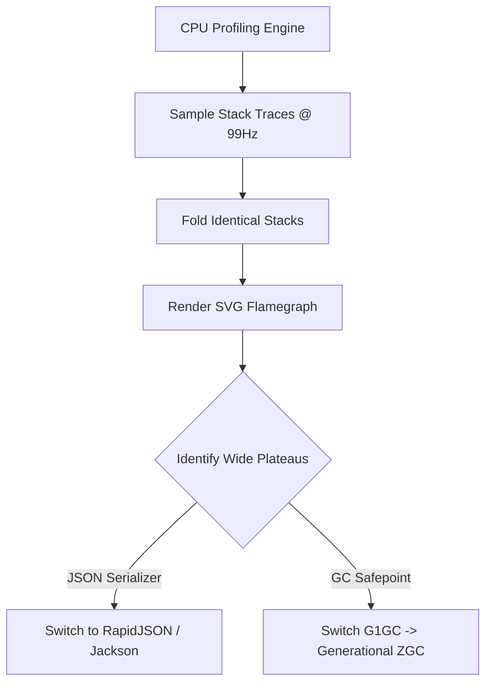

# CPU & Memory Profiling: Brendan Gregg Flamegraphs, JVM G1GC/ZGC Pauses & Python GIL Contention

```json continuity
{
  "previously": "In Chapter 04, we sized database connection pools using Little's Law and diagnosed HikariCP thread starvation.",
  "painPoint": "Under 5,000 RPS, AeroCart p99 latency spiked from 25ms to 3.2 seconds. The CPU was pinned at 98%, but APM traces showed database queries were fast (4ms). The team was flying blind without CPU profiling!",
  "unlock": "Evolve to AeroPulse v0.5: generate and read Brendan Gregg CPU and memory Flamegraphs, tune JVM G1GC and ZGC GC pauses to eliminate Stop-The-World safepoint stalls, and detect Python GIL contention."
}
```

```json walkthrough
[
  {
    "time": "0:00",
    "badge": "Flamegraph Anatomy",
    "title": "Reading Flamegraphs: X-Axis Width is CPU Time; Y-Axis is Stack Depth",
    "caption": "In a Flamegraph, the horizontal x-axis represents the percentage of total CPU samples spent in that function (sorted alphabetically, NOT chronological time). The vertical y-axis shows stack call depth.",
    "nodes": ["Top of Stack (Leaf)", "Wide Plateaus = Hot Spots", "Alphabetical Sort", "Root Function"],
    "activeIndex": 1,
    "code": "# Wide plateaus at the top indicate where CPU cycles are consumed!\n[  json_serialize (42% CPU)  ] [  auth_verify (18%)  ]\n[           process_request (85% CPU)                 ]"
  },
  {
    "time": "0:25",
    "badge": "JVM GC Safepoints",
    "title": "Stop-The-World Safepoints: Why 200ms Pauses Kill Microservices",
    "caption": "Generational G1GC stops all application threads at 'safepoints' to mark and compact memory. If an app generates humongous objects (> 50% region size), G1GC falls back to Full GC stalls.",
    "nodes": ["Humongous Allocations", "Safepoint Requested", "All Threads Halted", "G1GC STW Compaction"],
    "activeIndex": 2,
    "code": "# G1GC log signature:\n[GC pause (G1 Evacuation Pause) (young) 280ms]\n# Safepoint stall stops all active HTTP request processing!"
  },
  {
    "time": "0:50",
    "badge": "Modern ZGC Tuning",
    "title": "ZGC & Generational ZGC: Sub-Millisecond Pauses (< 1ms)",
    "caption": "ZGC performs marking and compaction concurrently using load barriers and colored pointers, maintaining sub-millisecond max pause times even on multi-terabyte heaps.",
    "nodes": ["ZGC Concurrent Mark", "Colored Pointers", "Concurrent Relocate", "Max Pause < 1ms"],
    "activeIndex": 3,
    "code": "JAVA_TOOL_OPTIONS: \"-XX:+UseZGC -XX:+ZGenerational\""
  },
  {
    "time": "1:15",
    "badge": "Python GIL & Event Loops",
    "title": "Python GIL Contention & Async Event-Loop Blocking",
    "caption": "In Python, threads executing CPU-bound work contend for the Global Interpreter Lock (GIL). In asyncio, running heavy regex or sync file I/O blocks the event loop for all concurrent users.",
    "nodes": ["Async Request", "Blocking Sync I/O", "Event Loop Stalled", "1,000 Sockets Freeze"],
    "activeIndex": 1,
    "code": "# Anti-pattern: Blocking event loop with sync crypto/regex\n# Fix: Offload CPU tasks to concurrent.futures.ProcessPoolExecutor"
  }
]
```

```json pretraining
[
  {
    "term": "Brendan Gregg Flamegraph",
    "formula": "X-axis = Proportion of CPU Samples · Y-axis = Call Stack Depth",
    "meaning": "A visualization of profiled software stack traces where wide horizontal boxes identify hot-spot functions consuming the most CPU or memory allocations."
  },
  {
    "term": "Stop-The-World (STW) Safepoint",
    "formula": "JVM Pauses All Application Threads -> Performs GC Sweeps -> Resumes",
    "meaning": "A state where the JVM halts all mutator threads to inspect or relocate heap objects, directly introducing tail latency spikes."
  },
  {
    "term": "Humongous Allocation (G1GC)",
    "formula": "Object Size > 50% of G1 Region Size (e.g., > 16MB)",
    "meaning": "An allocation that exceeds half a G1 region size, placed directly in continuous Humongous regions, causing premature Full GC cycles."
  },
  {
    "term": "Python GIL (Global Interpreter Lock)",
    "formula": "1 Thread Active per Python OS Process",
    "meaning": "A mutex in CPython that prevents multiple native threads from executing Python bytecode simultaneously, causing CPU contention on multicore hosts."
  }
]
```

## 🌱 Step 1: Plain-English Mental Model — The Assembly Line and The Fire Alarm

Imagine a car factory.
- **Normal Workflow**: 100 workers assemble cars at high speed.
- **Stop-The-World Garbage Collection**: Every 30 seconds, someone pulls the factory fire alarm. All 100 workers must freeze with their hands in the air for 3 seconds while janitors sweep metal shavings off the floor. During those 3 seconds, zero cars are built!
- **Flamegraph Profiling**: A heat camera placed over the factory floor. It immediately highlights that 70% of worker energy is spent opening cardboard boxes with dull scissors (`JSON parsing`), pointing you straight to the real bottleneck.



---

## 🔨 Step 2: Zero-to-Running Starter & CLI — Capturing Stack Profiles

Generate and inspect stack sample distributions using standard CLI tools:

```bash
# Capture Linux CPU profile with perf (if installed)
perf record -F 99 -g -p <pid> -- sleep 10
# Fold stacks and render Flamegraph
# perf script | stackcollapse-perf.pl | flamegraph.pl > flamegraph.svg
```

Let's build a Python stack sampler and folded-format generator in stdlib:

```python
from __future__ import annotations
import collections

# Subgoal 1: Model stack trace frequency aggregation (folded format)
class StackTraceProfiler:
    def __init__(self) -> None:
        self.stack_counts: collections.Counter[str] = collections.Counter()

    def record_sample(self, stack: list[str]) -> None:
        # Subgoal 2: Join stack frames with semicolons (Brendan Gregg folded format)
        folded = ";".join(stack)
        self.stack_counts[folded] += 1

    def compute_hotspots(self) -> list[tuple[str, float]]:
        # Subgoal 3: Calculate percentage of total CPU time per stack
        total = sum(self.stack_counts.values())
        if total == 0:
            return []
        return [
            (stack, round((count / total) * 100.0, 1))
            for stack, count in self.stack_counts.most_common()
        ]

if __name__ == "__main__":
    profiler = StackTraceProfiler()
    for _ in range(70):
        profiler.record_sample(["main", "handle_request", "json_deserialize", "utf8_decode"])
    for _ in range(30):
        profiler.record_sample(["main", "handle_request", "db_query", "socket_read"])

    hotspots = profiler.compute_hotspots()
    assert len(hotspots) == 2
    assert hotspots[0][0].endswith("utf8_decode") and hotspots[0][1] == 70.0
    print(f"StackTraceProfiler verified: top hot spot consumes {hotspots[0][1]}% CPU.")
```

### Java 17 Equivalent

```java
import java.util.*;

public class AeroPulseCh05Starter {
    public static Map<String, Double> computeHotspots(Map<String, Integer> foldedStacks) {
        int total = foldedStacks.values().stream().mapToInt(Integer::intValue).sum();
        Map<String, Double> pct = new HashMap<>();
        foldedStacks.forEach((stack, count) -> pct.put(stack, Math.round((count * 100.0 / total) * 10.0) / 10.0));
        return pct;
    }

    public static void main(String[] args) {
        Map<String, Integer> samples = Map.of(
            "main;handle;json", 80,
            "main;handle;db", 20
        );
        var hotspots = computeHotspots(samples);
        assert hotspots.get("main;handle;json") == 80.0;
        System.out.println("Java AeroPulseCh05Starter verified: " + hotspots);
    }
}
```

---

## 🛠️ Step 3: Everyday Practitioner Workflows & Where Naive Code Breaks

Why do teams fail to fix high latency even after adding CPU cores?
- **Misreading Flamegraph X-Axis as Time**: Thinking a function on the left happened before a function on the right. In reality, functions are sorted alphabetically to coalesce identical stacks!
- **Humongous Allocations Evading Young Gen**: Allocating large byte arrays (> 50% G1 region) bypasses Eden and forces direct Humongous allocations, triggering constant concurrent mark cycles.
- **Blocking Async Event Loops**: Running a 20ms sync encryption function inside a Python `asyncio` handler blocks all other concurrent requests on that worker.

```json contrast
{
  "title": "CPU Profiling Strategy: Top / APM Averages vs. Low-Overhead Sampling Flamegraphs",
  "leftLabel": "❌ High-Overhead Tracing / Blind Guessing",
  "leftCode": "# Attaching heavy debuggers or instrumenting every function:\n# Slows down application by 500%!\n# Misses kernel time, page faults, and GC safepoints",
  "rightLabel": "✅ Staff Low-Overhead Profiling (async-profiler / perf)",
  "rightCode": "# Uses hardware performance counters and safepoint-free sampling:\n./profiler.sh -e cpu -d 30 -f flamegraph.html <pid>\n# Zero distortion (< 1% overhead in production)"
}
```

```json poe
{
  "question": "A production service written in Java experiences sudden 3-second p99 latency spikes during flash sales. CPU usage is low (25%). The Flamegraph shows very narrow application stacks, but jstat -gcutil reveals G1 Old Generation jumping from 20% to 90% in seconds. What is the root cause?",
  "options": [
    "The CPU fans stopped working",
    "Humongous object allocations (e.g. giant JSON responses or file buffers > 50% of G1 region size) are triggering Stop-The-World Full GC cycles",
    "Kubernetes is throttling CPU",
    "PostgreSQL deadlocks"
  ],
  "answerIndex": 1,
  "explanation": "When an application allocates objects larger than half of -XX:G1HeapRegionSize, G1GC marks them as Humongous and places them straight into Old Gen, bypassing normal young-gen GC and triggering emergency Stop-The-World Full GC collections."
}
```

---

## 🏢 Step 4: How Big Tech Runs It at Scale, Staff Math & Production Blueprint

### 🏢 In the Wild: Netflix & Uber Fleet-Wide Continuous Profiling

At **Netflix** (FlameScope) and **Uber**, continuous CPU and memory profiling runs 24/7 in production across hundreds of thousands of containers:
1. **Low-Overhead Sampling Rate Math**:
   $$f_{\text{sample}} = 99\text{ Hz} \quad (\text{Never use } 100\text{ Hz to avoid resonance with periodic OS timers})$$
   Sampling at $99\text{ Hz}$ collects 99 stack samples per second per core, providing statistically valid flamegraphs with less than $0.5\%$ CPU overhead.
2. **JVM Safepoint Bias Elimination (`async-profiler`)**:
   Standard JVM profilers only sample at safepoints, completely hiding hot loops that don't poll safepoints! Big Tech platforms use `async-profiler` (AsyncGetCallTrace + perf_events) to sample unbiased native and Java stacks.

| Garbage Collector | Target Workload | Typical Max Pause Time | Memory Footprint Overhead |
| :--- | :--- | :--- | :--- |
| **Serial GC** | Single-threaded micro-containers (< 512MB) | High ($> 500\text{ms}$) | Lowest |
| **G1GC** | Default general-purpose enterprise heaps (4–32GB) | Moderate ($50–200\text{ms}$) | $\approx 10\%$ region tables |
| **ZGC / GenZGC** | Ultra-low-latency real-time apps (< 1ms SLA) | **Sub-millisecond ($< 1\text{ms}$)** | $\approx 15–20\%$ load barriers |
| **Shenandoah** | Low-latency alternative for OpenJDK | Ultra-low ($< 10\text{ms}$) | Brooks pointers overhead |

```python
from __future__ import annotations

class AeroPulseGCAnalyzer:
    """Production GC log and pause duration auditor."""

    @staticmethod
    def audit_pause_budget(
        pause_durations_ms: list[float],
        sla_max_pause_ms: float = 50.0,
    ) -> dict[str, object]:
        if not pause_durations_ms:
            return {"status": "NO_PAUSES", "max_pause_ms": 0.0, "breached": False}
        max_pause = max(pause_durations_ms)
        avg_pause = sum(pause_durations_ms) / len(pause_durations_ms)
        breached = max_pause > sla_max_pause_ms

        return {
            "total_pauses": len(pause_durations_ms),
            "max_pause_ms": round(max_pause, 2),
            "avg_pause_ms": round(avg_pause, 2),
            "breached": breached,
            "status": "FAIL_SLA_BREACH" if breached else "PASS",
        }

if __name__ == "__main__":
    analyzer = AeroPulseGCAnalyzer()
    good_pauses = [2.1, 1.8, 3.4, 4.2]
    res1 = analyzer.audit_pause_budget(good_pauses, sla_max_pause_ms=10.0)
    assert res1["status"] == "PASS" and not res1["breached"]

    bad_pauses = [5.0, 120.0, 4.0]
    res2 = analyzer.audit_pause_budget(bad_pauses, sla_max_pause_ms=50.0)
    assert res2["status"] == "FAIL_SLA_BREACH" and res2["breached"]
    print("AeroPulseCh05Blueprint verified successfully.")
```

### Java 17 Equivalent

```java
import java.util.List;

public class AeroPulseCh05Blueprint {
    public static boolean checkGcHealth(List<Double> pausesMs, double maxAllowedMs) {
        for (double p : pausesMs) {
            if (p > maxAllowedMs) return false;
        }
        return true;
    }

    public static void main(String[] args) {
        boolean healthy = checkGcHealth(List.of(1.2, 2.5, 0.8), 10.0);
        boolean unhealthy = checkGcHealth(List.of(1.2, 125.0, 0.8), 10.0);
        assert healthy && !unhealthy;
        System.out.println("Java AeroPulseCh05Blueprint verified.");
    }
}
```

> [!WARNING]
> **Hiring Bar-Raiser Gotcha — The Async Event Loop JSON Trap!**
> In Python (`FastAPI`/`asyncio`) or Node.js microservices, engineers often believe declaring an endpoint `async def get_flight()` guarantees non-blocking concurrency. In reality, calling `json.loads(giant_payload)` or compiling heavy regex runs synchronously on the main thread, freezing the event loop for thousands of other concurrent HTTP connections! Senior architects offload CPU payloads exceeding $1\text{ms}$ to thread or process pools!

```json quiz
[
  {
    "id": "perf05-q1",
    "question": "What does the width of a box on the horizontal x-axis of a Brendan Gregg CPU Flamegraph represent?",
    "options": [
      "The chronological order in which the function was executed",
      "The proportion of total CPU sample time spent in that function and its descendants",
      "The amount of memory allocated by that function",
      "The network latency of the API call"
    ],
    "answerIndex": 1,
    "explanation": "Flamegraph x-axis is sorted alphabetically to aggregate identical stack traces. The width corresponds strictly to the percentage of total CPU samples spent in that call path."
  },
  {
    "id": "perf05-q2",
    "question": "Why should sampling profilers sample at 99Hz rather than 100Hz?",
    "options": [
      "99Hz is cheaper on cloud compute",
      "Sampling at 100Hz risks phase-locking (resonance) with periodic 100Hz OS kernel timer interrupts, systematically biasing telemetry",
      "100Hz causes CPU overheating",
      "Most Linux kernels reject frequencies divisible by 10"
    ],
    "answerIndex": 1,
    "explanation": "Periodic timers often fire at round frequencies (100Hz/1000Hz). Sampling at a slightly off-cadence frequency like 99Hz avoids synchronized sampling bias."
  },
  {
    "id": "perf05-q3",
    "question": "Which modern JVM garbage collector is designed specifically to maintain sub-millisecond (< 1ms) Stop-The-World pause times on large heaps?",
    "options": [
      "Serial GC",
      "ZGC (and Generational ZGC)",
      "Parallel GC",
      "Concurrent Mark Sweep (CMS)"
    ],
    "answerIndex": 1,
    "explanation": "ZGC performs almost all marking, relocation, and reference processing concurrently with application threads, keeping maximum pause times strictly under 1 millisecond."
  }
]
```

---

## 📋 Step 5: Master Cheat-Sheet, 60-Second Interview Pitch & Verified Sources

| Profiling Tool | Target Runtime | Metric Profiled | Overhead |
| :--- | :--- | :--- | :--- |
| **`perf` / Flamegraph** | Linux Kernel, C/C++, Rust, Go | CPU on-CPU instructions | $< 1\%$ |
| **`async-profiler`** | JVM (Java, Kotlin, Scala) | Non-safepoint biased CPU & Allocations | $< 1\%$ |
| **`py-spy`** | CPython (FastAPI, Pytest) | Python stack traces & GIL contention | $< 2\%$ |
| **`ZGC` / `GenZGC`** | JVM 17+ / 21+ | Sub-millisecond Stop-The-World pauses | $15\%$ RAM overhead |

### 🎙️ 60-Second Interview Soundbite

> *"When production systems experience tail-latency spikes without obvious database bottlenecks, I rely on low-overhead sampling profilers rather than guessing. Using `async-profiler` for JVM services or `py-spy` for Python, we generate Brendan Gregg Flamegraphs sampled at 99Hz to avoid OS timer lock-in. For JVM tail latency, we inspect GC safepoint pauses using JDK Flight Recorder: if G1GC evacuation pauses or humongous allocations exceed our 50ms SLO, we tune region sizes or transition to Generational ZGC to achieve sub-millisecond pause times. In Python services, we isolate GIL contention and ensure heavy CPU serialization is offloaded from the async event loop."*

### 📚 Verified Primary Sources
- [Brendan Gregg — Flame Graphs CPU and Memory Profiling](https://www.brendangregg.com/flamegraphs.html)
- [Oracle JDK 17 — Garbage-First Garbage Collector (G1GC) Tuning Guide](https://docs.oracle.com/en/java/javase/17/gctuning/garbage-first-g1-garbage-collector.html)
