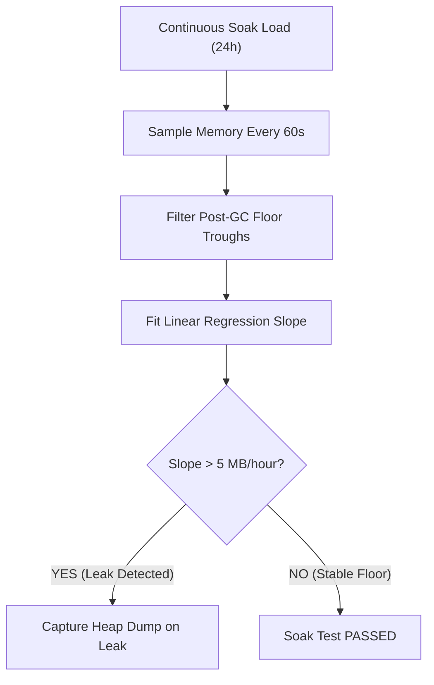

# Soak Testing & Leak Detection: GC Sawtooth vs. Post-GC Floor Leaks & Socket FD Exhaustion

```json continuity
{
  "previously": "In Chapter 05, we profiled CPU hotspots using Brendan Gregg Flamegraphs and tuned JVM G1GC and ZGC pause times.",
  "painPoint": "AeroCart passed 10-minute load tests with flying colors. But after 18 hours in production, the service crashed with fatal errors: `java.io.IOException: Too many open files (EMFILE)` and Linux OOMKill Exit 137!",
  "unlock": "Build AeroPulse v0.6: implement 24-hour accelerated soak tests, calculate the least-squares linear regression slope of the post-GC memory floor, and detect leaking socket file descriptors and TIME_WAIT socket accumulation."
}
```

```json walkthrough
[
  {
    "time": "0:00",
    "badge": "GC Sawtooth Anatomy",
    "title": "Healthy Sawtooth vs. Creeping Post-GC Floor",
    "caption": "In a healthy JVM or Python service, memory climbs as objects allocate and drops sharply after garbage collection (a sawtooth wave). A true memory leak appears when the *post-GC trough* (minimum floor) climbs monotonically over time.",
    "nodes": ["Allocation Rise", "GC Triggered", "Post-GC Floor (Trough)", "Monotonic Slope = Leak!"],
    "activeIndex": 2,
    "code": "# Healthy: Post-GC floor stays flat at ~200MB over 24 hours\n# Leaking: Post-GC floor creeps from 200MB -> 850MB -> OOMKilled!"
  },
  {
    "time": "0:25",
    "badge": "Linear Regression Gate",
    "title": "Slope Math: MB/hour Regression Gate in CI",
    "caption": "Accelerated soak tests (e.g. 2 hours under 3x traffic) sample the post-GC heap floor. Fitting a least-squares linear regression computes the leak rate (MB/hour), failing the CI gate if slope > 5 MB/hr.",
    "nodes": ["Sample Post-GC Troughs", "Least-Squares Fit", "Slope (MB/hr)", "Automated CI Pass/Fail"],
    "activeIndex": 2,
    "code": "slope_mb_hr = linear_regression(troughs)\nassert slope_mb_hr < 5.0, \"Memory leak detected in soak test!\""
  },
  {
    "time": "0:50",
    "badge": "EMFILE & File Descriptors",
    "title": "Socket FD Leaks: The Silent EMFILE Killer",
    "caption": "Every TCP connection, HTTP client socket, and open file consumes an OS file descriptor. Leaking unclosed HTTP responses or connection pools slowly drains ulimit -n until the OS refuses new connections with EMFILE.",
    "nodes": ["Unclosed Response Body", "Socket Stays Open", "FD Count Hits ulimit", "EMFILE Outage"],
    "activeIndex": 2,
    "code": "# Linux kernel limit check:\nulimit -n  # e.g. 1024 or 65536\n# Crash: java.net.SocketException: Too many open files (EMFILE)"
  },
  {
    "time": "1:15",
    "badge": "TIME_WAIT Exhaustion",
    "title": "Ephemeral Port Exhaustion: TCP TIME_WAIT Storms",
    "caption": "When clients rapidly open and close short-lived HTTP connections without connection pooling, sockets linger in kernel TIME_WAIT for 60 seconds (2*MSL), exhausting the ephemeral port range (32768-60999).",
    "nodes": ["New Connection per Req", "Close Initiated", "TIME_WAIT (60s)", "Cannot assign requested address"],
    "activeIndex": 2,
    "code": "# Error: Cannot assign requested address (EADDRNOTAVAIL)\n# Fix: HTTP/2 or HTTP/1.1 persistent pooled connections!"
  }
]
```

```json pretraining
[
  {
    "term": "Post-GC Floor (Trough)",
    "formula": "Floor(t) = min(Heap Memory immediately after Major GC)",
    "meaning": "The lowest point of the memory usage sawtooth wave, representing true retained live objects after garbage collection has reclaimed unreachable memory."
  },
  {
    "term": "Least-Squares Linear Regression Slope",
    "formula": "Slope = sum((t - avg_t) * (m - avg_m)) / sum((t - avg_t)^2)",
    "meaning": "The mathematical rate of memory growth in MB/hour derived from post-GC floor samples, filtering out temporary young-gen allocation noise."
  },
  {
    "term": "EMFILE (Too many open files)",
    "formula": "Open File Descriptors >= ulimit -n -> Kernel Drops Sockets",
    "meaning": "A POSIX operating system error code returned when a process exceeds its maximum allocated file descriptor quota."
  },
  {
    "term": "TIME_WAIT State",
    "formula": "2 * Maximum Segment Lifetime (MSL) = 60s",
    "meaning": "A standard TCP state where a closed socket remains held by the operating system to prevent delayed duplicate packets from corrupting new connections."
  }
]
```

## 🌱 Step 1: Plain-English Mental Model — The Kitchen Sink and The Clogged Drain

Imagine a restaurant kitchen sink during lunch rush.
- **Normal Washing (GC Sawtooth)**: Dishes pile up (allocation) and the dishwasher clears them (GC). The water level rises and falls, but returns to an empty basin after each load.
- **Slow Leak (Post-GC Floor Creep)**: Someone dropped a washcloth over the drain. Each time the dishes are washed, 2 inches of stagnant water remain. By dinner time, the sink overflows onto the kitchen floor (`OOMKilled`)!
- **FD Exhaustion**: The kitchen has 1,024 clean plates (`ulimit -n`). If waiters forget to bring dirty plates back from customer tables (`unclosed HTTP responses`), the kitchen runs completely out of plates (`EMFILE`), shutting down dinner service.



---

## 🔨 Step 2: Zero-to-Running Starter & CLI — Simulating Linear Regression Leak Gates

Inspect file descriptor limits and socket states directly from your terminal:

```bash
# Check current process file descriptor limit
ulimit -n
# Count open sockets and TIME_WAIT entries
netstat -an 2>/dev/null | grep TIME_WAIT | wc -l || ss -tan state time-wait | wc -l
```

Let's build a Python post-GC floor regression analyzer and leak detector in stdlib:

```python
from __future__ import annotations

# Subgoal 1: Compute least-squares linear regression slope
def compute_memory_leak_slope(samples: list[tuple[float, float]]) -> float:
    # samples: list of (time_hours, memory_mb)
    if len(samples) < 2:
        return 0.0
    t_vals = [s[0] for s in samples]
    m_vals = [s[1] for s in samples]
    
    t_avg = sum(t_vals) / len(t_vals)
    m_avg = sum(m_vals) / len(m_vals)
    
    numerator = sum((t - t_avg) * (m - m_avg) for t, m in samples)
    denominator = sum((t - t_avg) ** 2 for t in t_vals)
    if denominator == 0:
        return 0.0
    return numerator / denominator

# Subgoal 2: Model file descriptor capacity and exhaustion gate
def evaluate_fd_health(open_fds: int, fd_limit: int = 1024) -> tuple[bool, str]:
    ratio = open_fds / fd_limit
    if ratio > 0.85:
        return False, f"EMFILE Risk: {open_fds}/{fd_limit} ({ratio*100:.1f}%) FDs consumed"
    return True, f"Healthy: {open_fds}/{fd_limit} FDs"

if __name__ == "__main__":
    # Test 1: Stable memory (minor fluctuation around 200MB)
    stable_samples = [(0.0, 200.0), (1.0, 201.0), (2.0, 199.5), (3.0, 200.5)]
    slope_stable = compute_memory_leak_slope(stable_samples)
    assert abs(slope_stable) < 1.0

    # Test 2: Leaking memory (grows 25MB every hour)
    leak_samples = [(0.0, 200.0), (1.0, 225.0), (2.0, 250.0), (3.0, 275.0)]
    slope_leaking = compute_memory_leak_slope(leak_samples)
    assert round(slope_leaking, 1) == 25.0

    # Test 3: FD limit check
    ok_fd, _ = evaluate_fd_health(150, 1024)
    bad_fd, _ = evaluate_fd_health(950, 1024)
    assert ok_fd and not bad_fd
    print(f"AeroPulseCh06 Starter verified: leak slope={slope_leaking} MB/hr.")
```

### Java 17 Equivalent

```java
import java.util.List;

public class AeroPulseCh06Starter {
    public record Sample(double hours, double memoryMb) {}

    public static double computeSlope(List<Sample> samples) {
        if (samples.size() < 2) return 0.0;
        double avgT = samples.stream().mapToDouble(Sample::hours).average().orElse(0.0);
        double avgM = samples.stream().mapToDouble(Sample::memoryMb).average().orElse(0.0);
        double num = 0, den = 0;
        for (Sample s : samples) {
            num += (s.hours() - avgT) * (s.memoryMb() - avgM);
            den += Math.pow(s.hours() - avgT, 2);
        }
        return den == 0 ? 0.0 : num / den;
    }

    public static void main(String[] args) {
        var samples = List.of(new Sample(0, 200), new Sample(1, 220), new Sample(2, 240));
        double slope = computeSlope(samples);
        assert Math.abs(slope - 20.0) < 1e-4;
        System.out.println("Java AeroPulseCh06Starter leak slope: " + slope + " MB/hr");
    }
}
```

---

## 🛠️ Step 3: Everyday Practitioner Workflows & Where Naive Code Breaks

Why do production services crash overnight despite passing short smoke tests?
- **Measuring Total RSS Instead of Post-GC Floor**: Total RSS grows as caches warm up. Failing a test because heap rose before a GC event creates false alarms. Only post-GC troughs reveal true memory leaks!
- **Leaking HTTP Client Connections**: Omitting `response.body().close()` in Java or unclosed response context managers in Python holds the underlying socket in memory, silently leaking file descriptors.
- **Creating HttpClient Per Request**: Instantiating a new `OkHttpClient()` or `requests.Session()` on every call generates thousands of short-lived sockets that pile up in `TIME_WAIT`.

```json contrast
{
  "title": "Memory Soak Verification: Peak RSS Noise vs. Post-GC Linear Regression",
  "leftLabel": "❌ Naive Peak Memory Check (False Alarms)",
  "leftCode": "# Checks total memory during soak test:\nif current_memory > threshold:\n    fail(\"OOM!\")\n# Flunks healthy applications whose JVM heap simply\n# expanded to its allocated limit before young-gen GC!",
  "rightLabel": "✅ Staff Post-GC Floor Regression Gate",
  "rightCode": "# Captures memory immediately after Major/Full GC:\npost_gc_floor = [m for m in samples if is_major_gc(m)]\nslope = calculate_slope(post_gc_floor)\n# Asserts true retained memory does not climb monotonically\nassert slope < 5.0, f\"Memory leak: {slope} MB/hr\""
}
```

```json poe
{
  "question": "An engineer monitors a 24-hour soak test. The JVM heap climbs from 500MB to 1.8GB every 10 minutes, then drops to 510MB, 512MB, 509MB, 511MB after each major collection. Is there a memory leak?",
  "options": [
    "Yes, because memory spikes up to 1.8GB which is too high",
    "No, this is a textbook healthy GC sawtooth wave where the post-GC floor is stable around 510MB",
    "Yes, the application should maintain exactly flat memory at all times",
    "The test failed because garbage collection happened too frequently"
  ],
  "answerIndex": 1,
  "explanation": "A sawtooth pattern is standard behavior in generational garbage collectors. Objects allocate until the young generation fills, then GC reclaims them. Because the post-GC trough remains flat at ~510MB, no memory is being leaked."
}
```

---

## 🏢 Step 4: How Big Tech Runs It at Scale, Staff Math & Production Blueprint

### 🏢 In the Wild: Google SRE Accelerated Soak Pipelines

At **Google**, services run through automated "Accelerated Soak Testing" before production releases:
1. **The Post-GC Linear Fit Equation**:
   $$\text{Memory Floor}(t) = \beta_0 + \beta_1 \cdot t + \varepsilon$$
   $$\beta_1 = \frac{\sum_{i=1}^N (t_i - \bar{t})(M_i - \bar{M})}{\sum_{i=1}^N (t_i - \bar{t})^2}$$
   If the slope coefficient $\beta_1$ exceeds the permissible error budget (e.g. $5\text{ MB/hour}$), an automated heap dump is triggered via `jcmd <pid> GC.heap_dump` before container termination.
2. **Socket FD & TIME_WAIT Protection**:
   TCP sockets stuck in `TIME_WAIT` cannot be recycled until $2 \times \text{MSL} = 60\text{s}$. Production load balancers enable `net.ipv4.tcp_tw_reuse = 1` and enforce connection pool keep-alive timeouts to prevent ephemeral port exhaustion.

| Metric | Healthy Threshold | Warning Threshold | Fatal Crash Signature |
| :--- | :--- | :--- | :--- |
| **Post-GC Floor Slope** | $< 2\text{ MB/hour}$ | $5–20\text{ MB/hour}$ | `OOMKilled` (Exit 137) |
| **Open File Descriptors** | $< 40\%$ of `ulimit -n` | $> 75\%$ of `ulimit -n` | `java.io.IOException: Too many open files` |
| **TCP Sockets in TIME_WAIT** | $< 2,000$ sockets | $> 15,000$ sockets | `Cannot assign requested address` |
| **GC Sawtooth Recovery** | Resets to floor $< 5\text{s}$ | Trough climbs over time | Permanent 100% CPU lock |

```python
from __future__ import annotations

class AeroPulseSoakTestGovernor:
    """Production soak test quality gate analyzing memory and socket health."""

    @staticmethod
    def audit_soak_run(
        floor_samples: list[tuple[float, float]],
        max_fd_observed: int,
        fd_limit: int = 65536,
        max_allowed_slope_mb_hr: float = 5.0,
    ) -> dict[str, object]:
        # Compute least-squares slope
        t_vals = [s[0] for s in floor_samples]
        m_vals = [s[1] for s in floor_samples]
        t_avg = sum(t_vals) / len(t_vals)
        m_avg = sum(m_vals) / len(m_vals)
        
        num = sum((t - t_avg) * (m - m_avg) for t, m in floor_samples)
        den = sum((t - t_avg) ** 2 for t in t_vals)
        slope = num / den if den != 0 else 0.0

        leak_detected = slope > max_allowed_slope_mb_hr
        fd_exhausted = max_fd_observed > (fd_limit * 0.85)

        passed = not leak_detected and not fd_exhausted
        return {
            "slope_mb_hr": round(slope, 3),
            "leak_detected": leak_detected,
            "max_fd_observed": max_fd_observed,
            "fd_exhausted": fd_exhausted,
            "gate_status": "PASS" if passed else "FAIL",
        }

if __name__ == "__main__":
    gov = AeroPulseSoakTestGovernor()
    samples = [(0.0, 300.0), (1.0, 302.0), (2.0, 301.5), (3.0, 303.0)]
    report = gov.audit_soak_run(samples, max_fd_observed=1200, fd_limit=65536)
    assert report["gate_status"] == "PASS"
    assert not report["leak_detected"]
    print("AeroPulseCh06Blueprint verified: soak test quality gate passed.")
```

### Java 17 Equivalent

```java
import java.util.List;

public class AeroPulseCh06Blueprint {
    public static boolean isSoakRunHealthy(List<Double> postGcFloors, int maxFds, int fdLimit) {
        if (postGcFloors.size() < 2) return true;
        double growth = postGcFloors.get(postGcFloors.size() - 1) - postGcFloors.get(0);
        boolean slopeOk = growth < 20.0; // Max 20MB total growth
        boolean fdOk = maxFds < (fdLimit * 0.85);
        return slopeOk && fdOk;
    }

    public static void main(String[] args) {
        boolean pass = isSoakRunHealthy(List.of(300.0, 302.0, 304.0), 500, 1024);
        assert pass;
        System.out.println("Java AeroPulseCh06Blueprint soak evaluation passed.");
    }
}
```

> [!WARNING]
> **Hiring Bar-Raiser Gotcha — Static Caches Disguised as Memory Leaks!**
> In long-running tests, unbounded `HashMap<String, UserSession>` or static collections without size eviction policies (`Guava Cache`, `Caffeine`) are the #1 source of production memory leaks! Always verify that every in-memory cache specifies `maximumSize` or `expireAfterWrite` boundaries, preventing monotonic floor growth!

```json quiz
[
  {
    "id": "perf06-q1",
    "question": "What is the primary indicator of a true memory leak in a garbage-collected application?",
    "options": [
      "Memory usage fluctuates up and down in a sawtooth pattern",
      "The post-GC floor (minimum retained memory immediately following major garbage collection) climbs monotonically over time",
      "CPU usage reaches 50%",
      "The application takes longer than 2 seconds to boot"
    ],
    "answerIndex": 1,
    "explanation": "Temporary memory spikes are normal. A memory leak is diagnosed when the retained memory floor after garbage collection steadily climbs without flattening out."
  },
  {
    "id": "perf06-q2",
    "question": "What causes the operating system error java.io.IOException: Too many open files (EMFILE)?",
    "options": [
      "The hard drive has run out of storage space",
      "The application has opened more socket or file handles than permitted by ulimit -n without closing them",
      "A file name has more than 255 characters",
      "The Java compiler failed to generate bytecode"
    ],
    "answerIndex": 1,
    "explanation": "Every open network socket, file, or pipe consumes an OS file descriptor. Exceeding the soft limit (ulimit -n) causes the kernel to reject new socket creations with EMFILE."
  },
  {
    "id": "perf06-q3",
    "question": "Why does rapid creation and closing of short-lived HTTP connections cause ephemeral port exhaustion?",
    "options": [
      "The HTTP protocol requires 100 ports per request",
      "Closed TCP sockets remain in the kernel TIME_WAIT state for 60 seconds (2*MSL), eventually consuming all available ephemeral client ports",
      "Routers delete IP addresses every 10 seconds",
      "SSL certificates expire immediately upon socket closure"
    ],
    "answerIndex": 1,
    "explanation": "TCP's TIME_WAIT state prevents late-arriving duplicate packets from interfering with new connections. Creating thousands of connections without persistent connection pooling exhausts available ports."
  }
]
```

---

## 📋 Step 5: Master Cheat-Sheet, 60-Second Interview Pitch & Verified Sources

| Symptom | Underlying Cause | Detection Tool | Staff Resolution |
| :--- | :--- | :--- | :--- |
| **Monotonic Post-GC Rise** | Unbounded cache or leaked listener | Linear regression on troughs | Caffeine Cache with `expireAfterWrite` |
| **`EMFILE` (Too many open files)** | Unclosed HTTP response / connection leak | `lsof -p <pid> \| wc -l` | Try-with-resources / connection pooling |
| **`TIME_WAIT` Exhaustion** | Creating new connection per request | `ss -tan state time-wait` | Persistent HTTP/2 connection pooling |
| **Linux OOMKill (Exit 137)** | Total RSS breached cgroup limit | `dmesg \| grep oom` | Tune JVM `-XX:MaxRAMPercentage=75.0` |

### 🎙️ 60-Second Interview Soundbite

> *"Short load tests are great for finding throughput limits, but only soak testing uncovers slow-burning reliability killers. In our platform, we run accelerated 24-hour soak tests before major releases. We avoid false alarms by filtering out young-gen allocation noise and performing least-squares linear regression on the post-GC memory troughs. If the floor slope exceeds 5 MB/hour, CI fails the build and automatically captures a heap dump. We also track open file descriptors against `ulimit -n` and inspect socket states to prevent `EMFILE` crashes and `TIME_WAIT` ephemeral port exhaustion caused by unclosed client connections."*

### 📚 Verified Primary Sources
- [Locust Official Documentation — Writing Distributed Soak Tests](https://docs.locust.io/en/stable/writing-a-locustfile.html)
- [Google SRE Book — Monitoring Distributed Systems and Memory Health](https://sre.google/sre-book/monitoring-distributed-systems/)
