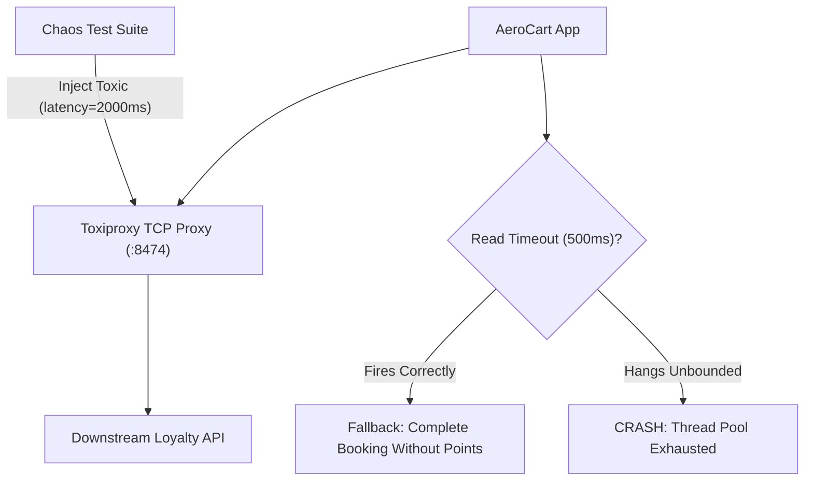

# Chaos Engineering: The Scientific Method & Deterministic TCP Fault Injection with Toxiproxy

```json continuity
{
  "previously": "In Module 2, we profiled CPU/GC bottlenecks and detected memory leaks and file descriptor exhaustion in soak tests.",
  "painPoint": "AeroCart's third-party Loyalty Points microservice hung for 30 seconds without closing its TCP sockets. Because AeroCart lacked strict client timeouts, all 200 Tomcat worker threads stalled waiting for loyalty points, taking down the entire flight booking checkout engine!",
  "unlock": "Evolve to AeroPulse v0.7: adopt the Chaos Engineering scientific method, inject deterministic network latency and socket reset faults via Shopify Toxiproxy, and verify strict connect and read deadlines."
}
```

```json walkthrough
[
  {
    "time": "0:00",
    "badge": "The Scientific Method",
    "title": "Chaos Engineering: Hypothesis -> Fault Injection -> Verification",
    "caption": "Chaos engineering is not breaking things randomly in production. It follows a rigorous 4-step scientific method: (1) Define steady-state hypothesis; (2) Inject realistic network fault; (3) Verify blast radius; (4) Automate remediation.",
    "nodes": ["Steady-State Hypothesis", "Inject Controlled Toxic", "Observe Telemetry", "Blast Radius Contained"],
    "activeIndex": 1,
    "code": "# Steady-State: Checkout success >= 99.9% even if Loyalty hangs\\n# Fault: Inject 3,000ms latency into Loyalty proxy"
  },
  {
    "time": "0:25",
    "badge": "Shopify Toxiproxy",
    "title": "Deterministic TCP Fault Injection with Shopify Toxiproxy",
    "caption": "Toxiproxy sits between your application and downstream dependencies (Postgres, Redis, third-party APIs). Through a simple REST API, tests inject deterministic network toxics: latency, jitter, packet loss, bandwidth throttling, and reset_peer.",
    "nodes": ["App (AeroCart)", "Toxiproxy TCP Proxy", "Downstream Service", "REST API Control"],
    "activeIndex": 1,
    "code": "# Inject 2000ms latency with 500ms jitter via Toxiproxy API:\\nPOST /proxies/loyalty_service/toxics\\n{\"type\": \"latency\", \"attributes\": {\"latency\": 2000, \"jitter\": 500}}"
  },
  {
    "time": "0:50",
    "badge": "Deadlines vs Timeouts",
    "title": "Strict Timeouts: Connect Deadline vs. Read Timeout",
    "caption": "Never use unbounded timeouts. Connect timeout must fail fast (e.g. 250ms) if the host is down. Read timeout must cap waiting time (e.g. 500ms) when a dependency hangs mid-stream.",
    "nodes": ["SYN Sent", "Connect Timeout (250ms)", "Data Transfer", "Read Timeout (500ms)"],
    "activeIndex": 3,
    "code": "client = httpx.Client(timeout=httpx.Timeout(5.0, connect=0.250, read=0.500))"
  },
  {
    "time": "1:15",
    "badge": "Graceful Fallback",
    "title": "Degraded Mode: Return Partial Results Instead of Crashing",
    "caption": "When the Loyalty service times out, AeroCart should not fail checkout. It catches the TimeoutException, flags loyalty points as 'PENDING_RECONCILIATION', and confirms the flight booking successfully!",
    "nodes": ["Loyalty Timeout", "Catch TimeoutException", "Log Degraded State", "Flight Booked Successfully!"],
    "activeIndex": 3,
    "code": "try:\\n    loyalty.claim_points()\\nexcept TimeoutError:\\n    order.loyalty_status = 'DEFERRED_TO_QUEUE'"
  }
]
```

```json pretraining
[
  {
    "term": "Steady-State Hypothesis",
    "formula": "System Behavior under Normal Conditions (e.g. 99.9% 200 OK)",
    "meaning": "A quantifiable assertion about expected system behavior that should remain true even when experimental chaos faults are injected."
  },
  {
    "term": "Shopify Toxiproxy",
    "formula": "TCP Man-In-The-Middle Proxy + REST Toxic Injection",
    "meaning": "An open-source TCP proxy designed specifically for testing resilience, capable of programmatically simulating network latency, packet loss, and connection drops."
  },
  {
    "term": "Connect Timeout vs. Read Timeout",
    "formula": "Connect = TCP Handshake Limit · Read = Socket Inactive Receive Limit",
    "meaning": "Separate network deadline parameters: connect timeout limits the duration of initial TCP connection establishment; read timeout limits maximum silence between bytes."
  },
  {
    "term": "Blast Radius",
    "formula": "Affected Users = Minimized Fraction of Real Traffic",
    "meaning": "The scope of potential impact caused by a chaos experiment, strictly bounded to prevent catastrophic outages."
  }
]
```

## 🌱 Step 1: Plain-English Mental Model — The Fire Drill and The Automatic Sprinkler

Imagine a commercial skyscraper.
- **Chaos Engineering as a Fire Drill**: You do not burn down the building to see what happens. You trigger a controlled smoke canister on floor 4 (fault injection) to verify that the fire doors close automatically and the sprinkler system activates within 5 seconds (steady-state hypothesis).
- **Toxiproxy as the Water Valve**: Toxiproxy is like having a remote-control valve on every pipe in the building. You can instantly simulate water freezing in the pipes (`latency`), a pipe bursting (`reset_peer`), or water pressure dropping (`bandwidth limits`) with one button press, verifying that your plumbing doesn't flood the lobby.



---

## 🔨 Step 2: Zero-to-Running Starter & CLI — Injecting Toxics via Toxiproxy

Control and inspect Toxiproxy directly from your terminal:

```bash
# Start Toxiproxy in Docker
docker run --rm -d --name toxiproxy -p 8474:8474 -p 22222:22222 ghcr.io/shopify/toxiproxy
# Create a proxy for downstream service
curl -s -X POST http://localhost:8474/proxies -d '{"name": "loyalty", "listen": "0.0.0.0:22222", "upstream": "loyalty-api:8080"}'
```

Let's build a Python simulator that injects network toxics and validates timeout fallback handling in stdlib:

```python
from __future__ import annotations
import time

# Subgoal 1: Model simulated TCP proxy with programmable toxics
class SimulatedToxiproxy:
    def __init__(self) -> None:
        self.latency_ms: float = 0.0
        self.should_reset_peer: bool = False

    def inject_latency(self, latency_ms: float) -> None:
        self.latency_ms = latency_ms

    def inject_reset(self) -> None:
        self.should_reset_peer = True

    def reset_toxics(self) -> None:
        self.latency_ms = 0.0
        self.should_reset_peer = False

# Subgoal 2: Client with strict connect and read deadlines
def fetch_loyalty_with_deadline(proxy: SimulatedToxiproxy, timeout_ms: float = 500.0) -> tuple[str, bool]:
    if proxy.should_reset_peer:
        # Connection reset by peer
        return "DEFERRED_FALLBACK", False
    if proxy.latency_ms > timeout_ms:
        # Deadline exceeded; trigger graceful fallback
        return "DEFERRED_FALLBACK", False
    return "POINTS_CONFIRMED", True

if __name__ == "__main__":
    proxy = SimulatedToxiproxy()
    # Baseline: Healthy downstream responds instantly
    val1, ok1 = fetch_loyalty_with_deadline(proxy, timeout_ms=500.0)
    assert ok1 and val1 == "POINTS_CONFIRMED"

    # Chaos Injection: 2000ms latency injected via Toxiproxy
    proxy.inject_latency(2000.0)
    val2, ok2 = fetch_loyalty_with_deadline(proxy, timeout_ms=500.0)
    assert not ok2 and val2 == "DEFERRED_FALLBACK"

    # Chaos Injection: Connection reset
    proxy.reset_toxics()
    proxy.inject_reset()
    val3, ok3 = fetch_loyalty_with_deadline(proxy, timeout_ms=500.0)
    assert not ok3 and val3 == "DEFERRED_FALLBACK"
    print("SimulatedToxiproxy test passed: deadline & fallback verified.")
```

### Java 17 Equivalent

```java
public class AeroPulseCh07Starter {
    public static String callWithTimeout(double downstreamLatencyMs, double timeoutMs) {
        // Subgoal 1: Evaluate latency against deadline
        if (downstreamLatencyMs > timeoutMs) {
            return "DEFERRED_FALLBACK";
        }
        return "POINTS_CONFIRMED";
    }

    public static void main(String[] args) {
        String normal = callWithTimeout(50.0, 500.0);
        String chaos = callWithTimeout(2000.0, 500.0);
        assert "POINTS_CONFIRMED".equals(normal);
        assert "DEFERRED_FALLBACK".equals(chaos);
        System.out.println("Java AeroPulseCh07Starter chaos fallback verified.");
    }
}
```

---

## 🛠️ Step 3: Everyday Practitioner Workflows & Where Naive Code Breaks

Why do systems fall apart during downstream network blips?
- **Infinite Default Socket Timeouts**: In many HTTP libraries (including Python `requests` and older Java `HttpURLConnection`), omitting the timeout parameter results in an **infinite timeout**! If the remote host stops sending packets, your thread hangs forever.
- **Confusing Connect vs. Read Timeouts**: Setting `timeout=5.0` without distinguishing connect from read. If the remote host drops packets during the TCP SYN handshake, a 5-second connect timeout burns client threads while waiting.
- **Testing Chaos Without Invariant Assertions**: Injecting chaos without asserting business invariants (e.g., flight booking must complete even if bonus points fail) turns testing into noise.

```json contrast
{
  "title": "Downstream HTTP Invocation: Unbounded vs. Deadline-Gated with Fallback",
  "leftLabel": "❌ Unbounded Timeout (System Outage)",
  "leftCode": "# Unbounded default timeout!\nresponse = requests.get('https://loyalty.internal/points')\n# If loyalty proxy hangs, worker thread blocks indefinitely\n# 200 concurrent requests exhaust all worker threads!",
  "rightLabel": "✅ Strict Timeout with Graceful Fallback",
  "rightCode": "# Strict connect (250ms) and read (500ms) deadlines\ntry:\n    resp = client.get('http://loyalty', timeout=(0.25, 0.50))\nexcept (httpx.TimeoutException, httpx.NetworkError):\n    logger.warn('Loyalty points delayed; proceeding with booking')\n    resp = FallbackResult(status='DEFERRED')"
}
```

```json poe
{
  "question": "A team configures Toxiproxy to inject 5,000ms latency on the payment gateway connection. The test suite fails because the test runner timed out after 30 seconds. What is the fundamental flaw in the application under test?",
  "options": [
    "Toxiproxy is not compatible with payment gateways",
    "The application lacks strict read timeouts on its payment HTTP client, causing caller threads to block indefinitely instead of failing fast and reporting a clean timeout error",
    "Docker ran out of disk space",
    "The test runner had too much memory"
  ],
  "answerIndex": 1,
  "explanation": "If injecting 5s latency causes a 30s test freeze, the application lacks an explicit read timeout. Well-engineered microservices enforce strict deadlines (e.g. 2s) and fail fast."
}
```

---

## 🏢 Step 4: How Big Tech Runs It at Scale, Staff Math & Production Blueprint

### 🏢 In the Wild: Netflix ChAP & Shopify Toxiproxy Automated Resilience Tests

At **Netflix** (Chaos Automation Platform - ChAP) and **Shopify**, chaos experiments run as standard CI verification gates:
1. **The Steady-State Invariant Equation**:
   $$\text{Availability}_{\text{Core}}(t) \ge 99.9\% \quad \forall \text{ Faults } f \in \text{Toxics}(\text{NonCriticalDependencies})$$
   A slow or dead secondary service must have zero measurable impact on core revenue checkout availability.
2. **Blast Radius Containment via Toxiproxy**:
   Toxiproxy allows CI suites to test exact failure modes locally and in staging without affecting production:
   - `latency`: Simulates cross-region fiber degradation.
   - `jitter`: Simulates noisy-neighbor network packet jitter.
   - `bandwidth`: Simulates degraded mobile network conditions.
   - `reset_peer`: Simulates server crashes or TCP connection resets.

| Toxic Type | Simulated Real-World Incident | Expected Architectural Defense |
| :--- | :--- | :--- |
| **`latency`** | Downstream database lock contention or GC stall | Client read timeout + Circuit Breaker |
| **`reset_peer`** | Remote container OOMKill or instant crash | Exponential backoff retry with jitter |
| **`bandwidth`** | Network switch saturation or congested link | Stream backpressure & payload minimization |
| **`timeout (drop)`** | Blackholed packet / misconfigured firewall | Client connect timeout ($< 500\text{ms}$) |

```python
from __future__ import annotations

class AeroPulseChaosHarness:
    """Production resilience test harness verifying timeout and fallback gates."""

    @staticmethod
    def run_experiment(
        downstream_latency_ms: float,
        timeout_budget_ms: float = 250.0,
        has_fallback: bool = True,
    ) -> dict[str, object]:
        timed_out = downstream_latency_ms > timeout_budget_ms
        if timed_out and not has_fallback:
            return {"outcome": "CASCADING_FAILURE", "success": False}
        if timed_out and has_fallback:
            return {"outcome": "GRACEFUL_DEGRADATION", "success": True}
        return {"outcome": "NORMAL_SUCCESS", "success": True}

if __name__ == "__main__":
    harness = AeroPulseChaosHarness()
    # Healthy run
    r1 = harness.run_experiment(50.0, timeout_budget_ms=250.0)
    assert r1["success"] and r1["outcome"] == "NORMAL_SUCCESS"

    # Chaos fault: 1000ms latency with fallback
    r2 = harness.run_experiment(1000.0, timeout_budget_ms=250.0, has_fallback=True)
    assert r2["success"] and r2["outcome"] == "GRACEFUL_DEGRADATION"

    # Chaos fault without fallback fails core service
    r3 = harness.run_experiment(1000.0, timeout_budget_ms=250.0, has_fallback=False)
    assert not r3["success"] and r3["outcome"] == "CASCADING_FAILURE"
    print("AeroPulseCh07Blueprint verified: chaos resilience harness passed.")
```

### Java 17 Equivalent

```java
public class AeroPulseCh07Blueprint {
    public static boolean verifyResilience(double latencyMs, double timeoutMs, boolean fallbackEnabled) {
        if (latencyMs > timeoutMs) {
            return fallbackEnabled;
        }
        return true;
    }

    public static void main(String[] args) {
        boolean pass = verifyResilience(1500.0, 300.0, true);
        boolean fail = verifyResilience(1500.0, 300.0, false);
        assert pass && !fail;
        System.out.println("Java AeroPulseCh07Blueprint verified.");
    }
}
```

> [!WARNING]
> **Hiring Bar-Raiser Gotcha — Blind Retries Multiply Chaos Disasters!**
> When Toxiproxy injects downstream latency, naive HTTP clients configured with immediate retries (`retry(3)`) triple the request load on an already drowning service, transforming a minor slowdown into an unrecoverable cascading outage! Senior reliability engineers mandate **bounded exponential backoff with full jitter** and circuit breakers that trip after consecutive timeout failures!

```json quiz
[
  {
    "id": "perf07-q1",
    "question": "What is the primary objective of Chaos Engineering according to the scientific method?",
    "options": [
      "To randomly terminate production servers without notice",
      "To proactively test a steady-state hypothesis by injecting controlled faults and verifying system self-healing before real outages occur",
      "To eliminate the need for unit testing",
      "To test whether CPU fans function at maximum speed"
    ],
    "answerIndex": 1,
    "explanation": "Chaos Engineering is empirical and controlled: it formulates a hypothesis of steady-state behavior, injects a bounded fault, and verifies that the system contains the blast radius."
  },
  {
    "id": "perf07-q2",
    "question": "What is the role of Shopify Toxiproxy in an automated resilience test pipeline?",
    "options": [
      "It acts as a code compiler for Java",
      "It sits between the application and downstream dependencies to programmatically inject TCP latency, packet loss, and connection resets via a REST API",
      "It replaces relational databases with cache files",
      "It encrypts passwords in git repositories"
    ],
    "answerIndex": 1,
    "explanation": "Toxiproxy is a programmable TCP proxy that allows automated test suites to simulate degraded or broken network conditions on demand."
  },
  {
    "id": "perf07-q3",
    "question": "Why should HTTP client connect timeouts and read timeouts be configured with separate values?",
    "options": [
      "Because HTTP/2 requires different numbers",
      "Connect timeouts should fail fast (e.g. 250ms) if the remote host is unreachable, while read timeouts must grant sufficient time for the server to process the request",
      "The operating system requires them to be prime numbers",
      "Connect timeouts only apply to DNS queries"
    ],
    "answerIndex": 1,
    "explanation": "Establishing a TCP handshake should complete in milliseconds. If the host is dead, failing fast avoids holding threads. Read timeouts allow application processing while guarding against silent hangs."
  }
]
```

---

## 📋 Step 5: Master Cheat-Sheet, 60-Second Interview Pitch & Verified Sources

| Chaos Experiment | Tool / Mechanism | Invariant Tested | Production Defense |
| :--- | :--- | :--- | :--- |
| **Downstream Latency** | Toxiproxy `latency` toxic | Service does not hang threads | Client read timeout ($< 500\text{ms}$) |
| **Connection Drop** | Toxiproxy `reset_peer` toxic | Clean exception handling | Exponential backoff with jitter |
| **Slow Handshake** | Toxiproxy `timeout` toxic | Fast failover | Connect timeout ($< 250\text{ms}$) |
| **Degraded Feature** | Synthetic Chaos Drill | Core revenue continues | Graceful fallback / queue deferral |

### 🎙️ 60-Second Interview Soundbite

> *"True resilience cannot be verified with happy-path tests alone. In our platform, we incorporate Chaos Engineering into our automated testing using Shopify Toxiproxy. By inserting a programmable TCP proxy between our services and downstream dependencies, we inject deterministic network latencies, packet jitter, and socket resets during integration testing. We verify two critical invariants: first, that every client enforces strict connect and read deadlines so threads never hang indefinitely; and second, that non-critical dependency outages trigger graceful fallbacks—such as deferring loyalty points to an asynchronous queue—preserving 99.9% checkout availability for core flight bookings."*

### 📚 Verified Primary Sources
- [Shopify Toxiproxy Official Documentation — TCP Fault Injection Proxy](https://github.com/Shopify/toxiproxy)
- [Netflix TechBlog — Chaos Engineering Upgraded: The Chaos Automation Platform (ChAP)](https://netflixtechblog.com/chaos-engineering-upgraded-878d341f15fa)
