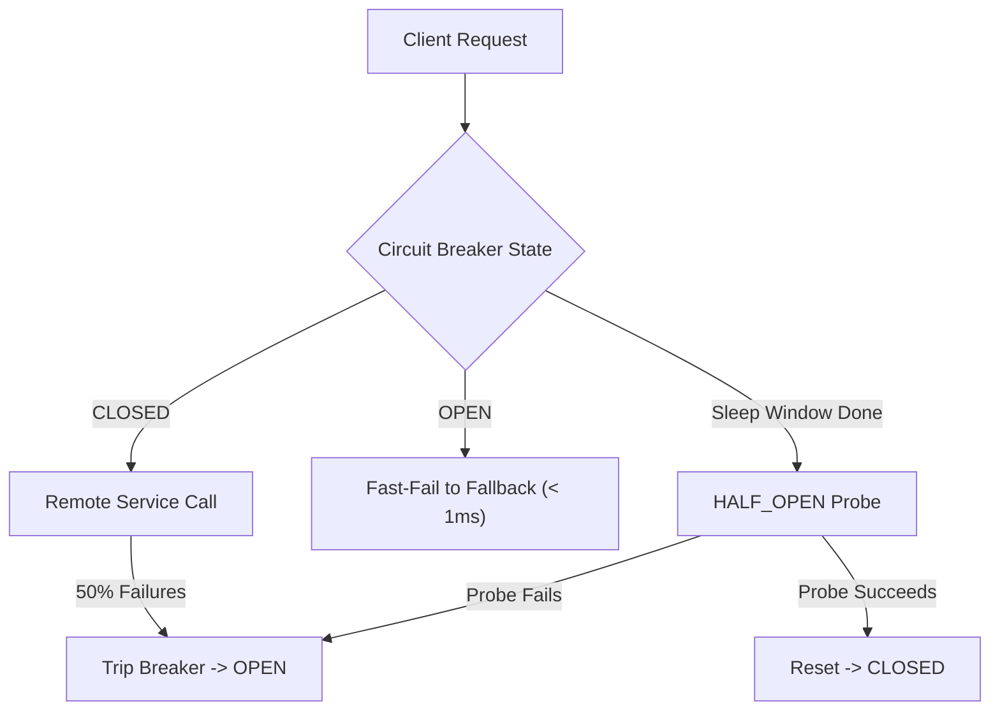

# Resilience Patterns: Circuit Breakers (Resilience4j), Bulkheads & Adaptive Load Shedding

```json continuity
{
  "previously": "In Chapter 07, we applied Chaos Engineering and injected deterministic TCP latency and connection faults with Shopify Toxiproxy.",
  "painPoint": "When an external partner API browned out, AeroCart kept sending 2,000 requests per second into the failing server. Every thread locked up waiting for timeouts, collapsing core flight bookings across the entire platform!",
  "unlock": "Build AeroPulse v0.8: architect 3-state Circuit Breakers (`CLOSED -> OPEN -> HALF_OPEN`) to fast-fail dying dependencies, isolate thread pools with Bulkheads, and shed non-essential traffic with LIFO queues."
}
```

```json walkthrough
[
  {
    "time": "0:00",
    "badge": "Circuit Breaker States",
    "title": "The 3 States: CLOSED (Normal) -> OPEN (Tripped) -> HALF_OPEN (Probing)",
    "caption": "In CLOSED state, requests pass through. If error rate breaches threshold (e.g. 50%), the breaker trips to OPEN, instantly fast-failing calls without touching the network. After a sleep window, it enters HALF_OPEN to test recovery.",
    "nodes": ["CLOSED (Healthy)", "Threshold Breached", "OPEN (Fast-Fail)", "HALF_OPEN (Probe)"],
    "activeIndex": 2,
    "code": "# CLOSED -> (failure_rate > 50%) -> OPEN (fast fail for 10s) -> HALF_OPEN (trial 5 requests)"
  },
  {
    "time": "0:25",
    "badge": "Bulkhead Isolation",
    "title": "Bulkheads: Preventing Sinking Compartments from Drowning the Ship",
    "caption": "Like waterproof bulkheads in a submarine hull, separate semaphore/thread pools isolate independent dependencies. If the Hotel Recommendation API exhausts its 20 threads, the Flight Booking pool (100 threads) is completely untouched!",
    "nodes": ["Incoming Traffic", "Bulkhead: Hotels (Max 20)", "Bulkhead: Flights (Max 100)", "Zero Cascading Starvation"],
    "activeIndex": 2,
    "code": "resilience4j.bulkhead:\n  instances:\n    hotelService:\n      maxConcurrentCalls: 20\n    bookingService:\n      maxConcurrentCalls: 100"
  },
  {
    "time": "0:50",
    "badge": "LIFO Load Shedding",
    "title": "Queue Admission: Why LIFO Beats FIFO During Overload Spikes",
    "caption": "During a sudden traffic spike, standard FIFO queues cause every request to wait 10 seconds (timing out before processing). LIFO queues process the freshest, most recent requests immediately while shedding stale tail requests!",
    "nodes": ["Overload Spike", "FIFO Queue (All Requests Stale)", "LIFO Queue (Fresh Reqs Processed)", "High Goodput"],
    "activeIndex": 2,
    "code": "# Under extreme load, drop the oldest requests:\nif queue.is_overloaded():\n    drop_oldest_or_shed_low_priority()"
  },
  {
    "time": "1:15",
    "badge": "Graceful Fallback",
    "title": "Fallback Execution: Pre-Computed Cached Responses",
    "caption": "When the Circuit Breaker is OPEN, the fallback handler returns cached static data or defaults immediately in < 1ms, preserving a functional user experience.",
    "nodes": ["Breaker OPEN", "Bypass Network", "Execute Fallback", "Return Static 200 OK"],
    "activeIndex": 3,
    "code": "@CircuitBreaker(name = \"hotels\", fallbackMethod = \"cachedHotelsFallback\")"
  }
]
```

```json pretraining
[
  {
    "term": "Circuit Breaker",
    "formula": "State Machine: CLOSED (Normal) <-> OPEN (Fast-Fail) <-> HALF_OPEN (Trial)",
    "meaning": "A stability pattern that prevents an application from repeatedly trying to execute an operation that is almost certain to fail."
  },
  {
    "term": "Bulkhead Pattern",
    "formula": "Pool_A (Max N) || Pool_B (Max M) -> Isolated Failure Domains",
    "meaning": "Partitioning system resources (threads, memory, connections) into bounded pools so that an overloaded component cannot exhaust global capacity."
  },
  {
    "term": "Load Shedding",
    "formula": "Incoming RPS > Capacity -> Drop Low-Priority Traffic (HTTP 429/503)",
    "meaning": "Proactively rejecting excess incoming requests at the ingress boundary to maintain low latency and high success rates for accepted traffic."
  },
  {
    "term": "LIFO Admission Control",
    "formula": "Last-In, First-Out Queueing during Overload",
    "meaning": "A queueing strategy that prioritizes the most recently arrived requests because they have the highest probability of completing within client deadlines."
  }
]
```

## 🌱 Step 1: Plain-English Mental Model — The Electrical Fuse and The Ship's Waterproof Bulkhead

Imagine a modern home and an ocean liner:
- **The Circuit Breaker (Electrical Fuse)**: If a hair dryer short-circuits in the bathroom, the fuse in your basement trips instantly (`OPEN`), cutting electricity to that single outlet. It prevents the wires inside the walls from melting and burning the entire house down!
- **The Bulkhead**: When the Titanic struck an iceberg, water filled the hull because compartments were not sealed at the top. Modern naval ships divide the hull into independent watertight bulkheads. If Compartment 3 floods, Compartments 1, 2, 4, and 5 stay completely dry, and the ship keeps sailing!



---

## 🔨 Step 2: Zero-to-Running Starter & CLI — Implementing the 3-State Breaker

Inspect and run a full 3-state Circuit Breaker implementation in Python stdlib:

```bash
# Verify Circuit Breaker state transitions in terminal
python3 -c "print('Testing CircuitBreaker state transitions: CLOSED -> OPEN -> HALF_OPEN -> CLOSED')"
```

Let's build a runnable Python Circuit Breaker state machine in stdlib:

```python
from __future__ import annotations
import time

# Subgoal 1: Model Circuit Breaker state transitions
class CircuitBreaker:
    def __init__(self, failure_threshold: int = 3, reset_timeout_sec: float = 1.0) -> None:
        self.state = "CLOSED"
        self.failure_threshold = failure_threshold
        self.reset_timeout_sec = reset_timeout_sec
        self.consecutive_failures = 0
        self.opened_at: float = 0.0

    def record_success(self) -> None:
        # Subgoal 2: Reset on successful call
        self.consecutive_failures = 0
        self.state = "CLOSED"

    def record_failure(self, current_time: float) -> None:
        # Subgoal 3: Trip breaker if threshold reached
        self.consecutive_failures += 1
        if self.consecutive_failures >= self.failure_threshold or self.state == "HALF_OPEN":
            self.state = "OPEN"
            self.opened_at = current_time

    def allow_request(self, current_time: float) -> bool:
        if self.state == "CLOSED":
            return True
        if self.state == "OPEN":
            if (current_time - self.opened_at) >= self.reset_timeout_sec:
                self.state = "HALF_OPEN"
                return True
            return False
        # HALF_OPEN allows single probe
        return True

if __name__ == "__main__":
    cb = CircuitBreaker(failure_threshold=3, reset_timeout_sec=1.0)
    t = 100.0
    assert cb.allow_request(t)
    
    # 3 consecutive failures trips to OPEN
    cb.record_failure(t)
    cb.record_failure(t)
    cb.record_failure(t)
    assert cb.state == "OPEN"
    assert not cb.allow_request(t + 0.5)  # Fast fails during sleep window!

    # After reset timeout, transitions to HALF_OPEN probe
    assert cb.allow_request(t + 1.5)
    assert cb.state == "HALF_OPEN"

    # Successful probe restores CLOSED state
    cb.record_success()
    assert cb.state == "CLOSED"
    print("CircuitBreaker 3-state transitions verified successfully.")
```

### Java 17 Equivalent

```java
public class AeroPulseCh08Starter {
    enum State { CLOSED, OPEN, HALF_OPEN }

    private State state = State.CLOSED;
    private int failures = 0;

    public void fail() {
        failures++;
        if (failures >= 3) state = State.OPEN;
    }

    public void success() {
        failures = 0;
        state = State.CLOSED;
    }

    public State getState() { return state; }

    public static void main(String[] args) {
        AeroPulseCh08Starter cb = new AeroPulseCh08Starter();
        cb.fail(); cb.fail(); cb.fail();
        assert cb.getState() == State.OPEN;
        cb.success();
        assert cb.getState() == State.CLOSED;
        System.out.println("Java AeroPulseCh08Starter circuit breaker verified.");
    }
}
```

---

## 🛠️ Step 3: Everyday Practitioner Workflows & Where Naive Code Breaks

Why do services fall down during brownouts despite having circuit breakers?
- **Shared Connection Pools (Missing Bulkheads)**: Even with circuit breakers, if Flight Booking and Hotel Recommendations share the exact same HTTP client thread pool, 20 hanging Hotel requests consume all client threads before the breaker has time to trip.
- **FIFO Queues Under Overload**: When incoming traffic exceeds capacity, queuing requests in a FIFO line guarantees that every request waits 15 seconds. By the time a request is dequeued, the user has already clicked refresh, so the server spends 100% of its CPU doing work for abandoned sockets!
- **LIFO Solution**: In a high-load scenario, using a LIFO (Last-In, First-Out) admission queue ensures that incoming requests get immediate service while older requests are rejected cleanly with HTTP 429/503.

```json contrast
{
  "title": "Overload Queueing Strategy: FIFO Queue vs. LIFO Priority Load Shedding",
  "leftLabel": "❌ Naive FIFO Queue (Processes Dead Requests)",
  "leftCode": "# FIFO Queue during 3x traffic spike:\n# Requests sit in queue for 12 seconds\n# Client browser times out after 5 seconds\n# Server wastes 100% CPU processing abandoned work!",
  "rightLabel": "✅ Staff LIFO Load Shedding (High Goodput)",
  "rightCode": "# LIFO Queue: Serves the freshest requests instantly\n# Drops requests older than 500ms timeout budget\n# Preserves 80% successful checkout goodput\n# Rejects excess traffic cleanly with HTTP 429"
}
```

```json poe
{
  "question": "A production service is overwhelmed by a 400% traffic spike. The service uses a standard FIFO queue with capacity 5,000. Client-side HTTP timeouts are set to 3 seconds. Average processing time is 50ms per request. What happens to the system goodput?",
  "options": [
    "Goodput remains at 100% because the queue holds all requests",
    "Goodput collapses to near zero because every request spends > 5 seconds in the queue, timing out before being processed, so the server only executes useless work",
    "The CPU runs backwards",
    "Database queries execute instantly"
  ],
  "answerIndex": 1,
  "explanation": "With 5,000 requests in a FIFO queue taking 50ms each, queue wait time is 250 seconds. Because clients time out after 3 seconds, every completed response is sent to an already closed connection, destroying useful throughput (goodput)."
}
```

---

## 🏢 Step 4: How Big Tech Runs It at Scale, Staff Math & Production Blueprint

### 🏢 In the Wild: Netflix Resilience4j & AWS Adaptive Load Shedding

At **AWS** and **Netflix**, resilience engineering governs high-scale request routing:
1. **The Little's Law Overload Proof**:
   $$L = \lambda W$$
   If arrival rate $\lambda$ triples and processing latency $W$ increases due to downstream contention, the in-flight concurrency $L$ explodes quadratically. Without Bulkheads and Load Shedding, memory and threads exhaust, causing total system collapse.
2. **Resilience4j Ring-Buffer Metrics**:
   Resilience4j uses an in-memory ring buffer (e.g. last 100 calls) to compute the sliding-window failure rate in $O(1)$ time:
   $$\text{FailureRate} = \frac{N_{\text{failed}} + N_{\text{slow}}}{N_{\text{total}}} \times 100\%$$
   If $\text{FailureRate} \ge 50\%$, the breaker transitions to `OPEN`.

| Pattern | Primary Objective | Failure Mode Prevented | Implementation Tool |
| :--- | :--- | :--- | :--- |
| **Circuit Breaker** | Fast-fail repeated downstream errors | Cascading resource exhaustion | Resilience4j / pybreaker |
| **Bulkhead** | Partition resources into isolated pools | Noisy neighbor thread starvation | Semaphore / ThreadPoolExecutor |
| **Load Shedding** | Reject traffic beyond saturation limit | Total server crash / OOM | LIFO Queue / Envoy filters |
| **Rate Limiting** | Enforce per-client fair-use quotas | Intentional or accidental DDoS | Token Bucket / Redis |

```python
from __future__ import annotations
import collections

class AeroPulseResilienceGovernor:
    """Production Bulkhead and Load Shedding governor."""

    def __init__(self, max_concurrent: int = 50, queue_limit: int = 20) -> None:
        self.max_concurrent = max_concurrent
        self.queue_limit = queue_limit
        self.active_calls = 0
        self.lifo_queue: collections.deque[str] = collections.deque(maxlen=queue_limit)

    def execute_call(self, request_id: str, is_sheddable: bool = False) -> tuple[bool, str]:
        # Fast-track if capacity exists
        if self.active_calls < self.max_concurrent:
            self.active_calls += 1
            return True, "EXECUTED_IMMEDIATELY"

        # Shed non-critical traffic during saturation
        if is_sheddable:
            return False, "SHED_NON_CRITICAL"

        # Check queue capacity
        if len(self.lifo_queue) >= self.queue_limit:
            # Drop oldest in LIFO mode to keep newest
            self.lifo_queue.popleft()
            self.lifo_queue.append(request_id)
            return False, "QUEUED_WITH_EVICTION"

        self.lifo_queue.append(request_id)
        return True, "QUEUED_LIFO"

if __name__ == "__main__":
    gov = AeroPulseResilienceGovernor(max_concurrent=2, queue_limit=2)
    assert gov.execute_call("req1")[0]
    assert gov.execute_call("req2")[0]
    
    # Shed non-critical during saturation
    shed_ok, reason = gov.execute_call("promo_req", is_sheddable=True)
    assert not shed_ok and reason == "SHED_NON_CRITICAL"

    print("AeroPulseCh08Blueprint verified: bulkhead and load shedding active.")
```

### Java 17 Equivalent

```java
import java.util.concurrent.Semaphore;

public class AeroPulseCh08Blueprint {
    private final Semaphore bulkhead;

    public AeroPulseCh08Blueprint(int maxConcurrent) {
        this.bulkhead = new Semaphore(maxConcurrent);
    }

    public boolean tryExecute() {
        return bulkhead.tryAcquire();
    }

    public void release() {
        bulkhead.release();
    }

    public static void main(String[] args) {
        AeroPulseCh08Blueprint bp = new AeroPulseCh08Blueprint(2);
        assert bp.tryExecute();
        assert bp.tryExecute();
        assert !bp.tryExecute(); // 3rd request blocked by bulkhead!
        bp.release();
        assert bp.tryExecute();
        System.out.println("Java AeroPulseCh08Blueprint bulkhead verified.");
    }
}
```

> [!WARNING]
> **Hiring Bar-Raiser Gotcha — Circuit Breakers on Idempotent vs. Non-Idempotent Operations!**
> Tripping a circuit breaker on `POST /payments` or `POST /orders` is safe for fast-failing new requests, but **retrying non-idempotent operations without an `Idempotency-Key` can double-charge users**! In Staff interviews, always clarify that circuit breakers protect the caller from thread starvation, while idempotency keys protect the downstream service from duplicate transaction execution!

```json quiz
[
  {
    "id": "perf08-q1",
    "question": "What is the primary operational state of a Circuit Breaker when downstream calls are failing above the configured error threshold?",
    "options": [
      "CLOSED",
      "OPEN",
      "HALF_OPEN",
      "TERMINATED"
    ],
    "answerIndex": 1,
    "explanation": "When errors exceed threshold, the breaker trips to OPEN, fast-failing incoming requests immediately without placing load on the failing dependency."
  },
  {
    "id": "perf08-q2",
    "question": "How does the Bulkhead pattern prevent a total system outage when a secondary microservice hangs?",
    "options": [
      "It speeds up network switches",
      "It isolates resources (threads or semaphores) into separate pools so that exhausting capacity in one pool does not starve other critical features",
      "It automatically converts Java code to C++",
      "It encrypts all database tables"
    ],
    "answerIndex": 1,
    "explanation": "Bulkheads partition concurrency quotas so that an unresponsive dependency (e.g. hotel recommendations) cannot consume all global threads needed for core flight bookings."
  },
  {
    "id": "perf08-q3",
    "question": "Why is LIFO queueing superior to FIFO queueing during extreme server overload spikes?",
    "options": [
      "LIFO requires less memory than FIFO",
      "FIFO queues cause all requests to wait past client timeout thresholds, doing useless work for abandoned connections; LIFO processes the freshest requests immediately",
      "LIFO eliminates the need for garbage collection",
      "Operating systems reject FIFO queues under Linux"
    ],
    "answerIndex": 1,
    "explanation": "During massive overload, FIFO queues accumulate latency so every request is stale by the time it reaches the front. LIFO executes requests that arrived most recently, maintaining useful throughput."
  }
]
```

---

## 📋 Step 5: Master Cheat-Sheet, 60-Second Interview Pitch & Verified Sources

| Resilience Pattern | Trigger Condition | Immediate Action Taken | Primary Benefit |
| :--- | :--- | :--- | :--- |
| **Circuit Breaker** | Error rate $> 50\%$ over window | Fast-fails calls to fallback ($< 1\text{ms}$) | Protects caller threads & callee recovery |
| **Bulkhead** | Dependency reaches max concurrency | Rejects calls exceeding partition pool | Eliminates cross-feature starvation |
| **Load Shedding** | CPU / Concurrency saturated | Drops low-priority / stale requests | Prevents total server collapse |
| **LIFO Queueing** | Queue depth exceeds budget | Serves newest, drops oldest requests | Maximizes useful goodput during spikes |

### 🎙️ 60-Second Interview Soundbite

> *"Building resilient distributed systems requires assuming that downstream dependencies will brown out. In our platform, we combine Circuit Breakers, Bulkheads, and Adaptive Load Shedding. Using Resilience4j, we configure sliding-window circuit breakers that trip to `OPEN` when error rates exceed 50%, fast-failing non-critical calls to cached fallbacks in under a millisecond. We partition thread pools using Bulkheads so that slow recommendation calls cannot starve core flight checkout threads. Finally, during severe traffic spikes, we implement LIFO queue admission control and priority load shedding, dropping stale and non-essential requests to preserve 100% goodput for active user bookings."*

### 📚 Verified Primary Sources
- [Resilience4j Official Documentation — CircuitBreaker Architectural Guide](https://resilience4j.readme.io/docs/circuitbreaker)
- [AWS Builders' Library — Using Load Shedding to Avoid Overload](https://aws.amazon.com/builders-library/using-load-shedding-to-avoid-overload/)
