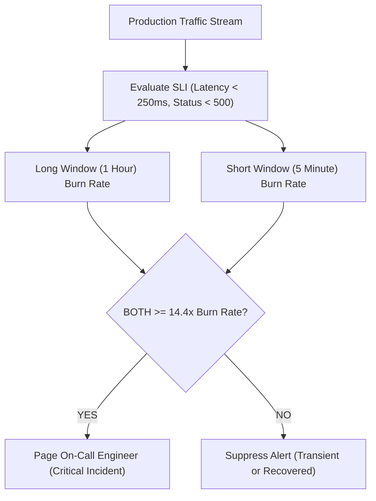

# SLIs, SLOs & Error Budgets: Google SRE Multi-Window Multi-Burn-Rate Alerting

```json continuity
{
  "previously": "In Chapter 08, we configured Circuit Breakers, Bulkheads, and adaptive LIFO load shedding to contain downstream brownouts.",
  "painPoint": "On-call engineers were drowning in alert noise: a 5-minute error rate alert paged at 3:00 AM because a single automated test ran on empty staging, while a slow 1% error burn quietly consumed 50% of the monthly error budget undetected!",
  "unlock": "Master AeroPulse v0.9: define user-centric SLIs, SLO targets (99.9% = 43.2m/30d budget), and contractual SLAs, and implement Google SRE multi-window multi-burn-rate alerting (14.4x page, 6x ticket) with immediate reset."
}
```

```json walkthrough
[
  {
    "time": "0:00",
    "badge": "SLI vs SLO vs SLA",
    "title": "The Reliability Triad: SLI (Indicator) -> SLO (Objective) -> SLA (Agreement)",
    "caption": "An SLI is a measurable metric (e.g. % of HTTP requests faster than 250ms). An SLO is an internal target (e.g. 99.9% of requests over 30 days). An SLA is a business contract with financial penalties.",
    "nodes": ["SLI (What we measure)", "SLO (Internal Target: 99.9%)", "Error Budget (0.1% = 43.2m)", "SLA (Contract & Penalties)"],
    "activeIndex": 1,
    "code": "# SLI: good_events / valid_events\n# SLO: SLI >= 99.9% across rolling 30-day window\n# Error Budget: 100% - 99.9% = 0.1% (43.2 minutes of total downtime/month)"
  },
  {
    "time": "0:25",
    "badge": "Error Budget Burn Rate",
    "title": "Burn Rate Math: How Fast Is the Budget Consumed?",
    "caption": "A 1x burn rate consumes 100% of the error budget over exactly 30 days. A 14.4x burn rate consumes 2% of the entire monthly budget in just 1 hour! High burn rates require immediate human waking pages.",
    "nodes": ["30-Day Budget (100%)", "1x Burn (Steady 30 Days)", "14.4x Burn (Consumes 2% in 1h)", "Immediate Page!"],
    "activeIndex": 2,
    "code": "burn_rate = (error_rate_window) / (1.0 - SLO_target)\n# If 99.9% SLO: error_rate = 1.44% -> Burn Rate = 0.0144 / 0.001 = 14.4x!"
  },
  {
    "time": "0:50",
    "badge": "Multi-Window Alerting",
    "title": "Why Single Windows Fail: Multi-Window Alerting (1h + 5m)",
    "caption": "Alerting on a 1-hour window takes 55 minutes to stop ringing after an outage is fixed. Alerting on a 5-minute window causes false pages on transient blips. Google SRE requires BOTH a 1-hour and a 5-minute window to burn at 14.4x!",
    "nodes": ["1h Window >= 14.4x", "AND", "5m Window >= 14.4x", "Accurate Page & Fast Reset"],
    "activeIndex": 2,
    "code": "# Alert condition in Prometheus PromQL:\nexpr: (burn_rate_1h >= 14.4) and (burn_rate_5m >= 14.4)"
  },
  {
    "time": "1:15",
    "badge": "Budget Policies",
    "title": "Error Budget Policy: Feature Freezes When Budget is Spent",
    "caption": "When the rolling 30-day error budget reaches 0%, product teams halt feature launches and dedicate 100% of sprint capacity to reliability, refactoring, and test automation until the budget recovers.",
    "nodes": ["Budget Depleted (0%)", "Feature Release Freeze", "Refactoring & Reliability", "Budget Restored -> Resume"],
    "activeIndex": 1,
    "code": "# Engineering agreement:\nif error_budget_remaining <= 0:\n    halt_feature_deployments_and_focus_on_reliability()"
  }
]
```

```json pretraining
[
  {
    "term": "Service Level Indicator (SLI)",
    "formula": "SLI = (Good Events / Total Valid Events) * 100%",
    "meaning": "A carefully defined quantifiable metric indicating how well a service is performing from the perspective of its users."
  },
  {
    "term": "Service Level Objective (SLO)",
    "formula": "Target = 99.9% over rolling 30-day window",
    "meaning": "An internal target reliability goal agreed upon between engineering and product management."
  },
  {
    "term": "Error Budget",
    "formula": "Error Budget = 100% - SLO Target (e.g. 0.1% = 43.2 min/30d)",
    "meaning": "The allowable room for unreliability and scheduled downtime that product teams can spend on risky new features and deployments."
  },
  {
    "term": "Burn Rate",
    "formula": "Burn Rate = Current Error Rate / Allowed Error Budget",
    "meaning": "The speed at which an outage or degradation is consuming the service's error budget relative to a steady 30-day allocation."
  }
]
```

## 🌱 Step 1: Plain-English Mental Model — The Fuel Tank and The Speedometer

Imagine driving an airplane across the ocean.
- **The Fuel Tank (Error Budget)**: You start the month with exactly 100 gallons of emergency reserve fuel (`0.1% = 43.2 minutes of allowed downtime`).
- **Normal Consumption (1x Burn Rate)**: You consume fuel at a rate that empties the tank on day 30. That is safe.
- **Critical Leak (14.4x Burn Rate)**: A fuel line cracks. The needle drops so fast that 2 full days of fuel vanish in 60 minutes! You don't wait 10 hours to see what happens; you sound the cockpit alarm immediately (`pager duty`)!
- **Multi-Window Alerting**: Checking both the speedometer and the fuel gauge prevents panic when the plane hits one brief air bump, while catching real fuel line ruptures instantly.



---

## 🔨 Step 2: Zero-to-Running Starter & CLI — Computing Burn Rates

Inspect and calculate error budgets and burn rates from your terminal:

```bash
# Calculate 30-day 99.9% error budget in minutes
python3 -c "print(f'30-day 99.9% error budget: {30 * 24 * 60 * 0.001:.1f} minutes')"
```

Let's build a Python multi-window burn rate evaluator in stdlib:

```python
from __future__ import annotations

# Subgoal 1: Model error budget and burn rate calculations
def calculate_burn_rate(error_rate: float, slo_target: float = 0.999) -> float:
    error_budget = 1.0 - slo_target
    if error_budget <= 0:
        return 0.0
    return error_rate / error_budget

# Subgoal 2: Multi-window alerting gate matching Google SRE Workbook
def evaluate_google_sre_alerts(
    slo_target: float,
    err_rate_1h: float,
    err_rate_5m: float,
    err_rate_6h: float,
    err_rate_30m: float,
) -> str:
    # Page condition: 2% budget consumed in 1 hour (14.4x burn rate)
    burn_1h = calculate_burn_rate(err_rate_1h, slo_target)
    burn_5m = calculate_burn_rate(err_rate_5m, slo_target)
    if burn_1h >= 14.4 and burn_5m >= 14.4:
        return "PAGE_IMMEDIATE_P1"

    # Ticket condition: 5% budget consumed in 6 hours (6.0x burn rate)
    burn_6h = calculate_burn_rate(err_rate_6h, slo_target)
    burn_30m = calculate_burn_rate(err_rate_30m, slo_target)
    if burn_6h >= 6.0 and burn_30m >= 6.0:
        return "TICKET_BUSINESS_HOURS"

    return "BUDGET_HEALTHY"

if __name__ == "__main__":
    # Test 1: 99.9% SLO -> 0.001 budget. 1.44% error rate = exactly 14.4x burn!
    rate = calculate_burn_rate(0.0144, 0.999)
    assert round(rate, 1) == 14.4

    # Test 2: High burn across both windows triggers P1 page
    alert1 = evaluate_google_sre_alerts(0.999, err_rate_1h=0.015, err_rate_5m=0.015, err_rate_6h=0.001, err_rate_30m=0.001)
    assert alert1 == "PAGE_IMMEDIATE_P1"

    # Test 3: Fast recovery (5m window drops to 0) clears alert immediately!
    alert2 = evaluate_google_sre_alerts(0.999, err_rate_1h=0.015, err_rate_5m=0.000, err_rate_6h=0.001, err_rate_30m=0.000)
    assert alert2 == "BUDGET_HEALTHY"
    print("Google SRE multi-window alerting verified successfully.")
```

### Java 17 Equivalent

```java
public class AeroPulseCh09Starter {
    public static double burnRate(double errorRate, double slo) {
        return errorRate / (1.0 - slo);
    }

    public static String evaluate(double slo, double err1h, double err5m) {
        double b1h = burnRate(err1h, slo);
        double b5m = burnRate(err5m, slo);
        if (b1h >= 14.4 && b5m >= 14.4) return "PAGE";
        return "OK";
    }

    public static void main(String[] args) {
        String res = evaluate(0.999, 0.015, 0.015);
        assert "PAGE".equals(res);
        System.out.println("Java AeroPulseCh09Starter alert: " + res);
    }
}
```

---

## 🛠️ Step 3: Everyday Practitioner Workflows & Where Naive Code Breaks

Why do standard APM alert rules fail so miserably in production?
- **Alerting on Raw Error Count**: Alerting on "more than 10 errors" triggers pages on high-traffic days while missing catastrophic 100% failure rates on low-traffic microservices.
- **Single-Window Long Latency Alerts**: Using a 1-hour window means when an incident ends at 3:05 PM, the alert continues firing until 4:00 PM, creating confusion and alert fatigue.
- **Short 1-Minute Alerts (Noise Flapping)**: Alerting on a single 1-minute window triggers pages for transient network glitches that self-heal in 10 seconds.

```json contrast
{
  "title": "Production Alerting: Naive Thresholds vs. Google SRE Multi-Window Multi-Burn-Rate",
  "leftLabel": "❌ Naive Single-Window Alert (Noisy / Stale)",
  "leftCode": "# PromQL Anti-Pattern:\n# Triggers on temporary traffic dip or keeps paging for 55m after fix!\nalert: HighErrorRate\nexpr: rate(http_requests_total{status=~'5..'}[5m]) > 0.01",
  "rightLabel": "✅ Staff Google SRE Multi-Window (Precision Paging)",
  "rightCode": "# PromQL Google SRE Multi-Burn Rate:\n# Both 1h AND 5m windows must breach 14.4x burn rate\nexpr: (burn_rate_1h >= 14.4) and (burn_rate_5m >= 14.4)\n# Pages instantly on critical burn; resets in < 5m upon fix!"
}
```

```json poe
{
  "question": "A service with an SLO of 99.9% experiences an outage causing a 100% error rate for exactly 3 minutes, consuming 7% of its monthly error budget. If alerting is configured with Google SRE multi-window rules (1h + 5m @ 14.4x), what happens?",
  "options": [
    "The on-call engineer is paged because both the 1h and 5m windows exceed the 14.4x burn rate threshold during the outage",
    "No alert fires because outages under 10 minutes are ignored",
    "The service automatically rolls back to version 0",
    "Prometheus deletes its database"
  ],
  "answerIndex": 0,
  "explanation": "A 100% error rate is a 1,000x burn rate! Both the 5-minute and 1-hour windows easily breach the 14.4x threshold, paging the engineer within minutes to contain the blast radius."
}
```

---

## 🏢 Step 4: How Big Tech Runs It at Scale, Staff Math & Production Blueprint

### 🏢 In the Wild: Google SRE Multi-Window Alerting Table

At **Google**, alerting on SLO error budgets is codified across four severity tiers in the *Google SRE Workbook*:
1. **The Multi-Burn Table**:
   - **Critical Page (2% budget in 1h)**: Long window = 1 hour, Short window = 5 minutes, Burn Rate = $14.4\times$.
   - **High Page (5% budget in 6h)**: Long window = 6 hours, Short window = 30 minutes, Burn Rate = $6.0\times$.
   - **Medium Ticket (10% budget in 3d)**: Long window = 3 days, Short window = 6 hours, Burn Rate = $1.0\times$.
2. **Error Budget Consumption Rate**:
   $$\% \text{ Budget Consumed} = \frac{\text{Burn Rate} \times \text{Window Duration (hours)}}{30 \text{ days} \times 24 \text{ hours}} \times 100\%$$
   $$\text{For } 14.4\times \text{ over } 1 \text{ hour}: \quad \frac{14.4 \times 1}{720} \times 100\% = 2.0\%$$

| Severity Tier | Budget Consumed | Long Window | Short Window | Burn Rate | Action Taken |
| :--- | :--- | :--- | :--- | :--- | :--- |
| **Critical P1** | $2\%$ in $1\text{ hour}$ | $1\text{ hour}$ | $5\text{ minutes}$ | **$14.4\times$** | Page on-call immediately |
| **High P2** | $5\%$ in $6\text{ hours}$ | $6\text{ hours}$ | $30\text{ minutes}$ | **$6.0\times$** | Page on-call immediately |
| **Ticket P3** | $10\%$ in $3\text{ days}$ | $3\text{ days}$ | $6\text{ hours}$ | **$1.0\times$** | File ticket for next business day |
| **Ticket P4** | $2\%$ in $24\text{ hours}$ | $24\text{ hours}$ | $2\text{ hours}$ | **$0.6\times$** | File low-priority tech-debt ticket |

```python
from __future__ import annotations

class AeroPulseSREAlertEngine:
    """Production SRE multi-window multi-burn-rate evaluator."""

    def __init__(self, slo_target: float = 0.999) -> None:
        self.slo_target = slo_target
        self.budget = 1.0 - slo_target

    def evaluate_windows(
        self,
        err_1h: float,
        err_5m: float,
        err_6h: float,
        err_30m: float,
    ) -> dict[str, object]:
        burn_1h = err_1h / self.budget
        burn_5m = err_5m / self.budget
        burn_6h = err_6h / self.budget
        burn_30m = err_30m / self.budget

        is_critical_page = (burn_1h >= 14.4) and (burn_5m >= 14.4)
        is_ticket = (burn_6h >= 6.0) and (burn_30m >= 6.0)

        action = "NONE"
        if is_critical_page:
            action = "PAGE_P1"
        elif is_ticket:
            action = "TICKET_P2"

        return {
            "burn_1h": round(burn_1h, 1),
            "burn_5m": round(burn_5m, 1),
            "action": action,
            "page_triggered": is_critical_page,
        }

if __name__ == "__main__":
    engine = AeroPulseSREAlertEngine(slo_target=0.999)
    # Severe incident: 2% error rate
    res1 = engine.evaluate_windows(err_1h=0.02, err_5m=0.02, err_6h=0.005, err_30m=0.005)
    assert res1["action"] == "PAGE_P1"
    assert res1["page_triggered"]

    # Post-fix recovery: 5m window drops to 0, clearing page!
    res2 = engine.evaluate_windows(err_1h=0.02, err_5m=0.00, err_6h=0.005, err_30m=0.000)
    assert not res2["page_triggered"]
    print("AeroPulseCh09Blueprint verified: multi-window burn rate alert engine passed.")
```

### Java 17 Equivalent

```java
public class AeroPulseCh09Blueprint {
    public static boolean shouldPage(double slo, double err1h, double err5m) {
        double budget = 1.0 - slo;
        return (err1h / budget >= 14.4) && (err5m / budget >= 14.4);
    }

    public static void main(String[] args) {
        boolean page = shouldPage(0.999, 0.02, 0.02);
        boolean heal = shouldPage(0.999, 0.02, 0.00);
        assert page && !heal;
        System.out.println("Java AeroPulseCh09Blueprint verified.");
    }
}
```

> [!WARNING]
> **Hiring Bar-Raiser Gotcha — Alerting on Latency Averages Destroys SLO Reliability!**
> Never compute an SLI using arithmetic mean latency (`avg(response_time) < 200ms`)! If 99 requests take 1ms and 1 request hangs for 10 seconds, average latency is 100ms (falsely passing), but 1% of your customers suffered an unrecoverable timeout! Senior SREs mandate percentile counting: `sum(rate(http_duration_bucket{le="250"}[5m])) / sum(rate(http_duration_count[5m])) >= 0.999`!

```json quiz
[
  {
    "id": "perf09-q1",
    "question": "What is the difference between an SLO (Service Level Objective) and an SLA (Service Level Agreement)?",
    "options": [
      "SLOs are written in Python while SLAs are written in SQL",
      "An SLO is an internal target metric guiding engineering reliability; an SLA is an external legal contract with financial or business penalties",
      "SLAs are only for hardware",
      "They are identical terms with no distinction"
    ],
    "answerIndex": 1,
    "explanation": "SLOs are internal engineering goals that guide alerting and feature velocity. SLAs are formal contractual commitments made to customers with financial consequences if breached."
  },
  {
    "id": "perf09-q2",
    "question": "Why does Google SRE multi-window alerting evaluate both a long window (1h) and a short window (5m)?",
    "options": [
      "Because Prometheus cannot calculate 1-hour metrics alone",
      "To ensure alerts trigger fast on critical burns (short window) while resetting immediately after an outage is resolved (preventing 55 minutes of stale paging)",
      "To double the number of alerts sent to Slack",
      "To avoid paying for AWS CloudWatch"
    ],
    "answerIndex": 1,
    "explanation": "A long window alone keeps paging long after an issue is fixed. Requiring both windows ensures rapid alerting and near-instant recovery detection."
  },
  {
    "id": "perf09-q3",
    "question": "If a service has a 99.9% 30-day availability SLO, what does a 14.4x burn rate mean?",
    "options": [
      "The server is running 14.4 times faster than normal",
      "The service is consuming 2% of its entire 30-day error budget in just 1 hour, requiring an immediate critical page",
      "CPU utilization is 14.4%",
      "14.4 servers have crashed"
    ],
    "answerIndex": 1,
    "explanation": "At 14.4x burn rate, the allowed monthly unreliability is being consumed 14.4 times faster than steady state, consuming 2% of the monthly budget in 1 hour."
  }
]
```

---

## 📋 Step 5: Master Cheat-Sheet, 60-Second Interview Pitch & Verified Sources

| Metric / Term | Mathematical Formula | Purpose in Quality Architecture |
| :--- | :--- | :--- |
| **SLI** | $\frac{\text{Good Requests}}{\text{Total Requests}}$ | Quantifies actual user experience |
| **SLO** | $\text{SLI} \ge 99.9\%$ over 30 days | Establishes the boundary for feature vs reliability work |
| **Error Budget** | $1.0 - \text{SLO} = 0.1\%$ ($43.2\text{m}$) | Bounded currency for deployments and experiments |
| **Burn Rate** | $\frac{\text{Current Error Rate}}{1.0 - \text{SLO}}$ | Gauges speed of budget consumption |
| **Multi-Window Gate** | `1h @ 14.4x` AND `5m @ 14.4x` | High-precision alerting with instant auto-heal |

### 🎙️ 60-Second Interview Soundbite

> *"Alerting on raw error counts or static CPU thresholds produces unmanageable alert fatigue. In our platform, we adopted the Google SRE multi-window multi-burn-rate alerting framework. For our core flight booking engine, we defined an SLI of successful requests under 250ms with a 99.9% rolling 30-day SLO, which gives us an error budget of 43.2 minutes per month. We configure Prometheus alerts based on burn rates: if a service experiences a 14.4x burn rate across both a 1-hour and a 5-minute window, it indicates that 2% of our monthly budget will vanish in one hour, immediately paging the on-call engineer. Once the fix is deployed, the 5-minute window drops below threshold, instantly resetting the alarm without lingering false pages."*

### 📚 Verified Primary Sources
- [Google SRE Workbook — Alerting on SLOs and Multi-Window Multi-Burn-Rate Rules](https://sre.google/workbook/alerting-on-slos/)
- [Google SRE Book — Service Level Objectives (SLIs, SLOs, and SLAs)](https://sre.google/sre-book/service-level-objectives/)
