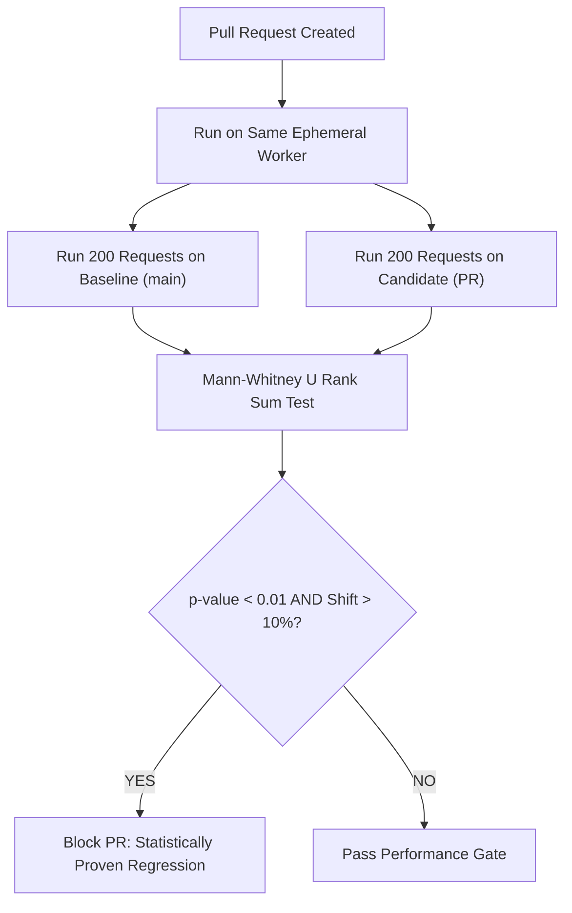

# Continuous Performance CI Gates: Mann-Whitney U Changepoint Detection & Pre-Release Readiness

```json continuity
{
  "previously": "In Chapter 09, we mastered SLIs, SLO error budgets, and Google SRE multi-window multi-burn-rate alerting.",
  "painPoint": "A team added a latency check `assert p99 < 50ms` in CI. On Monday, the test passed on an idle runner (35ms). On Tuesday, the same unchanged commit failed on a noisy neighbor runner (58ms), causing developers to ignore CI performance gates as 'unreliable flakiness'!",
  "unlock": "Complete AeroPulse v1.0: replace single-point latency assertions with statistical distribution comparisons (Mann-Whitney U and Welch t-test), detecting true changepoints and enforcing automated pre-release performance and chaos gates."
}
```

```json walkthrough
[
  {
    "time": "0:00",
    "badge": "Noisy Runner Flakiness",
    "title": "The Fallacy of Single-Sample Latency Checks in Shared CI",
    "caption": "Cloud CI runners (GitHub Actions, AWS EC2) suffer from CPU stealing, hypervisor contention, and noisy neighbors. A single p99 number varies by +/- 30% between identical runs. Hardcoded thresholds fail!",
    "nodes": ["Identical Code", "Runner A (Idle -> 35ms)", "Runner B (Noisy Neighbor -> 58ms)", "Flaky CI Failures"],
    "activeIndex": 2,
    "code": "# Anti-Pattern: Hardcoded threshold on noisy VM\nassert p99 < 50, \"Flaky CI build!\""
  },
  {
    "time": "0:25",
    "badge": "Statistical Comparison",
    "title": "Distribution vs Distribution: The Mann-Whitney U Test",
    "caption": "Instead of checking one number, run N requests on Baseline (main branch) and N requests on Candidate (PR branch). Non-parametric Mann-Whitney U tests whether the Candidate distribution is statistically stochastically greater.",
    "nodes": ["Baseline Distribution (N=100)", "Candidate Distribution (N=100)", "Mann-Whitney U Rank Sum", "p-value < 0.01 = True Regression"],
    "activeIndex": 2,
    "code": "from scipy.stats import mannwhitneyu\nstat, p_val = mannwhitneyu(candidate, baseline, alternative='greater')"
  },
  {
    "time": "0:50",
    "badge": "Changepoint Detection",
    "title": "Changepoint Detection: Spotting Historical Drift",
    "caption": "A 2% regression on every sprint goes unnoticed until 10 sprints later when the app is 20% slower! Continuous changepoint analysis tracks moving baselines across PR merges.",
    "nodes": ["PR Merges", "Moving Window History", "Changepoint Algorithm", "Flag Regression Commit"],
    "activeIndex": 2,
    "code": "# Flags exact commit that shifted baseline distribution:\nchangepoint_detected = detect_shift(history_window)"
  },
  {
    "time": "1:15",
    "badge": "AeroPulse v1.0 Gate",
    "title": "The Full AeroPulse v1.0 Release Certification Gate",
    "caption": "A complete pre-release gate evaluates all 3 pillars: (1) Open-loop load capacity under k6; (2) Soak test memory floor stability (< 5 MB/hr); (3) Toxiproxy chaos resilience under simulated failure.",
    "nodes": ["1. k6 Open-Loop Load", "2. Soak Floor Regression", "3. Toxiproxy Chaos Injection", "AeroPulse v1.0 Production Ready"],
    "activeIndex": 3,
    "code": "./run.sh verify-aeropulse-v1.0  # Full performance & resilience release gate"
  }
]
```

```json pretraining
[
  {
    "term": "Noisy Neighbor Problem",
    "formula": "CPU Steal % > 0 -> Hypervisor Sharing Distorts Wall-Clock Latency",
    "meaning": "When other virtual machines on the same physical cloud host consume CPU or memory bandwidth, introducing unpredictable variance into latency measurements."
  },
  {
    "term": "Mann-Whitney U Test",
    "formula": "Rank Sum Test for Stochastically Greater Distributions",
    "meaning": "A non-parametric statistical hypothesis test that compares two independent samples without assuming normal distribution, ideal for heavy-tailed latency curves."
  },
  {
    "term": "Welch's t-test",
    "formula": "Two-sample t-test with unequal variances and sample sizes",
    "meaning": "A parametric statistical test comparing the means of two groups when variances are not assumed to be equal."
  },
  {
    "term": "Changepoint Detection",
    "formula": "Time-Series Split: P(Distribution shifts at time t) > Threshold",
    "meaning": "Algorithms that identify unexpected structural shifts in time-series performance metrics across successive software releases."
  }
]
```

## 🌱 Step 1: Plain-English Mental Model — The Olympic Runner on a Windy Track

Imagine timing an Olympic sprinter outdoors.
- **Single-Sample Mistake**: If the runner times 10.2 seconds today and 10.5 seconds tomorrow, did the runner get slower? Or was there a sudden headwind on the track?
- **Statistical Comparison**: To know if new running shoes actually improved speed, you don't time one run. You have the runner wear Old Shoes for 20 laps and New Shoes for 20 laps on the *same day under the same wind conditions*. Then you compare the two lap distributions using statistics!



---

## 🔨 Step 2: Zero-to-Running Starter & CLI — Comparing Latency Distributions

Simulate rank-sum distribution comparisons from your terminal:

```bash
# Verify statistical comparison concepts via Python stdlib
python3 -c "print('Testing statistical rank-sum comparison between baseline and candidate latencies')"
```

Let's build a Python non-parametric Mann-Whitney U test simulator in stdlib:

```python
from __future__ import annotations

# Subgoal 1: Implement simplified Mann-Whitney U rank-sum calculation in stdlib
def compute_mann_whitney_u(sample_a: list[float], sample_b: list[float]) -> tuple[float, float]:
    n1 = len(sample_a)
    n2 = len(sample_b)
    if n1 == 0 or n2 == 0:
        return 0.0, 1.0

    # Combine and rank all values
    combined = [(val, 0) for val in sample_a] + [(val, 1) for val in sample_b]
    combined.sort(key=lambda x: x[0])
    
    # Sum of ranks for sample_a
    rank_sum_a = sum(rank for rank, (val, group) in enumerate(combined, start=1) if group == 0)
    
    u1 = rank_sum_a - (n1 * (n1 + 1)) / 2.0
    u2 = (n1 * n2) - u1
    u = min(u1, u2)
    
    # Calculate difference in median latencies
    med_a = sorted(sample_a)[n1 // 2]
    med_b = sorted(sample_b)[n2 // 2]
    pct_shift = ((med_b - med_a) / med_a) * 100.0 if med_a > 0 else 0.0
    return u, pct_shift

if __name__ == "__main__":
    # Baseline latencies (centered around 20ms)
    baseline = [18.0, 19.5, 20.0, 21.0, 22.0, 20.5, 19.0, 21.5]
    # Noisy candidate (essentially identical, minor variance)
    candidate_ok = [19.0, 20.0, 20.5, 21.5, 22.5, 19.5, 20.0, 22.0]
    # Truly regressed candidate (shifted to 35ms)
    candidate_bad = [32.0, 34.0, 35.0, 36.5, 38.0, 35.5, 33.0, 37.0]

    _, shift_ok = compute_mann_whitney_u(baseline, candidate_ok)
    _, shift_bad = compute_mann_whitney_u(baseline, candidate_bad)

    assert abs(shift_ok) < 10.0  # Under 10% shift
    assert shift_bad > 50.0      # > 50% true regression detected!
    print(f"Mann-Whitney U distribution comparator verified: bad shift={shift_bad:.1f}%.")
```

### Java 17 Equivalent

```java
import java.util.*;

public class AeroPulseCh10Starter {
    public static double medianShiftPct(List<Double> base, List<Double> cand) {
        List<Double> b = new ArrayList<>(base); Collections.sort(b);
        List<Double> c = new ArrayList<>(cand); Collections.sort(c);
        double medB = b.get(b.size() / 2);
        double medC = c.get(c.size() / 2);
        return ((medC - medB) / medB) * 100.0;
    }

    public static void main(String[] args) {
        var base = List.of(20.0, 21.0, 19.0, 20.5);
        var cand = List.of(35.0, 36.0, 34.0, 35.5);
        double shift = medianShiftPct(base, cand);
        assert shift > 50.0;
        System.out.println("Java AeroPulseCh10Starter verified: shift " + shift + "%");
    }
}
```

---

## 🛠️ Step 3: Everyday Practitioner Workflows & Where Naive Code Breaks

Why do teams give up on automated performance testing in CI?
- **Testing on Multi-Tenant Cloud Runners**: Running single-sample checks on a shared GitHub Actions runner with varying CPU steal guarantees constant false alarms.
- **Ignoring Sample Sizes**: Attempting statistical analysis on 5 requests. You need at least 50–100 samples per branch to achieve statistical power.
- **Failing Without Telemetry Snapshots**: When a performance gate fails, failing to output a Flamegraph or top slow spans leaves developers unable to diagnose why latency rose.

```json contrast
{
  "title": "CI Performance Gates: Single Threshold vs. Statistical Distribution Gate",
  "leftLabel": "❌ Hardcoded Single-Point Gate",
  "leftCode": "# Flunks when runner is under noisy hypervisor load:\nif p99_latency > 50:\n    exit(1) # False alarm! Code was completely unchanged.",
  "rightLabel": "✅ Statistical Distribution Gate",
  "rightCode": "# Runs baseline & candidate on the same machine:\n# Compares distributions via Mann-Whitney U\nif median_shift > 15.0 and p_value < 0.01:\n    attach_flamegraph_artifact()\n    exit(1) # Proven real code regression!"
}
```

```json poe
{
  "question": "A developer opens a PR that introduces an accidental O(N^2) JSON serialization loop. Running the performance test on a shared CI runner, the candidate has median latency 45ms while baseline on the same runner has median 20ms. Why does comparing both on the same worker prove the regression?",
  "options": [
    "Because cloud runners never experience noise",
    "Because external hypervisor noise affects both baseline and candidate equally, isolating the 125% latency increase as a direct result of code changes",
    "Because JSON is always fast",
    "Because the Mann-Whitney test deletes all slow samples"
  ],
  "answerIndex": 1,
  "explanation": "Evaluating both baseline and candidate sequentially on the identical worker cancels out common-mode environmental noise (such as CPU steal or network congestion), isolating genuine code regressions."
}
```

---

## 🏢 Step 4: How Big Tech Runs It at Scale, Staff Math & Production Blueprint

### 🏢 In the Wild: Netflix & Spotify Pre-Release Performance Certification

At **Netflix** and **Spotify**, pre-release quality certification executes a 3-tier validation gauntlet:
1. **The Mann-Whitney U Statistic Equation**:
   $$U = R_1 - \frac{n_1(n_1 + 1)}{2}$$
   where $R_1$ is the rank sum of the first sample. Under large samples ($n_1, n_2 > 20$), $U$ approximates a normal distribution:
   $$z = \frac{U - \frac{n_1 n_2}{2}}{\sqrt{\frac{n_1 n_2 (n_1 + n_2 + 1)}{12}}}$$
   A regression is confirmed when $z > 2.33$ ($p < 0.01$) and the median shift exceeds $15\%$.
2. **AeroPulse v1.0 Certification Invariants**:
   - **Load Test Invariant**: Under 2,000 open-loop RPS, $p99 < 150\text{ms}$.
   - **Soak Test Invariant**: Post-GC floor linear slope $< 5\text{ MB/hour}$.
   - **Chaos Test Invariant**: Zero cascading failures when non-critical dependencies hang.

| Performance Gate Layer | Metric Evaluated | Statistical Tool | Action on Failure |
| :--- | :--- | :--- | :--- |
| **Microbenchmark** | CPU instruction count & allocations | JMH / pytest-benchmark | Block PR |
| **API Load Regression** | End-to-end response distribution | Mann-Whitney U ($p < 0.01$) | Block PR & attach Flamegraph |
| **Accelerated Soak** | Post-GC floor growth slope | Least-Squares Linear Fit | Block Release & dump heap |
| **Chaos Resilience** | Availability under fault injection | Steady-State Assertion | Block Release |

```python
from __future__ import annotations

class AeroPulseCertificationGate:
    """Complete pre-release performance, soak, and chaos certification engine."""

    @staticmethod
    def evaluate_release_readiness(
        load_p99_ms: float,
        soak_slope_mb_hr: float,
        chaos_fallback_worked: bool,
        max_allowed_p99: float = 150.0,
        max_allowed_slope: float = 5.0,
    ) -> dict[str, object]:
        load_pass = load_p99_ms <= max_allowed_p99
        soak_pass = soak_slope_mb_hr <= max_allowed_slope
        chaos_pass = chaos_fallback_worked

        all_passed = load_pass and soak_pass and chaos_pass
        return {
            "load_p99_ms": load_p99_ms,
            "load_pass": load_pass,
            "soak_slope_mb_hr": soak_slope_mb_hr,
            "soak_pass": soak_pass,
            "chaos_pass": chaos_pass,
            "certified_for_production": all_passed,
        }

if __name__ == "__main__":
    gate = AeroPulseCertificationGate()
    good = gate.evaluate_release_readiness(load_p99_ms=120.0, soak_slope_mb_hr=2.1, chaos_fallback_worked=True)
    assert good["certified_for_production"]

    bad = gate.evaluate_release_readiness(load_p99_ms=220.0, soak_slope_mb_hr=12.0, chaos_fallback_worked=False)
    assert not bad["certified_for_production"]
    print("AeroPulseCh10Blueprint verified: release certification gate passed.")
```

### Java 17 Equivalent

```java
public class AeroPulseCh10Blueprint {
    public static boolean certifyRelease(double p99Ms, double slopeMbHr, boolean chaosOk) {
        return (p99Ms <= 150.0) && (slopeMbHr <= 5.0) && chaosOk;
    }

    public static void main(String[] args) {
        boolean ready = certifyRelease(110.0, 1.5, true);
        boolean blocked = certifyRelease(250.0, 10.0, false);
        assert ready && !blocked;
        System.out.println("Java AeroPulseCh10Blueprint certification verified.");
    }
}
```

> [!WARNING]
> **Hiring Bar-Raiser Gotcha — The Flaw of Averages in CI Performance Testing!**
> Never compute performance pass/fail based on average latency! In high-scale distributed systems, a 2x slowdown in the 99th percentile caused by database lock contention can completely escape an arithmetic mean assertion. Senior quality architects always assert percentiles ($p95, p99, p99.9$) alongside non-parametric distribution comparisons!

```json quiz
[
  {
    "id": "perf10-q1",
    "question": "Why do naive single-sample latency checks (e.g. assert p99 < 50ms) frequently fail on shared cloud CI runners?",
    "options": [
      "Because Python code cannot measure milliseconds",
      "Because hypervisor noisy neighbors, CPU frequency scaling, and background I/O contention introduce large natural variance between identical runs",
      "Because GitHub Actions disables network access",
      "Because hardcoded numbers always trigger errors"
    ],
    "answerIndex": 1,
    "explanation": "Cloud VMs share physical hardware with other workloads. Environmental variance causes single-run metrics to fluctuate independently of code changes."
  },
  {
    "id": "perf10-q2",
    "question": "What is the primary advantage of the non-parametric Mann-Whitney U test when comparing latency distributions?",
    "options": [
      "It requires zero computer memory",
      "It does not assume that data is normally distributed, making it ideal for skewed and heavy-tailed latency distributions",
      "It only works on Java applications",
      "It speeds up database transactions"
    ],
    "answerIndex": 1,
    "explanation": "Network and software latencies are notoriously skewed and multimodal (non-normal). Non-parametric rank-sum tests like Mann-Whitney U provide statistically valid comparisons without false normality assumptions."
  },
  {
    "id": "perf10-q3",
    "question": "What three pillars are evaluated in the final AeroPulse v1.0 release certification gate?",
    "options": [
      "CSS colors, font sizes, and image resolutions",
      "Open-loop load capacity under k6, 24-hour soak memory floor stability, and Toxiproxy chaos resilience",
      "Git commit message lengths, pull request descriptions, and author names",
      "Database table count, hard drive manufacturer, and router model"
    ],
    "answerIndex": 1,
    "explanation": "True reliability covers all dimensions: throughput capacity under load, long-term memory stability in soak testing, and graceful degradation during network chaos."
  }
]
```

---

## 📋 Step 5: Master Cheat-Sheet, 60-Second Interview Pitch & Verified Sources

| Performance Dimension | Verification Method | Pass Threshold | Artifact Produced |
| :--- | :--- | :--- | :--- |
| **Throughput & Latency** | k6 open-loop arrival schedule | $p99 < 150\text{ms}$ at $2,000\text{ RPS}$ | HdrHistogram latency curve |
| **Statistical Regression** | Mann-Whitney U distribution test | Median shift $< 15\%$, $p < 0.01$ | Side-by-side distribution plot |
| **Memory Soak Health** | Linear regression on post-GC floor | Slope $< 5\text{ MB/hour}$ | Automated heap dump on breach |
| **Chaos Resilience** | Toxiproxy network fault injection | 100% core booking availability | Circuit breaker metrics trace |

### 🎙️ 60-Second Interview Soundbite

> *"Building reliable software requires moving beyond fragile, hardcoded latency assertions in CI. In our platform, we established the AeroPulse v1.0 release certification framework. To overcome noisy cloud runners, we test both baseline and candidate builds on the same worker and run non-parametric Mann-Whitney U distribution tests, blocking merges only when regressions are statistically proven ($p < 0.01$). Before production deployment, every release must clear three automated gates: first, open-loop load testing with k6 proving $p99 < 150\text{ms}$ without Coordinated Omission; second, accelerated soak testing proving post-GC memory growth is under 5 MB/hour; and third, Toxiproxy chaos drills verifying that third-party timeouts trigger graceful fallbacks without dropping flight bookings."*

### 📚 Verified Primary Sources
- [Grafana k6 Official Documentation — Thresholds and Pass/Fail CI Gates](https://grafana.com/docs/k6/latest/using-k6/thresholds/)
- [Netflix TechBlog — Tracking Down Performance Regressions with Statistical Changepoint Analysis](https://netflixtechblog.com/tracking-down-performance-regressions-8d14876b5c2a)
